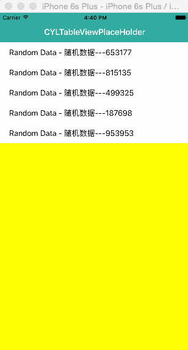
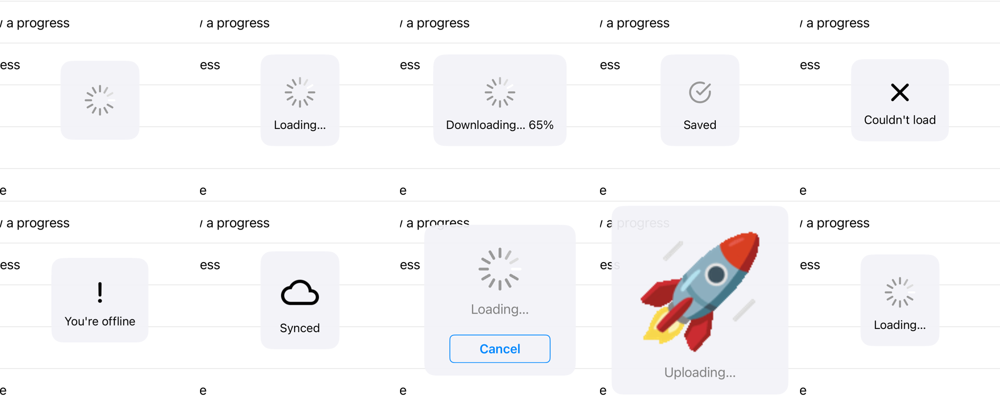
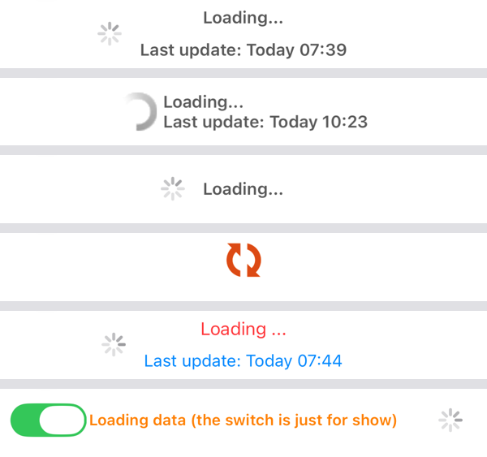
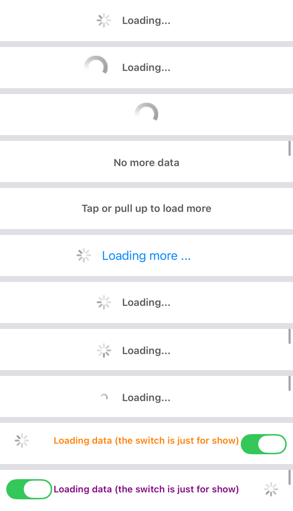
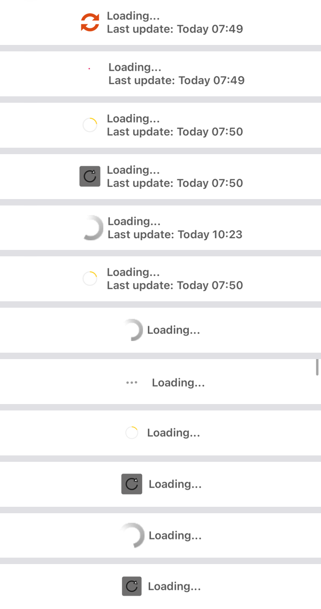
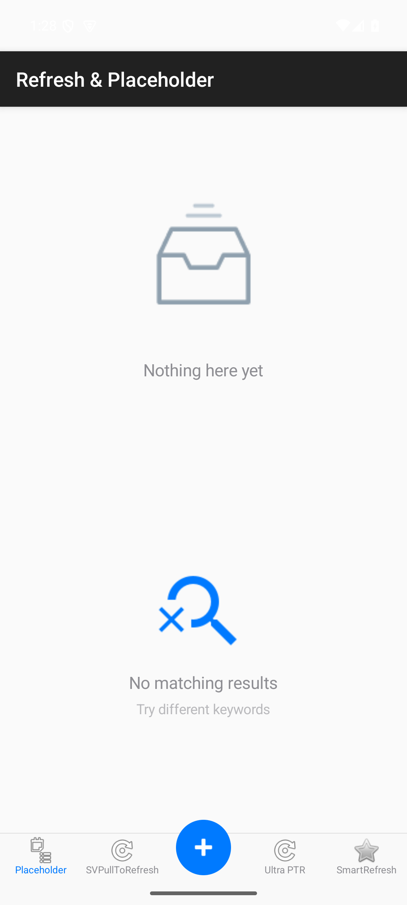
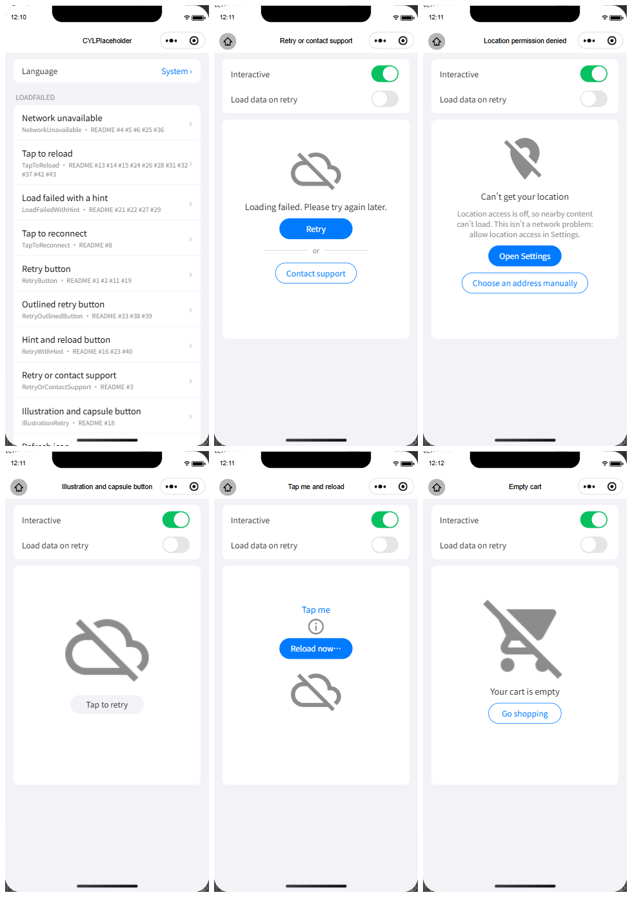
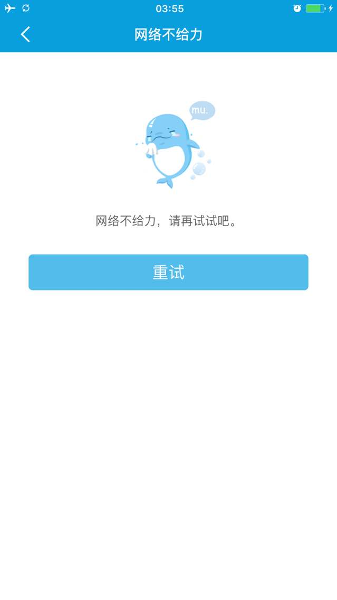
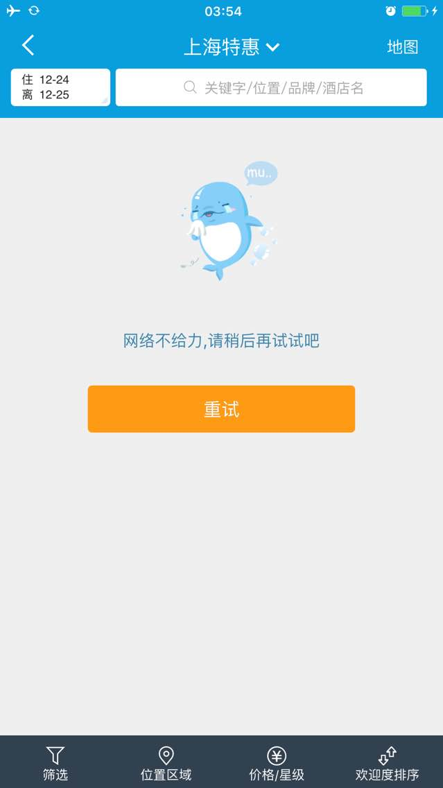
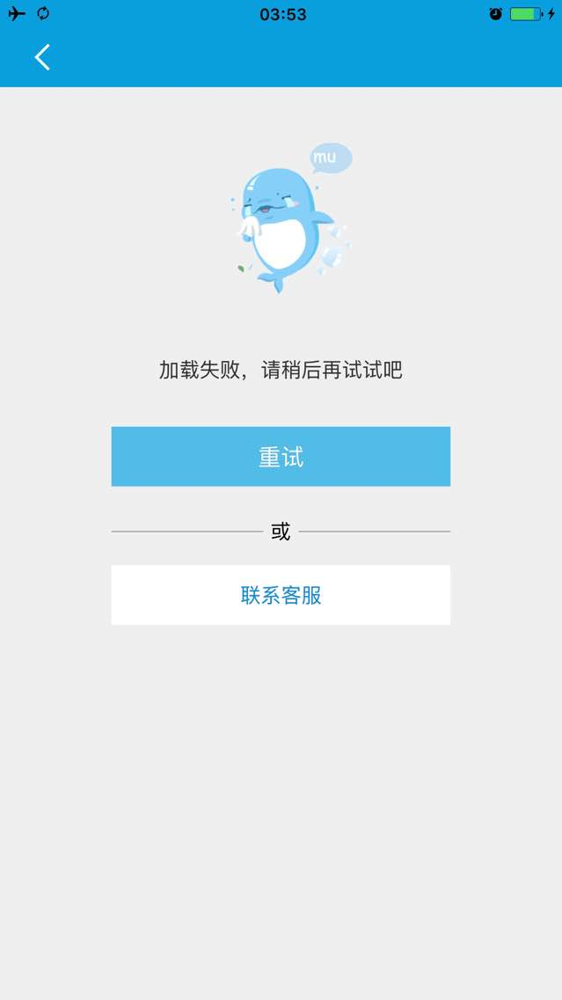

# CYLTableViewPlaceHolder【一行代码完成“空TableView占位视图”管理 / Empty table view placeholders in one line】

    

<!-- bound-classes: CYLPlaceholderView, CYLPlaceholderStackView, CYLPlaceholderHUD, CYLPlaceholderStatusView -->

## 如何阅读 README / How to read this README

| 中文 | English |
| --- | --- |
| 本文档为中英双语：正文是左中右英的两栏表格，每行内容相同；API 较宽的表格先给完整的中文表，再给行数相同的英文表；代码示例中英共用，注释用 `[CN]` / `[EN]` 成对标注。 | This document is bilingual: body text is a two-column table with Chinese on the left and English on the right, the same content in each row; wide API tables give the full Chinese table first and then an English table with the same rows; code samples are shared, and their comments come in `[CN]` / `[EN]` pairs. |
| 标题写作“中文 / English”，锚点由两部分用 `--` 连接，例如 `#如何阅读-readme--how-to-read-this-readme`。“导航 / CONTENTS”与“绑定的类”表由脚本生成，请勿手工修改。 | Headings read "中文 / English", and anchors join the two parts with `--`, for example `#如何阅读-readme--how-to-read-this-readme`. The "导航 / CONTENTS" table and the binding table are generated by a script; do not edit them by hand. |
| 本页是入口：只有简介、安装、Swift 快速开始和各平台的初始化代码；详细说明都在 [`docs/`](docs/)，见下文“[文档](#文档--documentation)”。 | This page is the entry point: only the introduction, installation, a Swift quick start and each platform's initialization code; the details are in [`docs/`](docs/), see "[Documentation](#文档--documentation)" below. |

## 导航 / CONTENTS

<!-- docs-navigation:start -->

| 中文 | English |
| --- | --- |
| [如何阅读 README](#如何阅读-readme--how-to-read-this-readme) | [How to read this README](#如何阅读-readme--how-to-read-this-readme) |
| [简介](#简介--overview) | [Overview](#简介--overview) |
| [功能](#功能--features) | [Features](#功能--features) |
| [集成后的效果](#集成后的效果--the-result) | [The result](#集成后的效果--the-result) |
| [安装](#安装--installation) | [Installation](#安装--installation) |
| [快速开始（Swift）](#快速开始swift--quick-start-swift) | [Quick start (Swift)](#快速开始swift--quick-start-swift) |
| [HUD 与状态红条](#hud-与状态红条--the-hud-and-the-status-bar) | [The HUD and the status bar](#hud-与状态红条--the-hud-and-the-status-bar) |
| [内置刷新组件](#内置刷新组件--built-in-refresh-components) | [Built-in refresh components](#内置刷新组件--built-in-refresh-components) |
| [平台](#平台--platforms) | [Platforms](#平台--platforms) |
| [文档](#文档--documentation) | [Documentation](#文档--documentation) |
| [适用于多种应用场景](#适用于多种应用场景--scenarios-it-fits) | [Scenarios it fits](#适用于多种应用场景--scenarios-it-fits) |
| [致谢与许可](#致谢与许可--credits-and-license) | [Credits and license](#致谢与许可--credits-and-license) |

<!-- docs-navigation:end -->

<!-- docs-binding:start -->

| 类 / Class | 头文件 / Header |
| --- | --- |
| `CYLPlaceholderView` | [`CYLTableViewPlaceHolder/CYLTableViewPlaceHolder/CYLPlaceholderView.h`](CYLTableViewPlaceHolder/CYLTableViewPlaceHolder/CYLPlaceholderView.h) |
| `CYLPlaceholderStackView` | [`CYLTableViewPlaceHolder/CYLTableViewPlaceHolder/CYLPlaceholderStackView.h`](CYLTableViewPlaceHolder/CYLTableViewPlaceHolder/CYLPlaceholderStackView.h) |
| `CYLPlaceholderHUD` | [`CYLTableViewPlaceHolder/CYLPlaceholderHUD/CYLPlaceholderHUD.h`](CYLTableViewPlaceHolder/CYLPlaceholderHUD/CYLPlaceholderHUD.h) |
| `CYLPlaceholderStatusView` | [`CYLTableViewPlaceHolder/CYLTableViewPlaceHolder/CYLPlaceholderStatusView.h`](CYLTableViewPlaceHolder/CYLTableViewPlaceHolder/CYLPlaceholderStatusView.h) |

<!-- docs-binding:end -->

## 简介 / Overview

| 中文 | English |
| --- | --- |
| CYLTableViewPlaceHolder 在 `UITableView` / `UICollectionView` 的数据源为空时，自动显示一个占位视图（空数据、网络故障、权限缺失等），有数据时自动移除；同时内置刷新组件 `CYLRefresh`、HUD、顶部状态红条和 36 个场景化占位。核心用 Swift 编写，Objective-C 接口（`@objc`）保持不变。（学习交流群：465239521） | When the data source of a `UITableView` / `UICollectionView` is empty, CYLTableViewPlaceHolder shows a placeholder view (no data, network failure, a missing permission and so on) automatically and removes it when there is data; it also includes the refresh component `CYLRefresh`, a HUD, a top status bar and 36 scenario placeholders. The core is written in Swift, and its Objective-C interface (`@objc`) is unchanged. (Study and discussion group: 465239521) |
| 最低支持 **iOS 15.0**（podspec 为 `s.platform = :ios, '15.0'`）。仍需支持 iOS 12–14 的应用请停留在上一个版本，见 [CHANGELOG.md](CHANGELOG.md)。 | The minimum is **iOS 15.0** (the podspec says `s.platform = :ios, '15.0'`). Apps that still support iOS 12–14 must stay on the previous release, see [CHANGELOG.md](CHANGELOG.md). |

| 编号 | 特点 | 解释 |
| --- | --- | --- |
| 1 | 轻量级、无污染 | 基于 UITableView 分类，无污染，比基于子类化、继承的框架更加轻量级 |
| 2 | 低耦合 | 自定义占位视图的可自行实现，通过协议传递，耦合性极低。 |
| 3 | 简单，无学习成本 | 一行代码完成，仅需使用 `cyl_reloadData` 代替 `reloadData` 即可。自动检测是否需要 `addSubview` 和 `removeFromSuperview`，省去学习繁琐的 add 和 remove 的调用时机。 |
| 4 | 使用方法简单 | 基于 `dataSource` 管理占位视图；内置的 `CYLRefresh` 提供下拉、上拉和横向刷新功能。 |
| 5 | 支持 CocoaPods | 容易集成 |

| No. | Feature | Explanation |
| --- | --- | --- |
| 1 | Lightweight, no pollution | Based on a `UITableView` category, so there is no pollution, and it is lighter than frameworks based on subclassing or inheritance. |
| 2 | Low coupling | You implement a custom placeholder view yourself and pass it through a protocol, so coupling is very low. |
| 3 | Simple, no learning cost | One line: just use `cyl_reloadData` instead of `reloadData`. It detects automatically whether `addSubview` and `removeFromSuperview` are needed, so you do not have to learn when to call add and remove. |
| 4 | Easy to use | Placeholder views are managed from the `dataSource`; the built-in `CYLRefresh` provides pull-down, pull-up and horizontal refresh. |
| 5 | CocoaPods support | Easy to integrate. |

## 功能 / Features

| 中文 | English |
| --- | --- |
| **占位视图**：`cyl_placeholderViewBlock` 的 block API（`UITableView` 与 `UICollectionView`）和旧版 delegate API（`cyl_reloadData`）；内置 `CYLPlaceholderView`，51 种离线图标、9 种提示、七种语言。 | **Placeholders**: the block API `cyl_placeholderViewBlock` (`UITableView` and `UICollectionView`) and the legacy delegate API (`cyl_reloadData`); the built-in `CYLPlaceholderView` with 51 offline icons, 9 messages and seven languages. |
| **场景化占位**：`CYLPlaceholderStackView` 用 `CYLPlaceholderScenario` 一行创建“图标 + 标题 + 按钮”的组合（重试、联系客服、去设置等），共 36 个场景，含 8 个权限缺失场景。 | **Scenario placeholders**: `CYLPlaceholderStackView` builds an "icon + title + button" combination from a `CYLPlaceholderScenario` in one line (retry, contact support, open Settings and so on), 36 scenarios in all, 8 of them missing permissions. |
| **HUD 与状态红条**：`CYLPlaceholderHUD`（SVProgressHUD 风格的加载框）和 `CYLPlaceholderStatusView`（顶部“网络不可用”红条）。 | **HUD and status bar**: `CYLPlaceholderHUD` (an SVProgressHUD-style loading box) and `CYLPlaceholderStatusView` (the red "network unavailable" bar at the top). |
| **CYLRefresh**：下拉刷新、上拉加载、横向（trailer）刷新，样式与 MJRefresh 对应，另有 GIF 帧图片与 GIF、Lottie、PAG、Rive 图标动画刷新头 / 尾。 | **CYLRefresh**: pull-down refresh, pull-up loading and horizontal (trailer) refresh, with the styles of MJRefresh, plus refresh headers and footers with GIF frame images and GIF, Lottie, PAG and Rive icon animations. |
| **动画**：占位图、HUD 与刷新图标可播放 Lottie、PAG、Rive、SVGA 和 GIF；核心默认只显示静态图片，需要哪种动画就引入对应的 CocoaPods 子规格。 | **Animations**: placeholders, the HUD and refresh icons can play Lottie, PAG, Rive, SVGA and GIF; the core shows static images by default, and you add the CocoaPods subspec of each animation you need. |

## 集成后的效果 / The result



## 安装 / Installation

| 中文 | English |
| --- | --- |
| **CocoaPods**：在 `Podfile` 中加入下面一行（版本取自 podspec：1.1.0）。刷新组件 `CYLRefresh` 已内置，无需其他刷新库。 | **CocoaPods**: add the line below to your `Podfile` (the version is read from the podspec: 1.1.0). The refresh component `CYLRefresh` is included; no other refresh library is needed. |
| 要播放动画，在 `subspecs` 中加入需要的子规格（`LottieSwift`、`PAG`、`Rive`、`SVGA`、`GIF`；`Core` 为默认）。`CYLAnimatedItem` pod 尚未发布到 CocoaPods trunk，按 commit 从 CYLTabBarController 仓库引入（commit 见仓库的 `Cartfile`）。完整的子规格表见 [Placeholder-Usage.md](docs/Placeholder-Usage.md#自动占位视图开发版本--automatic-placeholder-view-development-version)。 | To play animations, add the subspecs you need to `subspecs` (`LottieSwift`, `PAG`, `Rive`, `SVGA`, `GIF`; `Core` is the default). The `CYLAnimatedItem` pod is not on the CocoaPods trunk yet, so it is taken from the CYLTabBarController repository by commit (the commit is in the repository's `Cartfile`). The full subspec table is in [Placeholder-Usage.md](docs/Placeholder-Usage.md#自动占位视图开发版本--automatic-placeholder-view-development-version). |
| 开发版本可用本地路径或 Git 分支集成。**Carthage**：`github "ChenYilong/CYLTableViewPlaceHolder" "<branch-or-commit>"`，以 `carthage update --use-xcframeworks --platform iOS` 构建；注意 Carthage 的限制见 Placeholder-Usage.md。本仓库没有 `Package.swift`，不提供 Swift Package Manager 集成。 | A development version can be integrated with a local path or a Git branch. **Carthage**: `github "ChenYilong/CYLTableViewPlaceHolder" "<branch-or-commit>"`, built with `carthage update --use-xcframeworks --platform iOS`; for the Carthage limits see Placeholder-Usage.md. This repository has no `Package.swift`, so Swift Package Manager is not offered. |
| 安装细节与常见问题（`pod update --no-repo-update`、`ld: library not found for -lPods`）见 [Placeholder-Usage.md](docs/Placeholder-Usage.md#第一步使用-cocoapods-导入--step-1-install-with-cocoapods)。 | Installation details and common problems (`pod update --no-repo-update`, `ld: library not found for -lPods`) are in [Placeholder-Usage.md](docs/Placeholder-Usage.md#第一步使用-cocoapods-导入--step-1-install-with-cocoapods). |

```ruby
pod 'CYLTableViewPlaceHolder', '~> 1.1.0'

# [CN] 需要动画时：先按 commit 引入 CYLAnimatedItem，再选择子规格
# [EN] For animations: take CYLAnimatedItem by commit first, then choose the subspecs
# pod 'CYLAnimatedItem', :git => 'https://github.com/ChenYilong/CYLTabBarController.git', :commit => '<sha>'
# pod 'CYLTableViewPlaceHolder', :subspecs => ['Core', 'LottieSwift', 'PAG', 'Rive', 'GIF']
```

## 快速开始（Swift） / Quick start (Swift)

| 中文 | English |
| --- | --- |
| 核心用 Swift 编写，下面的示例都是 Swift，来自或对照 `Examples/Example-Scenarios/Sources` 与 `Tests/`；Objective-C 调用方仍然可用（接口是 `@objc`），写法对照见 [Swift-Guide.md](docs/Swift-Guide.md)。注意：Objective-C 不能再继承 CYLRefresh 控件、`CYLPlaceholderView` 和 `CYLPlaceholderStackView`（破坏性变更，见 [Swift-Migration.md](docs/Swift-Migration.md) 与 [CHANGELOG.md](CHANGELOG.md)）。 | The core is written in Swift, and the samples below are Swift, taken from or checked against `Examples/Example-Scenarios/Sources` and `Tests/`; Objective-C callers still work (the API is `@objc`), and the spelling table is in [Swift-Guide.md](docs/Swift-Guide.md). Note: Objective-C can no longer subclass the CYLRefresh controls, `CYLPlaceholderView` and `CYLPlaceholderStackView` (a breaking change, see [Swift-Migration.md](docs/Swift-Migration.md) and [CHANGELOG.md](CHANGELOG.md)). |
| **占位视图**：列表为空时显示返回的视图，有数据时调用恢复闭包。`UITableView` 与 `UICollectionView` 通用；闭包若引用控制器请用弱引用。 | **Placeholder view**: the returned view shows while the list is empty, and the restore closure runs when there is data. It works for `UITableView` and `UICollectionView`; use a weak reference if the closure references the controller. |

```swift
import CYLTableViewPlaceHolder

tableView.cyl_placeholderViewBlock({ tableView in
    tableView.isScrollEnabled = false
    // [CN] 也可返回自定义视图
    // [EN] You can also return a custom view
    return CYLPlaceholderView(style: .noInternet, message: .noInternet)
}, backToNormalBlock: { tableView in
    tableView.isScrollEnabled = true
})

// [CN] 取消自动占位；若占位视图正在显示，会调用恢复闭包。
// [EN] Cancel the automatic placeholder; if one is showing, the restore closure is called.
tableView.cyl_placeholderViewBlock(nil)
```

| 中文 | English |
| --- | --- |
| **自定义图片与文字**：`CYLPlaceholderView` 可用预设样式与提示，也可传入自己的图片或文字（传 `nil` 隐藏相应内容）。 | **Custom image and text**: `CYLPlaceholderView` takes a preset style and message, or your own image or text (`nil` hides that part). |

```swift
let offline = CYLPlaceholderView(style: .noInternet, message: .noInternet)
let custom = CYLPlaceholderView(image: myImage, text: "自定义提示")
```

| 中文 | English |
| --- | --- |
| **场景化占位**：用场景枚举一行创建多个组件，点击事件通过 `actions` 传入。全部场景见 [Placeholder-Scenarios.md](docs/Placeholder-Scenarios.md)。 | **Scenario placeholders**: one line creates several components from a scenario value, and tap handlers are passed through `actions`. All scenarios are in [Placeholder-Scenarios.md](docs/Placeholder-Scenarios.md). |

```swift
// [CN] 携程式：图标加标题、“重试”按钮、“或”分隔符、“联系客服”按钮，两个点击事件
// [EN] Ctrip style: icon and title, a "Retry" button, an "or" separator and a "Contact support" button; two actions
let placeholder = CYLPlaceholderStackView(scenario: .retryOrContactSupport, actions: [
    .retry: { [weak self] _, _ in self?.reload() },
    .contactSupport: { [weak self] _, _ in
        self?.navigationController?.pushViewController(SupportViewController(), animated: true)
    },
])
tableView.cyl_placeholderViewBlock({ _ in placeholder })
```

| 中文 | English |
| --- | --- |
| **旧版 delegate API**：遵循 `CYLTableViewPlaceHolderDelegate`，实现 `makePlaceHolderView`，再用 `cyl_reloadData()` 代替 `reloadData()`（它已在内部调用 `reloadData`，不要重复调用）。只管理 `UITableView`；可选方法与完整说明见 [Placeholder-Usage.md](docs/Placeholder-Usage.md#第二步遵循协议--step-2-adopt-the-protocol)。 | **Legacy delegate API**: adopt `CYLTableViewPlaceHolderDelegate`, implement `makePlaceHolderView`, and call `cyl_reloadData()` instead of `reloadData()` (it already calls `reloadData` internally, so do not call it again). It manages only `UITableView`; the optional methods and the full description are in [Placeholder-Usage.md](docs/Placeholder-Usage.md#第二步遵循协议--step-2-adopt-the-protocol). |

```swift
class ViewController: UIViewController, CYLTableViewPlaceHolderDelegate {
    // [CN] 唯一必须实现的协议方法（Objective-C 选择器名 makePlaceHolderView）
    // [EN] The only required protocol method (Objective-C selector makePlaceHolderView)
    @objc(makePlaceHolderView) func makePlaceHolderView() -> UIView {
        CYLPlaceholderView(style: .empty, message: .empty)
    }

    func reload() {
        tableView.cyl_reloadData()
    }
}
```

| 中文 | English |
| --- | --- |
| **刷新**：内置 `CYLRefresh`，类名前缀 `CYL`，分类属性前缀 `cyl_`。所有样式见下文“[内置刷新组件](#内置刷新组件--built-in-refresh-components)”。 | **Refresh**: the built-in `CYLRefresh`, with the class prefix `CYL` and the category property prefix `cyl_`. All styles are listed under "[Built-in refresh components](#内置刷新组件--built-in-refresh-components)" below. |

```swift
tableView.cyl_header = CYLRefreshNormalHeader { [weak self] in
    // [CN] 加载数据，完成后调用 endRefreshing
    // [EN] Load the data, then call endRefreshing when done
    self?.loadNewData()
}
tableView.cyl_footer = CYLRefreshAutoNormalFooter { [weak self] in
    // [CN] 加载更多数据，完成后调用 endRefreshing
    // [EN] Load more data, then call endRefreshing when done
    self?.loadMoreData()
}
```

## HUD 与状态红条 / The HUD and the status bar

| 中文 | English |
| --- | --- |
| `CYLPlaceholderHUD`：页面加载进度，使用 [SVProgressHUD](https://github.com/SVProgressHUD/SVProgressHUD) 的接口（显示、进度、成功 / 错误 / 提示、`popActivity`、延迟关闭、样式、遮罩）显示在页面上方的方框中；方框本身是一个 `CYLPlaceholderView`，加载动画复用刷新资源并默认循环播放。与占位图、CYLRefresh 一起覆盖页面的整个生命周期。详见 [Placeholder-HUD.md](docs/Placeholder-HUD.md)。 | `CYLPlaceholderHUD`: a page's loading progress in a box over the page, with [SVProgressHUD](https://github.com/SVProgressHUD/SVProgressHUD)'s API (show, progress, success / error / info, `popActivity`, delayed dismissal, styles, masks); the box itself is one `CYLPlaceholderView`, and the loading animation reuses the refresh resources and loops by default. With the placeholder and CYLRefresh it covers a page's whole life cycle. See [Placeholder-HUD.md](docs/Placeholder-HUD.md). |
| `CYLPlaceholderStatusView`：顶部“当前网络不可用”红条，移植自 CYLChatKit，由 `CYLPlaceholderNetworkMonitor`（NWPathMonitor）在断网时显示。详见 [Status-Bar.md](docs/Status-Bar.md)。 | `CYLPlaceholderStatusView`: the red "network unavailable" bar at the top, ported from CYLChatKit and shown by `CYLPlaceholderNetworkMonitor` (NWPathMonitor) while offline. See [Status-Bar.md](docs/Status-Bar.md). |

```swift
CYLPlaceholderHUD.show(status: "Loading…")
// [CN] 完成后 / [EN] When done
CYLPlaceholderHUD.dismiss()  // [CN] 或 / [EN] or CYLPlaceholderHUD.showError(status: "Couldn't load")

// [CN] 状态红条：断网时自动显示在视图控制器的 view 顶端（导航栏下方）
// [EN] The status bar: shown automatically at the top of the view controller's view (below the navigation bar) while offline
cyl_showsStatusViewWhenOffline = true
// [CN] 选择同时显示、只显示红条或只显示占位图
// [EN] Choose both, only the bar or only the placeholder
cyl_setStatusDisplay(.all, animated: true)
```



## 内置刷新组件 / Built-in refresh components

| 中文 | English |
| --- | --- |
| `CYLRefresh` 源码位于 `CYLTableViewPlaceHolder/CYLRefresh/`，由 [MJRefresh](https://github.com/CoderMJLee/MJRefresh) 改编，样式与其 README 的顺序相同：下拉刷新 01–06、上拉加载 01–11、`UICollectionView` 上下拉与左拉、`WKWebView`，另有 GIF、Lottie、PAG、Rive 刷新图标动画。每个样式的代码和截图见 [Refresh-Styles.md](docs/Refresh-Styles.md)，图标动画见 [Refresh-Icon-Animation.md](docs/Refresh-Icon-Animation.md)。 | The `CYLRefresh` source is in `CYLTableViewPlaceHolder/CYLRefresh/` and is adapted from [MJRefresh](https://github.com/CoderMJLee/MJRefresh), with the styles in the order of its README: pull-down refresh 01–06, pull-up loading 01–11, `UICollectionView` pull down/up and pull left, `WKWebView`, plus GIF, Lottie, PAG and Rive refresh icon animations. The code and screenshot of each style are in [Refresh-Styles.md](docs/Refresh-Styles.md), and the icon animations in [Refresh-Icon-Animation.md](docs/Refresh-Icon-Animation.md). |
| 一览：下拉刷新 01–06、上拉加载 01–11、刷新图标动画（每组从上到下；截图为各示例刷新中状态，运行在 iOS 27 模拟器上）。 | Overview: pull-down refresh 01–06, pull-up loading 01–11, refresh icon animations (each group from top to bottom; each screenshot shows the example while refreshing, on an iOS 27 simulator). |







## 平台 / Platforms

| 中文 | English |
| --- | --- |
| 本仓库还包含 Android、HarmonyOS 和微信小程序版本，名称和用法尽量与 iOS 一致。下面只给安装与初始化的最小代码，详细说明在 `docs/`。本仓库没有 Flutter 或 React Native 包。 | This repository also contains Android, HarmonyOS and WeChat Mini Program versions, with names and usage kept as close to iOS as possible. Only the minimal installation and initialization code is given below; the details are in `docs/`. This repository has no Flutter or React Native package. |

| 平台 | 位置 | 语言 | 详细文档 |
| --- | --- | --- | --- |
| iOS | `CYLTableViewPlaceHolder/` | Swift（`@objc`，兼容 Objective-C） | 本页，[Swift-Guide.md](docs/Swift-Guide.md)、[iOS-API-Map.md](docs/iOS-API-Map.md) |
| Android | `android/` | Kotlin | [Android-Port.md](docs/Android-Port.md)、[Android-API-Map.md](docs/Android-API-Map.md)、[iOS-Android-Parity.md](docs/iOS-Android-Parity.md) |
| HarmonyOS | `CrossPlatform/harmonyos-cylplaceholder/` | ArkTS | [HarmonyOS.md](docs/HarmonyOS.md) |
| 微信小程序 | `CrossPlatform/wechat-miniprogram-cylplaceholder/` | JavaScript | [WeChat-MiniProgram.md](docs/WeChat-MiniProgram.md) |

| Platform | Location | Language | Details |
| --- | --- | --- | --- |
| iOS | `CYLTableViewPlaceHolder/` | Swift (`@objc`, Objective-C compatible) | this page, [Swift-Guide.md](docs/Swift-Guide.md), [iOS-API-Map.md](docs/iOS-API-Map.md) |
| Android | `android/` | Kotlin | [Android-Port.md](docs/Android-Port.md), [Android-API-Map.md](docs/Android-API-Map.md), [iOS-Android-Parity.md](docs/iOS-Android-Parity.md) |
| HarmonyOS | `CrossPlatform/harmonyos-cylplaceholder/` | ArkTS | [HarmonyOS.md](docs/HarmonyOS.md) |
| WeChat Mini Program | `CrossPlatform/wechat-miniprogram-cylplaceholder/` | JavaScript | [WeChat-MiniProgram.md](docs/WeChat-MiniProgram.md) |

### Android / Android

| 中文 | English |
| --- | --- |
| Kotlin 版：模块 `:placeholder`（占位图与 HUD，包名 `com.cyl.placeholder`）和 `:merged`（CYLRefresh，包名 `com.cyl.refresh.*`），未发布到 Maven Central；在 `android/` 的 Gradle 工程里引用模块，CYLTabBarController 的 Android 模块按 commit 从源码构建。构建示例：`./gradlew :merged-example:assembleDebug`。用法与 iOS 相同：`layout.cyl_header = CYLRefreshNormalHeader(context)`。详见 [Android-Port.md](docs/Android-Port.md)（含构建细节和截图）。 | The Kotlin version: the modules `:placeholder` (placeholder views and the HUD, package `com.cyl.placeholder`) and `:merged` (CYLRefresh, packages `com.cyl.refresh.*`), not published to Maven Central; reference the modules in the Gradle project under `android/`, and CYLTabBarController's Android modules are built from source at a commit. Build the example with `./gradlew :merged-example:assembleDebug`. Usage matches iOS: `layout.cyl_header = CYLRefreshNormalHeader(context)`. See [Android-Port.md](docs/Android-Port.md) (build details and screenshots). |

```kotlin
// [CN] 模块依赖（android/merged/example/build.gradle.kts）
// [EN] Module dependencies (android/merged/example/build.gradle.kts)
dependencies {
    implementation(project(":merged"))       // CYLRefresh + placeholder
}

// [CN] 初始化（android/merged/example/.../HudLifecyclePage.kt）：占位图、HUD、下拉刷新与上拉加载
// [EN] Initialization (android/merged/example/.../HudLifecyclePage.kt): placeholder, HUD, pull-down refresh and pull-up loading
list.cyl_placeholderViewBlock {
    CYLPlaceholderStackView(context, CYLPlaceholderScenario.RetryButton,
        mapOf(CYLPlaceholderAction.Retry to { _: String -> reload() }))
}
val hud = CYLPlaceholderHUD(context, frame)
hud.showWithStatus("Loading…")  // [CN] 完成后 hud.dismiss() / [EN] when done: hud.dismiss()
val layout = CYLRefreshLayout(context).apply { setRefreshContent(frame) }
layout.cyl_header = CYLRefreshNormalHeader(context).also { it.refreshingBlock = { /* load, then it.endRefreshing() */ } }
layout.cyl_footer = CYLRefreshAutoNormalFooter(context)
```



### HarmonyOS / HarmonyOS

| 中文 | English |
| --- | --- |
| ArkTS 版：库模块 `cylplaceholder`（占位图、场景、HUD、状态红条、CYLRefresh，名称与 iOS 相同）依赖 CYLTabBarController 的 `cylanimateditem` 模块；两者都是本仓库中的本地模块，没有发布到 ohpm，通过 `file:` 依赖引用。未签名的 HAP 可安装到模拟器。详见 [HarmonyOS.md](docs/HarmonyOS.md)。 | The ArkTS version: the library module `cylplaceholder` (placeholders, scenarios, the HUD, the status bar and CYLRefresh, with the iOS names) depends on CYLTabBarController's `cylanimateditem` module; both are local modules of this repository, not published to ohpm, and referenced through `file:` dependencies. An unsigned HAP installs on the emulator. See [HarmonyOS.md](docs/HarmonyOS.md). |

```json5
// [CN] 应用模块的 oh-package.json5（CrossPlatform/harmonyos-cylplaceholder/entry）
// [EN] The app module's oh-package.json5 (CrossPlatform/harmonyos-cylplaceholder/entry)
{
  "dependencies": {
    "cylplaceholder": "file:../cylplaceholder",
    "cylanimateditem": "file:../cylanimateditem"
  }
}
```

```typescript
// [CN] 初始化（entry/src/main/ets/pages/CollectionFlowPage.ets）：列表为空时显示场景占位
// [EN] Initialization (entry/src/main/ets/pages/CollectionFlowPage.ets): a scenario placeholder while the list is empty
import { CYLPlaceholderListController, CYLPlaceholderScenario, CYLPlaceholderStackViewModel } from 'cylplaceholder';

const collection = new CYLPlaceholderListController(() => this.colors.length);
collection.cyl_placeholderViewBlock((c: CYLPlaceholderListController) =>
  CYLPlaceholderStackViewModel.initWithScenario(CYLPlaceholderScenario.NoFavorites));
collection.reloadData();
```

### 微信小程序 / WeChat Mini Program

| 中文 | English |
| --- | --- |
| 微信小程序版：`cyl-placeholder` 组件（35 个场景、七种语言）、`cyl-placeholder-hud`、`cyl-placeholder-status` 和 `cyl-refresh`，包名 `cyl-placeholder-miniprogram`（见包内 README；本仓库未验证它已发布到 npm）。安装后在微信开发者工具运行“工具 → 构建 npm”。详见 [WeChat-MiniProgram.md](docs/WeChat-MiniProgram.md)。 | The WeChat Mini Program version: the `cyl-placeholder` component (35 scenarios, seven languages), `cyl-placeholder-hud`, `cyl-placeholder-status` and `cyl-refresh`, package name `cyl-placeholder-miniprogram` (see the package's README; that it is published to npm was not verified here). After installing, run "Tools → Build npm" in WeChat DevTools. See [WeChat-MiniProgram.md](docs/WeChat-MiniProgram.md). |

```bash
npm install cyl-placeholder-miniprogram
```

```json
{ "usingComponents": { "cyl-placeholder": "cyl-placeholder-miniprogram/cyl-placeholder/index" } }
```

```html
<cyl-placeholder wx:if="{{!rows.length}}" scenario="RetryButton" bind:action="onPlaceholderAction" />
```

```js
// [CN] 初始化（CrossPlatform/wechat-miniprogram-cylplaceholder/README.md）
// [EN] Initialization (CrossPlatform/wechat-miniprogram-cylplaceholder/README.md)
const { CYLPlaceholderAction } = require('cyl-placeholder-miniprogram')

Page({
  onPlaceholderAction(e) {
    if (e.detail.action === CYLPlaceholderAction.Retry) this.reload()
  },
})
```



## 文档 / Documentation

| 文档 | 中文 | English |
| --- | --- | --- |
| [Placeholder-Usage.md](docs/Placeholder-Usage.md) | 占位视图参考：block API、`CYLPlaceholderView` 配置、内置动画与子规格、安装细节、delegate API、应用场景图集 | Placeholder reference: the block API, `CYLPlaceholderView` configuration, bundled animations and subspecs, installation details, the delegate API and the scenario galleries |
| [Placeholder-Scenarios.md](docs/Placeholder-Scenarios.md) | 36 个场景化占位、`CYLPlaceholderStackView`、配置文件、状态栏与无障碍 | The 36 scenario placeholders, `CYLPlaceholderStackView`, configuration files, the status bar and accessibility |
| [Placeholder-HUD.md](docs/Placeholder-HUD.md) | `CYLPlaceholderHUD`：SVProgressHUD 风格的接口、状态与无障碍 | `CYLPlaceholderHUD`: the SVProgressHUD-style API, states and accessibility |
| [Status-Bar.md](docs/Status-Bar.md) | 顶部网络状态红条与 `CYLPlaceholderNetworkMonitor` | The top network status bar and `CYLPlaceholderNetworkMonitor` |
| [Refresh-Styles.md](docs/Refresh-Styles.md) | CYLRefresh 全部样式、截图、国际化与行为 | Every CYLRefresh style, screenshots, localization and behavior |
| [Refresh-Icon-Animation.md](docs/Refresh-Icon-Animation.md) | 刷新图标动画：GIF、Lottie、PAG、Rive | Refresh icon animations: GIF, Lottie, PAG, Rive |
| [Refresh-Library-Parity.md](docs/Refresh-Library-Parity.md) | 与其他刷新库（MJRefresh、SmartRefreshControl、Android CYLRefreshLayout 等）的对照与进度 | Comparison and progress against other refresh libraries (MJRefresh, SmartRefreshControl, Android CYLRefreshLayout and others) |
| [Example-Animation-Playback.md](docs/Example-Animation-Playback.md) | 示例中的动画播放 | Animation playback in the examples |
| [Examples.md](docs/Examples.md) | 运行各个示例工程，聚合 Demo 的各个 Tab | Running the example projects and the tabs of the aggregate demo |
| [Swift-Guide.md](docs/Swift-Guide.md) | 在 Swift 中使用本库：Objective-C 到 Swift 的写法对照 | Using the library from Swift: the Objective-C to Swift spelling table |
| [Swift-Migration.md](docs/Swift-Migration.md) | 核心迁移到 Swift 的进度与破坏性变更 | The Swift migration of the core: progress and breaking changes |
| [CHANGELOG.md](CHANGELOG.md) | 更新日志（最低 iOS 15 等） | Changelog (minimum iOS 15 and more) |
| [issue-progress.md](docs/issue-progress.md) | 上游 issue 与 PR 的处理状态、评分与已知限制 | The state, score and known limits of upstream issues and PRs |
| [iOS-API-Map.md](docs/iOS-API-Map.md) | Android 到 iOS 的 API 对照（生成） | The Android to iOS API map (generated) |
| [Android-API-Map.md](docs/Android-API-Map.md) | iOS 到 Android 的 API 对照（生成） | The iOS to Android API map (generated) |
| [iOS-Android-Parity.md](docs/iOS-Android-Parity.md) | iOS 与 Android 的功能对照（生成） | The iOS and Android feature parity (generated) |
| [Android-Port.md](docs/Android-Port.md) | Android 版：进度、构建、截图 | The Android version: progress, build, screenshots |
| [HarmonyOS.md](docs/HarmonyOS.md) | HarmonyOS 版：进度、模拟器、截图 | The HarmonyOS version: progress, emulator, screenshots |
| [WeChat-MiniProgram.md](docs/WeChat-MiniProgram.md) | 微信小程序版：进度、验证、截图 | The WeChat Mini Program version: progress, verification, screenshots |
| [Animated-Item-Migration.md](docs/Animated-Item-Migration.md) | `CYLAnimatedItem`（图标 + 标题 + 动效组件）各平台改造进度 | The migration of `CYLAnimatedItem` (the icon + title + animation component) on each platform |
| [CI-CD.md](docs/CI-CD.md) | CI 任务与截图发布 | CI jobs and screenshot publishing |
| [Task-Log.md](docs/Task-Log.md) | 任务记录 | The task log |

## 适用于多种应用场景 / Scenarios it fits

| 中文 | English |
| --- | --- |
| 本库基于 `dataSource` 是否为空触发，所以只需操作 `dataSource`；每次添加和移除占位视图都会销毁旧的并重新创建，因此在创建处按网络状态等条件返回不同视图即可适用于不同场景（网络故障、暂无数据）。示例与 43 张应用截图见 [Placeholder-Usage.md](docs/Placeholder-Usage.md#适用于多种应用场景--scenarios-it-fits)。 | The library triggers on whether the `dataSource` is empty, so you only operate on the `dataSource`; every time the placeholder is added or removed the old one is destroyed and a new one is created, so returning different views by the network state and so on where it is created fits different scenarios (network failure, no data). The examples and 43 app screenshots are in [Placeholder-Usage.md](docs/Placeholder-Usage.md#适用于多种应用场景--scenarios-it-fits). |

| 携程：网络故障 / 携程: network failure | 携程：网络故障 / 携程: network failure | 携程：网络故障 / 携程: network failure |
| --- | --- | --- |
|  |  |  |

## 致谢与许可 / Credits and license

| 中文 | English |
| --- | --- |
| 本库使用 MIT 许可证，见 [LICENSE](LICENSE)。 | The library is licensed under the MIT license, see [LICENSE](LICENSE). |
| CYLRefresh 依据 [MJRefresh](https://github.com/CoderMJLee/MJRefresh) 3.7.9 改造，适用其 MIT 许可证，版权声明保留在 [`LICENSE.third-party`](CYLTableViewPlaceHolder/CYLRefresh/LICENSE.third-party)；手绘风格的刷新头 / 尾（`CYLRefresh/Custom/Drawn/`）部分源自 [SmartRefreshControl](https://github.com/scwang90/SmartRefreshControl)（MIT），声明见 [`LICENSE.refresh-third-party.txt`](CYLTableViewPlaceHolder/CYLRefresh/LICENSE.refresh-third-party.txt)。 | CYLRefresh is adapted from [MJRefresh](https://github.com/CoderMJLee/MJRefresh) 3.7.9 and the MIT license applies, with its copyright notice kept in [`LICENSE.third-party`](CYLTableViewPlaceHolder/CYLRefresh/LICENSE.third-party); the hand-drawn refresh headers and footers (`CYLRefresh/Custom/Drawn/`) are in part derived from [SmartRefreshControl](https://github.com/scwang90/SmartRefreshControl) (MIT), with the notice in [`LICENSE.refresh-third-party.txt`](CYLTableViewPlaceHolder/CYLRefresh/LICENSE.refresh-third-party.txt). |
| 内置动画文件均下载自开源仓库且未修改：Lottie 来自 [airbnb/lottie-ios](https://github.com/airbnb/lottie-ios)（Apache-2.0），PAG 来自 [Tencent/libpag](https://github.com/Tencent/libpag)（Apache-2.0），Rive 来自 [rive-app/rive-ios](https://github.com/rive-app/rive-ios)（MIT），线条图标来自 [useAnimations/react-useanimations](https://github.com/useAnimations/react-useanimations)（MIT）；逐个文件的来源、提交和 SHA-256 记录在 `CYLTableViewPlaceHolder/CYLTableViewPlaceHolder/CYLTableViewPlaceHolder.bundle/Animations/NOTICE.animations`。播放 Lottie、PAG、Rive、SVGA 分别需要 lottie-ios、libpag、RiveRuntime、SVGAPlayerLite（由对应的 CocoaPods 子规格引入）。 | The bundled animation files are all downloaded unmodified from open-source repositories: Lottie from [airbnb/lottie-ios](https://github.com/airbnb/lottie-ios) (Apache-2.0), PAG from [Tencent/libpag](https://github.com/Tencent/libpag) (Apache-2.0), Rive from [rive-app/rive-ios](https://github.com/rive-app/rive-ios) (MIT), and the line icons from [useAnimations/react-useanimations](https://github.com/useAnimations/react-useanimations) (MIT); each file's source, commit and SHA-256 are recorded in `CYLTableViewPlaceHolder/CYLTableViewPlaceHolder/CYLTableViewPlaceHolder.bundle/Animations/NOTICE.animations`. Playing Lottie, PAG, Rive and SVGA needs lottie-ios, libpag, RiveRuntime and SVGAPlayerLite respectively (added by the matching CocoaPods subspec). |
| 图标与文字组件继承 [CYLTabBarController](https://github.com/ChenYilong/CYLTabBarController) 的 `CYLAnimatedItemView`（MIT）；占位图标来自 Google Material Design；占位视图的第三方声明（[KLTableViewAndCollectionViewPlaceholder](https://github.com/klaus01/KLTableViewAndCollectionViewPlaceholder)，MIT）见 [`LICENSE.placeholder-third-party`](CYLTableViewPlaceHolder/CYLTableViewPlaceHolder/LICENSE.placeholder-third-party)；状态红条移植自 CYLChatKit。 | The icon and text component subclasses `CYLAnimatedItemView` of [CYLTabBarController](https://github.com/ChenYilong/CYLTabBarController) (MIT); the placeholder icons come from Google Material Design; the third-party notice of the placeholder view ([KLTableViewAndCollectionViewPlaceholder](https://github.com/klaus01/KLTableViewAndCollectionViewPlaceholder), MIT) is in [`LICENSE.placeholder-third-party`](CYLTableViewPlaceHolder/CYLTableViewPlaceHolder/LICENSE.placeholder-third-party); the status bar is ported from CYLChatKit. |
| （更多 iOS 开发干货，欢迎关注 [微博@iOS程序犭袁](http://weibo.com/luohanchenyilong/)） | (For more iOS development tips, follow [Weibo @iOS程序犭袁](http://weibo.com/luohanchenyilong/).) |

---

Posted by [微博@iOS程序犭袁](http://weibo.com/luohanchenyilong/)

| 中文 | English |
| --- | --- |
| 原创文章，版权声明：自由转载-非商用-非衍生-保持署名，协议：[Creative Commons BY-NC-ND 3.0](http://creativecommons.org/licenses/by-nc-nd/3.0/deed.zh) | Original article. Copyright notice: free to reproduce, non-commercial, no derivatives, attribution required. License: [Creative Commons BY-NC-ND 3.0](http://creativecommons.org/licenses/by-nc-nd/3.0/deed.zh) |
