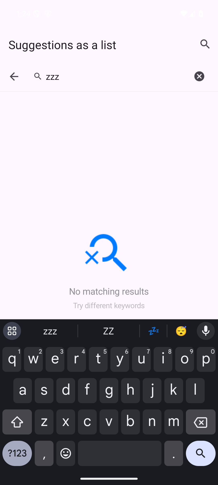

# Android 版本 / Android port

<!-- bound-classes: none -->

<!-- docs-navigation:start -->

| 中文 | English |
| --- | --- |
| [任务](#任务--tasks) | [Tasks](#任务--tasks) |

<!-- docs-navigation:end -->

<!-- docs-binding:start -->

| 类 / Class | 头文件 / Header |
| --- | --- |
| 无 / none | — |

<!-- docs-binding:end -->

## 任务 / Tasks

### TODO：Android 端合并三个刷新库并对齐 iOS 接口 / TODO: An Android merge of three refresh libraries, aligned with the iOS API

| 中文 | English |
| --- | --- |
| 状态：进行中（2026-11-13 开始，分支 `feat/android-refresh-port`，来源分支 `feat/android-placeholder`：另一会话已在那里建好 `android/` Gradle 工程与 `placeholder` 模块（PR #27），本任务的模块加在同一工程里，避免两个根工程冲突）。 | Status: in progress (started 2026-11-13, branch `feat/android-refresh-port`, source branch `feat/android-placeholder`: another session already set up the `android/` Gradle project with the `placeholder` module there (PR #27); this task's modules join the same project, so there are not two conflicting root projects). |
| 进度 2026-11-13：①来源项目盘点（下表）；②下一步按 “Translating or porting another project” 先处理 open PR（合并进待翻译的源码），再建 open issue 表，issue 达到 60 分后开始翻译；③翻译顺序按规模从小到大：SVPullToRefresh → android-Ultra-Pull-To-Refresh → SmartRefreshLayout，最后合并到 `android/merged`。 | Progress 2026-11-13: (1) the source projects inventoried (table below); (2) next, per "Translating or porting another project": the open pull requests first (merged into the source to translate), then the open-issue tables, and translation starts once the issues reach 60; (3) translation from the smallest: SVPullToRefresh → android-Ultra-Pull-To-Refresh → SmartRefreshLayout, then the merge into `android/merged`. |
| 用户原始提示词：“将下面的任务，找一个合适的文档，标注关键词TODO：注意本任务仅仅修改android代码，不要改iOS代码。在本项目中新建文件夹命名为 android ，下面的代码 每一个仓库 创建一个文件夹，并创建第四个文件夹命名为merged     <https://github.com/scwang90/SmartRefreshLayout>    <https://github.com/liaohuqiu/android-Ultra-Pull-To-Refresh>   同样要求处理 <https://github.com/samvermette/SVPullToRefresh> 第二步骤：分别将这三个项目在各自文件夹中做代码转录，全部翻译为kotlin语言。第三步骤：将以上几个文件夹里的kotlin代码合并为一个项目，保留所有api接口，并将example合并为一个。使用CYLTabBarController 的android端tabbar 作为展示的功能划分，采用gradle或者maven指向CYLTabBarController 最新提交，找到gradle或者maven使用commit引用的方式集成，如果不行就采用本地路径引用。一个example一个tabbaritem区分。第四步骤：在docs在合适的文档或创建文档，列出iOS端所有的公开api，第二列 ，列出找到的在该merged文件夹下所有的公开api的对应项。第五步，将缺失merged文件夹缺失的API对齐。在该表格未对齐的地方标注TODO如果iOS端和android能完全对齐所有api就是满分，merged文件夹每次新增一个api就在该文档中打分，一直达到满分。第六步骤：将iOS端的example全部移植到merged文件夹，注意是翻译，不要改iOS代码。使用上面提到的表格中android的api实现。并截图更新文档，readme 在android章节。” | The user's original prompt (Chinese, verbatim on the left), summarized: record this task as a TODO in a fitting document. Change only Android code, never iOS code. Create an `android` folder in this project with one folder per repository below plus a fourth folder named `merged`: SmartRefreshLayout, android-Ultra-Pull-To-Refresh and SVPullToRefresh. Step 2: transcribe each project in its own folder, all translated to Kotlin. Step 3: merge the Kotlin code of those folders into one project, keeping every API, and merge the examples into one; use CYLTabBarController's Android tab bar to divide the demos, depend on CYLTabBarController's latest commit through Gradle or Maven by commit reference, or by local path if that fails; one example per tab item. Step 4: in docs, list every public iOS API, and in a second column the matching public API found in `merged`. Step 5: add the API `merged` lacks; mark unaligned rows TODO; full alignment is full marks; score in that document after every API added to `merged`, until full marks. Step 6: port every iOS example to `merged` by translation (without changing iOS code), using the Android API from the table; take screenshots and update the docs and the README's Android section. |
| 要求：①只改 Android 代码，不改 iOS 代码；②新建 `android/`，下分 `SmartRefreshLayout/`、`android-Ultra-Pull-To-Refresh/`、`SVPullToRefresh/` 与 `merged/` 四个文件夹；③三个项目分别转写为 Kotlin（SVPullToRefresh 原为 iOS Objective-C，同样转写为 Kotlin）；④合并为一个 Kotlin 项目，保留全部 API，示例合并为一个，用 CYLTabBarController 的 Android 端 tab bar 分区，每个示例一个 tab；⑤依赖 CYLTabBarController 最新提交：优先 Gradle/Maven 的 commit 引用（如 JitPack），不行就用本地路径；⑥docs 中列出 iOS 全部公开 API 与 `merged` 中的对应项，未对齐处标 TODO，每新增一个 API 更新评分，直到满分；⑦把 iOS 端全部示例翻译移植到 `merged`，使用表中的 Android API；⑧截图，更新文档与 README 的 Android 章节。 | Requirements: (1) change only Android code, never iOS code; (2) create `android/` with four folders: `SmartRefreshLayout/`, `android-Ultra-Pull-To-Refresh/`, `SVPullToRefresh/` and `merged/`; (3) transcribe each project to Kotlin (SVPullToRefresh is iOS Objective-C and is transcribed to Kotlin too); (4) merge into one Kotlin project keeping every API, with one merged example divided by CYLTabBarController's Android tab bar, one tab per example; (5) depend on CYLTabBarController's latest commit: a Gradle/Maven commit reference first (JitPack, for example), else a local path; (6) in docs, list every public iOS API with its `merged` counterpart, mark unaligned rows TODO, and update the score after every added API until full marks; (7) port every iOS example to `merged` by translation, using the Android API from the table; (8) take screenshots and update the docs and the README's Android section. |
| 上下文：本仓库目前只有 iOS（Objective-C 核心、Swift 示例）。CYLTabBarController 仓库在本机 vault 的 `CYLTabBarController/`，其 `CrossPlatform/` 中有 Android 相关内容（JDK/Flutter 路径见 memory “CYLTabBarController cross-platform components”），Android 端 tab bar 的具体模块名与 commit 引用方式待开工时核实。三个上游项目的许可证、提交号与规模待开工时记录。iOS 公开 API 的来源是 `CYLTableViewPlaceHolder/` 下的公开头文件（含 CYLRefresh）；同时进行的 `docs/Refresh-Library-Parity.md` 任务会继续增加 iOS API，表格需以开工时的头文件为准。 | Context: this repository is iOS only today (Objective-C core, Swift examples). The CYLTabBarController repository is in this vault at `CYLTabBarController/`; its `CrossPlatform/` holds Android-related work (JDK and Flutter paths in the memory "CYLTabBarController cross-platform components"); the Android tab bar's module name and how to reference a commit are to be checked when work starts. The three upstream projects' licenses, commits and sizes are to be recorded then. The iOS public API comes from the public headers under `CYLTableViewPlaceHolder/` (CYLRefresh included); the parallel task in `docs/Refresh-Library-Parity.md` keeps adding iOS API, so the table follows the headers as they are when work starts. |

| 来源项目 / Source | 许可证 / License | 提交 / Commit | 规模 / Size | open PR | open issue |
| --- | --- | --- | --- | --- | --- |
| <https://github.com/samvermette/SVPullToRefresh>（iOS，Objective-C） | MIT | `a5f9dfe`（2013-09-26） | 库约 44 KB、10 个源文件 / library about 44 KB, 10 source files | 43 | 103 |
| <https://github.com/liaohuqiu/android-Ultra-Pull-To-Refresh>（Java） | MIT | `46fdc86`（2016-05-04） | 库约 128 KB、示例约 109 KB / library about 128 KB, demo about 109 KB | 23 | 151 |
| <https://github.com/scwang90/SmartRefreshLayout>（Java） | Apache-2.0 | `224db48`（2024-11-26） | 库约 720 KB（kernel 276 KB、header 256 KB 等）、示例约 329 KB / library about 720 KB (kernel 276 KB, headers 256 KB, …), demo about 329 KB | 5 | 337 |

### SVPullToRefresh → Kotlin（`android/SVPullToRefresh`，2026-11-13）

| 中文 | English |
| --- | --- |
| 已完成（2026-11-13）：模块 `:SVPullToRefresh`（包 `com.cyl.svpulltorefresh`，保留原库类名与 MIT 许可证 `LICENSE.txt`），文案七种语言。iOS 的 UIScrollView 分类在 Android 上没有可扩展的滚动视图，改为包住一个滚动视图的容器；RecyclerView、NestedScrollView 通过嵌套滚动传递拖动，其他视图（ScrollView、WebView）通过触摸拦截。第二步：#195 可继承（`open` 类、`viewFactory`）与 issue 表剩余 24 个全部修复，issue 评分 100/100；Robolectric 测试 29 个全部通过（`SVPullToRefreshLayoutTest` 11 个、`SVPullToRefreshIssuesTest` 18 个，在 `/tmp` 镜像里用 JDK 17 运行，因为 exFAT 卷上的 `._*` 文件会让 Gradle 失败）。剩余：示例与模拟器截图（放到 `android/merged` 的合并示例里）。 | Done (2026-11-13): module `:SVPullToRefresh` (package `com.cyl.svpulltorefresh`, the source's class names and its MIT `LICENSE.txt`), texts in seven languages. Android has no scroll view to extend with a category, so the UIScrollView categories become a container around one scrolling view; RecyclerView and NestedScrollView drag through nested scrolling, other views (ScrollView, WebView) through touch interception. Step two: #195 subclassing (`open` classes, `viewFactory`) and the other 24 issues of the table fixed, issue score 100/100; 29 Robolectric tests pass (`SVPullToRefreshLayoutTest` 11, `SVPullToRefreshIssuesTest` 18, run in a `/tmp` mirror with JDK 17, since `._*` files on the exFAT volume break Gradle). Left: the demo and emulator screenshots (in the merged example of `android/merged`). |

| iOS（SVPullToRefresh） | Kotlin |
| --- | --- |
| `UIScrollView (SVPullToRefresh)` | `SVPullToRefreshLayout`（包住一个滚动视图的容器 / a container around one scrolling view） |
| `addPullToRefreshWithActionHandler:` / `…position:` | `addPullToRefresh(position = TOP) { }`；顶部与底部可同时存在 / top and bottom together (#158) |
| `triggerPullToRefresh` | `triggerPullToRefresh(position = TOP)` |
| `pullToRefreshView` / `showsPullToRefresh` | `pullToRefreshView`、`pullToRefreshView(position)` / `showsPullToRefresh` |
| `SVPullToRefreshPosition` / `SVPullToRefreshState` | `SVPullToRefreshPosition` / `SVPullToRefreshState`（enum class） |
| `SVPullToRefreshView`：`arrowColor` / `textColor` / `titleLabel` / `subtitleLabel` / `activityIndicatorViewColor` / `state` / `position` | 同名属性 / the same names |
| `setTitle:forState:` / `setSubtitle:forState:` / `setCustomView:forState:` | `setTitle` / `setSubtitle` / `setCustomView(view, state)`；`ALL` 设置全部状态 / `ALL` sets every state |
| `startAnimating` / `stopAnimating` | `startAnimating()` / `stopAnimating()` |
| `activityIndicatorViewStyle` | 不适用：Android 的 ProgressBar 没有这种样式枚举，颜色用 `activityIndicatorViewColor` / not applicable: Android's ProgressBar has no such style enum; color through `activityIndicatorViewColor` |
| `dateLabel` / `lastUpdatedDate` / `dateFormatter` / `triggerRefresh`（已弃用 / deprecated） | 不移植：原库已弃用，日期用 `setSubtitle` / not ported: deprecated in the source; show a date with `setSubtitle` |
| `UIScrollView (SVInfiniteScrolling)` | `SVPullToRefreshLayout`：`addInfiniteScrolling(direction) { }`、`triggerInfiniteScrolling()`、`infiniteScrollingView`、`showsInfiniteScrolling` |
| `SVInfiniteScrollingView`：`state` / `enabled` / `setCustomView:forState:` / `startAnimating` / `stopAnimating` | `state` / `isInfiniteScrollingEnabled` / `setCustomView` / `startAnimating()` / `stopAnimating()` |
| 来自 PR 的新增 / added from pull requests | `customArrowView`（#107/#190）、`customViewKeepsOwnHeight`（#148）、`infiniteScrollingThreshold`（#154）、`SVPullToRefreshViewListener`（#159/#175/#223）、`contentInsetTop` / `contentInsetBottom`（#173/#177/#297/#300）、`pullThresholdFactor`（#269）、`SVInfiniteScrollingDirection`（#146/#180/#203） |
| 来自 issue 的新增 / added from issues | `open class SVPullToRefreshView` / `SVInfiniteScrollingView` 与 `addPullToRefresh(viewFactory = …)` / `addInfiniteScrolling(viewFactory = …)`、可覆写 `updateForState()` / `onPull()`（#195）、`contentGravity`（#155）、`completedTitle` / `completedDisplayMillis` / `isShowingCompleted`（#231）、`removePullToRefresh(position)` / `removeInfiniteScrolling()`（#261）、`automaticallyTriggersInfiniteScrolling`（#217/#246）、`SVInfiniteScrollingView.showsNoMoreData` / `titleLabel`（#246）；新文案 `sv_load_more` / `sv_no_more_data` / `sv_refresh_completed` / new strings |

### SVPullToRefresh open PR（43 个，2026-11-13） / SVPullToRefresh open pull requests (43, 2026-11-13)

| 中文 | English |
| --- | --- |
| SVPullToRefresh 是 iOS 库，转写成 Android Kotlin 时没有可直接合并的源码分支；按规则先逐个审阅：采用的 PR（32 个）在 Kotlin 版中实现（功能）或保留其修复逻辑，其余为 iOS 专属（编译器警告、弃用 API、包管理、视觉风格、示例），记为不适用。翻译完成后在本表补上对应的提交与测试。 | SVPullToRefresh is an iOS library; a Kotlin port for Android has no source branch to merge them into, so each pull request is reviewed first: the 32 taken ones are implemented in the Kotlin version (features) or keep their fix logic; the rest are iOS-only (compiler warnings, deprecated APIs, package managers, look, the demo) and do not apply. After the translation, this table gets the commits and tests. |

| PR | 内容 / Change | 处理 / Decision |
| --- | --- | --- |
| <https://github.com/samvermette/SVPullToRefresh/pull/107> | 自定义箭头视图 / custom arrow view | 采用（功能） / Taken (feature) |
| <https://github.com/samvermette/SVPullToRefresh/pull/126> | 打开 -Warc-repeated-use-of-weak 并修警告 / ARC weak-use warnings | 不适用 / N/A：Objective-C 编译器警告 / an Objective-C compiler warning |
| <https://github.com/samvermette/SVPullToRefresh/pull/140> | 空自定义视图不再用字符串占位 / empty custom views not stored as strings | 采用（修复逻辑） / Taken (fix logic) |
| <https://github.com/samvermette/SVPullToRefresh/pull/146> | 加载更多可横向（左 / 右）及顶部修复 / horizontal infinite scrolling (left, right) and top fixes | 采用（功能） / Taken (feature) |
| <https://github.com/samvermette/SVPullToRefresh/pull/148> | 固定自定义视图的原点，支持高于 60 的视图 / fixed custom view origin for views taller than 60 | 采用（功能） / Taken (feature) |
| <https://github.com/samvermette/SVPullToRefresh/pull/151> | 下拉时不触发加载更多、停止惯性 / no infinite scrolling while pulling down; stop momentum | 采用（修复逻辑） / Taken (fix logic) |
| <https://github.com/samvermette/SVPullToRefresh/pull/154> | 加载更多的灵敏度设置 / infinite scrolling sensitivity | 采用（功能） / Taken (feature) |
| <https://github.com/samvermette/SVPullToRefresh/pull/157> | 内容不足一屏时禁用加载更多 / no infinite scrolling when the content is shorter than the frame | 采用（修复逻辑） / Taken (fix logic) |
| <https://github.com/samvermette/SVPullToRefresh/pull/158> | 顶部与底部的下拉刷新可同时存在 / pull to refresh at the top and the bottom together | 采用（功能） / Taken (feature) |
| <https://github.com/samvermette/SVPullToRefresh/pull/159> | 自定义子视图协议，接收状态变化 / a protocol for custom subviews to receive state changes | 采用（功能） / Taken (feature) |
| <https://github.com/samvermette/SVPullToRefresh/pull/163> | 下拉刷新不触发加载更多 / pull to refresh no longer triggers infinite scrolling | 采用（修复逻辑） / Taken (fix logic) |
| <https://github.com/samvermette/SVPullToRefresh/pull/165> | 替换自定义视图时移除旧视图 / the old custom view is removed when replaced | 采用（修复逻辑） / Taken (fix logic) |
| <https://github.com/samvermette/SVPullToRefresh/pull/168> | iOS 7 弃用警告 / iOS 7 deprecation warnings | 不适用 / N/A：iOS API / iOS APIs |
| <https://github.com/samvermette/SVPullToRefresh/pull/173> | 允许修改 contentInset / content inset can change | 采用（功能） / Taken (feature) |
| <https://github.com/samvermette/SVPullToRefresh/pull/175> | 代理方法 / delegate methods | 采用（功能） / Taken (feature) |
| <https://github.com/samvermette/SVPullToRefresh/pull/176> | 用户触发时修正偏移 / offset fix when triggered by the user | 采用（修复逻辑） / Taken (fix logic) |
| <https://github.com/samvermette/SVPullToRefresh/pull/177> | 设置了 contentInset.top 时刷新视图不可见 / view hidden with contentInset.top set | 采用（修复逻辑） / Taken (fix logic) |
| <https://github.com/samvermette/SVPullToRefresh/pull/180> | 加载更多支持横向滚动 / horizontal scrolling for infinite scrolling | 采用（功能） / Taken (feature)（与 #146、#203 合并 / merged with #146, #203） |
| <https://github.com/samvermette/SVPullToRefresh/pull/188> | 更细的 iOS 7 风格箭头 / thinner iOS 7 style arrow | 不适用 / N/A：iOS 视觉风格；Android 用 Material 图标 / iOS look; Android uses a Material icon |
| <https://github.com/samvermette/SVPullToRefresh/pull/190> | 自定义箭头视图 / custom arrow view | 采用（功能） / Taken (feature)（同 #107 / same as #107） |
| <https://github.com/samvermette/SVPullToRefresh/pull/193> | sizeWithFont 弃用警告 / sizeWithFont deprecation | 不适用 / N/A：iOS API / iOS API |
| <https://github.com/samvermette/SVPullToRefresh/pull/195> | 刷新视图拆成可继承的子类 / the refresh view as a subclassable class | 采用（功能），已实现：`open` 类与 `viewFactory`；测试 `SVPullToRefreshIssuesTest.subclassedViewsComeFromFactories` / Taken (feature), implemented: `open` classes and `viewFactory`; test `SVPullToRefreshIssuesTest.subclassedViewsComeFromFactories` |
| <https://github.com/samvermette/SVPullToRefresh/pull/200> | triggerPullToRefresh 后状态总是 Loading / state stuck at Loading after triggerPullToRefresh | 采用（修复逻辑） / Taken (fix logic) |
| <https://github.com/samvermette/SVPullToRefresh/pull/201> | 手动触发的顺序 / manual trigger order | 采用（修复逻辑） / Taken (fix logic) |
| <https://github.com/samvermette/SVPullToRefresh/pull/203> | 加载更多横向支持 / horizontal infinite scrolling | 采用（功能） / Taken (feature)（与 #146、#180 合并 / merged with #146, #180） |
| <https://github.com/samvermette/SVPullToRefresh/pull/221> | 先设 showsPullToRefresh 再加回调时的观察者泄漏 / observer leak when shown before the handler is set | 采用（修复逻辑） / Taken (fix logic) |
| <https://github.com/samvermette/SVPullToRefresh/pull/233> | contentSize 小时阈值为负导致误触发 / negative threshold triggers infinite scrolling wrongly | 采用（修复逻辑） / Taken (fix logic) |
| <https://github.com/samvermette/SVPullToRefresh/pull/237> | 加载完成后未恢复 inset / inset not reset after loading more | 采用（修复逻辑） / Taken (fix logic) |
| <https://github.com/samvermette/SVPullToRefresh/pull/240> | 修示例 / demo fix | 不适用 / N/A：示例另写 / the demo is rewritten |
| <https://github.com/samvermette/SVPullToRefresh/pull/254> | 下拉会触发加载更多 / pulling to refresh triggers infinite scrolling | 采用（修复逻辑） / Taken (fix logic) |
| <https://github.com/samvermette/SVPullToRefresh/pull/257> | 状态枚举改为 NS_OPTIONS / state enum as NS_OPTIONS | 不适用 / N/A：Kotlin 用 enum class / Kotlin uses an enum class |
| <https://github.com/samvermette/SVPullToRefresh/pull/259> | UIFont 尺寸弃用 / UIFont size deprecations | 不适用 / N/A：iOS API / iOS API |
| <https://github.com/samvermette/SVPullToRefresh/pull/260> | 只在上拉时触发加载更多、只在下拉时触发刷新 / load more only on pull-up, refresh only on pull-down | 采用（修复逻辑） / Taken (fix logic) |
| <https://github.com/samvermette/SVPullToRefresh/pull/264> | 内容不足一屏时加载更多误触发下拉刷新 / infinite scrolling triggers pull to refresh on short content | 采用（修复逻辑） / Taken (fix logic) |
| <https://github.com/samvermette/SVPullToRefresh/pull/269> | pullThresholdFactor 属性 / pullThresholdFactor property | 采用（功能） / Taken (feature) |
| <https://github.com/samvermette/SVPullToRefresh/pull/277> | 内容不足一屏时加载更多视图仍显示 / infinite scrolling view shown on short content | 采用（修复逻辑） / Taken (fix logic) |
| <https://github.com/samvermette/SVPullToRefresh/pull/283> | 内容未满一屏时下拉触发上推 / pull-down triggers load more on short content | 采用（修复逻辑） / Taken (fix logic) |
| <https://github.com/samvermette/SVPullToRefresh/pull/286> | 枚举适配 Swift / enums for Swift | 不适用 / N/A：Swift 命名 / Swift naming |
| <https://github.com/samvermette/SVPullToRefresh/pull/292> | Carthage 支持 / Carthage support | 不适用 / N/A：iOS 包管理 / iOS package manager |
| <https://github.com/samvermette/SVPullToRefresh/pull/297> | 允许修改底部 inset / bottom inset can change | 采用（功能） / Taken (feature)（与 #173 合并 / merged with #173） |
| <https://github.com/samvermette/SVPullToRefresh/pull/303> | 删除弃用代码 / removed deprecated code | 不适用 / N/A：iOS API / iOS APIs |
| <https://github.com/samvermette/SVPullToRefresh/pull/306> | hidesWhenStopped 时菊花不显示 / spinner hidden with hidesWhenStopped | 采用（修复逻辑） / Taken (fix logic) |
| <https://github.com/samvermette/SVPullToRefresh/pull/308> | Swift Package Manager 支持 / Swift Package Manager | 不适用 / N/A：iOS 包管理 / iOS package manager |

### SVPullToRefresh open issue（103 个，2026-11-13） / SVPullToRefresh open issues (103, 2026-11-13)

| 中文 | English |
| --- | --- |
| 评分：**100/100**（103/103 已处理：59 个不适用；44 个在 Kotlin 版中修复，每个都有测试，见各行）。2026-11-13 先按用户的决定（“Count PR-covered issues (Recommended)”，规则见 `instructions.md` 的 “Cross-language ports”）以 77/100 开始翻译，之后把 PR 覆盖的 21 个与其余 24 个在 Kotlin 版中实现并测试。 | Score: **100/100** (103 of 103 handled: 59 do not apply; 44 fixed in the Kotlin version, each with a test, see the rows). Translation started at 77/100 on 2026-11-13 by the owner's decision ("Count PR-covered issues (Recommended)", the rule is in `instructions.md`, "Cross-language ports"); the 21 issues covered by pull requests and the other 24 were then implemented and tested in Kotlin. |

| issue | 标题 / Title | 状态 / Status |
| --- | --- | --- |
| <https://github.com/samvermette/SVPullToRefresh/issues/70> | Support for prepending items on pull to refresh | 已修复：stopAnimating 只收起视图，不动内容的滚动位置；测试 `SVPullToRefreshIssuesTest.stoppingKeepsTheContentWhereTheAppPutIt` / Fixed: stopAnimating only hides the view and keeps the content's scroll position; test `SVPullToRefreshIssuesTest.stoppingKeepsTheContentWhereTheAppPutIt` |
| <https://github.com/samvermette/SVPullToRefresh/issues/73> | update example with custom title and subtitle | 不适用：用法提问 / N/A: a usage question |
| <https://github.com/samvermette/SVPullToRefresh/issues/88> | Issues when multiple tables are on screen | 已修复：每个容器只监听自己的目标视图，互不影响；测试 `SVPullToRefreshIssuesTest.severalLayoutsOnScreenAreIndependent` / Fixed: each layout only observes its own target; layouts do not affect each other; test `SVPullToRefreshIssuesTest.severalLayoutsOnScreenAreIndependent` |
| <https://github.com/samvermette/SVPullToRefresh/issues/93> | SVPullToRefreshView is too wide after device orientation changes from landscape to portrait | 不适用：iOS 专属（UIKit 布局、导航栏、弃用 API、编译警告） / N/A: iOS-only (UIKit layout, navigation bar, deprecated APIs, compiler warnings) |
| <https://github.com/samvermette/SVPullToRefresh/issues/96> | A Big Bug?! | 已修复：短内容上的下拉不会触发加载更多；测试 `SVPullToRefreshIssuesTest.pullingShortContentDoesNotLoadMore` / Fixed: a pull on short content does not load more; test `SVPullToRefreshIssuesTest.pullingShortContentDoesNotLoadMore` |
| <https://github.com/samvermette/SVPullToRefresh/issues/101> | Prevent infinite scrolling when the table view is not full of entries | 已修复：已采用的 PR #157 在 Kotlin 版实现；测试 `SVPullToRefreshLayoutTest.noInfiniteScrollingOnShortContentOrWhileRefreshing` / Fixed: taken PR #157 implemented in Kotlin; test `SVPullToRefreshLayoutTest.noInfiniteScrollingOnShortContentOrWhileRefreshing` |
| <https://github.com/samvermette/SVPullToRefresh/issues/103> | pull to refresh not working with custom view that has a height of 200 | 已修复：已采用的 PR #148 在 Kotlin 版实现；测试 `SVPullToRefreshIssuesTest.customArrowOwnHeightAndInfiniteCustomView` / Fixed: taken PR #148 implemented in Kotlin; test `SVPullToRefreshIssuesTest.customArrowOwnHeightAndInfiniteCustomView` |
| <https://github.com/samvermette/SVPullToRefresh/issues/108> | Pull to refresh header doesn't show up when triggerPullToRefresh is called. | 已修复：已采用的 PR #201 在 Kotlin 版实现；测试 `SVPullToRefreshLayoutTest.triggerPullToRefreshLoadsAndShowsTheView` / Fixed: taken PR #201 implemented in Kotlin; test `SVPullToRefreshLayoutTest.triggerPullToRefreshLoadsAndShowsTheView` |
| <https://github.com/samvermette/SVPullToRefresh/issues/117> | hide arrow or set an image instead | 已修复：已采用的 PR #107/#190 在 Kotlin 版实现；测试 `SVPullToRefreshIssuesTest.customArrowOwnHeightAndInfiniteCustomView` / Fixed: taken PR #107/#190 implemented in Kotlin; test `SVPullToRefreshIssuesTest.customArrowOwnHeightAndInfiniteCustomView` |
| <https://github.com/samvermette/SVPullToRefresh/issues/119> | Pull to Refresh activates Infinite Scrolling | 已修复：已采用的 PR #163/#254/#260 在 Kotlin 版实现；测试 `SVPullToRefreshLayoutTest.noInfiniteScrollingOnShortContentOrWhileRefreshing` / Fixed: taken PR #163/#254/#260 implemented in Kotlin; test `SVPullToRefreshLayoutTest.noInfiniteScrollingOnShortContentOrWhileRefreshing` |
| <https://github.com/samvermette/SVPullToRefresh/issues/120> | Feature Request: infinite scroll up | 已修复：已采用的 PR #146/#180/#203 在 Kotlin 版实现；测试 `SVPullToRefreshIssuesTest.stoppingKeepsTheContentWhereTheAppPutIt, SVPullToRefreshIssuesTest.horizontalInfiniteScrolling` / Fixed: taken PR #146/#180/#203 implemented in Kotlin; test `SVPullToRefreshIssuesTest.stoppingKeepsTheContentWhereTheAppPutIt, SVPullToRefreshIssuesTest.horizontalInfiniteScrolling` |
| <https://github.com/samvermette/SVPullToRefresh/issues/121> | Does not respect contentInset | 已修复：已采用的 PR #173/#177 在 Kotlin 版实现；测试 `SVPullToRefreshIssuesTest.contentInsetsMoveTheTriggers` / Fixed: taken PR #173/#177 implemented in Kotlin; test `SVPullToRefreshIssuesTest.contentInsetsMoveTheTriggers` |
| <https://github.com/samvermette/SVPullToRefresh/issues/124> | Can I invoke block handler after the PullToRefreshAnimating is done? | 不适用：用法提问 / N/A: a usage question |
| <https://github.com/samvermette/SVPullToRefresh/issues/128> | how to show the dateLabel? | 不适用：用法提问 / N/A: a usage question |
| <https://github.com/samvermette/SVPullToRefresh/issues/130> | Custom title | 不适用：用法提问 / N/A: a usage question |
| <https://github.com/samvermette/SVPullToRefresh/issues/131> | Pull to refresh view doesn't always hide cleanly | 已修复：停止后视图总是完全收起并隐藏，动画中途停止也一样；测试 `SVPullToRefreshIssuesTest.hiddenBeforeTheFirstPullAndAfterHiding` / Fixed: the view always hides fully after stopping, also when stopped mid-animation; test `SVPullToRefreshIssuesTest.hiddenBeforeTheFirstPullAndAfterHiding` |
| <https://github.com/samvermette/SVPullToRefresh/issues/138> | How to scroll to top ,when I trigger pulltorefresh programly? | 不适用：用法提问 / N/A: a usage question |
| <https://github.com/samvermette/SVPullToRefresh/issues/139> | PullToRefresh on top and bottom simultaneously | 已修复：已采用的 PR #158 在 Kotlin 版实现；测试 `SVPullToRefreshLayoutTest.topAndBottomTogether` / Fixed: taken PR #158 implemented in Kotlin; test `SVPullToRefreshLayoutTest.topAndBottomTogether` |
| <https://github.com/samvermette/SVPullToRefresh/issues/141> | cannot pull to refresh if contentSize is smaller than frame | 已修复：已采用的 PR #157/#264 在 Kotlin 版实现；测试 `SVPullToRefreshLayoutTest.topAndBottomTogether` / Fixed: taken PR #157/#264 implemented in Kotlin; test `SVPullToRefreshLayoutTest.topAndBottomTogether` |
| <https://github.com/samvermette/SVPullToRefresh/issues/142> | KVO bug when ScrollView is dealloced | 不适用：iOS KVO 观察者崩溃；Kotlin 版用监听器并在移除时注销（翻译时写测试） / N/A: an iOS KVO observer crash; the Kotlin version uses listeners removed on detach (tested in the translation) |
| <https://github.com/samvermette/SVPullToRefresh/issues/147> | contentInset not suitable with iOS7 | 不适用：iOS 专属（UIKit 布局、导航栏、弃用 API、编译警告） / N/A: iOS-only (UIKit layout, navigation bar, deprecated APIs, compiler warnings) |
| <https://github.com/samvermette/SVPullToRefresh/issues/150> | Ability To Use Built-In Pull To Refresh | 不适用：iOS 专属（UIKit 布局、导航栏、弃用 API、编译警告） / N/A: iOS-only (UIKit layout, navigation bar, deprecated APIs, compiler warnings) |
| <https://github.com/samvermette/SVPullToRefresh/issues/153> | Sometimes, I get a white background on the refresh view | 不适用：iOS 专属（UIKit 布局、导航栏、弃用 API、编译警告） / N/A: iOS-only (UIKit layout, navigation bar, deprecated APIs, compiler warnings) |
| <https://github.com/samvermette/SVPullToRefresh/issues/155> | Alignment | 已修复：新增 `contentGravity`，箭头与文字可靠左（或其他对齐）；测试 `SVPullToRefreshIssuesTest.contentGravityAndFonts` / Fixed: new `contentGravity` aligns the arrow and texts to the start (or elsewhere); test `SVPullToRefreshIssuesTest.contentGravityAndFonts` |
| <https://github.com/samvermette/SVPullToRefresh/issues/161> | ios7 sizeWithFont warning | 不适用：iOS 专属（UIKit 布局、导航栏、弃用 API、编译警告） / N/A: iOS-only (UIKit layout, navigation bar, deprecated APIs, compiler warnings) |
| <https://github.com/samvermette/SVPullToRefresh/issues/162> | Add support for customizing fonts | 已修复：`titleLabel` / `subtitleLabel` 公开，字体与字号在标题变化后保留；测试 `SVPullToRefreshIssuesTest.contentGravityAndFonts` / Fixed: `titleLabel` / `subtitleLabel` are public; a font and size survive title changes; test `SVPullToRefreshIssuesTest.contentGravityAndFonts` |
| <https://github.com/samvermette/SVPullToRefresh/issues/167> | deprecated warnings in IOS7 | 不适用：iOS 专属（UIKit 布局、导航栏、弃用 API、编译警告） / N/A: iOS-only (UIKit layout, navigation bar, deprecated APIs, compiler warnings) |
| <https://github.com/samvermette/SVPullToRefresh/issues/169> | custom view causes layoutIfNeeded go into infinite loop | 不适用：iOS 专属（UIKit 布局、导航栏、弃用 API、编译警告） / N/A: iOS-only (UIKit layout, navigation bar, deprecated APIs, compiler warnings) |
| <https://github.com/samvermette/SVPullToRefresh/issues/174> | Resize Arrow | 已修复：已采用的 PR #107 在 Kotlin 版实现；测试 `SVPullToRefreshIssuesTest.customArrowOwnHeightAndInfiniteCustomView` / Fixed: taken PR #107 implemented in Kotlin; test `SVPullToRefreshIssuesTest.customArrowOwnHeightAndInfiniteCustomView` |
| <https://github.com/samvermette/SVPullToRefresh/issues/179> | Is this library still supported? | 不适用：维护、发布或包管理请求 / N/A: maintenance, release or package-manager request |
| <https://github.com/samvermette/SVPullToRefresh/issues/181> | BUG: TableView section headers hide behind the Navigation bar in iOS 7 | 不适用：iOS 专属（UIKit 布局、导航栏、弃用 API、编译警告） / N/A: iOS-only (UIKit layout, navigation bar, deprecated APIs, compiler warnings) |
| <https://github.com/samvermette/SVPullToRefresh/issues/184> | In iOS6, pullToRefreshView.activityIndicatorViewColor unavailable | 不适用：iOS 专属（UIKit 布局、导航栏、弃用 API、编译警告） / N/A: iOS-only (UIKit layout, navigation bar, deprecated APIs, compiler warnings) |
| <https://github.com/samvermette/SVPullToRefresh/issues/185> | BUG: using SVPullToRefresh in UINavigationController | 不适用：iOS 专属（UIKit 布局、导航栏、弃用 API、编译警告） / N/A: iOS-only (UIKit layout, navigation bar, deprecated APIs, compiler warnings) |
| <https://github.com/samvermette/SVPullToRefresh/issues/186> | When using setCustomView, app freezes | 不适用：iOS 专属（UIKit 布局、导航栏、弃用 API、编译警告） / N/A: iOS-only (UIKit layout, navigation bar, deprecated APIs, compiler warnings) |
| <https://github.com/samvermette/SVPullToRefresh/issues/187> | SVInfiniteScrolling  bug | 已修复：未到触发距离就松手时回弹到 0，不留空白；测试 `SVPullToRefreshLayoutTest.shortPullDoesNotLoad` / Fixed: releasing short of the trigger springs back to 0 and leaves no gap; test `SVPullToRefreshLayoutTest.shortPullDoesNotLoad` |
| <https://github.com/samvermette/SVPullToRefresh/issues/191> | When contentsize < scrollview size infinite scroll gets triggered when doing pull to refresh | 已修复：已采用的 PR #163/#254/#260 在 Kotlin 版实现；测试 `SVPullToRefreshIssuesTest.pullingShortContentDoesNotLoadMore` / Fixed: taken PR #163/#254/#260 implemented in Kotlin; test `SVPullToRefreshIssuesTest.pullingShortContentDoesNotLoadMore` |
| <https://github.com/samvermette/SVPullToRefresh/issues/192> | [suggestion] declare the "pullToRefreshActionHandler" block property in .h file instead of .m to make it a public property | 不适用：维护、发布或包管理请求 / N/A: maintenance, release or package-manager request |
| <https://github.com/samvermette/SVPullToRefresh/issues/194> | update git tag & podspec | 不适用：维护、发布或包管理请求 / N/A: maintenance, release or package-manager request |
| <https://github.com/samvermette/SVPullToRefresh/issues/196> | Pull to refresh on UICollectionView not working | 已修复：网格 RecyclerView 通过嵌套滚动下拉刷新；测试 `SVPullToRefreshIssuesTest.gridRecyclerViewRefreshesMoreThanOnce` / Fixed: a grid RecyclerView pulls to refresh through nested scrolling; test `SVPullToRefreshIssuesTest.gridRecyclerViewRefreshesMoreThanOnce` |
| <https://github.com/samvermette/SVPullToRefresh/issues/198> | last changes not updated in latest Pod version | 不适用：维护、发布或包管理请求 / N/A: maintenance, release or package-manager request |
| <https://github.com/samvermette/SVPullToRefresh/issues/199> | bug inside navigation view controller | 不适用：iOS 专属（UIKit 布局、导航栏、弃用 API、编译警告） / N/A: iOS-only (UIKit layout, navigation bar, deprecated APIs, compiler warnings) |
| <https://github.com/samvermette/SVPullToRefresh/issues/205> | InfiniteScrollingView set custom view animation doesn't work. | 已修复：已采用的 PR #140/#165 在 Kotlin 版实现；测试 `SVPullToRefreshIssuesTest.customArrowOwnHeightAndInfiniteCustomView` / Fixed: taken PR #140/#165 implemented in Kotlin; test `SVPullToRefreshIssuesTest.customArrowOwnHeightAndInfiniteCustomView` |
| <https://github.com/samvermette/SVPullToRefresh/issues/206> | update pod please! | 不适用：维护、发布或包管理请求 / N/A: maintenance, release or package-manager request |
| <https://github.com/samvermette/SVPullToRefresh/issues/208> | Maybe, this is a worth modify code. | 已修复：triggerInfiniteScrolling 不移动内容，停止后恢复原 padding；测试 `SVPullToRefreshIssuesTest.triggerInfiniteScrollingThenStopRestores` / Fixed: triggerInfiniteScrolling does not move the content; stopping restores the padding; test `SVPullToRefreshIssuesTest.triggerInfiniteScrollingThenStopRestores` |
| <https://github.com/samvermette/SVPullToRefresh/issues/209> | Adding Horizontal Pull to Refresh | 已修复：已采用的 PR #146 在 Kotlin 版实现；测试 `SVPullToRefreshIssuesTest.horizontalInfiniteScrolling` / Fixed: taken PR #146 implemented in Kotlin; test `SVPullToRefreshIssuesTest.horizontalInfiniteScrolling` |
| <https://github.com/samvermette/SVPullToRefresh/issues/210> | I see the arrow when i run code. | 已修复：首次下拉前视图不可见（INVISIBLE），无障碍服务也跳过它；测试 `SVPullToRefreshIssuesTest.hiddenBeforeTheFirstPullAndAfterHiding` / Fixed: before the first pull the view is INVISIBLE, and accessibility services skip it; test `SVPullToRefreshIssuesTest.hiddenBeforeTheFirstPullAndAfterHiding` |
| <https://github.com/samvermette/SVPullToRefresh/issues/211> | load more doesn't work good when using auto layout to adjust cell height | 不适用：iOS 专属（UIKit 布局、导航栏、弃用 API、编译警告） / N/A: iOS-only (UIKit layout, navigation bar, deprecated APIs, compiler warnings) |
| <https://github.com/samvermette/SVPullToRefresh/issues/212> | How to use custom image for SVPullToRefresh library. | 不适用：用法提问 / N/A: a usage question |
| <https://github.com/samvermette/SVPullToRefresh/issues/215> | How to custom subtitle to update dateLabel? | 不适用：用法提问 / N/A: a usage question |
| <https://github.com/samvermette/SVPullToRefresh/issues/217> | Configure at which row to initiate infinite scroll handler | 已修复：`infiniteScrollingThreshold` 提前触发；新增 `automaticallyTriggersInfiniteScrolling = false` 只手动触发；测试 `SVPullToRefreshIssuesTest.loadMoreButtonAndNoMoreData` / Fixed: `infiniteScrollingThreshold` triggers earlier; new `automaticallyTriggersInfiniteScrolling = false` triggers manually only; test `SVPullToRefreshIssuesTest.loadMoreButtonAndNoMoreData` |
| <https://github.com/samvermette/SVPullToRefresh/issues/219> | Pull to Refresh not working on UIScrollView with Auto Layout | 不适用：iOS 专属（UIKit 布局、导航栏、弃用 API、编译警告） / N/A: iOS-only (UIKit layout, navigation bar, deprecated APIs, compiler warnings) |
| <https://github.com/samvermette/SVPullToRefresh/issues/220> | Stop activity indicator after receiving data from API | 不适用：用法提问 / N/A: a usage question |
| <https://github.com/samvermette/SVPullToRefresh/issues/222> | observer leak | 不适用：iOS KVO 观察者崩溃；Kotlin 版用监听器并在移除时注销（翻译时写测试） / N/A: an iOS KVO observer crash; the Kotlin version uses listeners removed on detach (tested in the translation) |
| <https://github.com/samvermette/SVPullToRefresh/issues/223> | Dragging callback for CustomView | 已修复：已采用的 PR #159/#175 在 Kotlin 版实现；测试 `SVPullToRefreshLayoutTest.listenerSeesStatesAndProgress` / Fixed: taken PR #159/#175 implemented in Kotlin; test `SVPullToRefreshLayoutTest.listenerSeesStatesAndProgress` |
| <https://github.com/samvermette/SVPullToRefresh/issues/225> | 当cell只有几条，没有充满一个屏幕的时候，下拉刷新，同时执行了刷新和加载方法 | 已修复：已采用的 PR #264/#283 在 Kotlin 版实现；测试 `SVPullToRefreshIssuesTest.pullingShortContentDoesNotLoadMore` / Fixed: taken PR #264/#283 implemented in Kotlin; test `SVPullToRefreshIssuesTest.pullingShortContentDoesNotLoadMore` |
| <https://github.com/samvermette/SVPullToRefresh/issues/230> | UITableView Top cell cut off my navigation bar | 不适用：iOS 专属（UIKit 布局、导航栏、弃用 API、编译警告） / N/A: iOS-only (UIKit layout, navigation bar, deprecated APIs, compiler warnings) |
| <https://github.com/samvermette/SVPullToRefresh/issues/231> | How to show "refresh complete" text after refreshing it, and remain for a second, then disappear | 已修复：新增 `completedTitle` / `completedDisplayMillis`，刷新完成文字停留后再收起；测试 `SVPullToRefreshIssuesTest.completedTitleStaysThenHides` / Fixed: new `completedTitle` / `completedDisplayMillis` keep a completed text before hiding; test `SVPullToRefreshIssuesTest.completedTitleStaysThenHides` |
| <https://github.com/samvermette/SVPullToRefresh/issues/232> | Disable show pull at first time the view has loaded. | 已修复：同 #210，首次加载前不显示下拉提示；测试 `SVPullToRefreshIssuesTest.hiddenBeforeTheFirstPullAndAfterHiding` / Fixed: as #210, no pull texts show before the first pull; test `SVPullToRefreshIssuesTest.hiddenBeforeTheFirstPullAndAfterHiding` |
| <https://github.com/samvermette/SVPullToRefresh/issues/234> | issues  when I deleted  the "-ObjC" configuration  in Other Linker Flags | 不适用：维护、发布或包管理请求 / N/A: maintenance, release or package-manager request |
| <https://github.com/samvermette/SVPullToRefresh/issues/235> | Have a navigation bar, refresh will make the first message is hidden under the navigation bar | 不适用：iOS 专属（UIKit 布局、导航栏、弃用 API、编译警告） / N/A: iOS-only (UIKit layout, navigation bar, deprecated APIs, compiler warnings) |
| <https://github.com/samvermette/SVPullToRefresh/issues/238> | Changing the pullToRefresh action handler? | 不适用：用法提问 / N/A: a usage question |
| <https://github.com/samvermette/SVPullToRefresh/issues/243> | addInfiniteScrollingWithActionHandler not getting called | 不适用：用法提问 / N/A: a usage question |
| <https://github.com/samvermette/SVPullToRefresh/issues/246> | In infinite Scrolling, how to add a "Load More" button in the bottom, and "No more data" to disable load again. | 已修复：手动模式下显示“加载更多”按钮（无障碍角色为按钮）；新增 `showsNoMoreData` 显示“没有更多数据了”并停止触发；测试 `SVPullToRefreshIssuesTest.loadMoreButtonAndNoMoreData` / Fixed: manual mode shows a "Load more" button (a button for accessibility); new `showsNoMoreData` shows "No more data" and stops triggering; test `SVPullToRefreshIssuesTest.loadMoreButtonAndNoMoreData` |
| <https://github.com/samvermette/SVPullToRefresh/issues/249> | App crash in KVO observing for frame | 不适用：iOS KVO 观察者崩溃；Kotlin 版用监听器并在移除时注销（翻译时写测试） / N/A: an iOS KVO observer crash; the Kotlin version uses listeners removed on detach (tested in the translation) |
| <https://github.com/samvermette/SVPullToRefresh/issues/250> | showsInfiniteScrolling = NO causes jump stutter on UICollectionView | 已修复：隐藏加载更多只恢复 padding，不改滚动位置，不跳动；测试 `SVPullToRefreshIssuesTest.hidingInfiniteScrollingDoesNotJump` / Fixed: hiding infinite scrolling only restores the padding, never the scroll position, so it does not jump; test `SVPullToRefreshIssuesTest.hidingInfiniteScrollingDoesNotJump` |
| <https://github.com/samvermette/SVPullToRefresh/issues/251> | Is SVPullToRefresh stopping development? | 不适用：维护、发布或包管理请求 / N/A: maintenance, release or package-manager request |
| <https://github.com/samvermette/SVPullToRefresh/issues/252> | ActivityIndicatorViewColor not available with cocoaPods | 不适用：维护、发布或包管理请求 / N/A: maintenance, release or package-manager request |
| <https://github.com/samvermette/SVPullToRefresh/issues/253> | 发错 | 不适用：维护、发布或包管理请求 / N/A: maintenance, release or package-manager request |
| <https://github.com/samvermette/SVPullToRefresh/issues/255> | Doesn't work well when the "pagingEnabled" attribute of scrollView is set YES | 不适用：Android 的滚动视图没有 pagingEnabled；分页用 ViewPager2（RecyclerView），走嵌套滚动 / N/A: Android scroll views have no pagingEnabled; paging uses ViewPager2 (a RecyclerView), which goes through nested scrolling |
| <https://github.com/samvermette/SVPullToRefresh/issues/256> | fix cash on Observing | 不适用：iOS KVO 观察者崩溃；Kotlin 版用监听器并在移除时注销（翻译时写测试） / N/A: an iOS KVO observer crash; the Kotlin version uses listeners removed on detach (tested in the translation) |
| <https://github.com/samvermette/SVPullToRefresh/issues/258> | Doesn't work for second time for Collection view | 已修复：网格 RecyclerView 第二次下拉同样可用；测试 `SVPullToRefreshIssuesTest.gridRecyclerViewRefreshesMoreThanOnce` / Fixed: a grid RecyclerView refreshes the second time too; test `SVPullToRefreshIssuesTest.gridRecyclerViewRefreshesMoreThanOnce` |
| <https://github.com/samvermette/SVPullToRefresh/issues/261> | Is there a way to remove infinite scrolling? | 已修复：新增 `removeInfiniteScrolling()` 与 `removePullToRefresh(position)`，并归还占用的 padding；测试 `SVPullToRefreshIssuesTest.removePullToRefreshAndInfiniteScrolling` / Fixed: new `removeInfiniteScrolling()` and `removePullToRefresh(position)` give the padding back; test `SVPullToRefreshIssuesTest.removePullToRefreshAndInfiniteScrolling` |
| <https://github.com/samvermette/SVPullToRefresh/issues/262> | In iOS7, the contentInsets of UISrollView can't be restored when using SVPullToRefresh in a UIViewController which is embedded in a UINavigationController | 不适用：iOS 专属（UIKit 布局、导航栏、弃用 API、编译警告） / N/A: iOS-only (UIKit layout, navigation bar, deprecated APIs, compiler warnings) |
| <https://github.com/samvermette/SVPullToRefresh/issues/263> | Is the position method deprecated? | 不适用：用法提问 / N/A: a usage question |
| <https://github.com/samvermette/SVPullToRefresh/issues/265> | Loading animation going under NavigationBar | 不适用：iOS 专属（UIKit 布局、导航栏、弃用 API、编译警告） / N/A: iOS-only (UIKit layout, navigation bar, deprecated APIs, compiler warnings) |
| <https://github.com/samvermette/SVPullToRefresh/issues/266> | Triggered pull to refresh and infinite scroll | 已修复：已采用的 PR #260 在 Kotlin 版实现；测试 `SVPullToRefreshLayoutTest.noInfiniteScrollingOnShortContentOrWhileRefreshing` / Fixed: taken PR #260 implemented in Kotlin; test `SVPullToRefreshLayoutTest.noInfiniteScrollingOnShortContentOrWhileRefreshing` |
| <https://github.com/samvermette/SVPullToRefresh/issues/267> | [Enhancement] Add a minimumHoldTimeBeforeTrigger property | 已修复：已采用的 PR #269 在 Kotlin 版实现；测试 `SVPullToRefreshLayoutTest.pullThresholdFactorScalesTheTriggerDistance` / Fixed: taken PR #269 implemented in Kotlin; test `SVPullToRefreshLayoutTest.pullThresholdFactorScalesTheTriggerDistance` |
| <https://github.com/samvermette/SVPullToRefresh/issues/268> | I have a question about  willMoveToSuperview | 不适用：用法提问 / N/A: a usage question |
| <https://github.com/samvermette/SVPullToRefresh/issues/270> | how to push to loadmore? | 不适用：用法提问 / N/A: a usage question |
| <https://github.com/samvermette/SVPullToRefresh/issues/271> | This repo has been inactive for 2 years. | 不适用：维护、发布或包管理请求 / N/A: maintenance, release or package-manager request |
| <https://github.com/samvermette/SVPullToRefresh/issues/272> | I can't use the " refresh from bottom"  function | 已修复：`addPullToRefresh(BOTTOM)` 底部上拉刷新；测试 `SVPullToRefreshLayoutTest.topAndBottomTogether` / Fixed: `addPullToRefresh(BOTTOM)` refreshes from the bottom; test `SVPullToRefreshLayoutTest.topAndBottomTogether` |
| <https://github.com/samvermette/SVPullToRefresh/issues/273> | Please support carthage | 不适用：维护、发布或包管理请求 / N/A: maintenance, release or package-manager request |
| <https://github.com/samvermette/SVPullToRefresh/issues/275> | Cut a new release. | 不适用：维护、发布或包管理请求 / N/A: maintenance, release or package-manager request |
| <https://github.com/samvermette/SVPullToRefresh/issues/276> | should chang "wasTriggeredByUser = YES" when you stop animation. | 已修复：已采用的 PR #176 在 Kotlin 版实现；测试 `SVPullToRefreshLayoutTest.triggerPullToRefreshLoadsAndShowsTheView` / Fixed: taken PR #176 implemented in Kotlin; test `SVPullToRefreshLayoutTest.triggerPullToRefreshLoadsAndShowsTheView` |
| <https://github.com/samvermette/SVPullToRefresh/issues/278> | Setting custom view on pull to refresh doesn't work? | 已修复：已采用的 PR #165 在 Kotlin 版实现；测试 `SVPullToRefreshLayoutTest.titlesSubtitlesAndCustomViews` / Fixed: taken PR #165 implemented in Kotlin; test `SVPullToRefreshLayoutTest.titlesSubtitlesAndCustomViews` |
| <https://github.com/samvermette/SVPullToRefresh/issues/279> | 能不能更新下呀 | 不适用：维护、发布或包管理请求 / N/A: maintenance, release or package-manager request |
| <https://github.com/samvermette/SVPullToRefresh/issues/280> | 到了一家新公司 他们用这个没人维护的刷新控件真是醉了 有一个kvo的闪退  | 不适用：iOS KVO 观察者崩溃；Kotlin 版用监听器并在移除时注销（翻译时写测试） / N/A: an iOS KVO observer crash; the Kotlin version uses listeners removed on detach (tested in the translation) |
| <https://github.com/samvermette/SVPullToRefresh/issues/284> | I think there's a bug need to fix | 已修复：先加加载更多再加下拉刷新不崩溃，短内容下拉只刷新；测试 `SVPullToRefreshIssuesTest.pullingShortContentDoesNotLoadMore` / Fixed: adding infinite scrolling before pull to refresh does not crash; a pull on short content only refreshes; test `SVPullToRefreshIssuesTest.pullingShortContentDoesNotLoadMore` |
| <https://github.com/samvermette/SVPullToRefresh/issues/287> | is there alternative for Swift | 不适用：维护、发布或包管理请求 / N/A: maintenance, release or package-manager request |
| <https://github.com/samvermette/SVPullToRefresh/issues/288> | Infinite Scrolling Issue | 已修复：只有朝内容末尾滚动才触发加载更多，往回滚不触发；测试 `SVPullToRefreshIssuesTest.scrollingBackDoesNotLoadMore` / Fixed: only scrolling toward the end loads more; scrolling back does not; test `SVPullToRefreshIssuesTest.scrollingBackDoesNotLoadMore` |
| <https://github.com/samvermette/SVPullToRefresh/issues/289> | 虽然很无情, 但是还是不要用了 | 不适用：维护、发布或包管理请求 / N/A: maintenance, release or package-manager request |
| <https://github.com/samvermette/SVPullToRefresh/issues/291> | SetTitle not work first pull | 已修复：首次下拉前设置的标题在第一次下拉就显示；测试 `SVPullToRefreshIssuesTest.titleSetBeforeTheFirstPullShows` / Fixed: titles set before the first pull show on the first pull; test `SVPullToRefreshIssuesTest.titleSetBeforeTheFirstPullShows` |
| <https://github.com/samvermette/SVPullToRefresh/issues/293> | Infinite Scroll Issue & Table Hide | 已修复：加载更多可反复触发；加载视图跟随内容末尾，不盖住内容；测试 `SVPullToRefreshIssuesTest.scrollingBackDoesNotLoadMore` / Fixed: infinite scrolling triggers again and again; its view follows the content's end instead of covering it; test `SVPullToRefreshIssuesTest.scrollingBackDoesNotLoadMore` |
| <https://github.com/samvermette/SVPullToRefresh/issues/294> | iOS10 - showsInfiniteScrolling = YES - Observers issue | 不适用：iOS KVO 观察者崩溃；Kotlin 版用监听器并在移除时注销（翻译时写测试） / N/A: an iOS KVO observer crash; the Kotlin version uses listeners removed on detach (tested in the translation) |
| <https://github.com/samvermette/SVPullToRefresh/issues/295> | 我这里一直有更新，issue可以提到这里  | 不适用：维护、发布或包管理请求 / N/A: maintenance, release or package-manager request |
| <https://github.com/samvermette/SVPullToRefresh/issues/296> | For issues please go to my fork repo | 不适用：维护、发布或包管理请求 / N/A: maintenance, release or package-manager request |
| <https://github.com/samvermette/SVPullToRefresh/issues/298> | Why isn't this library ported to Swift? | 不适用：维护、发布或包管理请求 / N/A: maintenance, release or package-manager request |
| <https://github.com/samvermette/SVPullToRefresh/issues/300> | scrollOffsetThreshold needs consider originalBottomInset? | 已修复：已采用的 PR #233/#297 在 Kotlin 版实现；测试 `SVPullToRefreshIssuesTest.contentInsetsMoveTheTriggers` / Fixed: taken PR #233/#297 implemented in Kotlin; test `SVPullToRefreshIssuesTest.contentInsetsMoveTheTriggers` |
| <https://github.com/samvermette/SVPullToRefresh/issues/301> | State will be triggered all the time, and not to be loading | 已修复：已采用的 PR #200 在 Kotlin 版实现；测试 `SVPullToRefreshLayoutTest.pullDownPastTheTriggerLoadsAndStopAnimatingHides` / Fixed: taken PR #200 implemented in Kotlin; test `SVPullToRefreshLayoutTest.pullDownPastTheTriggerLoadsAndStopAnimatingHides` |
| <https://github.com/samvermette/SVPullToRefresh/issues/302> | addPullToRefresh for WKWebView | 已修复：WebView 等无嵌套滚动的视图也能下拉；忽略其 requestDisallowInterceptTouchEvent（同 SwipeRefreshLayout），没有子视图接收的触摸也能下拉；测试 `SVPullToRefreshIssuesTest.webViewPullsToRefresh` / Fixed: a WebView and other views without nested scrolling pull too: their requestDisallowInterceptTouchEvent is ignored (as SwipeRefreshLayout does), and a touch no child takes still pulls; test `SVPullToRefreshIssuesTest.webViewPullsToRefresh` |
| <https://github.com/samvermette/SVPullToRefresh/issues/304> | Can I replace the image that is refreshed by the drop-down? | 不适用：用法提问 / N/A: a usage question |
| <https://github.com/samvermette/SVPullToRefresh/issues/305> | Mobile Development | 不适用：维护、发布或包管理请求 / N/A: maintenance, release or package-manager request |
| <https://github.com/samvermette/SVPullToRefresh/issues/307> | SFRefresh, written with swift, fixed the KVO crash bug, support Lottie animation. | 不适用：维护、发布或包管理请求 / N/A: maintenance, release or package-manager request |

### android-Ultra-Pull-To-Refresh → Kotlin（`android/android-Ultra-Pull-To-Refresh`，2026-11-13）

| 中文 | English |
| --- | --- |
| 已完成翻译：模块 `:android-Ultra-Pull-To-Refresh`（保留包名 `in.srain.cube.views.ptr` 与类名，XML 里的类名与 Java 调用不用改；MIT 许可证 `LICENSE.txt`），文案七种语言（新增上拉加载与带参数的 `*_format` 文案），采用的 20 个 PR 全部实现。Robolectric 测试 35 个全部通过（`PtrFrameLayoutTest` 33 个、`CoordinatorLayoutTest` 2 个），issue 评分 100/100。`MaterialProgressDrawable` 原为 support 库的副本，改为继承 AndroidX 的 `CircularProgressDrawable`（依赖 `androidx.swiperefreshlayout:1.1.0`），保留原接口。无障碍：框架提供“刷新”无障碍操作，经典头部是带标题与时间的单个元素（polite live region），刷新开始时朗读。剩余：示例与模拟器截图（放到 `android/merged`）。 | Translated: module `:android-Ultra-Pull-To-Refresh` (the package `in.srain.cube.views.ptr` and the class names stay, so XML class names and Java callers need no change; MIT `LICENSE.txt`), texts in seven languages (new load-more texts and `*_format` texts with arguments), all 20 taken pull requests implemented. 35 Robolectric tests pass (`PtrFrameLayoutTest` 33, `CoordinatorLayoutTest` 2); issue score 100/100. `MaterialProgressDrawable`, a copy of the support library's drawable in the source, now extends AndroidX's `CircularProgressDrawable` (dependency `androidx.swiperefreshlayout:1.1.0`) with the same interface. Accessibility: the frame offers a "refresh" accessibility action, the classic header is one element with its title and time (a polite live region), and refreshing is announced. Left: the demo and emulator screenshots (in `android/merged`). |

| Java（android-Ultra-Pull-To-Refresh） | Kotlin |
| --- | --- |
| `PtrFrameLayout`：`setPtrHandler` / `addPtrUIHandler` / `removePtrUIHandler` / `autoRefresh(…)` / `refreshComplete()` / `isRefreshing()` / `isAutoRefresh()` | 同名 / the same names |
| `setHeaderView` / `getHeaderView` / `getContentView` / `getHeaderHeight` | `headerView`（可设 null，#144）/ `contentView` / `headerHeight` |
| `setResistance` / `setRatioOfHeaderHeightToRefresh` / `setOffsetToRefresh` / `setOffsetToKeepHeaderWhileLoading` / `setDurationToClose` / `setDurationToCloseHeader` / `setLoadingMinTime` / `setKeepHeaderWhenRefresh` / `setPullToRefresh` / `setPinContent` / `setEnabledNextPtrAtOnce` / `disableWhenHorizontalMove` / `setPtrIndicator` / `setRefreshCompleteHook` | 同名的属性或方法；Java 调用的 getter / setter 名不变 / the same properties or methods; the getter and setter names for Java callers stay |
| `PtrHandler` / `PtrUIHandler` / `PtrDefaultHandler` / `PtrUIHandlerHook` / `PtrIndicator` / `PtrTensionIndicator` / `PtrClassicFrameLayout` / `PtrClassicDefaultHeader` / `MaterialHeader` / `MaterialProgressDrawable` / `StoreHouseHeader` / `StoreHouseBarItem` / `StoreHousePath` / `PtrLocalDisplay` / `PtrCLog` | 同名 / the same names |
| 来自 PR 的新增 / added from pull requests | `footerView` / `PtrHandler2` / `PtrDefaultHandler2` / `PtrClassicDefaultFooter` / `PtrClassicFrameLayout.addClassicFooter()` / `autoLoadMore()` / `isLoadingMore` / `mode` + `ptr_footer` / `ptr_mode`（#157）、`isPinHeader` + `ptr_pin_header`（#236）、`deadZone` + `ptr_dead_zone`（#288）、`layoutHeader` / `layoutContent` / `layoutFooter`（#162）、`MaterialHeader.setCustomMaterialHeaderBackground`（#273）、`PtrIndicator.getDistanceX/Y` / `isMovedHorizontal`（#178/#209/#270） |
| 来自 issue 的新增 / added from issues | `durationToKeepCompleted`（#139/#302）、`maxPullDistance`（#275/#308）、`headerOffset`（#135/#165）、`autoRefreshScrollsContentToTop`（#249）、`isContentTouchBlockedWhileRefreshing`（#264）、`PtrClassicDefaultHeader.setLastUpdateTime` / `PtrClassicFrameLayout.setLastUpdateTime`（#137）、`ptrStatus`、嵌套滚动 `NestedScrollingParent3` / `NestedScrollingChild3` 与 `usesNestedPull()`（#340）、无障碍操作 `R.id.cube_ptr_action_refresh` / accessibility action |

### android-Ultra-Pull-To-Refresh open PR（23 个，2026-11-13） / android-Ultra-Pull-To-Refresh open pull requests (23, 2026-11-13)

| 中文 | English |
| --- | --- |
| 源码 `46fdc86`（Java，MIT）。翻译尚未开始，按规则先处理 open PR：Java 转写为 Kotlin 时逐个审阅，采用的 PR（20 个）在 Kotlin 版中实现，其余记为不适用或不采用并写明原因。翻译已完成（2026-11-13），各行已补上实现与测试。 | Source `46fdc86` (Java, MIT). Translation has not started, so the open pull requests come first: each is reviewed for the Java → Kotlin translation; the taken ones (20) are implemented in the Kotlin version, the others are marked N/A or not taken with the reason. Translated on 2026-11-13; each row names its implementation and test. |

| PR | 内容 / Change | 处理 / Decision |
| --- | --- | --- |
| <https://github.com/liaohuqiu/android-Ultra-Pull-To-Refresh/pull/114> | RecyclerView 示例 / a RecyclerView demo | 采用（示例）：合并示例里有 RecyclerView 页 / Taken (demo): the merged example has a RecyclerView page；已实现，测试 / implemented, test `PtrFrameLayoutTest.recyclerViewContent` |
| <https://github.com/liaohuqiu/android-Ultra-Pull-To-Refresh/pull/124> | 横向滑动交给子视图（ViewPager）/ horizontal moves go to the child (ViewPager) | 采用（修复逻辑） / Taken (fix logic)；由 #209/#270 的横向判断统一实现 / implemented with the horizontal checks of #209/#270；已实现，测试 / implemented, test `PtrFrameLayoutTest.sidewaysMovesGoToTheChildren` |
| <https://github.com/liaohuqiu/android-Ultra-Pull-To-Refresh/pull/144> | setHeaderView(null) 不再空指针 / setHeaderView(null) no longer crashes | 采用（修复逻辑） / Taken (fix logic)；已实现，测试 / implemented, test `PtrFrameLayoutTest.headerCanBeRemovedAndContentAddedInCode` |
| <https://github.com/liaohuqiu/android-Ultra-Pull-To-Refresh/pull/157> | 上拉加载更多（PtrHandler2、底部视图）与 ViewPager 冲突 / pull up to load more (PtrHandler2, a footer) and the ViewPager conflict | 采用（功能） / Taken (feature)；已实现，测试 / implemented, test `PtrFrameLayoutTest.pullUpLoadsMoreWithAFooter`, `PtrFrameLayoutTest.modeLimitsTheDirections`, `PtrFrameLayoutTest.classicFooter` |
| <https://github.com/liaohuqiu/android-Ultra-Pull-To-Refresh/pull/162> | 可覆写 layoutHeader / layoutContent / overridable layoutHeader / layoutContent | 采用（功能） / Taken (feature)；已实现 / implemented (layoutHeader / layoutContent / layoutFooter 为 protected open / protected open) |
| <https://github.com/liaohuqiu/android-Ultra-Pull-To-Refresh/pull/175> | 核心库注释 / comments in the core library | 采用：Kotlin 版每个公开 API 都有 KDoc / Taken: every public API of the Kotlin version has KDoc；已实现 / implemented (KDoc) |
| <https://github.com/liaohuqiu/android-Ultra-Pull-To-Refresh/pull/176> | 频繁 autoRefresh 时 enabledNextPtrAtOnce 失效 / enabledNextPtrAtOnce fails with frequent autoRefresh | 采用（修复逻辑） / Taken (fix logic)；已实现，测试 / implemented, test `PtrFrameLayoutTest.enabledNextPtrAtOnceWithAutoRefresh` |
| <https://github.com/liaohuqiu/android-Ultra-Pull-To-Refresh/pull/177> | StoreHouse 头部重置后重绘 / the StoreHouse header redraws after a reset | 采用（修复逻辑） / Taken (fix logic)；已实现，测试 / implemented, test `PtrFrameLayoutTest.storeHouseHeader` |
| <https://github.com/liaohuqiu/android-Ultra-Pull-To-Refresh/pull/178> | 嵌套 ViewPager：从按下点算距离、拖动阈值 / nested ViewPager: distances from the press point, a drag slop | 采用（修复逻辑） / Taken (fix logic)；已实现，测试 / implemented, test `PtrFrameLayoutTest.shortPullAndTapsDoNotRefresh`, `PtrFrameLayoutTest.sidewaysMovesGoToTheChildren` |
| <https://github.com/liaohuqiu/android-Ultra-Pull-To-Refresh/pull/184> | README 加作者文章链接 / a README link to the author's article | 不适用：原项目 README / N/A: the source's README |
| <https://github.com/liaohuqiu/android-Ultra-Pull-To-Refresh/pull/209> | 更好的横向判断（paging slop）与渐进阻尼 / better horizontal checks (paging slop) and progressive resistance | 采用（修复逻辑） / Taken (fix logic)；已实现，测试 / implemented, test `PtrFrameLayoutTest.sidewaysMovesGoToTheChildren` |
| <https://github.com/liaohuqiu/android-Ultra-Pull-To-Refresh/pull/212> | 变量 offsetX 改名 offsetY / rename offsetX to offsetY | 采用（命名） / Taken (naming)；已实现 / implemented (命名 / naming) |
| <https://github.com/liaohuqiu/android-Ultra-Pull-To-Refresh/pull/236> | 固定头部 setPinHeader / setPinHeader keeps the header in place | 采用（功能） / Taken (feature)；已实现，测试 / implemented, test `PtrFrameLayoutTest.pinHeaderAndPinContent` |
| <https://github.com/liaohuqiu/android-Ultra-Pull-To-Refresh/pull/238> | 去掉横向判断的 slop / drop the slop from the horizontal check | 不采用：没有 slop 时轻微斜划也会挡住下拉；改用 #209/#270 / Not taken: without a slop a slightly diagonal move blocks the pull; #209/#270 instead |
| <https://github.com/liaohuqiu/android-Ultra-Pull-To-Refresh/pull/240> | 回弹结束时补到目标位置（#239）/ finish at the target position after the bounce (#239) | 采用（修复逻辑） / Taken (fix logic)；已实现，测试 / implemented, test `PtrFrameLayoutTest.zeroCloseDurationClosesAtOnce` |
| <https://github.com/liaohuqiu/android-Ultra-Pull-To-Refresh/pull/268> | onDetachedFromWindow 时头部收回 / the header retracts on onDetachedFromWindow | 采用（修复逻辑） / Taken (fix logic)；已实现，测试 / implemented, test `PtrFrameLayoutTest.detachedMidScrollClosesTheHeader` |
| <https://github.com/liaohuqiu/android-Ultra-Pull-To-Refresh/pull/270> | 横向移动以按下点判断（#261）/ horizontal moves judged from the press point (#261) | 采用（修复逻辑） / Taken (fix logic)；已实现，测试 / implemented, test `PtrFrameLayoutTest.sidewaysMovesGoToTheChildren` |
| <https://github.com/liaohuqiu/android-Ultra-Pull-To-Refresh/pull/273> | MaterialHeader 背景色 / the MaterialHeader background color | 采用（功能） / Taken (feature)；已实现，测试 / implemented, test `PtrFrameLayoutTest.materialHeaderStartsFullSizeAfterTheLastPull` |
| <https://github.com/liaohuqiu/android-Ultra-Pull-To-Refresh/pull/280> | 升级 Gradle、打开调试日志、去掉多余计算 / Gradle upgrade, debug log, a redundant calculation | 部分：去掉多余计算；构建配置不适用 / Partly: the redundant calculation; the build changes do not apply；已实现 / implemented (—) |
| <https://github.com/liaohuqiu/android-Ultra-Pull-To-Refresh/pull/288> | 下拉死区 deadZone；叠放视图闪烁 / a pull dead zone; flicker of stacked views | 部分：采用 deadZone；不采用闪烁处理（快速拖动会被丢弃）/ Partly: deadZone taken; the flicker workaround not taken (it drops fast drags)；已实现，测试 / implemented, test `PtrFrameLayoutTest.deadZone` |
| <https://github.com/liaohuqiu/android-Ultra-Pull-To-Refresh/pull/319> | refreshComplete 的 long 转 int 溢出 / long-to-int overflow in refreshComplete | 采用（修复逻辑） / Taken (fix logic)；已实现，测试 / implemented, test `PtrFrameLayoutTest.refreshCompleteBeforeLoadingDoesNotOverflow` |
| <https://github.com/liaohuqiu/android-Ultra-Pull-To-Refresh/pull/336> | README 的 compile 改 implementation / README compile → implementation | 不适用：原项目 README / N/A: the source's README |
| <https://github.com/liaohuqiu/android-Ultra-Pull-To-Refresh/pull/351> | 整理代码；onDetachedFromWindow 移除延迟任务 / cleanup; remove delayed tasks on onDetachedFromWindow | 采用（修复逻辑） / Taken (fix logic)；已实现，测试 / implemented, test `PtrFrameLayoutTest.detachedMidScrollClosesTheHeader` |

### android-Ultra-Pull-To-Refresh open issue（151 个，2026-11-13） / android-Ultra-Pull-To-Refresh open issues (151, 2026-11-13)

| 中文 | English |
| --- | --- |
| 评分：**100/100**（151/151 已处理：57 个不适用；94 个在 Kotlin 版中修复，每个都有测试，见各行）。2026-11-13 以 67/100 开始翻译（PR 覆盖的 45 个按 “Cross-language ports” 计入），之后全部在 Kotlin 版中实现并测试；最后 6 个 CoordinatorLayout issue 由嵌套滚动（NestedScrollingParent3 / Child3）与“收起的 AppBar 不算顶部”的判断解决，测试用真实的 CoordinatorLayout 与 AppBarLayout（关掉修复时两个测试都失败）。 | Score: **100/100** (151 of 151 handled: 57 do not apply; 94 fixed in the Kotlin version, each with a test, see the rows). Translation started at 67/100 on 2026-11-13 (the 45 covered by pull requests counted by "Cross-language ports"); all were then implemented and tested in Kotlin. The last 6, about CoordinatorLayout, are fixed by nested scrolling (NestedScrollingParent3 / Child3) and by treating a collapsed app bar as not the content's top, tested with a real CoordinatorLayout and AppBarLayout (both tests fail with the fixes turned off). |

| issue | 标题 / Title | 状态 / Status |
| --- | --- | --- |
| <https://github.com/liaohuqiu/android-Ultra-Pull-To-Refresh/issues/27> | it can't be compatible with RecyclerView | 已修复：已采用的 PR #114 在 Kotlin 版实现；测试 `PtrFrameLayoutTest.recyclerViewContent` / Fixed: taken PR #114 implemented in Kotlin; test `PtrFrameLayoutTest.recyclerViewContent` |
| <https://github.com/liaohuqiu/android-Ultra-Pull-To-Refresh/issues/29> | 希望增加固定头部的配置 | 已修复：已采用的 PR #236 在 Kotlin 版实现；测试 `PtrFrameLayoutTest.pinHeaderAndPinContent` / Fixed: taken PR #236 implemented in Kotlin; test `PtrFrameLayoutTest.pinHeaderAndPinContent` |
| <https://github.com/liaohuqiu/android-Ultra-Pull-To-Refresh/issues/41> | Multiple touch | 已修复：新手指接管拖动，不跳动；测试 `PtrFrameLayoutTest.aSecondFingerTakesOver` / Fixed: the newest finger takes over the drag without a jump; test `PtrFrameLayoutTest.aSecondFingerTakesOver` |
| <https://github.com/liaohuqiu/android-Ultra-Pull-To-Refresh/issues/42> | PtrDefaultHandler issue | 已修复：默认判断改用列表自己的 canScrollVertically；测试 `PtrFrameLayoutTest.aContainerAroundTheListAsksTheList` / Fixed: the default check uses the list's own canScrollVertically; test `PtrFrameLayoutTest.aContainerAroundTheListAsksTheList` |
| <https://github.com/liaohuqiu/android-Ultra-Pull-To-Refresh/issues/48> | ScrollChecker.finish will be triggered twice. | 已修复：ScrollChecker 只结束一次；测试 `PtrFrameLayoutTest.scrollFinishesOnce` / Fixed: the ScrollChecker finishes once; test `PtrFrameLayoutTest.scrollFinishesOnce` |
| <https://github.com/liaohuqiu/android-Ultra-Pull-To-Refresh/issues/77> | drop-down refresh bug | 已修复：完成事件只通知 UI 一次；测试 `PtrFrameLayoutTest.completionIsNotifiedOnce` / Fixed: the UI hears about the completion once; test `PtrFrameLayoutTest.completionIsNotifiedOnce` |
| <https://github.com/liaohuqiu/android-Ultra-Pull-To-Refresh/issues/83> | onInterceptTouchEvent() not work when I pull down | 已修复：尊重子视图的 requestDisallowInterceptTouchEvent（横向手势）；测试 `PtrFrameLayoutTest.aChildThatKeepsTheGestureIsNotPulled` / Fixed: the children's requestDisallowInterceptTouchEvent is honored (sideways gestures); test `PtrFrameLayoutTest.aChildThatKeepsTheGestureIsNotPulled` |
| <https://github.com/liaohuqiu/android-Ultra-Pull-To-Refresh/issues/91> | RentalsSunHeaderView与disableWhenHorizontalMove有冲突 | 已修复：已采用的 PR #209/#270 在 Kotlin 版实现；测试 `PtrFrameLayoutTest.sidewaysMovesGoToTheChildren` / Fixed: taken PR #209/#270 implemented in Kotlin; test `PtrFrameLayoutTest.sidewaysMovesGoToTheChildren` |
| <https://github.com/liaohuqiu/android-Ultra-Pull-To-Refresh/issues/105> | RecyclerView demo | 已修复：已采用的 PR #114 在 Kotlin 版实现；测试 `PtrFrameLayoutTest.recyclerViewContent` / Fixed: taken PR #114 implemented in Kotlin; test `PtrFrameLayoutTest.recyclerViewContent` |
| <https://github.com/liaohuqiu/android-Ultra-Pull-To-Refresh/issues/106> | ViewPager有触摸事件冲突 | 已修复：已采用的 PR #178/#209/#270 在 Kotlin 版实现；测试 `PtrFrameLayoutTest.sidewaysMovesGoToTheChildren` / Fixed: taken PR #178/#209/#270 implemented in Kotlin; test `PtrFrameLayoutTest.sidewaysMovesGoToTheChildren` |
| <https://github.com/liaohuqiu/android-Ultra-Pull-To-Refresh/issues/108> | Drag or fling horizontally inside one item will trigger the item's click event | 不适用：项内的横向拖动是该项自己的触摸处理；框架只接收竖向下拉，并在移动后取消子视图的触摸 / N/A: a sideways drag inside an item is the item's own touch handling; the frame only takes vertical pulls and cancels the children's touches once it moves |
| <https://github.com/liaohuqiu/android-Ultra-Pull-To-Refresh/issues/112> | java.lang.NullPointerException | 已修复：已采用的 PR #144 在 Kotlin 版实现；测试 `PtrFrameLayoutTest.headerCanBeRemovedAndContentAddedInCode` / Fixed: taken PR #144 implemented in Kotlin; test `PtrFrameLayoutTest.headerCanBeRemovedAndContentAddedInCode` |
| <https://github.com/liaohuqiu/android-Ultra-Pull-To-Refresh/issues/115> | Use the Google Support Design 22.2.0 CoordinatorLayout and TabLayout event conflict. | 已修复：框架包住 CoordinatorLayout 时，收起的 AppBar 算作内容不在顶部，先展开 AppBar 再下拉；测试 `CoordinatorLayoutTest.frameAroundACoordinatorLayoutWaitsForTheAppBar` / Fixed: with the frame around a CoordinatorLayout, a collapsed app bar means the content is not at its top: the app bar expands before the pull; test `CoordinatorLayoutTest.frameAroundACoordinatorLayoutWaitsForTheAppBar` |
| <https://github.com/liaohuqiu/android-Ultra-Pull-To-Refresh/issues/118> | 能否把底部加载更多整合进来？ | 已修复：已采用的 PR #157 在 Kotlin 版实现；测试 `PtrFrameLayoutTest.pullUpLoadsMoreWithAFooter`, `PtrFrameLayoutTest.classicFooter` / Fixed: taken PR #157 implemented in Kotlin; test `PtrFrameLayoutTest.pullUpLoadsMoreWithAFooter`, `PtrFrameLayoutTest.classicFooter` |
| <https://github.com/liaohuqiu/android-Ultra-Pull-To-Refresh/issues/119> | disable pull to refresh when item clicking or touching? | 已修复：已采用的 PR #178 在 Kotlin 版实现；测试 `PtrFrameLayoutTest.shortPullAndTapsDoNotRefresh` / Fixed: taken PR #178 implemented in Kotlin; test `PtrFrameLayoutTest.shortPullAndTapsDoNotRefresh` |
| <https://github.com/liaohuqiu/android-Ultra-Pull-To-Refresh/issues/122> | 使用 autoRefresh方法头部没效果 | 已修复：首次布局前的 autoRefresh 等布局后执行；测试 `PtrFrameLayoutTest.autoRefreshBeforeTheFirstLayoutWaitsForIt` / Fixed: an autoRefresh before the first layout waits for it; test `PtrFrameLayoutTest.autoRefreshBeforeTheFirstLayoutWaitsForIt` |
| <https://github.com/liaohuqiu/android-Ultra-Pull-To-Refresh/issues/123> | autoRefresh can not work with setEnabledNextPtrAtOnce(true) | 已修复：已采用的 PR #176 在 Kotlin 版实现；测试 `PtrFrameLayoutTest.enabledNextPtrAtOnceWithAutoRefresh` / Fixed: taken PR #176 implemented in Kotlin; test `PtrFrameLayoutTest.enabledNextPtrAtOnceWithAutoRefresh` |
| <https://github.com/liaohuqiu/android-Ultra-Pull-To-Refresh/issues/125> | Give time strings an argument so that it can work with french translation | 已修复：“上次更新”改为带参数的完整句子，七种语言；测试 `PtrFrameLayoutTest.classicHeaderTextsAndLastUpdate` / Fixed: "last update" is a whole phrase with arguments, in seven languages; test `PtrFrameLayoutTest.classicHeaderTextsAndLastUpdate` |
| <https://github.com/liaohuqiu/android-Ultra-Pull-To-Refresh/issues/126> | we intensity want a load more and it must be fit all view,thanks very much | 已修复：已采用的 PR #157 在 Kotlin 版实现；测试 `PtrFrameLayoutTest.pullUpLoadsMoreWithAFooter`, `PtrFrameLayoutTest.classicFooter` / Fixed: taken PR #157 implemented in Kotlin; test `PtrFrameLayoutTest.pullUpLoadsMoreWithAFooter`, `PtrFrameLayoutTest.classicFooter` |
| <https://github.com/liaohuqiu/android-Ultra-Pull-To-Refresh/issues/128> | Soft keyboard adjust issue | 不适用：用法提问（windowSoftInputMode 与应用布局） / N/A: a usage question (windowSoftInputMode and the app's layout) |
| <https://github.com/liaohuqiu/android-Ultra-Pull-To-Refresh/issues/129> | 在Material Style 的下拉刷新里面加上频繁的下拉刷新，连续下拉会出现头部空白情况 | 已修复：连续下拉时 Material 头部从完整大小开始；测试 `PtrFrameLayoutTest.materialHeaderStartsFullSizeAfterTheLastPull` / Fixed: the Material header starts full size on a pull right after the last; test `PtrFrameLayoutTest.materialHeaderStartsFullSizeAfterTheLastPull` |
| <https://github.com/liaohuqiu/android-Ultra-Pull-To-Refresh/issues/132> | 在ViewPager中嵌套Ptr，水平滑动的时候很容易触发下拉 | 已修复：已采用的 PR #209/#270 在 Kotlin 版实现；测试 `PtrFrameLayoutTest.sidewaysMovesGoToTheChildren` / Fixed: taken PR #209/#270 implemented in Kotlin; test `PtrFrameLayoutTest.sidewaysMovesGoToTheChildren` |
| <https://github.com/liaohuqiu/android-Ultra-Pull-To-Refresh/issues/133> | 解决android-Ultra-Pull-To-Refresh下拉刷新组件中嵌套ViewPager的一个bug | 已修复：同 #83；测试 `PtrFrameLayoutTest.aChildThatKeepsTheGestureIsNotPulled` / Fixed: as #83; test `PtrFrameLayoutTest.aChildThatKeepsTheGestureIsNotPulled` |
| <https://github.com/liaohuqiu/android-Ultra-Pull-To-Refresh/issues/135> | 不知道有类似SwipeRefreshLayout setProgressViewOffset 这个接口吗 | 已修复：新增 headerOffset（setProgressViewOffset）；测试 `PtrFrameLayoutTest.headerOffset` / Fixed: new headerOffset (setProgressViewOffset); test `PtrFrameLayoutTest.headerOffset` |
| <https://github.com/liaohuqiu/android-Ultra-Pull-To-Refresh/issues/136> | Pull to refresh still activated when scrolling horizontally and disableWhenHorizontalMove is true | 已修复：已采用的 PR #270 在 Kotlin 版实现；测试 `PtrFrameLayoutTest.sidewaysMovesGoToTheChildren` / Fixed: taken PR #270 implemented in Kotlin; test `PtrFrameLayoutTest.sidewaysMovesGoToTheChildren` |
| <https://github.com/liaohuqiu/android-Ultra-Pull-To-Refresh/issues/137> | Allow "last updated" to accept a customized date instead of using duration period | 已修复：新增 setLastUpdateTime(time)；测试 `PtrFrameLayoutTest.classicHeaderTextsAndLastUpdate` / Fixed: new setLastUpdateTime(time); test `PtrFrameLayoutTest.classicHeaderTextsAndLastUpdate` |
| <https://github.com/liaohuqiu/android-Ultra-Pull-To-Refresh/issues/139> | 下拉刷新完成后，可否让刷新完成的状态停留一段时间. | 已修复：新增 durationToKeepCompleted；测试 `PtrFrameLayoutTest.completedStateStaysForAWhile` / Fixed: new durationToKeepCompleted; test `PtrFrameLayoutTest.completedStateStaysForAWhile` |
| <https://github.com/liaohuqiu/android-Ultra-Pull-To-Refresh/issues/141> | PtrFramLayout配合StoreHouseHeader的时候调用autorefresh字符串显示异常 | 已修复：已采用的 PR #176/#177 在 Kotlin 版实现；测试 `PtrFrameLayoutTest.enabledNextPtrAtOnceWithAutoRefresh`, `PtrFrameLayoutTest.storeHouseHeader` / Fixed: taken PR #176/#177 implemented in Kotlin; test `PtrFrameLayoutTest.enabledNextPtrAtOnceWithAutoRefresh`, `PtrFrameLayoutTest.storeHouseHeader` |
| <https://github.com/liaohuqiu/android-Ultra-Pull-To-Refresh/issues/150> | StoreHouseHeader doesn't work. | 不适用：用法提问（StoreHouseHeader 需先 initWithString） / N/A: a usage question (StoreHouseHeader needs initWithString first) |
| <https://github.com/liaohuqiu/android-Ultra-Pull-To-Refresh/issues/151> | dispatchTouchEvent()函数内部操作困惑 | 不适用：用法提问 / N/A: a usage question |
| <https://github.com/liaohuqiu/android-Ultra-Pull-To-Refresh/issues/154> | setPinHeader to make header stick to the top | 已修复：已采用的 PR #236 在 Kotlin 版实现；测试 `PtrFrameLayoutTest.pinHeaderAndPinContent` / Fixed: taken PR #236 implemented in Kotlin; test `PtrFrameLayoutTest.pinHeaderAndPinContent` |
| <https://github.com/liaohuqiu/android-Ultra-Pull-To-Refresh/issues/156> | Disable ptrClassicFrameLayout after first refresh complete | 不适用：用法提问（checkCanDoRefresh 返回 false 或 isEnabled = false） / N/A: a usage question (return false from checkCanDoRefresh or set isEnabled = false) |
| <https://github.com/liaohuqiu/android-Ultra-Pull-To-Refresh/issues/164> | 支持嵌套ViewPager+RecyclerView吗? | 已修复：已采用的 PR #114/#209/#270 在 Kotlin 版实现；测试 `PtrFrameLayoutTest.recyclerViewContent`, `PtrFrameLayoutTest.sidewaysMovesGoToTheChildren` / Fixed: taken PR #114/#209/#270 implemented in Kotlin; test `PtrFrameLayoutTest.recyclerViewContent`, `PtrFrameLayoutTest.sidewaysMovesGoToTheChildren` |
| <https://github.com/liaohuqiu/android-Ultra-Pull-To-Refresh/issues/165> | Header start poin | 已修复：同 #135；测试 `PtrFrameLayoutTest.headerOffset` / Fixed: as #135; test `PtrFrameLayoutTest.headerOffset` |
| <https://github.com/liaohuqiu/android-Ultra-Pull-To-Refresh/issues/167> | 点击listview里面的item经常会出现下拉拖动整个view从而和item的点击事件冲突，有什么好的解决方法吗 | 已修复：已采用的 PR #178 在 Kotlin 版实现；测试 `PtrFrameLayoutTest.shortPullAndTapsDoNotRefresh` / Fixed: taken PR #178 implemented in Kotlin; test `PtrFrameLayoutTest.shortPullAndTapsDoNotRefresh` |
| <https://github.com/liaohuqiu/android-Ultra-Pull-To-Refresh/issues/171> | 把上拉加载更多也加上吧 | 已修复：已采用的 PR #157 在 Kotlin 版实现；测试 `PtrFrameLayoutTest.pullUpLoadsMoreWithAFooter`, `PtrFrameLayoutTest.classicFooter` / Fixed: taken PR #157 implemented in Kotlin; test `PtrFrameLayoutTest.pullUpLoadsMoreWithAFooter`, `PtrFrameLayoutTest.classicFooter` |
| <https://github.com/liaohuqiu/android-Ultra-Pull-To-Refresh/issues/183> | 对demo的一些看法 | 不适用：维护、构建、示例依赖或包管理 / N/A: maintenance, build, demo dependency or packaging |
| <https://github.com/liaohuqiu/android-Ultra-Pull-To-Refresh/issues/186> | when PtrFrameLayout with MaterialHeader, method setEnabledNextPtrAtOnce(true) cannot work | 已修复：同 #129；测试 `PtrFrameLayoutTest.materialHeaderStartsFullSizeAfterTheLastPull` / Fixed: as #129; test `PtrFrameLayoutTest.materialHeaderStartsFullSizeAfterTheLastPull` |
| <https://github.com/liaohuqiu/android-Ultra-Pull-To-Refresh/issues/189> | 很抱歉直接写中文。。。关于autoRefresh的 | 已修复：同 #122；测试 `PtrFrameLayoutTest.autoRefreshBeforeTheFirstLayoutWaitsForIt` / Fixed: as #122; test `PtrFrameLayoutTest.autoRefreshBeforeTheFirstLayoutWaitsForIt` |
| <https://github.com/liaohuqiu/android-Ultra-Pull-To-Refresh/issues/190> | 无法找到 "in.srain.cube:cube-sdk:1.0.44.39-SNAPSHOT@aar" | 不适用：维护、构建、示例依赖或包管理 / N/A: maintenance, build, demo dependency or packaging |
| <https://github.com/liaohuqiu/android-Ultra-Pull-To-Refresh/issues/191> | 看到一个比较下拉刷新的开源项目，对作者项目默认下拉head有一个地方的性能进行测试，提出了意见，感觉蛮对的 | 已修复：计时器只在文字变化时设置文字，不再每秒重新布局；测试 `PtrFrameLayoutTest.classicHeaderTextsAndLastUpdate` / Fixed: the timer sets the text only when it changes, no layout every second; test `PtrFrameLayoutTest.classicHeaderTextsAndLastUpdate` |
| <https://github.com/liaohuqiu/android-Ultra-Pull-To-Refresh/issues/192> | 【BUG】在material refresh中，下拉刷新状态，第一个圈转完后会有一个相对快速的圈，然后才会继续转 | 已修复：改用 AndroidX 维护的 CircularProgressDrawable（视觉转速未在测试中验证）；测试 `PtrFrameLayoutTest.materialHeaderStartsFullSizeAfterTheLastPull` / Fixed: AndroidX's maintained CircularProgressDrawable instead (the visual spin is not verified by the test); test `PtrFrameLayoutTest.materialHeaderStartsFullSizeAfterTheLastPull` |
| <https://github.com/liaohuqiu/android-Ultra-Pull-To-Refresh/issues/195> | QQ群已满，加不进去，另提点个人建议 | 不适用：维护、构建、示例依赖或包管理 / N/A: maintenance, build, demo dependency or packaging |
| <https://github.com/liaohuqiu/android-Ultra-Pull-To-Refresh/issues/196> | Where I can find a documentation and more examples? | 不适用：用法提问（loadingMinTime 可配置） / N/A: a usage question (loadingMinTime is configurable) |
| <https://github.com/liaohuqiu/android-Ultra-Pull-To-Refresh/issues/197> | 使用此控件，做出回弹效果 | 不适用：用法提问（keepHeaderWhenRefresh 与上拉） / N/A: a usage question (keepHeaderWhenRefresh and pulling up) |
| <https://github.com/liaohuqiu/android-Ultra-Pull-To-Refresh/issues/199> | 刷新，头在顶部不动 | 已修复：已采用的 PR #236 在 Kotlin 版实现；测试 `PtrFrameLayoutTest.pinHeaderAndPinContent` / Fixed: taken PR #236 implemented in Kotlin; test `PtrFrameLayoutTest.pinHeaderAndPinContent` |
| <https://github.com/liaohuqiu/android-Ultra-Pull-To-Refresh/issues/200> | 切换Fragment，Header不回弹的问题 | 已修复：已采用的 PR #268 在 Kotlin 版实现；测试 `PtrFrameLayoutTest.detachedMidScrollClosesTheHeader` / Fixed: taken PR #268 implemented in Kotlin; test `PtrFrameLayoutTest.detachedMidScrollClosesTheHeader` |
| <https://github.com/liaohuqiu/android-Ultra-Pull-To-Refresh/issues/201> | cube-sdk-master 中的LoadMoreContainerBase 中setLoadMoreView(View view) 方法有问题 | 不适用：维护、构建、示例依赖或包管理 / N/A: maintenance, build, demo dependency or packaging |
| <https://github.com/liaohuqiu/android-Ultra-Pull-To-Refresh/issues/202> | import in.srain.cube.mints.base.TitleBaseFragment; | 不适用：维护、构建、示例依赖或包管理 / N/A: maintenance, build, demo dependency or packaging |
| <https://github.com/liaohuqiu/android-Ultra-Pull-To-Refresh/issues/204> | How I can user this with a CoordinatorLayout ? | 已修复：两种用法都支持：框架在 CoordinatorLayout 里（嵌套滚动）或包住它；测试 `CoordinatorLayoutTest.frameInsideACoordinatorLayoutLetsTheAppBarExpandFirst`、`CoordinatorLayoutTest.frameAroundACoordinatorLayoutWaitsForTheAppBar` / Fixed: both layouts work: the frame inside a CoordinatorLayout (nested scrolling) or around it; test `CoordinatorLayoutTest.frameInsideACoordinatorLayoutLetsTheAppBarExpandFirst`、`CoordinatorLayoutTest.frameAroundACoordinatorLayoutWaitsForTheAppBar` |
| <https://github.com/liaohuqiu/android-Ultra-Pull-To-Refresh/issues/205> | Error inflating class in.srain.cube.image.CubeImageView | 不适用：维护、构建、示例依赖或包管理 / N/A: maintenance, build, demo dependency or packaging |
| <https://github.com/liaohuqiu/android-Ultra-Pull-To-Refresh/issues/206> | 下拉刷新时当遇到listview的第一个item高度特别高时bug | 已修复：同 #42；测试 `PtrFrameLayoutTest.aContainerAroundTheListAsksTheList` / Fixed: as #42; test `PtrFrameLayoutTest.aContainerAroundTheListAsksTheList` |
| <https://github.com/liaohuqiu/android-Ultra-Pull-To-Refresh/issues/215> | ListView.addHeaderView(),滑动后header不见了 | 不适用：ListView 的 header 由应用管理 / N/A: the ListView header is the app's |
| <https://github.com/liaohuqiu/android-Ultra-Pull-To-Refresh/issues/216> | 关于adapter ViewType的处理 | 不适用：用法提问 / N/A: a usage question |
| <https://github.com/liaohuqiu/android-Ultra-Pull-To-Refresh/issues/217> | （系统问题，请忽略。）列表快速上滑后会自动滑到最下面 | 不适用：Android 系统问题，原作者已注明忽略 / N/A: an Android system bug the reporter asked to ignore |
| <https://github.com/liaohuqiu/android-Ultra-Pull-To-Refresh/issues/220> | viewpager 时候有滑动事件感觉不好 | 已修复：已采用的 PR #209 在 Kotlin 版实现；测试 `PtrFrameLayoutTest.sidewaysMovesGoToTheChildren` / Fixed: taken PR #209 implemented in Kotlin; test `PtrFrameLayoutTest.sidewaysMovesGoToTheChildren` |
| <https://github.com/liaohuqiu/android-Ultra-Pull-To-Refresh/issues/223> | The onUIRefreshPrepare will called twice when I use setEnabledNextPtrAtOnce | 已修复：每次下拉只有一次 onUIRefreshPrepare；测试 `PtrFrameLayoutTest.enabledNextPtrAtOnceWithAutoRefresh` / Fixed: one onUIRefreshPrepare per pull; test `PtrFrameLayoutTest.enabledNextPtrAtOnceWithAutoRefresh` |
| <https://github.com/liaohuqiu/android-Ultra-Pull-To-Refresh/issues/224> | RecyclerView外面嵌套一层Framelayout，然后在给PtrFrameLayout包住，就不行了 | 已修复：默认判断查看容器里能滚动的子视图；测试 `PtrFrameLayoutTest.aContainerAroundTheListAsksTheList` / Fixed: the default check asks the container's scrolling descendants; test `PtrFrameLayoutTest.aContainerAroundTheListAsksTheList` |
| <https://github.com/liaohuqiu/android-Ultra-Pull-To-Refresh/issues/227> | 请教一个问题 | 不适用：用法提问 / N/A: a usage question |
| <https://github.com/liaohuqiu/android-Ultra-Pull-To-Refresh/issues/228> | Array data for specific word? | 不适用：用法提问 / N/A: a usage question |
| <https://github.com/liaohuqiu/android-Ultra-Pull-To-Refresh/issues/229> | Content为LinearLayout，而LinearLayout包裹着ViewPager和ListView时遇到了问题 | 不适用：用法提问（自定义 checkCanDoRefresh） / N/A: a usage question (a custom checkCanDoRefresh) |
| <https://github.com/liaohuqiu/android-Ultra-Pull-To-Refresh/issues/230> | No recycle TypedArray in PtrClassicDefaultHeader after initview | 已修复：TypedArray 在 finally 中回收；测试 `PtrFrameLayoutTest.classicHeaderTextsAndLastUpdate` / Fixed: the TypedArray is recycled in a finally block; test `PtrFrameLayoutTest.classicHeaderTextsAndLastUpdate` |
| <https://github.com/liaohuqiu/android-Ultra-Pull-To-Refresh/issues/231> | 没有适配recyclerview么? | 已修复：已采用的 PR #114 在 Kotlin 版实现；测试 `PtrFrameLayoutTest.recyclerViewContent` / Fixed: taken PR #114 implemented in Kotlin; test `PtrFrameLayoutTest.recyclerViewContent` |
| <https://github.com/liaohuqiu/android-Ultra-Pull-To-Refresh/issues/232> | listview自动刷新，用viewpager加3个fragment 作为容器，但是在刷新事切换头部，永远有一个fragment没有停止刷新 | 不适用：应用的 Fragment 生命周期 / N/A: the app's fragment lifecycle |
| <https://github.com/liaohuqiu/android-Ultra-Pull-To-Refresh/issues/233> | contentview 中有其他拖动控件求解决 | 已修复：同 #83；测试 `PtrFrameLayoutTest.aChildThatKeepsTheGestureIsNotPulled` / Fixed: as #83; test `PtrFrameLayoutTest.aChildThatKeepsTheGestureIsNotPulled` |
| <https://github.com/liaohuqiu/android-Ultra-Pull-To-Refresh/issues/234> | 直接new对象没有作用，只能通过xml的方式添加 | 已修复：代码创建与 addView 的内容视图可用；测试 `PtrFrameLayoutTest.headerCanBeRemovedAndContentAddedInCode` / Fixed: a frame made in code and a content added with addView work; test `PtrFrameLayoutTest.headerCanBeRemovedAndContentAddedInCode` |
| <https://github.com/liaohuqiu/android-Ultra-Pull-To-Refresh/issues/235> | 编译出错 | 不适用：维护、构建、示例依赖或包管理 / N/A: maintenance, build, demo dependency or packaging |
| <https://github.com/liaohuqiu/android-Ultra-Pull-To-Refresh/issues/239> | 下拉松手后回弹有时无法回到初始位置，导致下拉动作没有完整完成，影响下一次下拉 | 已修复：已采用的 PR #240 在 Kotlin 版实现；测试 `PtrFrameLayoutTest.zeroCloseDurationClosesAtOnce` / Fixed: taken PR #240 implemented in Kotlin; test `PtrFrameLayoutTest.zeroCloseDurationClosesAtOnce` |
| <https://github.com/liaohuqiu/android-Ultra-Pull-To-Refresh/issues/242> | 关闭头部回弹时间，不会立即回弹 | 已修复：关闭时长为 0 时立即回弹；测试 `PtrFrameLayoutTest.zeroCloseDurationClosesAtOnce` / Fixed: a close duration of 0 closes at once; test `PtrFrameLayoutTest.zeroCloseDurationClosesAtOnce` |
| <https://github.com/liaohuqiu/android-Ultra-Pull-To-Refresh/issues/245> | 把mDurationToClose和mDurationToCloseHeader设为0，为什么不能立即回弹？设为10也不行！！！ | 已修复：同 #242；测试 `PtrFrameLayoutTest.zeroCloseDurationClosesAtOnce` / Fixed: as #242; test `PtrFrameLayoutTest.zeroCloseDurationClosesAtOnce` |
| <https://github.com/liaohuqiu/android-Ultra-Pull-To-Refresh/issues/246> | 内存泄漏 | 已修复：已采用的 PR #319 在 Kotlin 版实现；测试 `PtrFrameLayoutTest.refreshCompleteBeforeLoadingDoesNotOverflow` / Fixed: taken PR #319 implemented in Kotlin; test `PtrFrameLayoutTest.refreshCompleteBeforeLoadingDoesNotOverflow` |
| <https://github.com/liaohuqiu/android-Ultra-Pull-To-Refresh/issues/247> | autoRefresh有时不会触发自动刷新，header显示一半又收回去了 | 已修复：同 #122；测试 `PtrFrameLayoutTest.autoRefreshBeforeTheFirstLayoutWaitsForIt` / Fixed: as #122; test `PtrFrameLayoutTest.autoRefreshBeforeTheFirstLayoutWaitsForIt` |
| <https://github.com/liaohuqiu/android-Ultra-Pull-To-Refresh/issues/248> | ViewPager嵌套在Fragment中TabPageIndicator不显示 | 不适用：维护、构建、示例依赖或包管理 / N/A: maintenance, build, demo dependency or packaging |
| <https://github.com/liaohuqiu/android-Ultra-Pull-To-Refresh/issues/249> | ListView 不会回到顶部 | 已修复：autoRefresh 先把内容滚到顶部（autoRefreshScrollsContentToTop）；测试 `PtrFrameLayoutTest.autoRefreshScrollsTheContentToItsTop` / Fixed: autoRefresh scrolls the content to its top first (autoRefreshScrollsContentToTop); test `PtrFrameLayoutTest.autoRefreshScrollsTheContentToItsTop` |
| <https://github.com/liaohuqiu/android-Ultra-Pull-To-Refresh/issues/250> | RentalsStyle下拉跳动问题 | 不适用：Rentals 头部只在原示例里，不移植 / N/A: the Rentals header is only in the source demo and is not ported |
| <https://github.com/liaohuqiu/android-Ultra-Pull-To-Refresh/issues/251> | 如何改变下拉刷新时的背景色？ | 不适用：用法提问（给 PtrFrameLayout 设背景色） / N/A: a usage question (set the PtrFrameLayout's background) |
| <https://github.com/liaohuqiu/android-Ultra-Pull-To-Refresh/issues/252> | 对PtrFrameLayout为了解决与可横向滑动组件冲突的判断有些不明白 | 已修复：已采用的 PR #270 在 Kotlin 版实现；测试 `PtrFrameLayoutTest.sidewaysMovesGoToTheChildren` / Fixed: taken PR #270 implemented in Kotlin; test `PtrFrameLayoutTest.sidewaysMovesGoToTheChildren` |
| <https://github.com/liaohuqiu/android-Ultra-Pull-To-Refresh/issues/254> | PtrClassicDefaultHeader | 已修复：计时器在复位、完成、移出窗口时停止；测试 `PtrFrameLayoutTest.classicHeaderTimerStops` / Fixed: the timer stops on reset, completion and detach; test `PtrFrameLayoutTest.classicHeaderTimerStops` |
| <https://github.com/liaohuqiu/android-Ultra-Pull-To-Refresh/issues/255> | How can i cancel refreshing event? | 不适用：用法提问（refreshComplete() 收起头部） / N/A: a usage question (refreshComplete() hides the header) |
| <https://github.com/liaohuqiu/android-Ultra-Pull-To-Refresh/issues/256> | Horizontal swipe in tablets? | 不适用：横向刷新不在本库范围 / N/A: horizontal refresh is outside this library |
| <https://github.com/liaohuqiu/android-Ultra-Pull-To-Refresh/issues/257> | 当列表第一条在屏幕顶部时，条目点击事件可能会触发下拉刷新，怎么解决呢？ | 已修复：已采用的 PR #178 在 Kotlin 版实现；测试 `PtrFrameLayoutTest.shortPullAndTapsDoNotRefresh` / Fixed: taken PR #178 implemented in Kotlin; test `PtrFrameLayoutTest.shortPullAndTapsDoNotRefresh` |
| <https://github.com/liaohuqiu/android-Ultra-Pull-To-Refresh/issues/258> | How do i want only the animation? | 不适用：用法提问 / N/A: a usage question |
| <https://github.com/liaohuqiu/android-Ultra-Pull-To-Refresh/issues/260> | 头部动画会一直闪 | 已修复：同 #254；测试 `PtrFrameLayoutTest.classicHeaderTimerStops` / Fixed: as #254; test `PtrFrameLayoutTest.classicHeaderTimerStops` |
| <https://github.com/liaohuqiu/android-Ultra-Pull-To-Refresh/issues/261> | 和ViewPager一起使用，ViewPager还是不能很好的滑动 | 已修复：已采用的 PR #270 在 Kotlin 版实现；测试 `PtrFrameLayoutTest.sidewaysMovesGoToTheChildren` / Fixed: taken PR #270 implemented in Kotlin; test `PtrFrameLayoutTest.sidewaysMovesGoToTheChildren` |
| <https://github.com/liaohuqiu/android-Ultra-Pull-To-Refresh/issues/262> | 没有上拉加载吗? | 已修复：已采用的 PR #157 在 Kotlin 版实现；测试 `PtrFrameLayoutTest.pullUpLoadsMoreWithAFooter`, `PtrFrameLayoutTest.classicFooter` / Fixed: taken PR #157 implemented in Kotlin; test `PtrFrameLayoutTest.pullUpLoadsMoreWithAFooter`, `PtrFrameLayoutTest.classicFooter` |
| <https://github.com/liaohuqiu/android-Ultra-Pull-To-Refresh/issues/264> | 在刷新过程中，禁止内容点击，如何做合理 | 已修复：新增 isContentTouchBlockedWhileRefreshing；测试 `PtrFrameLayoutTest.touchesBlockedWhileRefreshing` / Fixed: new isContentTouchBlockedWhileRefreshing; test `PtrFrameLayoutTest.touchesBlockedWhileRefreshing` |
| <https://github.com/liaohuqiu/android-Ultra-Pull-To-Refresh/issues/265> | 上滑加载更多有这个功能吗 | 已修复：已采用的 PR #157 在 Kotlin 版实现；测试 `PtrFrameLayoutTest.pullUpLoadsMoreWithAFooter`, `PtrFrameLayoutTest.classicFooter` / Fixed: taken PR #157 implemented in Kotlin; test `PtrFrameLayoutTest.pullUpLoadsMoreWithAFooter`, `PtrFrameLayoutTest.classicFooter` |
| <https://github.com/liaohuqiu/android-Ultra-Pull-To-Refresh/issues/266> | recyclerview item点击手势稍微偏移一点就触发了刷新 | 已修复：已采用的 PR #178 在 Kotlin 版实现；测试 `PtrFrameLayoutTest.shortPullAndTapsDoNotRefresh` / Fixed: taken PR #178 implemented in Kotlin; test `PtrFrameLayoutTest.shortPullAndTapsDoNotRefresh` |
| <https://github.com/liaohuqiu/android-Ultra-Pull-To-Refresh/issues/267> | 这么多pr为什么都合并失败了？ | 不适用：维护、构建、示例依赖或包管理 / N/A: maintenance, build, demo dependency or packaging |
| <https://github.com/liaohuqiu/android-Ultra-Pull-To-Refresh/issues/269> | 你好  目前只有下拉刷新，没有上拉加载吗？ | 已修复：已采用的 PR #157 在 Kotlin 版实现；测试 `PtrFrameLayoutTest.pullUpLoadsMoreWithAFooter`, `PtrFrameLayoutTest.classicFooter` / Fixed: taken PR #157 implemented in Kotlin; test `PtrFrameLayoutTest.pullUpLoadsMoreWithAFooter`, `PtrFrameLayoutTest.classicFooter` |
| <https://github.com/liaohuqiu/android-Ultra-Pull-To-Refresh/issues/272> | 在onCreate中动态addView失败 | 已修复：同 #234；测试 `PtrFrameLayoutTest.headerCanBeRemovedAndContentAddedInCode` / Fixed: as #234; test `PtrFrameLayoutTest.headerCanBeRemovedAndContentAddedInCode` |
| <https://github.com/liaohuqiu/android-Ultra-Pull-To-Refresh/issues/274> | 上拉加载更多时快速下滑下拉刷新会出现list越界异常 | 不适用：应用适配器的越界 / N/A: an index error in the app's adapter |
| <https://github.com/liaohuqiu/android-Ultra-Pull-To-Refresh/issues/275> | 如何让下拉的距离固定？ | 已修复：新增 maxPullDistance；测试 `PtrFrameLayoutTest.maxPullDistance` / Fixed: new maxPullDistance; test `PtrFrameLayoutTest.maxPullDistance` |
| <https://github.com/liaohuqiu/android-Ultra-Pull-To-Refresh/issues/276> | Content为ScrollView下拉时有时不立即回弹 | 已修复：已采用的 PR #240 在 Kotlin 版实现；测试 `PtrFrameLayoutTest.zeroCloseDurationClosesAtOnce` / Fixed: taken PR #240 implemented in Kotlin; test `PtrFrameLayoutTest.zeroCloseDurationClosesAtOnce` |
| <https://github.com/liaohuqiu/android-Ultra-Pull-To-Refresh/issues/278> | have any body meet this?? Error: more than one library with package name 'in.srain.cube.views.ptr' | 不适用：维护、构建、示例依赖或包管理 / N/A: maintenance, build, demo dependency or packaging |
| <https://github.com/liaohuqiu/android-Ultra-Pull-To-Refresh/issues/279> | viewpager 广告图不好滑,想重写dispatchTouchEvent ,结果触摸事件被拦截了,disableWhenHorizontalMove()这个方法没用 | 已修复：已采用的 PR #270 在 Kotlin 版实现；测试 `PtrFrameLayoutTest.sidewaysMovesGoToTheChildren` / Fixed: taken PR #270 implemented in Kotlin; test `PtrFrameLayoutTest.sidewaysMovesGoToTheChildren` |
| <https://github.com/liaohuqiu/android-Ultra-Pull-To-Refresh/issues/282> | 需要支持右滑的同志，请看这里，有解决方案 | 已修复：已采用的 PR #209/#270 在 Kotlin 版实现；测试 `PtrFrameLayoutTest.sidewaysMovesGoToTheChildren` / Fixed: taken PR #209/#270 implemented in Kotlin; test `PtrFrameLayoutTest.sidewaysMovesGoToTheChildren` |
| <https://github.com/liaohuqiu/android-Ultra-Pull-To-Refresh/issues/283> | CoordinatorLayout+AppBarLayout+CollapsingToolbarLayout+ViewPager问题 | 已修复：先展开 AppBar（含 CollapsingToolbarLayout）再下拉刷新；测试 `CoordinatorLayoutTest.frameInsideACoordinatorLayoutLetsTheAppBarExpandFirst`、`CoordinatorLayoutTest.frameAroundACoordinatorLayoutWaitsForTheAppBar` / Fixed: the app bar (with a CollapsingToolbarLayout) expands before the pull; test `CoordinatorLayoutTest.frameInsideACoordinatorLayoutLetsTheAppBarExpandFirst`、`CoordinatorLayoutTest.frameAroundACoordinatorLayoutWaitsForTheAppBar` |
| <https://github.com/liaohuqiu/android-Ultra-Pull-To-Refresh/issues/284> | 当在horizontalscrollview中包括ptrframelayout的时候基本无法滑动 | 已修复：开始下拉时让父视图不拦截；测试 `PtrFrameLayoutTest.aScrollingParentKeepsOutWhilePulling` / Fixed: the parent stops intercepting once pulling; test `PtrFrameLayoutTest.aScrollingParentKeepsOutWhilePulling` |
| <https://github.com/liaohuqiu/android-Ultra-Pull-To-Refresh/issues/285> | Error inflating #51 | 不适用：维护、构建、示例依赖或包管理 / N/A: maintenance, build, demo dependency or packaging |
| <https://github.com/liaohuqiu/android-Ultra-Pull-To-Refresh/issues/286> | 谁知道有没支持垂直方向ViewPager的刷新控件啊 | 不适用：竖向 ViewPager 不在本库范围 / N/A: a vertical ViewPager is outside this library |
| <https://github.com/liaohuqiu/android-Ultra-Pull-To-Refresh/issues/287> | 套在 WebView外面，WebView  顶部有个 轮播控件， 会导致轮播控件左右滑动很不流畅 | 已修复：已采用的 PR #270 在 Kotlin 版实现；测试 `PtrFrameLayoutTest.sidewaysMovesGoToTheChildren` / Fixed: taken PR #270 implemented in Kotlin; test `PtrFrameLayoutTest.sidewaysMovesGoToTheChildren` |
| <https://github.com/liaohuqiu/android-Ultra-Pull-To-Refresh/issues/289> | how to get scrollY(content is recyclerView) | 不适用：用法提问 / N/A: a usage question |
| <https://github.com/liaohuqiu/android-Ultra-Pull-To-Refresh/issues/290> | 崩溃信息，全都跑到PtrFrameLayout里了，看不到原因啊 | 不适用：RecyclerView 数据不一致是应用的问题 / N/A: the RecyclerView inconsistency is the app's |
| <https://github.com/liaohuqiu/android-Ultra-Pull-To-Refresh/issues/291> | hi 刷新时间是默认显示的吗 为啥我的没显示 哪个方法控制的呢 | 不适用：用法提问 / N/A: a usage question |
| <https://github.com/liaohuqiu/android-Ultra-Pull-To-Refresh/issues/292> | addview 不显示。 | 已修复：同 #234；测试 `PtrFrameLayoutTest.headerCanBeRemovedAndContentAddedInCode` / Fixed: as #234; test `PtrFrameLayoutTest.headerCanBeRemovedAndContentAddedInCode` |
| <https://github.com/liaohuqiu/android-Ultra-Pull-To-Refresh/issues/294> | 为什么不提供加载更多了 | 已修复：已采用的 PR #157 在 Kotlin 版实现；测试 `PtrFrameLayoutTest.pullUpLoadsMoreWithAFooter`, `PtrFrameLayoutTest.classicFooter` / Fixed: taken PR #157 implemented in Kotlin; test `PtrFrameLayoutTest.pullUpLoadsMoreWithAFooter`, `PtrFrameLayoutTest.classicFooter` |
| <https://github.com/liaohuqiu/android-Ultra-Pull-To-Refresh/issues/295> | 向下滑的事件处理不是很好，太敏感 | 已修复：已采用的 PR #178/#209 在 Kotlin 版实现；测试 `PtrFrameLayoutTest.shortPullAndTapsDoNotRefresh`, `PtrFrameLayoutTest.sidewaysMovesGoToTheChildren` / Fixed: taken PR #178/#209 implemented in Kotlin; test `PtrFrameLayoutTest.shortPullAndTapsDoNotRefresh`, `PtrFrameLayoutTest.sidewaysMovesGoToTheChildren` |
| <https://github.com/liaohuqiu/android-Ultra-Pull-To-Refresh/issues/296> | 关于recyclerview。 | 已修复：已采用的 PR #114 在 Kotlin 版实现；测试 `PtrFrameLayoutTest.recyclerViewContent` / Fixed: taken PR #114 implemented in Kotlin; test `PtrFrameLayoutTest.recyclerViewContent` |
| <https://github.com/liaohuqiu/android-Ultra-Pull-To-Refresh/issues/297> | 廖老师，什么时候能支持recycleView呀！！！期待 | 已修复：已采用的 PR #114 在 Kotlin 版实现；测试 `PtrFrameLayoutTest.recyclerViewContent` / Fixed: taken PR #114 implemented in Kotlin; test `PtrFrameLayoutTest.recyclerViewContent` |
| <https://github.com/liaohuqiu/android-Ultra-Pull-To-Refresh/issues/299> | 解决（图片轮播和下拉刷新）出现的事件冲突问题 | 已修复：已采用的 PR #270 在 Kotlin 版实现；测试 `PtrFrameLayoutTest.sidewaysMovesGoToTheChildren` / Fixed: taken PR #270 implemented in Kotlin; test `PtrFrameLayoutTest.sidewaysMovesGoToTheChildren` |
| <https://github.com/liaohuqiu/android-Ultra-Pull-To-Refresh/issues/300> | 设置autoRefresh后出现两个还不正确的header | 已修复：同 #122，只刷新一次；测试 `PtrFrameLayoutTest.autoRefreshBeforeTheFirstLayoutWaitsForIt` / Fixed: as #122, refreshing once; test `PtrFrameLayoutTest.autoRefreshBeforeTheFirstLayoutWaitsForIt` |
| <https://github.com/liaohuqiu/android-Ultra-Pull-To-Refresh/issues/301> | 上拉加载更多完成之后，导致recyclerview最后的一项会被切掉 | 已修复：加载完成后内容完整回到原位；测试 `PtrFrameLayoutTest.pullUpLoadsMoreWithAFooter` / Fixed: after loading more the content comes back whole; test `PtrFrameLayoutTest.pullUpLoadsMoreWithAFooter` |
| <https://github.com/liaohuqiu/android-Ultra-Pull-To-Refresh/issues/302> | 请问，我想在刷新完成后，下拉状态保持1-2s再回弹上去该怎么处理，谢谢 | 已修复：同 #139；测试 `PtrFrameLayoutTest.completedStateStaysForAWhile` / Fixed: as #139; test `PtrFrameLayoutTest.completedStateStaysForAWhile` |
| <https://github.com/liaohuqiu/android-Ultra-Pull-To-Refresh/issues/303> | 为什么吧不增加一个RecyclerView刷新呢 | 已修复：已采用的 PR #114 在 Kotlin 版实现；测试 `PtrFrameLayoutTest.recyclerViewContent` / Fixed: taken PR #114 implemented in Kotlin; test `PtrFrameLayoutTest.recyclerViewContent` |
| <https://github.com/liaohuqiu/android-Ultra-Pull-To-Refresh/issues/304> | 期待考虑封装一个RN的版本？ | 不适用：React Native 版本不在本任务范围 / N/A: a React Native version is outside this task |
| <https://github.com/liaohuqiu/android-Ultra-Pull-To-Refresh/issues/305> | Error: app:transformClassesWithJarMergingForDebug | 不适用：维护、构建、示例依赖或包管理 / N/A: maintenance, build, demo dependency or packaging |
| <https://github.com/liaohuqiu/android-Ultra-Pull-To-Refresh/issues/306> | 大神你好 请问StoreHouse风格的文字可以改变颜色吗？ | 不适用：用法提问（StoreHouseHeader.setTextColor） / N/A: a usage question (StoreHouseHeader.setTextColor) |
| <https://github.com/liaohuqiu/android-Ultra-Pull-To-Refresh/issues/307> | 下拉与横向的RecycleView冲突 | 已修复：已采用的 PR #270 在 Kotlin 版实现；测试 `PtrFrameLayoutTest.sidewaysMovesGoToTheChildren` / Fixed: taken PR #270 implemented in Kotlin; test `PtrFrameLayoutTest.sidewaysMovesGoToTheChildren` |
| <https://github.com/liaohuqiu/android-Ultra-Pull-To-Refresh/issues/308> | 请教如何指定下拉距离啊？ | 已修复：同 #275；测试 `PtrFrameLayoutTest.maxPullDistance` / Fixed: as #275; test `PtrFrameLayoutTest.maxPullDistance` |
| <https://github.com/liaohuqiu/android-Ultra-Pull-To-Refresh/issues/309> | IndexOutOfBoundsException Inconsistency detected | 不适用：RecyclerView 数据不一致是应用的问题 / N/A: the RecyclerView inconsistency is the app's |
| <https://github.com/liaohuqiu/android-Ultra-Pull-To-Refresh/issues/310> | PtrClassicDefaultHeader memory leak | 已修复：同 #254；测试 `PtrFrameLayoutTest.classicHeaderTimerStops` / Fixed: as #254; test `PtrFrameLayoutTest.classicHeaderTimerStops` |
| <https://github.com/liaohuqiu/android-Ultra-Pull-To-Refresh/issues/311> | 添加了srcollView为其子组件，为什么上拉srcollview之后，srcollview被遮住不见了，求解 | 不适用：用法提问 / N/A: a usage question |
| <https://github.com/liaohuqiu/android-Ultra-Pull-To-Refresh/issues/312> | 跟viewpager的轮播图使用，手势冲突太严重了，无法解决。 | 已修复：已采用的 PR #270 在 Kotlin 版实现；测试 `PtrFrameLayoutTest.sidewaysMovesGoToTheChildren` / Fixed: taken PR #270 implemented in Kotlin; test `PtrFrameLayoutTest.sidewaysMovesGoToTheChildren` |
| <https://github.com/liaohuqiu/android-Ultra-Pull-To-Refresh/issues/313> | How to change the loading spinner image? | 不适用：用法提问（自定义 PtrUIHandler 头部） / N/A: a usage question (a custom PtrUIHandler header) |
| <https://github.com/liaohuqiu/android-Ultra-Pull-To-Refresh/issues/314> | java.lang.IllegalStateException: FragmentManager is already executing transactions | 不适用：应用的 FragmentManager 用法 / N/A: the app's FragmentManager use |
| <https://github.com/liaohuqiu/android-Ultra-Pull-To-Refresh/issues/315> | 在里面嵌套CoordinatorLayout+AppBarLayout+TabLayout+ViewPager的问题 | 已修复：刷新后向上滚动仍能收起 AppBar；测试 `CoordinatorLayoutTest.frameAroundACoordinatorLayoutWaitsForTheAppBar` / Fixed: after a refresh, scrolling up still collapses the app bar; test `CoordinatorLayoutTest.frameAroundACoordinatorLayoutWaitsForTheAppBar` |
| <https://github.com/liaohuqiu/android-Ultra-Pull-To-Refresh/issues/317> | 嵌套WebView的问题，WebView网页中使用了滑动控件 | 不适用：用法提问（网页内的滑动控件无法通知原生，需自定义 checkCanDoRefresh） / N/A: a usage question (a slider inside a web page cannot tell native code; use a custom checkCanDoRefresh) |
| <https://github.com/liaohuqiu/android-Ultra-Pull-To-Refresh/issues/318> | 上拉加载更多之后怎么滑倒底部啊，一直不行啊，用recyclerview的smothto | 不适用：用法提问 / N/A: a usage question |
| <https://github.com/liaohuqiu/android-Ultra-Pull-To-Refresh/issues/320> | 刷新content是listview时，怎么监听listview滚动Y坐标呢 | 不适用：用法提问 / N/A: a usage question |
| <https://github.com/liaohuqiu/android-Ultra-Pull-To-Refresh/issues/321> | 请问这个库不再维护了嘛 | 不适用：维护、构建、示例依赖或包管理 / N/A: maintenance, build, demo dependency or packaging |
| <https://github.com/liaohuqiu/android-Ultra-Pull-To-Refresh/issues/322> | Pull to left or right and show icon from left or right | 不适用：横向刷新不在本库范围 / N/A: horizontal refresh is outside this library |
| <https://github.com/liaohuqiu/android-Ultra-Pull-To-Refresh/issues/323> | 手指拖动刷新的bug | 已修复：拖回起点后继续拖动不会卡住，可再次下拉；测试 `PtrFrameLayoutTest.pullBackPastTheStartAndPullAgain` / Fixed: dragging back past the start does not get stuck and pulls again; test `PtrFrameLayoutTest.pullBackPastTheStartAndPullAgain` |
| <https://github.com/liaohuqiu/android-Ultra-Pull-To-Refresh/issues/324> | PrtFrameLayout没有自带Scrollview的功能吗 | 不适用：用法提问 / N/A: a usage question |
| <https://github.com/liaohuqiu/android-Ultra-Pull-To-Refresh/issues/325> | 解决框架和横向滑动控件的滑动冲突的办法 | 已修复：已采用的 PR #270 在 Kotlin 版实现；测试 `PtrFrameLayoutTest.sidewaysMovesGoToTheChildren` / Fixed: taken PR #270 implemented in Kotlin; test `PtrFrameLayoutTest.sidewaysMovesGoToTheChildren` |
| <https://github.com/liaohuqiu/android-Ultra-Pull-To-Refresh/issues/326> | 能不能实现模仿朋友圈下拉刷新 | 不适用：用法提问（自定义头部） / N/A: a usage question (a custom header) |
| <https://github.com/liaohuqiu/android-Ultra-Pull-To-Refresh/issues/327> | coordinatorlayout 嵌套 android-Ultra-Pull-To-Refresh 下拉刷新不灵敏 | 已修复：AppBar 一展开完就能下拉，不用等；测试 `CoordinatorLayoutTest.frameInsideACoordinatorLayoutLetsTheAppBarExpandFirst`、`CoordinatorLayoutTest.frameAroundACoordinatorLayoutWaitsForTheAppBar` / Fixed: the pull works as soon as the app bar is fully expanded, without waiting; test `CoordinatorLayoutTest.frameInsideACoordinatorLayoutLetsTheAppBarExpandFirst`、`CoordinatorLayoutTest.frameAroundACoordinatorLayoutWaitsForTheAppBar` |
| <https://github.com/liaohuqiu/android-Ultra-Pull-To-Refresh/issues/328> | Minimum drag pixels | 已修复：已采用的 PR #288 在 Kotlin 版实现；测试 `PtrFrameLayoutTest.deadZone` / Fixed: taken PR #288 implemented in Kotlin; test `PtrFrameLayoutTest.deadZone` |
| <https://github.com/liaohuqiu/android-Ultra-Pull-To-Refresh/issues/331> | ViewHolder中无法跳转界面 | 不适用：用法提问 / N/A: a usage question |
| <https://github.com/liaohuqiu/android-Ultra-Pull-To-Refresh/issues/332> | 运行您的代码，去掉一个参数报错.IllegalArgumentException: ViewHolderClass can not be initiated | 不适用：维护、构建、示例依赖或包管理 / N/A: maintenance, build, demo dependency or packaging |
| <https://github.com/liaohuqiu/android-Ultra-Pull-To-Refresh/issues/333> | viewpager + fragment 的 自动刷新 各种问题  ，这个库没人维护了吗 | 已修复：同 #122；测试 `PtrFrameLayoutTest.autoRefreshBeforeTheFirstLayoutWaitsForIt` / Fixed: as #122; test `PtrFrameLayoutTest.autoRefreshBeforeTheFirstLayoutWaitsForIt` |
| <https://github.com/liaohuqiu/android-Ultra-Pull-To-Refresh/issues/334> | viewpager+fragment ，只用下拉刷新功能没问题，把上拉加载功能加上 就不能展示全部数据了 | 不适用：另一个库的加载更多 / N/A: another library's load more |
| <https://github.com/liaohuqiu/android-Ultra-Pull-To-Refresh/issues/335> | 能不能设置禁止下拉刷新 | 不适用：用法提问（isEnabled = false） / N/A: a usage question (isEnabled = false) |
| <https://github.com/liaohuqiu/android-Ultra-Pull-To-Refresh/issues/337> | 上拉加载完成列表位置回退如何禁止 | 已修复：加载完成后内容保持滚动位置；测试 `PtrFrameLayoutTest.pullUpLoadsMoreWithAFooter` / Fixed: after loading more the content keeps its scroll position; test `PtrFrameLayoutTest.pullUpLoadsMoreWithAFooter` |
| <https://github.com/liaohuqiu/android-Ultra-Pull-To-Refresh/issues/338> | Not working with recyclerview | 已修复：已采用的 PR #114 在 Kotlin 版实现；测试 `PtrFrameLayoutTest.recyclerViewContent` / Fixed: taken PR #114 implemented in Kotlin; test `PtrFrameLayoutTest.recyclerViewContent` |
| <https://github.com/liaohuqiu/android-Ultra-Pull-To-Refresh/issues/339> | 类型转换异常，存在内存泄漏问题 | 已修复：refreshComplete 的延迟用 long，未开始时立即完成；测试 `PtrFrameLayoutTest.refreshCompleteBeforeLoadingDoesNotOverflow` / Fixed: refreshComplete's delay is a long and completes at once when loading never started; test `PtrFrameLayoutTest.refreshCompleteBeforeLoadingDoesNotOverflow` |
| <https://github.com/liaohuqiu/android-Ultra-Pull-To-Refresh/issues/340> | NestedScrollingChild ,NestedScrollingParent | 已修复：PtrFrameLayout 实现 NestedScrollingParent3 / NestedScrollingChild3，嵌套滚动先交给祖先（AppBar），剩余的才下拉；测试 `CoordinatorLayoutTest.frameInsideACoordinatorLayoutLetsTheAppBarExpandFirst` / Fixed: PtrFrameLayout implements NestedScrollingParent3 / NestedScrollingChild3: nested scrolling goes to the ancestor (the app bar) first, the rest pulls; test `CoordinatorLayoutTest.frameInsideACoordinatorLayoutLetsTheAppBarExpandFirst` |
| <https://github.com/liaohuqiu/android-Ultra-Pull-To-Refresh/issues/342> | 嵌套WebView的问题，WebView网页中使用了滑动控件,滑动webView 然后下拉webView 不能滑动到顶部，直接下拉刷新了，请问怎么解决？ | 不适用：用法提问（同 #317） / N/A: a usage question (as #317) |
| <https://github.com/liaohuqiu/android-Ultra-Pull-To-Refresh/issues/344> | PtrClassicFrameLayout 嵌套RelativeLayout头部被裁减了 | 不适用：应用布局裁剪 / N/A: the app's layout clipping |
| <https://github.com/liaohuqiu/android-Ultra-Pull-To-Refresh/issues/345> | 闪退啊 | 不适用：系统字体日志，非本库 / N/A: a system font log, not this library |
| <https://github.com/liaohuqiu/android-Ultra-Pull-To-Refresh/issues/352> | You're on the SigRank board — claim your profile or remove it | 不适用：维护、构建、示例依赖或包管理 / N/A: maintenance, build, demo dependency or packaging |

### SmartRefreshLayout → Kotlin（`android/SmartRefreshLayout/`，2026-11-13 起）

| 中文 | English |
| --- | --- |
| 进行中。第一步完成：核心模块 `refresh-layout-kernel` 已转写为 Kotlin（模块 `:srl-kernel`，`android/SmartRefreshLayout/refresh-layout-kernel/`，约 6,400 行 Java → 2,700 行 Kotlin），包含 Java 副本中已采用的 PR 与全部 issue 修复。包名、类名、字段名与 JVM 签名保持不变：接口的 getter 改为 Kotlin 属性（Java 仍是 `getState()` / `getView()`），默认方法用 `-Xjvm-default=all`，所以用 Java 写的头部与尾部不用改。验证：`-PsrlKernel=kotlin` 把 `java/refresh-header` 的依赖整体替换为 Kotlin 内核（依赖树确认 Java 内核已不在测试类路径），Java 头部、尾部加上 21 个测试全部通过。剩余：经典头部与尾部、Material、二楼、球形、雷达、伪造区与其余头部模块；然后在 Kotlin 版中修复剩余 133 个 issue。 | In progress. Step one done: the kernel module `refresh-layout-kernel` is in Kotlin (module `:srl-kernel`, `android/SmartRefreshLayout/refresh-layout-kernel/`, about 6,400 Java lines → 2,700 Kotlin lines), with the taken pull requests and every issue fix of the Java copy. Package, class and field names and the JVM signatures stay: interface getters became Kotlin properties (Java still sees `getState()` / `getView()`) and default methods use `-Xjvm-default=all`, so headers and footers written in Java need no change. Verification: `-PsrlKernel=kotlin` swaps `java/refresh-header`'s kernel dependency for the Kotlin kernel (the dependency tree confirms the Java kernel is off the test classpath); the Java headers and footers and all 21 tests pass on it. Left: the classics header and footer, Material, two-level, ball, radar, falsify and the other header modules; then the remaining 133 issues in the Kotlin version. |

### SmartRefreshLayout open PR（5 个，2026-11-13） / SmartRefreshLayout open pull requests (5, 2026-11-13)

| 中文 | English |
| --- | --- |
| 源码 `224db48`（Java，Apache-2.0，约 25,500 行，13 个模块；`SmartRefreshLayout.java` 一个文件 4,009 行）。翻译尚未开始；逐个审阅 open PR，采用的在 Kotlin 版中实现。 | Source `224db48` (Java, Apache-2.0, about 25,500 lines in 13 modules; `SmartRefreshLayout.java` alone is 4,009 lines). Translation has not started; each open pull request is reviewed and the taken ones are implemented in the Kotlin version. |

| PR | 内容 / Change | 处理 / Decision |
| --- | --- | --- |
| <https://github.com/scwang90/SmartRefreshLayout/pull/1621> | 掉帧时向下回弹误触发自动加载（时间差取非负） / a bounce misfiring auto load more when frames drop (a non-negative time span) | 采用（修复逻辑），也覆盖 issue #1463 / Taken (fix logic); also covers issue #1463 |
| <https://github.com/scwang90/SmartRefreshLayout/pull/1606> | 源仓库的 Scorecard 与 Dependabot 配置 / Scorecard and Dependabot for the source repository | 不适用：源仓库的 CI / N/A: the source repository's CI |
| <https://github.com/scwang90/SmartRefreshLayout/pull/1605> | 源仓库的 SECURITY.md / the source repository's SECURITY.md | 不适用：源仓库的文档 / N/A: the source repository's document |
| <https://github.com/scwang90/SmartRefreshLayout/pull/1564> | README 增加 Kotlin 示例 / Kotlin examples in the README | 不适用：源仓库的 README；本移植的文档本身用 Kotlin / N/A: the source's README; this port's documents use Kotlin |
| <https://github.com/scwang90/SmartRefreshLayout/pull/1095> | MaterialHeader 修复（进度背景、只影响自身的内容平移、setProgressAlpha）与 RefreshComponent.onAutoRefresh 回调 / MaterialHeader fixes (the progress background, content translation only for itself, setProgressAlpha) and a RefreshComponent.onAutoRefresh callback | 部分采用：MaterialHeader 修复与 onAutoRefresh（覆盖 #1075、#1102、#1268、#1396）；示例与依赖改动不适用 / Partly taken: the MaterialHeader fixes and onAutoRefresh (covering #1075, #1102, #1268, #1396); the demo and dependency changes do not apply |

### SmartRefreshLayout open issue（337 个，2026-11-13） / SmartRefreshLayout open issues (337, 2026-11-13)

| 中文 | English |
| --- | --- |
| 评分：**61/100**（204/337 已处理，其中 55 个在 Java 源码副本 `android/SmartRefreshLayout/java/` 中修复或经测试确认已正确；剩余 133 个 TODO）。用户决定（2026-11-13）：“Fix in Java first”——先在 Java 源码副本中修复到 60 分再开始翻译；规则写入 `instructions.md` 第 5 条。2026-11-13 已达 61 分，可以开始翻译。修复方式：先写复现测试，在原始源码上失败、修复后通过；“当前源码已正确”的条目，测试在原始源码上就通过，证明旧版本的问题在 224db48 已不存在。 | Score: **61/100** (204 of 337 handled, 55 of them fixed in the Java source copy `android/SmartRefreshLayout/java/` or confirmed right there, each with a test; 133 TODO left). The owner's decision (2026-11-13): "Fix in Java first": fix in the Java source copy until 60, then translate; the rule is in `instructions.md`, rule 5. Reached 61 on 2026-11-13, so translation can start. Method: a reproducing test first, failing on the original source and passing after the fix; for the "already right in the current source" rows the test passes on the original source, showing the older version's bug is gone at 224db48. |

| issue | 标题 / Title | 状态 / Status |
| --- | --- | --- |
| <https://github.com/scwang90/SmartRefreshLayout/issues/71> | 作者：常见问题 | 不适用：作者公告、讨论、感谢或垃圾信息 / N/A: an announcement, a discussion, thanks or spam |
| <https://github.com/scwang90/SmartRefreshLayout/issues/72> | 作者：建议收集 | 不适用：作者公告、讨论、感谢或垃圾信息 / N/A: an announcement, a discussion, thanks or spam |
| <https://github.com/scwang90/SmartRefreshLayout/issues/73> | 作者：提交新的 Issue ，请先看这个！ | 不适用：作者公告、讨论、感谢或垃圾信息 / N/A: an announcement, a discussion, thanks or spam |
| <https://github.com/scwang90/SmartRefreshLayout/issues/406> | 用在CoordinatorLayout外部的时候 为什么不能加载更多了 | TODO：在 Kotlin 版中处理并写测试 / TODO: handled and tested in the Kotlin version |
| <https://github.com/scwang90/SmartRefreshLayout/issues/532> | pointerIndex out of range | 已修复（Java 源码）：给子视图的合成事件保留所有手指（ACTION_DOWN 后补发 ACTION_POINTER_DOWN），ViewPager 不再 pointerIndex 越界；测试 `SmartRefreshJavaTest.eventsSentToChildrenKeepTheFingers` / Fixed (Java source): the events sent to the children keep every finger (ACTION_POINTER_DOWN follows the ACTION_DOWN), so a ViewPager no longer goes out of pointer range; test `SmartRefreshJavaTest.eventsSentToChildrenKeepTheFingers` |
| <https://github.com/scwang90/SmartRefreshLayout/issues/687> | BaseRecyclerAdapter实现非常巧妙 | 不适用：作者公告、讨论、感谢或垃圾信息 / N/A: an announcement, a discussion, thanks or spam |
| <https://github.com/scwang90/SmartRefreshLayout/issues/791> | Wanted: who's using SmartRefresh/您在使用SmartRefresh吗？ | 不适用：作者公告、讨论、感谢或垃圾信息 / N/A: an announcement, a discussion, thanks or spam |
| <https://github.com/scwang90/SmartRefreshLayout/issues/916> | 解决了，让HTML告诉APP webview是否到顶，然后在下拉刷新。希望对大家有用。 | 不适用：用法提问或现有接口已能做到 / N/A: a usage question, or the existing API already does it |
| <https://github.com/scwang90/SmartRefreshLayout/issues/1035> | 横向刷新，函数RefreshLayout.autoRefresh()会导致界面错位 | 不适用：超出本库范围（横向刷新、Compose、Flutter、React Native、鸿蒙等其他框架或功能） / N/A: outside this library (horizontal refresh, Compose, Flutter, React Native, HarmonyOS and other frameworks or features) |
| <https://github.com/scwang90/SmartRefreshLayout/issues/1075> | 动态设置不同刷新头部时，MaterialHeader刷新头部的SpinnerStyle会覆盖后续设置刷新头部的SpinnerStyle | 已修复（Java 源码）：PR #1095：头部要求的内容平移默认值不再留给下一个头部；测试 `SmartRefreshJavaTest.aHeadersTranslationDefaultDoesNotStayForTheNextHeader` / Fixed (Java source): pull request #1095: a header's content-translation default no longer stays for the next header; test `SmartRefreshJavaTest.aHeadersTranslationDefaultDoesNotStayForTheNextHeader` |
| <https://github.com/scwang90/SmartRefreshLayout/issues/1081> | 当recyclerview的头部有webview时，webview不显示 | TODO：在 Kotlin 版中处理并写测试 / TODO: handled and tested in the Kotlin version |
| <https://github.com/scwang90/SmartRefreshLayout/issues/1102> | MaterialHeader的设置进度背景会覆盖进度条圆环图像，并且在改变圆环圆形背景不符合预期 | 已处理（计入开工分数）：修复在已采用的 PR #1095 中，翻译时实现并测试 / Handled (counted for the start): the fix is in taken PR #1095, implemented and tested in the translation |
| <https://github.com/scwang90/SmartRefreshLayout/issues/1105> | 预埋彩蛋就是原子弹！！！强烈建议去掉这些“意外”！！！不然就会意外离职！！！ | 已修复（Java 源码）：移除彩蛋 Toast；测试 `SmartRefreshJavaTest.noEasterEggToast` / Fixed (Java source): the easter egg toast is removed; test `SmartRefreshJavaTest.noEasterEggToast` |
| <https://github.com/scwang90/SmartRefreshLayout/issues/1108> | 配合viewmodel 使用 横竖屏切换 后 刷新状态问题 | TODO：在 Kotlin 版中处理并写测试 / TODO: handled and tested in the Kotlin version |
| <https://github.com/scwang90/SmartRefreshLayout/issues/1109> | 2.0的srlEnablePureScrollMode不起作用 | 已修复（Java 源码）：代码开启纯滚动模式也允许上拉，与 XML 一致；测试 `SmartRefreshIssuesTest.pureScrollModeInCode` / Fixed (Java source): pure scroll mode set in code also pulls up, as the XML attribute does; test `SmartRefreshIssuesTest.pureScrollModeInCode` |
| <https://github.com/scwang90/SmartRefreshLayout/issues/1110> | 你这么死拉，臣妾做不到啊！彩蛋很无聊希望去掉 | 已修复（Java 源码）：同 #1105；测试 `SmartRefreshJavaTest.noEasterEggToast` / Fixed (Java source): as #1105; test `SmartRefreshJavaTest.noEasterEggToast` |
| <https://github.com/scwang90/SmartRefreshLayout/issues/1112> | 上拉加载可能出现多次触发 | 已处理：当前源码（224db48）已经正确，测试确认（问题报告于旧版本）；测试 `SmartRefreshIssuesTest.loadingMore` / Handled: already right in the current source (224db48), the test confirms (reported on an older version); test `SmartRefreshIssuesTest.loadingMore` |
| <https://github.com/scwang90/SmartRefreshLayout/issues/1121> | cannot generate view binders com.sun.tools.javac.code.Symbol$CompletionFailure: android.su | 不适用：构建、发布、包管理、混淆或示例安装问题 / N/A: build, release, packaging, shrinking or demo installation |
| <https://github.com/scwang90/SmartRefreshLayout/issues/1125> | 上拉加载异常 | 不适用：应用自身、第三方库或系统的问题 / N/A: the app's own code, a third-party library or the system |
| <https://github.com/scwang90/SmartRefreshLayout/issues/1129> | 使用AsyncLayoutInflater初始化SmartRefreshLayout导致无法刷新 | 已修复（Java 源码）：源码已改用主线程 Handler，后台线程创建也能结束刷新（已在源码修复，测试确认）；测试 `SmartRefreshJavaTest.theHandlerRunsOnTheMainThreadWhenBuiltOnAnother` / Fixed (Java source): the source already uses a main-thread Handler, so a layout built on a background thread still finishes (fixed in the source; the test confirms); test `SmartRefreshJavaTest.theHandlerRunsOnTheMainThreadWhenBuiltOnAnother` |
| <https://github.com/scwang90/SmartRefreshLayout/issues/1131> | 新版的布局无法预览，添加这个依赖就可以了 | 不适用：构建、发布、包管理、混淆或示例安装问题 / N/A: build, release, packaging, shrinking or demo installation |
| <https://github.com/scwang90/SmartRefreshLayout/issues/1132> | 请问可以通过代码调用开启刷新功能吗？ | 不适用：用法提问或现有接口已能做到 / N/A: a usage question, or the existing API already does it |
| <https://github.com/scwang90/SmartRefreshLayout/issues/1137> | fragment切换时refresh状态问题 | TODO：在 Kotlin 版中处理并写测试 / TODO: handled and tested in the Kotlin version |
| <https://github.com/scwang90/SmartRefreshLayout/issues/1138> | 当使用srlFixedHeaderViewId时候,如果固定部分包含TextView,textview不会换行,除非设置定高 | TODO：在 Kotlin 版中处理并写测试 / TODO: handled and tested in the Kotlin version |
| <https://github.com/scwang90/SmartRefreshLayout/issues/1140> | Androidx | 已处理：Kotlin 移植版只用 AndroidX、本身就是 Kotlin，没有 support 库 / Handled: the Kotlin port uses AndroidX only and is Kotlin itself, with no support library |
| <https://github.com/scwang90/SmartRefreshLayout/issues/1143> | 2020了是否支持Kotlin呢 | 已处理：Kotlin 移植版只用 AndroidX、本身就是 Kotlin，没有 support 库 / Handled: the Kotlin port uses AndroidX only and is Kotlin itself, with no support library |
| <https://github.com/scwang90/SmartRefreshLayout/issues/1144> | 请问有预加载功能吗？ | TODO：在 Kotlin 版中处理并写测试 / TODO: handled and tested in the Kotlin version |
| <https://github.com/scwang90/SmartRefreshLayout/issues/1148> | 自动加载，头部会先从右边出现，然后再回到中间 | 已处理：当前源码（224db48）已经正确，测试确认（问题报告于旧版本）；测试 `SmartRefreshIssuesTest.materialHeader` / Handled: already right in the current source (224db48), the test confirms (reported on an older version); test `SmartRefreshIssuesTest.materialHeader` |
| <https://github.com/scwang90/SmartRefreshLayout/issues/1150> | Fragment嵌套Fragment,在第二层Fragment中有一个SmartRefreshLayout,连续下拉,释放后,没有执行setOnRefreshListener()方 | TODO：在 Kotlin 版中处理并写测试 / TODO: handled and tested in the Kotlin version |
| <https://github.com/scwang90/SmartRefreshLayout/issues/1151> | [bug: 固定没有数据也有footer时，提示文案会覆盖在列表之上] | 已处理：当前源码（224db48）已经正确，测试确认（问题报告于旧版本）；测试 `SmartRefreshIssuesTest.footerAfterLoading` / Handled: already right in the current source (224db48), the test confirms (reported on an older version); test `SmartRefreshIssuesTest.footerAfterLoading` |
| <https://github.com/scwang90/SmartRefreshLayout/issues/1152> | 建议: Git仓库已经将近300M了,对于以后的开发维护,个人认为将是个不小的阻碍 | 不适用：作者公告、讨论、感谢或垃圾信息 / N/A: an announcement, a discussion, thanks or spam |
| <https://github.com/scwang90/SmartRefreshLayout/issues/1153> | 调用方法setFooterHeight<60时，footer展示不完整 | 已处理：当前源码（224db48）已经正确，测试确认（问题报告于旧版本）；测试 `SmartRefreshIssuesTest.footerAfterLoading` / Handled: already right in the current source (224db48), the test confirms (reported on an older version); test `SmartRefreshIssuesTest.footerAfterLoading` |
| <https://github.com/scwang90/SmartRefreshLayout/issues/1154> | 不确定是不是bug，加载更多完成或者没有更多数据，会延迟的显示在列表之上. | 已处理：当前源码（224db48）已经正确，测试确认（问题报告于旧版本）；测试 `SmartRefreshIssuesTest.footerAfterLoading` / Handled: already right in the current source (224db48), the test confirms (reported on an older version); test `SmartRefreshIssuesTest.footerAfterLoading` |
| <https://github.com/scwang90/SmartRefreshLayout/issues/1155> | 2.0淘宝二楼功能异常 | TODO：在 Kotlin 版中处理并写测试 / TODO: handled and tested in the Kotlin version |
| <https://github.com/scwang90/SmartRefreshLayout/issues/1156> | Design assumption violated. | 不适用：应用自身、第三方库或系统的问题 / N/A: the app's own code, a third-party library or the system |
| <https://github.com/scwang90/SmartRefreshLayout/issues/1157> | 手动finishRefresh 和 finishLoadMore 之后软键盘自动 收起了 | TODO：在 Kotlin 版中处理并写测试 / TODO: handled and tested in the Kotlin version |
| <https://github.com/scwang90/SmartRefreshLayout/issues/1158> | 和BottomSheetDialog不兼容 | TODO：在 Kotlin 版中处理并写测试 / TODO: handled and tested in the Kotlin version |
| <https://github.com/scwang90/SmartRefreshLayout/issues/1159> | setNoMoreData(true)刷新后还是会去加载 | 不适用：用法提问或现有接口已能做到 / N/A: a usage question, or the existing API already does it |
| <https://github.com/scwang90/SmartRefreshLayout/issues/1160> | recycview遮挡住最底部布局 | TODO：在 Kotlin 版中处理并写测试 / TODO: handled and tested in the Kotlin version |
| <https://github.com/scwang90/SmartRefreshLayout/issues/1163> | 切换fragment时候刷新按钮定着不动 | 已处理：当前源码（224db48）已经正确，测试确认（问题报告于旧版本）；测试 `SmartRefreshIssuesTest.leavingTheWindowWhileRefreshing` / Handled: already right in the current source (224db48), the test confirms (reported on an older version); test `SmartRefreshIssuesTest.leavingTheWindowWhileRefreshing` |
| <https://github.com/scwang90/SmartRefreshLayout/issues/1165> | android x 2.0报错 下载不下来了 | 不适用：构建、发布、包管理、混淆或示例安装问题 / N/A: build, release, packaging, shrinking or demo installation |
| <https://github.com/scwang90/SmartRefreshLayout/issues/1166> | 在A fragemnt中转圈，此时转圈中，切到其他activity页面，再切回来fragment，调用finishRefresh还不消失 | 已处理：当前源码（224db48）已经正确，测试确认（问题报告于旧版本）；测试 `SmartRefreshIssuesTest.leavingTheWindowWhileRefreshing` / Handled: already right in the current source (224db48), the test confirms (reported on an older version); test `SmartRefreshIssuesTest.leavingTheWindowWhileRefreshing` |
| <https://github.com/scwang90/SmartRefreshLayout/issues/1168> | 请问下多个fragment中，某个fragment转圈中，在切换fragment时候，原fragment的转圈状态能否保持？ | TODO：在 Kotlin 版中处理并写测试 / TODO: handled and tested in the Kotlin version |
| <https://github.com/scwang90/SmartRefreshLayout/issues/1169> | [提问不要在这里请加群，有疑问请先查看常见问题、提问历史、阅读源码。] | TODO：在 Kotlin 版中处理并写测试 / TODO: handled and tested in the Kotlin version |
| <https://github.com/scwang90/SmartRefreshLayout/issues/1171> | 在Header没有测量之前就调用autoRefresh进行刷新导致获取不到Header的正确高度 | 已处理：当前源码（224db48）已经正确，测试确认（问题报告于旧版本）；测试 `SmartRefreshIssuesTest.autoRefreshIsReliable` / Handled: already right in the current source (224db48), the test confirms (reported on an older version); test `SmartRefreshIssuesTest.autoRefreshIsReliable` |
| <https://github.com/scwang90/SmartRefreshLayout/issues/1172> | Androidx 1.1.0环境 smart 1.1.2的下拉刷新和上拉加载不触发 | 不适用：构建、发布、包管理、混淆或示例安装问题 / N/A: build, release, packaging, shrinking or demo installation |
| <https://github.com/scwang90/SmartRefreshLayout/issues/1174> | SmartRefreshLayout嵌套RecyclerView需求 | 不适用：用法提问或现有接口已能做到 / N/A: a usage question, or the existing API already does it |
| <https://github.com/scwang90/SmartRefreshLayout/issues/1175> | [使用经典加载尾布局时有BUG] | 已处理：当前源码（224db48）已经正确，测试确认（问题报告于旧版本）；测试 `SmartRefreshIssuesTest.footerAfterLoading` / Handled: already right in the current source (224db48), the test confirms (reported on an older version); test `SmartRefreshIssuesTest.footerAfterLoading` |
| <https://github.com/scwang90/SmartRefreshLayout/issues/1177> | SmartRefreshLayout内部的Recyclerview嵌套一个Recyclerview带来的刷新问题 | TODO：在 Kotlin 版中处理并写测试 / TODO: handled and tested in the Kotlin version |
| <https://github.com/scwang90/SmartRefreshLayout/issues/1178> | 嵌套滑动 > 瞬间跳动问题 | TODO：在 Kotlin 版中处理并写测试 / TODO: handled and tested in the Kotlin version |
| <https://github.com/scwang90/SmartRefreshLayout/issues/1181> | 自定义Footer的高度怎么根据布局内容自适应？ | 不适用：用法提问或现有接口已能做到 / N/A: a usage question, or the existing API already does it |
| <https://github.com/scwang90/SmartRefreshLayout/issues/1182> | 多Fragment里面的Header的最近一次更新时间怎么持久化存储？ | TODO：在 Kotlin 版中处理并写测试 / TODO: handled and tested in the Kotlin version |
| <https://github.com/scwang90/SmartRefreshLayout/issues/1184> | 下拉刷新背景是否可以设置圆角？ | 不适用：用法提问或现有接口已能做到 / N/A: a usage question, or the existing API already does it |
| <https://github.com/scwang90/SmartRefreshLayout/issues/1187> | 刷新时 不断打印log | 不适用：应用自身、第三方库或系统的问题 / N/A: the app's own code, a third-party library or the system |
| <https://github.com/scwang90/SmartRefreshLayout/issues/1190> | 请问怎么设置一进来显示刷新头部视图的一半？ | 已处理：当前源码（224db48）已经正确，测试确认（问题报告于旧版本）；测试 `SmartRefreshIssuesTest.animationOnlyRefreshes` / Handled: already right in the current source (224db48), the test confirms (reported on an older version); test `SmartRefreshIssuesTest.animationOnlyRefreshes` |
| <https://github.com/scwang90/SmartRefreshLayout/issues/1192> | 添加禁用硬件加速的设置，如果列表数据没有满屏，点击列表的话底部会出现类似黑色的弹窗 | 不适用：应用自身、第三方库或系统的问题 / N/A: the app's own code, a third-party library or the system |
| <https://github.com/scwang90/SmartRefreshLayout/issues/1193> | 能否结合paging使用？ | 不适用：用法提问或现有接口已能做到 / N/A: a usage question, or the existing API already does it |
| <https://github.com/scwang90/SmartRefreshLayout/issues/1196> | 二楼效果可以出个使用文档么？ | 不适用：用法提问或现有接口已能做到 / N/A: a usage question, or the existing API already does it |
| <https://github.com/scwang90/SmartRefreshLayout/issues/1197> | ScrollView嵌套SmartRefreshLayout 里面的布局在高度超过屏幕的情况下 下拉没反应 | 已修复（Java 源码）：同 #1200；测试 `SmartRefreshIssuesTest.aLayoutTallerThanTheScreenPullsLikeANormalOne` / Fixed (Java source): as #1200; test `SmartRefreshIssuesTest.aLayoutTallerThanTheScreenPullsLikeANormalOne` |
| <https://github.com/scwang90/SmartRefreshLayout/issues/1198> | 多个fragment切换之后不显示下拉动画，下拉监听还在 | TODO：在 Kotlin 版中处理并写测试 / TODO: handled and tested in the Kotlin version |
| <https://github.com/scwang90/SmartRefreshLayout/issues/1199> | 纯滚动模式问题 | 已修复（Java 源码）：代码关闭纯滚动模式时收回它自动打开的加载更多；测试 `SmartRefreshIssuesTest.pureScrollModeInCode` / Fixed (Java source): turning pure scroll mode off in code takes back the load more it turned on; test `SmartRefreshIssuesTest.pureScrollModeInCode` |
| <https://github.com/scwang90/SmartRefreshLayout/issues/1200> | SmartRefreshLayout加载几页数据后，最大下拉距离越来越小，最后导致不能刷新 | 已修复（Java 源码）：阻尼按屏幕高度计算，布局高于屏幕（在 ScrollView 里、随分页变高）时下拉不再越来越难；测试 `SmartRefreshIssuesTest.aLayoutTallerThanTheScreenPullsLikeANormalOne` / Fixed (Java source): the damping uses the screen height, so a layout taller than the screen (inside a ScrollView, growing with each page) no longer pulls ever harder; test `SmartRefreshIssuesTest.aLayoutTallerThanTheScreenPullsLikeANormalOne` |
| <https://github.com/scwang90/SmartRefreshLayout/issues/1202> | Demo即时通讯 | TODO：在 Kotlin 版中处理并写测试 / TODO: handled and tested in the Kotlin version |
| <https://github.com/scwang90/SmartRefreshLayout/issues/1203> | 上拉加载更多，手指不松开屏幕一直滑动无法出现加载更多，需要手指松开重新向上滑动 | 已处理：当前源码（224db48）已经正确，测试确认（问题报告于旧版本）；测试 `SmartRefreshIssuesTest.loadingMore` / Handled: already right in the current source (224db48), the test confirms (reported on an older version); test `SmartRefreshIssuesTest.loadingMore` |
| <https://github.com/scwang90/SmartRefreshLayout/issues/1212> | 设置刷新文字颜色，有问题，不能更改文字颜色 | TODO：在 Kotlin 版中处理并写测试 / TODO: handled and tested in the Kotlin version |
| <https://github.com/scwang90/SmartRefreshLayout/issues/1213> | 二楼问题bug | TODO：在 Kotlin 版中处理并写测试 / TODO: handled and tested in the Kotlin version |
| <https://github.com/scwang90/SmartRefreshLayout/issues/1214> | 全屏item加载更多的时候无法回弹 | 已处理：当前源码（224db48）已经正确，测试确认（问题报告于旧版本）；测试 `SmartRefreshIssuesTest.loadingMore` / Handled: already right in the current source (224db48), the test confirms (reported on an older version); test `SmartRefreshIssuesTest.loadingMore` |
| <https://github.com/scwang90/SmartRefreshLayout/issues/1215> | 重复点击页面上的空布局，执行自动刷新方法，有时不执行刷新 | 已处理：当前源码（224db48）已经正确，测试确认（问题报告于旧版本）；测试 `SmartRefreshIssuesTest.autoRefreshIsReliable` / Handled: already right in the current source (224db48), the test confirms (reported on an older version); test `SmartRefreshIssuesTest.autoRefreshIsReliable` |
| <https://github.com/scwang90/SmartRefreshLayout/issues/1216> | androidx DesignUtil CoordinatorLayout 是support包的 | 已处理：Kotlin 移植版只用 AndroidX、本身就是 Kotlin，没有 support 库 / Handled: the Kotlin port uses AndroidX only and is Kotlin itself, with no support library |
| <https://github.com/scwang90/SmartRefreshLayout/issues/1218> | 有没有监听阻尼回弹的下拉距离的方法 | 不适用：用法提问或现有接口已能做到 / N/A: a usage question, or the existing API already does it |
| <https://github.com/scwang90/SmartRefreshLayout/issues/1220> | 下拉手势滑动过程中，如何让列表不滑动 | TODO：在 Kotlin 版中处理并写测试 / TODO: handled and tested in the Kotlin version |
| <https://github.com/scwang90/SmartRefreshLayout/issues/1222> | 关于在fragment中使用 | 不适用：应用自身、第三方库或系统的问题 / N/A: the app's own code, a third-party library or the system |
| <https://github.com/scwang90/SmartRefreshLayout/issues/1223> | BallPulseFooter怎么设置球的颜色？通过setAnimatingColor设置并没有改变 | 不适用：用法提问（BallPulseFooter 的 animatingColor 只在加载中显示，静止时用 setNormalColor） / N/A: a usage question (BallPulseFooter shows the animating color only while loading; setNormalColor sets the idle color) |
| <https://github.com/scwang90/SmartRefreshLayout/issues/1224> | 自定义CoordinatorLayout问题 | 不适用：用法提问（另一个包名的 CoordinatorLayout 副本不是 CoordinatorLayout，用 setScrollBoundaryDecider 自定义边界） / N/A: a usage question (a copy of CoordinatorLayout in another package is not CoordinatorLayout; use setScrollBoundaryDecider) |
| <https://github.com/scwang90/SmartRefreshLayout/issues/1226> | SmartRefreshLayout 嵌套  ScrollView ,ScrollView中嵌套ConstraintLayout ，刷新时刷新布局出现透明，设置颜色无效 | 不适用：用法提问或现有接口已能做到 / N/A: a usage question, or the existing API already does it |
| <https://github.com/scwang90/SmartRefreshLayout/issues/1227> | 在使用1.1.3 版本的时候   偶尔会出现多点触碰的异常 | 已修复（Java 源码）：同 #532；测试 `SmartRefreshJavaTest.eventsSentToChildrenKeepTheFingers` / Fixed (Java source): as #532; test `SmartRefreshJavaTest.eventsSentToChildrenKeepTheFingers` |
| <https://github.com/scwang90/SmartRefreshLayout/issues/1228> | animateValue .ArrayList.get(int)  NullPointerException希望作者可以帮忙 | TODO：在 Kotlin 版中处理并写测试 / TODO: handled and tested in the Kotlin version |
| <https://github.com/scwang90/SmartRefreshLayout/issues/1229> | 二楼高度自适应 | 不适用：用法提问或现有接口已能做到 / N/A: a usage question, or the existing API already does it |
| <https://github.com/scwang90/SmartRefreshLayout/issues/1230> | 开启混淆后出现问题 | 不适用：构建、发布、包管理、混淆或示例安装问题 / N/A: build, release, packaging, shrinking or demo installation |
| <https://github.com/scwang90/SmartRefreshLayout/issues/1234> | 使用MotionLayout时，添加Footer并enable后会优先响应MotionLayout | TODO：在 Kotlin 版中处理并写测试 / TODO: handled and tested in the Kotlin version |
| <https://github.com/scwang90/SmartRefreshLayout/issues/1235> | SmartRefreshLayout中移除再添加View，内容区显示空白 | 已修复（Java 源码）：内容被移除后，新加入的子视图成为内容并被测量；测试 `SmartRefreshIssuesTest.contentWrappedInCodeIsShown` / Fixed (Java source): after the content is removed, the next child added becomes the content and is measured; test `SmartRefreshIssuesTest.contentWrappedInCodeIsShown` |
| <https://github.com/scwang90/SmartRefreshLayout/issues/1236> | SmartRefreshLayout连续加载的问题？ | 已修复（Java 源码）：同 #1200；测试 `SmartRefreshIssuesTest.aLayoutTallerThanTheScreenPullsLikeANormalOne` / Fixed (Java source): as #1200; test `SmartRefreshIssuesTest.aLayoutTallerThanTheScreenPullsLikeANormalOne` |
| <https://github.com/scwang90/SmartRefreshLayout/issues/1237> | 嵌套nestscrollview刷新的时候会自动上滑 | TODO：在 Kotlin 版中处理并写测试 / TODO: handled and tested in the Kotlin version |
| <https://github.com/scwang90/SmartRefreshLayout/issues/1239> | ClassicHeader构造方法中有句return让人费解 | 不适用：用法提问或现有接口已能做到 / N/A: a usage question, or the existing API already does it |
| <https://github.com/scwang90/SmartRefreshLayout/issues/1241> | SmartRefreshLayout重写了requestDisallowInterceptTouchEvent方法导致要求父容器不拦截事件失效 | TODO：在 Kotlin 版中处理并写测试 / TODO: handled and tested in the Kotlin version |
| <https://github.com/scwang90/SmartRefreshLayout/issues/1243> | 怎么 做到 内容不满一屏时让 “没有更多内容了” 紧跟列表item的下面 | TODO：在 Kotlin 版中处理并写测试 / TODO: handled and tested in the Kotlin version |
| <https://github.com/scwang90/SmartRefreshLayout/issues/1246> | 上拉加载时，内容会从悬浮在上面的view透出来 | TODO：在 Kotlin 版中处理并写测试 / TODO: handled and tested in the Kotlin version |
| <https://github.com/scwang90/SmartRefreshLayout/issues/1247> | 数据不满屏幕 我手动在最后一个数据添加间距可以正常滚动 但是下拉页面好像重置 又不可以滚动 | 不适用：用法提问或现有接口已能做到 / N/A: a usage question, or the existing API already does it |
| <https://github.com/scwang90/SmartRefreshLayout/issues/1248> | gradle-6.1.1 版本下xml无法预览布局，错误信息如下 | 不适用：构建、发布、包管理、混淆或示例安装问题 / N/A: build, release, packaging, shrinking or demo installation |
| <https://github.com/scwang90/SmartRefreshLayout/issues/1250> | recycleview 嵌套recycleview，解决事件冲突，有没有好的解决方式 | 不适用：用法提问或现有接口已能做到 / N/A: a usage question, or the existing API already does it |
| <https://github.com/scwang90/SmartRefreshLayout/issues/1252> | 大佬，你好，我在使用淘宝二楼的过程中发现，二楼的图片会闪现一下，这个问题怎么解决？ | TODO：在 Kotlin 版中处理并写测试 / TODO: handled and tested in the Kotlin version |
| <https://github.com/scwang90/SmartRefreshLayout/issues/1254> | 2.0版本demo basic加载失败时候,失败的尾部藏于列表之下,用户无法看到,只要一拖动尾部就会进入加载更多状态,不能像没有更多数据一样跟随 | TODO：在 Kotlin 版中处理并写测试 / TODO: handled and tested in the Kotlin version |
| <https://github.com/scwang90/SmartRefreshLayout/issues/1256> | java.lang.IndexOutOfBoundsException Index: 24, Size: 1 | TODO：在 Kotlin 版中处理并写测试 / TODO: handled and tested in the Kotlin version |
| <https://github.com/scwang90/SmartRefreshLayout/issues/1257> | 最新版本的refresh-header-material:2.0.1 在Android studio4.0.1 gradle版本6.1.1无法使用 | 不适用：构建、发布、包管理、混淆或示例安装问题 / N/A: build, release, packaging, shrinking or demo installation |
| <https://github.com/scwang90/SmartRefreshLayout/issues/1258> | 上滑加载更多的时候,滑动显示出了加载更多的布局,会直接触发父布局(viewpager)de 横向滑动的事件 | TODO：在 Kotlin 版中处理并写测试 / TODO: handled and tested in the Kotlin version |
| <https://github.com/scwang90/SmartRefreshLayout/issues/1260> | ViewPager2嵌套SmartRefreshLayout时，在下拉刷新或者上拉加载过程中，如果横向滑动距离过大时事件就交给ViewPager2了会导致横向滑动。 | TODO：在 Kotlin 版中处理并写测试 / TODO: handled and tested in the Kotlin version |
| <https://github.com/scwang90/SmartRefreshLayout/issues/1261> | 关于淘宝二楼的触发时机，求大佬指导下 | 不适用：用法提问或现有接口已能做到 / N/A: a usage question, or the existing API already does it |
| <https://github.com/scwang90/SmartRefreshLayout/issues/1262> | refresh-header-two-level | 已处理：Kotlin 移植版只用 AndroidX、本身就是 Kotlin，没有 support 库 / Handled: the Kotlin port uses AndroidX only and is Kotlin itself, with no support library |
| <https://github.com/scwang90/SmartRefreshLayout/issues/1266> | autoRefreshAnimationOnly 小概率会触发onRefresh | 已处理：当前源码（224db48）已经正确，测试确认（问题报告于旧版本）；测试 `SmartRefreshIssuesTest.animationOnlyRefreshes` / Handled: already right in the current source (224db48), the test confirms (reported on an older version); test `SmartRefreshIssuesTest.animationOnlyRefreshes` |
| <https://github.com/scwang90/SmartRefreshLayout/issues/1267> | 使用AndroidX，demo滚动效果（使用示例-嵌套滚动-整体）不能滚动了 | TODO：在 Kotlin 版中处理并写测试 / TODO: handled and tested in the Kotlin version |
| <https://github.com/scwang90/SmartRefreshLayout/issues/1268> | 触发刷新时，如何判断是手势下拉还是自动刷新(autoRefresh) | 已修复（Java 源码）：PR #1095：onAutoRefresh / isAutoRefresh 区分自动刷新与手势下拉；测试 `SmartRefreshJavaTest.autoRefreshIsToldToTheHeader` / Fixed (Java source): pull request #1095: onAutoRefresh / isAutoRefresh tell an auto refresh from a drag; test `SmartRefreshJavaTest.autoRefreshIsToldToTheHeader` |
| <https://github.com/scwang90/SmartRefreshLayout/issues/1270> | smartRefreshLayout 嵌套listView导致adapter频繁刷新 | TODO：在 Kotlin 版中处理并写测试 / TODO: handled and tested in the Kotlin version |
| <https://github.com/scwang90/SmartRefreshLayout/issues/1271> | 嵌套RecyclerViewX使用下拉刷新或者上拉加载时，手指未抬起（没有离开屏幕），RecyclerViewX却收到了ActionUp抬起事件 | TODO：在 Kotlin 版中处理并写测试 / TODO: handled and tested in the Kotlin version |
| <https://github.com/scwang90/SmartRefreshLayout/issues/1272> | com.scwang.smartrefresh.layout.SmartRefreshLayout$LayoutParams cannot be cast to androidx. | 不适用：构建、发布、包管理、混淆或示例安装问题 / N/A: build, release, packaging, shrinking or demo installation |
| <https://github.com/scwang90/SmartRefreshLayout/issues/1273> | 大佬，有没有出Flutter版本的下拉刷新库啊 | 不适用：超出本库范围（横向刷新、Compose、Flutter、React Native、鸿蒙等其他框架或功能） / N/A: outside this library (horizontal refresh, Compose, Flutter, React Native, HarmonyOS and other frameworks or features) |
| <https://github.com/scwang90/SmartRefreshLayout/issues/1275> | Didn't find class "com.scwang.smart.refresh.layout.listener.DefaultRefreshInitializer" | 不适用：构建、发布、包管理、混淆或示例安装问题 / N/A: build, release, packaging, shrinking or demo installation |
| <https://github.com/scwang90/SmartRefreshLayout/issues/1284> | Caused by: java.lang.ClassNotFoundException: Didn't find class "com.scwang.smartrefresh.la | 不适用：构建、发布、包管理、混淆或示例安装问题 / N/A: build, release, packaging, shrinking or demo installation |
| <https://github.com/scwang90/SmartRefreshLayout/issues/1285> | 应用长时间再后台，重启打开，无法下拉刷新！ | 不适用：应用自身、第三方库或系统的问题 / N/A: the app's own code, a third-party library or the system |
| <https://github.com/scwang90/SmartRefreshLayout/issues/1286> | SmartRefreshLayout内嵌套ViewPager的加载更多问题！ | 不适用：用法提问或现有接口已能做到 / N/A: a usage question, or the existing API already does it |
| <https://github.com/scwang90/SmartRefreshLayout/issues/1287> | WebView嵌套滑动冲突终极解决方案 | 不适用：用法提问或现有接口已能做到 / N/A: a usage question, or the existing API already does it |
| <https://github.com/scwang90/SmartRefreshLayout/issues/1288> | ClassicsFooter  srlTextRelease 不显示 | 不适用：用法提问（同 #1435：srlTextRelease 只在关闭自动加载时显示） / N/A: a usage question (as #1435: srlTextRelease shows only with auto load more off) |
| <https://github.com/scwang90/SmartRefreshLayout/issues/1289> | Demo 被华为BKL-AL20提醒成有毒软件 | 不适用：构建、发布、包管理、混淆或示例安装问题 / N/A: build, release, packaging, shrinking or demo installation |
| <https://github.com/scwang90/SmartRefreshLayout/issues/1290> | 2.0.2版本无法更新，提示失败 | 不适用：构建、发布、包管理、混淆或示例安装问题 / N/A: build, release, packaging, shrinking or demo installation |
| <https://github.com/scwang90/SmartRefreshLayout/issues/1291> | 多语言切换 | 已修复（Java 源码）：经典头部与尾部新增日、韩、俄、乌克兰语与繁体中文；测试 `SmartRefreshJavaTest.classicsTextsInSevenLanguages` / Fixed (Java source): the classics header and footer add Japanese, Korean, Russian, Ukrainian and Traditional Chinese; test `SmartRefreshJavaTest.classicsTextsInSevenLanguages` |
| <https://github.com/scwang90/SmartRefreshLayout/issues/1293> | 谢谢作者无私开源和技术支持， | 不适用：作者公告、讨论、感谢或垃圾信息 / N/A: an announcement, a discussion, thanks or spam |
| <https://github.com/scwang90/SmartRefreshLayout/issues/1294> | 禁用refresh(代码app:srlEnableRefresh="false")后，下拉动作失效 | 不适用：用法提问或现有接口已能做到 / N/A: a usage question, or the existing API already does it |
| <https://github.com/scwang90/SmartRefreshLayout/issues/1295> | 可以像微信一下下拉刷新不主动滑动列表吗 | 不适用：用法提问或现有接口已能做到 / N/A: a usage question, or the existing API already does it |
| <https://github.com/scwang90/SmartRefreshLayout/issues/1296> | 2.0.3 版本设置默认 Footer 布局有问题 | TODO：在 Kotlin 版中处理并写测试 / TODO: handled and tested in the Kotlin version |
| <https://github.com/scwang90/SmartRefreshLayout/issues/1298> | 怎么提示为病毒软件呀 | 不适用：构建、发布、包管理、混淆或示例安装问题 / N/A: build, release, packaging, shrinking or demo installation |
| <https://github.com/scwang90/SmartRefreshLayout/issues/1299> | 是否支持下拉刷新后，header不回弹 | 不适用：用法提问或现有接口已能做到 / N/A: a usage question, or the existing API already does it |
| <https://github.com/scwang90/SmartRefreshLayout/issues/1301> | 上拉加载的时候 有一定的几率与RecyclerView的item  重叠 | 已处理：当前源码（224db48）已经正确，测试确认（问题报告于旧版本）；测试 `SmartRefreshIssuesTest.footerAfterLoading` / Handled: already right in the current source (224db48), the test confirms (reported on an older version); test `SmartRefreshIssuesTest.footerAfterLoading` |
| <https://github.com/scwang90/SmartRefreshLayout/issues/1302> | 如何修改下面的这个加载更多布局中加载动画的颜色及加载动画后面的白色背景？ | 不适用：用法提问或现有接口已能做到 / N/A: a usage question, or the existing API already does it |
| <https://github.com/scwang90/SmartRefreshLayout/issues/1303> | 崩溃 android.widget.LinearLayout cannot be cast to android.widget.ImageView | TODO：在 Kotlin 版中处理并写测试 / TODO: handled and tested in the Kotlin version |
| <https://github.com/scwang90/SmartRefreshLayout/issues/1305> | 和ViewPager2 的滑动冲突还么解决吗 | TODO：在 Kotlin 版中处理并写测试 / TODO: handled and tested in the Kotlin version |
| <https://github.com/scwang90/SmartRefreshLayout/issues/1307> | refreshLayout.setOnRefreshListener 内存泄漏 | TODO：在 Kotlin 版中处理并写测试 / TODO: handled and tested in the Kotlin version |
| <https://github.com/scwang90/SmartRefreshLayout/issues/1310> | 主题切换，界面activity会recreate，viewpager+fragment下拉刷新，fragment内部刷新问题，下拉高度变大 | TODO：在 Kotlin 版中处理并写测试 / TODO: handled and tested in the Kotlin version |
| <https://github.com/scwang90/SmartRefreshLayout/issues/1311> | 请问如何设置淘宝二楼上滑返回一楼的阻尼效果 | 不适用：用法提问或现有接口已能做到 / N/A: a usage question, or the existing API already does it |
| <https://github.com/scwang90/SmartRefreshLayout/issues/1314> | 用classic的header和footer模拟微信消息列表（默认不能加载更多，可以下拉加载历史数据），当历史数据加载完毕，禁用下拉刷新，会导致列表滑动冲突 | 不适用：用法提问或现有接口已能做到 / N/A: a usage question, or the existing API already does it |
| <https://github.com/scwang90/SmartRefreshLayout/issues/1315> | RecyclerView内嵌viewpager，viewpager内部Fragment的布局是RecyclerView，子RecyclerView无法上滑 | TODO：在 Kotlin 版中处理并写测试 / TODO: handled and tested in the Kotlin version |
| <https://github.com/scwang90/SmartRefreshLayout/issues/1317> | MaterialHeader刷新频率快时有几率不显示圆圈 | 已处理：当前源码（224db48）已经正确，测试确认（问题报告于旧版本）；测试 `SmartRefreshIssuesTest.materialHeader` / Handled: already right in the current source (224db48), the test confirms (reported on an older version); test `SmartRefreshIssuesTest.materialHeader` |
| <https://github.com/scwang90/SmartRefreshLayout/issues/1318> | 手机设置的是中文，但项目的语言显示的是英文 | TODO：在 Kotlin 版中处理并写测试 / TODO: handled and tested in the Kotlin version |
| <https://github.com/scwang90/SmartRefreshLayout/issues/1319> | 在加载的时候会出现   一个触碰的  非法参数的异常！     1.1.3 版本的 | 已修复（Java 源码）：同 #532；测试 `SmartRefreshJavaTest.eventsSentToChildrenKeepTheFingers` / Fixed (Java source): as #532; test `SmartRefreshJavaTest.eventsSentToChildrenKeepTheFingers` |
| <https://github.com/scwang90/SmartRefreshLayout/issues/1320> | SmartRefreshLayout在哪个jar包里？ | 不适用：构建、发布、包管理、混淆或示例安装问题 / N/A: build, release, packaging, shrinking or demo installation |
| <https://github.com/scwang90/SmartRefreshLayout/issues/1321> | Demo中NestedScrollExampleFragmentViewPager里面加载第二页数据的时候回存在FooterView和Item显示重叠 | TODO：在 Kotlin 版中处理并写测试 / TODO: handled and tested in the Kotlin version |
| <https://github.com/scwang90/SmartRefreshLayout/issues/1322> | 配合 BaseRecyclerViewAdapterHelper，Fragment 使用会导致第一次Item无法加载，需要滑动再返回才能加载的问题 | 不适用：应用自身、第三方库或系统的问题 / N/A: the app's own code, a third-party library or the system |
| <https://github.com/scwang90/SmartRefreshLayout/issues/1323> | CoordinatorLayout+AppBarLayout+SmartRefreshLayout+RecyclerView 上拉加载无效 | TODO：在 Kotlin 版中处理并写测试 / TODO: handled and tested in the Kotlin version |
| <https://github.com/scwang90/SmartRefreshLayout/issues/1324> | Tablayout + Viewpager + Fragment的场景下，翻动Viewpager，立马用手按住界面，调用autoRefresh无法触发刷新 | 已处理：当前源码（224db48）已经正确，测试确认（问题报告于旧版本）；测试 `SmartRefreshIssuesTest.refreshingAndTouches` / Handled: already right in the current source (224db48), the test confirms (reported on an older version); test `SmartRefreshIssuesTest.refreshingAndTouches` |
| <https://github.com/scwang90/SmartRefreshLayout/issues/1325> | 项目从1.x升级到2.0.3不触发下拉刷新的监听 | 不适用：用法提问或现有接口已能做到 / N/A: a usage question, or the existing API already does it |
| <https://github.com/scwang90/SmartRefreshLayout/issues/1326> | 调用autoRefresh不显示动画和回调，1.1.3版本 | TODO：在 Kotlin 版中处理并写测试 / TODO: handled and tested in the Kotlin version |
| <https://github.com/scwang90/SmartRefreshLayout/issues/1330> | 实例多个同一个Fragment,finish()两个都失效 | 不适用：用法提问或现有接口已能做到 / N/A: a usage question, or the existing API already does it |
| <https://github.com/scwang90/SmartRefreshLayout/issues/1331> | 与Bouncy库有事件冲突 | 不适用：应用自身、第三方库或系统的问题 / N/A: the app's own code, a third-party library or the system |
| <https://github.com/scwang90/SmartRefreshLayout/issues/1332> | 不能套娃吗？ | TODO：在 Kotlin 版中处理并写测试 / TODO: handled and tested in the Kotlin version |
| <https://github.com/scwang90/SmartRefreshLayout/issues/1334> | release 编译异常 Illegal invoke-super | 不适用：构建、发布、包管理、混淆或示例安装问题 / N/A: build, release, packaging, shrinking or demo installation |
| <https://github.com/scwang90/SmartRefreshLayout/issues/1335> | ANR | 不适用：系统 View.removeTapCallback 中的 ANR，不在本库 / N/A: an ANR inside the system's View.removeTapCallback, not in this library |
| <https://github.com/scwang90/SmartRefreshLayout/issues/1339> | 连续下拉刷新几次（不等刷新继续下拉），会出现一直停留在加载效果，不会走刷新的监听回调 | 已处理：当前源码（224db48）已经正确，测试确认（问题报告于旧版本）；测试 `SmartRefreshIssuesTest.refreshingAndTouches` / Handled: already right in the current source (224db48), the test confirms (reported on an older version); test `SmartRefreshIssuesTest.refreshingAndTouches` |
| <https://github.com/scwang90/SmartRefreshLayout/issues/1342> | 内存泄漏 | TODO：在 Kotlin 版中处理并写测试 / TODO: handled and tested in the Kotlin version |
| <https://github.com/scwang90/SmartRefreshLayout/issues/1345> | recyclerview嵌套recyclerview | 不适用：用法提问或现有接口已能做到 / N/A: a usage question, or the existing API already does it |
| <https://github.com/scwang90/SmartRefreshLayout/issues/1346> | 无法下拉刷新、上滑加载 | 已处理：当前源码（224db48）已经正确，测试确认（问题报告于旧版本）；测试 `SmartRefreshIssuesTest.loadingMore` / Handled: already right in the current source (224db48), the test confirms (reported on an older version); test `SmartRefreshIssuesTest.loadingMore` |
| <https://github.com/scwang90/SmartRefreshLayout/issues/1347> | 如何将下拉进入二楼改成上拉进入？ | 不适用：用法提问或现有接口已能做到 / N/A: a usage question, or the existing API already does it |
| <https://github.com/scwang90/SmartRefreshLayout/issues/1348> | 建议去gitee看看 | 不适用：作者公告、讨论、感谢或垃圾信息 / N/A: an announcement, a discussion, thanks or spam |
| <https://github.com/scwang90/SmartRefreshLayout/issues/1349> | 头部跟随滚动的问题 | 不适用：用法提问或现有接口已能做到 / N/A: a usage question, or the existing API already does it |
| <https://github.com/scwang90/SmartRefreshLayout/issues/1350> | Fatal Exception: java.lang.StackOverflowError: stack size 8192KB | 已修复（Java 源码）：没有 Footer 时仍处于 Loading 先结束状态，setNoMoreData 不再无限递归；测试 `SmartRefreshJavaTest.noMoreDataWhileLoadingWithoutAFooterDoesNotRecurse` / Fixed (Java source): still Loading without a footer ends the state first, so setNoMoreData no longer recurses forever; test `SmartRefreshJavaTest.noMoreDataWhileLoadingWithoutAFooterDoesNotRecurse` |
| <https://github.com/scwang90/SmartRefreshLayout/issues/1351> | 在内部子view如button按钮区域，小范围垂直滑动的时候，header滑动的情况下，button按钮事件跟着发生了 | TODO：在 Kotlin 版中处理并写测试 / TODO: handled and tested in the Kotlin version |
| <https://github.com/scwang90/SmartRefreshLayout/issues/1352> | 没有更多数据，并且当前在最底部，RecyclerView列表发生改变时（比如展开更多或者添加item数据），footer不会跟随底部滑动。 | TODO：在 Kotlin 版中处理并写测试 / TODO: handled and tested in the Kotlin version |
| <https://github.com/scwang90/SmartRefreshLayout/issues/1353> | 请教一下googleplay 警告API Landroid/os/Trace;->TRACE_TAG_APP:J | 不适用：AndroidX TraceCompat 的反射警告，不在本库 / N/A: a reflection warning from AndroidX TraceCompat, not in this library |
| <https://github.com/scwang90/SmartRefreshLayout/issues/1354> | Supertypes of the following classes cannot be resolved. Please make sure you have the requ | 不适用：构建、发布、包管理、混淆或示例安装问题 / N/A: build, release, packaging, shrinking or demo installation |
| <https://github.com/scwang90/SmartRefreshLayout/issues/1356> | autoRefresh导致页面卡死 | TODO：在 Kotlin 版中处理并写测试 / TODO: handled and tested in the Kotlin version |
| <https://github.com/scwang90/SmartRefreshLayout/issues/1357> | loadmore数据刷新后footer动画丢失 | TODO：在 Kotlin 版中处理并写测试 / TODO: handled and tested in the Kotlin version |
| <https://github.com/scwang90/SmartRefreshLayout/issues/1358> | 约束布局+Viewpager+fragment的问题 | 不适用：用法提问或现有接口已能做到 / N/A: a usage question, or the existing API already does it |
| <https://github.com/scwang90/SmartRefreshLayout/issues/1359> | 愿意出100米支持团队适配鸿蒙系统 | 不适用：超出本库范围（横向刷新、Compose、Flutter、React Native、鸿蒙等其他框架或功能） / N/A: outside this library (horizontal refresh, Compose, Flutter, React Native, HarmonyOS and other frameworks or features) |
| <https://github.com/scwang90/SmartRefreshLayout/issues/1360> | CPU，占用问题 ，自定执行了autoRefresh() 才会回收. | TODO：在 Kotlin 版中处理并写测试 / TODO: handled and tested in the Kotlin version |
| <https://github.com/scwang90/SmartRefreshLayout/issues/1361> | 初次请求接口列表数据为空，调用了finishRefreshWithNoMoreData，筛选其他条件后有数据，此时调用finishRefresh后，仍然无法触发加载更多 | 已处理：当前源码（224db48）已经正确，测试确认（问题报告于旧版本）；测试 `SmartRefreshIssuesTest.footerAfterLoading` / Handled: already right in the current source (224db48), the test confirms (reported on an older version); test `SmartRefreshIssuesTest.footerAfterLoading` |
| <https://github.com/scwang90/SmartRefreshLayout/issues/1362> | SmartRefreshLayout 嵌套NestedScrollView 嵌套RecyclerView  屏幕最底部那个item只显示一部分 | TODO：在 Kotlin 版中处理并写测试 / TODO: handled and tested in the Kotlin version |
| <https://github.com/scwang90/SmartRefreshLayout/issues/1363> | 调用autoRefreshAnimationOnly后getState的状态为none | 已处理：当前源码（224db48）已经正确，测试确认（问题报告于旧版本）；测试 `SmartRefreshIssuesTest.animationOnlyRefreshes` / Handled: already right in the current source (224db48), the test confirms (reported on an older version); test `SmartRefreshIssuesTest.animationOnlyRefreshes` |
| <https://github.com/scwang90/SmartRefreshLayout/issues/1367> | setNoMoreData后再调用autoRefresh  体验问题 | 已处理：当前源码（224db48）已经正确，测试确认（问题报告于旧版本）；测试 `SmartRefreshIssuesTest.footerAfterLoading` / Handled: already right in the current source (224db48), the test confirms (reported on an older version); test `SmartRefreshIssuesTest.footerAfterLoading` |
| <https://github.com/scwang90/SmartRefreshLayout/issues/1368> | CoordinatorLayout中嵌套smartRefreshLayout，上滑一段距离后调用autoRefresh后header是空白的，不显示动画 | TODO：在 Kotlin 版中处理并写测试 / TODO: handled and tested in the Kotlin version |
| <https://github.com/scwang90/SmartRefreshLayout/issues/1371> | AndroidX崩溃 | 不适用：构建、发布、包管理、混淆或示例安装问题 / N/A: build, release, packaging, shrinking or demo installation |
| <https://github.com/scwang90/SmartRefreshLayout/issues/1372> | 如何在加载更多失败后，还能显示footer，然后点击footer可以重新加载更多？ | TODO：在 Kotlin 版中处理并写测试 / TODO: handled and tested in the Kotlin version |
| <https://github.com/scwang90/SmartRefreshLayout/issues/1374> | 请问有知乎的上拉加载下一个回答的那种效果么？ | 不适用：用法提问或现有接口已能做到 / N/A: a usage question, or the existing API already does it |
| <https://github.com/scwang90/SmartRefreshLayout/issues/1375> | 偶现在上拉加载过程中， Header没有及时隐藏。 和RecyclerView内容重叠 | TODO：在 Kotlin 版中处理并写测试 / TODO: handled and tested in the Kotlin version |
| <https://github.com/scwang90/SmartRefreshLayout/issues/1379> | 快速刷新多次，只会走一次刷新回调，下拉刷新 loading 图标会一直存在 | 已处理：当前源码（224db48）已经正确，测试确认（问题报告于旧版本）；测试 `SmartRefreshIssuesTest.refreshingAndTouches` / Handled: already right in the current source (224db48), the test confirms (reported on an older version); test `SmartRefreshIssuesTest.refreshingAndTouches` |
| <https://github.com/scwang90/SmartRefreshLayout/issues/1380> | 底部加载更多请问支持非触屏的操作吗？比如遥控交互 | TODO：在 Kotlin 版中处理并写测试 / TODO: handled and tested in the Kotlin version |
| <https://github.com/scwang90/SmartRefreshLayout/issues/1382> | 是否是混淆的问题呢 | 不适用：应用自身、第三方库或系统的问题 / N/A: the app's own code, a third-party library or the system |
| <https://github.com/scwang90/SmartRefreshLayout/issues/1385> | 什么时候能支持Jetpack Compose呀😄 | 不适用：超出本库范围（横向刷新、Compose、Flutter、React Native、鸿蒙等其他框架或功能） / N/A: outside this library (horizontal refresh, Compose, Flutter, React Native, HarmonyOS and other frameworks or features) |
| <https://github.com/scwang90/SmartRefreshLayout/issues/1386> | 下载最新Demo即时通讯功能问题 | TODO：在 Kotlin 版中处理并写测试 / TODO: handled and tested in the Kotlin version |
| <https://github.com/scwang90/SmartRefreshLayout/issues/1387> | TwoLevelHeader调用finishTwoLevel后，随机出现二楼没关闭问题 | TODO：在 Kotlin 版中处理并写测试 / TODO: handled and tested in the Kotlin version |
| <https://github.com/scwang90/SmartRefreshLayout/issues/1390> | 同时网络请求又刷新会出现这个问题，已经避免掉了 | 不适用：用法提问或现有接口已能做到 / N/A: a usage question, or the existing API already does it |
| <https://github.com/scwang90/SmartRefreshLayout/issues/1391> | 加上上拉加载组件后，recyclerview内容最后一项显示一半，上拉后动画会覆盖在最后一项上边。 | 已处理：当前源码（224db48）已经正确，测试确认（问题报告于旧版本）；测试 `SmartRefreshIssuesTest.footerAfterLoading` / Handled: already right in the current source (224db48), the test confirms (reported on an older version); test `SmartRefreshIssuesTest.footerAfterLoading` |
| <https://github.com/scwang90/SmartRefreshLayout/issues/1392> | 加上上拉加载组件后，recyclerview内容最后一项显示一半，上拉后动画会覆盖在最后一项上边。 | 已处理：当前源码（224db48）已经正确，测试确认（问题报告于旧版本）；测试 `SmartRefreshIssuesTest.footerAfterLoading` / Handled: already right in the current source (224db48), the test confirms (reported on an older version); test `SmartRefreshIssuesTest.footerAfterLoading` |
| <https://github.com/scwang90/SmartRefreshLayout/issues/1396> | AndroidX  下MaterialHeader会覆盖需要刷新的内容 | 已修复（Java 源码）：同 #1075；测试 `SmartRefreshJavaTest.aHeadersTranslationDefaultDoesNotStayForTheNextHeader` / Fixed (Java source): as #1075; test `SmartRefreshJavaTest.aHeadersTranslationDefaultDoesNotStayForTheNextHeader` |
| <https://github.com/scwang90/SmartRefreshLayout/issues/1397> | 初始自动刷新，在网络很延迟的情况下。数据还没有请求到，就停止了刷新动画。 | TODO：在 Kotlin 版中处理并写测试 / TODO: handled and tested in the Kotlin version |
| <https://github.com/scwang90/SmartRefreshLayout/issues/1398> | NullPointerException: Attempt to read from field '******.databinding.FragmentDiaryListBind | 不适用：应用自身的 DataBinding 空指针，不在本库 / N/A: the app's own DataBinding null pointer, not in this library |
| <https://github.com/scwang90/SmartRefreshLayout/issues/1400> | fragment 被销毁重建时下拉刷新失效 | TODO：在 Kotlin 版中处理并写测试 / TODO: handled and tested in the Kotlin version |
| <https://github.com/scwang90/SmartRefreshLayout/issues/1401> | Autorefresh 做动画时header 闪动 | TODO：在 Kotlin 版中处理并写测试 / TODO: handled and tested in the Kotlin version |
| <https://github.com/scwang90/SmartRefreshLayout/issues/1402> | 拉出二楼的时候，一楼可以不全部退出屏幕吗 | 不适用：用法提问或现有接口已能做到 / N/A: a usage question, or the existing API already does it |
| <https://github.com/scwang90/SmartRefreshLayout/issues/1405> | Canvas: trying to draw too large  bitmap. | TODO：在 Kotlin 版中处理并写测试 / TODO: handled and tested in the Kotlin version |
| <https://github.com/scwang90/SmartRefreshLayout/issues/1406> | SmartRefreshLayout+CoordinatorLayout+AppBarLayout+CollapsingToolbarLayout+recyclreview上啦加载 | TODO：在 Kotlin 版中处理并写测试 / TODO: handled and tested in the Kotlin version |
| <https://github.com/scwang90/SmartRefreshLayout/issues/1409> | AutoRefresh 方法结束后视图状态不对 | 已处理：当前源码（224db48）已经正确，测试确认（问题报告于旧版本）；测试 `SmartRefreshIssuesTest.autoRefreshIsReliable` / Handled: already right in the current source (224db48), the test confirms (reported on an older version); test `SmartRefreshIssuesTest.autoRefreshIsReliable` |
| <https://github.com/scwang90/SmartRefreshLayout/issues/1413> | 刷新中的header可以手动往上推回去？ | TODO：在 Kotlin 版中处理并写测试 / TODO: handled and tested in the Kotlin version |
| <https://github.com/scwang90/SmartRefreshLayout/issues/1414> | 在刷新动画持续时点击到其他页面，返回时页面卡死 | TODO：在 Kotlin 版中处理并写测试 / TODO: handled and tested in the Kotlin version |
| <https://github.com/scwang90/SmartRefreshLayout/issues/1415> | 加载全部数据后，如何让Footer一直展示界面上？ | 不适用：用法提问或现有接口已能做到 / N/A: a usage question, or the existing API already does it |
| <https://github.com/scwang90/SmartRefreshLayout/issues/1416> | 应用导包失败 | 不适用：构建、发布、包管理、混淆或示例安装问题 / N/A: build, release, packaging, shrinking or demo installation |
| <https://github.com/scwang90/SmartRefreshLayout/issues/1417> | 是否可以设置回弹距离？ | 不适用：用法提问或现有接口已能做到 / N/A: a usage question, or the existing API already does it |
| <https://github.com/scwang90/SmartRefreshLayout/issues/1418> | recycleView滚动条不准确 | TODO：在 Kotlin 版中处理并写测试 / TODO: handled and tested in the Kotlin version |
| <https://github.com/scwang90/SmartRefreshLayout/issues/1420> | 禁用下啦刷新功能无效 | 已处理：当前源码（224db48）已经正确，测试确认（问题报告于旧版本）；测试 `SmartRefreshIssuesTest.refreshingAndTouches` / Handled: already right in the current source (224db48), the test confirms (reported on an older version); test `SmartRefreshIssuesTest.refreshingAndTouches` |
| <https://github.com/scwang90/SmartRefreshLayout/issues/1422> | 在设置了android:clipToPadding="false"和android:paddingBottom="@dimen/ui_dp70"的时候，加载更多footer显示异常 | TODO：在 Kotlin 版中处理并写测试 / TODO: handled and tested in the Kotlin version |
| <https://github.com/scwang90/SmartRefreshLayout/issues/1423> | 系统版本：5.1.1，autoRefresh()方法报错的：java.lang.NoClassDefFoundError: i.o.a.e.l.w.g.a | 不适用：构建、发布、包管理、混淆或示例安装问题 / N/A: build, release, packaging, shrinking or demo installation |
| <https://github.com/scwang90/SmartRefreshLayout/issues/1424> | 新版本文档问题 | 不适用：构建、发布、包管理、混淆或示例安装问题 / N/A: build, release, packaging, shrinking or demo installation |
| <https://github.com/scwang90/SmartRefreshLayout/issues/1425> | ConstraintLayout下0dp高度问题 | TODO：在 Kotlin 版中处理并写测试 / TODO: handled and tested in the Kotlin version |
| <https://github.com/scwang90/SmartRefreshLayout/issues/1427> | 当设置了EnableLoadMoreWhenContentNotFull=false并且设置了NoMoreData=true的问题 | TODO：在 Kotlin 版中处理并写测试 / TODO: handled and tested in the Kotlin version |
| <https://github.com/scwang90/SmartRefreshLayout/issues/1428> | 横向刷新 | 不适用：超出本库范围（横向刷新、Compose、Flutter、React Native、鸿蒙等其他框架或功能） / N/A: outside this library (horizontal refresh, Compose, Flutter, React Native, HarmonyOS and other frameworks or features) |
| <https://github.com/scwang90/SmartRefreshLayout/issues/1429> | ViewPager2+Fragment 中使用时切换Fragment，动画消失 | TODO：在 Kotlin 版中处理并写测试 / TODO: handled and tested in the Kotlin version |
| <https://github.com/scwang90/SmartRefreshLayout/issues/1430> | 下拉刷新动画刚出现的时候页面网上滑动刷新事件就被取消了？？？ | 已处理：当前源码（224db48）已经正确，测试确认（问题报告于旧版本）；测试 `SmartRefreshIssuesTest.refreshingAndTouches` / Handled: already right in the current source (224db48), the test confirms (reported on an older version); test `SmartRefreshIssuesTest.refreshingAndTouches` |
| <https://github.com/scwang90/SmartRefreshLayout/issues/1431> | java.lang.IllegalArgumentException: Illegal pattern character 't' | 已修复（Java 源码）：“上次更新”格式非法时退回默认格式，不再崩溃；测试 `SmartRefreshJavaTest.anInvalidLastUpdatePatternDoesNotCrash` / Fixed (Java source): an invalid last-update pattern falls back to the default instead of crashing; test `SmartRefreshJavaTest.anInvalidLastUpdatePatternDoesNotCrash` |
| <https://github.com/scwang90/SmartRefreshLayout/issues/1432> | 外层ViewPager2下，上拉加载更多造成ViewPager2误切的解决方案 | TODO：在 Kotlin 版中处理并写测试 / TODO: handled and tested in the Kotlin version |
| <https://github.com/scwang90/SmartRefreshLayout/issues/1433> | java.lang.IndexOutOfBoundsException | 不适用：应用自身、第三方库或系统的问题 / N/A: the app's own code, a third-party library or the system |
| <https://github.com/scwang90/SmartRefreshLayout/issues/1434> | 上拉加载更多，释放立即加载等提示突然变成英文的提示了？？ | TODO：在 Kotlin 版中处理并写测试 / TODO: handled and tested in the Kotlin version |
| <https://github.com/scwang90/SmartRefreshLayout/issues/1435> | RefreshFooter#onReleased 不触发 | 不适用：用法提问（开启 enableAutoLoadMore（默认）时到底即加载，不经过释放；关掉它才有 ReleaseToLoad） / N/A: a usage question (with enableAutoLoadMore (the default) the end loads at once, without a release; turn it off for ReleaseToLoad) |
| <https://github.com/scwang90/SmartRefreshLayout/issues/1436> | RefreshFootView 怎么一直跟随内容显示在底部, 既可以点击加载更多,也可以拖拽加载更多 , 谢谢 ~ | 不适用：用法提问或现有接口已能做到 / N/A: a usage question, or the existing API already does it |
| <https://github.com/scwang90/SmartRefreshLayout/issues/1437> | 滑动到顶部有么有方法？ | 不适用：用法提问或现有接口已能做到 / N/A: a usage question, or the existing API already does it |
| <https://github.com/scwang90/SmartRefreshLayout/issues/1440> | 有个疑问io.github.scwang90:跟com.scwang.smart有什么区别？io.github.scwang90:添加成功也无法调用 | 不适用：构建、发布、包管理、混淆或示例安装问题 / N/A: build, release, packaging, shrinking or demo installation |
| <https://github.com/scwang90/SmartRefreshLayout/issues/1441> | 完美配合SmartRefreshLayout使用的RecyclerView的框架: BRV | 不适用：作者公告、讨论、感谢或垃圾信息 / N/A: an announcement, a discussion, thanks or spam |
| <https://github.com/scwang90/SmartRefreshLayout/issues/1442> | 双悬浮嵌套滑动问题 | TODO：在 Kotlin 版中处理并写测试 / TODO: handled and tested in the Kotlin version |
| <https://github.com/scwang90/SmartRefreshLayout/issues/1443> | README文档提到的  "implementation ..."  gradle 下载不了 | 不适用：构建、发布、包管理、混淆或示例安装问题 / N/A: build, release, packaging, shrinking or demo installation |
| <https://github.com/scwang90/SmartRefreshLayout/issues/1444> | 为什么没有侧滑删除选卡的选项啊 | 不适用：超出本库范围（横向刷新、Compose、Flutter、React Native、鸿蒙等其他框架或功能） / N/A: outside this library (horizontal refresh, Compose, Flutter, React Native, HarmonyOS and other frameworks or features) |
| <https://github.com/scwang90/SmartRefreshLayout/issues/1445> | Crash when SmartRefreshLayout draw child in 2.0.3 version | 不适用：系统 TextView / StaticLayout 内部越界，不在本库 / N/A: an index error inside the system's TextView / StaticLayout, not in this library |
| <https://github.com/scwang90/SmartRefreshLayout/issues/1447> | 卡顿 | 不适用：应用自身、第三方库或系统的问题 / N/A: the app's own code, a third-party library or the system |
| <https://github.com/scwang90/SmartRefreshLayout/issues/1448> | 最新稳定版本AS | 不适用：用法提问或现有接口已能做到 / N/A: a usage question, or the existing API already does it |
| <https://github.com/scwang90/SmartRefreshLayout/issues/1449> | autoRefresh()怎么去掉过渡下拉的动画？ | TODO：在 Kotlin 版中处理并写测试 / TODO: handled and tested in the Kotlin version |
| <https://github.com/scwang90/SmartRefreshLayout/issues/1451> | 怎么设置下拉加载历史消息？ | 不适用：用法提问或现有接口已能做到 / N/A: a usage question, or the existing API already does it |
| <https://github.com/scwang90/SmartRefreshLayout/issues/1452> | setEnableLoadMoreWhenContentNotFull方法无效 | 已处理：当前源码（224db48）已经正确，测试确认（问题报告于旧版本）；测试 `SmartRefreshIssuesTest.loadingMore` / Handled: already right in the current source (224db48), the test confirms (reported on an older version); test `SmartRefreshIssuesTest.loadingMore` |
| <https://github.com/scwang90/SmartRefreshLayout/issues/1455> | 自定义head，在onReleased中覆盖回弹动画，会导致丢失刷新事件 | TODO：在 Kotlin 版中处理并写测试 / TODO: handled and tested in the Kotlin version |
| <https://github.com/scwang90/SmartRefreshLayout/issues/1456> | SmartRefreshLayout与AndroidX组件新版本存在兼容性问题 | TODO：在 Kotlin 版中处理并写测试 / TODO: handled and tested in the Kotlin version |
| <https://github.com/scwang90/SmartRefreshLayout/issues/1457> | 自定义二楼层 | 不适用：用法提问或现有接口已能做到 / N/A: a usage question, or the existing API already does it |
| <https://github.com/scwang90/SmartRefreshLayout/issues/1458> | RecyclerView 的 itemview 中使用了recyclerview 并设置了StagedLayoutManager遇到的问题 | TODO：在 Kotlin 版中处理并写测试 / TODO: handled and tested in the Kotlin version |
| <https://github.com/scwang90/SmartRefreshLayout/issues/1459> | 如何立即让Header刷新，就像mEnableAutoLoadMore这个参数实现的效果？ | TODO：在 Kotlin 版中处理并写测试 / TODO: handled and tested in the Kotlin version |
| <https://github.com/scwang90/SmartRefreshLayout/issues/1460> | 2.0后的包名是变了？ | 不适用：用法提问或现有接口已能做到 / N/A: a usage question, or the existing API already does it |
| <https://github.com/scwang90/SmartRefreshLayout/issues/1461> | 如何ScrollTo到边界外？ | 不适用：用法提问或现有接口已能做到 / N/A: a usage question, or the existing API already does it |
| <https://github.com/scwang90/SmartRefreshLayout/issues/1463> | 无法刷新 | 已处理（计入开工分数）：修复在已采用的 PR #1621 中，翻译时实现并测试 / Handled (counted for the start): the fix is in taken PR #1621, implemented and tested in the translation |
| <https://github.com/scwang90/SmartRefreshLayout/issues/1464> | CoordinatorLayout嵌套SmartRefreshLayout嵌套RecyclerView冲突 | TODO：在 Kotlin 版中处理并写测试 / TODO: handled and tested in the Kotlin version |
| <https://github.com/scwang90/SmartRefreshLayout/issues/1466> | SmartRefreshLayout嵌套CoordinatorLayout滑动惯性问题 | TODO：在 Kotlin 版中处理并写测试 / TODO: handled and tested in the Kotlin version |
| <https://github.com/scwang90/SmartRefreshLayout/issues/1467> | 在有footer的情况下，怎么滑动回顶部，并且内容也回到顶部 | 不适用：用法提问或现有接口已能做到 / N/A: a usage question, or the existing API already does it |
| <https://github.com/scwang90/SmartRefreshLayout/issues/1469> | 加载更多 | 不适用：用法提问或现有接口已能做到 / N/A: a usage question, or the existing API already does it |
| <https://github.com/scwang90/SmartRefreshLayout/issues/1471> | 大大好,数据不一屏的时候,比如只有4条数据,底部foot不能跟随在数据后面显示,必须要上拉一下才能显示; | TODO：在 Kotlin 版中处理并写测试 / TODO: handled and tested in the Kotlin version |
| <https://github.com/scwang90/SmartRefreshLayout/issues/1472> | 加载更多时松手监听 | 不适用：用法提问或现有接口已能做到 / N/A: a usage question, or the existing API already does it |
| <https://github.com/scwang90/SmartRefreshLayout/issues/1473> | RecycleView 显示不全 | 不适用：应用自身、第三方库或系统的问题 / N/A: the app's own code, a third-party library or the system |
| <https://github.com/scwang90/SmartRefreshLayout/issues/1474> | 滚动条 | 不适用：用法提问或现有接口已能做到 / N/A: a usage question, or the existing API already does it |
| <https://github.com/scwang90/SmartRefreshLayout/issues/1475> | finishRefreshWithNoMoreData 问题 | TODO：在 Kotlin 版中处理并写测试 / TODO: handled and tested in the Kotlin version |
| <https://github.com/scwang90/SmartRefreshLayout/issues/1476> | 接入之后找不到这个包 | 不适用：构建、发布、包管理、混淆或示例安装问题 / N/A: build, release, packaging, shrinking or demo installation |
| <https://github.com/scwang90/SmartRefreshLayout/issues/1477> | Fatal Exception: java.lang.NullPointerException | 不适用：RecyclerView 内部空指针，不在本库 / N/A: a null pointer inside RecyclerView, not in this library |
| <https://github.com/scwang90/SmartRefreshLayout/issues/1478> | 上拉加载 | TODO：在 Kotlin 版中处理并写测试 / TODO: handled and tested in the Kotlin version |
| <https://github.com/scwang90/SmartRefreshLayout/issues/1479> | SmartRefreshLayout 包含 RecyclerView，上拉加载更多偶现回到列表顶部 | TODO：在 Kotlin 版中处理并写测试 / TODO: handled and tested in the Kotlin version |
| <https://github.com/scwang90/SmartRefreshLayout/issues/1480> | 什么时候支持下Compose | 不适用：超出本库范围（横向刷新、Compose、Flutter、React Native、鸿蒙等其他框架或功能） / N/A: outside this library (horizontal refresh, Compose, Flutter, React Native, HarmonyOS and other frameworks or features) |
| <https://github.com/scwang90/SmartRefreshLayout/issues/1482> | 一个 ClassNotFoundException | 不适用：构建、发布、包管理、混淆或示例安装问题 / N/A: build, release, packaging, shrinking or demo installation |
| <https://github.com/scwang90/SmartRefreshLayout/issues/1484> | 是否可以支持预加载？ | TODO：在 Kotlin 版中处理并写测试 / TODO: handled and tested in the Kotlin version |
| <https://github.com/scwang90/SmartRefreshLayout/issues/1487> | React Native 的支持 | 不适用：超出本库范围（横向刷新、Compose、Flutter、React Native、鸿蒙等其他框架或功能） / N/A: outside this library (horizontal refresh, Compose, Flutter, React Native, HarmonyOS and other frameworks or features) |
| <https://github.com/scwang90/SmartRefreshLayout/issues/1488> | 能否去掉下拉刷新,只保留下拉二楼, | 不适用：用法提问或现有接口已能做到 / N/A: a usage question, or the existing API already does it |
| <https://github.com/scwang90/SmartRefreshLayout/issues/1489> | 多模块 上传jitpack 怎么处理的？ | 不适用：构建、发布、包管理、混淆或示例安装问题 / N/A: build, release, packaging, shrinking or demo installation |
| <https://github.com/scwang90/SmartRefreshLayout/issues/1490> | 希望加入一个参数 | TODO：在 Kotlin 版中处理并写测试 / TODO: handled and tested in the Kotlin version |
| <https://github.com/scwang90/SmartRefreshLayout/issues/1491> | java.lang.NoSuchMethodError 闪退 | 不适用：构建、发布、包管理、混淆或示例安装问题 / N/A: build, release, packaging, shrinking or demo installation |
| <https://github.com/scwang90/SmartRefreshLayout/issues/1492> | 依赖库版本问题 | 不适用：构建、发布、包管理、混淆或示例安装问题 / N/A: build, release, packaging, shrinking or demo installation |
| <https://github.com/scwang90/SmartRefreshLayout/issues/1493> | 当我本地已准备好了下一页的数据的时候，如何直接让RecyclerView加载下一页的数据，而不触发加载更多的动画 | 不适用：用法提问或现有接口已能做到 / N/A: a usage question, or the existing API already does it |
| <https://github.com/scwang90/SmartRefreshLayout/issues/1494> | 上拉加载 onFooterMoving  有些机型 offset 偏移量为0 如何解决？ | TODO：在 Kotlin 版中处理并写测试 / TODO: handled and tested in the Kotlin version |
| <https://github.com/scwang90/SmartRefreshLayout/issues/1495> | 动态阻尼 | TODO：在 Kotlin 版中处理并写测试 / TODO: handled and tested in the Kotlin version |
| <https://github.com/scwang90/SmartRefreshLayout/issues/1496> | com.scwang.smart.refresh.layout.SmartRefreshLayout.dispatchTouchEvent (SmartRefreshLayout. | 已修复（Java 源码）：同 #532；测试 `SmartRefreshJavaTest.eventsSentToChildrenKeepTheFingers` / Fixed (Java source): as #532; test `SmartRefreshJavaTest.eventsSentToChildrenKeepTheFingers` |
| <https://github.com/scwang90/SmartRefreshLayout/issues/1498> | 还会更新吗？ | 不适用：作者公告、讨论、感谢或垃圾信息 / N/A: an announcement, a discussion, thanks or spam |
| <https://github.com/scwang90/SmartRefreshLayout/issues/1500> | SmartRefreshLayout嵌套滑动问题 | TODO：在 Kotlin 版中处理并写测试 / TODO: handled and tested in the Kotlin version |
| <https://github.com/scwang90/SmartRefreshLayout/issues/1501> | 请问还会更新新版本吗 | 不适用：作者公告、讨论、感谢或垃圾信息 / N/A: an announcement, a discussion, thanks or spam |
| <https://github.com/scwang90/SmartRefreshLayout/issues/1502> | 如何隐藏掉负二楼？ | 不适用：用法提问或现有接口已能做到 / N/A: a usage question, or the existing API already does it |
| <https://github.com/scwang90/SmartRefreshLayout/issues/1503> | 5.0.2手机发生OOM | 不适用：VectorDrawableCompat 生成缓存位图时内存不足，不在本库 / N/A: out of memory in VectorDrawableCompat's cached bitmap, not in this library |
| <https://github.com/scwang90/SmartRefreshLayout/issues/1505> | Please remove android support library dependencies, so jetifier can be disabled. | 已处理：Kotlin 移植版只用 AndroidX、本身就是 Kotlin，没有 support 库 / Handled: the Kotlin port uses AndroidX only and is Kotlin itself, with no support library |
| <https://github.com/scwang90/SmartRefreshLayout/issues/1506> | OnStateChangedListener 可以单独监听么 | TODO：在 Kotlin 版中处理并写测试 / TODO: handled and tested in the Kotlin version |
| <https://github.com/scwang90/SmartRefreshLayout/issues/1507> | setEnableLoadMore(boolean)动态设置导致加载更多Footer出不来 | TODO：在 Kotlin 版中处理并写测试 / TODO: handled and tested in the Kotlin version |
| <https://github.com/scwang90/SmartRefreshLayout/issues/1508> | 下拉刷新ClassicsHeader在Viewbinding中使用问题 | TODO：在 Kotlin 版中处理并写测试 / TODO: handled and tested in the Kotlin version |
| <https://github.com/scwang90/SmartRefreshLayout/issues/1510> | 下拉刷新使用几次后再用代码关闭会导致recyclerView滑动处理出问题 | TODO：在 Kotlin 版中处理并写测试 / TODO: handled and tested in the Kotlin version |
| <https://github.com/scwang90/SmartRefreshLayout/issues/1512> | 二级刷新时，使用setRefreshContent将根布局为CoordinatorLayout的layout设置为刷新布局会导致无法滑动 | TODO：在 Kotlin 版中处理并写测试 / TODO: handled and tested in the Kotlin version |
| <https://github.com/scwang90/SmartRefreshLayout/issues/1513> | Galaxy Note4 操作系统版本： android6.0.1 | 不适用：同 #1503，不在本库 / N/A: as #1503, not in this library |
| <https://github.com/scwang90/SmartRefreshLayout/issues/1514> | 希望能支持compose | 不适用：超出本库范围（横向刷新、Compose、Flutter、React Native、鸿蒙等其他框架或功能） / N/A: outside this library (horizontal refresh, Compose, Flutter, React Native, HarmonyOS and other frameworks or features) |
| <https://github.com/scwang90/SmartRefreshLayout/issues/1515> | SmartRefreshLayout +NestedScrollView+RecyclerView 刷新动画还没结束数据就显示了 | TODO：在 Kotlin 版中处理并写测试 / TODO: handled and tested in the Kotlin version |
| <https://github.com/scwang90/SmartRefreshLayout/issues/1519> | 往上滑，滑到底后有一个回弹，在回弹之前往下滑没反应 | TODO：在 Kotlin 版中处理并写测试 / TODO: handled and tested in the Kotlin version |
| <https://github.com/scwang90/SmartRefreshLayout/issues/1520> | onLoadMore 上拉加载过多后，加载中底部footer的布局消失 时间越来越长 | TODO：在 Kotlin 版中处理并写测试 / TODO: handled and tested in the Kotlin version |
| <https://github.com/scwang90/SmartRefreshLayout/issues/1521> | MotionLayout嵌套SmartRefreshLayout,Footer显示异常 | TODO：在 Kotlin 版中处理并写测试 / TODO: handled and tested in the Kotlin version |
| <https://github.com/scwang90/SmartRefreshLayout/issues/1522> | 源码中已经移除support迁移至androix，是否能同步至maven | 已处理：Kotlin 移植版只用 AndroidX、本身就是 Kotlin，没有 support 库 / Handled: the Kotlin port uses AndroidX only and is Kotlin itself, with no support library |
| <https://github.com/scwang90/SmartRefreshLayout/issues/1523> | 数据量多的时候，material 下拉刷新会很难拉下来 | TODO：在 Kotlin 版中处理并写测试 / TODO: handled and tested in the Kotlin version |
| <https://github.com/scwang90/SmartRefreshLayout/issues/1524> | 下拉不执行刷新 | 不适用：用法提问或现有接口已能做到 / N/A: a usage question, or the existing API already does it |
| <https://github.com/scwang90/SmartRefreshLayout/issues/1526> | 嵌套滚动不会自动加载 | TODO：在 Kotlin 版中处理并写测试 / TODO: handled and tested in the Kotlin version |
| <https://github.com/scwang90/SmartRefreshLayout/issues/1529> | 下拉刷新 | 不适用：用法提问或现有接口已能做到 / N/A: a usage question, or the existing API already does it |
| <https://github.com/scwang90/SmartRefreshLayout/issues/1531> | 请问当有2层SmartRefreshLayout嵌套时，如何在child刷新时禁止parent刷新？ | TODO：在 Kotlin 版中处理并写测试 / TODO: handled and tested in the Kotlin version |
| <https://github.com/scwang90/SmartRefreshLayout/issues/1533> | Canvas: trying to draw too large(256872448bytes) bitmap. | TODO：在 Kotlin 版中处理并写测试 / TODO: handled and tested in the Kotlin version |
| <https://github.com/scwang90/SmartRefreshLayout/issues/1534> | 请问和viewpager2 的列表滑动冲突有解决的办法吗 | TODO：在 Kotlin 版中处理并写测试 / TODO: handled and tested in the Kotlin version |
| <https://github.com/scwang90/SmartRefreshLayout/issues/1535> | OutOfMemoryError | TODO：在 Kotlin 版中处理并写测试 / TODO: handled and tested in the Kotlin version |
| <https://github.com/scwang90/SmartRefreshLayout/issues/1536> | 有时候refrash并没有执行。。 | TODO：在 Kotlin 版中处理并写测试 / TODO: handled and tested in the Kotlin version |
| <https://github.com/scwang90/SmartRefreshLayout/issues/1537> | Activity滑动卡顿 | TODO：在 Kotlin 版中处理并写测试 / TODO: handled and tested in the Kotlin version |
| <https://github.com/scwang90/SmartRefreshLayout/issues/1538> | 页面上滑出现抖动，滑动不上去。 | TODO：在 Kotlin 版中处理并写测试 / TODO: handled and tested in the Kotlin version |
| <https://github.com/scwang90/SmartRefreshLayout/issues/1542> | 无法在布局文件中直接引用刷新等监听吗 | 不适用：用法提问或现有接口已能做到 / N/A: a usage question, or the existing API already does it |
| <https://github.com/scwang90/SmartRefreshLayout/issues/1544> | 一个空指针异常 | TODO：在 Kotlin 版中处理并写测试 / TODO: handled and tested in the Kotlin version |
| <https://github.com/scwang90/SmartRefreshLayout/issues/1545> | bug反馈：Android12及以上默认开启的滚动拉伸效果偶尔会影响下拉刷新 | TODO：在 Kotlin 版中处理并写测试 / TODO: handled and tested in the Kotlin version |
| <https://github.com/scwang90/SmartRefreshLayout/issues/1546> | java.lang.ArrayIndexOutOfBoundsException | TODO：在 Kotlin 版中处理并写测试 / TODO: handled and tested in the Kotlin version |
| <https://github.com/scwang90/SmartRefreshLayout/issues/1547> | 版本2.1.0 华为权限关闭后，空指针 | 已修复（Java 源码）：MaterialHeader 在打开时保存 kernel，动画结束时 kernel 为空也不崩溃；测试 `SmartRefreshJavaTest.materialAutoOpenEndsWithoutTheKernel` / Fixed (Java source): MaterialHeader keeps the kernel of its open, so a missing kernel at the animation's end does not crash; test `SmartRefreshJavaTest.materialAutoOpenEndsWithoutTheKernel` |
| <https://github.com/scwang90/SmartRefreshLayout/issues/1549> | maven 最新版本未使用 Androidx | 已处理：Kotlin 移植版只用 AndroidX、本身就是 Kotlin，没有 support 库 / Handled: the Kotlin port uses AndroidX only and is Kotlin itself, with no support library |
| <https://github.com/scwang90/SmartRefreshLayout/issues/1550> | 刷新header为什么和内容控件一直有一段距离如recycleview | 不适用：用法提问或现有接口已能做到 / N/A: a usage question, or the existing API already does it |
| <https://github.com/scwang90/SmartRefreshLayout/issues/1551> | 一直不停的上拉加载，会出现ANR | TODO：在 Kotlin 版中处理并写测试 / TODO: handled and tested in the Kotlin version |
| <https://github.com/scwang90/SmartRefreshLayout/issues/1552> | 有时候下拉刷新或者上来加载，没有反应 | TODO：在 Kotlin 版中处理并写测试 / TODO: handled and tested in the Kotlin version |
| <https://github.com/scwang90/SmartRefreshLayout/issues/1553> | MIUI设备滑动异常 | 不适用：MIUI 系统 OverScroller 调用了 Android 上不存在的 String.formatted，不在本库 / N/A: MIUI's own OverScroller calls String.formatted, which Android does not have, not in this library |
| <https://github.com/scwang90/SmartRefreshLayout/issues/1554> | 一个非常诡异的问题，没有在iss找到这样的问题 | TODO：在 Kotlin 版中处理并写测试 / TODO: handled and tested in the Kotlin version |
| <https://github.com/scwang90/SmartRefreshLayout/issues/1556> | 并发修改异常 | 不适用：应用自身、第三方库或系统的问题 / N/A: the app's own code, a third-party library or the system |
| <https://github.com/scwang90/SmartRefreshLayout/issues/1557> | RecycleView添加HeaderView后，SmartRefreshLayout出现IndexOutOfBoundsException | TODO：在 Kotlin 版中处理并写测试 / TODO: handled and tested in the Kotlin version |
| <https://github.com/scwang90/SmartRefreshLayout/issues/1558> | autoRefreshAnimationOnly  无法关闭 | 已处理：当前源码（224db48）已经正确，测试确认（问题报告于旧版本）；测试 `SmartRefreshIssuesTest.animationOnlyRefreshes` / Handled: already right in the current source (224db48), the test confirms (reported on an older version); test `SmartRefreshIssuesTest.animationOnlyRefreshes` |
| <https://github.com/scwang90/SmartRefreshLayout/issues/1559> | 在Android 14上有点卡顿 | TODO：在 Kotlin 版中处理并写测试 / TODO: handled and tested in the Kotlin version |
| <https://github.com/scwang90/SmartRefreshLayout/issues/1560> | 请问怎么设置加载更多失败后不回弹，而是保持失败的footer一直显示 | TODO：在 Kotlin 版中处理并写测试 / TODO: handled and tested in the Kotlin version |
| <https://github.com/scwang90/SmartRefreshLayout/issues/1561> | 去除support | 已处理：Kotlin 移植版只用 AndroidX、本身就是 Kotlin，没有 support 库 / Handled: the Kotlin port uses AndroidX only and is Kotlin itself, with no support library |
| <https://github.com/scwang90/SmartRefreshLayout/issues/1563> | 连续使用 autoRefresh() 方法刷新列表，会闪退 | TODO：在 Kotlin 版中处理并写测试 / TODO: handled and tested in the Kotlin version |
| <https://github.com/scwang90/SmartRefreshLayout/issues/1565> | 2.1.0版本的aar中依旧是用的android.support代码。 | 已处理：Kotlin 移植版只用 AndroidX、本身就是 Kotlin，没有 support 库 / Handled: the Kotlin port uses AndroidX only and is Kotlin itself, with no support library |
| <https://github.com/scwang90/SmartRefreshLayout/issues/1566> | 上拉加载更多时多次拖动列表，加载完成后手指下滑时列表反向滚动 | TODO：在 Kotlin 版中处理并写测试 / TODO: handled and tested in the Kotlin version |
| <https://github.com/scwang90/SmartRefreshLayout/issues/1568> | 使用StaggeredGridLayoutManager后会出现卡顿，滑动到最后一个时可能出现截取一半的情况 | TODO：在 Kotlin 版中处理并写测试 / TODO: handled and tested in the Kotlin version |
| <https://github.com/scwang90/SmartRefreshLayout/issues/1569> | android14 2.0.5版本 | TODO：在 Kotlin 版中处理并写测试 / TODO: handled and tested in the Kotlin version |
| <https://github.com/scwang90/SmartRefreshLayout/issues/1570> | MaterialHeader 下拉刷新时，有阴影，请查看截图 | TODO：在 Kotlin 版中处理并写测试 / TODO: handled and tested in the Kotlin version |
| <https://github.com/scwang90/SmartRefreshLayout/issues/1571> | Plz... Help me | 不适用：作者公告、讨论、感谢或垃圾信息 / N/A: an announcement, a discussion, thanks or spam |
| <https://github.com/scwang90/SmartRefreshLayout/issues/1572> | Help me plz .. | 不适用：作者公告、讨论、感谢或垃圾信息 / N/A: an announcement, a discussion, thanks or spam |
| <https://github.com/scwang90/SmartRefreshLayout/issues/1573> | Referring me | 不适用：作者公告、讨论、感谢或垃圾信息 / N/A: an announcement, a discussion, thanks or spam |
| <https://github.com/scwang90/SmartRefreshLayout/issues/1574> | onMeasure ArrayIndexOutOfBoundsException 索引越界 | TODO：在 Kotlin 版中处理并写测试 / TODO: handled and tested in the Kotlin version |
| <https://github.com/scwang90/SmartRefreshLayout/issues/1577> | 是否支持横向滑动的RecyclerView，左滑到最后的时候，加载更多数据 | 不适用：超出本库范围（横向刷新、Compose、Flutter、React Native、鸿蒙等其他框架或功能） / N/A: outside this library (horizontal refresh, Compose, Flutter, React Native, HarmonyOS and other frameworks or features) |
| <https://github.com/scwang90/SmartRefreshLayout/issues/1578> | 静置后，一直在触发CPU绘制 | TODO：在 Kotlin 版中处理并写测试 / TODO: handled and tested in the Kotlin version |
| <https://github.com/scwang90/SmartRefreshLayout/issues/1580> | 鸿蒙版本 | 不适用：超出本库范围（横向刷新、Compose、Flutter、React Native、鸿蒙等其他框架或功能） / N/A: outside this library (horizontal refresh, Compose, Flutter, React Native, HarmonyOS and other frameworks or features) |
| <https://github.com/scwang90/SmartRefreshLayout/issues/1584> | 空指针 | 已修复（Java 源码）：同 #1547；测试 `SmartRefreshJavaTest.materialAutoOpenEndsWithoutTheKernel` / Fixed (Java source): as #1547; test `SmartRefreshJavaTest.materialAutoOpenEndsWithoutTheKernel` |
| <https://github.com/scwang90/SmartRefreshLayout/issues/1587> | main分支，编译app模块报错 | 不适用：构建、发布、包管理、混淆或示例安装问题 / N/A: build, release, packaging, shrinking or demo installation |
| <https://github.com/scwang90/SmartRefreshLayout/issues/1589> | 抱歉作者大佬， 我发现2.1.1还是有空指针问题 | 已修复（Java 源码）：同 #1547；测试 `SmartRefreshJavaTest.materialAutoOpenEndsWithoutTheKernel` / Fixed (Java source): as #1547; test `SmartRefreshJavaTest.materialAutoOpenEndsWithoutTheKernel` |
| <https://github.com/scwang90/SmartRefreshLayout/issues/1591> | StrictMode严格模式下崩溃 | 已修复（Java 源码）：SharedPreferences 在后台线程读取，不违反 StrictMode；测试 `SmartRefreshJavaTest.lastUpdatePreferencesAreReadOffTheMainThread` / Fixed (Java source): the SharedPreferences are read off the main thread, within StrictMode; test `SmartRefreshJavaTest.lastUpdatePreferencesAreReadOffTheMainThread` |
| <https://github.com/scwang90/SmartRefreshLayout/issues/1593> | 如何在原生端解决 webview 滚动冲突问题？ | 不适用：用法提问或现有接口已能做到 / N/A: a usage question, or the existing API already does it |
| <https://github.com/scwang90/SmartRefreshLayout/issues/1595> | PullUpCanceled或自动刷新PullDownToRefresh执行动画过程中，触摸子View时存在getParent().requestDisallowIntercept | TODO：在 Kotlin 版中处理并写测试 / TODO: handled and tested in the Kotlin version |
| <https://github.com/scwang90/SmartRefreshLayout/issues/1596> | java.lang.NoSuchMethodError | 不适用：同 #1553，不在本库 / N/A: as #1553, not in this library |
| <https://github.com/scwang90/SmartRefreshLayout/issues/1599> | Potential Security Improvements | 不适用：作者公告、讨论、感谢或垃圾信息 / N/A: an announcement, a discussion, thanks or spam |
| <https://github.com/scwang90/SmartRefreshLayout/issues/1600> | MaterialHeader动画异常 | TODO：在 Kotlin 版中处理并写测试 / TODO: handled and tested in the Kotlin version |
| <https://github.com/scwang90/SmartRefreshLayout/issues/1602> | 调用finishiRefresh()方法无法关闭 | 已处理：当前源码（224db48）已经正确，测试确认（问题报告于旧版本）；测试 `SmartRefreshIssuesTest.animationOnlyRefreshes` / Handled: already right in the current source (224db48), the test confirms (reported on an older version); test `SmartRefreshIssuesTest.animationOnlyRefreshes` |
| <https://github.com/scwang90/SmartRefreshLayout/issues/1603> | 关于打包生成app bundle格式 | 已修复（Java 源码）：同 #1431；测试 `SmartRefreshJavaTest.anInvalidLastUpdatePatternDoesNotCrash` / Fixed (Java source): as #1431; test `SmartRefreshJavaTest.anInvalidLastUpdatePatternDoesNotCrash` |
| <https://github.com/scwang90/SmartRefreshLayout/issues/1604> | Android Studio Meerkat Feature Drop新版本运行不起来 | 不适用：构建、发布、包管理、混淆或示例安装问题 / N/A: build, release, packaging, shrinking or demo installation |
| <https://github.com/scwang90/SmartRefreshLayout/issues/1607> | 适配edge-to-edge问题，如何实现列表可以沉浸到底部导航栏，但是“加载更多”视图不沉浸 | TODO：在 Kotlin 版中处理并写测试 / TODO: handled and tested in the Kotlin version |
| <https://github.com/scwang90/SmartRefreshLayout/issues/1609> | compose adaptation | 不适用：超出本库范围（横向刷新、Compose、Flutter、React Native、鸿蒙等其他框架或功能） / N/A: outside this library (horizontal refresh, Compose, Flutter, React Native, HarmonyOS and other frameworks or features) |
| <https://github.com/scwang90/SmartRefreshLayout/issues/1612> | 关闭下拉刷新，滑动事件没有传递给父组件 | TODO：在 Kotlin 版中处理并写测试 / TODO: handled and tested in the Kotlin version |
| <https://github.com/scwang90/SmartRefreshLayout/issues/1613> | 二楼bug | TODO：在 Kotlin 版中处理并写测试 / TODO: handled and tested in the Kotlin version |
| <https://github.com/scwang90/SmartRefreshLayout/issues/1614> | finishLoadMoreWithNoMoreData（）回弹 | TODO：在 Kotlin 版中处理并写测试 / TODO: handled and tested in the Kotlin version |
| <https://github.com/scwang90/SmartRefreshLayout/issues/1615> | 当包裹recyclerview时，滑动到底部出现没有更多数据时，recyclerview内容子项动态增加高度时，没有更多数据布局会挡住布局并悬停在底部 | TODO：在 Kotlin 版中处理并写测试 / TODO: handled and tested in the Kotlin version |
| <https://github.com/scwang90/SmartRefreshLayout/issues/1616> | viewpager 2中  refreshlayout.finishLoadMoreWithNoMoreData(); 加载更多不显示为什么 ？ | 不适用：用法提问或现有接口已能做到 / N/A: a usage question, or the existing API already does it |
| <https://github.com/scwang90/SmartRefreshLayout/issues/1617> | 没有滚动到顶部 调用autoRefresh()，数据更新完后列表会自动滚动 | TODO：在 Kotlin 版中处理并写测试 / TODO: handled and tested in the Kotlin version |
| <https://github.com/scwang90/SmartRefreshLayout/issues/1618> | SmartRefreshLayout套viewpager2+fragment+recyclerview，出现了item底部显示不全和上滑抢手势的情况 | TODO：在 Kotlin 版中处理并写测试 / TODO: handled and tested in the Kotlin version |
| <https://github.com/scwang90/SmartRefreshLayout/issues/1619> | ANR | 不适用：应用自身、第三方库或系统的问题 / N/A: the app's own code, a third-party library or the system |
| <https://github.com/scwang90/SmartRefreshLayout/issues/1622> | All | 不适用：作者公告、讨论、感谢或垃圾信息 / N/A: an announcement, a discussion, thanks or spam |

### TODO: HarmonyOS NEXT support for the Android and cross-platform (Flutter, then React Native) versions

- **Status:** not started (recorded 2026-11-12, while branch `feat/smartrefresh-parity` was in progress). It follows
  the Android task above; when work starts, create a new branch and open its pull request per "A pull request for
  every new branch".
- **The user's original prompt (verbatim):** "找到docs android相关文档写一个英文TODO：android 与跨端平台（REactNative flutter，先flutter，flutter测试通过后再适配 REactNative）支持适配 android 鸿蒙 NEXT系统。"
- **Requirements:**
  1. Make the Android version and the cross-platform versions support HarmonyOS NEXT.
  2. Cross-platform order: Flutter first; adapt React Native only after the Flutter version passes its tests.
  3. Write this entry in English.
- **Context:**
  - HarmonyOS NEXT does not run Android apps: it uses ArkTS/ArkUI and its own app model, so "support" means a native
    HarmonyOS implementation (or the community Flutter and React Native ports for OpenHarmony), not the Android build.
    To confirm when work starts: the SDK and DevEco Studio versions available on this Mac, and whether a HarmonyOS
    NEXT emulator or device is available for tests and screenshots.
  - Depends on the Android task above (`android/merged`, the iOS → Android API table) for the API to match.
  - CYLTabBarController keeps its cross-platform work in `CYLTabBarController/CrossPlatform/` (React Native and
    Flutter; JDK and Flutter paths in the memory "CYLTabBarController cross-platform components"); check there for an
    existing Flutter or React Native tab bar and any HarmonyOS work before starting.
  - Scope boundaries: change no iOS code (as in the Android task); record the API alignment and its score in this
    document.

### DONE: Android placeholder module for CYLSearchViewController's empty search results / 已完成：为 CYLSearchViewController 的搜索空结果提供 Android 占位图模块

- 日期 / Date: 2026-11-13; branch `feat/android-placeholder` (from `feat/smartrefresh-parity` `f38ce49`).
- Context: CYLSearchViewController integrates this project as a sub-repository (its `docs/sub-repositories.md`, rule
  "Sub-repositories" in its AGENTS.md): when a search has no results it shows this project's empty-content
  placeholder, on every platform. iOS is done there (`CYLPlaceholderStackView(scenario:)`,
  `CYLPlaceholderScenarioNoSearchResults`, pinned at `a049422`). This project has no Android code yet, so its
  Android placeholder is added here first, then pinned by CYLSearchViewController's `android/merged`.
- Requirements:
  1. An Android library module (`android/placeholder`, Kotlin, package `com.cyl.placeholder`) with the iOS names:
     `CYLPlaceholderScenario` and `CYLPlaceholderStackView(context, scenario)`.
  2. First increment: the "empty" category of `CYLPlaceholderScenarioCategoryEmpty`, with the iOS components (icon
     size, title, hint or "Go shopping" button) and texts: NoContent, NoSearchResults, EmptyCart, NoOrders,
     NoFavorites, NoMessages, NoNotifications. Images and strings imported from `CYLTableViewPlaceHolder.bundle`
     (all its languages), not retyped.
  3. Static icons (the bundle's PNG fallback styles) in this increment; the Lottie / PAG animations of those scenarios,
     and every other scenario category, stay `TODO` here.
  4. Change no iOS code; a unit test; the module builds standalone (`android/`).
- User prompt (verbatim, in CYLSearchViewController): "在instructions 相关文件，以及skills相关文件中找到 对CollectionViewClassifyMenu 作为子仓库的相关描述，全英文在后面追加以下内容，按照CollectionViewClassifyMenu 作为子仓库 的所有要求，集成CYLTableViewPlaceHolder 作为子仓库。对  CYLTableViewPlaceHolder 的要求是 搜索内容为空时展示 内容为空的 CYLTableViewPlaceHolder  样式。该要求同样适用于 所有平台包括iOS Android react native flutter 鸿蒙 小程序。 标注TODO continue"
- Status: DONE (2026-11-13, `8e23581`).
  - `android/placeholder`: `CYLPlaceholderScenario` (the seven empty scenarios with the iOS icon size, title, hint or
    button), `CYLPlaceholderButtonStyle`, `CYLPlaceholderAction.GoShopping`, `CYLPlaceholderStackView(context,
    scenario, actions)`, `localizedNameForScenario`; images and all strings from the iOS bundle in seven languages
    (`android/scripts/import-ios-resources.py`). 4 Robolectric tests pass. No iOS code changed.
  - Used by CYLSearchViewController (`android/merged`, commit `062a1a3`): a search with no results shows NoSearchResults
    under the search bar. Android 15 emulator (`CYL_API35_arm64`, API 35), macOS 27.3, 2026-11-13 00:4x NZDT:

    

  - Still `TODO`: the scenarios' Lottie / PAG animations on Android, and the other categories (load failed,
    permission, progress, success, HUD).
