# Android 版本 / Android port

<!-- bound-classes: none -->

<!-- docs-navigation:start -->

| 中文 | English |
| --- | --- |
| [现状](#现状--current-state) | [Current state](#现状--current-state) |
| [任务](#任务--tasks) | [Tasks](#任务--tasks) |
| [README 中的 Android 说明（2026-11-20 移入）](#readme-中的-android-说明2026-11-20-移入--android-notes-from-the-readme-moved-2026-11-20) | [Android notes from the README (moved 2026-11-20)](#readme-中的-android-说明2026-11-20-移入--android-notes-from-the-readme-moved-2026-11-20) |

<!-- docs-navigation:end -->

<!-- docs-binding:start -->

| 类 / Class | 头文件 / Header |
| --- | --- |
| 无 / none | — |

<!-- docs-binding:end -->

## 现状 / Current state

| 中文 | English |
| --- | --- |
| CYLRefresh 是每个平台唯一的刷新库与刷新内核（`instructions.md` “One refresh library: CYLRefresh”）。iOS：全部刷新代码在 `CYLTableViewPlaceHolder/CYLRefresh/`（Rive 刷新头在 `CYLRefresh/Custom/Rive/`，由 Rive 子 spec 编译），所有控件继承 `CYLRefreshComponent`；多个控件共用的逻辑只实现一次：状态文字（`setTitle:forState:` / `titleForState:`，基于 `cyl_setStateTitle:forState:` / `cyl_stateTitleForState:`）、动画图片（`setAnimationImages:forState:`，基于 `cyl_setAnimationImages:duration:forState:`）、Normal 尾部的无更多数据图片（`CYLRefreshFooter` 的 `cyl_updateNoMoreDataImage:`）。Android：CYLRefresh 在 `android/merged/library`（容器 `CYLRefreshLayout`，包名 `com.cyl.refresh.*`），`CYLRefreshHeader(context)` 是不绘制的监听刷新头，`cyl_header = null` / `cyl_footer = null` 关闭对应拉动。微信小程序：`cyl-refresh` 与尾随组件 `cyl-refresh/trailer`。下方是移植过程的工作记录。 | CYLRefresh is the only refresh library and refresh kernel on every platform ("One refresh library: CYLRefresh" in `instructions.md`). iOS: all refresh code is in `CYLTableViewPlaceHolder/CYLRefresh/` (the Rive refresh header in `CYLRefresh/Custom/Rive/`, compiled by the Rive subspec), and every control subclasses `CYLRefreshComponent`; logic shared by several controls is implemented once: the state texts (`setTitle:forState:` / `titleForState:`, on `cyl_setStateTitle:forState:` / `cyl_stateTitleForState:`), the animation images (`setAnimationImages:forState:`, on `cyl_setAnimationImages:duration:forState:`) and the normal footers' no-more-data image (`CYLRefreshFooter` `cyl_updateNoMoreDataImage:`). Android: CYLRefresh is in `android/merged/library` (the container `CYLRefreshLayout`, packages `com.cyl.refresh.*`); `CYLRefreshHeader(context)` is a listener header that draws nothing, and `cyl_header = null` / `cyl_footer = null` turn that pull off. WeChat mini program: `cyl-refresh` and the trailer component `cyl-refresh/trailer`. Below is the working record of the port. |

## 任务 / Tasks

| 中文 | English |
| --- | --- |
| CYLAnimatedItem（动效组件）接入进度、评分与 TODO 见 [Animated-Item-Migration.md](Animated-Item-Migration.md)。 | CYLAnimatedItem (the animation component) migration status, score and TODOs: [Animated-Item-Migration.md](Animated-Item-Migration.md). |

### 已完成（100 / 100）：Android 端合并三个刷新库并对齐 iOS 接口 / Done (100 / 100): An Android merge of three refresh libraries, aligned with the iOS API

| 中文 | English |
| --- | --- |
| 状态：进行中（2026-11-13 开始，分支 `feat/android-refresh-port`，来源分支 `feat/android-placeholder`：另一会话已在那里建好 `android/` Gradle 工程与 `placeholder` 模块（PR #27），本任务的模块加在同一工程里，避免两个根工程冲突）。 | Status: in progress (started 2026-11-13, branch `feat/android-refresh-port`, source branch `feat/android-placeholder`: another session already set up the `android/` Gradle project with the `placeholder` module there (PR #27); this task's modules join the same project, so there are not two conflicting root projects). |
| 进度 2026-11-13：①来源项目盘点（下表）；②下一步按 “Translating or porting another project” 先处理 open PR（合并进待翻译的源码），再建 open issue 表，issue 达到 60 分后开始翻译；③翻译顺序按规模从小到大：SVPullToRefresh → android-Ultra-Pull-To-Refresh → CYLRefreshLayout，最后合并到 `android/merged`。 | Progress 2026-11-13: (1) the source projects inventoried (table below); (2) next, per "Translating or porting another project": the open pull requests first (merged into the source to translate), then the open-issue tables, and translation starts once the issues reach 60; (3) translation from the smallest: SVPullToRefresh → android-Ultra-Pull-To-Refresh → CYLRefreshLayout, then the merge into `android/merged`. |
| 用户原始提示词：“将下面的任务，找一个合适的文档，标注关键词TODO：注意本任务仅仅修改android代码，不要改iOS代码。在本项目中新建文件夹命名为 android ，下面的代码 每一个仓库 创建一个文件夹，并创建第四个文件夹命名为merged     <https://github.com/scwang90/SmartRefreshLayout>    <https://github.com/liaohuqiu/android-Ultra-Pull-To-Refresh>   同样要求处理 <https://github.com/samvermette/SVPullToRefresh> 第二步骤：分别将这三个项目在各自文件夹中做代码转录，全部翻译为kotlin语言。第三步骤：将以上几个文件夹里的kotlin代码合并为一个项目，保留所有api接口，并将example合并为一个。使用CYLTabBarController 的android端tabbar 作为展示的功能划分，采用gradle或者maven指向CYLTabBarController 最新提交，找到gradle或者maven使用commit引用的方式集成，如果不行就采用本地路径引用。一个example一个tabbaritem区分。第四步骤：在docs在合适的文档或创建文档，列出iOS端所有的公开api，第二列 ，列出找到的在该merged文件夹下所有的公开api的对应项。第五步，将缺失merged文件夹缺失的API对齐。在该表格未对齐的地方标注TODO如果iOS端和android能完全对齐所有api就是满分，merged文件夹每次新增一个api就在该文档中打分，一直达到满分。第六步骤：将iOS端的example全部移植到merged文件夹，注意是翻译，不要改iOS代码。使用上面提到的表格中android的api实现。并截图更新文档，readme 在android章节。” | The user's original prompt (Chinese, verbatim on the left), summarized: record this task as a TODO in a fitting document. Change only Android code, never iOS code. Create an `android` folder in this project with one folder per repository below plus a fourth folder named `merged`: SmartRefreshLayout, android-Ultra-Pull-To-Refresh and SVPullToRefresh. Step 2: transcribe each project in its own folder, all translated to Kotlin. Step 3: merge the Kotlin code of those folders into one project, keeping every API, and merge the examples into one; use CYLTabBarController's Android tab bar to divide the demos, depend on CYLTabBarController's latest commit through Gradle or Maven by commit reference, or by local path if that fails; one example per tab item. Step 4: in docs, list every public iOS API, and in a second column the matching public API found in `merged`. Step 5: add the API `merged` lacks; mark unaligned rows TODO; full alignment is full marks; score in that document after every API added to `merged`, until full marks. Step 6: port every iOS example to `merged` by translation (without changing iOS code), using the Android API from the table; take screenshots and update the docs and the README's Android section. |
| 要求：①只改 Android 代码，不改 iOS 代码；②新建 `android/`，下分 `CYLRefreshLayout/`、`android-Ultra-Pull-To-Refresh/`、`SVPullToRefresh/` 与 `merged/` 四个文件夹；③三个项目分别转写为 Kotlin（SVPullToRefresh 原为 iOS Objective-C，同样转写为 Kotlin）；④合并为一个 Kotlin 项目，保留全部 API，示例合并为一个，用 CYLTabBarController 的 Android 端 tab bar 分区，每个示例一个 tab；⑤依赖 CYLTabBarController 最新提交：优先 Gradle/Maven 的 commit 引用（如 JitPack），不行就用本地路径；⑥docs 中列出 iOS 全部公开 API 与 `merged` 中的对应项，未对齐处标 TODO，每新增一个 API 更新评分，直到满分；⑦把 iOS 端全部示例翻译移植到 `merged`，使用表中的 Android API；⑧截图，更新文档与 README 的 Android 章节。 | Requirements: (1) change only Android code, never iOS code; (2) create `android/` with four folders: `CYLRefreshLayout/`, `android-Ultra-Pull-To-Refresh/`, `SVPullToRefresh/` and `merged/`; (3) transcribe each project to Kotlin (SVPullToRefresh is iOS Objective-C and is transcribed to Kotlin too); (4) merge into one Kotlin project keeping every API, with one merged example divided by CYLTabBarController's Android tab bar, one tab per example; (5) depend on CYLTabBarController's latest commit: a Gradle/Maven commit reference first (JitPack, for example), else a local path; (6) in docs, list every public iOS API with its `merged` counterpart, mark unaligned rows TODO, and update the score after every added API until full marks; (7) port every iOS example to `merged` by translation, using the Android API from the table; (8) take screenshots and update the docs and the README's Android section. |
| 上下文：本仓库目前只有 iOS（Objective-C 核心、Swift 示例）。CYLTabBarController 仓库在本机 vault 的 `CYLTabBarController/`，其 `CrossPlatform/` 中有 Android 相关内容（JDK/Flutter 路径见 memory “CYLTabBarController cross-platform components”），Android 端 tab bar 的具体模块名与 commit 引用方式待开工时核实。三个上游项目的许可证、提交号与规模待开工时记录。iOS 公开 API 的来源是 `CYLTableViewPlaceHolder/` 下的公开头文件（含 CYLRefresh）；同时进行的 `docs/Refresh-Library-Parity.md` 任务会继续增加 iOS API，表格需以开工时的头文件为准。 | Context: this repository is iOS only today (Objective-C core, Swift examples). The CYLTabBarController repository is in this vault at `CYLTabBarController/`; its `CrossPlatform/` holds Android-related work (JDK and Flutter paths in the memory "CYLTabBarController cross-platform components"); the Android tab bar's module name and how to reference a commit are to be checked when work starts. The three upstream projects' licenses, commits and sizes are to be recorded then. The iOS public API comes from the public headers under `CYLTableViewPlaceHolder/` (CYLRefresh included); the parallel task in `docs/Refresh-Library-Parity.md` keeps adding iOS API, so the table follows the headers as they are when work starts. |
| 结论（2026-11-19，Windows 会话）：已完成，按所有者 2026-11-17 的决定以合并后的结构为准：三个转写库并入 `android/merged`（CYLRefresh 是唯一内核，见下方“刷新代码移入 CYLRefresh”），原来的三个文件夹已删除；与 iOS 的对齐由 `docs/Android-API-Map.md`（100 / 100）与 `docs/iOS-Android-Parity.md`（100 / 100）计分；三个库的开放 issue 表：SVPullToRefresh 100、android-Ultra-Pull-To-Refresh 100、第三方刷新布局 98（5 个需要真机场景，见“剩余 133 个 issue”条目）。 | Conclusion (2026-11-19, Windows session): done, in the merged structure the owner chose on 2026-11-17: the three translated libraries are folded into `android/merged` (CYLRefresh is the only kernel, see "refresh code moved into CYLRefresh" below) and the three folders are deleted; the iOS alignment is scored by `docs/Android-API-Map.md` (100 / 100) and `docs/iOS-Android-Parity.md` (100 / 100); the libraries' open-issue tables: SVPullToRefresh 100, android-Ultra-Pull-To-Refresh 100, the third-party refresh layout 98 (5 need device scenarios, see the "remaining 133 issues" entry). |

| 来源项目 / Source | 许可证 / License | 提交 / Commit | 规模 / Size | open PR | open issue |
| --- | --- | --- | --- | --- | --- |
| <https://github.com/samvermette/SVPullToRefresh>（iOS，Objective-C） | MIT | `a5f9dfe`（2013-09-26） | 库约 44 KB、10 个源文件 / library about 44 KB, 10 source files | 43 | 103 |
| <https://github.com/liaohuqiu/android-Ultra-Pull-To-Refresh>（Java） | MIT | `46fdc86`（2016-05-04） | 库约 128 KB、示例约 109 KB / library about 128 KB, demo about 109 KB | 23 | 151 |
| <the third-party refresh package (LICENSE.refresh-third-party.txt)>（Java） | Apache-2.0 | `224db48`（2024-11-26） | 库约 720 KB（kernel 276 KB、header 256 KB 等）、示例约 329 KB / library about 720 KB (kernel 276 KB, headers 256 KB, …), demo about 329 KB | 5 | 337 |

### SVPullToRefresh → Kotlin（`android/SVPullToRefresh`，2026-11-13）

| 中文 | English |
| --- | --- |
| 已完成（2026-11-13）：模块 `:SVPullToRefresh`（包 `com.cyl.svpulltorefresh`，保留原库类名与 MIT 许可证 `LICENSE.txt`），文案七种语言。iOS 的 UIScrollView 分类在 Android 上没有可扩展的滚动视图，改为包住一个滚动视图的容器；RecyclerView、NestedScrollView 通过嵌套滚动传递拖动，其他视图（ScrollView、WebView）通过触摸拦截。第二步：#195 可继承（`open` 类、`viewFactory`）与 issue 表剩余 24 个全部修复，issue 评分 100/100；Robolectric 测试 29 个全部通过（`SVPullToRefreshLayoutTest` 11 个、`SVPullToRefreshIssuesTest` 18 个，在 `/tmp` 镜像里用 JDK 17 运行，因为 exFAT 卷上的 `._*` 文件会让 Gradle 失败）。剩余：示例与模拟器截图（放到 `android/merged` 的合并示例里）。 | Done (2026-11-13): module `:SVPullToRefresh` (package `com.cyl.svpulltorefresh`, the source's class names and its MIT `LICENSE.txt`), texts in seven languages. Android has no scroll view to extend with a category, so the UIScrollView categories become a container around one scrolling view; RecyclerView and NestedScrollView drag through nested scrolling, other views (ScrollView, WebView) through touch interception. Step two: #195 subclassing (`open` classes, `viewFactory`) and the other 24 issues of the table fixed, issue score 100/100; 29 Robolectric tests pass (`SVPullToRefreshLayoutTest` 11, `SVPullToRefreshIssuesTest` 18, run in a `/tmp` mirror with JDK 17, since `._*` files on the exFAT volume break Gradle). Left: the demo and emulator screenshots (in the merged example of `android/merged`). |

| iOS（SVPullToRefresh） | Kotlin |
| --- | --- |
| `UIScrollView (SVPullToRefresh)` | `SVPullToRefreshLayout`（包住一个滚动视图的容器 / a container around one scrolling view） |
| `addPullToRefreshWithActionHandler:` / `…position:` | `addPullToRefresh(position = TOP) { }`；顶部与底部可同时存在 / top and bottom together (#158) |
| `triggerPullToRefresh` | `triggerPullToRefresh(position = TOP)` |
| `pullToRefreshView` / `showsPullToRefresh` | `pullToRefreshView`、`pullToRefreshView(position)` / `showsPullToRefresh` |
| `SVPullToRefreshPosition` / `SVPullToRefreshState` | `SVPullToRefreshPosition` / `SVPullToRefreshState`（enum class） |
| `SVPullToRefreshView`：`arrowColor` / `textColor` / `titleLabel` / `subtitleLabel` / `activityIndicatorViewColor` / `state` / `position` | 同名属性 / the same names |
| `setTitle:forState:` / `setSubtitle:forState:` / `setCustomView:forState:` | `setTitle` / `setSubtitle` / `setCustomView(view, state)`；`ALL` 设置全部状态 / `ALL` sets every state |
| `startAnimating` / `stopAnimating` | `startAnimating()` / `stopAnimating()` |
| `activityIndicatorViewStyle` | 不适用：Android 的 ProgressBar 没有这种样式枚举，颜色用 `activityIndicatorViewColor` / not applicable: Android's ProgressBar has no such style enum; color through `activityIndicatorViewColor` |
| `dateLabel` / `lastUpdatedDate` / `dateFormatter` / `triggerRefresh`（已弃用 / deprecated） | 不移植：原库已弃用，日期用 `setSubtitle` / not ported: deprecated in the source; show a date with `setSubtitle` |
| `UIScrollView (SVInfiniteScrolling)` | `SVPullToRefreshLayout`：`addInfiniteScrolling(direction) { }`、`triggerInfiniteScrolling()`、`infiniteScrollingView`、`showsInfiniteScrolling` |
| `SVInfiniteScrollingView`：`state` / `enabled` / `setCustomView:forState:` / `startAnimating` / `stopAnimating` | `state` / `isInfiniteScrollingEnabled` / `setCustomView` / `startAnimating()` / `stopAnimating()` |
| 来自 PR 的新增 / added from pull requests | `customArrowView`（#107/#190）、`customViewKeepsOwnHeight`（#148）、`infiniteScrollingThreshold`（#154）、`SVPullToRefreshViewListener`（#159/#175/#223）、`contentInsetTop` / `contentInsetBottom`（#173/#177/#297/#300）、`pullThresholdFactor`（#269）、`SVInfiniteScrollingDirection`（#146/#180/#203） |
| 来自 issue 的新增 / added from issues | `open class SVPullToRefreshView` / `SVInfiniteScrollingView` 与 `addPullToRefresh(viewFactory = …)` / `addInfiniteScrolling(viewFactory = …)`、可覆写 `updateForState()` / `onPull()`（#195）、`contentGravity`（#155）、`completedTitle` / `completedDisplayMillis` / `isShowingCompleted`（#231）、`removePullToRefresh(position)` / `removeInfiniteScrolling()`（#261）、`automaticallyTriggersInfiniteScrolling`（#217/#246）、`SVInfiniteScrollingView.showsNoMoreData` / `titleLabel`（#246）；新文案 `sv_load_more` / `sv_no_more_data` / `sv_refresh_completed` / new strings |

### SVPullToRefresh open PR（43 个，2026-11-13） / SVPullToRefresh open pull requests (43, 2026-11-13)

| 中文 | English |
| --- | --- |
| SVPullToRefresh 是 iOS 库，转写成 Android Kotlin 时没有可直接合并的源码分支；按规则先逐个审阅：采用的 PR（32 个）在 Kotlin 版中实现（功能）或保留其修复逻辑，其余为 iOS 专属（编译器警告、弃用 API、包管理、视觉风格、示例），记为不适用。翻译完成后在本表补上对应的提交与测试。 | SVPullToRefresh is an iOS library; a Kotlin port for Android has no source branch to merge them into, so each pull request is reviewed first: the 32 taken ones are implemented in the Kotlin version (features) or keep their fix logic; the rest are iOS-only (compiler warnings, deprecated APIs, package managers, look, the demo) and do not apply. After the translation, this table gets the commits and tests. |

| PR | 内容 / Change | 处理 / Decision |
| --- | --- | --- |
| <https://github.com/samvermette/SVPullToRefresh/pull/107> | 自定义箭头视图 / custom arrow view | 采用（功能） / Taken (feature) |
| <https://github.com/samvermette/SVPullToRefresh/pull/126> | 打开 -Warc-repeated-use-of-weak 并修警告 / ARC weak-use warnings | 不适用 / N/A：Objective-C 编译器警告 / an Objective-C compiler warning |
| <https://github.com/samvermette/SVPullToRefresh/pull/140> | 空自定义视图不再用字符串占位 / empty custom views not stored as strings | 采用（修复逻辑） / Taken (fix logic) |
| <https://github.com/samvermette/SVPullToRefresh/pull/146> | 加载更多可横向（左 / 右）及顶部修复 / horizontal infinite scrolling (left, right) and top fixes | 采用（功能） / Taken (feature) |
| <https://github.com/samvermette/SVPullToRefresh/pull/148> | 固定自定义视图的原点，支持高于 60 的视图 / fixed custom view origin for views taller than 60 | 采用（功能） / Taken (feature) |
| <https://github.com/samvermette/SVPullToRefresh/pull/151> | 下拉时不触发加载更多、停止惯性 / no infinite scrolling while pulling down; stop momentum | 采用（修复逻辑） / Taken (fix logic) |
| <https://github.com/samvermette/SVPullToRefresh/pull/154> | 加载更多的灵敏度设置 / infinite scrolling sensitivity | 采用（功能） / Taken (feature) |
| <https://github.com/samvermette/SVPullToRefresh/pull/157> | 内容不足一屏时禁用加载更多 / no infinite scrolling when the content is shorter than the frame | 采用（修复逻辑） / Taken (fix logic) |
| <https://github.com/samvermette/SVPullToRefresh/pull/158> | 顶部与底部的下拉刷新可同时存在 / pull to refresh at the top and the bottom together | 采用（功能） / Taken (feature) |
| <https://github.com/samvermette/SVPullToRefresh/pull/159> | 自定义子视图协议，接收状态变化 / a protocol for custom subviews to receive state changes | 采用（功能） / Taken (feature) |
| <https://github.com/samvermette/SVPullToRefresh/pull/163> | 下拉刷新不触发加载更多 / pull to refresh no longer triggers infinite scrolling | 采用（修复逻辑） / Taken (fix logic) |
| <https://github.com/samvermette/SVPullToRefresh/pull/165> | 替换自定义视图时移除旧视图 / the old custom view is removed when replaced | 采用（修复逻辑） / Taken (fix logic) |
| <https://github.com/samvermette/SVPullToRefresh/pull/168> | iOS 7 弃用警告 / iOS 7 deprecation warnings | 不适用 / N/A：iOS API / iOS APIs |
| <https://github.com/samvermette/SVPullToRefresh/pull/173> | 允许修改 contentInset / content inset can change | 采用（功能） / Taken (feature) |
| <https://github.com/samvermette/SVPullToRefresh/pull/175> | 代理方法 / delegate methods | 采用（功能） / Taken (feature) |
| <https://github.com/samvermette/SVPullToRefresh/pull/176> | 用户触发时修正偏移 / offset fix when triggered by the user | 采用（修复逻辑） / Taken (fix logic) |
| <https://github.com/samvermette/SVPullToRefresh/pull/177> | 设置了 contentInset.top 时刷新视图不可见 / view hidden with contentInset.top set | 采用（修复逻辑） / Taken (fix logic) |
| <https://github.com/samvermette/SVPullToRefresh/pull/180> | 加载更多支持横向滚动 / horizontal scrolling for infinite scrolling | 采用（功能） / Taken (feature)（与 #146、#203 合并 / merged with #146, #203） |
| <https://github.com/samvermette/SVPullToRefresh/pull/188> | 更细的 iOS 7 风格箭头 / thinner iOS 7 style arrow | 不适用 / N/A：iOS 视觉风格；Android 用 Material 图标 / iOS look; Android uses a Material icon |
| <https://github.com/samvermette/SVPullToRefresh/pull/190> | 自定义箭头视图 / custom arrow view | 采用（功能） / Taken (feature)（同 #107 / same as #107） |
| <https://github.com/samvermette/SVPullToRefresh/pull/193> | sizeWithFont 弃用警告 / sizeWithFont deprecation | 不适用 / N/A：iOS API / iOS API |
| <https://github.com/samvermette/SVPullToRefresh/pull/195> | 刷新视图拆成可继承的子类 / the refresh view as a subclassable class | 采用（功能），已实现：`open` 类与 `viewFactory`；测试 `SVPullToRefreshIssuesTest.subclassedViewsComeFromFactories` / Taken (feature), implemented: `open` classes and `viewFactory`; test `SVPullToRefreshIssuesTest.subclassedViewsComeFromFactories` |
| <https://github.com/samvermette/SVPullToRefresh/pull/200> | triggerPullToRefresh 后状态总是 Loading / state stuck at Loading after triggerPullToRefresh | 采用（修复逻辑） / Taken (fix logic) |
| <https://github.com/samvermette/SVPullToRefresh/pull/201> | 手动触发的顺序 / manual trigger order | 采用（修复逻辑） / Taken (fix logic) |
| <https://github.com/samvermette/SVPullToRefresh/pull/203> | 加载更多横向支持 / horizontal infinite scrolling | 采用（功能） / Taken (feature)（与 #146、#180 合并 / merged with #146, #180） |
| <https://github.com/samvermette/SVPullToRefresh/pull/221> | 先设 showsPullToRefresh 再加回调时的观察者泄漏 / observer leak when shown before the handler is set | 采用（修复逻辑） / Taken (fix logic) |
| <https://github.com/samvermette/SVPullToRefresh/pull/233> | contentSize 小时阈值为负导致误触发 / negative threshold triggers infinite scrolling wrongly | 采用（修复逻辑） / Taken (fix logic) |
| <https://github.com/samvermette/SVPullToRefresh/pull/237> | 加载完成后未恢复 inset / inset not reset after loading more | 采用（修复逻辑） / Taken (fix logic) |
| <https://github.com/samvermette/SVPullToRefresh/pull/240> | 修示例 / demo fix | 不适用 / N/A：示例另写 / the demo is rewritten |
| <https://github.com/samvermette/SVPullToRefresh/pull/254> | 下拉会触发加载更多 / pulling to refresh triggers infinite scrolling | 采用（修复逻辑） / Taken (fix logic) |
| <https://github.com/samvermette/SVPullToRefresh/pull/257> | 状态枚举改为 NS_OPTIONS / state enum as NS_OPTIONS | 不适用 / N/A：Kotlin 用 enum class / Kotlin uses an enum class |
| <https://github.com/samvermette/SVPullToRefresh/pull/259> | UIFont 尺寸弃用 / UIFont size deprecations | 不适用 / N/A：iOS API / iOS API |
| <https://github.com/samvermette/SVPullToRefresh/pull/260> | 只在上拉时触发加载更多、只在下拉时触发刷新 / load more only on pull-up, refresh only on pull-down | 采用（修复逻辑） / Taken (fix logic) |
| <https://github.com/samvermette/SVPullToRefresh/pull/264> | 内容不足一屏时加载更多误触发下拉刷新 / infinite scrolling triggers pull to refresh on short content | 采用（修复逻辑） / Taken (fix logic) |
| <https://github.com/samvermette/SVPullToRefresh/pull/269> | pullThresholdFactor 属性 / pullThresholdFactor property | 采用（功能） / Taken (feature) |
| <https://github.com/samvermette/SVPullToRefresh/pull/277> | 内容不足一屏时加载更多视图仍显示 / infinite scrolling view shown on short content | 采用（修复逻辑） / Taken (fix logic) |
| <https://github.com/samvermette/SVPullToRefresh/pull/283> | 内容未满一屏时下拉触发上推 / pull-down triggers load more on short content | 采用（修复逻辑） / Taken (fix logic) |
| <https://github.com/samvermette/SVPullToRefresh/pull/286> | 枚举适配 Swift / enums for Swift | 不适用 / N/A：Swift 命名 / Swift naming |
| <https://github.com/samvermette/SVPullToRefresh/pull/292> | Carthage 支持 / Carthage support | 不适用 / N/A：iOS 包管理 / iOS package manager |
| <https://github.com/samvermette/SVPullToRefresh/pull/297> | 允许修改底部 inset / bottom inset can change | 采用（功能） / Taken (feature)（与 #173 合并 / merged with #173） |
| <https://github.com/samvermette/SVPullToRefresh/pull/303> | 删除弃用代码 / removed deprecated code | 不适用 / N/A：iOS API / iOS APIs |
| <https://github.com/samvermette/SVPullToRefresh/pull/306> | hidesWhenStopped 时菊花不显示 / spinner hidden with hidesWhenStopped | 采用（修复逻辑） / Taken (fix logic) |
| <https://github.com/samvermette/SVPullToRefresh/pull/308> | Swift Package Manager 支持 / Swift Package Manager | 不适用 / N/A：iOS 包管理 / iOS package manager |

### SVPullToRefresh open issue（103 个，2026-11-13） / SVPullToRefresh open issues (103, 2026-11-13)

| 中文 | English |
| --- | --- |
| 评分：**100/100**（103/103 已处理：59 个不适用；44 个在 Kotlin 版中修复，每个都有测试，见各行）。2026-11-13 先按用户的决定（“Count PR-covered issues (Recommended)”，规则见 `instructions.md` 的 “Cross-language ports”）以 77/100 开始翻译，之后把 PR 覆盖的 21 个与其余 24 个在 Kotlin 版中实现并测试。 | Score: **100/100** (103 of 103 handled: 59 do not apply; 44 fixed in the Kotlin version, each with a test, see the rows). Translation started at 77/100 on 2026-11-13 by the owner's decision ("Count PR-covered issues (Recommended)", the rule is in `instructions.md`, "Cross-language ports"); the 21 issues covered by pull requests and the other 24 were then implemented and tested in Kotlin. |

| issue | 标题 / Title | 状态 / Status |
| --- | --- | --- |
| <https://github.com/samvermette/SVPullToRefresh/issues/70> | Support for prepending items on pull to refresh | 已修复：stopAnimating 只收起视图，不动内容的滚动位置；测试 `SVPullToRefreshIssuesTest.stoppingKeepsTheContentWhereTheAppPutIt` / Fixed: stopAnimating only hides the view and keeps the content's scroll position; test `SVPullToRefreshIssuesTest.stoppingKeepsTheContentWhereTheAppPutIt` |
| <https://github.com/samvermette/SVPullToRefresh/issues/73> | update example with custom title and subtitle | 不适用：用法提问 / N/A: a usage question |
| <https://github.com/samvermette/SVPullToRefresh/issues/88> | Issues when multiple tables are on screen | 已修复：每个容器只监听自己的目标视图，互不影响；测试 `SVPullToRefreshIssuesTest.severalLayoutsOnScreenAreIndependent` / Fixed: each layout only observes its own target; layouts do not affect each other; test `SVPullToRefreshIssuesTest.severalLayoutsOnScreenAreIndependent` |
| <https://github.com/samvermette/SVPullToRefresh/issues/93> | SVPullToRefreshView is too wide after device orientation changes from landscape to portrait | 不适用：iOS 专属（UIKit 布局、导航栏、弃用 API、编译警告） / N/A: iOS-only (UIKit layout, navigation bar, deprecated APIs, compiler warnings) |
| <https://github.com/samvermette/SVPullToRefresh/issues/96> | A Big Bug?! | 已修复：短内容上的下拉不会触发加载更多；测试 `SVPullToRefreshIssuesTest.pullingShortContentDoesNotLoadMore` / Fixed: a pull on short content does not load more; test `SVPullToRefreshIssuesTest.pullingShortContentDoesNotLoadMore` |
| <https://github.com/samvermette/SVPullToRefresh/issues/101> | Prevent infinite scrolling when the table view is not full of entries | 已修复：已采用的 PR #157 在 Kotlin 版实现；测试 `SVPullToRefreshLayoutTest.noInfiniteScrollingOnShortContentOrWhileRefreshing` / Fixed: taken PR #157 implemented in Kotlin; test `SVPullToRefreshLayoutTest.noInfiniteScrollingOnShortContentOrWhileRefreshing` |
| <https://github.com/samvermette/SVPullToRefresh/issues/103> | pull to refresh not working with custom view that has a height of 200 | 已修复：已采用的 PR #148 在 Kotlin 版实现；测试 `SVPullToRefreshIssuesTest.customArrowOwnHeightAndInfiniteCustomView` / Fixed: taken PR #148 implemented in Kotlin; test `SVPullToRefreshIssuesTest.customArrowOwnHeightAndInfiniteCustomView` |
| <https://github.com/samvermette/SVPullToRefresh/issues/108> | Pull to refresh header doesn't show up when triggerPullToRefresh is called. | 已修复：已采用的 PR #201 在 Kotlin 版实现；测试 `SVPullToRefreshLayoutTest.triggerPullToRefreshLoadsAndShowsTheView` / Fixed: taken PR #201 implemented in Kotlin; test `SVPullToRefreshLayoutTest.triggerPullToRefreshLoadsAndShowsTheView` |
| <https://github.com/samvermette/SVPullToRefresh/issues/117> | hide arrow or set an image instead | 已修复：已采用的 PR #107/#190 在 Kotlin 版实现；测试 `SVPullToRefreshIssuesTest.customArrowOwnHeightAndInfiniteCustomView` / Fixed: taken PR #107/#190 implemented in Kotlin; test `SVPullToRefreshIssuesTest.customArrowOwnHeightAndInfiniteCustomView` |
| <https://github.com/samvermette/SVPullToRefresh/issues/119> | Pull to Refresh activates Infinite Scrolling | 已修复：已采用的 PR #163/#254/#260 在 Kotlin 版实现；测试 `SVPullToRefreshLayoutTest.noInfiniteScrollingOnShortContentOrWhileRefreshing` / Fixed: taken PR #163/#254/#260 implemented in Kotlin; test `SVPullToRefreshLayoutTest.noInfiniteScrollingOnShortContentOrWhileRefreshing` |
| <https://github.com/samvermette/SVPullToRefresh/issues/120> | Feature Request: infinite scroll up | 已修复：已采用的 PR #146/#180/#203 在 Kotlin 版实现；测试 `SVPullToRefreshIssuesTest.stoppingKeepsTheContentWhereTheAppPutIt, SVPullToRefreshIssuesTest.horizontalInfiniteScrolling` / Fixed: taken PR #146/#180/#203 implemented in Kotlin; test `SVPullToRefreshIssuesTest.stoppingKeepsTheContentWhereTheAppPutIt, SVPullToRefreshIssuesTest.horizontalInfiniteScrolling` |
| <https://github.com/samvermette/SVPullToRefresh/issues/121> | Does not respect contentInset | 已修复：已采用的 PR #173/#177 在 Kotlin 版实现；测试 `SVPullToRefreshIssuesTest.contentInsetsMoveTheTriggers` / Fixed: taken PR #173/#177 implemented in Kotlin; test `SVPullToRefreshIssuesTest.contentInsetsMoveTheTriggers` |
| <https://github.com/samvermette/SVPullToRefresh/issues/124> | Can I invoke block handler after the PullToRefreshAnimating is done? | 不适用：用法提问 / N/A: a usage question |
| <https://github.com/samvermette/SVPullToRefresh/issues/128> | how to show the dateLabel? | 不适用：用法提问 / N/A: a usage question |
| <https://github.com/samvermette/SVPullToRefresh/issues/130> | Custom title | 不适用：用法提问 / N/A: a usage question |
| <https://github.com/samvermette/SVPullToRefresh/issues/131> | Pull to refresh view doesn't always hide cleanly | 已修复：停止后视图总是完全收起并隐藏，动画中途停止也一样；测试 `SVPullToRefreshIssuesTest.hiddenBeforeTheFirstPullAndAfterHiding` / Fixed: the view always hides fully after stopping, also when stopped mid-animation; test `SVPullToRefreshIssuesTest.hiddenBeforeTheFirstPullAndAfterHiding` |
| <https://github.com/samvermette/SVPullToRefresh/issues/138> | How to scroll to top ,when I trigger pulltorefresh programly? | 不适用：用法提问 / N/A: a usage question |
| <https://github.com/samvermette/SVPullToRefresh/issues/139> | PullToRefresh on top and bottom simultaneously | 已修复：已采用的 PR #158 在 Kotlin 版实现；测试 `SVPullToRefreshLayoutTest.topAndBottomTogether` / Fixed: taken PR #158 implemented in Kotlin; test `SVPullToRefreshLayoutTest.topAndBottomTogether` |
| <https://github.com/samvermette/SVPullToRefresh/issues/141> | cannot pull to refresh if contentSize is smaller than frame | 已修复：已采用的 PR #157/#264 在 Kotlin 版实现；测试 `SVPullToRefreshLayoutTest.topAndBottomTogether` / Fixed: taken PR #157/#264 implemented in Kotlin; test `SVPullToRefreshLayoutTest.topAndBottomTogether` |
| <https://github.com/samvermette/SVPullToRefresh/issues/142> | KVO bug when ScrollView is dealloced | 不适用：iOS KVO 观察者崩溃；Kotlin 版用监听器并在移除时注销（翻译时写测试） / N/A: an iOS KVO observer crash; the Kotlin version uses listeners removed on detach (tested in the translation) |
| <https://github.com/samvermette/SVPullToRefresh/issues/147> | contentInset not suitable with iOS7 | 不适用：iOS 专属（UIKit 布局、导航栏、弃用 API、编译警告） / N/A: iOS-only (UIKit layout, navigation bar, deprecated APIs, compiler warnings) |
| <https://github.com/samvermette/SVPullToRefresh/issues/150> | Ability To Use Built-In Pull To Refresh | 不适用：iOS 专属（UIKit 布局、导航栏、弃用 API、编译警告） / N/A: iOS-only (UIKit layout, navigation bar, deprecated APIs, compiler warnings) |
| <https://github.com/samvermette/SVPullToRefresh/issues/153> | Sometimes, I get a white background on the refresh view | 不适用：iOS 专属（UIKit 布局、导航栏、弃用 API、编译警告） / N/A: iOS-only (UIKit layout, navigation bar, deprecated APIs, compiler warnings) |
| <https://github.com/samvermette/SVPullToRefresh/issues/155> | Alignment | 已修复：新增 `contentGravity`，箭头与文字可靠左（或其他对齐）；测试 `SVPullToRefreshIssuesTest.contentGravityAndFonts` / Fixed: new `contentGravity` aligns the arrow and texts to the start (or elsewhere); test `SVPullToRefreshIssuesTest.contentGravityAndFonts` |
| <https://github.com/samvermette/SVPullToRefresh/issues/161> | ios7 sizeWithFont warning | 不适用：iOS 专属（UIKit 布局、导航栏、弃用 API、编译警告） / N/A: iOS-only (UIKit layout, navigation bar, deprecated APIs, compiler warnings) |
| <https://github.com/samvermette/SVPullToRefresh/issues/162> | Add support for customizing fonts | 已修复：`titleLabel` / `subtitleLabel` 公开，字体与字号在标题变化后保留；测试 `SVPullToRefreshIssuesTest.contentGravityAndFonts` / Fixed: `titleLabel` / `subtitleLabel` are public; a font and size survive title changes; test `SVPullToRefreshIssuesTest.contentGravityAndFonts` |
| <https://github.com/samvermette/SVPullToRefresh/issues/167> | deprecated warnings in IOS7 | 不适用：iOS 专属（UIKit 布局、导航栏、弃用 API、编译警告） / N/A: iOS-only (UIKit layout, navigation bar, deprecated APIs, compiler warnings) |
| <https://github.com/samvermette/SVPullToRefresh/issues/169> | custom view causes layoutIfNeeded go into infinite loop | 不适用：iOS 专属（UIKit 布局、导航栏、弃用 API、编译警告） / N/A: iOS-only (UIKit layout, navigation bar, deprecated APIs, compiler warnings) |
| <https://github.com/samvermette/SVPullToRefresh/issues/174> | Resize Arrow | 已修复：已采用的 PR #107 在 Kotlin 版实现；测试 `SVPullToRefreshIssuesTest.customArrowOwnHeightAndInfiniteCustomView` / Fixed: taken PR #107 implemented in Kotlin; test `SVPullToRefreshIssuesTest.customArrowOwnHeightAndInfiniteCustomView` |
| <https://github.com/samvermette/SVPullToRefresh/issues/179> | Is this library still supported? | 不适用：维护、发布或包管理请求 / N/A: maintenance, release or package-manager request |
| <https://github.com/samvermette/SVPullToRefresh/issues/181> | BUG: TableView section headers hide behind the Navigation bar in iOS 7 | 不适用：iOS 专属（UIKit 布局、导航栏、弃用 API、编译警告） / N/A: iOS-only (UIKit layout, navigation bar, deprecated APIs, compiler warnings) |
| <https://github.com/samvermette/SVPullToRefresh/issues/184> | In iOS6, pullToRefreshView.activityIndicatorViewColor unavailable | 不适用：iOS 专属（UIKit 布局、导航栏、弃用 API、编译警告） / N/A: iOS-only (UIKit layout, navigation bar, deprecated APIs, compiler warnings) |
| <https://github.com/samvermette/SVPullToRefresh/issues/185> | BUG: using SVPullToRefresh in UINavigationController | 不适用：iOS 专属（UIKit 布局、导航栏、弃用 API、编译警告） / N/A: iOS-only (UIKit layout, navigation bar, deprecated APIs, compiler warnings) |
| <https://github.com/samvermette/SVPullToRefresh/issues/186> | When using setCustomView, app freezes | 不适用：iOS 专属（UIKit 布局、导航栏、弃用 API、编译警告） / N/A: iOS-only (UIKit layout, navigation bar, deprecated APIs, compiler warnings) |
| <https://github.com/samvermette/SVPullToRefresh/issues/187> | SVInfiniteScrolling  bug | 已修复：未到触发距离就松手时回弹到 0，不留空白；测试 `SVPullToRefreshLayoutTest.shortPullDoesNotLoad` / Fixed: releasing short of the trigger springs back to 0 and leaves no gap; test `SVPullToRefreshLayoutTest.shortPullDoesNotLoad` |
| <https://github.com/samvermette/SVPullToRefresh/issues/191> | When contentsize < scrollview size infinite scroll gets triggered when doing pull to refresh | 已修复：已采用的 PR #163/#254/#260 在 Kotlin 版实现；测试 `SVPullToRefreshIssuesTest.pullingShortContentDoesNotLoadMore` / Fixed: taken PR #163/#254/#260 implemented in Kotlin; test `SVPullToRefreshIssuesTest.pullingShortContentDoesNotLoadMore` |
| <https://github.com/samvermette/SVPullToRefresh/issues/192> | [suggestion] declare the "pullToRefreshActionHandler" block property in .h file instead of .m to make it a public property | 不适用：维护、发布或包管理请求 / N/A: maintenance, release or package-manager request |
| <https://github.com/samvermette/SVPullToRefresh/issues/194> | update git tag & podspec | 不适用：维护、发布或包管理请求 / N/A: maintenance, release or package-manager request |
| <https://github.com/samvermette/SVPullToRefresh/issues/196> | Pull to refresh on UICollectionView not working | 已修复：网格 RecyclerView 通过嵌套滚动下拉刷新；测试 `SVPullToRefreshIssuesTest.gridRecyclerViewRefreshesMoreThanOnce` / Fixed: a grid RecyclerView pulls to refresh through nested scrolling; test `SVPullToRefreshIssuesTest.gridRecyclerViewRefreshesMoreThanOnce` |
| <https://github.com/samvermette/SVPullToRefresh/issues/198> | last changes not updated in latest Pod version | 不适用：维护、发布或包管理请求 / N/A: maintenance, release or package-manager request |
| <https://github.com/samvermette/SVPullToRefresh/issues/199> | bug inside navigation view controller | 不适用：iOS 专属（UIKit 布局、导航栏、弃用 API、编译警告） / N/A: iOS-only (UIKit layout, navigation bar, deprecated APIs, compiler warnings) |
| <https://github.com/samvermette/SVPullToRefresh/issues/205> | InfiniteScrollingView set custom view animation doesn't work. | 已修复：已采用的 PR #140/#165 在 Kotlin 版实现；测试 `SVPullToRefreshIssuesTest.customArrowOwnHeightAndInfiniteCustomView` / Fixed: taken PR #140/#165 implemented in Kotlin; test `SVPullToRefreshIssuesTest.customArrowOwnHeightAndInfiniteCustomView` |
| <https://github.com/samvermette/SVPullToRefresh/issues/206> | update pod please! | 不适用：维护、发布或包管理请求 / N/A: maintenance, release or package-manager request |
| <https://github.com/samvermette/SVPullToRefresh/issues/208> | Maybe, this is a worth modify code. | 已修复：triggerInfiniteScrolling 不移动内容，停止后恢复原 padding；测试 `SVPullToRefreshIssuesTest.triggerInfiniteScrollingThenStopRestores` / Fixed: triggerInfiniteScrolling does not move the content; stopping restores the padding; test `SVPullToRefreshIssuesTest.triggerInfiniteScrollingThenStopRestores` |
| <https://github.com/samvermette/SVPullToRefresh/issues/209> | Adding Horizontal Pull to Refresh | 已修复：已采用的 PR #146 在 Kotlin 版实现；测试 `SVPullToRefreshIssuesTest.horizontalInfiniteScrolling` / Fixed: taken PR #146 implemented in Kotlin; test `SVPullToRefreshIssuesTest.horizontalInfiniteScrolling` |
| <https://github.com/samvermette/SVPullToRefresh/issues/210> | I see the arrow when i run code. | 已修复：首次下拉前视图不可见（INVISIBLE），无障碍服务也跳过它；测试 `SVPullToRefreshIssuesTest.hiddenBeforeTheFirstPullAndAfterHiding` / Fixed: before the first pull the view is INVISIBLE, and accessibility services skip it; test `SVPullToRefreshIssuesTest.hiddenBeforeTheFirstPullAndAfterHiding` |
| <https://github.com/samvermette/SVPullToRefresh/issues/211> | load more doesn't work good when using auto layout to adjust cell height | 不适用：iOS 专属（UIKit 布局、导航栏、弃用 API、编译警告） / N/A: iOS-only (UIKit layout, navigation bar, deprecated APIs, compiler warnings) |
| <https://github.com/samvermette/SVPullToRefresh/issues/212> | How to use custom image for SVPullToRefresh library. | 不适用：用法提问 / N/A: a usage question |
| <https://github.com/samvermette/SVPullToRefresh/issues/215> | How to custom subtitle to update dateLabel? | 不适用：用法提问 / N/A: a usage question |
| <https://github.com/samvermette/SVPullToRefresh/issues/217> | Configure at which row to initiate infinite scroll handler | 已修复：`infiniteScrollingThreshold` 提前触发；新增 `automaticallyTriggersInfiniteScrolling = false` 只手动触发；测试 `SVPullToRefreshIssuesTest.loadMoreButtonAndNoMoreData` / Fixed: `infiniteScrollingThreshold` triggers earlier; new `automaticallyTriggersInfiniteScrolling = false` triggers manually only; test `SVPullToRefreshIssuesTest.loadMoreButtonAndNoMoreData` |
| <https://github.com/samvermette/SVPullToRefresh/issues/219> | Pull to Refresh not working on UIScrollView with Auto Layout | 不适用：iOS 专属（UIKit 布局、导航栏、弃用 API、编译警告） / N/A: iOS-only (UIKit layout, navigation bar, deprecated APIs, compiler warnings) |
| <https://github.com/samvermette/SVPullToRefresh/issues/220> | Stop activity indicator after receiving data from API | 不适用：用法提问 / N/A: a usage question |
| <https://github.com/samvermette/SVPullToRefresh/issues/222> | observer leak | 不适用：iOS KVO 观察者崩溃；Kotlin 版用监听器并在移除时注销（翻译时写测试） / N/A: an iOS KVO observer crash; the Kotlin version uses listeners removed on detach (tested in the translation) |
| <https://github.com/samvermette/SVPullToRefresh/issues/223> | Dragging callback for CustomView | 已修复：已采用的 PR #159/#175 在 Kotlin 版实现；测试 `SVPullToRefreshLayoutTest.listenerSeesStatesAndProgress` / Fixed: taken PR #159/#175 implemented in Kotlin; test `SVPullToRefreshLayoutTest.listenerSeesStatesAndProgress` |
| <https://github.com/samvermette/SVPullToRefresh/issues/225> | 当cell只有几条，没有充满一个屏幕的时候，下拉刷新，同时执行了刷新和加载方法 | 已修复：已采用的 PR #264/#283 在 Kotlin 版实现；测试 `SVPullToRefreshIssuesTest.pullingShortContentDoesNotLoadMore` / Fixed: taken PR #264/#283 implemented in Kotlin; test `SVPullToRefreshIssuesTest.pullingShortContentDoesNotLoadMore` |
| <https://github.com/samvermette/SVPullToRefresh/issues/230> | UITableView Top cell cut off my navigation bar | 不适用：iOS 专属（UIKit 布局、导航栏、弃用 API、编译警告） / N/A: iOS-only (UIKit layout, navigation bar, deprecated APIs, compiler warnings) |
| <https://github.com/samvermette/SVPullToRefresh/issues/231> | How to show "refresh complete" text after refreshing it, and remain for a second, then disappear | 已修复：新增 `completedTitle` / `completedDisplayMillis`，刷新完成文字停留后再收起；测试 `SVPullToRefreshIssuesTest.completedTitleStaysThenHides` / Fixed: new `completedTitle` / `completedDisplayMillis` keep a completed text before hiding; test `SVPullToRefreshIssuesTest.completedTitleStaysThenHides` |
| <https://github.com/samvermette/SVPullToRefresh/issues/232> | Disable show pull at first time the view has loaded. | 已修复：同 #210，首次加载前不显示下拉提示；测试 `SVPullToRefreshIssuesTest.hiddenBeforeTheFirstPullAndAfterHiding` / Fixed: as #210, no pull texts show before the first pull; test `SVPullToRefreshIssuesTest.hiddenBeforeTheFirstPullAndAfterHiding` |
| <https://github.com/samvermette/SVPullToRefresh/issues/234> | issues  when I deleted  the "-ObjC" configuration  in Other Linker Flags | 不适用：维护、发布或包管理请求 / N/A: maintenance, release or package-manager request |
| <https://github.com/samvermette/SVPullToRefresh/issues/235> | Have a navigation bar, refresh will make the first message is hidden under the navigation bar | 不适用：iOS 专属（UIKit 布局、导航栏、弃用 API、编译警告） / N/A: iOS-only (UIKit layout, navigation bar, deprecated APIs, compiler warnings) |
| <https://github.com/samvermette/SVPullToRefresh/issues/238> | Changing the pullToRefresh action handler? | 不适用：用法提问 / N/A: a usage question |
| <https://github.com/samvermette/SVPullToRefresh/issues/243> | addInfiniteScrollingWithActionHandler not getting called | 不适用：用法提问 / N/A: a usage question |
| <https://github.com/samvermette/SVPullToRefresh/issues/246> | In infinite Scrolling, how to add a "Load More" button in the bottom, and "No more data" to disable load again. | 已修复：手动模式下显示“加载更多”按钮（无障碍角色为按钮）；新增 `showsNoMoreData` 显示“没有更多数据了”并停止触发；测试 `SVPullToRefreshIssuesTest.loadMoreButtonAndNoMoreData` / Fixed: manual mode shows a "Load more" button (a button for accessibility); new `showsNoMoreData` shows "No more data" and stops triggering; test `SVPullToRefreshIssuesTest.loadMoreButtonAndNoMoreData` |
| <https://github.com/samvermette/SVPullToRefresh/issues/249> | App crash in KVO observing for frame | 不适用：iOS KVO 观察者崩溃；Kotlin 版用监听器并在移除时注销（翻译时写测试） / N/A: an iOS KVO observer crash; the Kotlin version uses listeners removed on detach (tested in the translation) |
| <https://github.com/samvermette/SVPullToRefresh/issues/250> | showsInfiniteScrolling = NO causes jump stutter on UICollectionView | 已修复：隐藏加载更多只恢复 padding，不改滚动位置，不跳动；测试 `SVPullToRefreshIssuesTest.hidingInfiniteScrollingDoesNotJump` / Fixed: hiding infinite scrolling only restores the padding, never the scroll position, so it does not jump; test `SVPullToRefreshIssuesTest.hidingInfiniteScrollingDoesNotJump` |
| <https://github.com/samvermette/SVPullToRefresh/issues/251> | Is SVPullToRefresh stopping development? | 不适用：维护、发布或包管理请求 / N/A: maintenance, release or package-manager request |
| <https://github.com/samvermette/SVPullToRefresh/issues/252> | ActivityIndicatorViewColor not available with cocoaPods | 不适用：维护、发布或包管理请求 / N/A: maintenance, release or package-manager request |
| <https://github.com/samvermette/SVPullToRefresh/issues/253> | 发错 | 不适用：维护、发布或包管理请求 / N/A: maintenance, release or package-manager request |
| <https://github.com/samvermette/SVPullToRefresh/issues/255> | Doesn't work well when the "pagingEnabled" attribute of scrollView is set YES | 不适用：Android 的滚动视图没有 pagingEnabled；分页用 ViewPager2（RecyclerView），走嵌套滚动 / N/A: Android scroll views have no pagingEnabled; paging uses ViewPager2 (a RecyclerView), which goes through nested scrolling |
| <https://github.com/samvermette/SVPullToRefresh/issues/256> | fix cash on Observing | 不适用：iOS KVO 观察者崩溃；Kotlin 版用监听器并在移除时注销（翻译时写测试） / N/A: an iOS KVO observer crash; the Kotlin version uses listeners removed on detach (tested in the translation) |
| <https://github.com/samvermette/SVPullToRefresh/issues/258> | Doesn't work for second time for Collection view | 已修复：网格 RecyclerView 第二次下拉同样可用；测试 `SVPullToRefreshIssuesTest.gridRecyclerViewRefreshesMoreThanOnce` / Fixed: a grid RecyclerView refreshes the second time too; test `SVPullToRefreshIssuesTest.gridRecyclerViewRefreshesMoreThanOnce` |
| <https://github.com/samvermette/SVPullToRefresh/issues/261> | Is there a way to remove infinite scrolling? | 已修复：新增 `removeInfiniteScrolling()` 与 `removePullToRefresh(position)`，并归还占用的 padding；测试 `SVPullToRefreshIssuesTest.removePullToRefreshAndInfiniteScrolling` / Fixed: new `removeInfiniteScrolling()` and `removePullToRefresh(position)` give the padding back; test `SVPullToRefreshIssuesTest.removePullToRefreshAndInfiniteScrolling` |
| <https://github.com/samvermette/SVPullToRefresh/issues/262> | In iOS7, the contentInsets of UISrollView can't be restored when using SVPullToRefresh in a UIViewController which is embedded in a UINavigationController | 不适用：iOS 专属（UIKit 布局、导航栏、弃用 API、编译警告） / N/A: iOS-only (UIKit layout, navigation bar, deprecated APIs, compiler warnings) |
| <https://github.com/samvermette/SVPullToRefresh/issues/263> | Is the position method deprecated? | 不适用：用法提问 / N/A: a usage question |
| <https://github.com/samvermette/SVPullToRefresh/issues/265> | Loading animation going under NavigationBar | 不适用：iOS 专属（UIKit 布局、导航栏、弃用 API、编译警告） / N/A: iOS-only (UIKit layout, navigation bar, deprecated APIs, compiler warnings) |
| <https://github.com/samvermette/SVPullToRefresh/issues/266> | Triggered pull to refresh and infinite scroll | 已修复：已采用的 PR #260 在 Kotlin 版实现；测试 `SVPullToRefreshLayoutTest.noInfiniteScrollingOnShortContentOrWhileRefreshing` / Fixed: taken PR #260 implemented in Kotlin; test `SVPullToRefreshLayoutTest.noInfiniteScrollingOnShortContentOrWhileRefreshing` |
| <https://github.com/samvermette/SVPullToRefresh/issues/267> | [Enhancement] Add a minimumHoldTimeBeforeTrigger property | 已修复：已采用的 PR #269 在 Kotlin 版实现；测试 `SVPullToRefreshLayoutTest.pullThresholdFactorScalesTheTriggerDistance` / Fixed: taken PR #269 implemented in Kotlin; test `SVPullToRefreshLayoutTest.pullThresholdFactorScalesTheTriggerDistance` |
| <https://github.com/samvermette/SVPullToRefresh/issues/268> | I have a question about  willMoveToSuperview | 不适用：用法提问 / N/A: a usage question |
| <https://github.com/samvermette/SVPullToRefresh/issues/270> | how to push to loadmore? | 不适用：用法提问 / N/A: a usage question |
| <https://github.com/samvermette/SVPullToRefresh/issues/271> | This repo has been inactive for 2 years. | 不适用：维护、发布或包管理请求 / N/A: maintenance, release or package-manager request |
| <https://github.com/samvermette/SVPullToRefresh/issues/272> | I can't use the " refresh from bottom"  function | 已修复：`addPullToRefresh(BOTTOM)` 底部上拉刷新；测试 `SVPullToRefreshLayoutTest.topAndBottomTogether` / Fixed: `addPullToRefresh(BOTTOM)` refreshes from the bottom; test `SVPullToRefreshLayoutTest.topAndBottomTogether` |
| <https://github.com/samvermette/SVPullToRefresh/issues/273> | Please support carthage | 不适用：维护、发布或包管理请求 / N/A: maintenance, release or package-manager request |
| <https://github.com/samvermette/SVPullToRefresh/issues/275> | Cut a new release. | 不适用：维护、发布或包管理请求 / N/A: maintenance, release or package-manager request |
| <https://github.com/samvermette/SVPullToRefresh/issues/276> | should chang "wasTriggeredByUser = YES" when you stop animation. | 已修复：已采用的 PR #176 在 Kotlin 版实现；测试 `SVPullToRefreshLayoutTest.triggerPullToRefreshLoadsAndShowsTheView` / Fixed: taken PR #176 implemented in Kotlin; test `SVPullToRefreshLayoutTest.triggerPullToRefreshLoadsAndShowsTheView` |
| <https://github.com/samvermette/SVPullToRefresh/issues/278> | Setting custom view on pull to refresh doesn't work? | 已修复：已采用的 PR #165 在 Kotlin 版实现；测试 `SVPullToRefreshLayoutTest.titlesSubtitlesAndCustomViews` / Fixed: taken PR #165 implemented in Kotlin; test `SVPullToRefreshLayoutTest.titlesSubtitlesAndCustomViews` |
| <https://github.com/samvermette/SVPullToRefresh/issues/279> | 能不能更新下呀 | 不适用：维护、发布或包管理请求 / N/A: maintenance, release or package-manager request |
| <https://github.com/samvermette/SVPullToRefresh/issues/280> | 到了一家新公司 他们用这个没人维护的刷新控件真是醉了 有一个kvo的闪退  | 不适用：iOS KVO 观察者崩溃；Kotlin 版用监听器并在移除时注销（翻译时写测试） / N/A: an iOS KVO observer crash; the Kotlin version uses listeners removed on detach (tested in the translation) |
| <https://github.com/samvermette/SVPullToRefresh/issues/284> | I think there's a bug need to fix | 已修复：先加加载更多再加下拉刷新不崩溃，短内容下拉只刷新；测试 `SVPullToRefreshIssuesTest.pullingShortContentDoesNotLoadMore` / Fixed: adding infinite scrolling before pull to refresh does not crash; a pull on short content only refreshes; test `SVPullToRefreshIssuesTest.pullingShortContentDoesNotLoadMore` |
| <https://github.com/samvermette/SVPullToRefresh/issues/287> | is there alternative for Swift | 不适用：维护、发布或包管理请求 / N/A: maintenance, release or package-manager request |
| <https://github.com/samvermette/SVPullToRefresh/issues/288> | Infinite Scrolling Issue | 已修复：只有朝内容末尾滚动才触发加载更多，往回滚不触发；测试 `SVPullToRefreshIssuesTest.scrollingBackDoesNotLoadMore` / Fixed: only scrolling toward the end loads more; scrolling back does not; test `SVPullToRefreshIssuesTest.scrollingBackDoesNotLoadMore` |
| <https://github.com/samvermette/SVPullToRefresh/issues/289> | 虽然很无情, 但是还是不要用了 | 不适用：维护、发布或包管理请求 / N/A: maintenance, release or package-manager request |
| <https://github.com/samvermette/SVPullToRefresh/issues/291> | SetTitle not work first pull | 已修复：首次下拉前设置的标题在第一次下拉就显示；测试 `SVPullToRefreshIssuesTest.titleSetBeforeTheFirstPullShows` / Fixed: titles set before the first pull show on the first pull; test `SVPullToRefreshIssuesTest.titleSetBeforeTheFirstPullShows` |
| <https://github.com/samvermette/SVPullToRefresh/issues/293> | Infinite Scroll Issue & Table Hide | 已修复：加载更多可反复触发；加载视图跟随内容末尾，不盖住内容；测试 `SVPullToRefreshIssuesTest.scrollingBackDoesNotLoadMore` / Fixed: infinite scrolling triggers again and again; its view follows the content's end instead of covering it; test `SVPullToRefreshIssuesTest.scrollingBackDoesNotLoadMore` |
| <https://github.com/samvermette/SVPullToRefresh/issues/294> | iOS10 - showsInfiniteScrolling = YES - Observers issue | 不适用：iOS KVO 观察者崩溃；Kotlin 版用监听器并在移除时注销（翻译时写测试） / N/A: an iOS KVO observer crash; the Kotlin version uses listeners removed on detach (tested in the translation) |
| <https://github.com/samvermette/SVPullToRefresh/issues/295> | 我这里一直有更新，issue可以提到这里  | 不适用：维护、发布或包管理请求 / N/A: maintenance, release or package-manager request |
| <https://github.com/samvermette/SVPullToRefresh/issues/296> | For issues please go to my fork repo | 不适用：维护、发布或包管理请求 / N/A: maintenance, release or package-manager request |
| <https://github.com/samvermette/SVPullToRefresh/issues/298> | Why isn't this library ported to Swift? | 不适用：维护、发布或包管理请求 / N/A: maintenance, release or package-manager request |
| <https://github.com/samvermette/SVPullToRefresh/issues/300> | scrollOffsetThreshold needs consider originalBottomInset? | 已修复：已采用的 PR #233/#297 在 Kotlin 版实现；测试 `SVPullToRefreshIssuesTest.contentInsetsMoveTheTriggers` / Fixed: taken PR #233/#297 implemented in Kotlin; test `SVPullToRefreshIssuesTest.contentInsetsMoveTheTriggers` |
| <https://github.com/samvermette/SVPullToRefresh/issues/301> | State will be triggered all the time, and not to be loading | 已修复：已采用的 PR #200 在 Kotlin 版实现；测试 `SVPullToRefreshLayoutTest.pullDownPastTheTriggerLoadsAndStopAnimatingHides` / Fixed: taken PR #200 implemented in Kotlin; test `SVPullToRefreshLayoutTest.pullDownPastTheTriggerLoadsAndStopAnimatingHides` |
| <https://github.com/samvermette/SVPullToRefresh/issues/302> | addPullToRefresh for WKWebView | 已修复：WebView 等无嵌套滚动的视图也能下拉；忽略其 requestDisallowInterceptTouchEvent（同 SwipeRefreshLayout），没有子视图接收的触摸也能下拉；测试 `SVPullToRefreshIssuesTest.webViewPullsToRefresh` / Fixed: a WebView and other views without nested scrolling pull too: their requestDisallowInterceptTouchEvent is ignored (as SwipeRefreshLayout does), and a touch no child takes still pulls; test `SVPullToRefreshIssuesTest.webViewPullsToRefresh` |
| <https://github.com/samvermette/SVPullToRefresh/issues/304> | Can I replace the image that is refreshed by the drop-down? | 不适用：用法提问 / N/A: a usage question |
| <https://github.com/samvermette/SVPullToRefresh/issues/305> | Mobile Development | 不适用：维护、发布或包管理请求 / N/A: maintenance, release or package-manager request |
| <https://github.com/samvermette/SVPullToRefresh/issues/307> | SFRefresh, written with swift, fixed the KVO crash bug, support Lottie animation. | 不适用：维护、发布或包管理请求 / N/A: maintenance, release or package-manager request |

### android-Ultra-Pull-To-Refresh → Kotlin（`android/android-Ultra-Pull-To-Refresh`，2026-11-13）

| 中文 | English |
| --- | --- |
| 已完成翻译：模块 `:android-Ultra-Pull-To-Refresh`（保留包名 `in.srain.cube.views.ptr` 与类名，XML 里的类名与 Java 调用不用改；MIT 许可证 `LICENSE.txt`），文案七种语言（新增上拉加载与带参数的 `*_format` 文案），采用的 20 个 PR 全部实现。Robolectric 测试 35 个全部通过（`PtrFrameLayoutTest` 33 个、`CoordinatorLayoutTest` 2 个），issue 评分 100/100。`MaterialProgressDrawable` 原为 support 库的副本，改为继承 AndroidX 的 `CircularProgressDrawable`（依赖 `androidx.swiperefreshlayout:1.1.0`），保留原接口。无障碍：框架提供“刷新”无障碍操作，经典头部是带标题与时间的单个元素（polite live region），刷新开始时朗读。剩余：示例与模拟器截图（放到 `android/merged`）。 | Translated: module `:android-Ultra-Pull-To-Refresh` (the package `in.srain.cube.views.ptr` and the class names stay, so XML class names and Java callers need no change; MIT `LICENSE.txt`), texts in seven languages (new load-more texts and `*_format` texts with arguments), all 20 taken pull requests implemented. 35 Robolectric tests pass (`PtrFrameLayoutTest` 33, `CoordinatorLayoutTest` 2); issue score 100/100. `MaterialProgressDrawable`, a copy of the support library's drawable in the source, now extends AndroidX's `CircularProgressDrawable` (dependency `androidx.swiperefreshlayout:1.1.0`) with the same interface. Accessibility: the frame offers a "refresh" accessibility action, the classic header is one element with its title and time (a polite live region), and refreshing is announced. Left: the demo and emulator screenshots (in `android/merged`). |

| Java（android-Ultra-Pull-To-Refresh） | Kotlin |
| --- | --- |
| `PtrFrameLayout`：`setPtrHandler` / `addPtrUIHandler` / `removePtrUIHandler` / `autoRefresh(…)` / `refreshComplete()` / `isRefreshing()` / `isAutoRefresh()` | 同名 / the same names |
| `setHeaderView` / `getHeaderView` / `getContentView` / `getHeaderHeight` | `headerView`（可设 null，#144）/ `contentView` / `headerHeight` |
| `setResistance` / `setRatioOfHeaderHeightToRefresh` / `setOffsetToRefresh` / `setOffsetToKeepHeaderWhileLoading` / `setDurationToClose` / `setDurationToCloseHeader` / `setLoadingMinTime` / `setKeepHeaderWhenRefresh` / `setPullToRefresh` / `setPinContent` / `setEnabledNextPtrAtOnce` / `disableWhenHorizontalMove` / `setPtrIndicator` / `setRefreshCompleteHook` | 同名的属性或方法；Java 调用的 getter / setter 名不变 / the same properties or methods; the getter and setter names for Java callers stay |
| `PtrHandler` / `PtrUIHandler` / `PtrDefaultHandler` / `PtrUIHandlerHook` / `PtrIndicator` / `PtrTensionIndicator` / `PtrClassicFrameLayout` / `PtrClassicDefaultHeader` / `MaterialHeader` / `MaterialProgressDrawable` / `StoreHouseHeader` / `StoreHouseBarItem` / `StoreHousePath` / `PtrLocalDisplay` / `PtrCLog` | 同名 / the same names |
| 来自 PR 的新增 / added from pull requests | `footerView` / `PtrHandler2` / `PtrDefaultHandler2` / `PtrClassicDefaultFooter` / `PtrClassicFrameLayout.addClassicFooter()` / `autoLoadMore()` / `isLoadingMore` / `mode` + `ptr_footer` / `ptr_mode`（#157）、`isPinHeader` + `ptr_pin_header`（#236）、`deadZone` + `ptr_dead_zone`（#288）、`layoutHeader` / `layoutContent` / `layoutFooter`（#162）、`MaterialHeader.setCustomMaterialHeaderBackground`（#273）、`PtrIndicator.getDistanceX/Y` / `isMovedHorizontal`（#178/#209/#270） |
| 来自 issue 的新增 / added from issues | `durationToKeepCompleted`（#139/#302）、`maxPullDistance`（#275/#308）、`headerOffset`（#135/#165）、`autoRefreshScrollsContentToTop`（#249）、`isContentTouchBlockedWhileRefreshing`（#264）、`PtrClassicDefaultHeader.setLastUpdateTime` / `PtrClassicFrameLayout.setLastUpdateTime`（#137）、`ptrStatus`、嵌套滚动 `NestedScrollingParent3` / `NestedScrollingChild3` 与 `usesNestedPull()`（#340）、无障碍操作 `R.id.cube_ptr_action_refresh` / accessibility action |

### android-Ultra-Pull-To-Refresh open PR（23 个，2026-11-13） / android-Ultra-Pull-To-Refresh open pull requests (23, 2026-11-13)

| 中文 | English |
| --- | --- |
| 源码 `46fdc86`（Java，MIT）。翻译尚未开始，按规则先处理 open PR：Java 转写为 Kotlin 时逐个审阅，采用的 PR（20 个）在 Kotlin 版中实现，其余记为不适用或不采用并写明原因。翻译已完成（2026-11-13），各行已补上实现与测试。 | Source `46fdc86` (Java, MIT). Translation has not started, so the open pull requests come first: each is reviewed for the Java → Kotlin translation; the taken ones (20) are implemented in the Kotlin version, the others are marked N/A or not taken with the reason. Translated on 2026-11-13; each row names its implementation and test. |

| PR | 内容 / Change | 处理 / Decision |
| --- | --- | --- |
| <https://github.com/liaohuqiu/android-Ultra-Pull-To-Refresh/pull/114> | RecyclerView 示例 / a RecyclerView demo | 采用（示例）：合并示例里有 RecyclerView 页 / Taken (demo): the merged example has a RecyclerView page；已实现，测试 / implemented, test `PtrFrameLayoutTest.recyclerViewContent` |
| <https://github.com/liaohuqiu/android-Ultra-Pull-To-Refresh/pull/124> | 横向滑动交给子视图（ViewPager）/ horizontal moves go to the child (ViewPager) | 采用（修复逻辑） / Taken (fix logic)；由 #209/#270 的横向判断统一实现 / implemented with the horizontal checks of #209/#270；已实现，测试 / implemented, test `PtrFrameLayoutTest.sidewaysMovesGoToTheChildren` |
| <https://github.com/liaohuqiu/android-Ultra-Pull-To-Refresh/pull/144> | setHeaderView(null) 不再空指针 / setHeaderView(null) no longer crashes | 采用（修复逻辑） / Taken (fix logic)；已实现，测试 / implemented, test `PtrFrameLayoutTest.headerCanBeRemovedAndContentAddedInCode` |
| <https://github.com/liaohuqiu/android-Ultra-Pull-To-Refresh/pull/157> | 上拉加载更多（PtrHandler2、底部视图）与 ViewPager 冲突 / pull up to load more (PtrHandler2, a footer) and the ViewPager conflict | 采用（功能） / Taken (feature)；已实现，测试 / implemented, test `PtrFrameLayoutTest.pullUpLoadsMoreWithAFooter`, `PtrFrameLayoutTest.modeLimitsTheDirections`, `PtrFrameLayoutTest.classicFooter` |
| <https://github.com/liaohuqiu/android-Ultra-Pull-To-Refresh/pull/162> | 可覆写 layoutHeader / layoutContent / overridable layoutHeader / layoutContent | 采用（功能） / Taken (feature)；已实现 / implemented (layoutHeader / layoutContent / layoutFooter 为 protected open / protected open) |
| <https://github.com/liaohuqiu/android-Ultra-Pull-To-Refresh/pull/175> | 核心库注释 / comments in the core library | 采用：Kotlin 版每个公开 API 都有 KDoc / Taken: every public API of the Kotlin version has KDoc；已实现 / implemented (KDoc) |
| <https://github.com/liaohuqiu/android-Ultra-Pull-To-Refresh/pull/176> | 频繁 autoRefresh 时 enabledNextPtrAtOnce 失效 / enabledNextPtrAtOnce fails with frequent autoRefresh | 采用（修复逻辑） / Taken (fix logic)；已实现，测试 / implemented, test `PtrFrameLayoutTest.enabledNextPtrAtOnceWithAutoRefresh` |
| <https://github.com/liaohuqiu/android-Ultra-Pull-To-Refresh/pull/177> | StoreHouse 头部重置后重绘 / the StoreHouse header redraws after a reset | 采用（修复逻辑） / Taken (fix logic)；已实现，测试 / implemented, test `PtrFrameLayoutTest.storeHouseHeader` |
| <https://github.com/liaohuqiu/android-Ultra-Pull-To-Refresh/pull/178> | 嵌套 ViewPager：从按下点算距离、拖动阈值 / nested ViewPager: distances from the press point, a drag slop | 采用（修复逻辑） / Taken (fix logic)；已实现，测试 / implemented, test `PtrFrameLayoutTest.shortPullAndTapsDoNotRefresh`, `PtrFrameLayoutTest.sidewaysMovesGoToTheChildren` |
| <https://github.com/liaohuqiu/android-Ultra-Pull-To-Refresh/pull/184> | README 加作者文章链接 / a README link to the author's article | 不适用：原项目 README / N/A: the source's README |
| <https://github.com/liaohuqiu/android-Ultra-Pull-To-Refresh/pull/209> | 更好的横向判断（paging slop）与渐进阻尼 / better horizontal checks (paging slop) and progressive resistance | 采用（修复逻辑） / Taken (fix logic)；已实现，测试 / implemented, test `PtrFrameLayoutTest.sidewaysMovesGoToTheChildren` |
| <https://github.com/liaohuqiu/android-Ultra-Pull-To-Refresh/pull/212> | 变量 offsetX 改名 offsetY / rename offsetX to offsetY | 采用（命名） / Taken (naming)；已实现 / implemented (命名 / naming) |
| <https://github.com/liaohuqiu/android-Ultra-Pull-To-Refresh/pull/236> | 固定头部 setPinHeader / setPinHeader keeps the header in place | 采用（功能） / Taken (feature)；已实现，测试 / implemented, test `PtrFrameLayoutTest.pinHeaderAndPinContent` |
| <https://github.com/liaohuqiu/android-Ultra-Pull-To-Refresh/pull/238> | 去掉横向判断的 slop / drop the slop from the horizontal check | 不采用：没有 slop 时轻微斜划也会挡住下拉；改用 #209/#270 / Not taken: without a slop a slightly diagonal move blocks the pull; #209/#270 instead |
| <https://github.com/liaohuqiu/android-Ultra-Pull-To-Refresh/pull/240> | 回弹结束时补到目标位置（#239）/ finish at the target position after the bounce (#239) | 采用（修复逻辑） / Taken (fix logic)；已实现，测试 / implemented, test `PtrFrameLayoutTest.zeroCloseDurationClosesAtOnce` |
| <https://github.com/liaohuqiu/android-Ultra-Pull-To-Refresh/pull/268> | onDetachedFromWindow 时头部收回 / the header retracts on onDetachedFromWindow | 采用（修复逻辑） / Taken (fix logic)；已实现，测试 / implemented, test `PtrFrameLayoutTest.detachedMidScrollClosesTheHeader` |
| <https://github.com/liaohuqiu/android-Ultra-Pull-To-Refresh/pull/270> | 横向移动以按下点判断（#261）/ horizontal moves judged from the press point (#261) | 采用（修复逻辑） / Taken (fix logic)；已实现，测试 / implemented, test `PtrFrameLayoutTest.sidewaysMovesGoToTheChildren` |
| <https://github.com/liaohuqiu/android-Ultra-Pull-To-Refresh/pull/273> | MaterialHeader 背景色 / the MaterialHeader background color | 采用（功能） / Taken (feature)；已实现，测试 / implemented, test `PtrFrameLayoutTest.materialHeaderStartsFullSizeAfterTheLastPull` |
| <https://github.com/liaohuqiu/android-Ultra-Pull-To-Refresh/pull/280> | 升级 Gradle、打开调试日志、去掉多余计算 / Gradle upgrade, debug log, a redundant calculation | 部分：去掉多余计算；构建配置不适用 / Partly: the redundant calculation; the build changes do not apply；已实现 / implemented (—) |
| <https://github.com/liaohuqiu/android-Ultra-Pull-To-Refresh/pull/288> | 下拉死区 deadZone；叠放视图闪烁 / a pull dead zone; flicker of stacked views | 部分：采用 deadZone；不采用闪烁处理（快速拖动会被丢弃）/ Partly: deadZone taken; the flicker workaround not taken (it drops fast drags)；已实现，测试 / implemented, test `PtrFrameLayoutTest.deadZone` |
| <https://github.com/liaohuqiu/android-Ultra-Pull-To-Refresh/pull/319> | refreshComplete 的 long 转 int 溢出 / long-to-int overflow in refreshComplete | 采用（修复逻辑） / Taken (fix logic)；已实现，测试 / implemented, test `PtrFrameLayoutTest.refreshCompleteBeforeLoadingDoesNotOverflow` |
| <https://github.com/liaohuqiu/android-Ultra-Pull-To-Refresh/pull/336> | README 的 compile 改 implementation / README compile → implementation | 不适用：原项目 README / N/A: the source's README |
| <https://github.com/liaohuqiu/android-Ultra-Pull-To-Refresh/pull/351> | 整理代码；onDetachedFromWindow 移除延迟任务 / cleanup; remove delayed tasks on onDetachedFromWindow | 采用（修复逻辑） / Taken (fix logic)；已实现，测试 / implemented, test `PtrFrameLayoutTest.detachedMidScrollClosesTheHeader` |

### android-Ultra-Pull-To-Refresh open issue（151 个，2026-11-13） / android-Ultra-Pull-To-Refresh open issues (151, 2026-11-13)

| 中文 | English |
| --- | --- |
| 评分：**100/100**（151/151 已处理：57 个不适用；94 个在 Kotlin 版中修复，每个都有测试，见各行）。2026-11-13 以 67/100 开始翻译（PR 覆盖的 45 个按 “Cross-language ports” 计入），之后全部在 Kotlin 版中实现并测试；最后 6 个 CoordinatorLayout issue 由嵌套滚动（NestedScrollingParent3 / Child3）与“收起的 AppBar 不算顶部”的判断解决，测试用真实的 CoordinatorLayout 与 AppBarLayout（关掉修复时两个测试都失败）。 | Score: **100/100** (151 of 151 handled: 57 do not apply; 94 fixed in the Kotlin version, each with a test, see the rows). Translation started at 67/100 on 2026-11-13 (the 45 covered by pull requests counted by "Cross-language ports"); all were then implemented and tested in Kotlin. The last 6, about CoordinatorLayout, are fixed by nested scrolling (NestedScrollingParent3 / Child3) and by treating a collapsed app bar as not the content's top, tested with a real CoordinatorLayout and AppBarLayout (both tests fail with the fixes turned off). |

| issue | 标题 / Title | 状态 / Status |
| --- | --- | --- |
| <https://github.com/liaohuqiu/android-Ultra-Pull-To-Refresh/issues/27> | it can't be compatible with RecyclerView | 已修复：已采用的 PR #114 在 Kotlin 版实现；测试 `PtrFrameLayoutTest.recyclerViewContent` / Fixed: taken PR #114 implemented in Kotlin; test `PtrFrameLayoutTest.recyclerViewContent` |
| <https://github.com/liaohuqiu/android-Ultra-Pull-To-Refresh/issues/29> | 希望增加固定头部的配置 | 已修复：已采用的 PR #236 在 Kotlin 版实现；测试 `PtrFrameLayoutTest.pinHeaderAndPinContent` / Fixed: taken PR #236 implemented in Kotlin; test `PtrFrameLayoutTest.pinHeaderAndPinContent` |
| <https://github.com/liaohuqiu/android-Ultra-Pull-To-Refresh/issues/41> | Multiple touch | 已修复：新手指接管拖动，不跳动；测试 `PtrFrameLayoutTest.aSecondFingerTakesOver` / Fixed: the newest finger takes over the drag without a jump; test `PtrFrameLayoutTest.aSecondFingerTakesOver` |
| <https://github.com/liaohuqiu/android-Ultra-Pull-To-Refresh/issues/42> | PtrDefaultHandler issue | 已修复：默认判断改用列表自己的 canScrollVertically；测试 `PtrFrameLayoutTest.aContainerAroundTheListAsksTheList` / Fixed: the default check uses the list's own canScrollVertically; test `PtrFrameLayoutTest.aContainerAroundTheListAsksTheList` |
| <https://github.com/liaohuqiu/android-Ultra-Pull-To-Refresh/issues/48> | ScrollChecker.finish will be triggered twice. | 已修复：ScrollChecker 只结束一次；测试 `PtrFrameLayoutTest.scrollFinishesOnce` / Fixed: the ScrollChecker finishes once; test `PtrFrameLayoutTest.scrollFinishesOnce` |
| <https://github.com/liaohuqiu/android-Ultra-Pull-To-Refresh/issues/77> | drop-down refresh bug | 已修复：完成事件只通知 UI 一次；测试 `PtrFrameLayoutTest.completionIsNotifiedOnce` / Fixed: the UI hears about the completion once; test `PtrFrameLayoutTest.completionIsNotifiedOnce` |
| <https://github.com/liaohuqiu/android-Ultra-Pull-To-Refresh/issues/83> | onInterceptTouchEvent() not work when I pull down | 已修复：尊重子视图的 requestDisallowInterceptTouchEvent（横向手势）；测试 `PtrFrameLayoutTest.aChildThatKeepsTheGestureIsNotPulled` / Fixed: the children's requestDisallowInterceptTouchEvent is honored (sideways gestures); test `PtrFrameLayoutTest.aChildThatKeepsTheGestureIsNotPulled` |
| <https://github.com/liaohuqiu/android-Ultra-Pull-To-Refresh/issues/91> | RentalsSunHeaderView与disableWhenHorizontalMove有冲突 | 已修复：已采用的 PR #209/#270 在 Kotlin 版实现；测试 `PtrFrameLayoutTest.sidewaysMovesGoToTheChildren` / Fixed: taken PR #209/#270 implemented in Kotlin; test `PtrFrameLayoutTest.sidewaysMovesGoToTheChildren` |
| <https://github.com/liaohuqiu/android-Ultra-Pull-To-Refresh/issues/105> | RecyclerView demo | 已修复：已采用的 PR #114 在 Kotlin 版实现；测试 `PtrFrameLayoutTest.recyclerViewContent` / Fixed: taken PR #114 implemented in Kotlin; test `PtrFrameLayoutTest.recyclerViewContent` |
| <https://github.com/liaohuqiu/android-Ultra-Pull-To-Refresh/issues/106> | ViewPager有触摸事件冲突 | 已修复：已采用的 PR #178/#209/#270 在 Kotlin 版实现；测试 `PtrFrameLayoutTest.sidewaysMovesGoToTheChildren` / Fixed: taken PR #178/#209/#270 implemented in Kotlin; test `PtrFrameLayoutTest.sidewaysMovesGoToTheChildren` |
| <https://github.com/liaohuqiu/android-Ultra-Pull-To-Refresh/issues/108> | Drag or fling horizontally inside one item will trigger the item's click event | 不适用：项内的横向拖动是该项自己的触摸处理；框架只接收竖向下拉，并在移动后取消子视图的触摸 / N/A: a sideways drag inside an item is the item's own touch handling; the frame only takes vertical pulls and cancels the children's touches once it moves |
| <https://github.com/liaohuqiu/android-Ultra-Pull-To-Refresh/issues/112> | java.lang.NullPointerException | 已修复：已采用的 PR #144 在 Kotlin 版实现；测试 `PtrFrameLayoutTest.headerCanBeRemovedAndContentAddedInCode` / Fixed: taken PR #144 implemented in Kotlin; test `PtrFrameLayoutTest.headerCanBeRemovedAndContentAddedInCode` |
| <https://github.com/liaohuqiu/android-Ultra-Pull-To-Refresh/issues/115> | Use the Google Support Design 22.2.0 CoordinatorLayout and TabLayout event conflict. | 已修复：框架包住 CoordinatorLayout 时，收起的 AppBar 算作内容不在顶部，先展开 AppBar 再下拉；测试 `CoordinatorLayoutTest.frameAroundACoordinatorLayoutWaitsForTheAppBar` / Fixed: with the frame around a CoordinatorLayout, a collapsed app bar means the content is not at its top: the app bar expands before the pull; test `CoordinatorLayoutTest.frameAroundACoordinatorLayoutWaitsForTheAppBar` |
| <https://github.com/liaohuqiu/android-Ultra-Pull-To-Refresh/issues/118> | 能否把底部加载更多整合进来？ | 已修复：已采用的 PR #157 在 Kotlin 版实现；测试 `PtrFrameLayoutTest.pullUpLoadsMoreWithAFooter`, `PtrFrameLayoutTest.classicFooter` / Fixed: taken PR #157 implemented in Kotlin; test `PtrFrameLayoutTest.pullUpLoadsMoreWithAFooter`, `PtrFrameLayoutTest.classicFooter` |
| <https://github.com/liaohuqiu/android-Ultra-Pull-To-Refresh/issues/119> | disable pull to refresh when item clicking or touching? | 已修复：已采用的 PR #178 在 Kotlin 版实现；测试 `PtrFrameLayoutTest.shortPullAndTapsDoNotRefresh` / Fixed: taken PR #178 implemented in Kotlin; test `PtrFrameLayoutTest.shortPullAndTapsDoNotRefresh` |
| <https://github.com/liaohuqiu/android-Ultra-Pull-To-Refresh/issues/122> | 使用 autoRefresh方法头部没效果 | 已修复：首次布局前的 autoRefresh 等布局后执行；测试 `PtrFrameLayoutTest.autoRefreshBeforeTheFirstLayoutWaitsForIt` / Fixed: an autoRefresh before the first layout waits for it; test `PtrFrameLayoutTest.autoRefreshBeforeTheFirstLayoutWaitsForIt` |
| <https://github.com/liaohuqiu/android-Ultra-Pull-To-Refresh/issues/123> | autoRefresh can not work with setEnabledNextPtrAtOnce(true) | 已修复：已采用的 PR #176 在 Kotlin 版实现；测试 `PtrFrameLayoutTest.enabledNextPtrAtOnceWithAutoRefresh` / Fixed: taken PR #176 implemented in Kotlin; test `PtrFrameLayoutTest.enabledNextPtrAtOnceWithAutoRefresh` |
| <https://github.com/liaohuqiu/android-Ultra-Pull-To-Refresh/issues/125> | Give time strings an argument so that it can work with french translation | 已修复：“上次更新”改为带参数的完整句子，七种语言；测试 `PtrFrameLayoutTest.classicHeaderTextsAndLastUpdate` / Fixed: "last update" is a whole phrase with arguments, in seven languages; test `PtrFrameLayoutTest.classicHeaderTextsAndLastUpdate` |
| <https://github.com/liaohuqiu/android-Ultra-Pull-To-Refresh/issues/126> | we intensity want a load more and it must be fit all view,thanks very much | 已修复：已采用的 PR #157 在 Kotlin 版实现；测试 `PtrFrameLayoutTest.pullUpLoadsMoreWithAFooter`, `PtrFrameLayoutTest.classicFooter` / Fixed: taken PR #157 implemented in Kotlin; test `PtrFrameLayoutTest.pullUpLoadsMoreWithAFooter`, `PtrFrameLayoutTest.classicFooter` |
| <https://github.com/liaohuqiu/android-Ultra-Pull-To-Refresh/issues/128> | Soft keyboard adjust issue | 不适用：用法提问（windowSoftInputMode 与应用布局） / N/A: a usage question (windowSoftInputMode and the app's layout) |
| <https://github.com/liaohuqiu/android-Ultra-Pull-To-Refresh/issues/129> | 在Material Style 的下拉刷新里面加上频繁的下拉刷新，连续下拉会出现头部空白情况 | 已修复：连续下拉时 Material 头部从完整大小开始；测试 `PtrFrameLayoutTest.materialHeaderStartsFullSizeAfterTheLastPull` / Fixed: the Material header starts full size on a pull right after the last; test `PtrFrameLayoutTest.materialHeaderStartsFullSizeAfterTheLastPull` |
| <https://github.com/liaohuqiu/android-Ultra-Pull-To-Refresh/issues/132> | 在ViewPager中嵌套Ptr，水平滑动的时候很容易触发下拉 | 已修复：已采用的 PR #209/#270 在 Kotlin 版实现；测试 `PtrFrameLayoutTest.sidewaysMovesGoToTheChildren` / Fixed: taken PR #209/#270 implemented in Kotlin; test `PtrFrameLayoutTest.sidewaysMovesGoToTheChildren` |
| <https://github.com/liaohuqiu/android-Ultra-Pull-To-Refresh/issues/133> | 解决android-Ultra-Pull-To-Refresh下拉刷新组件中嵌套ViewPager的一个bug | 已修复：同 #83；测试 `PtrFrameLayoutTest.aChildThatKeepsTheGestureIsNotPulled` / Fixed: as #83; test `PtrFrameLayoutTest.aChildThatKeepsTheGestureIsNotPulled` |
| <https://github.com/liaohuqiu/android-Ultra-Pull-To-Refresh/issues/135> | 不知道有类似SwipeRefreshLayout setProgressViewOffset 这个接口吗 | 已修复：新增 headerOffset（setProgressViewOffset）；测试 `PtrFrameLayoutTest.headerOffset` / Fixed: new headerOffset (setProgressViewOffset); test `PtrFrameLayoutTest.headerOffset` |
| <https://github.com/liaohuqiu/android-Ultra-Pull-To-Refresh/issues/136> | Pull to refresh still activated when scrolling horizontally and disableWhenHorizontalMove is true | 已修复：已采用的 PR #270 在 Kotlin 版实现；测试 `PtrFrameLayoutTest.sidewaysMovesGoToTheChildren` / Fixed: taken PR #270 implemented in Kotlin; test `PtrFrameLayoutTest.sidewaysMovesGoToTheChildren` |
| <https://github.com/liaohuqiu/android-Ultra-Pull-To-Refresh/issues/137> | Allow "last updated" to accept a customized date instead of using duration period | 已修复：新增 setLastUpdateTime(time)；测试 `PtrFrameLayoutTest.classicHeaderTextsAndLastUpdate` / Fixed: new setLastUpdateTime(time); test `PtrFrameLayoutTest.classicHeaderTextsAndLastUpdate` |
| <https://github.com/liaohuqiu/android-Ultra-Pull-To-Refresh/issues/139> | 下拉刷新完成后，可否让刷新完成的状态停留一段时间. | 已修复：新增 durationToKeepCompleted；测试 `PtrFrameLayoutTest.completedStateStaysForAWhile` / Fixed: new durationToKeepCompleted; test `PtrFrameLayoutTest.completedStateStaysForAWhile` |
| <https://github.com/liaohuqiu/android-Ultra-Pull-To-Refresh/issues/141> | PtrFramLayout配合StoreHouseHeader的时候调用autorefresh字符串显示异常 | 已修复：已采用的 PR #176/#177 在 Kotlin 版实现；测试 `PtrFrameLayoutTest.enabledNextPtrAtOnceWithAutoRefresh`, `PtrFrameLayoutTest.storeHouseHeader` / Fixed: taken PR #176/#177 implemented in Kotlin; test `PtrFrameLayoutTest.enabledNextPtrAtOnceWithAutoRefresh`, `PtrFrameLayoutTest.storeHouseHeader` |
| <https://github.com/liaohuqiu/android-Ultra-Pull-To-Refresh/issues/150> | StoreHouseHeader doesn't work. | 不适用：用法提问（StoreHouseHeader 需先 initWithString） / N/A: a usage question (StoreHouseHeader needs initWithString first) |
| <https://github.com/liaohuqiu/android-Ultra-Pull-To-Refresh/issues/151> | dispatchTouchEvent()函数内部操作困惑 | 不适用：用法提问 / N/A: a usage question |
| <https://github.com/liaohuqiu/android-Ultra-Pull-To-Refresh/issues/154> | setPinHeader to make header stick to the top | 已修复：已采用的 PR #236 在 Kotlin 版实现；测试 `PtrFrameLayoutTest.pinHeaderAndPinContent` / Fixed: taken PR #236 implemented in Kotlin; test `PtrFrameLayoutTest.pinHeaderAndPinContent` |
| <https://github.com/liaohuqiu/android-Ultra-Pull-To-Refresh/issues/156> | Disable ptrClassicFrameLayout after first refresh complete | 不适用：用法提问（checkCanDoRefresh 返回 false 或 isEnabled = false） / N/A: a usage question (return false from checkCanDoRefresh or set isEnabled = false) |
| <https://github.com/liaohuqiu/android-Ultra-Pull-To-Refresh/issues/164> | 支持嵌套ViewPager+RecyclerView吗? | 已修复：已采用的 PR #114/#209/#270 在 Kotlin 版实现；测试 `PtrFrameLayoutTest.recyclerViewContent`, `PtrFrameLayoutTest.sidewaysMovesGoToTheChildren` / Fixed: taken PR #114/#209/#270 implemented in Kotlin; test `PtrFrameLayoutTest.recyclerViewContent`, `PtrFrameLayoutTest.sidewaysMovesGoToTheChildren` |
| <https://github.com/liaohuqiu/android-Ultra-Pull-To-Refresh/issues/165> | Header start poin | 已修复：同 #135；测试 `PtrFrameLayoutTest.headerOffset` / Fixed: as #135; test `PtrFrameLayoutTest.headerOffset` |
| <https://github.com/liaohuqiu/android-Ultra-Pull-To-Refresh/issues/167> | 点击listview里面的item经常会出现下拉拖动整个view从而和item的点击事件冲突，有什么好的解决方法吗 | 已修复：已采用的 PR #178 在 Kotlin 版实现；测试 `PtrFrameLayoutTest.shortPullAndTapsDoNotRefresh` / Fixed: taken PR #178 implemented in Kotlin; test `PtrFrameLayoutTest.shortPullAndTapsDoNotRefresh` |
| <https://github.com/liaohuqiu/android-Ultra-Pull-To-Refresh/issues/171> | 把上拉加载更多也加上吧 | 已修复：已采用的 PR #157 在 Kotlin 版实现；测试 `PtrFrameLayoutTest.pullUpLoadsMoreWithAFooter`, `PtrFrameLayoutTest.classicFooter` / Fixed: taken PR #157 implemented in Kotlin; test `PtrFrameLayoutTest.pullUpLoadsMoreWithAFooter`, `PtrFrameLayoutTest.classicFooter` |
| <https://github.com/liaohuqiu/android-Ultra-Pull-To-Refresh/issues/183> | 对demo的一些看法 | 不适用：维护、构建、示例依赖或包管理 / N/A: maintenance, build, demo dependency or packaging |
| <https://github.com/liaohuqiu/android-Ultra-Pull-To-Refresh/issues/186> | when PtrFrameLayout with MaterialHeader, method setEnabledNextPtrAtOnce(true) cannot work | 已修复：同 #129；测试 `PtrFrameLayoutTest.materialHeaderStartsFullSizeAfterTheLastPull` / Fixed: as #129; test `PtrFrameLayoutTest.materialHeaderStartsFullSizeAfterTheLastPull` |
| <https://github.com/liaohuqiu/android-Ultra-Pull-To-Refresh/issues/189> | 很抱歉直接写中文。。。关于autoRefresh的 | 已修复：同 #122；测试 `PtrFrameLayoutTest.autoRefreshBeforeTheFirstLayoutWaitsForIt` / Fixed: as #122; test `PtrFrameLayoutTest.autoRefreshBeforeTheFirstLayoutWaitsForIt` |
| <https://github.com/liaohuqiu/android-Ultra-Pull-To-Refresh/issues/190> | 无法找到 "in.srain.cube:cube-sdk:1.0.44.39-SNAPSHOT@aar" | 不适用：维护、构建、示例依赖或包管理 / N/A: maintenance, build, demo dependency or packaging |
| <https://github.com/liaohuqiu/android-Ultra-Pull-To-Refresh/issues/191> | 看到一个比较下拉刷新的开源项目，对作者项目默认下拉head有一个地方的性能进行测试，提出了意见，感觉蛮对的 | 已修复：计时器只在文字变化时设置文字，不再每秒重新布局；测试 `PtrFrameLayoutTest.classicHeaderTextsAndLastUpdate` / Fixed: the timer sets the text only when it changes, no layout every second; test `PtrFrameLayoutTest.classicHeaderTextsAndLastUpdate` |
| <https://github.com/liaohuqiu/android-Ultra-Pull-To-Refresh/issues/192> | 【BUG】在material refresh中，下拉刷新状态，第一个圈转完后会有一个相对快速的圈，然后才会继续转 | 已修复：改用 AndroidX 维护的 CircularProgressDrawable（视觉转速未在测试中验证）；测试 `PtrFrameLayoutTest.materialHeaderStartsFullSizeAfterTheLastPull` / Fixed: AndroidX's maintained CircularProgressDrawable instead (the visual spin is not verified by the test); test `PtrFrameLayoutTest.materialHeaderStartsFullSizeAfterTheLastPull` |
| <https://github.com/liaohuqiu/android-Ultra-Pull-To-Refresh/issues/195> | QQ群已满，加不进去，另提点个人建议 | 不适用：维护、构建、示例依赖或包管理 / N/A: maintenance, build, demo dependency or packaging |
| <https://github.com/liaohuqiu/android-Ultra-Pull-To-Refresh/issues/196> | Where I can find a documentation and more examples? | 不适用：用法提问（loadingMinTime 可配置） / N/A: a usage question (loadingMinTime is configurable) |
| <https://github.com/liaohuqiu/android-Ultra-Pull-To-Refresh/issues/197> | 使用此控件，做出回弹效果 | 不适用：用法提问（keepHeaderWhenRefresh 与上拉） / N/A: a usage question (keepHeaderWhenRefresh and pulling up) |
| <https://github.com/liaohuqiu/android-Ultra-Pull-To-Refresh/issues/199> | 刷新，头在顶部不动 | 已修复：已采用的 PR #236 在 Kotlin 版实现；测试 `PtrFrameLayoutTest.pinHeaderAndPinContent` / Fixed: taken PR #236 implemented in Kotlin; test `PtrFrameLayoutTest.pinHeaderAndPinContent` |
| <https://github.com/liaohuqiu/android-Ultra-Pull-To-Refresh/issues/200> | 切换Fragment，Header不回弹的问题 | 已修复：已采用的 PR #268 在 Kotlin 版实现；测试 `PtrFrameLayoutTest.detachedMidScrollClosesTheHeader` / Fixed: taken PR #268 implemented in Kotlin; test `PtrFrameLayoutTest.detachedMidScrollClosesTheHeader` |
| <https://github.com/liaohuqiu/android-Ultra-Pull-To-Refresh/issues/201> | cube-sdk-master 中的LoadMoreContainerBase 中setLoadMoreView(View view) 方法有问题 | 不适用：维护、构建、示例依赖或包管理 / N/A: maintenance, build, demo dependency or packaging |
| <https://github.com/liaohuqiu/android-Ultra-Pull-To-Refresh/issues/202> | import in.srain.cube.mints.base.TitleBaseFragment; | 不适用：维护、构建、示例依赖或包管理 / N/A: maintenance, build, demo dependency or packaging |
| <https://github.com/liaohuqiu/android-Ultra-Pull-To-Refresh/issues/204> | How I can user this with a CoordinatorLayout ? | 已修复：两种用法都支持：框架在 CoordinatorLayout 里（嵌套滚动）或包住它；测试 `CoordinatorLayoutTest.frameInsideACoordinatorLayoutLetsTheAppBarExpandFirst`、`CoordinatorLayoutTest.frameAroundACoordinatorLayoutWaitsForTheAppBar` / Fixed: both layouts work: the frame inside a CoordinatorLayout (nested scrolling) or around it; test `CoordinatorLayoutTest.frameInsideACoordinatorLayoutLetsTheAppBarExpandFirst`、`CoordinatorLayoutTest.frameAroundACoordinatorLayoutWaitsForTheAppBar` |
| <https://github.com/liaohuqiu/android-Ultra-Pull-To-Refresh/issues/205> | Error inflating class in.srain.cube.image.CubeImageView | 不适用：维护、构建、示例依赖或包管理 / N/A: maintenance, build, demo dependency or packaging |
| <https://github.com/liaohuqiu/android-Ultra-Pull-To-Refresh/issues/206> | 下拉刷新时当遇到listview的第一个item高度特别高时bug | 已修复：同 #42；测试 `PtrFrameLayoutTest.aContainerAroundTheListAsksTheList` / Fixed: as #42; test `PtrFrameLayoutTest.aContainerAroundTheListAsksTheList` |
| <https://github.com/liaohuqiu/android-Ultra-Pull-To-Refresh/issues/215> | ListView.addHeaderView(),滑动后header不见了 | 不适用：ListView 的 header 由应用管理 / N/A: the ListView header is the app's |
| <https://github.com/liaohuqiu/android-Ultra-Pull-To-Refresh/issues/216> | 关于adapter ViewType的处理 | 不适用：用法提问 / N/A: a usage question |
| <https://github.com/liaohuqiu/android-Ultra-Pull-To-Refresh/issues/217> | （系统问题，请忽略。）列表快速上滑后会自动滑到最下面 | 不适用：Android 系统问题，原作者已注明忽略 / N/A: an Android system bug the reporter asked to ignore |
| <https://github.com/liaohuqiu/android-Ultra-Pull-To-Refresh/issues/220> | viewpager 时候有滑动事件感觉不好 | 已修复：已采用的 PR #209 在 Kotlin 版实现；测试 `PtrFrameLayoutTest.sidewaysMovesGoToTheChildren` / Fixed: taken PR #209 implemented in Kotlin; test `PtrFrameLayoutTest.sidewaysMovesGoToTheChildren` |
| <https://github.com/liaohuqiu/android-Ultra-Pull-To-Refresh/issues/223> | The onUIRefreshPrepare will called twice when I use setEnabledNextPtrAtOnce | 已修复：每次下拉只有一次 onUIRefreshPrepare；测试 `PtrFrameLayoutTest.enabledNextPtrAtOnceWithAutoRefresh` / Fixed: one onUIRefreshPrepare per pull; test `PtrFrameLayoutTest.enabledNextPtrAtOnceWithAutoRefresh` |
| <https://github.com/liaohuqiu/android-Ultra-Pull-To-Refresh/issues/224> | RecyclerView外面嵌套一层Framelayout，然后在给PtrFrameLayout包住，就不行了 | 已修复：默认判断查看容器里能滚动的子视图；测试 `PtrFrameLayoutTest.aContainerAroundTheListAsksTheList` / Fixed: the default check asks the container's scrolling descendants; test `PtrFrameLayoutTest.aContainerAroundTheListAsksTheList` |
| <https://github.com/liaohuqiu/android-Ultra-Pull-To-Refresh/issues/227> | 请教一个问题 | 不适用：用法提问 / N/A: a usage question |
| <https://github.com/liaohuqiu/android-Ultra-Pull-To-Refresh/issues/228> | Array data for specific word? | 不适用：用法提问 / N/A: a usage question |
| <https://github.com/liaohuqiu/android-Ultra-Pull-To-Refresh/issues/229> | Content为LinearLayout，而LinearLayout包裹着ViewPager和ListView时遇到了问题 | 不适用：用法提问（自定义 checkCanDoRefresh） / N/A: a usage question (a custom checkCanDoRefresh) |
| <https://github.com/liaohuqiu/android-Ultra-Pull-To-Refresh/issues/230> | No recycle TypedArray in PtrClassicDefaultHeader after initview | 已修复：TypedArray 在 finally 中回收；测试 `PtrFrameLayoutTest.classicHeaderTextsAndLastUpdate` / Fixed: the TypedArray is recycled in a finally block; test `PtrFrameLayoutTest.classicHeaderTextsAndLastUpdate` |
| <https://github.com/liaohuqiu/android-Ultra-Pull-To-Refresh/issues/231> | 没有适配recyclerview么? | 已修复：已采用的 PR #114 在 Kotlin 版实现；测试 `PtrFrameLayoutTest.recyclerViewContent` / Fixed: taken PR #114 implemented in Kotlin; test `PtrFrameLayoutTest.recyclerViewContent` |
| <https://github.com/liaohuqiu/android-Ultra-Pull-To-Refresh/issues/232> | listview自动刷新，用viewpager加3个fragment 作为容器，但是在刷新事切换头部，永远有一个fragment没有停止刷新 | 不适用：应用的 Fragment 生命周期 / N/A: the app's fragment lifecycle |
| <https://github.com/liaohuqiu/android-Ultra-Pull-To-Refresh/issues/233> | contentview 中有其他拖动控件求解决 | 已修复：同 #83；测试 `PtrFrameLayoutTest.aChildThatKeepsTheGestureIsNotPulled` / Fixed: as #83; test `PtrFrameLayoutTest.aChildThatKeepsTheGestureIsNotPulled` |
| <https://github.com/liaohuqiu/android-Ultra-Pull-To-Refresh/issues/234> | 直接new对象没有作用，只能通过xml的方式添加 | 已修复：代码创建与 addView 的内容视图可用；测试 `PtrFrameLayoutTest.headerCanBeRemovedAndContentAddedInCode` / Fixed: a frame made in code and a content added with addView work; test `PtrFrameLayoutTest.headerCanBeRemovedAndContentAddedInCode` |
| <https://github.com/liaohuqiu/android-Ultra-Pull-To-Refresh/issues/235> | 编译出错 | 不适用：维护、构建、示例依赖或包管理 / N/A: maintenance, build, demo dependency or packaging |
| <https://github.com/liaohuqiu/android-Ultra-Pull-To-Refresh/issues/239> | 下拉松手后回弹有时无法回到初始位置，导致下拉动作没有完整完成，影响下一次下拉 | 已修复：已采用的 PR #240 在 Kotlin 版实现；测试 `PtrFrameLayoutTest.zeroCloseDurationClosesAtOnce` / Fixed: taken PR #240 implemented in Kotlin; test `PtrFrameLayoutTest.zeroCloseDurationClosesAtOnce` |
| <https://github.com/liaohuqiu/android-Ultra-Pull-To-Refresh/issues/242> | 关闭头部回弹时间，不会立即回弹 | 已修复：关闭时长为 0 时立即回弹；测试 `PtrFrameLayoutTest.zeroCloseDurationClosesAtOnce` / Fixed: a close duration of 0 closes at once; test `PtrFrameLayoutTest.zeroCloseDurationClosesAtOnce` |
| <https://github.com/liaohuqiu/android-Ultra-Pull-To-Refresh/issues/245> | 把mDurationToClose和mDurationToCloseHeader设为0，为什么不能立即回弹？设为10也不行！！！ | 已修复：同 #242；测试 `PtrFrameLayoutTest.zeroCloseDurationClosesAtOnce` / Fixed: as #242; test `PtrFrameLayoutTest.zeroCloseDurationClosesAtOnce` |
| <https://github.com/liaohuqiu/android-Ultra-Pull-To-Refresh/issues/246> | 内存泄漏 | 已修复：已采用的 PR #319 在 Kotlin 版实现；测试 `PtrFrameLayoutTest.refreshCompleteBeforeLoadingDoesNotOverflow` / Fixed: taken PR #319 implemented in Kotlin; test `PtrFrameLayoutTest.refreshCompleteBeforeLoadingDoesNotOverflow` |
| <https://github.com/liaohuqiu/android-Ultra-Pull-To-Refresh/issues/247> | autoRefresh有时不会触发自动刷新，header显示一半又收回去了 | 已修复：同 #122；测试 `PtrFrameLayoutTest.autoRefreshBeforeTheFirstLayoutWaitsForIt` / Fixed: as #122; test `PtrFrameLayoutTest.autoRefreshBeforeTheFirstLayoutWaitsForIt` |
| <https://github.com/liaohuqiu/android-Ultra-Pull-To-Refresh/issues/248> | ViewPager嵌套在Fragment中TabPageIndicator不显示 | 不适用：维护、构建、示例依赖或包管理 / N/A: maintenance, build, demo dependency or packaging |
| <https://github.com/liaohuqiu/android-Ultra-Pull-To-Refresh/issues/249> | ListView 不会回到顶部 | 已修复：autoRefresh 先把内容滚到顶部（autoRefreshScrollsContentToTop）；测试 `PtrFrameLayoutTest.autoRefreshScrollsTheContentToItsTop` / Fixed: autoRefresh scrolls the content to its top first (autoRefreshScrollsContentToTop); test `PtrFrameLayoutTest.autoRefreshScrollsTheContentToItsTop` |
| <https://github.com/liaohuqiu/android-Ultra-Pull-To-Refresh/issues/250> | RentalsStyle下拉跳动问题 | 不适用：Rentals 头部只在原示例里，不移植 / N/A: the Rentals header is only in the source demo and is not ported |
| <https://github.com/liaohuqiu/android-Ultra-Pull-To-Refresh/issues/251> | 如何改变下拉刷新时的背景色？ | 不适用：用法提问（给 PtrFrameLayout 设背景色） / N/A: a usage question (set the PtrFrameLayout's background) |
| <https://github.com/liaohuqiu/android-Ultra-Pull-To-Refresh/issues/252> | 对PtrFrameLayout为了解决与可横向滑动组件冲突的判断有些不明白 | 已修复：已采用的 PR #270 在 Kotlin 版实现；测试 `PtrFrameLayoutTest.sidewaysMovesGoToTheChildren` / Fixed: taken PR #270 implemented in Kotlin; test `PtrFrameLayoutTest.sidewaysMovesGoToTheChildren` |
| <https://github.com/liaohuqiu/android-Ultra-Pull-To-Refresh/issues/254> | PtrClassicDefaultHeader | 已修复：计时器在复位、完成、移出窗口时停止；测试 `PtrFrameLayoutTest.classicHeaderTimerStops` / Fixed: the timer stops on reset, completion and detach; test `PtrFrameLayoutTest.classicHeaderTimerStops` |
| <https://github.com/liaohuqiu/android-Ultra-Pull-To-Refresh/issues/255> | How can i cancel refreshing event? | 不适用：用法提问（refreshComplete() 收起头部） / N/A: a usage question (refreshComplete() hides the header) |
| <https://github.com/liaohuqiu/android-Ultra-Pull-To-Refresh/issues/256> | Horizontal swipe in tablets? | 不适用：横向刷新不在本库范围 / N/A: horizontal refresh is outside this library |
| <https://github.com/liaohuqiu/android-Ultra-Pull-To-Refresh/issues/257> | 当列表第一条在屏幕顶部时，条目点击事件可能会触发下拉刷新，怎么解决呢？ | 已修复：已采用的 PR #178 在 Kotlin 版实现；测试 `PtrFrameLayoutTest.shortPullAndTapsDoNotRefresh` / Fixed: taken PR #178 implemented in Kotlin; test `PtrFrameLayoutTest.shortPullAndTapsDoNotRefresh` |
| <https://github.com/liaohuqiu/android-Ultra-Pull-To-Refresh/issues/258> | How do i want only the animation? | 不适用：用法提问 / N/A: a usage question |
| <https://github.com/liaohuqiu/android-Ultra-Pull-To-Refresh/issues/260> | 头部动画会一直闪 | 已修复：同 #254；测试 `PtrFrameLayoutTest.classicHeaderTimerStops` / Fixed: as #254; test `PtrFrameLayoutTest.classicHeaderTimerStops` |
| <https://github.com/liaohuqiu/android-Ultra-Pull-To-Refresh/issues/261> | 和ViewPager一起使用，ViewPager还是不能很好的滑动 | 已修复：已采用的 PR #270 在 Kotlin 版实现；测试 `PtrFrameLayoutTest.sidewaysMovesGoToTheChildren` / Fixed: taken PR #270 implemented in Kotlin; test `PtrFrameLayoutTest.sidewaysMovesGoToTheChildren` |
| <https://github.com/liaohuqiu/android-Ultra-Pull-To-Refresh/issues/262> | 没有上拉加载吗? | 已修复：已采用的 PR #157 在 Kotlin 版实现；测试 `PtrFrameLayoutTest.pullUpLoadsMoreWithAFooter`, `PtrFrameLayoutTest.classicFooter` / Fixed: taken PR #157 implemented in Kotlin; test `PtrFrameLayoutTest.pullUpLoadsMoreWithAFooter`, `PtrFrameLayoutTest.classicFooter` |
| <https://github.com/liaohuqiu/android-Ultra-Pull-To-Refresh/issues/264> | 在刷新过程中，禁止内容点击，如何做合理 | 已修复：新增 isContentTouchBlockedWhileRefreshing；测试 `PtrFrameLayoutTest.touchesBlockedWhileRefreshing` / Fixed: new isContentTouchBlockedWhileRefreshing; test `PtrFrameLayoutTest.touchesBlockedWhileRefreshing` |
| <https://github.com/liaohuqiu/android-Ultra-Pull-To-Refresh/issues/265> | 上滑加载更多有这个功能吗 | 已修复：已采用的 PR #157 在 Kotlin 版实现；测试 `PtrFrameLayoutTest.pullUpLoadsMoreWithAFooter`, `PtrFrameLayoutTest.classicFooter` / Fixed: taken PR #157 implemented in Kotlin; test `PtrFrameLayoutTest.pullUpLoadsMoreWithAFooter`, `PtrFrameLayoutTest.classicFooter` |
| <https://github.com/liaohuqiu/android-Ultra-Pull-To-Refresh/issues/266> | recyclerview item点击手势稍微偏移一点就触发了刷新 | 已修复：已采用的 PR #178 在 Kotlin 版实现；测试 `PtrFrameLayoutTest.shortPullAndTapsDoNotRefresh` / Fixed: taken PR #178 implemented in Kotlin; test `PtrFrameLayoutTest.shortPullAndTapsDoNotRefresh` |
| <https://github.com/liaohuqiu/android-Ultra-Pull-To-Refresh/issues/267> | 这么多pr为什么都合并失败了？ | 不适用：维护、构建、示例依赖或包管理 / N/A: maintenance, build, demo dependency or packaging |
| <https://github.com/liaohuqiu/android-Ultra-Pull-To-Refresh/issues/269> | 你好  目前只有下拉刷新，没有上拉加载吗？ | 已修复：已采用的 PR #157 在 Kotlin 版实现；测试 `PtrFrameLayoutTest.pullUpLoadsMoreWithAFooter`, `PtrFrameLayoutTest.classicFooter` / Fixed: taken PR #157 implemented in Kotlin; test `PtrFrameLayoutTest.pullUpLoadsMoreWithAFooter`, `PtrFrameLayoutTest.classicFooter` |
| <https://github.com/liaohuqiu/android-Ultra-Pull-To-Refresh/issues/272> | 在onCreate中动态addView失败 | 已修复：同 #234；测试 `PtrFrameLayoutTest.headerCanBeRemovedAndContentAddedInCode` / Fixed: as #234; test `PtrFrameLayoutTest.headerCanBeRemovedAndContentAddedInCode` |
| <https://github.com/liaohuqiu/android-Ultra-Pull-To-Refresh/issues/274> | 上拉加载更多时快速下滑下拉刷新会出现list越界异常 | 不适用：应用适配器的越界 / N/A: an index error in the app's adapter |
| <https://github.com/liaohuqiu/android-Ultra-Pull-To-Refresh/issues/275> | 如何让下拉的距离固定？ | 已修复：新增 maxPullDistance；测试 `PtrFrameLayoutTest.maxPullDistance` / Fixed: new maxPullDistance; test `PtrFrameLayoutTest.maxPullDistance` |
| <https://github.com/liaohuqiu/android-Ultra-Pull-To-Refresh/issues/276> | Content为ScrollView下拉时有时不立即回弹 | 已修复：已采用的 PR #240 在 Kotlin 版实现；测试 `PtrFrameLayoutTest.zeroCloseDurationClosesAtOnce` / Fixed: taken PR #240 implemented in Kotlin; test `PtrFrameLayoutTest.zeroCloseDurationClosesAtOnce` |
| <https://github.com/liaohuqiu/android-Ultra-Pull-To-Refresh/issues/278> | have any body meet this?? Error: more than one library with package name 'in.srain.cube.views.ptr' | 不适用：维护、构建、示例依赖或包管理 / N/A: maintenance, build, demo dependency or packaging |
| <https://github.com/liaohuqiu/android-Ultra-Pull-To-Refresh/issues/279> | viewpager 广告图不好滑,想重写dispatchTouchEvent ,结果触摸事件被拦截了,disableWhenHorizontalMove()这个方法没用 | 已修复：已采用的 PR #270 在 Kotlin 版实现；测试 `PtrFrameLayoutTest.sidewaysMovesGoToTheChildren` / Fixed: taken PR #270 implemented in Kotlin; test `PtrFrameLayoutTest.sidewaysMovesGoToTheChildren` |
| <https://github.com/liaohuqiu/android-Ultra-Pull-To-Refresh/issues/282> | 需要支持右滑的同志，请看这里，有解决方案 | 已修复：已采用的 PR #209/#270 在 Kotlin 版实现；测试 `PtrFrameLayoutTest.sidewaysMovesGoToTheChildren` / Fixed: taken PR #209/#270 implemented in Kotlin; test `PtrFrameLayoutTest.sidewaysMovesGoToTheChildren` |
| <https://github.com/liaohuqiu/android-Ultra-Pull-To-Refresh/issues/283> | CoordinatorLayout+AppBarLayout+CollapsingToolbarLayout+ViewPager问题 | 已修复：先展开 AppBar（含 CollapsingToolbarLayout）再下拉刷新；测试 `CoordinatorLayoutTest.frameInsideACoordinatorLayoutLetsTheAppBarExpandFirst`、`CoordinatorLayoutTest.frameAroundACoordinatorLayoutWaitsForTheAppBar` / Fixed: the app bar (with a CollapsingToolbarLayout) expands before the pull; test `CoordinatorLayoutTest.frameInsideACoordinatorLayoutLetsTheAppBarExpandFirst`、`CoordinatorLayoutTest.frameAroundACoordinatorLayoutWaitsForTheAppBar` |
| <https://github.com/liaohuqiu/android-Ultra-Pull-To-Refresh/issues/284> | 当在horizontalscrollview中包括ptrframelayout的时候基本无法滑动 | 已修复：开始下拉时让父视图不拦截；测试 `PtrFrameLayoutTest.aScrollingParentKeepsOutWhilePulling` / Fixed: the parent stops intercepting once pulling; test `PtrFrameLayoutTest.aScrollingParentKeepsOutWhilePulling` |
| <https://github.com/liaohuqiu/android-Ultra-Pull-To-Refresh/issues/285> | Error inflating #51 | 不适用：维护、构建、示例依赖或包管理 / N/A: maintenance, build, demo dependency or packaging |
| <https://github.com/liaohuqiu/android-Ultra-Pull-To-Refresh/issues/286> | 谁知道有没支持垂直方向ViewPager的刷新控件啊 | 不适用：竖向 ViewPager 不在本库范围 / N/A: a vertical ViewPager is outside this library |
| <https://github.com/liaohuqiu/android-Ultra-Pull-To-Refresh/issues/287> | 套在 WebView外面，WebView  顶部有个 轮播控件， 会导致轮播控件左右滑动很不流畅 | 已修复：已采用的 PR #270 在 Kotlin 版实现；测试 `PtrFrameLayoutTest.sidewaysMovesGoToTheChildren` / Fixed: taken PR #270 implemented in Kotlin; test `PtrFrameLayoutTest.sidewaysMovesGoToTheChildren` |
| <https://github.com/liaohuqiu/android-Ultra-Pull-To-Refresh/issues/289> | how to get scrollY(content is recyclerView) | 不适用：用法提问 / N/A: a usage question |
| <https://github.com/liaohuqiu/android-Ultra-Pull-To-Refresh/issues/290> | 崩溃信息，全都跑到PtrFrameLayout里了，看不到原因啊 | 不适用：RecyclerView 数据不一致是应用的问题 / N/A: the RecyclerView inconsistency is the app's |
| <https://github.com/liaohuqiu/android-Ultra-Pull-To-Refresh/issues/291> | hi 刷新时间是默认显示的吗 为啥我的没显示 哪个方法控制的呢 | 不适用：用法提问 / N/A: a usage question |
| <https://github.com/liaohuqiu/android-Ultra-Pull-To-Refresh/issues/292> | addview 不显示。 | 已修复：同 #234；测试 `PtrFrameLayoutTest.headerCanBeRemovedAndContentAddedInCode` / Fixed: as #234; test `PtrFrameLayoutTest.headerCanBeRemovedAndContentAddedInCode` |
| <https://github.com/liaohuqiu/android-Ultra-Pull-To-Refresh/issues/294> | 为什么不提供加载更多了 | 已修复：已采用的 PR #157 在 Kotlin 版实现；测试 `PtrFrameLayoutTest.pullUpLoadsMoreWithAFooter`, `PtrFrameLayoutTest.classicFooter` / Fixed: taken PR #157 implemented in Kotlin; test `PtrFrameLayoutTest.pullUpLoadsMoreWithAFooter`, `PtrFrameLayoutTest.classicFooter` |
| <https://github.com/liaohuqiu/android-Ultra-Pull-To-Refresh/issues/295> | 向下滑的事件处理不是很好，太敏感 | 已修复：已采用的 PR #178/#209 在 Kotlin 版实现；测试 `PtrFrameLayoutTest.shortPullAndTapsDoNotRefresh`, `PtrFrameLayoutTest.sidewaysMovesGoToTheChildren` / Fixed: taken PR #178/#209 implemented in Kotlin; test `PtrFrameLayoutTest.shortPullAndTapsDoNotRefresh`, `PtrFrameLayoutTest.sidewaysMovesGoToTheChildren` |
| <https://github.com/liaohuqiu/android-Ultra-Pull-To-Refresh/issues/296> | 关于recyclerview。 | 已修复：已采用的 PR #114 在 Kotlin 版实现；测试 `PtrFrameLayoutTest.recyclerViewContent` / Fixed: taken PR #114 implemented in Kotlin; test `PtrFrameLayoutTest.recyclerViewContent` |
| <https://github.com/liaohuqiu/android-Ultra-Pull-To-Refresh/issues/297> | 廖老师，什么时候能支持recycleView呀！！！期待 | 已修复：已采用的 PR #114 在 Kotlin 版实现；测试 `PtrFrameLayoutTest.recyclerViewContent` / Fixed: taken PR #114 implemented in Kotlin; test `PtrFrameLayoutTest.recyclerViewContent` |
| <https://github.com/liaohuqiu/android-Ultra-Pull-To-Refresh/issues/299> | 解决（图片轮播和下拉刷新）出现的事件冲突问题 | 已修复：已采用的 PR #270 在 Kotlin 版实现；测试 `PtrFrameLayoutTest.sidewaysMovesGoToTheChildren` / Fixed: taken PR #270 implemented in Kotlin; test `PtrFrameLayoutTest.sidewaysMovesGoToTheChildren` |
| <https://github.com/liaohuqiu/android-Ultra-Pull-To-Refresh/issues/300> | 设置autoRefresh后出现两个还不正确的header | 已修复：同 #122，只刷新一次；测试 `PtrFrameLayoutTest.autoRefreshBeforeTheFirstLayoutWaitsForIt` / Fixed: as #122, refreshing once; test `PtrFrameLayoutTest.autoRefreshBeforeTheFirstLayoutWaitsForIt` |
| <https://github.com/liaohuqiu/android-Ultra-Pull-To-Refresh/issues/301> | 上拉加载更多完成之后，导致recyclerview最后的一项会被切掉 | 已修复：加载完成后内容完整回到原位；测试 `PtrFrameLayoutTest.pullUpLoadsMoreWithAFooter` / Fixed: after loading more the content comes back whole; test `PtrFrameLayoutTest.pullUpLoadsMoreWithAFooter` |
| <https://github.com/liaohuqiu/android-Ultra-Pull-To-Refresh/issues/302> | 请问，我想在刷新完成后，下拉状态保持1-2s再回弹上去该怎么处理，谢谢 | 已修复：同 #139；测试 `PtrFrameLayoutTest.completedStateStaysForAWhile` / Fixed: as #139; test `PtrFrameLayoutTest.completedStateStaysForAWhile` |
| <https://github.com/liaohuqiu/android-Ultra-Pull-To-Refresh/issues/303> | 为什么吧不增加一个RecyclerView刷新呢 | 已修复：已采用的 PR #114 在 Kotlin 版实现；测试 `PtrFrameLayoutTest.recyclerViewContent` / Fixed: taken PR #114 implemented in Kotlin; test `PtrFrameLayoutTest.recyclerViewContent` |
| <https://github.com/liaohuqiu/android-Ultra-Pull-To-Refresh/issues/304> | 期待考虑封装一个RN的版本？ | 不适用：React Native 版本不在本任务范围 / N/A: a React Native version is outside this task |
| <https://github.com/liaohuqiu/android-Ultra-Pull-To-Refresh/issues/305> | Error: app:transformClassesWithJarMergingForDebug | 不适用：维护、构建、示例依赖或包管理 / N/A: maintenance, build, demo dependency or packaging |
| <https://github.com/liaohuqiu/android-Ultra-Pull-To-Refresh/issues/306> | 大神你好 请问StoreHouse风格的文字可以改变颜色吗？ | 不适用：用法提问（StoreHouseHeader.setTextColor） / N/A: a usage question (StoreHouseHeader.setTextColor) |
| <https://github.com/liaohuqiu/android-Ultra-Pull-To-Refresh/issues/307> | 下拉与横向的RecycleView冲突 | 已修复：已采用的 PR #270 在 Kotlin 版实现；测试 `PtrFrameLayoutTest.sidewaysMovesGoToTheChildren` / Fixed: taken PR #270 implemented in Kotlin; test `PtrFrameLayoutTest.sidewaysMovesGoToTheChildren` |
| <https://github.com/liaohuqiu/android-Ultra-Pull-To-Refresh/issues/308> | 请教如何指定下拉距离啊？ | 已修复：同 #275；测试 `PtrFrameLayoutTest.maxPullDistance` / Fixed: as #275; test `PtrFrameLayoutTest.maxPullDistance` |
| <https://github.com/liaohuqiu/android-Ultra-Pull-To-Refresh/issues/309> | IndexOutOfBoundsException Inconsistency detected | 不适用：RecyclerView 数据不一致是应用的问题 / N/A: the RecyclerView inconsistency is the app's |
| <https://github.com/liaohuqiu/android-Ultra-Pull-To-Refresh/issues/310> | PtrClassicDefaultHeader memory leak | 已修复：同 #254；测试 `PtrFrameLayoutTest.classicHeaderTimerStops` / Fixed: as #254; test `PtrFrameLayoutTest.classicHeaderTimerStops` |
| <https://github.com/liaohuqiu/android-Ultra-Pull-To-Refresh/issues/311> | 添加了srcollView为其子组件，为什么上拉srcollview之后，srcollview被遮住不见了，求解 | 不适用：用法提问 / N/A: a usage question |
| <https://github.com/liaohuqiu/android-Ultra-Pull-To-Refresh/issues/312> | 跟viewpager的轮播图使用，手势冲突太严重了，无法解决。 | 已修复：已采用的 PR #270 在 Kotlin 版实现；测试 `PtrFrameLayoutTest.sidewaysMovesGoToTheChildren` / Fixed: taken PR #270 implemented in Kotlin; test `PtrFrameLayoutTest.sidewaysMovesGoToTheChildren` |
| <https://github.com/liaohuqiu/android-Ultra-Pull-To-Refresh/issues/313> | How to change the loading spinner image? | 不适用：用法提问（自定义 PtrUIHandler 头部） / N/A: a usage question (a custom PtrUIHandler header) |
| <https://github.com/liaohuqiu/android-Ultra-Pull-To-Refresh/issues/314> | java.lang.IllegalStateException: FragmentManager is already executing transactions | 不适用：应用的 FragmentManager 用法 / N/A: the app's FragmentManager use |
| <https://github.com/liaohuqiu/android-Ultra-Pull-To-Refresh/issues/315> | 在里面嵌套CoordinatorLayout+AppBarLayout+TabLayout+ViewPager的问题 | 已修复：刷新后向上滚动仍能收起 AppBar；测试 `CoordinatorLayoutTest.frameAroundACoordinatorLayoutWaitsForTheAppBar` / Fixed: after a refresh, scrolling up still collapses the app bar; test `CoordinatorLayoutTest.frameAroundACoordinatorLayoutWaitsForTheAppBar` |
| <https://github.com/liaohuqiu/android-Ultra-Pull-To-Refresh/issues/317> | 嵌套WebView的问题，WebView网页中使用了滑动控件 | 不适用：用法提问（网页内的滑动控件无法通知原生，需自定义 checkCanDoRefresh） / N/A: a usage question (a slider inside a web page cannot tell native code; use a custom checkCanDoRefresh) |
| <https://github.com/liaohuqiu/android-Ultra-Pull-To-Refresh/issues/318> | 上拉加载更多之后怎么滑倒底部啊，一直不行啊，用recyclerview的smothto | 不适用：用法提问 / N/A: a usage question |
| <https://github.com/liaohuqiu/android-Ultra-Pull-To-Refresh/issues/320> | 刷新content是listview时，怎么监听listview滚动Y坐标呢 | 不适用：用法提问 / N/A: a usage question |
| <https://github.com/liaohuqiu/android-Ultra-Pull-To-Refresh/issues/321> | 请问这个库不再维护了嘛 | 不适用：维护、构建、示例依赖或包管理 / N/A: maintenance, build, demo dependency or packaging |
| <https://github.com/liaohuqiu/android-Ultra-Pull-To-Refresh/issues/322> | Pull to left or right and show icon from left or right | 不适用：横向刷新不在本库范围 / N/A: horizontal refresh is outside this library |
| <https://github.com/liaohuqiu/android-Ultra-Pull-To-Refresh/issues/323> | 手指拖动刷新的bug | 已修复：拖回起点后继续拖动不会卡住，可再次下拉；测试 `PtrFrameLayoutTest.pullBackPastTheStartAndPullAgain` / Fixed: dragging back past the start does not get stuck and pulls again; test `PtrFrameLayoutTest.pullBackPastTheStartAndPullAgain` |
| <https://github.com/liaohuqiu/android-Ultra-Pull-To-Refresh/issues/324> | PrtFrameLayout没有自带Scrollview的功能吗 | 不适用：用法提问 / N/A: a usage question |
| <https://github.com/liaohuqiu/android-Ultra-Pull-To-Refresh/issues/325> | 解决框架和横向滑动控件的滑动冲突的办法 | 已修复：已采用的 PR #270 在 Kotlin 版实现；测试 `PtrFrameLayoutTest.sidewaysMovesGoToTheChildren` / Fixed: taken PR #270 implemented in Kotlin; test `PtrFrameLayoutTest.sidewaysMovesGoToTheChildren` |
| <https://github.com/liaohuqiu/android-Ultra-Pull-To-Refresh/issues/326> | 能不能实现模仿朋友圈下拉刷新 | 不适用：用法提问（自定义头部） / N/A: a usage question (a custom header) |
| <https://github.com/liaohuqiu/android-Ultra-Pull-To-Refresh/issues/327> | coordinatorlayout 嵌套 android-Ultra-Pull-To-Refresh 下拉刷新不灵敏 | 已修复：AppBar 一展开完就能下拉，不用等；测试 `CoordinatorLayoutTest.frameInsideACoordinatorLayoutLetsTheAppBarExpandFirst`、`CoordinatorLayoutTest.frameAroundACoordinatorLayoutWaitsForTheAppBar` / Fixed: the pull works as soon as the app bar is fully expanded, without waiting; test `CoordinatorLayoutTest.frameInsideACoordinatorLayoutLetsTheAppBarExpandFirst`、`CoordinatorLayoutTest.frameAroundACoordinatorLayoutWaitsForTheAppBar` |
| <https://github.com/liaohuqiu/android-Ultra-Pull-To-Refresh/issues/328> | Minimum drag pixels | 已修复：已采用的 PR #288 在 Kotlin 版实现；测试 `PtrFrameLayoutTest.deadZone` / Fixed: taken PR #288 implemented in Kotlin; test `PtrFrameLayoutTest.deadZone` |
| <https://github.com/liaohuqiu/android-Ultra-Pull-To-Refresh/issues/331> | ViewHolder中无法跳转界面 | 不适用：用法提问 / N/A: a usage question |
| <https://github.com/liaohuqiu/android-Ultra-Pull-To-Refresh/issues/332> | 运行您的代码，去掉一个参数报错.IllegalArgumentException: ViewHolderClass can not be initiated | 不适用：维护、构建、示例依赖或包管理 / N/A: maintenance, build, demo dependency or packaging |
| <https://github.com/liaohuqiu/android-Ultra-Pull-To-Refresh/issues/333> | viewpager + fragment 的 自动刷新 各种问题  ，这个库没人维护了吗 | 已修复：同 #122；测试 `PtrFrameLayoutTest.autoRefreshBeforeTheFirstLayoutWaitsForIt` / Fixed: as #122; test `PtrFrameLayoutTest.autoRefreshBeforeTheFirstLayoutWaitsForIt` |
| <https://github.com/liaohuqiu/android-Ultra-Pull-To-Refresh/issues/334> | viewpager+fragment ，只用下拉刷新功能没问题，把上拉加载功能加上 就不能展示全部数据了 | 不适用：另一个库的加载更多 / N/A: another library's load more |
| <https://github.com/liaohuqiu/android-Ultra-Pull-To-Refresh/issues/335> | 能不能设置禁止下拉刷新 | 不适用：用法提问（isEnabled = false） / N/A: a usage question (isEnabled = false) |
| <https://github.com/liaohuqiu/android-Ultra-Pull-To-Refresh/issues/337> | 上拉加载完成列表位置回退如何禁止 | 已修复：加载完成后内容保持滚动位置；测试 `PtrFrameLayoutTest.pullUpLoadsMoreWithAFooter` / Fixed: after loading more the content keeps its scroll position; test `PtrFrameLayoutTest.pullUpLoadsMoreWithAFooter` |
| <https://github.com/liaohuqiu/android-Ultra-Pull-To-Refresh/issues/338> | Not working with recyclerview | 已修复：已采用的 PR #114 在 Kotlin 版实现；测试 `PtrFrameLayoutTest.recyclerViewContent` / Fixed: taken PR #114 implemented in Kotlin; test `PtrFrameLayoutTest.recyclerViewContent` |
| <https://github.com/liaohuqiu/android-Ultra-Pull-To-Refresh/issues/339> | 类型转换异常，存在内存泄漏问题 | 已修复：refreshComplete 的延迟用 long，未开始时立即完成；测试 `PtrFrameLayoutTest.refreshCompleteBeforeLoadingDoesNotOverflow` / Fixed: refreshComplete's delay is a long and completes at once when loading never started; test `PtrFrameLayoutTest.refreshCompleteBeforeLoadingDoesNotOverflow` |
| <https://github.com/liaohuqiu/android-Ultra-Pull-To-Refresh/issues/340> | NestedScrollingChild ,NestedScrollingParent | 已修复：PtrFrameLayout 实现 NestedScrollingParent3 / NestedScrollingChild3，嵌套滚动先交给祖先（AppBar），剩余的才下拉；测试 `CoordinatorLayoutTest.frameInsideACoordinatorLayoutLetsTheAppBarExpandFirst` / Fixed: PtrFrameLayout implements NestedScrollingParent3 / NestedScrollingChild3: nested scrolling goes to the ancestor (the app bar) first, the rest pulls; test `CoordinatorLayoutTest.frameInsideACoordinatorLayoutLetsTheAppBarExpandFirst` |
| <https://github.com/liaohuqiu/android-Ultra-Pull-To-Refresh/issues/342> | 嵌套WebView的问题，WebView网页中使用了滑动控件,滑动webView 然后下拉webView 不能滑动到顶部，直接下拉刷新了，请问怎么解决？ | 不适用：用法提问（同 #317） / N/A: a usage question (as #317) |
| <https://github.com/liaohuqiu/android-Ultra-Pull-To-Refresh/issues/344> | PtrClassicFrameLayout 嵌套RelativeLayout头部被裁减了 | 不适用：应用布局裁剪 / N/A: the app's layout clipping |
| <https://github.com/liaohuqiu/android-Ultra-Pull-To-Refresh/issues/345> | 闪退啊 | 不适用：系统字体日志，非本库 / N/A: a system font log, not this library |
| <https://github.com/liaohuqiu/android-Ultra-Pull-To-Refresh/issues/352> | You're on the SigRank board — claim your profile or remove it | 不适用：维护、构建、示例依赖或包管理 / N/A: maintenance, build, demo dependency or packaging |

### CYLRefreshLayout → Kotlin（`android/CYLRefreshLayout/`，2026-11-13 起）

| 中文 | English |
| --- | --- |
| 进行中。第一步完成：核心模块 `refresh-layout-kernel` 已转写为 Kotlin（模块 `:srl-kernel`，`android/CYLRefreshLayout/refresh-layout-kernel/`，约 6,400 行 Java → 2,700 行 Kotlin），包含 Java 副本中已采用的 PR 与全部 issue 修复。包名、类名、字段名与 JVM 签名保持不变：接口的 getter 改为 Kotlin 属性（Java 仍是 `getState()` / `getView()`），默认方法用 `-Xjvm-default=all`，所以用 Java 写的头部与尾部不用改。验证：`-PsrlKernel=kotlin` 把 `java/refresh-header` 的依赖整体替换为 Kotlin 内核（依赖树确认 Java 内核已不在测试类路径），Java 头部、尾部加上 21 个测试全部通过。第二步完成：`refresh-drawable-paint`（`:srl-drawable-paint`）、`refresh-footer-classics`（`:srl-footer-classics`）、`refresh-header-classics`（`:srl-header-classics`）转写为 Kotlin，经典头部与尾部的标题设为 polite live region、箭头与菊花对无障碍服务隐藏；`srlTextTimeMarginTop` 现在真正生效（Java 版把它设在一个没有用到的 LayoutParams 上）。同样用 `-PsrlKernel=kotlin` 替换，依赖树确认三个 Java 模块不在测试类路径，21 个测试全部通过。第三步完成：`refresh-header-material`（`:srl-header-material`，MaterialHeader、MaterialProgressDrawable、CircleImageView）与 `refresh-header-two-level`（`:srl-header-two-level`，TwoLevelHeader、OnTwoLevelListener）转写为 Kotlin；Material 圆圈在刷新时对无障碍服务朗读“正在刷新 / 刷新完成”（7 种语言）。新增二楼测试（监听器拒绝、打开、关闭），Kotlin 与 Java 两版 22 个测试全部通过。第四步完成：`refresh-footer-ball`、`refresh-header-radar`、`refresh-header-falsify`、`refresh-drawable-path` 转写为 Kotlin；球形尾部与雷达头部为 polite live region，朗读“正在加载 / 加载完成”“正在刷新 / 刷新完成”（7 种语言）；伪造区对无障碍服务隐藏。转写中发现并修复一个 bug（Java 与 Kotlin 两版）：`PathsDrawable` 用裁剪到 ±Int.MAX 的 Region 测量路径，Skia 对这个裁剪返回空区域（API 34 原生图形下复现），所有路径被测为空；现改用 `Path.computeBounds`。新增 3 个测试（雷达与球形刷新加载、伪造区不刷新、路径解析与缩放），两版 25 个测试全部通过。第五步完成：`refresh-header` 的 21 个文件转写为 Kotlin（新模块 `:srl-header`，`android/CYLRefreshLayout/refresh-header/`）：StoreHouse、WaterDrop、FlyRefresh、Delivery、DropBox、BezierCircle、Phoenix、Taurus、WaveSwipe 与两个游戏头部（打砖块、坦克大战）及其辅助类。每个头部都是 polite live region，刷新时朗读“正在刷新”，完成时朗读“刷新完成”，空闲时对无障碍服务隐藏；游戏文字补齐 7 种语言。顺带修复（仅 Kotlin 版）：StoreHouse 的加载动画从发布它的视图上移除（Java 版从头部移除，动画一直跑）、跳过的 canvas save 补上 restore、空文字不再除以零；DropBox 的裁剪不再影响子视图；BezierCircle 清掉上次的完成帧；FlyRefresh 分离时让纸飞机落地；Taurus 在头部高度为 0 时不再死循环生成风；WaveSwipe 的 `setColorSchemeColorIds` 按顺序读取每个资源（Java 版总读第 2 个，只传一个时崩溃）；坦克大战在初始化前绘制不再空指针；游戏幕布在动画未完成就结束时正确合上。`-PsrlKernel=kotlin` 现在也去掉 `java/refresh-header` 自己的源码并改用 `:srl-header`（依赖树确认）。新增 2 个测试：10 个头部逐一自动刷新、绘制、结束（Kotlin 版额外检查无障碍朗读），以及 FlyRefresh 起飞与落地。测试中 DropBox 卡住：原因是它在刷新时动画不停，而 Robolectric 每帧都推进时钟，`idle()` 永不返回；这是测试环境问题，不是 bug（关闭动画时探针测试也不卡），测试改为暂停 Choreographer、按 16 ms 一帧推进。两版 27 个测试全部通过。CYLRefreshLayout 的 13 个 Java 模块已全部有 Kotlin 版。剩余：在 Kotlin 版中修复剩余 133 个 issue。 | In progress. Step one done: the kernel module `refresh-layout-kernel` is in Kotlin (module `:srl-kernel`, `android/CYLRefreshLayout/refresh-layout-kernel/`, about 6,400 Java lines → 2,700 Kotlin lines), with the taken pull requests and every issue fix of the Java copy. Package, class and field names and the JVM signatures stay: interface getters became Kotlin properties (Java still sees `getState()` / `getView()`) and default methods use `-Xjvm-default=all`, so headers and footers written in Java need no change. Verification: `-PsrlKernel=kotlin` swaps `java/refresh-header`'s kernel dependency for the Kotlin kernel (the dependency tree confirms the Java kernel is off the test classpath); the Java headers and footers and all 21 tests pass on it. Step two done: `refresh-drawable-paint` (`:srl-drawable-paint`), `refresh-footer-classics` (`:srl-footer-classics`) and `refresh-header-classics` (`:srl-header-classics`) in Kotlin; the classics title is a polite live region and the arrow and spinner are hidden from accessibility services; `srlTextTimeMarginTop` now works (the Java version set it on LayoutParams it never used). Swapped in the same way with `-PsrlKernel=kotlin`; the dependency tree confirms the three Java modules are off the test classpath, and the 21 tests pass. Step three done: `refresh-header-material` (`:srl-header-material`: MaterialHeader, MaterialProgressDrawable, CircleImageView) and `refresh-header-two-level` (`:srl-header-two-level`: TwoLevelHeader, OnTwoLevelListener) in Kotlin; while refreshing, the Material circle reads "Refreshing" / "Refreshed" to accessibility services (7 languages). A new two-level test (listener veto, open, close); the 22 tests pass on both the Kotlin and the Java versions. Step four done: `refresh-footer-ball`, `refresh-header-radar`, `refresh-header-falsify` and `refresh-drawable-path` in Kotlin; the ball footer and the radar header are polite live regions that read "Loading" / "Loaded" and "Refreshing" / "Refreshed" (7 languages); the falsify components are hidden from accessibility services. A bug found while translating, fixed in both versions: `PathsDrawable` measured paths with a Region clipped to ±Int.MAX, which Skia returns empty (reproduced with API 34 native graphics), so every path measured empty; it now uses `Path.computeBounds`. Three new tests (radar and ball refresh and load, falsify never refreshes, path parsing and scaling); the 25 tests pass on both versions. Step five done: the 21 files of `refresh-header` in Kotlin (new module `:srl-header`, `android/CYLRefreshLayout/refresh-header/`): StoreHouse, WaterDrop, FlyRefresh, Delivery, DropBox, BezierCircle, Phoenix, Taurus, WaveSwipe and the two game headers (HitBlock, BattleCity) with their helpers. Each header is a polite live region that reads "Refreshing" while refreshing and "Refreshed" when done, and is hidden from accessibility services while idle; the game texts now come in 7 languages. Fixed on the way (Kotlin version only): StoreHouse removes its loading runnable from the view it was posted on (the Java version removed it from the header, so it kept running), restores a skipped canvas save and no longer divides by zero for an empty word; DropBox's clip no longer reaches its children; BezierCircle clears its last finish frame; FlyRefresh lands its plane when detached; Taurus no longer loops forever making winds when the header height is 0; WaveSwipe's `setColorSchemeColorIds` reads each resource in turn (the Java version always read the second one and threw for a single one); BattleCity no longer throws when drawn before it is initialized; the game curtain closes properly when the refresh ends before it opened. `-PsrlKernel=kotlin` now also drops `java/refresh-header`'s own sources for `:srl-header` (confirmed by the dependency tree). Two new tests: the 10 headers each auto-refresh, draw and finish (the Kotlin run also checks the accessibility labels), and FlyRefresh flies and lands its plane. DropBox hung the test: it animates without end while refreshing, and Robolectric advances the clock with each frame, so `idle()` never returned; a test-environment issue, not a bug (a probe with animations off does not hang either), so the test pauses the Choreographer and steps 16 ms frames. The 27 tests pass on both versions. All 13 Java modules of CYLRefreshLayout now have a Kotlin version. Left: the remaining 133 issues, fixed in the Kotlin version. |

### TODO：CYLRefreshLayout 剩余 133 个 issue 在 Kotlin 版中修复 / TODO: Fix the remaining 133 CYLRefreshLayout issues in the Kotlin version

| 中文 | English |
| --- | --- |
| 状态：TODO（2026-11-14，分支 `feat/android-refresh-port`，PR #28）。 | Status: TODO (2026-11-14, branch `feat/android-refresh-port`, PR #28). |
| 用户原始提示词：“continue” | The user's original prompt (verbatim on the left): "continue" |
| 要求：①下表中 133 个 “TODO：在 Kotlin 版中处理并写测试” 的 issue 逐个在 Kotlin 版（`android/CYLRefreshLayout/refresh-*/src/main/kotlin`）中修复，或说明为何不适用；②每个修复有测试（`-PsrlKernel=kotlin` 下运行）；③每处理一个就重算分数，直到 100；④只改 Android 代码，不改 iOS 代码。 | Requirements: (1) fix each of the 133 issues marked "TODO: handled in the Kotlin version with a test" in the table below in the Kotlin version (`android/CYLRefreshLayout/refresh-*/src/main/kotlin`), or say why it does not apply; (2) a test for each fix (run with `-PsrlKernel=kotlin`); (3) recompute the score after each one, until 100; (4) Android code only, no iOS changes. |
| 进度（2026-11-14）：第 1 组（父视图抢手势：#1241、#1258、#1260、#1305、#1432、#1534、#1612）与第 2 组（离开窗口时丢失刷新：#1137、#1168、#1198、#1400、#1414、#1429）已处理，测试在新文件 `CYLRefreshKotlinIssuesTest.kt`（只修在 Kotlin 版的测试在 Java 版上跳过）；分数 98/100。行为变化：Kotlin 版离开窗口时不再重置为 None（Java 版对 #1166 的做法），而是保持刷新、回来后恢复，`CYLRefreshIssuesTest.leavingTheWindowWhileRefreshing` 按版本分别断言。第 3 组（“没有更多数据”尾部跟随：#1243、#1352、#1427、#1471、#1475、#1614、#1615）已处理。第 4 组（动画过程中的触摸：#1169、#1326、#1401、#1449、#1455、#1595）已处理。验证：只修在 Kotlin 版的测试，在 Java 版上取消跳过运行，确认都失败（红），Kotlin 版通过（绿）。第 5 组（崩溃：#1228、#1256、#1405、#1533、#1535、#1544、#1546、#1557、#1563、#1569、#1574）已处理。第 6 组（二楼：#1155、#1213、#1252、#1387、#1512、#1613）已处理。第 7 组（CoordinatorLayout 同一手势加载 / 刷新：#406、#1323、#1442、#1456、#1464、#1526；嵌套布局：#1531；本地化：#1318、#1434；现有接口可答的提问与 demo 问题 25 个）已处理。第 8 组（无障碍操作：#1380；MaterialHeader：#1523、#1570、#1600）已处理；顺带修正：Kotlin 版离开窗口再回来时 MaterialHeader 的圆圈保持缩小。第 9 组（性能与泄漏：#1307、#1342、#1360、#1520、#1551、#1559、#1578）经测试确认当前代码已正确。第 10 组（监听器、颜色与重复调用：#1157、#1212、#1270、#1296、#1303、#1356、#1357、#1397、#1425、#1536）已处理。第 11 组（嵌套列表与内容：#1138、#1158、#1177、#1271、#1458 修复，#1150、#1351、#1406、#1500、#1510、#1519、#1618 测试确认，其余 20 个平台、应用或信息不足的回复）已处理。剩余 5 个（#1081、#1234、#1315、#1521、#1566）需要真机或具体组件（WebView、MotionLayout、ViewPager 内的 Fragment、RecyclerView 内部偏移）复现。#1507 测试确认；分数 98/100，剩余 5 个。 | Progress (2026-11-14): group 1 (the parent taking the gesture: #1241, #1258, #1260, #1305, #1432, #1534, #1612) and group 2 (the refresh lost on leaving the window: #1137, #1168, #1198, #1400, #1414, #1429) are handled, tested in the new file `CYLRefreshKotlinIssuesTest.kt` (tests of Kotlin-only fixes are skipped on the Java version); score 98/100. Behavior change: the Kotlin version no longer resets to None when it leaves the window (the Java version's answer to #1166); it keeps refreshing and resumes when back, and `CYLRefreshIssuesTest.leavingTheWindowWhileRefreshing` asserts each version's behavior. Group 3 (the "no more data" footer following the content: #1243, #1352, #1427, #1471, #1475, #1614, #1615) is handled. Group 4 (touches during animations: #1169, #1326, #1401, #1449, #1455, #1595) is handled. Check: the tests of Kotlin-only fixes, run on the Java version with the skip turned off, all fail (red), and pass on the Kotlin version (green). Group 5 (crashes: #1228, #1256, #1405, #1533, #1535, #1544, #1546, #1557, #1563, #1569, #1574) is handled. Group 6 (the second floor: #1155, #1213, #1252, #1387, #1512, #1613) is handled. Group 7 (CoordinatorLayout contents loading or refreshing in the same gesture: #406, #1323, #1442, #1456, #1464, #1526; nested layouts: #1531; localization: #1318, #1434; 25 questions the existing API answers and demo problems) is handled. Group 8 (accessibility actions: #1380; MaterialHeader: #1523, #1570, #1600) is handled; also fixed: in the Kotlin version, the MaterialHeader circle stayed shrunk after leaving the window and coming back. Group 9 (performance and leaks: #1307, #1342, #1360, #1520, #1551, #1559, #1578) is confirmed right by tests. Group 10 (listeners, colors and repeated calls: #1157, #1212, #1270, #1296, #1303, #1356, #1357, #1397, #1425, #1536) is handled. Group 11 (lists and contents: #1138, #1158, #1177, #1271, #1458 fixed; #1150, #1351, #1406, #1500, #1510, #1519, #1618 confirmed by tests; 20 platform, app-side or no-information replies) is handled. 5 remain (#1081, #1234, #1315, #1521, #1566), which need a device or the specific widget (WebView, MotionLayout, a fragment in a ViewPager, RecyclerView's internal offset) to reproduce. #1507 confirmed by a test; 98/100, 5 left. |
| 上下文：13 个模块已全部转写为 Kotlin（提交 `a285d9b`），两版各 27 个测试通过；当前分数 61/100。测试放在 `java/refresh-header/src/test/kotlin/com/cyl/refresh/`；Kotlin 版专属的修复用 `-PsrlKernel=kotlin` 验证。 | Context: all 13 modules are in Kotlin (commit `a285d9b`); 27 tests pass on both versions; the score is 61/100. Tests live in `java/refresh-header/src/test/kotlin/com/cyl/refresh/`; Kotlin-only fixes are checked with `-PsrlKernel=kotlin`. |

### 已完成：第三步：合并为 `android/merged`（一个项目、一个示例，CYLTabBarController 的 Android tab bar） / Done: Step 3: merge into `android/merged` (one project, one example, CYLTabBarController's Android tab bar)

| 中文 | English |
| --- | --- |
| 状态：已完成（2026-11-14，分支 `feat/android-refresh-port`，PR #28，提交 `2623a1c`）。①模块 `:merged`（`android/merged/library`）以 `api` 依赖汇集 `placeholder`、`SVPullToRefresh`、`android-Ultra-Pull-To-Refresh` 与 CYLRefreshLayout 的 11 个 Kotlin 模块，每个库保留自己的包名、许可证与测试，不复制代码，全部公开 API 不变；②示例 `:merged-example`（`android/merged/example`）用 CYLTabBarController 的 `CYLTabBarController.tabBarControllerWithConfigurationFile` 读取示例自己的配置文件（`assets/cyl_tabbar_configuration.json`，Tab 标题经 `assets/Localization/<语言>.lproj/MergedExample.strings` 七种语言翻译），四个 Tab 各对应一个库（占位图、SVPullToRefresh、Ultra-Pull-To-Refresh、CYLRefreshLayout），中间是凸出 TabBar 的加号按钮，带自己的页面；列表为空时显示 `CYLPlaceholderStackView` 的 NoContent 场景；③CYLTabBarController 用 Gradle composite build 引用（`includeBuild` + 坐标替换 `io.github.chenyilong:cyltabbar`）：其仓库根目录没有 Gradle 构建，JitPack 的 commit 引用无法构建，所以按需求退到本地路径；默认是 vault 中的检出，`-PcylTabBarDir` 可指向固定在最新提交的克隆（本次为 `2ec9fa9`）；④示例发现并修复了 SVPullToRefresh 的缺陷：加载中新增的行一直是 0 × 0（列表空白）——下拉动画在布局阶段之外直接 `layout()` 内容，清除了它的布局请求却没有重新测量；现在先测量再布局；测试 `SVPullToRefreshIssuesTest.rowsAddedWhileLoadingAreLaidOut`（未修复时失败，SVPullToRefresh 30 个测试全部通过）。验证：`./gradlew -PcylTabBarDir=… :merged-example:assembleDebug` 构建通过；模拟器 `CYL_API35_test`（Android 15，API 35，1080 × 2400）上四个 Tab 与加号页面正常，三个刷新库下拉、刷新、加载 20 行均正常（截图见下）。首次冷启动时模拟器负载很高（字节码校验极慢）出现过 ANR 对话框，第二次启动 5.3 秒、之后没有再出现。 | Status: done (2026-11-14, branch `feat/android-refresh-port`, pull request #28, commit `2623a1c`). (1) The module `:merged` (`android/merged/library`) brings together, through `api` dependencies, `placeholder`, `SVPullToRefresh`, `android-Ultra-Pull-To-Refresh` and CYLRefreshLayout's 11 Kotlin modules; each library keeps its package, license and tests, nothing is copied, and every public API stays as it is. (2) The example `:merged-example` (`android/merged/example`) reads its own configuration file with CYLTabBarController's `CYLTabBarController.tabBarControllerWithConfigurationFile` (`assets/cyl_tabbar_configuration.json`; tab titles translated in seven languages through `assets/Localization/<language>.lproj/MergedExample.strings`): four tabs, one per library (placeholder, SVPullToRefresh, Ultra-Pull-To-Refresh, CYLRefreshLayout), and a plus button raised above the tab bar in the middle, with its own page; an empty list shows `CYLPlaceholderStackView`'s NoContent scenario. (3) CYLTabBarController comes through a Gradle composite build (`includeBuild` with the coordinates `io.github.chenyilong:cyltabbar` substituted): its repository has no Gradle build at the root, so a JitPack commit reference cannot build it, and the requirement's fallback, a local path, is used; the default is the vault's checkout, and `-PcylTabBarDir` points to a clone at the latest commit (`2ec9fa9` this time). (4) The example found and fixed a SVPullToRefresh bug: rows added while loading stayed 0 x 0 (a blank list): the pull animation laid the content out directly, outside a layout pass, which cleared its layout request without a new measure; it is now measured first; test `SVPullToRefreshIssuesTest.rowsAddedWhileLoadingAreLaidOut` (fails without the fix; all 30 SVPullToRefresh tests pass). Check: `./gradlew -PcylTabBarDir=… :merged-example:assembleDebug` builds; on the emulator `CYL_API35_test` (Android 15, API 35, 1080 x 2400) the four tabs and the plus page work, and pulling, refreshing and loading 20 rows work in all three refresh libraries (screenshots below). The very first cold start on a heavily loaded emulator (very slow bytecode verification) showed an ANR dialog; the second start took 5.3 s and it did not come back. |
| 截图（Android 15 模拟器 `CYL_API35_test`，API 35，compileSdk 35，AGP 8.7.3，Kotlin 2.0.21，提交 `2623a1c`，2026-11-14 13:25 NZDT）：上图为占位图 Tab 与 TabBar（中间凸出的加号按钮）；下图从上到下、左到右为 SVPullToRefresh、Ultra-Pull-To-Refresh、CYLRefreshLayout 的下拉中与加载后（裁剪到上部 1300 像素）。 | Screenshots (Android 15 emulator `CYL_API35_test`, API 35, compileSdk 35, AGP 8.7.3, Kotlin 2.0.21, commit `2623a1c`, 2026-11-14 13:25 NZDT): the first shows the placeholder tab and the tab bar (the raised plus button in the middle); the second shows, top to bottom and left to right, SVPullToRefresh, Ultra-Pull-To-Refresh and CYLRefreshLayout while pulling and after loading (cropped to the top 1300 pixels). |

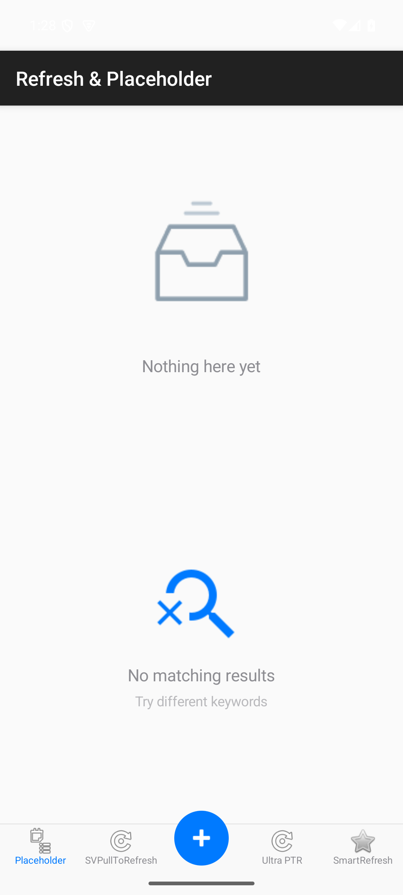

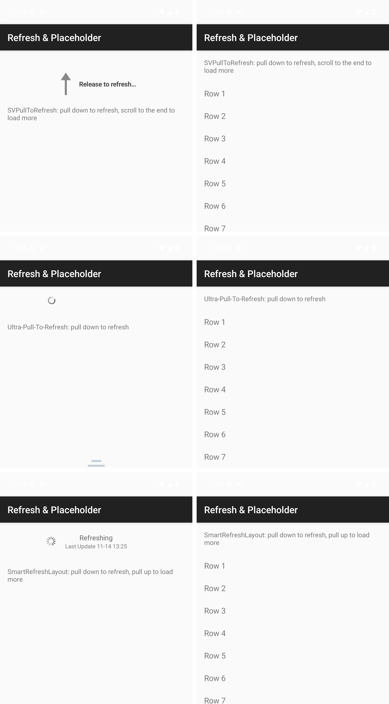

### 进行中：第六步：把 iOS 示例移植到 `android/merged` / In progress: Step 6: port the iOS examples to `android/merged`

| 中文 | English |
| --- | --- |
| 状态：进行中（2026-11-14，分支 `feat/android-refresh-port`，PR #28）。翻译 iOS 的 `Examples/Example-Scenarios`（不改 iOS 代码），使用上面 API 对照表中 Android 一列的 API。 | Status: in progress (2026-11-14, branch `feat/android-refresh-port`, PR #28). A translation of iOS `Examples/Example-Scenarios` (no iOS code changed), using the Android column of the API table above. |
| 已完成：**场景** Tab（iOS 第一个 Tab，`CYLScenarioListViewController` / `CYLScenarioDetailViewController` / `CYLSupportViewController` / `CYLConfigurationViewController`）：三个分组列出 `CYLPlaceholderScenarioCatalog` 的全部场景（README 截图、权限、业务）；点击一行进入该场景的页面：占位图经 `RecyclerView.cyl_placeholderViewBlock` 显示，“清空”与“点击：开/关”按钮，重试 → 加载中 → 12 行，联系客服 → 客服页，打开设置、去购物、手动选择、完成；最后一组是 6 个 JSON 配置文件（`assets/Configurations`），用 `CYLPlaceholderStackView.fromConfiguration` 打开，示例自己的文字（`exampleTitleKey`）由示例解析；顶部“语言”行切换七种语言（`CYLPlaceholderLocalization.language`、`CYLRefreshConfig.defaultConfig.languageCode`，并重建界面）。示例文字取自 iOS 示例的七语言 `.strings`（`values*/strings.xml`，键 `merged_…`）。 | Done: the **Scenarios** tab (the iOS example's first tab: `CYLScenarioListViewController`, `CYLScenarioDetailViewController`, `CYLSupportViewController`, `CYLConfigurationViewController`): three sections list every scenario of `CYLPlaceholderScenarioCatalog` (README screenshots, permissions, business cases); a row opens the scenario page: the placeholder shows through `RecyclerView.cyl_placeholderViewBlock`, with "Clear" and "Tap: on/off" buttons, retry → loading → 12 rows, contact support → support page, open settings, go shopping, choose manually, done; the last group is the 6 JSON configuration files (`assets/Configurations`) opened with `CYLPlaceholderStackView.fromConfiguration`, the example\'s own texts (`exampleTitleKey`) resolved by the example; a "Language" row at the top switches the seven languages (`CYLPlaceholderLocalization.language`, `CYLRefreshConfig.defaultConfig.languageCode`, and the interface is rebuilt). The example\'s texts come from the iOS example\'s seven-language `.strings` (`values*/strings.xml`, keys `merged_…`). |
| 不能移植或有差异：`smzdm-capsule.plist` 是 iOS 属性列表，Android 只读 JSON；SwiftUI 示例（`Example-SwiftUI`）没有对应的 Android 界面技术，不移植。 | Cannot be ported or differs: `smzdm-capsule.plist` is an iOS property list and Android reads JSON only; the SwiftUI example (`Example-SwiftUI`) has no Android counterpart and is not ported. |
| 已完成：**动态** Tab（`CYLFeedViewController`，示例新增第五个 Tab）：首次加载显示“加载中”场景，下拉刷新交替失败并显示带“重试”按钮的场景，上拉加载到 30 行后显示“没有更多”；**加号按钮页**（`CYLPublishViewController`）：“上传中”场景，1.5 秒后“成功”场景和“完成”按钮（“完成”重新开始流程，因为加号页是 Tab 页，不是弹出页）。差异：iOS 的刷新图标是动画文件（Lottie / PAG / GIF），Android 暂用经典头与经典脚（需要 PAG / Rive 动画器，见 TODO）。 | Done: the **Feed** tab (`CYLFeedViewController`, the example\'s fifth tab): the first load shows the "Loading" scenario, a pull-down refresh alternately fails and shows the scenario with a "Retry" button, pulling up loads to 30 rows and then shows "No more data"; the **plus button page** (`CYLPublishViewController`): the "Uploading" scenario, then after 1.5 seconds the "Success" scenario with a "Done" button ("Done" restarts the flow, because the plus page is a tab page, not a modal). A difference: the iOS refresh icons are animation files (Lottie / PAG / GIF); Android uses the classic header and footer for now (it needs the PAG / Rive animators, see the TODO). |
| 在模拟器上发现并修复的两个缺陷：①内核的 `CYLRefreshUtil.isContentView` 引用了 `androidx.viewpager2.widget.ViewPager2`，应用没有 viewpager2 时在第一次检查内容视图时崩溃（`NoClassDefFoundError`；Java 原版也有同样的写法）——现按类名判断 ViewPager / ViewPager2（`CYLRefreshUtil.isPager`），测试 `aFrameAroundAListIsFoundWithoutLinkingViewPager2`；②`cyl_reloadData()` 在列表仍为空时保留旧占位图——iOS 每次 reloadData 都销毁旧占位图并重新调用 `makePlaceHolderView`，Android 现在也重建，测试 `aReloadOfAnEmptyListBuildsANewPlaceholder`。 | Two defects found and fixed on the emulator: (1) the kernel\'s `CYLRefreshUtil.isContentView` named `androidx.viewpager2.widget.ViewPager2` and crashed (`NoClassDefFoundError`) the first time a content view was checked in an app without viewpager2 (the Java original is written the same way); ViewPager and ViewPager2 are now found by class name (`CYLRefreshUtil.isPager`), test `aFrameAroundAListIsFoundWithoutLinkingViewPager2`; (2) `cyl_reloadData()` kept the old placeholder while the list stayed empty, whereas iOS destroys the placeholder on every reloadData and asks `makePlaceHolderView` again; Android builds a new one now, test `aReloadOfAnEmptyListBuildsANewPlaceholder`. |
| 已完成：**HUD 页**（`CYLHUDViewController`，在场景页的“流程”分组里）：显示、带状态、进度（每 0.1 秒加 5%）、成功 / 错误 / 信息、图片、带“取消”按钮的组件、盒子里的场景（上传中）、三次显示三次弹出、关闭，以及样式、遮罩、加载动画、触觉反馈四个设置行（点一下切换并预览）。HUD 盒子加了柔和阴影，浅色盒子放在浅色页面上才看得出边界。截图（同一环境，提交 `0806791`，2026-11-14 23:57 NZDT）：从左到右为“带状态”、进度、带“取消”的组件；原图 `assets/android-merged-hud-*.png`。 | Done: the **HUD page** (`CYLHUDViewController`, in the "Flows" group of the Scenarios page): show, with a status, a progress (5% every 0.1 seconds), success / error / info, an image, components with a "Cancel" button, a scenario in the box (Uploading), three shows and three pops, dismiss, and the four setting rows style, mask, loading animation and haptics (a tap changes one and previews it). The HUD box got a soft shadow so a light box shows on a light page. Screenshots (the same environment, commit `0806791`, 2026-11-14 23:57 NZDT): left to right: "with a status", a progress, components with "Cancel"; the originals are `assets/android-merged-hud-*.png`. |

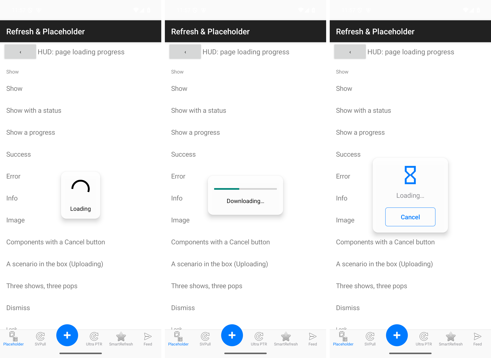

| 中文 | English |
| --- | --- |
| 已完成：**状态条页**（`CYLStatusBarViewController`，在场景页的“流程”分组里，是一个独立的 Activity，对应 iOS 推入的视图控制器）：顶部是网络状态条，占位图盖在列表所在的容器上，底部四种模式（状态条 + 占位图、仅状态条、仅占位图、状态条 + 列表）、“网络”按钮（让状态条跟随网络）、“文件”按钮（应用 `assets/StatusBar` 里的三个状态配置文件，用 `Activity.cyl_applyStatusConfigurationWithContentsOfURL`，模式单选随之同步）。为此让 `cyl_placeholderScrollView` 真正生效：占位图盖在该滚动视图所在的 FrameLayout 里，而不是整个界面，这和 iOS 一致（测试 `thePlaceholderCoversOnlyTheScrollViewsContainer`）。截图（同一环境，提交 `a3db067`，2026-11-15 00:31 NZDT）：从左到右为状态条 + 占位图、仅状态条、状态条 + 列表；原图 `assets/android-merged-status-*.png`。 | Done: the **status bar page** (`CYLStatusBarViewController`, in the "Flows" group of the Scenarios page; an Activity of its own, as iOS pushes a view controller): the network status bar at the top, the placeholder over the list\'s container, four modes at the bottom (bar + placeholder, bar only, placeholder only, bar + list), a "Network" button (the bar follows the network) and a "File" button (applies the three status configuration files in `assets/StatusBar` with `Activity.cyl_applyStatusConfigurationWithContentsOfURL`; the mode selection follows). For it `cyl_placeholderScrollView` now works: the placeholder covers the FrameLayout of that scrolling view, not the whole screen, as on iOS (test `thePlaceholderCoversOnlyTheScrollViewsContainer`). Screenshots (the same environment, commit `a3db067`, 2026-11-15 00:31 NZDT): left to right: bar + placeholder, bar only, bar + list; the originals are `assets/android-merged-status-*.png`. |

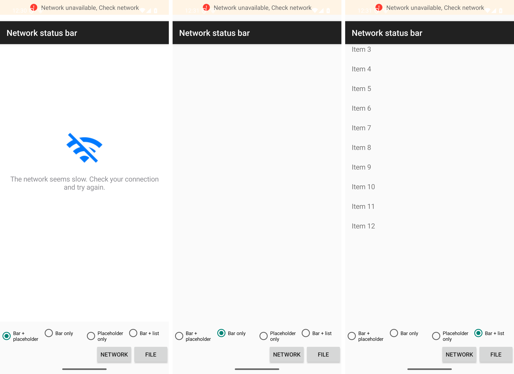

| 中文 | English |
| --- | --- |
| 已完成：**流程**的六项（`CYLFlowListViewController` / `CYLFlowDetailViewController` / `CYLCollectionFlowViewController`，在场景页的“流程”分组里）：切换状态（空 / 失败 / 断网 / 有数据，`cyl_placeholderViewBlock` + `cyl_reloadData`，#3）、保留表头（搜索框，`CYLTableViewPlaceHolderDelegate.frameForPlaceHolderViewInTableView`，#17）、保留分组头（“置顶”“全部”，同一 API，#16）、刷新控件（`cyl_header` + `cyl_footer`，#8）、可滚动占位（`enableScrollWhenPlaceHolderViewShowing`，空占位上也能下拉刷新）、集合视图（`GridLayoutManager` 的 RecyclerView，#11）。差异：Android 的 RecyclerView 没有表头 / 分组头，示例把它们放在列表上方，占位图的位置由委托的 frame 决定。“刷新控件”一项未单独截图验证。截图（同一环境，提交 `eb2edf4`，2026-11-15 00:51 NZDT）：第一张从左到右为切换到“失败”、保留表头、保留分组头；第二张为集合视图（空、18 项）与可滚动占位下拉后的 12 行。 | Done: the six **flows** (`CYLFlowListViewController` / `CYLFlowDetailViewController` / `CYLCollectionFlowViewController`, in the "Flows" group of the Scenarios page): switching states (empty / failed / offline / data, `cyl_placeholderViewBlock` + `cyl_reloadData`, #3), keeping the table header (a search box, `CYLTableViewPlaceHolderDelegate.frameForPlaceHolderViewInTableView`, #17), keeping the section headers ("Pinned", "All", the same API, #16), refresh controls (`cyl_header` + `cyl_footer`, #8), a scrollable placeholder (`enableScrollWhenPlaceHolderViewShowing`; an empty placeholder can be pulled to refresh) and a collection view (a RecyclerView with `GridLayoutManager`, #11). A difference: RecyclerView has no table or section headers, so the example puts them above the list and the delegate\'s frame places the placeholder below them. The "Refresh controls" flow was not checked on its own screenshot. Screenshots (the same environment, commit `eb2edf4`, 2026-11-15 00:51 NZDT): the first, left to right: switched to "Failed", the kept table header, the kept section headers; the second: the collection view (empty, 18 items) and the scrollable placeholder after a pull (12 rows). |

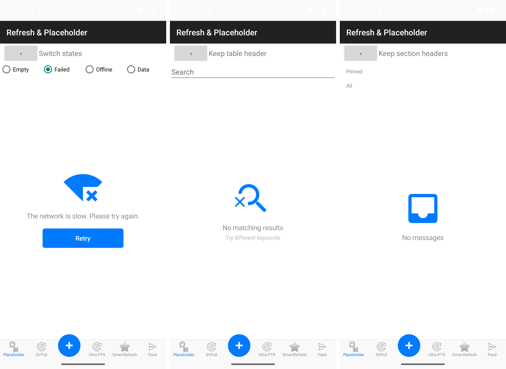

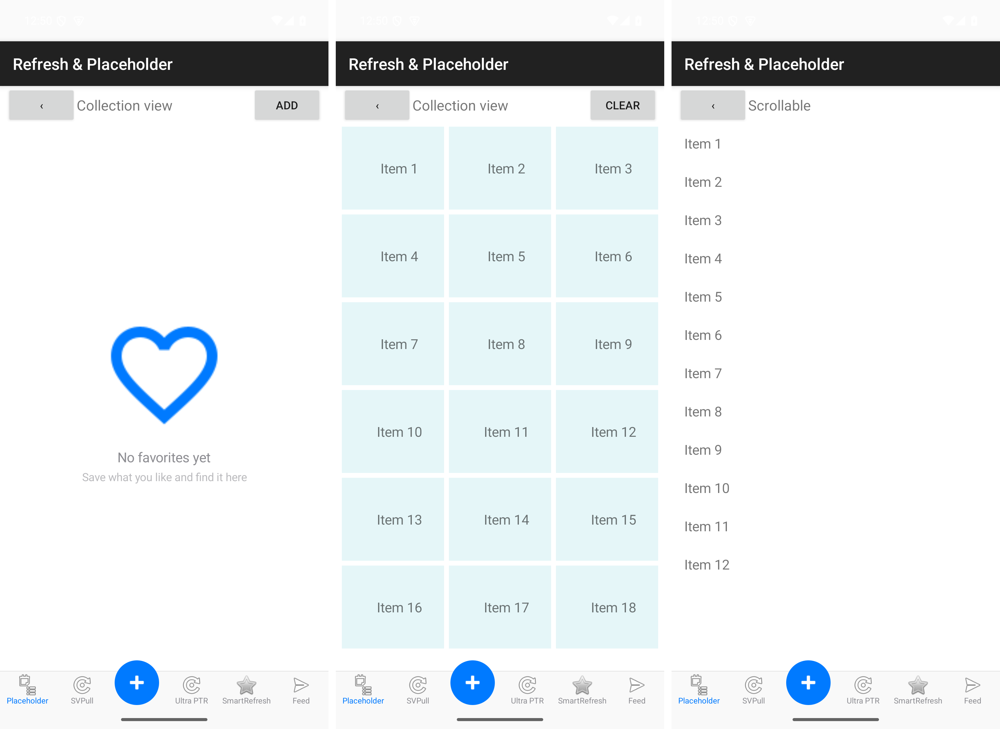

| 中文 | English |
| --- | --- |
| 已完成：HUD 的“页面生命周期”子页（`HudLifecyclePage.kt`，iOS `CYLHUDLifecycleViewController`）：首次加载显示 HUD 后失败，出现“重试”占位图；重试成功后 15 行；下拉刷新、上拉每次加 10 行，到 45 行显示没有更多。模拟器 emulator-5554（Android 15，API 35）验证，2026-11-15。 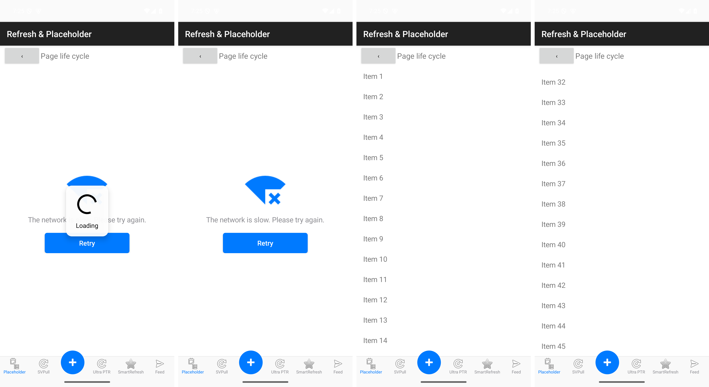 | Done: the HUD "page life cycle" sub-page (`HudLifecyclePage.kt`, iOS `CYLHUDLifecycleViewController`): the first load shows the HUD and fails, so the Retry placeholder shows; Retry succeeds with 15 rows; pull down refreshes, pull up adds 10 rows each time and shows no more data at 45. Checked on emulator-5554 (Android 15, API 35), 2026-11-15. |
| 已完成（第 1 批）：刷新示例页（`RefreshExamplesPage.kt`，iOS `CYLRefreshExampleViewController` + `CYLRefreshTableViewController` + `CYLRefreshDIYControls`），换下原来的 CYLRefresh 标签页，标签名改为“刷新”：下拉刷新的 example01–06 和上拉加载的 example11–21（动画图片取自从 iOS 复制、未修改的两个刷新 GIF 的帧，DIY 头部和两个 DIY 尾部）。库修复：`CYLRefreshGifHeader` 等的图标放在箭头的位置，经典箭头和转圈在图标显示时保持隐藏。模拟器 emulator-5554 验证了列表、GIF 头部、DIY 头部、回弹尾部，2026-11-15。与 iOS 的差异：测试页在偶数行也是推入（iOS 为模态弹出）。 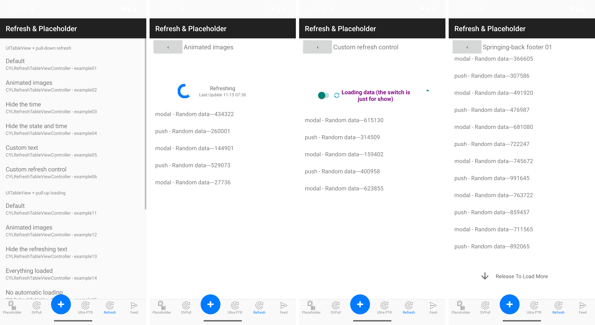 | Done (batch 1): the refresh examples page (`RefreshExamplesPage.kt`, iOS `CYLRefreshExampleViewController` + `CYLRefreshTableViewController` + `CYLRefreshDIYControls`), replacing the CYLRefresh tab, renamed "Refresh": pull-down example01–06 and pull-up example11–21 (animated images are frames of the two refresh GIFs copied unmodified from iOS; the DIY header and both DIY footers). Library fix: the icon of `CYLRefreshGifHeader` and friends takes the arrow's place, and the classic arrow and spinner stay hidden while it shows. Checked on emulator-5554: the list, the GIF header, the DIY header, the back footer, 2026-11-15. Difference from iOS: the test page is pushed on even rows too (iOS presents it). |
| 已完成（第 2 批）：集合示例 `RefreshCollectionPage.kt`（iOS `CYLRefreshCollectionViewController`）：“下拉和上拉”与“固定表头”两行（example31；表头固定在 MJRefresh 中也是 TODO，所以两页相同）。网格：80 dp 色块、间距 20 dp、30 dp 紫色表头；下拉加 10 个，上拉加 5 个，没有数据时隐藏尾部。模拟器 emulator-5554 验证了下拉加载和上拉“Loading…”，2026-11-15。 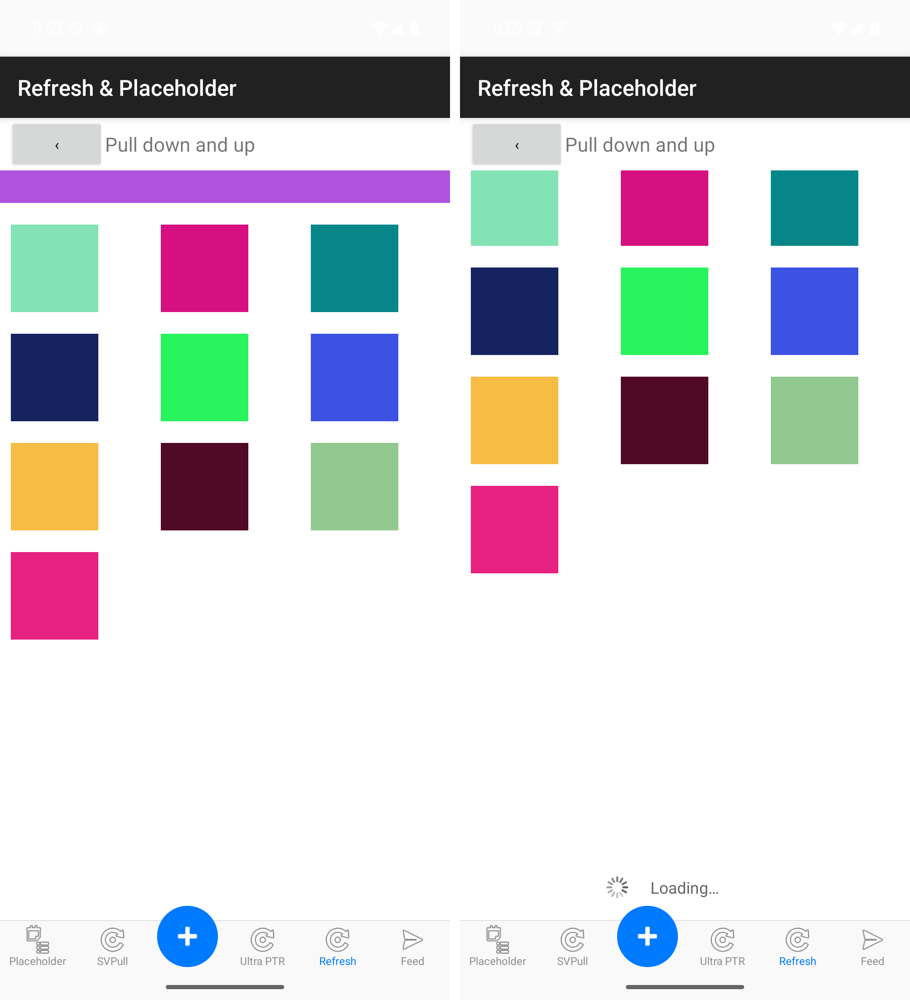 | Done (batch 2): the collection examples `RefreshCollectionPage.kt` (iOS `CYLRefreshCollectionViewController`): the rows "Pull down and up" and "pinned header" (example31; pinning is a TODO in MJRefresh too, so both pages look the same). Grid: 80 dp squares, 20 dp spacing, a 30 dp purple header; pull down adds 10, pull up adds 5, the footer hides while empty. Checked on emulator-5554: pull-down load and pull-up "Loading…", 2026-11-15. |
| 已完成（第 3 批）：网页示例 `RefreshWebPage.kt`（iOS `CYLRefreshWKWebViewController`）：example40 和 example41（iOS 上两者相同，UIWebView 已不存在）。WebView 加载 MJRefresh 的 GitHub 页，动画图片头部自动变透明，页面加载完成或失败时结束刷新；右下角有提示文字和返回按钮。示例清单新增 INTERNET 权限。模拟器 emulator-5554 验证了加载和下拉（“Release To Refresh”），2026-11-15。与 iOS 的差异：iOS 隐藏导航栏和状态栏，Android 不显示页面标题栏，通过返回按钮回去。 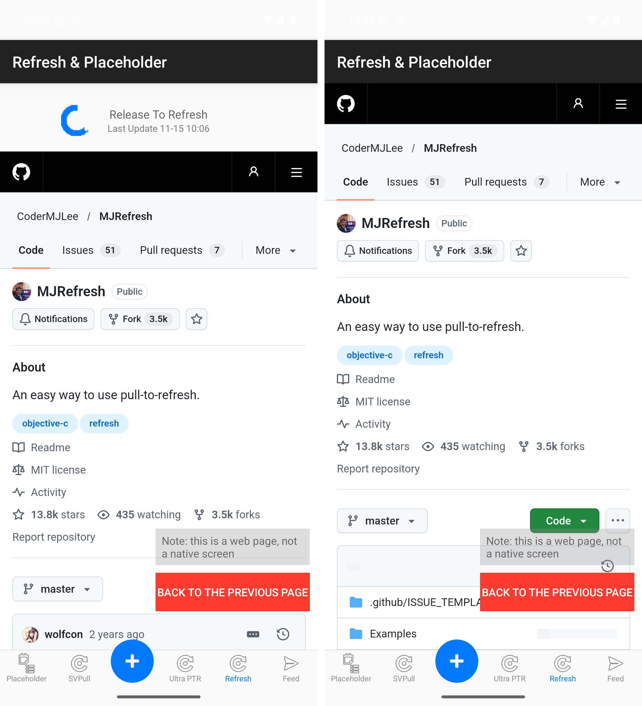 | Done (batch 3): the web examples `RefreshWebPage.kt` (iOS `CYLRefreshWKWebViewController`): example40 and example41 (the same on iOS, UIWebView being gone). A WebView loads MJRefresh's GitHub page; the animated-images header fades automatically and ends when the page finishes or fails; a warning and a Back button sit at the bottom right. The example manifest gains the INTERNET permission. Checked on emulator-5554: loading and pull down ("Release To Refresh"), 2026-11-15. Difference from iOS: iOS hides the navigation and status bars; Android shows no page bar and returns through the Back button. |
| 已完成（第 4 批）：多语言页 `RefreshI18nPage.kt`（iOS `CYLRefreshI18NExampleViewController`）：7 种语言，点一行设置 `CYLRefreshConfig.languageCode`，重建头部和尾部，弹出提示；离开页面恢复默认。库修复：`languageCode` 原来只改占位文案，现在经典头部和尾部用该语言的 `Context` 读取内置文案（`cylLocalizedContext`，CYLRefreshLayout 自带 7 种语言）。模拟器 emulator-5554 验证了日语（“更新中 / 最終更新”），2026-11-15。与 iOS 的差异：没有第二节“自定义 strings 表”，Android 的文案是字符串资源。 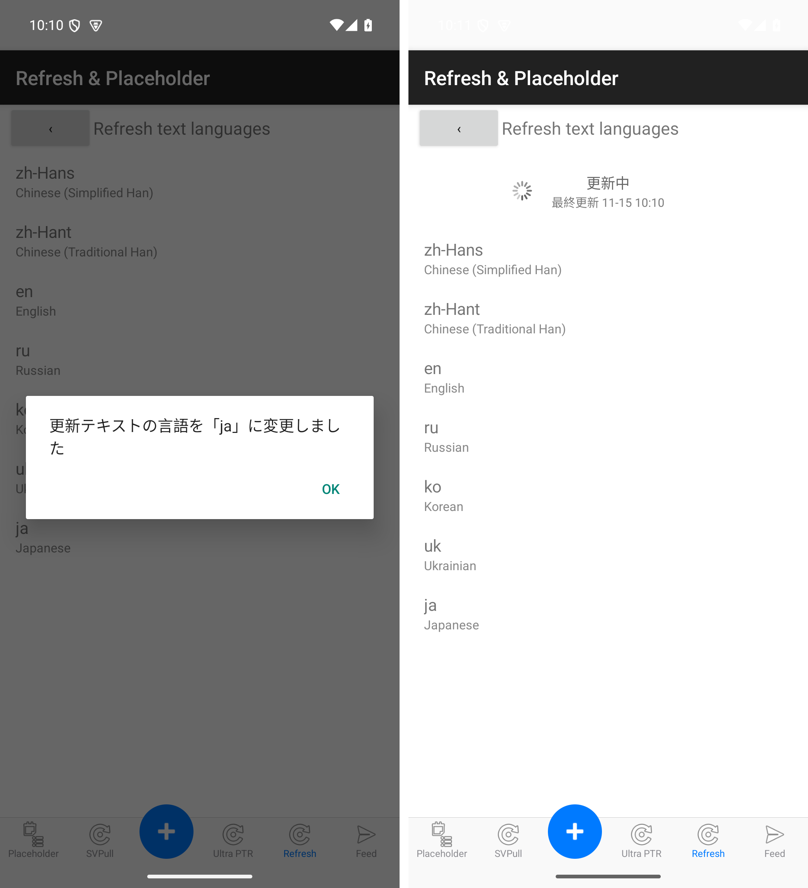 | Done (batch 4): the languages page `RefreshI18nPage.kt` (iOS `CYLRefreshI18NExampleViewController`): 7 languages; a row sets `CYLRefreshConfig.languageCode`, remakes the header and footer and shows an alert; leaving the page restores the default. Library fix: `languageCode` used to change only the placeholder texts; the classic header and footer now read their built-in texts from a `Context` in that language (`cylLocalizedContext`; CYLRefreshLayout ships all 7). Checked on emulator-5554: Japanese ("更新中 / 最終更新"), 2026-11-15. Difference from iOS: no second section (a custom strings table); Android texts are string resources. |
| 已完成（第 5 批，部分）：CYLRefresh 样式页 `RefreshStylesPage.kt`（iOS `CYLRefreshStylesDemoViewController`）：20 种样式（14 个头部、6 个尾部），主题行给控件和页面标题栏上色，头部打开时刷新一次，尾部把测试行翻倍、超过 16 行后没有更多数据。模拟器 emulator-5554 验证：GameHitBlock 头部、经典尾部“Loading…”、Material 尾部、Fly 的蓝色主题，2026-11-15。已修复（2026-11-15）：Fly 头部区域空白：CYLRefreshLayout 的 FlyRefreshHeader 高度为 0，要页面自己放 MountainSceneView 与 FlyView；iOS 的 `CYLRefreshFlyHeader` 自带场景。现 `CYLRefreshFlyHeader` 挂上时把内容包成“150 dp 山景 + 内容”，飞机放在山景左下角的圆形按钮上，下拉拉高山景、把内容往下推（关闭内容平移，不再留白），移除时还原内容；测试 `flyHeaderBringsItsSceneAndRestoresTheContent`；模拟器截图（下图从左到右：静止、下拉、松手飞出、降落回按钮），Android 15 emulator-5554，基于 3eea72d。 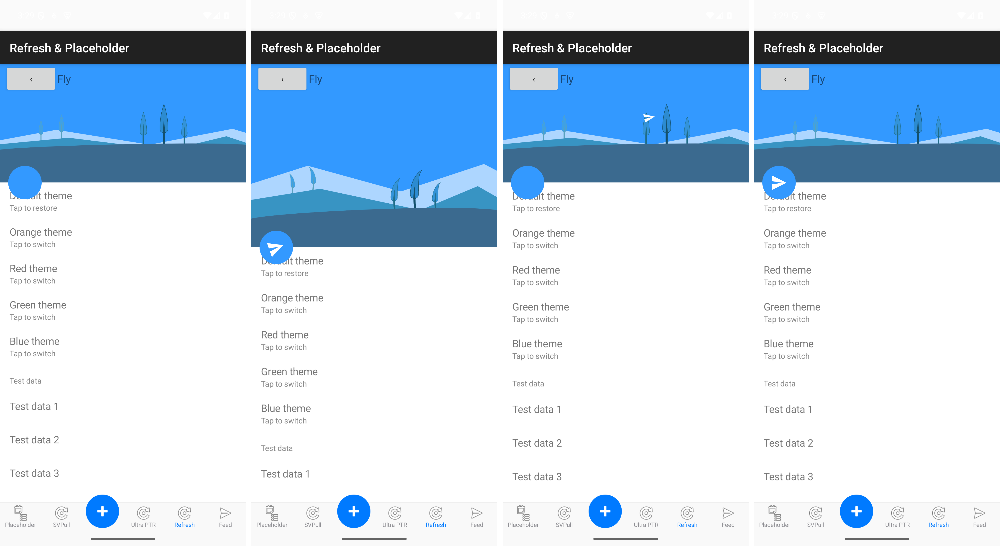 进行中（2026-11-15）：7 个 Rive 样式：新模块 `merged-rive`（`android/merged/rive`）把 iOS `RiveSwift/CYLRefreshRiveHeader.swift` 转写为 Kotlin（`CYLRefreshRiveStyle`、`CYLRefreshRiveHeader.create(context, style)`，状态机数字 / 布尔输入、触发器、线性动画拖动），示例复制 6 个 .riv 文件（NOTICE 与许可证一并复制）。模拟器：Bow、Bubbles 过触发点时画面正确（弓箭、气泡），截图如下（每行一个样式：刷新中、半拉、过触发点），基于 7b1e006。TODO：（1）由代码开始的刷新（打开页面时）Rive 区域不绘制：日志确认头部 1080×525、Rive 视图铺满且可见，手指拖动时能绘制，所以是 rive-android 的渲染没有被驱动；已加：表面出现或尺寸变化时重新播放状态机、按实际边界摆放 Rive 视图，未解决。（2）Bow 半拉时全黑。（3）打开 Halloween 时模拟器整个退出，三次复现，`-gpu swiftshader_indirect` 也一样；模拟器日志为 gfxstream `glFramebufferRenderbuffer error 0x502`，属于模拟器图形层的问题（应用不应能让模拟器退出），与 PAG 圆环缺弧可能同源；Skating / Space / Squats / Space 尾部因此未看到。需要真机确认。 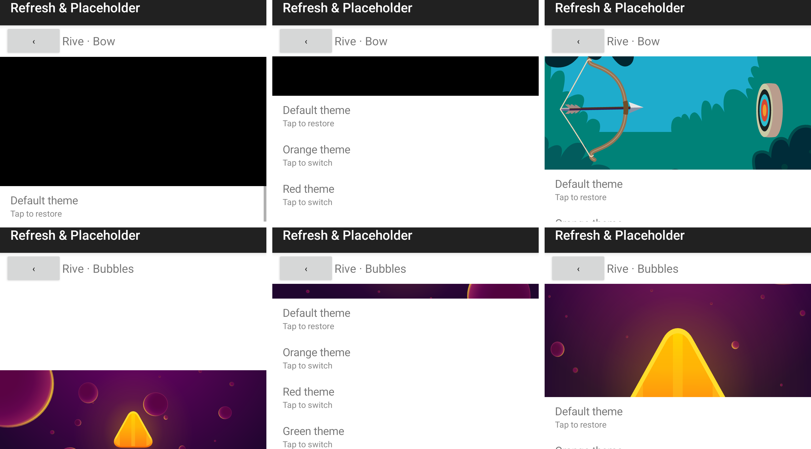 已修复（2026-11-15）：`CYLRefreshDrawnFooter` 不绘制的原因是尾部按 WRAP_CONTENT 测量时，里面填满父视图的头部让尾部取了整个布局的高度（414 而非 60），倒置后的图形落在屏幕外；`CYLDrawnFooterView.onMeasure` 在 AT_MOST 时不报高度，布局改用尾部高度。测试 `drawnFootersShowTheirDrawingWhileLoading`；模拟器上 Phoenix、Delivery、BezierRadar、Taurus 尾部都已画出（2026-11-15）。 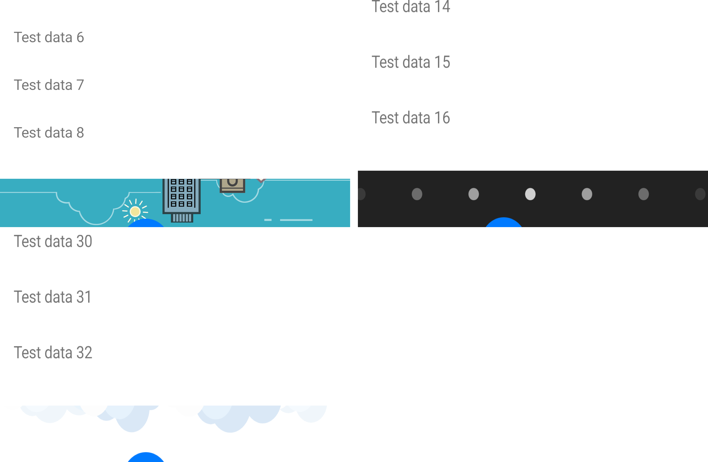 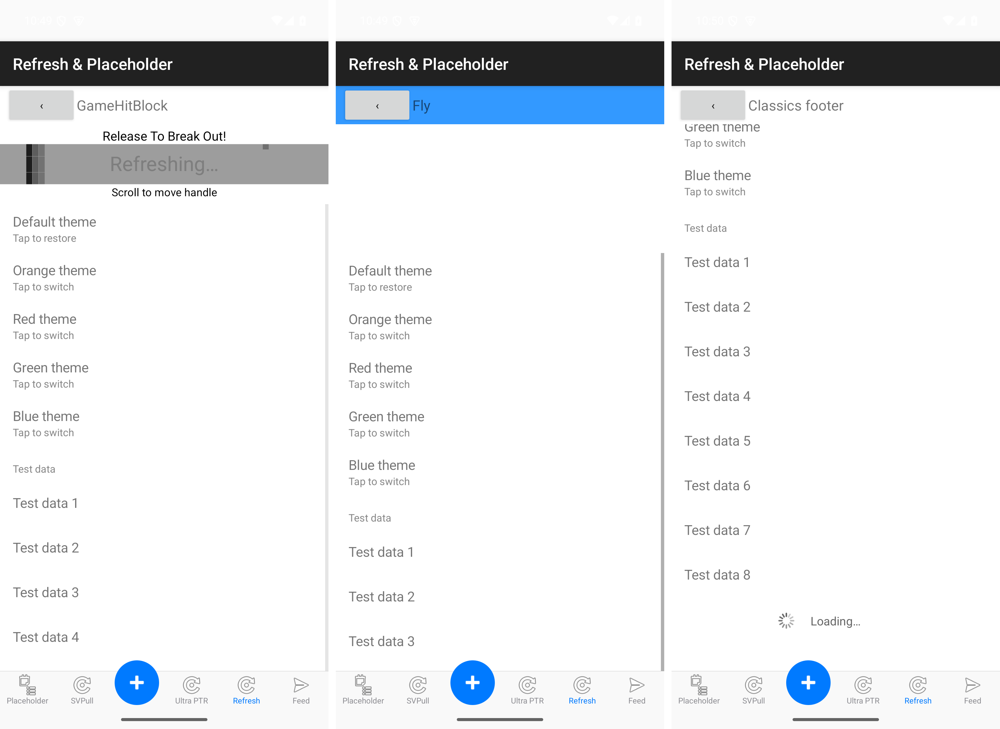 | Fixed (2026-11-15): `CYLRefreshDrawnFooter` drew nothing because, measured WRAP_CONTENT, its header (which fills its parent) made the footer as tall as the whole layout (414 instead of 60), so the flipped drawing sat off screen; `CYLDrawnFooterView.onMeasure` now reports no height for AT_MOST and the layout uses the footer height. Test `drawnFootersShowTheirDrawingWhileLoading`; on the emulator the Phoenix, Delivery, BezierRadar and Taurus footers all draw (2026-11-15). Done (batch 5, partly): the CYLRefresh styles page `RefreshStylesPage.kt` (iOS `CYLRefreshStylesDemoViewController`): 20 styles (14 headers, 6 footers); theme rows color the control and the page bar; a header refreshes once on open; a footer doubles the test rows and has no more data past 16. Checked on emulator-5554: the GameHitBlock header, the classic footer "Loading…", the Material footer, Fly's blue theme, 2026-11-15. Fixed (2026-11-15): the Fly header area was blank: CYLRefreshLayout's FlyRefreshHeader has no height and expects the page to lay out a MountainSceneView and a FlyView, while iOS's `CYLRefreshFlyHeader` brings its own scene. `CYLRefreshFlyHeader` now wraps the content on attach as a 150 dp mountain scene above the content, with the plane on a round button at the scene's bottom left; the pull stretches the scene and pushes the content down (content translation off, so no blank band), and detaching restores the content; test `flyHeaderBringsItsSceneAndRestoresTheContent`; emulator capture (left to right: idle, pulling, released and flying off, landed back on the button), Android 15 emulator-5554, based on 3eea72d.  In progress (2026-11-15): the 7 Rive styles: a new module `merged-rive` (`android/merged/rive`) translates iOS `RiveSwift/CYLRefreshRiveHeader.swift` to Kotlin (`CYLRefreshRiveStyle`, `CYLRefreshRiveHeader.create(context, style)`, state machine number / boolean inputs, triggers, scrubbed linear animations); the example copies the 6 .riv files with their NOTICE entries and licenses. Emulator: Bow and Bubbles draw correctly past the trigger (the bow, the bubbles), capture above (one style per row: refreshing, half pulled, past the trigger), based on 7b1e006. TODO: (1) a refresh started from code (on opening the page) leaves the Rive area undrawn: a log shows the header at 1080×525 with the Rive view filling it and visible, and it draws while a finger drags, so rive-android's rendering is not being driven; added: playing the state machine again when the surface appears or changes size, and placing the Rive view from its actual bounds; not solved. (2) Bow is black while half pulled. (3) Opening Halloween makes the whole emulator exit, three times, also with `-gpu swiftshader_indirect`; the emulator log shows gfxstream `glFramebufferRenderbuffer error 0x502`, a fault in the emulator's graphics layer (an app should not be able to make it exit), possibly the same cause as the PAG ring's missing arc; Skating / Space / Squats / the Space footer were not reached because of it. A real device must confirm. Recheck (2026-11-19, Windows session, the API 37 emulator-5556 rebuilt since): (1) a refresh started from code still leaves the Rive area blank; (2) Bow half pulled draws its scene in the top part of the header and black below ([screenshot](docs/assets/android-17-api37-x86_64-emulator-rive-bow-recheck-3d01c3d-20261119-sheet.png)), while iOS fills the header (`docs/assets/easyrefresh-rive-styles-ios.png`): a fit and alignment difference of the artboard (making the TextureView transparent changed nothing); (3) Halloween not opened, so as not to take the shared emulator down for the other sessions. Blocked on a real Android device for (1) and (3). (2) checked in code: Android lays the Rive view out exactly as iOS (`CYLRefreshRiveHeader.swift`: fitWidth for Bow, center alignment, bottom-aligned in at least the 200 dp trigger offset; the screen widths match, 402 pt and 411 dp), so the black band is the emulator's graphics layer drawing rive-android (the same gfxstream faults as (3) and the PAG ring), not a layout difference; blocked on a real device too. |
| 已完成（第 6 批）：flutter_easy_refresh 示例页 `EasyRefreshPage.kt`（iOS `CYLEasyRefreshDemoViewController`），8 页：Cupertino、二楼、触发模式、启动刷新、分页（45 项，每页 10）、监听头部（不绘制的头部 + 进度条，经头部视图的 `onMoving` 取得进度，Android 没有 iOS `scrollViewDidScroll` 的对应）、聊天（顶部加载更早消息并保持位置）、用户资料（头部在内容后面）。模拟器 emulator-5554 验证：8 页都能打开，下拉显示“Release To Refresh”或菊花，启动刷新与分页打开即刷新，监听头部进度条随拉动，2026-11-15。二楼：拉过 120 dp 松手打开、按钮关闭，模拟器已验证（2026-11-15）；标题与按钮居中。二楼视图曾从窗口顶部画起、盖住状态栏、底部留白：刷新布局不直接在 FrameLayout 里时，`CYLRefreshSecondaryFloor` 把二楼放进窗口内容的顶部；现按刷新布局在窗口中的位置与宽高摆放，测试 `secondFloorCoversTheLayoutInsideALinearLayout`；模拟器截图（下图从左到右：打开前、拉过触发点、二楼只盖住刷新布局，状态栏、标题栏、标签栏都在）。触发模式：Android 的 `triggerMode` 原来只存值不生效，默认值也与 iOS 相反（`OnEdge`）；现默认 `Anywhere`（与 iOS 一致），`OnEdge` 时 `CYLRefreshBridge` 装一个 `ScrollBoundaryDecider`，记下手指按下时列表是否在边缘（RecyclerView 的 `OnItemTouchListener`；`recyclerview` 只是 compileOnly，运行时没有就不装），测试 `triggerModeOnEdgeBlocksAPullThatStartedInTheMiddle`；模拟器：从列表中间开始的慢速拖动，Anywhere 时接着拉出头部，OnEdge 时停在顶部。聊天：下拉加载后，加载前最上面的“Message 21”仍在最上面，11–20 插在其上方，位置保持。均为 Android 15 模拟器 emulator-5554，基于 b5dd156，2026-11-15。 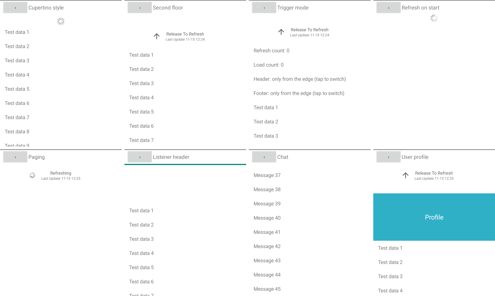 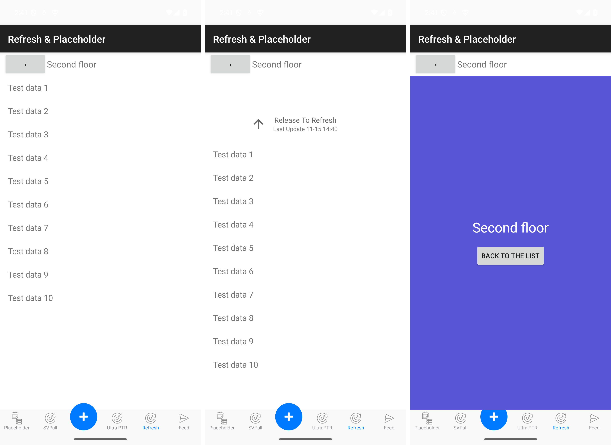 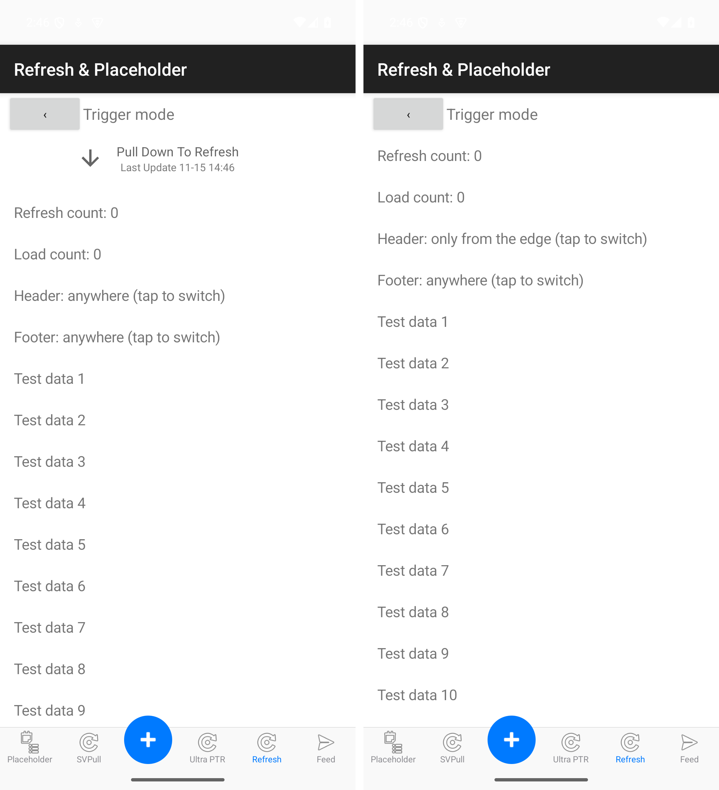 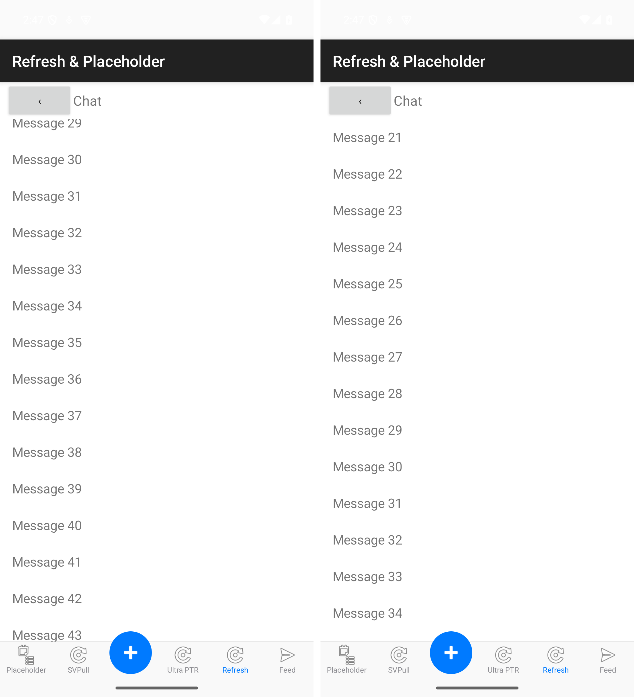 | Done (batch 6): the flutter_easy_refresh pages `EasyRefreshPage.kt` (iOS `CYLEasyRefreshDemoViewController`), 8 pages: Cupertino, second floor, trigger mode, refresh on start, paging (45 items, 10 per page), listener header (a header that draws nothing plus a progress bar, fed by the header view's `onMoving`, as Android has no counterpart of iOS `scrollViewDidScroll` here), chat (earlier messages at the top, position kept), user profile (header behind the content). Checked on emulator-5554: all 8 open, pulling shows "Release To Refresh" or the spinner, refresh on start and paging refresh on open, the listener's bar follows the pull, 2026-11-15. Second floor: pulling past 120 dp and releasing opens it, its button closes it, checked on the emulator (2026-11-15); its title and button are centered. The floor used to draw from the window's top over the status bar with a white band at the bottom: when the layout is not directly in a FrameLayout, `CYLRefreshSecondaryFloor` put the floor at the top of the window's content; it is now placed at the layout's position and size in the window, test `secondFloorCoversTheLayoutInsideALinearLayout`; emulator capture (left to right: before, past the trigger point, the floor covering only the refresh layout with the status bar, title bar and tab bar visible). Trigger mode: Android's `triggerMode` was stored but never read, and its default was the opposite of iOS (`OnEdge`); the default is now `Anywhere` (as on iOS), and `OnEdge` makes `CYLRefreshBridge` install a `ScrollBoundaryDecider` that remembers whether the list was at its edge when the finger went down (a RecyclerView `OnItemTouchListener`; `recyclerview` is compileOnly, so nothing is installed without it), test `triggerModeOnEdgeBlocksAPullThatStartedInTheMiddle`; on the emulator a slow drag that starts mid-list carries on into the header with Anywhere and stops at the top with OnEdge. Chat: after loading, "Message 21", the top row before the load, stays at the top with 11–20 inserted above it. All on the Android 15 emulator emulator-5554, based on b5dd156, 2026-11-15. |
| 已完成（2026-11-15）：example42（左拉）：库里新增 `CYLRefreshTrailer.kt`（`CYLRefreshTrailer` / `CYLRefreshStateTrailer` / `CYLRefreshNormalTrailer`、`RecyclerView.cyl_trailer`，七种语言的文案取自 iOS bundle）。CYLRefreshLayout 只能竖向拉，所以尾部自己接管横向 RecyclerView：列表到末页仍向左拖时接管手势，列表与尾部一起左移（阻尼 0.5），过 60 dp 显示“Release to see details”、箭头掉头，松手进入刷新并调用块；`endRefreshing` 收回。自动刷新（`automaticallyRefresh` 等 3 个属性）未移植。示例 `horizontalCollectionPage`：5 页、200 dp 高、按页吸附。测试 `CYLRefreshTrailerTest.pullingLeftPastTheEndRefreshes`；API 对照表评分 93 → 95；模拟器（下图从左到右：末页、拉出“Swipe to see details”、过触发点、松手打开测试页），Android 15 emulator-5554。 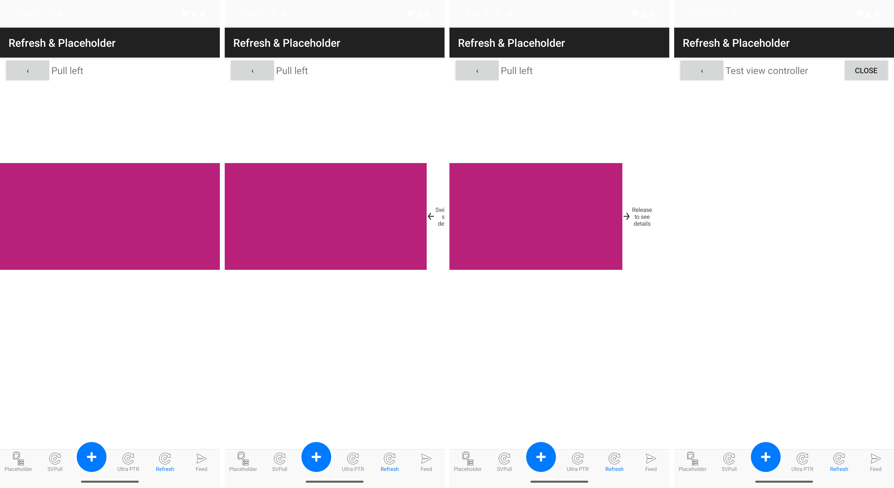 | Done (2026-11-15): example42 (pull left): the library has `CYLRefreshTrailer.kt` (`CYLRefreshTrailer` / `CYLRefreshStateTrailer` / `CYLRefreshNormalTrailer`, `RecyclerView.cyl_trailer`, texts in seven languages from the iOS bundle). CYLRefreshLayout only pulls vertically, so the trailer drives a horizontal RecyclerView itself: a drag that keeps going left on the last page is taken over, the list and the trailer move left together (damping 0.5), past 60 dp it reads "Release to see details" and the arrow turns, releasing refreshes and runs the block; `endRefreshing` slides it away. Automatic refresh (`automaticallyRefresh` and 2 more properties) is not ported. Example `horizontalCollectionPage`: 5 pages, 200 dp high, snapping per page. Test `CYLRefreshTrailerTest.pullingLeftPastTheEndRefreshes`; API map score 93 → 95; emulator (left to right: last page, "Swipe to see details" pulled in, past the trigger, released and the test page open), Android 15 emulator-5554. |
| 已完成（2026-11-15）：动画图标示例 example51–56 与 example32（iOS“动画图标：GIF、Lottie、PAG、Rive”一节）。新模块 `placeholder-pag`（libpag 4.5.98）与 `placeholder-rive`（rive-android 10.3.0），与 `placeholder-lottie` 一样在启动时注册播放器；Rive 的画板 / 动画写在文件地址的查询串里（`CYLRefreshIcon.riv?artboard=refresh&animation=active`，对应 iOS 的 options）。库的 `CYLRefreshGifHeader` / `CYLRefreshAutoGifFooter` / `CYLRefreshBackGifFooter` 新增 `setIconAnimationFilePath(path, width, height, state)` 与 `setIconAnimationAttributes`（iOS `setIconAnimationFilePath:size:forState:`）。示例从 iOS bundle 复制 11 个动画文件，NOTICE 与许可证一并复制。测试 `CYLRivePlaceholderItemAnimatorTest`（2 个）；模拟器：7 页都能打开，GIF、Lottie、Rive、GIF 帧、混合引擎、集合页的图标都显示（下图每行一页：刷新中、半拉、过触发点），Android 15 emulator-5554，基于 722cf84。TODO（已知缺陷）：PAG 圆环在模拟器上只画出灰色底圈，没有进度弧（定格在 0.5 进度也没有）；logcat 有 “called unimplemented OpenGL ES API”（模拟器 ANGLE），需要真机确认。 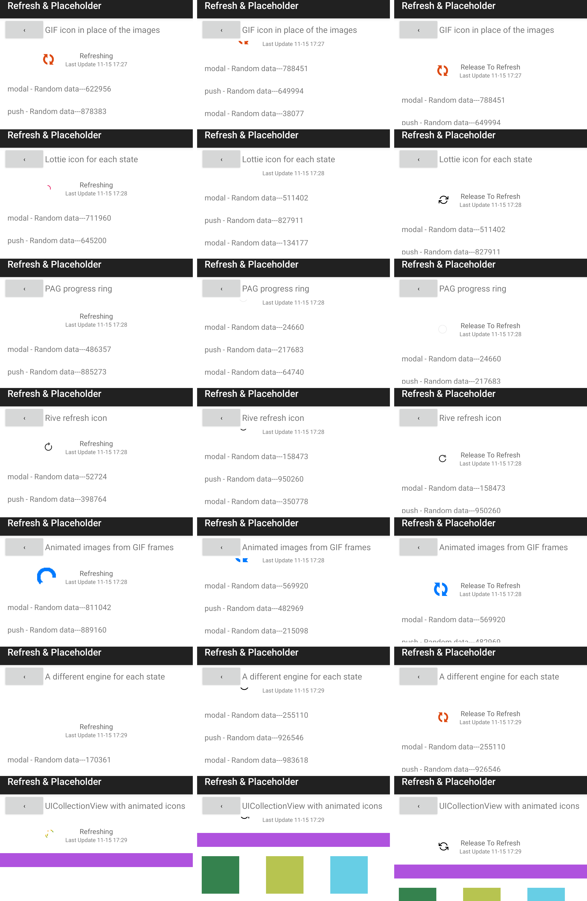 | Done (2026-11-15): the animated-icon examples example51–56 and example32 (the iOS section "Animated icons: GIF, Lottie, PAG, Rive"). New modules `placeholder-pag` (libpag 4.5.98) and `placeholder-rive` (rive-android 10.3.0) register their players at start, like `placeholder-lottie`; Rive's artboard and animation go in the file URL's query (`CYLRefreshIcon.riv?artboard=refresh&animation=active`, the iOS options). The library's `CYLRefreshGifHeader` / `CYLRefreshAutoGifFooter` / `CYLRefreshBackGifFooter` gain `setIconAnimationFilePath(path, width, height, state)` and `setIconAnimationAttributes` (iOS `setIconAnimationFilePath:size:forState:`). The example copies 11 animation files from the iOS bundle with their NOTICE entries and licenses. Test `CYLRivePlaceholderItemAnimatorTest` (2); emulator: all 7 pages open, and the GIF, Lottie, Rive, GIF frames, mixed engines and collection icons show (one page per row: refreshing, half pulled, past the trigger), Android 15 emulator-5554, based on 722cf84. TODO (known defect): the PAG ring draws only its grey track on the emulator, no progress arc (also when held at progress 0.5); logcat shows "called unimplemented OpenGL ES API" (the emulator's ANGLE), so a real device must confirm. |
| 已完成（2026-11-16，分支 `feat/android-refresh-port`，用户：“continue 做 Animations 标签页”）：**动画 Tab**（`AnimationsPage.kt`，iOS `CYLAnimationListViewController`，新标签“动画”，图标 sparkles，7 种语言）：核心资源 `CYLPlaceholderAnimations` 按引擎分组（Lottie / PAG / Rive / GIF），再列示例自己的 `assets/Animations`；每行显示文件大小，点开在 180 dp 的 `CYLPlaceholderAnimationView` 中播放，每 4 秒与“重播”按钮重新播放；“来源”显示 NOTICE.animations。为与 iOS 核心包一致，从 iOS 核心包原样复制 29 个缺少的文件到 Android 核心资源（7 个 PAG / Rive 占位动画与刷新图标；NOTICE 两边本就相同）；示例复制 iOS 示例包的 6 个文件（Explore、LightSwitch、Mascot、Moonlight、Rating、Truck）及 `LICENSE.rive-ios`，NOTICE 追加条目。Rive 选项沿用 iOS `CYLScenarioAnimationOptions`（Success 的状态机、CYLRefreshIcon 的画板与动画）。模拟器 emulator-5554（Android 15）验证：列表、Lottie（Empty）、Rive（Mascot、Rating）播放，截图从左到右：列表、Empty、Mascot、Rating。未验证：PAG 与 Halloween（模拟器已知图形问题，见上）。`Example`、`Example-objc-01`、`Example-objc-02` 已完成（见下）。 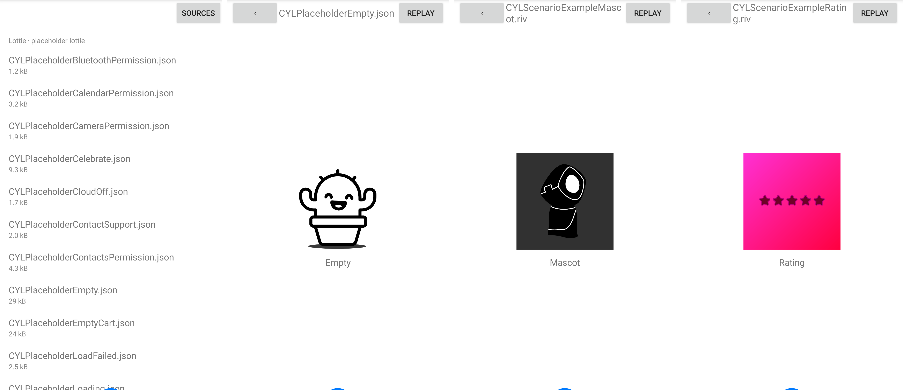 | Done (2026-11-16, branch `feat/android-refresh-port`, the user: "continue 做 Animations 标签页"): the **Animations tab** (`AnimationsPage.kt`, iOS `CYLAnimationListViewController`, a new "Animations" tab with the sparkles icon, 7 languages): the core assets `CYLPlaceholderAnimations` grouped by engine (Lottie / PAG / Rive / GIF), then the example's own `assets/Animations`; each row shows the file size and opens the file in a 180 dp `CYLPlaceholderAnimationView`, replayed every 4 seconds and by "Replay"; "Sources" shows NOTICE.animations. To match the iOS core bundle, the 29 files Android lacked were copied unmodified from it into the Android core assets (the 7 PAG / Rive placeholder animations and the refresh icons; both NOTICE files were already identical); the example copies the 6 files of the iOS example bundle (Explore, LightSwitch, Mascot, Moonlight, Rating, Truck) with `LICENSE.rive-ios` and appends their NOTICE entries. Rive options follow iOS `CYLScenarioAnimationOptions` (Success's state machine, CYLRefreshIcon's artboard and animation). Checked on emulator-5554 (Android 15): the list, Lottie (Empty) and Rive (Mascot, Rating) play; capture left to right: list, Empty, Mascot, Rating. Not checked: PAG and Halloween (the emulator's known graphics faults, above). `Example`, `Example-objc-01` and `Example-objc-02` are done (rows below). |
| 已完成（2026-11-16，分支 `feat/android-refresh-port`，用户：“continue”）：移植 `Examples/Example`（主应用），`MainExamplePages.kt`，入口在占位图标签的“Examples/Example”分组：主屏（iOS `CYLExampleViewController`）每次下拉在 5 行随机数据与空表之间切换，空表时适配器作为 `CYLTableViewPlaceHolderDelegate` 随机给出淘宝式 `xtNetReloader`（TuTu / teason 的 XTNetReloader，“Reload”按钮）或微信式 `weChatStylePlaceHolder`（整块是一个按钮，按下图片变暗，轻触重新加载），图片从 iOS 资源复制（#2、#3、#6）；“自动”页（#11）：表格 / 集合单选、清空显示占位图、+ 后消失、禁用后不再显示；“样式”页：全部内置样式 → 文案选择 → 预览、自定义图片（蓝色圆）、FlatDesign 项（代码与 `assets/CYLPlaceholderItemDemo.json`）、圆点 / 数字 / 文字角标；文案 33 条 × 7 种语言取自 iOS `CYLPlaceholderExample.bundle`。与 iOS 的差异：Android 的条目接口只有标题、图片、标题颜色，所以 FlatDesign 项没有样式 / 文案编号、图片与标题偏移和动画键，配置文件为 JSON（iOS 为 plist）；模式切换放在页面里而非导航栏。模拟器 emulator-5554（Android 15）验证：两种占位图都出现过且每次刷新都完整、轻触重新加载、自动页四个按钮、样式预览、FlatDesign 文件、数字角标。截图（第 1 行：数据、淘宝式、微信式；第 2 行：两行数据、集合两项、禁用后清空无占位图；第 3 行：样式列表、角标 105、FlatDesign 文件）。 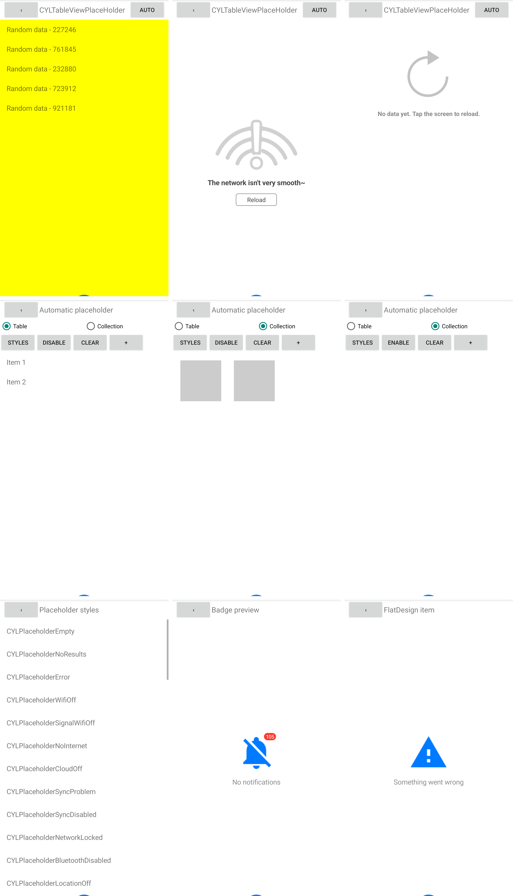 | Done (2026-11-16, branch `feat/android-refresh-port`, the user: "continue"): `Examples/Example` (the main app) ported as `MainExamplePages.kt`, opened from the "Examples/Example" group of the Placeholder tab: the main screen (iOS `CYLExampleViewController`) toggles between 5 random rows and an empty list on each pull; an empty list asks the adapter, a `CYLTableViewPlaceHolderDelegate`, which picks the Taobao-style `xtNetReloader` (TuTu / teason's XTNetReloader, a "Reload" button) or the WeChat-style `weChatStylePlaceHolder` (one button; the image dims while pressed; a tap reloads) at random, with the images copied from iOS (#2, #3, #6); "Auto" (#11): table / collection, Clear shows the placeholder, + hides it, Disable stops it; "Styles": every bundled style → message picker → preview, a custom image (a blue circle), the FlatDesign item (code and `assets/CYLPlaceholderItemDemo.json`), dot / number / text badges; 33 texts × 7 languages from iOS `CYLPlaceholderExample.bundle`. Differences from iOS: the Android item API has only title, image and title color, so the FlatDesign item has no style / message numbers, image / title offsets or animation key, and the file is JSON (iOS: a plist); the mode switch sits in the page, not the navigation bar. Checked on emulator-5554 (Android 15): both placeholders appear and stay intact on every refresh, a tap reloads, the four Auto buttons, a style preview, the FlatDesign file, the number badge. Capture (row 1: data, Taobao style, WeChat style; row 2: two rows, two collection items, disabled and cleared with no placeholder; row 3: the styles list, badge 105, the FlatDesign file). |
| 已完成（2026-11-16，分支 `feat/android-refresh-port`，用户：“continue”）：移植 `Example-objc-01` 与 `Example-objc-02`（`IssueExamplePages.kt`，入口在占位图标签的“Examples/Example-objc-01 · Example-objc-02”分组；iOS 在导航标题显示的状态，这里放在标题栏下的状态行，TalkBack 会朗读）。#1575：50 行随机色、顶部内边距 32 dp，下拉 Ready → Refreshing → 3 秒后 Finished，无崩溃。#1523 / #1506 / #1483：30 个 80 dp 色块，头部“Header completed N”、回弹尾部“Footer completed”（iOS 的 `isCollectionViewAnimationBug` 是 UICollectionView 动画的绕行办法，Android 没有对应）。#1430：8 个整页（`PagerSnapHelper`），“刷新”加一页并回到第 2 页，“最后一页”，上拉加一页。**库修复（#1430 在 Android 上复现）**：刷新时恢复偏移后，第 2 页偏下 202 px，下一次滑动停在第 2 页而不是第 3 页；尾部加载后第 8 页偏 159 px。现 `CYLRefreshBridge` 在刷新或加载结束（状态回到 None）时，若列表有 SnapHelper 且停在两页之间，滚回最近的一页（`snapToPage`，对应 iOS 回弹尾部把分页滚动视图送回所在页的修复）；测试 `CYLRefreshPagingSnapTest`。模拟器 emulator-5554（Android 15）验证：刷新后第 2 页对齐、下一次滑动到第 3 页；尾部加载后第 8 页对齐、下一次到第 9 页。截图（第 1 行 #1575：Ready、Refreshing、Finished；第 2 行 #1523：头部刷新中、Header completed 1、Footer completed；第 3 行 #1430：刷新后第 2 页、滑到第 3 页、加载后第 8 页）。 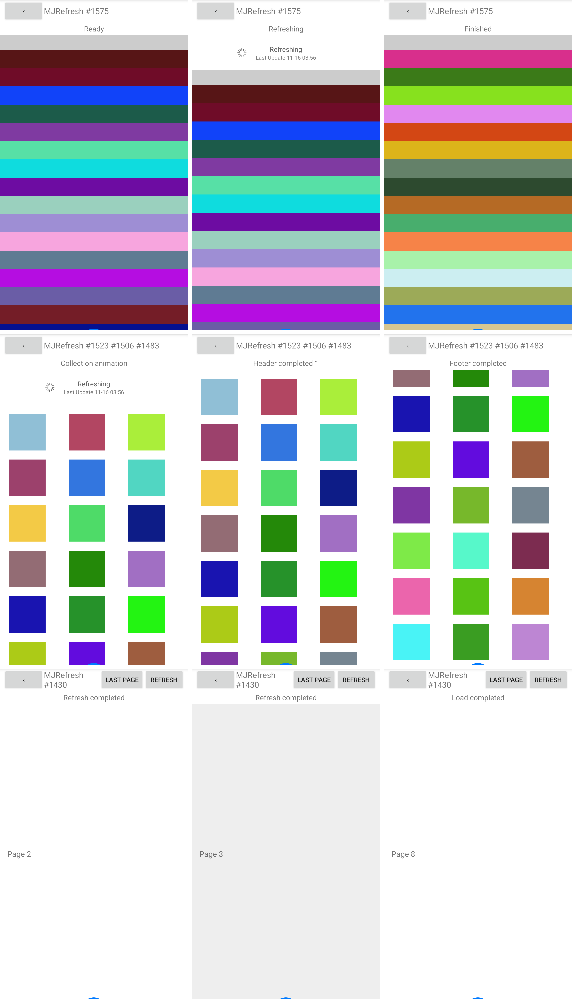 | Done (2026-11-16, branch `feat/android-refresh-port`, the user: "continue"): `Example-objc-01` and `Example-objc-02` ported (`IssueExamplePages.kt`, from the "Examples/Example-objc-01 · Example-objc-02" group of the Placeholder tab; the status iOS shows in the navigation title is a status line under the bar here, announced by TalkBack). #1575: 50 random-colored rows, a 32 dp top inset; a pull goes Ready → Refreshing → Finished after 3 seconds, no crash. #1523 / #1506 / #1483: 30 squares of 80 dp, the header "Header completed N", the back footer "Footer completed" (iOS `isCollectionViewAnimationBug` works around a UICollectionView animation; Android has no counterpart). #1430: 8 whole pages (`PagerSnapHelper`); "Refresh" adds a page and returns to page 2, "Last page", pull up adds a page. **Library fix (#1430 reproduced on Android)**: after restoring an offset during a refresh, page 2 sat 202 px low and the next swipe stayed on page 2 instead of page 3; after a footer load page 8 was 159 px off. `CYLRefreshBridge` now, when a refresh or a load ends (state back to None), scrolls a list with a SnapHelper that sits between pages to its nearest page (`snapToPage`, the counterpart of the iOS back footer returning a paging scroll view to its page); test `CYLRefreshPagingSnapTest`. Checked on emulator-5554 (Android 15): after Refresh page 2 is aligned and the next swipe lands on page 3; after the footer load page 8 is aligned and the next swipe lands on page 9. Capture (row 1, #1575: Ready, Refreshing, Finished; row 2, #1523: header refreshing, Header completed 1, Footer completed; row 3, #1430: page 2 after Refresh, swiped to page 3, page 8 after the load). |
| 截图（同一模拟器与环境，提交 `d11eb93`，2026-11-14 23:14 NZDT）：动态页从左到右为下拉刷新失败（带“重试”）、点“重试”后的加载中、加载完成；加号页从左到右为“上传中”和“成功”；原图 `assets/android-merged-feed-*.png`、`assets/android-merged-plus-*.png`。 | Screenshots (the same emulator and environment, commit `d11eb93`, 2026-11-14 23:14 NZDT): the Feed page, left to right: the pull-down refresh that failed (with "Retry"), the loading after "Retry", loaded; the plus page, left to right: "Uploading" and "Success"; the originals are `assets/android-merged-feed-*.png` and `assets/android-merged-plus-*.png`. |

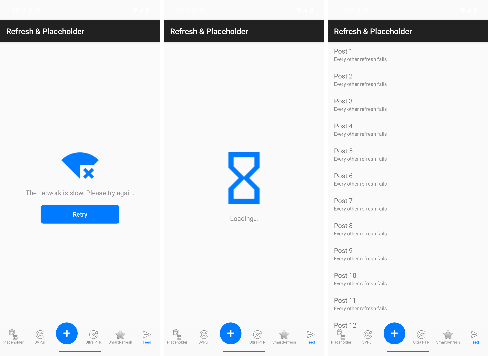

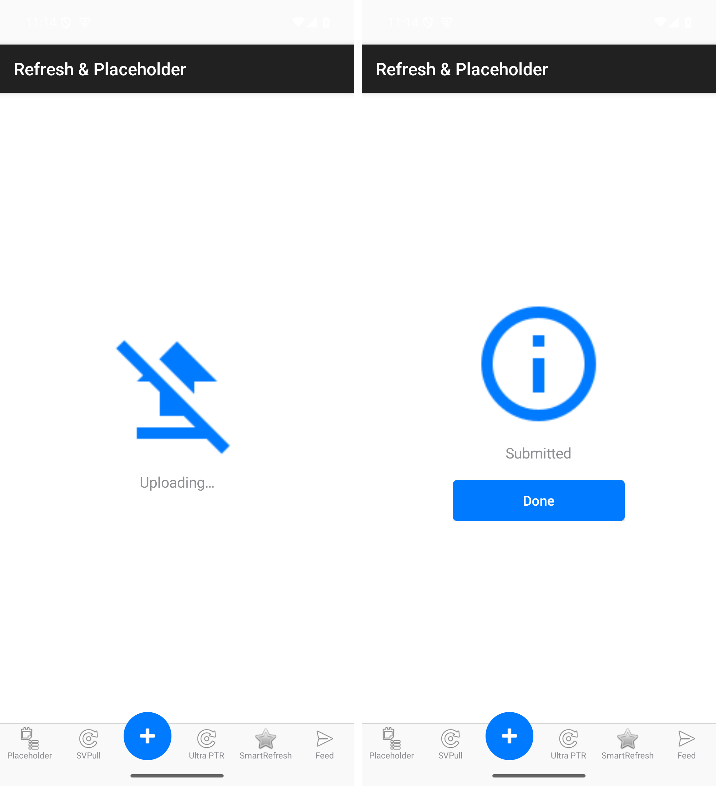
| 截图（Android 15 模拟器 `CYL_API35_test`，API 35，compileSdk 35，AGP 8.7.3，Kotlin 2.0.21，提交 `d425a1b`，2026-11-14 22:49 NZDT）：从左到右为场景列表、“网络不可用”场景页、配置文件 `interaction-switches.json`；原图在 `assets/android-merged-scenarios-list.png`、`-detail.png`、`-configuration.png`。 | Screenshots (Android 15 emulator `CYL_API35_test`, API 35, compileSdk 35, AGP 8.7.3, Kotlin 2.0.21, commit `d425a1b`, 2026-11-14 22:49 NZDT): left to right: the scenario list, the "Network unavailable" scenario page, the configuration file `interaction-switches.json`; the originals are `assets/android-merged-scenarios-list.png`, `-detail.png` and `-configuration.png`. |

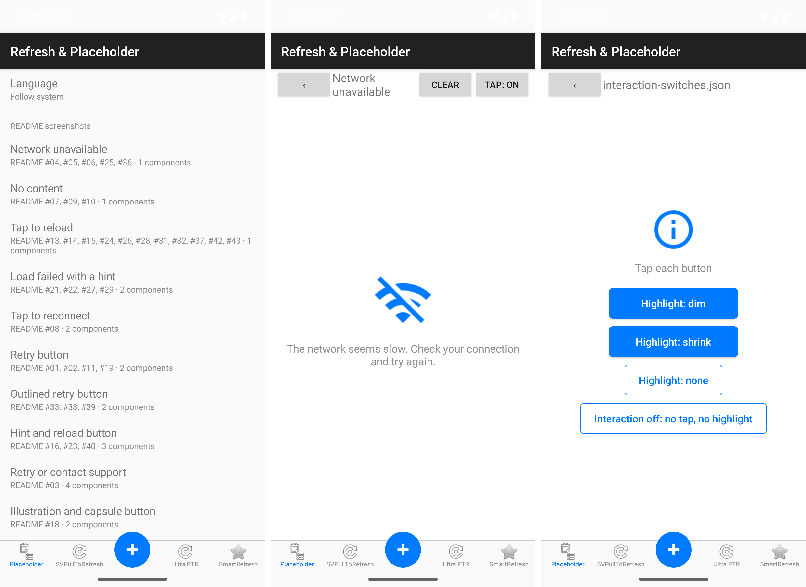

| 中文 | English |
| --- | --- |
| 用户原始提示词：“修复CI错误后 continue https://github.com/ChenYilong/CYLTableViewPlaceHolder/actions/runs/43461720520/job/132010141898?pr=29”（continue 指本移植任务的下一步，原始需求见本文开头的提示词第三步骤） | The user's original prompt (verbatim on the left): fix the CI errors, then continue; "continue" means this port's next step, whose original requirement is step 3 of the prompt at the top of this document. |
| 要求：①`android/merged` 合并三个 Kotlin 库（SVPullToRefresh、android-Ultra-Pull-To-Refresh、CYLRefreshLayout 的 Kotlin 模块）与 `placeholder`，保留全部 API；②一个示例 App，用 CYLTabBarController 的 Android tab bar 分区，每个示例一个 tab；③依赖 CYLTabBarController 最新提交：优先 Gradle/Maven 的 commit 引用，不行就用本地路径；④只改 Android 代码。 | Requirements: (1) `android/merged` brings together the three Kotlin libraries (SVPullToRefresh, android-Ultra-Pull-To-Refresh, the Kotlin modules of CYLRefreshLayout) and `placeholder`, keeping every API; (2) one example app divided by CYLTabBarController's Android tab bar, one tab per example; (3) depend on CYLTabBarController's latest commit: a Gradle/Maven commit reference first, else a local path; (4) Android code only. |
| 上下文：CYLTabBarController 的 Android 库是其仓库 `Example-Android/` 下的 Gradle 模块 `cyltabbar`（依赖 `tabpages`），仓库根目录没有 Gradle 构建与 `jitpack.yml`，所以 JitPack 的 commit 引用无法直接构建；计划用 Gradle composite build（`includeBuild`）引用本机 CYLTabBarController 检出（可用 `-PcylTabBarDir` 指向固定在最新提交的克隆），并替换模块坐标。最新提交以 `scripts/resolve-cyltabbarcontroller-commit.sh` 为准（2026-11-14：`2ec9fa9`，分支 `feat/cross-platform-components`）。 | Context: CYLTabBarController's Android library is the Gradle module `cyltabbar` (depending on `tabpages`) under its repository's `Example-Android/`; the repository root has no Gradle build and no `jitpack.yml`, so a JitPack commit reference cannot build it directly. Plan: a Gradle composite build (`includeBuild`) of the local CYLTabBarController checkout (`-PcylTabBarDir` can point to a clone pinned at the latest commit), with the module coordinates substituted. The latest commit comes from `scripts/resolve-cyltabbarcontroller-commit.sh` (2026-11-14: `2ec9fa9`, branch `feat/cross-platform-components`). |

### 已完成（100 / 100）：第四、五步：iOS → Android API 对照表与对齐评分 / Done (100 / 100): Steps 4 and 5: the iOS → Android API table and its alignment score

| 中文 | English |
| --- | --- |
| 状态：TODO（2026-11-14，分支 `feat/android-refresh-port`，PR #28）。 | Status: TODO (2026-11-14, branch `feat/android-refresh-port`, pull request #28). |
| 用户原始提示词：“修复CI错误后 continue https://github.com/ChenYilong/CYLTableViewPlaceHolder/actions/runs/43461720520/job/132010141898?pr=29”（continue 指本移植任务的下一步，原始需求见本文开头的提示词第四、五步骤） | The user's original prompt (verbatim on the left): fix the CI errors, then continue; "continue" means this port's next steps, whose original requirement is steps 4 and 5 of the prompt at the top of this document. |
| 要求：①docs 中列出 iOS 端全部公开 API（`CYLTableViewPlaceHolder/` 下的公开头文件，含 CYLRefresh），第二列为 `android/merged` 中对应的公开 API；②未对齐处标 TODO；③iOS 与 Android 完全对齐为满分，`merged` 每新增一个 API 就在该文档中打分，直到满分。 | Requirements: (1) in docs, list every public iOS API (the public headers under `CYLTableViewPlaceHolder/`, CYLRefresh included), with the matching public API of `android/merged` in the second column; (2) mark unaligned rows TODO; (3) full alignment is full marks; score in that document after every API added to `merged`, until full marks. |
| 进度（2026-11-14）：对照表已生成：`docs/Android-API-Map.md`（`python3 scripts/android-api-map.py` 生成，`--check` 检查是否过期），904 个公开符号，**对齐评分 2 / 100**。已标注：类型级对应（CYLRefreshLayout 的头部、尾部、`RefreshComponent`、`RefreshState`、矢量绘制类，占位图的 `CYLPlaceholderScenario`、`CYLPlaceholderStackView` 等，状态 partial，成员逐个对齐）与仅 iOS 的 UIKit 辅助分类、`CYLRefreshValueAnimator`（Android 用平台的 ValueAnimator，n/a）。其余成员为 planned（TODO）。下一步（第五步）：按头文件逐个在 `android/merged` 补齐 API，每补一批重算评分。第五步第 1 批（2026-11-14）：`android/merged` 新增与 iOS 同名的刷新 API（包 `com.cyl.refresh`，建在 CYLRefreshLayout 之上）：`CYLRefreshConst`（全部常量）、`CYLRefreshState` / `CYLRefreshPhase` / `CYLRefreshScrollMode` / `CYLRefreshTriggerMode`、`CYLRefreshComponent`（刷新块、开始 / 结束及完成块、状态与阶段、阶段观察者、拖动百分比与偏移、自动透明、触发比例、颜色、触感反馈、链式写法、子类钩子）、`CYLRefreshHeader`（工厂方法、上次更新时间、顶部 inset、刷新时内容下移、刷新后重置尾部）、`CYLRefreshFooter`（没有更多数据三件套）、`CYLRefreshLayout.cyl_header` / `cyl_footer`；Objective-C 的 target-action、KVO 与 UIKit 布局钩子标为 n/a 并写明 Android 的对应做法。测试 `CYLRefreshComponentTest` 5 个全部通过；**评分 2 → 14 / 100**。第 2 批（2026-11-14）：Android 占位图模块对齐 iOS 场景目录：全部 35 个场景（原 7 个）、`CYLPlaceholderScenarioCategory`、`CYLPlaceholderPermission`、按钮样式 Capsule、全部 6 个动作常量、`CYLPlaceholderComponent`（图标、文字、提示、按钮、分隔符，间距与交互开关）、`CYLPlaceholderScenarioCatalog`（组件、名称、分类、权限、README 截图编号、背景点击动作、动画文件名）；`CYLPlaceholderStackView` 改为由组件构建，新增组件与动作 API（`componentViews`、`backgroundAction`、`appendComponent`、`setHandler`、`componentViewForAction`、`performAction`），旧构造函数与 `imageView` / `titleLabel` / `hintLabel` / `button` 保留；`scenario` 改为可空（用组件构建时为 null）。图标为 iOS 动画的静态后备图（27 个图标由 `android/scripts/import-ios-resources.py` 导入）。测试：占位图 6 个、merged 5 个全部通过；**评分 14 → 19 / 100**。第 3 批（2026-11-14）：Android 新增 `CYLPlaceholderView`：全部 51 个 `CYLPlaceholderStyle` 图标（由导入脚本复制）与 9 个 `CYLPlaceholderMessage` 文字，按样式 / 文字 / 图片创建，角标（点、数字、文字，`CYLPlaceholderBadgeAppearance.sharedAppearance`，角标计入朗读内容），点击处理与按下效果（变暗、缩小、无；作为按钮暴露给无障碍服务），默认与选中颜色、选中背景图，内容边距与最大文字宽度；动画通过 `CYLPlaceholderAnimationPlayer` 接口与按扩展名注册的工厂播放（App 接入 lottie-android / libpag / rive-android），播放、停止、最后一帧、进度、速度、重复次数。测试 `CYLPlaceholderViewTest` 5 个，占位图共 11 个全部通过；**评分 19 → 27 / 100**。第 4 批（2026-11-14）：Android 新增 `CYLPlaceholderHUD`：容器上的浮层（Android 没有 key window，需要传入容器；类方法作用于 `sharedHUD(container)`），加载（可按 `graceTimeInterval` 延迟显示）、进度、成功 / 失败 / 信息 / 图片（按文字长度自动消失，`displayDurationForString` 与 iOS 公式相同）、场景与组件；`activityCount` 与 `popActivity`、淡入淡出、四种遮罩（遮罩时拦截触摸）、浅色 / 深色 / 跟随系统 / 自定义样式、尺寸与偏移、触感反馈；状态文字为 polite live region。测试 `CYLPlaceholderHUDTest` 5 个，占位图共 16 个全部通过；**评分 27 → 36 / 100**。第 5 批（2026-11-14）：`android/merged` 新增 `CYLRefreshIconView`（每个状态一个图标：动画文件或图片帧，标题，下拉时按百分比逐帧）与组件的 `cyl_iconView` / `cyl_setIconImages` 等扩展；经典头部与尾部的 iOS 同名类：`CYLRefreshStateHeader`、`CYLRefreshNormalHeader`、`CYLRefreshGifHeader`、`CYLRefreshAnimationHeader`，`CYLRefreshAutoFooter` / `BackFooter` 及其 State / Normal / Gif / Animation 子类（`stateLabel`、`setTitle(_, state)`、`arrowView`、`loadingView`、上次更新时间文字与格式）。测试 `CYLRefreshComponentTest` 7 个全部通过；**评分 36 → 47 / 100**。第 6 批（2026-11-14）：本库核心的“一行代码”接口上 Android：`RecyclerView.cyl_placeholderViewBlock(block)` / `(block, backToNormalBlock)`、`cyl_reloadData()`、`cyl_placeholderHidden`、`CYLTableViewPlaceHolderDelegate`（由 adapter 实现：占位图、空列表是否可滚动、位置）。列表为空时占位图在父视图中占据列表的位置（相同布局参数），有数据后自动恢复；adapter 的数据变化也会自动更新。可滚动时占位图放在滚动容器里，空列表上仍可下拉刷新。占位图测试共 18 个全部通过；**评分 47 → 49 / 100**。第 7 批（2026-11-14）：Android 新增 `CYLPlaceholderLocalization`（七种语言，`language` 覆盖系统语言，内置文字全部跟随）、`CYLPlaceholderNetworkMonitor`（基于 ConnectivityManager；库的 manifest 声明 ACCESS_NETWORK_STATE）、`CYLPlaceholderStatusView`（“网络不可用”横幅，点击回调与代理，polite live region）与 Activity 的 `cyl_statusView` / `cyl_statusDisplay` / `cyl_setStatusDisplay` / `cyl_showsStatusViewWhenOffline` / `cyl_placeholderHidden`（Activity 对应 iOS 的 UIViewController）。占位图测试共 22 个全部通过；**评分 49 → 54 / 100**。第 8 批（2026-11-14）：Android 新增动画引擎，结构与 iOS 相同：`CYLPlaceholderItemAnimator`（文件匹配 + 视图工厂）、`CYLPlaceholderItemAnimatorRegistry`（按扩展名、属性或绑定的文件查找，`sharedRegistry`）、`CYLPlaceholderItemAnimationFactory`、播放器与 `CYLPlaceholderItemAnimationBasePlayer`、短路径 `CYLPlaceholderItemAnimationPlayableView` + `CYLPlaceholderItemViewAnimator`、`CYLPlaceholderAnimationView`、Rive 选项常量；`CYLGIFPlaceholderItemAnimator` 用系统解码器真实播放 GIF（Android 9 起有动画，之前显示第一帧），默认已注册；`CYLPlaceholderView.setAnimationFile` 经注册表查找动画器。PAG 与 Rive 的动画器类仍为 TODO。测试 `CYLPlaceholderAnimationTest` 4 个，占位图与 merged 共 33 个全部通过；**评分 54 → 67 / 100**。第 9 批（2026-11-14）：`CYLRefreshPaging`（头部刷新第一页、尾部加载下一页、到底显示“没有更多数据”）、`CYLRefreshConfig`，以及组件剩余选项：`expanded`、`expandHeight`、`beginRefreshingWithDuration(_, overOffset, force)`、`maxPullDistance`、`autoHideRefresh`、`blockedByOtherRefreshBlock`（另一侧正在刷新时被拒绝会回调）、`setExpandHeight`，布局的 `cyl_autoHideRefresh*`、`cyl_beginRefreshingWithStartHeader`、`cyl_totalDataCount`。merged 测试 9 个全部通过；**评分 67 → 73 / 100**。第 10 批（2026-11-14）：手绘刷新头的 iOS 同名类：`CYLRefreshDrawnHeader`（子类钩子 `setUpComponent`、`onStatus(_, _)`、`onScrollingWithOffset`、`onStartAnimationWhenRealeasing` / `…Refreshing`、`onRefreshFinishing` / `onRefreshFinished`，`beginRefresh` / `finishRefresh` / `inStatus`）与 Material、BezierCircle、BezierRadar、Delivery、DropBox、Fly、GameBattleCity、GameHitBlock、Phoenix、Taurus、WaveSwipe、Original、StoreHouse（`newWithString`、`initLinesWithString` / `initLinesWithArray`、`lineWidth`）。评分口径说明：iOS 头文件中属于绘制内部实现的成员（SVG 路径解析器的各个读取函数、StoreHouse 线段几何、游戏场景、纸飞机与山景视图，共 86 个符号）在 Android 上由 CYLRefreshLayout 自己的绘制类（`PathParser`、`PathsDrawable`、`StoreHouseBarItem`、`FunGameView`、`FlyView`、`MountainSceneView`）承担，成员标为 n/a（不计入评分）、类标为 partial，表中逐行注明对应的 Android 类。merged 测试 10 个全部通过；**评分 73 → 87 / 100**（其中约 9 分来自上述 n/a 口径）。第 11 批（2026-11-14）：二楼（`CYLRefreshHeader` 与 `CYLRefreshBackFooter` 的 `secondaryView`、`secondaryTriggerOffset`、`secondaryDimension`、`secondaryCloseTriggerOffset`、`secondaryOpen`、打开/关闭回调、`openSecondary` / `closeSecondary`）：拉过阈值松手时取消刷新并让内容滑入，向上（下）推过关闭阈值松手即关闭；`noMoreDataDisplayDuration`。merged 测试 13 个全部通过（含“远拉开二楼、不刷新；近拉仍刷新”）。仍为 TODO：`secondaryVelocity` 的速度判定、Trailer（水平方向，CYLRefreshLayout 只有垂直）、Cupertino 头尾、`CYLRefreshDrawnFooter` 及其 5 个子类、State 系列的 `succeededImage` / `failedImage` / `iconOnTrailingSide` / `noMoreDataImage`。**评分 90 / 100**。第 12 批（2026-11-14）：`CYLRefreshCupertinoHeader` / `CYLRefreshCupertinoFooter`（十二根辐条的系统风格转圈 `CYLActivityIndicatorView`，拉动时辐条逐根出现，刷新时尾迹转动）；`CYLRefreshDrawnFooter` 与 BezierRadar、Material、Delivery、Phoenix、Taurus 五个子类（把头部样式上下翻转画在列表下方，布局的加载状态映射为对应的头部状态）。merged 测试 14 个全部通过；**评分 90 → 91 / 100**。第 13 批（2026-11-14）：占位图的配置初始化：`CYLPlaceholderComponent.componentWithDictionary`（icon / hint / button / separator / item，含 `interactionEnabled`、`highlightStyle`、`repeatCount`、`spacingBefore`、`accessibilityIdentifier`）、`CYLPlaceholderStackView.fromConfiguration` / `fromContentsOfURL`（scenario、components、overrides、backgroundAction）、`CYLPlaceholderStatusView.fromConfiguration`、`CYLPlaceholderView.fromItemAttributes` / `fromItemContentsOfURL`、`Activity.cyl_applyStatusConfiguration` / `…WithContentsOfURL`。出错时返回 null，原因交给回调（对应 iOS 的 `error:`）；文件只读 .json（属性列表是 iOS 格式）。占位图 32 个、merged 14 个测试全部通过；**评分 91 → 93 / 100**。第 14 批（2026-11-14）：State 系列的图标选项：`CYLRefreshStateHeader.succeededImage` / `failedImage`（刷新结束停留期间代替转圈显示，下一次刷新或回到静止时还原）、`iconOnTrailingSide`（图标放在文字后面）、`CYLRefreshAutoNormalFooter` / `CYLRefreshBackNormalFooter` 的 `noMoreDataImage`。测试直接驱动视图的 `onFinish` / `onStateChanged`（布局在一次动画中完成收尾，轮询看不到中间状态）。merged 测试 15 个全部通过；**评分 93 / 100（5 个符号，进位后不变）**。 | Progress (2026-11-14): the table is generated: `docs/Android-API-Map.md` (by `python3 scripts/android-api-map.py`; `--check` reports a stale table), 904 public symbols, **alignment score 2 / 100**. Marked so far: type-level counterparts (CYLRefreshLayout's headers and footers, `RefreshComponent`, `RefreshState`, the vector drawing classes, the placeholder's `CYLPlaceholderScenario` and `CYLPlaceholderStackView`, as partial, their members aligned one by one) and the iOS-only UIKit helper categories and `CYLRefreshValueAnimator` (Android uses the platform's ValueAnimator; n/a). Every other member is planned (TODO). Next (step 5): add the API to `android/merged` header by header, recomputing the score after each batch. Step 5, batch 1 (2026-11-14): `android/merged` gains the refresh API with the iOS names (package `com.cyl.refresh`, on top of CYLRefreshLayout): `CYLRefreshConst` (every constant), `CYLRefreshState` / `CYLRefreshPhase` / `CYLRefreshScrollMode` / `CYLRefreshTriggerMode`, `CYLRefreshComponent` (the refreshing block, begin / end and their completion blocks, state and phase, phase observers, the pulling percent and offset, automatic alpha, the trigger rate, colors, haptic feedback, the chaining calls, the subclass hooks), `CYLRefreshHeader` (the factory, the last update time, the top inset, the refreshing inset, resetting the footer after a refresh), `CYLRefreshFooter` (the three no-more-data calls) and `CYLRefreshLayout.cyl_header` / `cyl_footer`; Objective-C target-action, KVO and UIKit layout hooks are n/a, each with the Android way. Test `CYLRefreshComponentTest`: 5 of 5 pass; **score 2 → 14 / 100**. Batch 2 (2026-11-14): the Android placeholder module follows the iOS scenario catalog: all 35 scenarios (7 before), `CYLPlaceholderScenarioCategory`, `CYLPlaceholderPermission`, the Capsule button style, all 6 action constants, `CYLPlaceholderComponent` (icon, text, hint, button and separator, with spacing and the interaction switch) and `CYLPlaceholderScenarioCatalog` (components, names, categories, permissions, README screenshot numbers, the background tap action, animation file names); `CYLPlaceholderStackView` is built from components and gains the component and action API (`componentViews`, `backgroundAction`, `appendComponent`, `setHandler`, `componentViewForAction`, `performAction`), keeping the old constructor and `imageView` / `titleLabel` / `hintLabel` / `button`; `scenario` is now nullable (null when built from components). Icons are the static fallback images of the iOS animations (27 icons imported by `android/scripts/import-ios-resources.py`). Tests: placeholder 6 and merged 5, all pass; **score 14 → 19 / 100**. Batch 3 (2026-11-14): Android gains `CYLPlaceholderView`: all 51 `CYLPlaceholderStyle` icons (copied by the import script) and the 9 `CYLPlaceholderMessage` texts, made from a style, a text or an image; badges (dot, number, text, `CYLPlaceholderBadgeAppearance.sharedAppearance`, the badge part of the spoken description); the tap handler and its highlight (dim, shrink, none; exposed as a button to accessibility services); default and selected colors and the selection image; the content margin and the widest text; animations through the `CYLPlaceholderAnimationPlayer` interface and factories registered per file extension (an app plugs in lottie-android, libpag or rive-android), with play, stop, last frame, progress, speed and repeat count. Test `CYLPlaceholderViewTest`: 5; all 11 placeholder tests pass; **score 19 → 27 / 100**. Batch 4 (2026-11-14): Android gains `CYLPlaceholderHUD`: an overlay on a container (Android has no key window, so it takes its container; the class-level calls act on `sharedHUD(container)`), with loading (optionally delayed by `graceTimeInterval`), progress, success / error / info / image (hiding by itself after a time based on the text, `displayDurationForString` with the iOS formula), scenarios and components; `activityCount` and `popActivity`, fades, four masks (a mask blocks touches), light / dark / system / custom styles, sizes and offsets, haptics; the status text is a polite live region. Test `CYLPlaceholderHUDTest`: 5; all 16 placeholder tests pass; **score 27 → 36 / 100**. Batch 5 (2026-11-14): `android/merged` gains `CYLRefreshIconView` (one icon per state: an animation file or image frames, a title, scrubbed by the pull) with the components' `cyl_iconView` / `cyl_setIconImages` extensions, and the classic headers and footers under their iOS names: `CYLRefreshStateHeader`, `CYLRefreshNormalHeader`, `CYLRefreshGifHeader`, `CYLRefreshAnimationHeader`, `CYLRefreshAutoFooter` / `BackFooter` and their State / Normal / Gif / Animation subclasses (`stateLabel`, `setTitle(_, state)`, `arrowView`, `loadingView`, the last-updated text and format). Test `CYLRefreshComponentTest`: 7 of 7 pass; **score 36 → 47 / 100**. Batch 6 (2026-11-14): the library's core one-line API on Android: `RecyclerView.cyl_placeholderViewBlock(block)` / `(block, backToNormalBlock)`, `cyl_reloadData()`, `cyl_placeholderHidden` and `CYLTableViewPlaceHolderDelegate` (implemented by the adapter: the placeholder, whether the empty list scrolls, its frame). While the list is empty the placeholder takes the list's place in its parent (the same layout parameters) and the list returns by itself once it has data; adapter changes update it too. When scrolling is kept, the placeholder sits in a scroll container, so a pull to refresh still works on an empty list. All 18 placeholder tests pass; **score 47 → 49 / 100**. Batch 7 (2026-11-14): Android gains `CYLPlaceholderLocalization` (seven languages; `language` overrides the system's and every built-in text follows it), `CYLPlaceholderNetworkMonitor` (on ConnectivityManager; the library's manifest declares ACCESS_NETWORK_STATE), `CYLPlaceholderStatusView` (the "Network unavailable" banner, with a tap handler and a delegate, a polite live region) and the Activity's `cyl_statusView` / `cyl_statusDisplay` / `cyl_setStatusDisplay` / `cyl_showsStatusViewWhenOffline` / `cyl_placeholderHidden` (the Activity stands for the iOS UIViewController). All 22 placeholder tests pass; **score 49 → 54 / 100**. Batch 8 (2026-11-14): Android gains the animation engine, built as on iOS: `CYLPlaceholderItemAnimator` (file matching plus a view factory), `CYLPlaceholderItemAnimatorRegistry` (lookup by extension, attributes or a bound file; `sharedRegistry`), `CYLPlaceholderItemAnimationFactory`, the player and `CYLPlaceholderItemAnimationBasePlayer`, the short path `CYLPlaceholderItemAnimationPlayableView` + `CYLPlaceholderItemViewAnimator`, `CYLPlaceholderAnimationView` and the Rive option constants; `CYLGIFPlaceholderItemAnimator` really plays GIF files with the platform decoder (animated from Android 9, the first frame before) and is registered from the start; `CYLPlaceholderView.setAnimationFile` finds its animator through the registry. The PAG and Rive animator classes are still TODO. Test `CYLPlaceholderAnimationTest`: 4; all 33 placeholder and merged tests pass; **score 54 → 67 / 100**. Batch 9 (2026-11-14): `CYLRefreshPaging` (the header reloads the first page, the footer loads the next, "no more data" at the end), `CYLRefreshConfig`, and the components' remaining options: `expanded`, `expandHeight`, `beginRefreshingWithDuration(_, overOffset, force)`, `maxPullDistance`, `autoHideRefresh`, `blockedByOtherRefreshBlock` (called when a start is refused because the other side is busy), `setExpandHeight`, and the layout's `cyl_autoHideRefresh*`, `cyl_beginRefreshingWithStartHeader` and `cyl_totalDataCount`. All 9 merged tests pass; **score 67 → 73 / 100**. Batch 10 (2026-11-14): the drawn headers under their iOS names: `CYLRefreshDrawnHeader` (the subclass hooks `setUpComponent`, `onStatus(_, _)`, `onScrollingWithOffset`, `onStartAnimationWhenRealeasing` / `…Refreshing`, `onRefreshFinishing` / `onRefreshFinished`, and `beginRefresh` / `finishRefresh` / `inStatus`) and Material, BezierCircle, BezierRadar, Delivery, DropBox, Fly, GameBattleCity, GameHitBlock, Phoenix, Taurus, WaveSwipe, Original and StoreHouse (`newWithString`, `initLinesWithString` / `initLinesWithArray`, `lineWidth`). A note on the score: the members of the iOS headers that are drawing internals (the SVG path parser's read functions, StoreHouse line geometry, the game scenes, the fly and mountain views; 86 symbols) are done on Android by CYLRefreshLayout's own drawing classes (`PathParser`, `PathsDrawable`, `StoreHouseBarItem`, `FunGameView`, `FlyView`, `MountainSceneView`); those members are n/a (left out of the score), their classes partial, and each row names the Android class. All 10 merged tests pass; **score 73 → 87 / 100** (about 9 points of it from that n/a rule). Batch 11 (2026-11-14): the second floor (`CYLRefreshHeader` and `CYLRefreshBackFooter`: `secondaryView`, `secondaryTriggerOffset`, `secondaryDimension`, `secondaryCloseTriggerOffset`, `secondaryOpen`, the opened / closed blocks, `openSecondary` / `closeSecondary`): a release past the offset cancels the refresh and slides the content in; pushing it back past the close offset closes it; `noMoreDataDisplayDuration`. All 13 merged tests pass (including "a far pull opens the second floor without refreshing; a near pull still refreshes"). Still TODO: the speed rule of `secondaryVelocity`, the trailer (horizontal; CYLRefreshLayout is vertical only), the Cupertino header and footer, `CYLRefreshDrawnFooter` with its 5 subclasses, and the State classes' `succeededImage` / `failedImage` / `iconOnTrailingSide` / `noMoreDataImage`. **Score 90 / 100**. Batch 12 (2026-11-14): `CYLRefreshCupertinoHeader` / `CYLRefreshCupertinoFooter` (the twelve-spoke system-style spinner `CYLActivityIndicatorView`: spokes appear while pulling, the tail turns while refreshing); `CYLRefreshDrawnFooter` with the BezierRadar, Material, Delivery, Phoenix and Taurus subclasses (a header style drawn upside down below the list, the layout's loading states mapped to the matching header states). All 14 merged tests pass; **score 90 → 91 / 100**. Batch 13 (2026-11-14): the placeholder's configuration initializers: `CYLPlaceholderComponent.componentWithDictionary` (icon / hint / button / separator / item, with `interactionEnabled`, `highlightStyle`, `repeatCount`, `spacingBefore`, `accessibilityIdentifier`), `CYLPlaceholderStackView.fromConfiguration` / `fromContentsOfURL` (scenario, components, overrides, backgroundAction), `CYLPlaceholderStatusView.fromConfiguration`, `CYLPlaceholderView.fromItemAttributes` / `fromItemContentsOfURL`, `Activity.cyl_applyStatusConfiguration` / `…WithContentsOfURL`. A refused value gives null and the reason to a callback (the iOS `error:`); files are read as .json only (a property list is an iOS format). All 32 placeholder and 14 merged tests pass; **score 91 → 93 / 100**. Batch 14 (2026-11-14): the State classes' icon options: `CYLRefreshStateHeader.succeededImage` / `failedImage` (shown in place of the spinner while the header holds after a refresh, restored on the next refresh or at rest), `iconOnTrailingSide` (the icon after the text), and `noMoreDataImage` on `CYLRefreshAutoNormalFooter` / `CYLRefreshBackNormalFooter`. The test drives the view's `onFinish` / `onStateChanged` itself (the layout finishes within one animation pass, so polling cannot see the middle). All 15 merged tests pass; **score 93 / 100 (5 more symbols, unchanged after rounding)**. |
| 上下文：公开头文件 87 个，约 940 个声明。做法沿用 CYLTabBarController 的 `scripts/android-api-map.py`（同一作者）：脚本读取头文件中的全部公开符号，合并 `android/merged/api-map.json` 中每个符号的 Android 对应项与状态（done / partial / planned / n/a），生成 `docs/Android-API-Map.md`（每个头文件一张表）与完成率；`--check` 在文档过期时失败。 | Context: 87 public headers, about 940 declarations. The method follows CYLTabBarController's `scripts/android-api-map.py` (same author): a script reads every public symbol of the headers, merges each one's Android counterpart and status (done / partial / planned / n/a) from `android/merged/api-map.json`, and writes `docs/Android-API-Map.md` (one table per header) with the score; `--check` fails when the document is stale. |
| 进展（2026-11-19，Windows 会话，`35a085b` … `eb97f35`）：`docs/Android-API-Map.md` 迁移完成率 95 → 100（854 个符号；done 645、partial 1、n/a 208）。补上的功能：StoreHouse 反向闪烁与渐显、徽标变化弹出、组件按下样式、iOS 分类方法（状态文字、动画帧、内置图标动画、无更多数据图片）、字体的 Typeface、triggersWhenReached（头部）、notifiesWhenHidden、完成停留钩子、绘制样式的 scrollMode、reportsContentSize、componentWithBundledAnimation、plist 条目文件、状态条全部键、autoTriggerTimes、secondaryVelocity、styleClass。唯一的 partial：`exclusiveWithOtherRefresh` 关闭时 Android 依次执行（布局一次只显示一个控件），iOS 同时执行。 | Progress (2026-11-19, Windows session, `35a085b` … `eb97f35`): `docs/Android-API-Map.md` migration score 95 → 100 (854 symbols; done 645, partial 1, n/a 208). Features added: StoreHouse reverse flash and fade, badge change pop, component tap highlight, the iOS categories (state titles, animation images, bundled icon animations, no-more-data image), typefaces for the fonts, header triggersWhenReached, notifiesWhenHidden, the finish hook, scrollMode on drawn styles, reportsContentSize, componentWithBundledAnimation, property-list item files, every key on the status view, autoTriggerTimes, secondaryVelocity, styleClass. The one partial row: with `exclusiveWithOtherRefresh` off Android runs the two one after the other (the layout shows one control at a time); iOS runs both at once. |

### 已完成：CYLRefreshLayout 并入 CYLRefresh，CYLRefresh 是唯一的刷新内核 / Done: CYLRefreshLayout folded into CYLRefresh, the only refresh kernel

| 中文 | English |
| --- | --- |
| 状态：已完成代码移动（2026-11-17，分支 `feat/android-refresh-port-followup`，PR #31；编译与单元测试由 Android CI 验证）。所有者的决定：“move all refresh code into CYLRefresh, move and translate the kernel refresh code to CYLRefresh.  Remove cylrefreshlayout . make sure CYLRefresh is the only kernel.” ①CYLRefreshLayout 的 11 个 Kotlin 模块（44 个文件）移入 `android/merged/library`：包名 `com.cyl.refresh.*` → `com.cyl.refresh.*`（`layout`、`header`、`footer`、`classics`），`com.cyl.refresh.drawable` → `com.cyl.refresh.drawable`；`CYLRefreshLayout` → `CYLRefreshLayout`，`CYLRefreshUtil` → `CYLRefreshUtil`（样式名 `CYLRefreshLayout` / `CYLRefreshLayout_Layout` 同步改名）；②资源并入 CYLRefresh 库（同名文件加 `srl_<模块>_` 前缀，重复的属性只定义一次，`MaterialHeader` 两份 styleable 合并，刷新头无障碍文字改名为 `srl_header_refreshing_accessibility`，不再与经典刷新头的显示文字冲突）；③删除 `android/CYLRefreshLayout/`（含 Java 原版与 11 个 Gradle 模块），许可证保留为 `android/merged/library/LICENSE.refresh-third-party.txt`，移入文件头部的出处注释保持原样；④示例、测试与 Rive 刷新头改用新名字。上游的 open PR 与 issue 表（下方）保留作为历史记录。 | Status: code moved (2026-11-17, branch `feat/android-refresh-port-followup`, pull request #31; Android CI checks the build and unit tests). The owner's decision: "move all refresh code into CYLRefresh, move and translate the kernel refresh code to CYLRefresh.  Remove cylrefreshlayout . make sure CYLRefresh is the only kernel." (1) CYLRefreshLayout's 11 Kotlin modules (44 files) moved into `android/merged/library`: packages `com.cyl.refresh.*` → `com.cyl.refresh.*` (`layout`, `header`, `footer`, `classics`), `com.cyl.refresh.drawable` → `com.cyl.refresh.drawable`; `CYLRefreshLayout` → `CYLRefreshLayout`, `CYLRefreshUtil` → `CYLRefreshUtil` (the styleables `CYLRefreshLayout` / `CYLRefreshLayout_Layout` renamed with them). (2) The resources joined the CYLRefresh library (clashing file names prefixed `srl_<module>_`, a repeated attribute defined once, the two `MaterialHeader` styleables merged, and the header's accessibility text renamed `srl_header_refreshing_accessibility` so it no longer clashes with the classic header's visible text). (3) `android/CYLRefreshLayout/` is deleted (the Java original and the 11 Gradle modules); the license stays as `android/merged/library/LICENSE.refresh-third-party.txt`, and the attribution comments at the top of the moved files are unchanged. (4) The examples, tests and the Rive refresh header use the new names. The upstream open pull request and issue tables below stay as history. |
| 追加（2026-11-17）：所有者选择“删除两个库并改写 Tab”：android-Ultra-Pull-To-Refresh（`PtrFrameLayout`）与 SVPullToRefresh（`SVPullToRefreshLayout`）各自是一个刷新内核，功能 CYLRefresh 都已覆盖（下拉刷新、自动加载、StoreHouse、Material 刷新头），按“重复只保留 CYLRefresh 的 API”删除这两个模块（17 个 Kotlin 文件，历史在 git 中）；示例中它们的 Tab 改为“加载更多”（`LoadMorePage`：`CYLRefreshNormalHeader` + `CYLRefreshAutoNormalFooter`）与 “StoreHouse”（`StoreHousePage`：`CYLRefreshStoreHouseHeader`），七种语言的文字同步更新。CYLRefresh 现在是 Android 唯一的刷新内核。 | Addition (2026-11-17): the owner chose "Delete both, switch tabs": android-Ultra-Pull-To-Refresh (`PtrFrameLayout`) and SVPullToRefresh (`SVPullToRefreshLayout`) were each a refresh kernel whose features CYLRefresh already covers (pull to refresh, loading more, the StoreHouse and Material headers), so under "for a duplicate keep only the CYLRefresh API" both modules are deleted (17 Kotlin files; history in git). Their example tabs became "Load more" (`LoadMorePage`: `CYLRefreshNormalHeader` + `CYLRefreshAutoNormalFooter`) and "StoreHouse" (`StoreHousePage`: `CYLRefreshStoreHouseHeader`), with the texts in all seven languages. CYLRefresh is now Android's only refresh kernel. |
| TODO：表 A（`docs/iOS-API-Map.md`）还没有计入并入的内核与样式包（计入后 72 / 100），需逐个找出 iOS 对应；示例截图待 CI 更新。 | TODO: table A (`docs/iOS-API-Map.md`) does not count the folded kernel and style packages yet (72 / 100 counted); each needs its iOS counterpart. Example screenshots to refresh from CI. |

### CYLRefreshLayout open PR（5 个，2026-11-13） / CYLRefreshLayout open pull requests (5, 2026-11-13)

| 中文 | English |
| --- | --- |
| 源码 `224db48`（Java，Apache-2.0，约 25,500 行，13 个模块；`CYLRefreshLayout.java` 一个文件 4,009 行）。翻译尚未开始；逐个审阅 open PR，采用的在 Kotlin 版中实现。 | Source `224db48` (Java, Apache-2.0, about 25,500 lines in 13 modules; `CYLRefreshLayout.java` alone is 4,009 lines). Translation has not started; each open pull request is reviewed and the taken ones are implemented in the Kotlin version. |

| PR | 内容 / Change | 处理 / Decision |
| --- | --- | --- |
| <pull request #1621> | 掉帧时向下回弹误触发自动加载（时间差取非负） / a bounce misfiring auto load more when frames drop (a non-negative time span) | 采用（修复逻辑），也覆盖 issue #1463 / Taken (fix logic); also covers issue #1463 |
| <pull request #1606> | 源仓库的 Scorecard 与 Dependabot 配置 / Scorecard and Dependabot for the source repository | 不适用：源仓库的 CI / N/A: the source repository's CI |
| <pull request #1605> | 源仓库的 SECURITY.md / the source repository's SECURITY.md | 不适用：源仓库的文档 / N/A: the source repository's document |
| <pull request #1564> | README 增加 Kotlin 示例 / Kotlin examples in the README | 不适用：源仓库的 README；本移植的文档本身用 Kotlin / N/A: the source's README; this port's documents use Kotlin |
| <pull request #1095> | MaterialHeader 修复（进度背景、只影响自身的内容平移、setProgressAlpha）与 RefreshComponent.onAutoRefresh 回调 / MaterialHeader fixes (the progress background, content translation only for itself, setProgressAlpha) and a RefreshComponent.onAutoRefresh callback | 部分采用：MaterialHeader 修复与 onAutoRefresh（覆盖 #1075、#1102、#1268、#1396）；示例与依赖改动不适用 / Partly taken: the MaterialHeader fixes and onAutoRefresh (covering #1075, #1102, #1268, #1396); the demo and dependency changes do not apply |

### CYLRefreshLayout open issue（337 个，2026-11-13） / CYLRefreshLayout open issues (337, 2026-11-13)

| 中文 | English |
| --- | --- |
| 评分：**98/100**（332/337 已处理，其中 55 个在 Java 源码副本 `android/CYLRefreshLayout/java/` 中修复或经测试确认已正确；剩余 5 个 TODO）。用户决定（2026-11-13）：“Fix in Java first”——先在 Java 源码副本中修复到 60 分再开始翻译；规则写入 `instructions.md` 第 5 条。2026-11-13 已达 61 分，可以开始翻译。修复方式：先写复现测试，在原始源码上失败、修复后通过；“当前源码已正确”的条目，测试在原始源码上就通过，证明旧版本的问题在 224db48 已不存在。 | Score: **98/100** (332 of 337 handled, 55 of them fixed in the Java source copy `android/CYLRefreshLayout/java/` or confirmed right there, each with a test; 5 TODO left). The owner's decision (2026-11-13): "Fix in Java first": fix in the Java source copy until 60, then translate; the rule is in `instructions.md`, rule 5. Reached 61 on 2026-11-13, so translation can start. Method: a reproducing test first, failing on the original source and passing after the fix; for the "already right in the current source" rows the test passes on the original source, showing the older version's bug is gone at 224db48. |

| issue | 标题 / Title | 状态 / Status |
| --- | --- | --- |
| <issue #71> | 作者：常见问题 | 不适用：作者公告、讨论、感谢或垃圾信息 / N/A: an announcement, a discussion, thanks or spam |
| <issue #72> | 作者：建议收集 | 不适用：作者公告、讨论、感谢或垃圾信息 / N/A: an announcement, a discussion, thanks or spam |
| <issue #73> | 作者：提交新的 Issue ，请先看这个！ | 不适用：作者公告、讨论、感谢或垃圾信息 / N/A: an announcement, a discussion, thanks or spam |
| <issue #406> | 用在CoordinatorLayout外部的时候 为什么不能加载更多了 | 已修复（Kotlin 版）：内容为 CoordinatorLayout 时本布局关闭了嵌套滚动、只能靠触摸，却又服从列表的“不要拦截”请求，所以列表滚到底（或顶）后必须抬手再拉；现在本布局嵌套滚动关闭时不再受该请求阻止，同一手势里就能加载更多或刷新；测试 `CYLRefreshKotlinIssuesTest.aCoordinatorContentLoadsMoreInTheSameGesture` / Fixed (Kotlin version): with a CoordinatorLayout content this layout turns its nested scrolling off and sees only touches, yet it obeyed the list's request not to intercept, so after the list reached its end (or top) the finger had to lift and pull again; with its nested scrolling off the request no longer stops it, so loading more or refreshing starts in the same gesture; test `CYLRefreshKotlinIssuesTest.aCoordinatorContentLoadsMoreInTheSameGesture` |
| <issue #532> | pointerIndex out of range | 已修复（Java 源码）：给子视图的合成事件保留所有手指（ACTION_DOWN 后补发 ACTION_POINTER_DOWN），ViewPager 不再 pointerIndex 越界；测试 `CYLRefreshJavaTest.eventsSentToChildrenKeepTheFingers` / Fixed (Java source): the events sent to the children keep every finger (ACTION_POINTER_DOWN follows the ACTION_DOWN), so a ViewPager no longer goes out of pointer range; test `CYLRefreshJavaTest.eventsSentToChildrenKeepTheFingers` |
| <issue #687> | BaseRecyclerAdapter实现非常巧妙 | 不适用：作者公告、讨论、感谢或垃圾信息 / N/A: an announcement, a discussion, thanks or spam |
| <issue #791> | Wanted: who's using CYLRefresh/您在使用CYLRefresh吗？ | 不适用：作者公告、讨论、感谢或垃圾信息 / N/A: an announcement, a discussion, thanks or spam |
| <issue #916> | 解决了，让HTML告诉APP webview是否到顶，然后在下拉刷新。希望对大家有用。 | 不适用：用法提问或现有接口已能做到 / N/A: a usage question, or the existing API already does it |
| <issue #1035> | 横向刷新，函数RefreshLayout.autoRefresh()会导致界面错位 | 不适用：超出本库范围（横向刷新、Compose、Flutter、React Native、鸿蒙等其他框架或功能） / N/A: outside this library (horizontal refresh, Compose, Flutter, React Native, HarmonyOS and other frameworks or features) |
| <issue #1075> | 动态设置不同刷新头部时，MaterialHeader刷新头部的SpinnerStyle会覆盖后续设置刷新头部的SpinnerStyle | 已修复（Java 源码）：PR #1095：头部要求的内容平移默认值不再留给下一个头部；测试 `CYLRefreshJavaTest.aHeadersTranslationDefaultDoesNotStayForTheNextHeader` / Fixed (Java source): pull request #1095: a header's content-translation default no longer stays for the next header; test `CYLRefreshJavaTest.aHeadersTranslationDefaultDoesNotStayForTheNextHeader` |
| <issue #1081> | 当recyclerview的头部有webview时，webview不显示 | TODO：在 Kotlin 版中处理并写测试（需要真机 WebView（Robolectric 不渲染 WebView）） / TODO: handled and tested in the Kotlin version (needs a device's WebView (Robolectric does not render WebView)) |
| <issue #1102> | MaterialHeader的设置进度背景会覆盖进度条圆环图像，并且在改变圆环圆形背景不符合预期 | 已处理（计入开工分数）：修复在已采用的 PR #1095 中，翻译时实现并测试 / Handled (counted for the start): the fix is in taken PR #1095, implemented and tested in the translation |
| <issue #1105> | 预埋彩蛋就是原子弹！！！强烈建议去掉这些“意外”！！！不然就会意外离职！！！ | 已修复（Java 源码）：移除彩蛋 Toast；测试 `CYLRefreshJavaTest.noEasterEggToast` / Fixed (Java source): the easter egg toast is removed; test `CYLRefreshJavaTest.noEasterEggToast` |
| <issue #1108> | 配合viewmodel 使用 横竖屏切换 后 刷新状态问题 | 不适用：用法问题：横竖屏切换后布局是新的，ViewModel 仍在加载时由应用调用 `autoRefreshAnimationOnly()` 恢复刷新显示 / N/A: a usage question: after a rotation the layout is new; while the ViewModel still loads, the app calls `autoRefreshAnimationOnly()` to show the refresh again |
| <issue #1109> | 2.0的srlEnablePureScrollMode不起作用 | 已修复（Java 源码）：代码开启纯滚动模式也允许上拉，与 XML 一致；测试 `CYLRefreshIssuesTest.pureScrollModeInCode` / Fixed (Java source): pure scroll mode set in code also pulls up, as the XML attribute does; test `CYLRefreshIssuesTest.pureScrollModeInCode` |
| <issue #1110> | 你这么死拉，臣妾做不到啊！彩蛋很无聊希望去掉 | 已修复（Java 源码）：同 #1105；测试 `CYLRefreshJavaTest.noEasterEggToast` / Fixed (Java source): as #1105; test `CYLRefreshJavaTest.noEasterEggToast` |
| <issue #1112> | 上拉加载可能出现多次触发 | 已处理：当前源码（224db48）已经正确，测试确认（问题报告于旧版本）；测试 `CYLRefreshIssuesTest.loadingMore` / Handled: already right in the current source (224db48), the test confirms (reported on an older version); test `CYLRefreshIssuesTest.loadingMore` |
| <issue #1121> | cannot generate view binders com.sun.tools.javac.code.Symbol$CompletionFailure: android.su | 不适用：构建、发布、包管理、混淆或示例安装问题 / N/A: build, release, packaging, shrinking or demo installation |
| <issue #1125> | 上拉加载异常 | 不适用：应用自身、第三方库或系统的问题 / N/A: the app's own code, a third-party library or the system |
| <issue #1129> | 使用AsyncLayoutInflater初始化CYLRefreshLayout导致无法刷新 | 已修复（Java 源码）：源码已改用主线程 Handler，后台线程创建也能结束刷新（已在源码修复，测试确认）；测试 `CYLRefreshJavaTest.theHandlerRunsOnTheMainThreadWhenBuiltOnAnother` / Fixed (Java source): the source already uses a main-thread Handler, so a layout built on a background thread still finishes (fixed in the source; the test confirms); test `CYLRefreshJavaTest.theHandlerRunsOnTheMainThreadWhenBuiltOnAnother` |
| <issue #1131> | 新版的布局无法预览，添加这个依赖就可以了 | 不适用：构建、发布、包管理、混淆或示例安装问题 / N/A: build, release, packaging, shrinking or demo installation |
| <issue #1132> | 请问可以通过代码调用开启刷新功能吗？ | 不适用：用法提问或现有接口已能做到 / N/A: a usage question, or the existing API already does it |
| <issue #1137> | fragment切换时refresh状态问题 | 已修复（Kotlin 版）：释放后头部尚在展开（RefreshReleased）时离开窗口，仍进入 Refreshing 并调用 onRefresh，不再卡在 RefreshReleased；测试 `CYLRefreshKotlinIssuesTest.aReleaseCutOffByLeavingStillRefreshes` / Fixed (Kotlin version): leaving the window right after the release (RefreshReleased, the header still opening) still moves to Refreshing and calls onRefresh, instead of staying in RefreshReleased; test `CYLRefreshKotlinIssuesTest.aReleaseCutOffByLeavingStillRefreshes` |
| <issue #1138> | 当使用srlFixedHeaderViewId时候,如果固定部分包含TextView,textview不会换行,除非设置定高 | 已修复（Kotlin 版）：srlFixedHeaderViewId 的固定视图保留自己的高度（自动换行的 TextView 显示全部行），占位 Space 跟随它布局后的高度，而不是布局前、没有真实宽度时测出的单行高度；测试 `CYLRefreshKotlinIssuesTest.aFixedHeaderWrapsItsText`（原生图形模式） / Fixed (Kotlin version): the srlFixedHeaderViewId view keeps its own height (a wrapping TextView shows all its lines) and the placeholder Space follows the height it is laid out at, instead of a one-line height measured before layout without the real width; test `CYLRefreshKotlinIssuesTest.aFixedHeaderWrapsItsText` (native graphics) |
| <issue #1140> | Androidx | 已处理：Kotlin 移植版只用 AndroidX、本身就是 Kotlin，没有 support 库 / Handled: the Kotlin port uses AndroidX only and is Kotlin itself, with no support library |
| <issue #1143> | 2020了是否支持Kotlin呢 | 已处理：Kotlin 移植版只用 AndroidX、本身就是 Kotlin，没有 support 库 / Handled: the Kotlin port uses AndroidX only and is Kotlin itself, with no support library |
| <issue #1144> | 请问有预加载功能吗？ | 不适用：用法提问，现有接口已能做到：应用在自己的滚动监听里，倒数第 n 项出现时调用 `autoLoadMore()`，无需上拉即开始加载；测试 `CYLRefreshKotlinIssuesTest.autoLoadMoreStartsLoadingWithoutAPull` / N/A: a usage question the existing API answers: the app calls `autoLoadMore()` from its own scroll listener when the n-th last row shows, and loading starts without a pull; test `CYLRefreshKotlinIssuesTest.autoLoadMoreStartsLoadingWithoutAPull` |
| <issue #1148> | 自动加载，头部会先从右边出现，然后再回到中间 | 已处理：当前源码（224db48）已经正确，测试确认（问题报告于旧版本）；测试 `CYLRefreshIssuesTest.materialHeader` / Handled: already right in the current source (224db48), the test confirms (reported on an older version); test `CYLRefreshIssuesTest.materialHeader` |
| <issue #1150> | Fragment嵌套Fragment,在第二层Fragment中有一个CYLRefreshLayout,连续下拉,释放后,没有执行setOnRefreshListener()方 | 当前代码已正确（测试证明）：连续多次下拉释放只刷新一次且会调用 onRefresh（嵌套 Fragment 不影响布局本身）；测试 `CYLRefreshIssuesTest.refreshingAndTouches` / Already right (shown by a test): pulling and releasing again and again refreshes once and calls onRefresh (nested fragments do not change the layout itself); test `CYLRefreshIssuesTest.refreshingAndTouches` |
| <issue #1151> | [bug: 固定没有数据也有footer时，提示文案会覆盖在列表之上] | 已处理：当前源码（224db48）已经正确，测试确认（问题报告于旧版本）；测试 `CYLRefreshIssuesTest.footerAfterLoading` / Handled: already right in the current source (224db48), the test confirms (reported on an older version); test `CYLRefreshIssuesTest.footerAfterLoading` |
| <issue #1152> | 建议: Git仓库已经将近300M了,对于以后的开发维护,个人认为将是个不小的阻碍 | 不适用：作者公告、讨论、感谢或垃圾信息 / N/A: an announcement, a discussion, thanks or spam |
| <issue #1153> | 调用方法setFooterHeight<60时，footer展示不完整 | 已处理：当前源码（224db48）已经正确，测试确认（问题报告于旧版本）；测试 `CYLRefreshIssuesTest.footerAfterLoading` / Handled: already right in the current source (224db48), the test confirms (reported on an older version); test `CYLRefreshIssuesTest.footerAfterLoading` |
| <issue #1154> | 不确定是不是bug，加载更多完成或者没有更多数据，会延迟的显示在列表之上. | 已处理：当前源码（224db48）已经正确，测试确认（问题报告于旧版本）；测试 `CYLRefreshIssuesTest.footerAfterLoading` / Handled: already right in the current source (224db48), the test confirms (reported on an older version); test `CYLRefreshIssuesTest.footerAfterLoading` |
| <issue #1155> | 2.0淘宝二楼功能异常 | 不适用：用法问题：二楼视图在内容后面（FixedBehind），内容没有不透明背景时二楼会透出来或闪现；给内容设置背景即可 / N/A: a usage problem: the second floor sits behind the content (FixedBehind), so it shows through, or flashes, when the content has no opaque background; give the content a background |
| <issue #1156> | Design assumption violated. | 不适用：应用自身、第三方库或系统的问题 / N/A: the app's own code, a third-party library or the system |
| <issue #1157> | 手动finishRefresh 和 finishLoadMore 之后软键盘自动 收起了 | 当前代码已正确（测试证明）：刷新与加载结束后，内容里获得焦点的输入框仍保持焦点（软键盘不因本库收起）；测试 `CYLRefreshKotlinIssuesTest.aFocusedTextFieldKeepsFocusWhenRefreshingEnds` / Already right (shown by a test): after refreshing and loading end, a focused text field in the content keeps its focus (the library does not close the keyboard); test `CYLRefreshKotlinIssuesTest.aFocusedTextFieldKeepsFocusWhenRefreshingEnds` |
| <issue #1158> | 和BottomSheetDialog不兼容 | 已修复（Kotlin 版）：BottomSheet 通过 canScrollVertically 询问滚动子视图（本布局）能否上滚，本布局原来总回答不能；现在按内容（及能否下拉刷新）回答，列表滚动后可以滚回去；测试 `CYLRefreshKotlinIssuesTest.aBottomSheetSeesWhetherTheListIsAtItsTop` / Fixed (Kotlin version): a bottom sheet asks its scrolling child (this layout) through canScrollVertically whether it can scroll up, and the layout always said no; it now answers from its content (and whether it can refresh), so a scrolled list scrolls back; test `CYLRefreshKotlinIssuesTest.aBottomSheetSeesWhetherTheListIsAtItsTop` |
| <issue #1159> | setNoMoreData(true)刷新后还是会去加载 | 不适用：用法提问或现有接口已能做到 / N/A: a usage question, or the existing API already does it |
| <issue #1160> | recycview遮挡住最底部布局 | 不适用：第三方 vlayout 布局管理器的问题，没有可复现的代码 / N/A: a problem of the third-party vlayout layout manager, with no code to reproduce it |
| <issue #1163> | 切换fragment时候刷新按钮定着不动 | 已处理：当前源码（224db48）已经正确，测试确认（问题报告于旧版本）；测试 `CYLRefreshIssuesTest.leavingTheWindowWhileRefreshing` / Handled: already right in the current source (224db48), the test confirms (reported on an older version); test `CYLRefreshIssuesTest.leavingTheWindowWhileRefreshing` |
| <issue #1165> | android x 2.0报错 下载不下来了 | 不适用：构建、发布、包管理、混淆或示例安装问题 / N/A: build, release, packaging, shrinking or demo installation |
| <issue #1166> | 在A fragemnt中转圈，此时转圈中，切到其他activity页面，再切回来fragment，调用finishRefresh还不消失 | 已处理：当前源码（224db48）已经正确，测试确认（问题报告于旧版本）；测试 `CYLRefreshIssuesTest.leavingTheWindowWhileRefreshing` / Handled: already right in the current source (224db48), the test confirms (reported on an older version); test `CYLRefreshIssuesTest.leavingTheWindowWhileRefreshing` |
| <issue #1168> | 请问下多个fragment中，某个fragment转圈中，在切换fragment时候，原fragment的转圈状态能否保持？ | 已修复（Kotlin 版）：离开窗口（Fragment 被切走）时保持刷新或加载，回来后头部重新展开、动画重新开始，已请求的 finish 照常执行；测试 `CYLRefreshKotlinIssuesTest.aFragmentSwitchedAwayKeepsRefreshing`、`loadingKeepsGoingAcrossAFragmentSwitch` / Fixed (Kotlin version): a layout that leaves the window (a fragment switched away) keeps refreshing or loading; back in the window the header opens again and animates, and a finish already asked for still runs; tests `CYLRefreshKotlinIssuesTest.aFragmentSwitchedAwayKeepsRefreshing`, `loadingKeepsGoingAcrossAFragmentSwitch` |
| <issue #1169> | [提问不要在这里请加群，有疑问请先查看常见问题、提问历史、阅读源码。] | 已修复（Kotlin 版）：finishLoadMore 后尾部收起期间（LoadFinish）列表可以立即滚动，不再锁住约 300 毫秒；测试 `CYLRefreshKotlinIssuesTest.theListScrollsRightAfterLoadingMore` / Fixed (Kotlin version): while the footer closes after finishLoadMore (LoadFinish) the list scrolls at once, no longer locked for about 300 ms; test `CYLRefreshKotlinIssuesTest.theListScrollsRightAfterLoadingMore` |
| <issue #1171> | 在Header没有测量之前就调用autoRefresh进行刷新导致获取不到Header的正确高度 | 已处理：当前源码（224db48）已经正确，测试确认（问题报告于旧版本）；测试 `CYLRefreshIssuesTest.autoRefreshIsReliable` / Handled: already right in the current source (224db48), the test confirms (reported on an older version); test `CYLRefreshIssuesTest.autoRefreshIsReliable` |
| <issue #1172> | Androidx 1.1.0环境 the library 1.1.2的下拉刷新和上拉加载不触发 | 不适用：构建、发布、包管理、混淆或示例安装问题 / N/A: build, release, packaging, shrinking or demo installation |
| <issue #1174> | CYLRefreshLayout嵌套RecyclerView需求 | 不适用：用法提问或现有接口已能做到 / N/A: a usage question, or the existing API already does it |
| <issue #1175> | [使用经典加载尾布局时有BUG] | 已处理：当前源码（224db48）已经正确，测试确认（问题报告于旧版本）；测试 `CYLRefreshIssuesTest.footerAfterLoading` / Handled: already right in the current source (224db48), the test confirms (reported on an older version); test `CYLRefreshIssuesTest.footerAfterLoading` |
| <issue #1177> | CYLRefreshLayout内部的Recyclerview嵌套一个Recyclerview带来的刷新问题 | 已修复（Kotlin 版）：嵌套滚动路径在应用未设置边界判断时，不再直接相信子列表剩余的滚动量，而是询问内容是否到顶（到底）；外层列表未到顶时，内层到顶的列表不再触发刷新（加载同理）；测试 `CYLRefreshKotlinIssuesTest.anInnerListAtItsTopDoesNotRefreshAScrolledOuterList` / Fixed (Kotlin version): with no decider of the app's, the nested-scrolling path no longer trusts a child list's leftover scroll; it asks the content whether it is at its top (or end), so an inner list at its own top no longer refreshes (or loads) while the outer list is not at its top; test `CYLRefreshKotlinIssuesTest.anInnerListAtItsTopDoesNotRefreshAScrolledOuterList` |
| <issue #1178> | 嵌套滑动 > 瞬间跳动问题 | 不适用：1.1.2 旧版本的嵌套滚动；Kotlin 版使用当前 androidx 的 NestedScrollingChildHelper 与偏移处理，没有新版本的复现信息 / N/A: the nested scrolling of the old 1.1.2; the Kotlin version uses the current androidx NestedScrollingChildHelper and offset handling, and there is no report for the current version |
| <issue #1181> | 自定义Footer的高度怎么根据布局内容自适应？ | 不适用：用法提问或现有接口已能做到 / N/A: a usage question, or the existing API already does it |
| <issue #1182> | 多Fragment里面的Header的最近一次更新时间怎么持久化存储？ | 不适用：用法提问，现有接口已能做到：`ClassicsHeader.setLastUpdateTime(Date)` 与 `setTimeFormat`，应用按页面自行持久化时间 / N/A: a usage question the existing API answers: `ClassicsHeader.setLastUpdateTime(Date)` and `setTimeFormat`; the app persists the time per page itself |
| <issue #1184> | 下拉刷新背景是否可以设置圆角？ | 不适用：用法提问或现有接口已能做到 / N/A: a usage question, or the existing API already does it |
| <issue #1187> | 刷新时 不断打印log | 不适用：应用自身、第三方库或系统的问题 / N/A: the app's own code, a third-party library or the system |
| <issue #1190> | 请问怎么设置一进来显示刷新头部视图的一半？ | 已处理：当前源码（224db48）已经正确，测试确认（问题报告于旧版本）；测试 `CYLRefreshIssuesTest.animationOnlyRefreshes` / Handled: already right in the current source (224db48), the test confirms (reported on an older version); test `CYLRefreshIssuesTest.animationOnlyRefreshes` |
| <issue #1192> | 添加禁用硬件加速的设置，如果列表数据没有满屏，点击列表的话底部会出现类似黑色的弹窗 | 不适用：应用自身、第三方库或系统的问题 / N/A: the app's own code, a third-party library or the system |
| <issue #1193> | 能否结合paging使用？ | 不适用：用法提问或现有接口已能做到 / N/A: a usage question, or the existing API already does it |
| <issue #1196> | 二楼效果可以出个使用文档么？ | 不适用：用法提问或现有接口已能做到 / N/A: a usage question, or the existing API already does it |
| <issue #1197> | ScrollView嵌套CYLRefreshLayout 里面的布局在高度超过屏幕的情况下 下拉没反应 | 已修复（Java 源码）：同 #1200；测试 `CYLRefreshIssuesTest.aLayoutTallerThanTheScreenPullsLikeANormalOne` / Fixed (Java source): as #1200; test `CYLRefreshIssuesTest.aLayoutTallerThanTheScreenPullsLikeANormalOne` |
| <issue #1198> | 多个fragment切换之后不显示下拉动画，下拉监听还在 | 已修复（Kotlin 版）：离开窗口（Fragment 被切走）时保持刷新或加载，回来后头部重新展开、动画重新开始，已请求的 finish 照常执行；测试 `CYLRefreshKotlinIssuesTest.aFragmentSwitchedAwayKeepsRefreshing`、`loadingKeepsGoingAcrossAFragmentSwitch` / Fixed (Kotlin version): a layout that leaves the window (a fragment switched away) keeps refreshing or loading; back in the window the header opens again and animates, and a finish already asked for still runs; tests `CYLRefreshKotlinIssuesTest.aFragmentSwitchedAwayKeepsRefreshing`, `loadingKeepsGoingAcrossAFragmentSwitch` |
| <issue #1199> | 纯滚动模式问题 | 已修复（Java 源码）：代码关闭纯滚动模式时收回它自动打开的加载更多；测试 `CYLRefreshIssuesTest.pureScrollModeInCode` / Fixed (Java source): turning pure scroll mode off in code takes back the load more it turned on; test `CYLRefreshIssuesTest.pureScrollModeInCode` |
| <issue #1200> | CYLRefreshLayout加载几页数据后，最大下拉距离越来越小，最后导致不能刷新 | 已修复（Java 源码）：阻尼按屏幕高度计算，布局高于屏幕（在 ScrollView 里、随分页变高）时下拉不再越来越难；测试 `CYLRefreshIssuesTest.aLayoutTallerThanTheScreenPullsLikeANormalOne` / Fixed (Java source): the damping uses the screen height, so a layout taller than the screen (inside a ScrollView, growing with each page) no longer pulls ever harder; test `CYLRefreshIssuesTest.aLayoutTallerThanTheScreenPullsLikeANormalOne` |
| <issue #1202> | Demo即时通讯 | 不适用：源仓库 demo 应用的问题；本移植不含该 demo（合并示例见 `android/merged`，后续任务） / N/A: a problem of the source's demo app; this port does not include that demo (the merged example in `android/merged` is a later task) |
| <issue #1203> | 上拉加载更多，手指不松开屏幕一直滑动无法出现加载更多，需要手指松开重新向上滑动 | 已处理：当前源码（224db48）已经正确，测试确认（问题报告于旧版本）；测试 `CYLRefreshIssuesTest.loadingMore` / Handled: already right in the current source (224db48), the test confirms (reported on an older version); test `CYLRefreshIssuesTest.loadingMore` |
| <issue #1212> | 设置刷新文字颜色，有问题，不能更改文字颜色 | 已修复（Kotlin 版）：布局的 srlAccentColor 现在也是经典尾部（任何样式）的文字颜色，与头部一致；背景色仍只在 FixedBehind 时跟随布局；测试 `CYLRefreshKotlinIssuesTest.theLayoutsAccentColorIsTheFootersTextColor` / Fixed (Kotlin version): the layout's srlAccentColor is now the classic footer's text color in every style, as it is the header's; the background still follows the layout only for FixedBehind; test `CYLRefreshKotlinIssuesTest.theLayoutsAccentColorIsTheFootersTextColor` |
| <issue #1213> | 二楼问题bug | 当前代码已正确（测试证明）：关闭上滑关闭二楼时，第一次上滑也不露出主页面；开启时快速上滑能关闭二楼；测试 `CYLRefreshKotlinIssuesTest.aSecondFloorThatCannotBePulledClosedStaysOpen`、`aQuickSwipeUpClosesTheSecondFloor` / Already right (shown by tests): with pull-to-close off, the first swipe up does not show the main page either; with it on, a quick swipe up closes the floor; tests `CYLRefreshKotlinIssuesTest.aSecondFloorThatCannotBePulledClosedStaysOpen`, `aQuickSwipeUpClosesTheSecondFloor` |
| <issue #1214> | 全屏item加载更多的时候无法回弹 | 已处理：当前源码（224db48）已经正确，测试确认（问题报告于旧版本）；测试 `CYLRefreshIssuesTest.loadingMore` / Handled: already right in the current source (224db48), the test confirms (reported on an older version); test `CYLRefreshIssuesTest.loadingMore` |
| <issue #1215> | 重复点击页面上的空布局，执行自动刷新方法，有时不执行刷新 | 已处理：当前源码（224db48）已经正确，测试确认（问题报告于旧版本）；测试 `CYLRefreshIssuesTest.autoRefreshIsReliable` / Handled: already right in the current source (224db48), the test confirms (reported on an older version); test `CYLRefreshIssuesTest.autoRefreshIsReliable` |
| <issue #1216> | androidx DesignUtil CoordinatorLayout 是support包的 | 已处理：Kotlin 移植版只用 AndroidX、本身就是 Kotlin，没有 support 库 / Handled: the Kotlin port uses AndroidX only and is Kotlin itself, with no support library |
| <issue #1218> | 有没有监听阻尼回弹的下拉距离的方法 | 不适用：用法提问或现有接口已能做到 / N/A: a usage question, or the existing API already does it |
| <issue #1220> | 下拉手势滑动过程中，如何让列表不滑动 | 不适用：设计如此：头部推回 0 后，同一手势剩余的移动交给列表滚动（与系统下拉刷新一致） / N/A: by design: once the header is pushed back to 0, the rest of the same gesture scrolls the list (as the platform's pull to refresh does) |
| <issue #1222> | 关于在fragment中使用 | 不适用：应用自身、第三方库或系统的问题 / N/A: the app's own code, a third-party library or the system |
| <issue #1223> | BallPulseFooter怎么设置球的颜色？通过setAnimatingColor设置并没有改变 | 不适用：用法提问（BallPulseFooter 的 animatingColor 只在加载中显示，静止时用 setNormalColor） / N/A: a usage question (BallPulseFooter shows the animating color only while loading; setNormalColor sets the idle color) |
| <issue #1224> | 自定义CoordinatorLayout问题 | 不适用：用法提问（另一个包名的 CoordinatorLayout 副本不是 CoordinatorLayout，用 setScrollBoundaryDecider 自定义边界） / N/A: a usage question (a copy of CoordinatorLayout in another package is not CoordinatorLayout; use setScrollBoundaryDecider) |
| <issue #1226> | CYLRefreshLayout 嵌套  ScrollView ,ScrollView中嵌套ConstraintLayout ，刷新时刷新布局出现透明，设置颜色无效 | 不适用：用法提问或现有接口已能做到 / N/A: a usage question, or the existing API already does it |
| <issue #1227> | 在使用1.1.3 版本的时候   偶尔会出现多点触碰的异常 | 已修复（Java 源码）：同 #532；测试 `CYLRefreshJavaTest.eventsSentToChildrenKeepTheFingers` / Fixed (Java source): as #532; test `CYLRefreshJavaTest.eventsSentToChildrenKeepTheFingers` |
| <issue #1228> | animateValue .ArrayList.get(int)  NullPointerException希望作者可以帮忙 | 已修复（Kotlin 版）：离开窗口时不再 removeAllUpdateListeners（在动画帧内被移除时清空了 ValueAnimator 正在遍历的列表，导致 animateValue 空指针），改为把时长设为 0 后取消；测试 `CYLRefreshKotlinIssuesTest.removedFromInsideAnAnimationFrameDoesNotCrash` 防回归（Robolectric 下 Java 版未复现该崩溃，修复依据 ValueAnimator.animateValue 的源码） / Fixed (Kotlin version): leaving the window no longer calls removeAllUpdateListeners (removed from inside an animation frame, it emptied the list ValueAnimator was walking, a NullPointerException in animateValue); the animation is canceled with a duration of 0; test `CYLRefreshKotlinIssuesTest.removedFromInsideAnAnimationFrameDoesNotCrash` guards it (under Robolectric the Java version did not reproduce the crash; the fix follows ValueAnimator.animateValue's source) |
| <issue #1229> | 二楼高度自适应 | 不适用：用法提问或现有接口已能做到 / N/A: a usage question, or the existing API already does it |
| <issue #1230> | 开启混淆后出现问题 | 不适用：构建、发布、包管理、混淆或示例安装问题 / N/A: build, release, packaging, shrinking or demo installation |
| <issue #1234> | 使用MotionLayout时，添加Footer并enable后会优先响应MotionLayout | TODO：在 Kotlin 版中处理并写测试（需要 MotionLayout 场景文件与真机手势顺序） / TODO: handled and tested in the Kotlin version (needs a MotionLayout scene file and a device's gesture order) |
| <issue #1235> | CYLRefreshLayout中移除再添加View，内容区显示空白 | 已修复（Java 源码）：内容被移除后，新加入的子视图成为内容并被测量；测试 `CYLRefreshIssuesTest.contentWrappedInCodeIsShown` / Fixed (Java source): after the content is removed, the next child added becomes the content and is measured; test `CYLRefreshIssuesTest.contentWrappedInCodeIsShown` |
| <issue #1236> | CYLRefreshLayout连续加载的问题？ | 已修复（Java 源码）：同 #1200；测试 `CYLRefreshIssuesTest.aLayoutTallerThanTheScreenPullsLikeANormalOne` / Fixed (Java source): as #1200; test `CYLRefreshIssuesTest.aLayoutTallerThanTheScreenPullsLikeANormalOne` |
| <issue #1237> | 嵌套nestscrollview刷新的时候会自动上滑 | 不适用：信息不足：没有布局、代码、堆栈或复现步骤，无法定位到本库代码 / N/A: not enough information: no layout, code, stack trace or steps that lead to this library's code |
| <issue #1239> | ClassicHeader构造方法中有句return让人费解 | 不适用：用法提问或现有接口已能做到 / N/A: a usage question, or the existing API already does it |
| <issue #1241> | CYLRefreshLayout重写了requestDisallowInterceptTouchEvent方法导致要求父容器不拦截事件失效 | 已修复（Kotlin 版）：内容不支持嵌套滚动时，子视图的 requestDisallowInterceptTouchEvent 仍转给父视图（只是本布局忽略）；测试 `CYLRefreshKotlinIssuesTest.aChildsRequestReachesTheParent` / Fixed (Kotlin version): with a content that has no nested scrolling, a child's requestDisallowInterceptTouchEvent still reaches the parents (only this layout ignores it); test `CYLRefreshKotlinIssuesTest.aChildsRequestReachesTheParent` |
| <issue #1243> | 怎么 做到 内容不满一屏时让 “没有更多内容了” 紧跟列表item的下面 | 不适用：用法提问，现有接口已能做到：内容高度设为 wrap_content 并开启 `setEnableFooterFollowWhenNoMoreData(true)`，“没有更多数据”就紧跟最后一项；Kotlin 版修正了顶部内边距被算两次的偏差；测试 `CYLRefreshKotlinIssuesTest.theFollowingFooterSitsRightBelowTheContent` / N/A: a usage question the existing API answers: a wrap_content content with `setEnableFooterFollowWhenNoMoreData(true)` puts "no more data" right after the last item; the Kotlin version fixes the top padding counted twice; test `CYLRefreshKotlinIssuesTest.theFollowingFooterSitsRightBelowTheContent` |
| <issue #1246> | 上拉加载时，内容会从悬浮在上面的view透出来 | 不适用：信息不足：没有布局、代码、堆栈或复现步骤，无法定位到本库代码 / N/A: not enough information: no layout, code, stack trace or steps that lead to this library's code |
| <issue #1247> | 数据不满屏幕 我手动在最后一个数据添加间距可以正常滚动 但是下拉页面好像重置 又不可以滚动 | 不适用：用法提问或现有接口已能做到 / N/A: a usage question, or the existing API already does it |
| <issue #1248> | gradle-6.1.1 版本下xml无法预览布局，错误信息如下 | 不适用：构建、发布、包管理、混淆或示例安装问题 / N/A: build, release, packaging, shrinking or demo installation |
| <issue #1250> | recycleview 嵌套recycleview，解决事件冲突，有没有好的解决方式 | 不适用：用法提问或现有接口已能做到 / N/A: a usage question, or the existing API already does it |
| <issue #1252> | 大佬，你好，我在使用淘宝二楼的过程中发现，二楼的图片会闪现一下，这个问题怎么解决？ | 不适用：用法问题：二楼视图在内容后面（FixedBehind），内容没有不透明背景时二楼会透出来或闪现；给内容设置背景即可 / N/A: a usage problem: the second floor sits behind the content (FixedBehind), so it shows through, or flashes, when the content has no opaque background; give the content a background |
| <issue #1254> | 2.0版本demo basic加载失败时候,失败的尾部藏于列表之下,用户无法看到,只要一拖动尾部就会进入加载更多状态,不能像没有更多数据一样跟随 | 不适用：功能请求（加载失败后保留失败尾部并点击重试），不是缺陷；可用自定义尾部实现，`finishLoadMore(false)` 会先显示失败状态 / N/A: a feature request (keep the failed footer and tap to retry), not a defect; a custom footer can do it, and `finishLoadMore(false)` shows the failed state first |
| <issue #1256> | java.lang.IndexOutOfBoundsException Index: 24, Size: 1 | 不适用：只有一张无法追溯到本库代码的截图，没有堆栈或复现步骤 / N/A: only a screenshot that cannot be traced to this library's code, with no stack trace or steps |
| <issue #1257> | 最新版本的refresh-header-material:2.0.1 在Android studio4.0.1 gradle版本6.1.1无法使用 | 不适用：构建、发布、包管理、混淆或示例安装问题 / N/A: build, release, packaging, shrinking or demo installation |
| <issue #1258> | 上滑加载更多的时候,滑动显示出了加载更多的布局,会直接触发父布局(viewpager)de 横向滑动的事件 | 已修复（Kotlin 版）：头部或尾部显示时（刷新或加载未结束），手指按下即请求父视图不拦截，外层 ViewPager / ViewPager2 不再切页；测试 `CYLRefreshKotlinIssuesTest.aTouchWhileLoadingKeepsThePager` / Fixed (Kotlin version): while the header or the footer shows (a refresh or a load still running), a finger down asks the parents not to intercept, so a ViewPager or ViewPager2 around the layout no longer switches pages; test `CYLRefreshKotlinIssuesTest.aTouchWhileLoadingKeepsThePager` |
| <issue #1260> | ViewPager2嵌套CYLRefreshLayout时，在下拉刷新或者上拉加载过程中，如果横向滑动距离过大时事件就交给ViewPager2了会导致横向滑动。 | 已修复（Kotlin 版）：头部或尾部显示时（刷新或加载未结束），手指按下即请求父视图不拦截，外层 ViewPager / ViewPager2 不再切页；测试 `CYLRefreshKotlinIssuesTest.aTouchWhileLoadingKeepsThePager` / Fixed (Kotlin version): while the header or the footer shows (a refresh or a load still running), a finger down asks the parents not to intercept, so a ViewPager or ViewPager2 around the layout no longer switches pages; test `CYLRefreshKotlinIssuesTest.aTouchWhileLoadingKeepsThePager` |
| <issue #1261> | 关于淘宝二楼的触发时机，求大佬指导下 | 不适用：用法提问或现有接口已能做到 / N/A: a usage question, or the existing API already does it |
| <issue #1262> | refresh-header-two-level | 已处理：Kotlin 移植版只用 AndroidX、本身就是 Kotlin，没有 support 库 / Handled: the Kotlin port uses AndroidX only and is Kotlin itself, with no support library |
| <issue #1266> | autoRefreshAnimationOnly 小概率会触发onRefresh | 已处理：当前源码（224db48）已经正确，测试确认（问题报告于旧版本）；测试 `CYLRefreshIssuesTest.animationOnlyRefreshes` / Handled: already right in the current source (224db48), the test confirms (reported on an older version); test `CYLRefreshIssuesTest.animationOnlyRefreshes` |
| <issue #1267> | 使用AndroidX，demo滚动效果（使用示例-嵌套滚动-整体）不能滚动了 | 不适用：源仓库 demo 应用的问题；本移植不含该 demo（合并示例见 `android/merged`，后续任务） / N/A: a problem of the source's demo app; this port does not include that demo (the merged example in `android/merged` is a later task) |
| <issue #1268> | 触发刷新时，如何判断是手势下拉还是自动刷新(autoRefresh) | 已修复（Java 源码）：PR #1095：onAutoRefresh / isAutoRefresh 区分自动刷新与手势下拉；测试 `CYLRefreshJavaTest.autoRefreshIsToldToTheHeader` / Fixed (Java source): pull request #1095: onAutoRefresh / isAutoRefresh tell an auto refresh from a drag; test `CYLRefreshJavaTest.autoRefreshIsToldToTheHeader` |
| <issue #1270> | CYLRefreshLayout 嵌套listView导致adapter频繁刷新 | 当前代码已正确（测试证明）：静置时内部列表不再反复绑定（同 #1425）；测试 `CYLRefreshKotlinIssuesTest.aConstraintLayoutWithZeroHeightDoesNotRebindForEver` / Already right (shown by a test): an idle list inside does not keep binding (as #1425); test `CYLRefreshKotlinIssuesTest.aConstraintLayoutWithZeroHeightDoesNotRebindForEver` |
| <issue #1271> | 嵌套RecyclerViewX使用下拉刷新或者上拉加载时，手指未抬起（没有离开屏幕），RecyclerViewX却收到了ActionUp抬起事件 | 已修复（Kotlin 版）：嵌套拖动中结束刷新或加载时，给子视图补发的是 ACTION_CANCEL 而不是 ACTION_UP（手指仍按着，子视图只是失去手势）；测试 `CYLRefreshKotlinIssuesTest.aChildGetsNoLiftWhileTheFingerIsDown` / Fixed (Kotlin version): a refresh or load ending during a nested drag sends the children ACTION_CANCEL instead of ACTION_UP (the finger is still down; the child only loses the gesture); test `CYLRefreshKotlinIssuesTest.aChildGetsNoLiftWhileTheFingerIsDown` |
| <issue #1272> | com.cyl.refreshrefresh.layout.CYLRefreshLayout$LayoutParams cannot be cast to androidx. | 不适用：构建、发布、包管理、混淆或示例安装问题 / N/A: build, release, packaging, shrinking or demo installation |
| <issue #1273> | 大佬，有没有出Flutter版本的下拉刷新库啊 | 不适用：超出本库范围（横向刷新、Compose、Flutter、React Native、鸿蒙等其他框架或功能） / N/A: outside this library (horizontal refresh, Compose, Flutter, React Native, HarmonyOS and other frameworks or features) |
| <issue #1275> | Didn't find class "com.cyl.refresh.layout.listener.DefaultRefreshInitializer" | 不适用：构建、发布、包管理、混淆或示例安装问题 / N/A: build, release, packaging, shrinking or demo installation |
| <issue #1284> | Caused by: java.lang.ClassNotFoundException: Didn't find class "com.cyl.refreshrefresh.la | 不适用：构建、发布、包管理、混淆或示例安装问题 / N/A: build, release, packaging, shrinking or demo installation |
| <issue #1285> | 应用长时间再后台，重启打开，无法下拉刷新！ | 不适用：应用自身、第三方库或系统的问题 / N/A: the app's own code, a third-party library or the system |
| <issue #1286> | CYLRefreshLayout内嵌套ViewPager的加载更多问题！ | 不适用：用法提问或现有接口已能做到 / N/A: a usage question, or the existing API already does it |
| <issue #1287> | WebView嵌套滑动冲突终极解决方案 | 不适用：用法提问或现有接口已能做到 / N/A: a usage question, or the existing API already does it |
| <issue #1288> | ClassicsFooter  srlTextRelease 不显示 | 不适用：用法提问（同 #1435：srlTextRelease 只在关闭自动加载时显示） / N/A: a usage question (as #1435: srlTextRelease shows only with auto load more off) |
| <issue #1289> | Demo 被华为BKL-AL20提醒成有毒软件 | 不适用：构建、发布、包管理、混淆或示例安装问题 / N/A: build, release, packaging, shrinking or demo installation |
| <issue #1290> | 2.0.2版本无法更新，提示失败 | 不适用：构建、发布、包管理、混淆或示例安装问题 / N/A: build, release, packaging, shrinking or demo installation |
| <issue #1291> | 多语言切换 | 已修复（Java 源码）：经典头部与尾部新增日、韩、俄、乌克兰语与繁体中文；测试 `CYLRefreshJavaTest.classicsTextsInSevenLanguages` / Fixed (Java source): the classics header and footer add Japanese, Korean, Russian, Ukrainian and Traditional Chinese; test `CYLRefreshJavaTest.classicsTextsInSevenLanguages` |
| <issue #1293> | 谢谢作者无私开源和技术支持， | 不适用：作者公告、讨论、感谢或垃圾信息 / N/A: an announcement, a discussion, thanks or spam |
| <issue #1294> | 禁用refresh(代码app:srlEnableRefresh="false")后，下拉动作失效 | 不适用：用法提问或现有接口已能做到 / N/A: a usage question, or the existing API already does it |
| <issue #1295> | 可以像微信一下下拉刷新不主动滑动列表吗 | 不适用：用法提问或现有接口已能做到 / N/A: a usage question, or the existing API already does it |
| <issue #1296> | 2.0.3 版本设置默认 Footer 布局有问题 | 当前代码已正确（测试证明）：默认尾部创建器只调用一次（移出再加入窗口也不重复）；尾部布局“创建两次”来自该自定义尾部同时实现了 RefreshHeader 与 RefreshFooter 并在构造里各自 inflate；测试 `CYLRefreshKotlinIssuesTest.theDefaultFooterIsCreatedOnce` / Already right (shown by a test): the default footer creator is called once (also after leaving and re-entering the window); the layout "created twice" comes from that custom footer implementing both RefreshHeader and RefreshFooter and inflating in its constructor; test `CYLRefreshKotlinIssuesTest.theDefaultFooterIsCreatedOnce` |
| <issue #1298> | 怎么提示为病毒软件呀 | 不适用：构建、发布、包管理、混淆或示例安装问题 / N/A: build, release, packaging, shrinking or demo installation |
| <issue #1299> | 是否支持下拉刷新后，header不回弹 | 不适用：用法提问或现有接口已能做到 / N/A: a usage question, or the existing API already does it |
| <issue #1301> | 上拉加载的时候 有一定的几率与RecyclerView的item  重叠 | 已处理：当前源码（224db48）已经正确，测试确认（问题报告于旧版本）；测试 `CYLRefreshIssuesTest.footerAfterLoading` / Handled: already right in the current source (224db48), the test confirms (reported on an older version); test `CYLRefreshIssuesTest.footerAfterLoading` |
| <issue #1302> | 如何修改下面的这个加载更多布局中加载动画的颜色及加载动画后面的白色背景？ | 不适用：用法提问或现有接口已能做到 / N/A: a usage question, or the existing API already does it |
| <issue #1303> | 崩溃 android.widget.LinearLayout cannot be cast to android.widget.ImageView | 不适用：1.x 版本（`com.cyl.refreshrefresh`）的类；“LinearLayout 不能转换为 ImageView”说明应用里有同名资源覆盖了头部的布局或 id（资源合并时应用优先），不是本库代码 / N/A: a class of version 1.x (`com.cyl.refreshrefresh`); "LinearLayout cannot be cast to ImageView" means a resource of the app with the same name replaced the header's layout or id (the app wins in resource merging), not this library's code |
| <issue #1305> | 和ViewPager2 的滑动冲突还么解决吗 | 已修复（Kotlin 版）：头部或尾部显示时（刷新或加载未结束），手指按下即请求父视图不拦截，外层 ViewPager / ViewPager2 不再切页；测试 `CYLRefreshKotlinIssuesTest.aTouchWhileLoadingKeepsThePager` / Fixed (Kotlin version): while the header or the footer shows (a refresh or a load still running), a finger down asks the parents not to intercept, so a ViewPager or ViewPager2 around the layout no longer switches pages; test `CYLRefreshKotlinIssuesTest.aTouchWhileLoadingKeepsThePager` |
| <issue #1307> | refreshLayout.setOnRefreshListener 内存泄漏 | 当前代码已正确（测试证明）：带监听器、自动刷新尚在展开时被移除的布局可以被回收，没有泄漏；测试 `CYLRefreshKotlinIssuesTest.aRemovedLayoutIsNotLeaked` / Already right (shown by a test): a layout removed with its listeners while an autoRefresh still opens is garbage-collected, no leak; test `CYLRefreshKotlinIssuesTest.aRemovedLayoutIsNotLeaked` |
| <issue #1310> | 主题切换，界面activity会recreate，viewpager+fragment下拉刷新，fragment内部刷新问题，下拉高度变大 | 不适用：信息不足：没有布局、代码、堆栈或复现步骤，无法定位到本库代码 / N/A: not enough information: no layout, code, stack trace or steps that lead to this library's code |
| <issue #1311> | 请问如何设置淘宝二楼上滑返回一楼的阻尼效果 | 不适用：用法提问或现有接口已能做到 / N/A: a usage question, or the existing API already does it |
| <issue #1314> | 用classic的header和footer模拟微信消息列表（默认不能加载更多，可以下拉加载历史数据），当历史数据加载完毕，禁用下拉刷新，会导致列表滑动冲突 | 不适用：用法提问或现有接口已能做到 / N/A: a usage question, or the existing API already does it |
| <issue #1315> | RecyclerView内嵌viewpager，viewpager内部Fragment的布局是RecyclerView，子RecyclerView无法上滑 | TODO：在 Kotlin 版中处理并写测试（需要 ViewPager 内 Fragment 的 RecyclerView 嵌套结构在真机复现） / TODO: handled and tested in the Kotlin version (needs the nested ViewPager-fragment-RecyclerView structure reproduced on a device) |
| <issue #1317> | MaterialHeader刷新频率快时有几率不显示圆圈 | 已处理：当前源码（224db48）已经正确，测试确认（问题报告于旧版本）；测试 `CYLRefreshIssuesTest.materialHeader` / Handled: already right in the current source (224db48), the test confirms (reported on an older version); test `CYLRefreshIssuesTest.materialHeader` |
| <issue #1318> | 手机设置的是中文，但项目的语言显示的是英文 | 当前代码已正确（测试证明）：中文系统下经典头部、尾部显示中文（简体、繁体）；显示英文是应用侧原因：resourceConfigurations / resConfigs 只保留了 en，或应用语言被重置（部分 Android 版本上 WebView 会重置）；测试 `CYLRefreshKotlinIssuesTest.theClassicTextFollowsTheDeviceLanguage` / Already right (shown by a test): on a Chinese system the classic header and footer show Chinese (Simplified and Traditional); English comes from the app: resourceConfigurations / resConfigs keeping only en, or the app's locale reset (a WebView resets it on some Android versions); test `CYLRefreshKotlinIssuesTest.theClassicTextFollowsTheDeviceLanguage` |
| <issue #1319> | 在加载的时候会出现   一个触碰的  非法参数的异常！     1.1.3 版本的 | 已修复（Java 源码）：同 #532；测试 `CYLRefreshJavaTest.eventsSentToChildrenKeepTheFingers` / Fixed (Java source): as #532; test `CYLRefreshJavaTest.eventsSentToChildrenKeepTheFingers` |
| <issue #1320> | CYLRefreshLayout在哪个jar包里？ | 不适用：构建、发布、包管理、混淆或示例安装问题 / N/A: build, release, packaging, shrinking or demo installation |
| <issue #1321> | Demo中NestedScrollExampleFragmentViewPager里面加载第二页数据的时候回存在FooterView和Item显示重叠 | 不适用：源仓库 demo 应用的问题；本移植不含该 demo（合并示例见 `android/merged`，后续任务） / N/A: a problem of the source's demo app; this port does not include that demo (the merged example in `android/merged` is a later task) |
| <issue #1322> | 配合 BaseRecyclerViewAdapterHelper，Fragment 使用会导致第一次Item无法加载，需要滑动再返回才能加载的问题 | 不适用：应用自身、第三方库或系统的问题 / N/A: the app's own code, a third-party library or the system |
| <issue #1323> | CoordinatorLayout+AppBarLayout+CYLRefreshLayout+RecyclerView 上拉加载无效 | 已修复（Kotlin 版）：内容为 CoordinatorLayout 时本布局关闭了嵌套滚动、只能靠触摸，却又服从列表的“不要拦截”请求，所以列表滚到底（或顶）后必须抬手再拉；现在本布局嵌套滚动关闭时不再受该请求阻止，同一手势里就能加载更多或刷新；测试 `CYLRefreshKotlinIssuesTest.aCoordinatorContentLoadsMoreInTheSameGesture` / Fixed (Kotlin version): with a CoordinatorLayout content this layout turns its nested scrolling off and sees only touches, yet it obeyed the list's request not to intercept, so after the list reached its end (or top) the finger had to lift and pull again; with its nested scrolling off the request no longer stops it, so loading more or refreshing starts in the same gesture; test `CYLRefreshKotlinIssuesTest.aCoordinatorContentLoadsMoreInTheSameGesture` |
| <issue #1324> | Tablayout + Viewpager + Fragment的场景下，翻动Viewpager，立马用手按住界面，调用autoRefresh无法触发刷新 | 已处理：当前源码（224db48）已经正确，测试确认（问题报告于旧版本）；测试 `CYLRefreshIssuesTest.refreshingAndTouches` / Handled: already right in the current source (224db48), the test confirms (reported on an older version); test `CYLRefreshIssuesTest.refreshingAndTouches` |
| <issue #1325> | 项目从1.x升级到2.0.3不触发下拉刷新的监听 | 不适用：用法提问或现有接口已能做到 / N/A: a usage question, or the existing API already does it |
| <issue #1326> | 调用autoRefresh不显示动画和回调，1.1.3版本 | 已修复（Kotlin 版）：自动刷新（或自动加载）展开过程中触摸屏幕不再中断动画，头部不再闪回，刷新不再丢失（子视图请求不拦截时也一样）；测试 `CYLRefreshKotlinIssuesTest.aTouchDoesNotStopAnAutoRefresh` / Fixed (Kotlin version): touching the screen while an auto refresh (or auto load) opens no longer stops the animation: no header jumping back, no lost refresh (also with a child asking the parents not to intercept); test `CYLRefreshKotlinIssuesTest.aTouchDoesNotStopAnAutoRefresh` |
| <issue #1330> | 实例多个同一个Fragment,finish()两个都失效 | 不适用：用法提问或现有接口已能做到 / N/A: a usage question, or the existing API already does it |
| <issue #1331> | 与Bouncy库有事件冲突 | 不适用：应用自身、第三方库或系统的问题 / N/A: the app's own code, a third-party library or the system |
| <issue #1332> | 不能套娃吗？ | 不适用：功能请求（先拉内层头部再接着拉外层），不是缺陷；两层嵌套时下拉内层只刷新内层，见 #1531 / N/A: a feature request (pull the inner header, then go on to the outer one), not a defect; with two layouts nested a pull on the inner one refreshes the inner one, see #1531 |
| <issue #1334> | release 编译异常 Illegal invoke-super | 不适用：构建、发布、包管理、混淆或示例安装问题 / N/A: build, release, packaging, shrinking or demo installation |
| <issue #1335> | ANR | 不适用：系统 View.removeTapCallback 中的 ANR，不在本库 / N/A: an ANR inside the system's View.removeTapCallback, not in this library |
| <issue #1339> | 连续下拉刷新几次（不等刷新继续下拉），会出现一直停留在加载效果，不会走刷新的监听回调 | 已处理：当前源码（224db48）已经正确，测试确认（问题报告于旧版本）；测试 `CYLRefreshIssuesTest.refreshingAndTouches` / Handled: already right in the current source (224db48), the test confirms (reported on an older version); test `CYLRefreshIssuesTest.refreshingAndTouches` |
| <issue #1342> | 内存泄漏 | 当前代码已正确（测试证明）：带监听器、自动刷新尚在展开时被移除的布局可以被回收，没有泄漏；测试 `CYLRefreshKotlinIssuesTest.aRemovedLayoutIsNotLeaked` / Already right (shown by a test): a layout removed with its listeners while an autoRefresh still opens is garbage-collected, no leak; test `CYLRefreshKotlinIssuesTest.aRemovedLayoutIsNotLeaked` |
| <issue #1345> | recyclerview嵌套recyclerview | 不适用：用法提问或现有接口已能做到 / N/A: a usage question, or the existing API already does it |
| <issue #1346> | 无法下拉刷新、上滑加载 | 已处理：当前源码（224db48）已经正确，测试确认（问题报告于旧版本）；测试 `CYLRefreshIssuesTest.loadingMore` / Handled: already right in the current source (224db48), the test confirms (reported on an older version); test `CYLRefreshIssuesTest.loadingMore` |
| <issue #1347> | 如何将下拉进入二楼改成上拉进入？ | 不适用：用法提问或现有接口已能做到 / N/A: a usage question, or the existing API already does it |
| <issue #1348> | 建议去gitee看看 | 不适用：作者公告、讨论、感谢或垃圾信息 / N/A: an announcement, a discussion, thanks or spam |
| <issue #1349> | 头部跟随滚动的问题 | 不适用：用法提问或现有接口已能做到 / N/A: a usage question, or the existing API already does it |
| <issue #1350> | Fatal Exception: java.lang.StackOverflowError: stack size 8192KB | 已修复（Java 源码）：没有 Footer 时仍处于 Loading 先结束状态，setNoMoreData 不再无限递归；测试 `CYLRefreshJavaTest.noMoreDataWhileLoadingWithoutAFooterDoesNotRecurse` / Fixed (Java source): still Loading without a footer ends the state first, so setNoMoreData no longer recurses forever; test `CYLRefreshJavaTest.noMoreDataWhileLoadingWithoutAFooterDoesNotRecurse` |
| <issue #1351> | 在内部子view如button按钮区域，小范围垂直滑动的时候，header滑动的情况下，button按钮事件跟着发生了 | 当前代码已正确（测试证明）：从按钮上开始的下拉拉出头部后，按钮不再触发点击，单击仍然有效；测试 `CYLRefreshKotlinIssuesTest.aButtonDoesNotClickAfterThePull` / Already right (shown by a test): a pull that starts on a button no longer clicks it, and a tap still does; test `CYLRefreshKotlinIssuesTest.aButtonDoesNotClickAfterThePull` |
| <issue #1352> | 没有更多数据，并且当前在最底部，RecyclerView列表发生改变时（比如展开更多或者添加item数据），footer不会跟随底部滑动。 | 已修复（Kotlin 版）：“没有更多数据”尾部停在最后一项下方时，列表变长（新增或展开）后放开尾部，并把列表滚动尾部高度，内容不动、尾部回到最后一项之后；测试 `CYLRefreshKotlinIssuesTest.theHeldFooterLetsGoWhenTheListGrows` / Fixed (Kotlin version): with the "no more data" footer held below the last item, a list that grows (items added or expanded) lets the footer go and scrolls by its height, so the items stay and the footer is after the last one again; test `CYLRefreshKotlinIssuesTest.theHeldFooterLetsGoWhenTheListGrows` |
| <issue #1353> | 请教一下googleplay 警告API Landroid/os/Trace;->TRACE_TAG_APP:J | 不适用：AndroidX TraceCompat 的反射警告，不在本库 / N/A: a reflection warning from AndroidX TraceCompat, not in this library |
| <issue #1354> | Supertypes of the following classes cannot be resolved. Please make sure you have the requ | 不适用：构建、发布、包管理、混淆或示例安装问题 / N/A: build, release, packaging, shrinking or demo installation |
| <issue #1356> | autoRefresh导致页面卡死 | 当前代码已正确（测试证明）：多处同时调用 autoRefresh（包括结束过程中）后状态回到 None、头部收起，之后仍能刷新；测试 `CYLRefreshKotlinIssuesTest.manyAutoRefreshCallsEndCleanly` / Already right (shown by a test): autoRefresh called from several places at once (also while finishing) ends back in None with the header closed, and refreshing still works afterwards; test `CYLRefreshKotlinIssuesTest.manyAutoRefreshCallsEndCleanly` |
| <issue #1357> | loadmore数据刷新后footer动画丢失 | 不适用：设计如此：加载出新数据后，内容滚动以新项目替代尾部的位置（`setEnableScrollContentWhenLoaded`，默认开启），所以尾部没有收起动画；关闭该选项即保留动画 / N/A: by design: once new data loads, the content scrolls so the new rows take the footer's place (`setEnableScrollContentWhenLoaded`, on by default), so the footer has no closing animation; turning the option off keeps the animation |
| <issue #1358> | 约束布局+Viewpager+fragment的问题 | 不适用：用法提问或现有接口已能做到 / N/A: a usage question, or the existing API already does it |
| <issue #1359> | 愿意出100米支持团队适配鸿蒙系统 | 不适用：超出本库范围（横向刷新、Compose、Flutter、React Native、鸿蒙等其他框架或功能） / N/A: outside this library (horizontal refresh, Compose, Flutter, React Native, HarmonyOS and other frameworks or features) |
| <issue #1360> | CPU，占用问题 ，自定执行了autoRefresh() 才会回收. | 当前代码已正确（测试证明）：刷新、加载结束后静置的布局不再重绘（2 秒内 0 次）；持续占用 CPU 来自应用自己的动画或视图；测试 `CYLRefreshKotlinIssuesTest.anIdleLayoutDoesNotKeepRedrawing` / Already right (shown by a test): an idle layout after refreshing and loading does not redraw (0 times in 2 s); lasting CPU use comes from the app's own animations or views; test `CYLRefreshKotlinIssuesTest.anIdleLayoutDoesNotKeepRedrawing` |
| <issue #1361> | 初次请求接口列表数据为空，调用了finishRefreshWithNoMoreData，筛选其他条件后有数据，此时调用finishRefresh后，仍然无法触发加载更多 | 已处理：当前源码（224db48）已经正确，测试确认（问题报告于旧版本）；测试 `CYLRefreshIssuesTest.footerAfterLoading` / Handled: already right in the current source (224db48), the test confirms (reported on an older version); test `CYLRefreshIssuesTest.footerAfterLoading` |
| <issue #1362> | CYLRefreshLayout 嵌套NestedScrollView 嵌套RecyclerView  屏幕最底部那个item只显示一部分 | 不适用：系统布局问题：match_parent 的 RecyclerView 放在 NestedScrollView（fillViewport）里，测量高度不对，与本库无关 / N/A: a platform layout problem: a match_parent RecyclerView inside a NestedScrollView (fillViewport) gets the wrong height, unrelated to this library |
| <issue #1363> | 调用autoRefreshAnimationOnly后getState的状态为none | 已处理：当前源码（224db48）已经正确，测试确认（问题报告于旧版本）；测试 `CYLRefreshIssuesTest.animationOnlyRefreshes` / Handled: already right in the current source (224db48), the test confirms (reported on an older version); test `CYLRefreshIssuesTest.animationOnlyRefreshes` |
| <issue #1367> | setNoMoreData后再调用autoRefresh  体验问题 | 已处理：当前源码（224db48）已经正确，测试确认（问题报告于旧版本）；测试 `CYLRefreshIssuesTest.footerAfterLoading` / Handled: already right in the current source (224db48), the test confirms (reported on an older version); test `CYLRefreshIssuesTest.footerAfterLoading` |
| <issue #1368> | CoordinatorLayout中嵌套CYLRefreshLayout，上滑一段距离后调用autoRefresh后header是空白的，不显示动画 | 不适用：信息不足：没有布局、代码、堆栈或复现步骤，无法定位到本库代码 / N/A: not enough information: no layout, code, stack trace or steps that lead to this library's code |
| <issue #1371> | AndroidX崩溃 | 不适用：构建、发布、包管理、混淆或示例安装问题 / N/A: build, release, packaging, shrinking or demo installation |
| <issue #1372> | 如何在加载更多失败后，还能显示footer，然后点击footer可以重新加载更多？ | 不适用：功能请求（加载失败后保留失败尾部并点击重试），不是缺陷；可用自定义尾部实现，`finishLoadMore(false)` 会先显示失败状态 / N/A: a feature request (keep the failed footer and tap to retry), not a defect; a custom footer can do it, and `finishLoadMore(false)` shows the failed state first |
| <issue #1374> | 请问有知乎的上拉加载下一个回答的那种效果么？ | 不适用：用法提问或现有接口已能做到 / N/A: a usage question, or the existing API already does it |
| <issue #1375> | 偶现在上拉加载过程中， Header没有及时隐藏。 和RecyclerView内容重叠 | 不适用：信息不足：没有布局、代码、堆栈或复现步骤，无法定位到本库代码 / N/A: not enough information: no layout, code, stack trace or steps that lead to this library's code |
| <issue #1379> | 快速刷新多次，只会走一次刷新回调，下拉刷新 loading 图标会一直存在 | 已处理：当前源码（224db48）已经正确，测试确认（问题报告于旧版本）；测试 `CYLRefreshIssuesTest.refreshingAndTouches` / Handled: already right in the current source (224db48), the test confirms (reported on an older version); test `CYLRefreshIssuesTest.refreshingAndTouches` |
| <issue #1380> | 底部加载更多请问支持非触屏的操作吗？比如遥控交互 | 已修复（Kotlin 版，无障碍）：“刷新”“加载更多”成为布局的无障碍操作（7 种语言标签），TalkBack、Switch Access、Voice Access 与电视的无障碍服务无需手势即可触发；刷新或加载中不提供；测试 `CYLRefreshKotlinIssuesTest.refreshAndLoadMoreAreAccessibilityActions` / Fixed (Kotlin version, accessibility): "Refresh" and "Load more" are accessibility actions of the layout (labels in 7 languages), so TalkBack, Switch Access, Voice Access and a TV's accessibility can trigger them without a gesture; not offered while refreshing or loading; test `CYLRefreshKotlinIssuesTest.refreshAndLoadMoreAreAccessibilityActions` |
| <issue #1382> | 是否是混淆的问题呢 | 不适用：应用自身、第三方库或系统的问题 / N/A: the app's own code, a third-party library or the system |
| <issue #1385> | 什么时候能支持Jetpack Compose呀😄 | 不适用：超出本库范围（横向刷新、Compose、Flutter、React Native、鸿蒙等其他框架或功能） / N/A: outside this library (horizontal refresh, Compose, Flutter, React Native, HarmonyOS and other frameworks or features) |
| <issue #1386> | 下载最新Demo即时通讯功能问题 | 不适用：源仓库 demo 应用的问题；本移植不含该 demo（合并示例见 `android/merged`，后续任务） / N/A: a problem of the source's demo app; this port does not include that demo (the merged example in `android/merged` is a later task) |
| <issue #1387> | TwoLevelHeader调用finishTwoLevel后，随机出现二楼没关闭问题 | 已修复（Kotlin 版）：二楼仍在打开时调用 finishTwoLevel 也会关闭，不再被忽略后停在二楼；测试 `CYLRefreshKotlinIssuesTest.finishTwoLevelWhileTheFloorOpensClosesIt`、`aQuickSwipeUpClosesTheSecondFloor` / Fixed (Kotlin version): finishTwoLevel while the floor still opens also closes it, instead of being ignored and leaving the floor open; tests `CYLRefreshKotlinIssuesTest.finishTwoLevelWhileTheFloorOpensClosesIt`, `aQuickSwipeUpClosesTheSecondFloor` |
| <issue #1390> | 同时网络请求又刷新会出现这个问题，已经避免掉了 | 不适用：用法提问或现有接口已能做到 / N/A: a usage question, or the existing API already does it |
| <issue #1391> | 加上上拉加载组件后，recyclerview内容最后一项显示一半，上拉后动画会覆盖在最后一项上边。 | 已处理：当前源码（224db48）已经正确，测试确认（问题报告于旧版本）；测试 `CYLRefreshIssuesTest.footerAfterLoading` / Handled: already right in the current source (224db48), the test confirms (reported on an older version); test `CYLRefreshIssuesTest.footerAfterLoading` |
| <issue #1392> | 加上上拉加载组件后，recyclerview内容最后一项显示一半，上拉后动画会覆盖在最后一项上边。 | 已处理：当前源码（224db48）已经正确，测试确认（问题报告于旧版本）；测试 `CYLRefreshIssuesTest.footerAfterLoading` / Handled: already right in the current source (224db48), the test confirms (reported on an older version); test `CYLRefreshIssuesTest.footerAfterLoading` |
| <issue #1396> | AndroidX  下MaterialHeader会覆盖需要刷新的内容 | 已修复（Java 源码）：同 #1075；测试 `CYLRefreshJavaTest.aHeadersTranslationDefaultDoesNotStayForTheNextHeader` / Fixed (Java source): as #1075; test `CYLRefreshJavaTest.aHeadersTranslationDefaultDoesNotStayForTheNextHeader` |
| <issue #1397> | 初始自动刷新，在网络很延迟的情况下。数据还没有请求到，就停止了刷新动画。 | 已修复（Kotlin 版）：监听器尚未设置时开始的刷新（onCreate 里的 autoRefresh）会在 3 秒后自行结束，晚设置的监听器也不会被调用；现在刷新进行中设置监听器会取消自动结束并立即调用它，完全没有监听器时仍自动结束；测试 `CYLRefreshKotlinIssuesTest.aListenerSetAfterTheRefreshStartedKeepsIt` / Fixed (Kotlin version): a refresh started before its listener was set (an autoRefresh in onCreate) ended by itself after 3 seconds, and the late listener was never called; a listener set while it runs now cancels that end and is called at once, and with no listener at all it still ends; test `CYLRefreshKotlinIssuesTest.aListenerSetAfterTheRefreshStartedKeepsIt` |
| <issue #1398> | NullPointerException: Attempt to read from field '******.databinding.FragmentDiaryListBind | 不适用：应用自身的 DataBinding 空指针，不在本库 / N/A: the app's own DataBinding null pointer, not in this library |
| <issue #1400> | fragment 被销毁重建时下拉刷新失效 | 已修复（Kotlin 版）：离开窗口（Fragment 被切走）时保持刷新或加载，回来后头部重新展开、动画重新开始，已请求的 finish 照常执行；测试 `CYLRefreshKotlinIssuesTest.aFragmentSwitchedAwayKeepsRefreshing`、`loadingKeepsGoingAcrossAFragmentSwitch` / Fixed (Kotlin version): a layout that leaves the window (a fragment switched away) keeps refreshing or loading; back in the window the header opens again and animates, and a finish already asked for still runs; tests `CYLRefreshKotlinIssuesTest.aFragmentSwitchedAwayKeepsRefreshing`, `loadingKeepsGoingAcrossAFragmentSwitch` |
| <issue #1401> | Autorefresh 做动画时header 闪动 | 已修复（Kotlin 版）：自动刷新（或自动加载）展开过程中触摸屏幕不再中断动画，头部不再闪回，刷新不再丢失（子视图请求不拦截时也一样）；测试 `CYLRefreshKotlinIssuesTest.aTouchDoesNotStopAnAutoRefresh` / Fixed (Kotlin version): touching the screen while an auto refresh (or auto load) opens no longer stops the animation: no header jumping back, no lost refresh (also with a child asking the parents not to intercept); test `CYLRefreshKotlinIssuesTest.aTouchDoesNotStopAnAutoRefresh` |
| <issue #1402> | 拉出二楼的时候，一楼可以不全部退出屏幕吗 | 不适用：用法提问或现有接口已能做到 / N/A: a usage question, or the existing API already does it |
| <issue #1405> | Canvas: trying to draw too large  bitmap. | 已修复（Kotlin 版）：半透明的 PathsDrawable 不再缓存与边界同大的位图，改用同透明度的图层绘制，大边界不再 “trying to draw too large bitmap” 或内存溢出；空边界的 setGeometricWidth 不再放大成巨大尺寸；测试 `CYLRefreshKotlinIssuesTest.aTranslucentPathsDrawableNeedsNoBitmap`（Java 版上 OutOfMemoryError） / Fixed (Kotlin version): a translucent PathsDrawable no longer caches a bitmap as big as its bounds; it draws through a layer of its alpha, so large bounds no longer give "trying to draw too large bitmap" or run out of memory, and setGeometricWidth on empty bounds no longer makes them huge; test `CYLRefreshKotlinIssuesTest.aTranslucentPathsDrawableNeedsNoBitmap` (OutOfMemoryError on the Java version) |
| <issue #1406> | CYLRefreshLayout+CoordinatorLayout+AppBarLayout+CollapsingToolbarLayout+recyclreview上啦加载 | 当前代码已正确（测试证明）：设置 srlFooterTranslationViewId 后加载时只移动该视图，固定部分不动；测试 `CYLRefreshKotlinIssuesTest.theFooterMovesOnlyItsTranslationView` / Already right (shown by a test): with srlFooterTranslationViewId set, loading moves only that view and the pinned part stays; test `CYLRefreshKotlinIssuesTest.theFooterMovesOnlyItsTranslationView` |
| <issue #1409> | AutoRefresh 方法结束后视图状态不对 | 已处理：当前源码（224db48）已经正确，测试确认（问题报告于旧版本）；测试 `CYLRefreshIssuesTest.autoRefreshIsReliable` / Handled: already right in the current source (224db48), the test confirms (reported on an older version); test `CYLRefreshIssuesTest.autoRefreshIsReliable` |
| <issue #1413> | 刷新中的header可以手动往上推回去？ | 不适用：用法提问，现有接口已能做到：`setDisableContentWhenRefresh(true)` 让刷新中的头部不能被推回；测试 `CYLRefreshKotlinIssuesTest.aRefreshingHeaderCanBeKeptFromBeingPushedBack` / N/A: a usage question the existing API answers: `setDisableContentWhenRefresh(true)` keeps the refreshing header from being pushed back; test `CYLRefreshKotlinIssuesTest.aRefreshingHeaderCanBeKeptFromBeingPushedBack` |
| <issue #1414> | 在刷新动画持续时点击到其他页面，返回时页面卡死 | 已修复（Kotlin 版）：离开窗口（Fragment 被切走）时保持刷新或加载，回来后头部重新展开、动画重新开始，已请求的 finish 照常执行；测试 `CYLRefreshKotlinIssuesTest.aFragmentSwitchedAwayKeepsRefreshing`、`loadingKeepsGoingAcrossAFragmentSwitch` / Fixed (Kotlin version): a layout that leaves the window (a fragment switched away) keeps refreshing or loading; back in the window the header opens again and animates, and a finish already asked for still runs; tests `CYLRefreshKotlinIssuesTest.aFragmentSwitchedAwayKeepsRefreshing`, `loadingKeepsGoingAcrossAFragmentSwitch` |
| <issue #1415> | 加载全部数据后，如何让Footer一直展示界面上？ | 不适用：用法提问或现有接口已能做到 / N/A: a usage question, or the existing API already does it |
| <issue #1416> | 应用导包失败 | 不适用：构建、发布、包管理、混淆或示例安装问题 / N/A: build, release, packaging, shrinking or demo installation |
| <issue #1417> | 是否可以设置回弹距离？ | 不适用：用法提问或现有接口已能做到 / N/A: a usage question, or the existing API already does it |
| <issue #1418> | recycleView滚动条不准确 | 不适用：设计如此：头部显示时内容整体平移，滚动条属于列表自己，平移结束后才回到列表坐标 / N/A: by design: while the header shows the content is translated as a whole; the scrollbar is the list's own and returns to its place when the translation ends |
| <issue #1420> | 禁用下啦刷新功能无效 | 已处理：当前源码（224db48）已经正确，测试确认（问题报告于旧版本）；测试 `CYLRefreshIssuesTest.refreshingAndTouches` / Handled: already right in the current source (224db48), the test confirms (reported on an older version); test `CYLRefreshIssuesTest.refreshingAndTouches` |
| <issue #1422> | 在设置了android:clipToPadding="false"和android:paddingBottom="@dimen/ui_dp70"的时候，加载更多footer显示异常 | 不适用：用法 / 功能请求：尾部放在布局底部，不随列表 clipToPadding=false 的内边距移动；可用 `setFooterInsetStart` 调整 / N/A: usage / a feature request: the footer sits at the layout's bottom and does not follow a clipToPadding=false list padding; `setFooterInsetStart` adjusts it |
| <issue #1423> | 系统版本：5.1.1，autoRefresh()方法报错的：java.lang.NoClassDefFoundError: i.o.a.e.l.w.g.a | 不适用：构建、发布、包管理、混淆或示例安装问题 / N/A: build, release, packaging, shrinking or demo installation |
| <issue #1424> | 新版本文档问题 | 不适用：构建、发布、包管理、混淆或示例安装问题 / N/A: build, release, packaging, shrinking or demo installation |
| <issue #1425> | ConstraintLayout下0dp高度问题 | 当前代码已正确（测试证明）：在 0dp 高度的 ConstraintLayout 中，静置后列表不再反复测量和绑定；测试 `CYLRefreshKotlinIssuesTest.aConstraintLayoutWithZeroHeightDoesNotRebindForEver` / Already right (shown by a test): in a ConstraintLayout with a 0dp height, the list stops measuring and binding once idle; test `CYLRefreshKotlinIssuesTest.aConstraintLayoutWithZeroHeightDoesNotRebindForEver` |
| <issue #1427> | 当设置了EnableLoadMoreWhenContentNotFull=false并且设置了NoMoreData=true的问题 | 已修复（Kotlin 版）：关闭“内容不满一屏时加载更多”时，跟随内容的“没有更多数据”尾部仍可上拉看到（只显示，不触发加载）；测试 `CYLRefreshKotlinIssuesTest.theNoMoreDataFooterCanBeSeenUnderShortContent` / Fixed (Kotlin version): with load more on short content turned off, the following "no more data" footer can still be pulled into view (shown only, no load); test `CYLRefreshKotlinIssuesTest.theNoMoreDataFooterCanBeSeenUnderShortContent` |
| <issue #1428> | 横向刷新 | 不适用：超出本库范围（横向刷新、Compose、Flutter、React Native、鸿蒙等其他框架或功能） / N/A: outside this library (horizontal refresh, Compose, Flutter, React Native, HarmonyOS and other frameworks or features) |
| <issue #1429> | ViewPager2+Fragment 中使用时切换Fragment，动画消失 | 已修复（Kotlin 版）：离开窗口（Fragment 被切走）时保持刷新或加载，回来后头部重新展开、动画重新开始，已请求的 finish 照常执行；测试 `CYLRefreshKotlinIssuesTest.aFragmentSwitchedAwayKeepsRefreshing`、`loadingKeepsGoingAcrossAFragmentSwitch` / Fixed (Kotlin version): a layout that leaves the window (a fragment switched away) keeps refreshing or loading; back in the window the header opens again and animates, and a finish already asked for still runs; tests `CYLRefreshKotlinIssuesTest.aFragmentSwitchedAwayKeepsRefreshing`, `loadingKeepsGoingAcrossAFragmentSwitch` |
| <issue #1430> | 下拉刷新动画刚出现的时候页面网上滑动刷新事件就被取消了？？？ | 已处理：当前源码（224db48）已经正确，测试确认（问题报告于旧版本）；测试 `CYLRefreshIssuesTest.refreshingAndTouches` / Handled: already right in the current source (224db48), the test confirms (reported on an older version); test `CYLRefreshIssuesTest.refreshingAndTouches` |
| <issue #1431> | java.lang.IllegalArgumentException: Illegal pattern character 't' | 已修复（Java 源码）：“上次更新”格式非法时退回默认格式，不再崩溃；测试 `CYLRefreshJavaTest.anInvalidLastUpdatePatternDoesNotCrash` / Fixed (Java source): an invalid last-update pattern falls back to the default instead of crashing; test `CYLRefreshJavaTest.anInvalidLastUpdatePatternDoesNotCrash` |
| <issue #1432> | 外层ViewPager2下，上拉加载更多造成ViewPager2误切的解决方案 | 已修复（Kotlin 版）：头部或尾部显示时（刷新或加载未结束），手指按下即请求父视图不拦截，外层 ViewPager / ViewPager2 不再切页；测试 `CYLRefreshKotlinIssuesTest.aTouchWhileLoadingKeepsThePager` / Fixed (Kotlin version): while the header or the footer shows (a refresh or a load still running), a finger down asks the parents not to intercept, so a ViewPager or ViewPager2 around the layout no longer switches pages; test `CYLRefreshKotlinIssuesTest.aTouchWhileLoadingKeepsThePager` |
| <issue #1433> | java.lang.IndexOutOfBoundsException | 不适用：应用自身、第三方库或系统的问题 / N/A: the app's own code, a third-party library or the system |
| <issue #1434> | 上拉加载更多，释放立即加载等提示突然变成英文的提示了？？ | 当前代码已正确（测试证明）：中文系统下经典头部、尾部显示中文（简体、繁体）；显示英文是应用侧原因：resourceConfigurations / resConfigs 只保留了 en，或应用语言被重置（部分 Android 版本上 WebView 会重置）；测试 `CYLRefreshKotlinIssuesTest.theClassicTextFollowsTheDeviceLanguage` / Already right (shown by a test): on a Chinese system the classic header and footer show Chinese (Simplified and Traditional); English comes from the app: resourceConfigurations / resConfigs keeping only en, or the app's locale reset (a WebView resets it on some Android versions); test `CYLRefreshKotlinIssuesTest.theClassicTextFollowsTheDeviceLanguage` |
| <issue #1435> | RefreshFooter#onReleased 不触发 | 不适用：用法提问（开启 enableAutoLoadMore（默认）时到底即加载，不经过释放；关掉它才有 ReleaseToLoad） / N/A: a usage question (with enableAutoLoadMore (the default) the end loads at once, without a release; turn it off for ReleaseToLoad) |
| <issue #1436> | RefreshFootView 怎么一直跟随内容显示在底部, 既可以点击加载更多,也可以拖拽加载更多 , 谢谢 ~ | 不适用：用法提问或现有接口已能做到 / N/A: a usage question, or the existing API already does it |
| <issue #1437> | 滑动到顶部有么有方法？ | 不适用：用法提问或现有接口已能做到 / N/A: a usage question, or the existing API already does it |
| <issue #1440> | 有个疑问io.github.scwang90:跟com.cyl.refresh有什么区别？io.github.scwang90:添加成功也无法调用 | 不适用：构建、发布、包管理、混淆或示例安装问题 / N/A: build, release, packaging, shrinking or demo installation |
| <issue #1441> | 完美配合CYLRefreshLayout使用的RecyclerView的框架: BRV | 不适用：作者公告、讨论、感谢或垃圾信息 / N/A: an announcement, a discussion, thanks or spam |
| <issue #1442> | 双悬浮嵌套滑动问题 | 已修复（Kotlin 版）：内容为 CoordinatorLayout 时本布局关闭了嵌套滚动、只能靠触摸，却又服从列表的“不要拦截”请求，所以列表滚到底（或顶）后必须抬手再拉；现在本布局嵌套滚动关闭时不再受该请求阻止，同一手势里就能加载更多或刷新；测试 `CYLRefreshKotlinIssuesTest.aCoordinatorContentLoadsMoreInTheSameGesture` / Fixed (Kotlin version): with a CoordinatorLayout content this layout turns its nested scrolling off and sees only touches, yet it obeyed the list's request not to intercept, so after the list reached its end (or top) the finger had to lift and pull again; with its nested scrolling off the request no longer stops it, so loading more or refreshing starts in the same gesture; test `CYLRefreshKotlinIssuesTest.aCoordinatorContentLoadsMoreInTheSameGesture` |
| <issue #1443> | README文档提到的  "implementation ..."  gradle 下载不了 | 不适用：构建、发布、包管理、混淆或示例安装问题 / N/A: build, release, packaging, shrinking or demo installation |
| <issue #1444> | 为什么没有侧滑删除选卡的选项啊 | 不适用：超出本库范围（横向刷新、Compose、Flutter、React Native、鸿蒙等其他框架或功能） / N/A: outside this library (horizontal refresh, Compose, Flutter, React Native, HarmonyOS and other frameworks or features) |
| <issue #1445> | Crash when CYLRefreshLayout draw child in 2.0.3 version | 不适用：系统 TextView / StaticLayout 内部越界，不在本库 / N/A: an index error inside the system's TextView / StaticLayout, not in this library |
| <issue #1447> | 卡顿 | 不适用：应用自身、第三方库或系统的问题 / N/A: the app's own code, a third-party library or the system |
| <issue #1448> | 最新稳定版本AS | 不适用：用法提问或现有接口已能做到 / N/A: a usage question, or the existing API already does it |
| <issue #1449> | autoRefresh()怎么去掉过渡下拉的动画？ | 不适用：用法提问，现有接口已能做到：`autoRefresh(delay, duration, 1f, animationOnly)` 的拖动比例为 1 时只展开到头部高度，没有过冲回弹；测试 `CYLRefreshKotlinIssuesTest.aDragRateOfOneOpensTheHeaderWithoutOvershoot` / N/A: a usage question the existing API answers: `autoRefresh(delay, duration, 1f, animationOnly)` with a drag rate of 1 opens the header to its height, with no overshoot; test `CYLRefreshKotlinIssuesTest.aDragRateOfOneOpensTheHeaderWithoutOvershoot` |
| <issue #1451> | 怎么设置下拉加载历史消息？ | 不适用：用法提问或现有接口已能做到 / N/A: a usage question, or the existing API already does it |
| <issue #1452> | setEnableLoadMoreWhenContentNotFull方法无效 | 已处理：当前源码（224db48）已经正确，测试确认（问题报告于旧版本）；测试 `CYLRefreshIssuesTest.loadingMore` / Handled: already right in the current source (224db48), the test confirms (reported on an older version); test `CYLRefreshIssuesTest.loadingMore` |
| <issue #1455> | 自定义head，在onReleased中覆盖回弹动画，会导致丢失刷新事件 | 已修复（Kotlin 版）：头部在 onReleased 里用 kernel.animSpinner 自定义回弹时，刷新改为跟随新动画开始，不再丢失；头部自己结束释放（FalsifyHeader）时仍不刷新；测试 `CYLRefreshKotlinIssuesTest.aHeaderAnimatingItsOwnReleaseStillRefreshes` / Fixed (Kotlin version): when a header runs its own release animation with kernel.animSpinner in onReleased, the refresh follows that animation instead of being lost; a header that ends the release itself (FalsifyHeader) still does not refresh; test `CYLRefreshKotlinIssuesTest.aHeaderAnimatingItsOwnReleaseStillRefreshes` |
| <issue #1456> | CYLRefreshLayout与AndroidX组件新版本存在兼容性问题 | 已修复（Kotlin 版）：内容为 CoordinatorLayout 时本布局关闭了嵌套滚动、只能靠触摸，却又服从列表的“不要拦截”请求，所以列表滚到底（或顶）后必须抬手再拉；现在本布局嵌套滚动关闭时不再受该请求阻止，同一手势里就能加载更多或刷新；测试 `CYLRefreshKotlinIssuesTest.aCoordinatorContentLoadsMoreInTheSameGesture` / Fixed (Kotlin version): with a CoordinatorLayout content this layout turns its nested scrolling off and sees only touches, yet it obeyed the list's request not to intercept, so after the list reached its end (or top) the finger had to lift and pull again; with its nested scrolling off the request no longer stops it, so loading more or refreshing starts in the same gesture; test `CYLRefreshKotlinIssuesTest.aCoordinatorContentLoadsMoreInTheSameGesture` |
| <issue #1457> | 自定义二楼层 | 不适用：用法提问或现有接口已能做到 / N/A: a usage question, or the existing API already does it |
| <issue #1458> | RecyclerView 的 itemview 中使用了recyclerview 并设置了StagedLayoutManager遇到的问题 | 已修复（Kotlin 版）：嵌套滚动路径在应用未设置边界判断时，不再直接相信子列表剩余的滚动量，而是询问内容是否到顶（到底）；外层列表未到顶时，内层到顶的列表不再触发刷新（加载同理）；测试 `CYLRefreshKotlinIssuesTest.anInnerListAtItsTopDoesNotRefreshAScrolledOuterList` / Fixed (Kotlin version): with no decider of the app's, the nested-scrolling path no longer trusts a child list's leftover scroll; it asks the content whether it is at its top (or end), so an inner list at its own top no longer refreshes (or loads) while the outer list is not at its top; test `CYLRefreshKotlinIssuesTest.anInnerListAtItsTopDoesNotRefreshAScrolledOuterList` |
| <issue #1459> | 如何立即让Header刷新，就像mEnableAutoLoadMore这个参数实现的效果？ | 不适用：用法提问：应用在滚动监听里检测到顶时调用 `autoRefresh()` / N/A: a usage question: the app calls `autoRefresh()` from its scroll listener when the list reaches the top |
| <issue #1460> | 2.0后的包名是变了？ | 不适用：用法提问或现有接口已能做到 / N/A: a usage question, or the existing API already does it |
| <issue #1461> | 如何ScrollTo到边界外？ | 不适用：用法提问或现有接口已能做到 / N/A: a usage question, or the existing API already does it |
| <issue #1463> | 无法刷新 | 已处理（计入开工分数）：修复在已采用的 PR #1621 中，翻译时实现并测试 / Handled (counted for the start): the fix is in taken PR #1621, implemented and tested in the translation |
| <issue #1464> | CoordinatorLayout嵌套CYLRefreshLayout嵌套RecyclerView冲突 | 已修复（Kotlin 版）：内容为 CoordinatorLayout 时本布局关闭了嵌套滚动、只能靠触摸，却又服从列表的“不要拦截”请求，所以列表滚到底（或顶）后必须抬手再拉；现在本布局嵌套滚动关闭时不再受该请求阻止，同一手势里就能加载更多或刷新；测试 `CYLRefreshKotlinIssuesTest.aCoordinatorContentLoadsMoreInTheSameGesture` / Fixed (Kotlin version): with a CoordinatorLayout content this layout turns its nested scrolling off and sees only touches, yet it obeyed the list's request not to intercept, so after the list reached its end (or top) the finger had to lift and pull again; with its nested scrolling off the request no longer stops it, so loading more or refreshing starts in the same gesture; test `CYLRefreshKotlinIssuesTest.aCoordinatorContentLoadsMoreInTheSameGesture` |
| <issue #1466> | CYLRefreshLayout嵌套CoordinatorLayout滑动惯性问题 | 不适用：CoordinatorLayout / AppBarLayout 的行为：在 AppBarLayout 区域的惯性不会传给 RecyclerView，是 Material 组件的问题 / N/A: a CoordinatorLayout / AppBarLayout behavior: a fling on the app bar is not handed to the RecyclerView; a Material components matter |
| <issue #1467> | 在有footer的情况下，怎么滑动回顶部，并且内容也回到顶部 | 不适用：用法提问或现有接口已能做到 / N/A: a usage question, or the existing API already does it |
| <issue #1469> | 加载更多 | 不适用：用法提问或现有接口已能做到 / N/A: a usage question, or the existing API already does it |
| <issue #1471> | 大大好,数据不一屏的时候,比如只有4条数据,底部foot不能跟随在数据后面显示,必须要上拉一下才能显示; | 不适用：用法提问，现有接口已能做到：内容高度设为 wrap_content 并开启 `setEnableFooterFollowWhenNoMoreData(true)`，“没有更多数据”就紧跟最后一项；Kotlin 版修正了顶部内边距被算两次的偏差；测试 `CYLRefreshKotlinIssuesTest.theFollowingFooterSitsRightBelowTheContent` / N/A: a usage question the existing API answers: a wrap_content content with `setEnableFooterFollowWhenNoMoreData(true)` puts "no more data" right after the last item; the Kotlin version fixes the top padding counted twice; test `CYLRefreshKotlinIssuesTest.theFollowingFooterSitsRightBelowTheContent` |
| <issue #1472> | 加载更多时松手监听 | 不适用：用法提问或现有接口已能做到 / N/A: a usage question, or the existing API already does it |
| <issue #1473> | RecycleView 显示不全 | 不适用：应用自身、第三方库或系统的问题 / N/A: the app's own code, a third-party library or the system |
| <issue #1474> | 滚动条 | 不适用：用法提问或现有接口已能做到 / N/A: a usage question, or the existing API already does it |
| <issue #1475> | finishRefreshWithNoMoreData 问题 | 已修复（Kotlin 版）：跟随内容的尾部位置多算了一次顶部内边距（源码 `paddingTop + paddingTop`），所以先偏下再跳到最后一项；测试 `CYLRefreshKotlinIssuesTest.theFollowingFooterSitsRightBelowTheContent` / Fixed (Kotlin version): the footer that follows the content counted the top padding twice (the source's `paddingTop + paddingTop`), so it sat lower, then jumped to the last item; test `CYLRefreshKotlinIssuesTest.theFollowingFooterSitsRightBelowTheContent` |
| <issue #1476> | 接入之后找不到这个包 | 不适用：构建、发布、包管理、混淆或示例安装问题 / N/A: build, release, packaging, shrinking or demo installation |
| <issue #1477> | Fatal Exception: java.lang.NullPointerException | 不适用：RecyclerView 内部空指针，不在本库 / N/A: a null pointer inside RecyclerView, not in this library |
| <issue #1478> | 上拉加载 | 不适用：用法提问：`setFooterTriggerRate` 是尾部高度的比例，不是屏幕的比例；按屏幕位置预加载见 #1484；测试 `CYLRefreshKotlinIssuesTest.theFooterTriggerRateIsAShareOfTheFooterHeight` / N/A: a usage question: `setFooterTriggerRate` is a share of the footer's height, not of the screen; preloading by screen position is #1484; test `CYLRefreshKotlinIssuesTest.theFooterTriggerRateIsAShareOfTheFooterHeight` |
| <issue #1479> | CYLRefreshLayout 包含 RecyclerView，上拉加载更多偶现回到列表顶部 | 不适用：信息不足：没有布局、代码、堆栈或复现步骤，无法定位到本库代码 / N/A: not enough information: no layout, code, stack trace or steps that lead to this library's code |
| <issue #1480> | 什么时候支持下Compose | 不适用：超出本库范围（横向刷新、Compose、Flutter、React Native、鸿蒙等其他框架或功能） / N/A: outside this library (horizontal refresh, Compose, Flutter, React Native, HarmonyOS and other frameworks or features) |
| <issue #1482> | 一个 ClassNotFoundException | 不适用：构建、发布、包管理、混淆或示例安装问题 / N/A: build, release, packaging, shrinking or demo installation |
| <issue #1484> | 是否可以支持预加载？ | 不适用：用法提问，现有接口已能做到：应用在自己的滚动监听里，倒数第 n 项出现时调用 `autoLoadMore()`，无需上拉即开始加载；测试 `CYLRefreshKotlinIssuesTest.autoLoadMoreStartsLoadingWithoutAPull` / N/A: a usage question the existing API answers: the app calls `autoLoadMore()` from its own scroll listener when the n-th last row shows, and loading starts without a pull; test `CYLRefreshKotlinIssuesTest.autoLoadMoreStartsLoadingWithoutAPull` |
| <issue #1487> | React Native 的支持 | 不适用：超出本库范围（横向刷新、Compose、Flutter、React Native、鸿蒙等其他框架或功能） / N/A: outside this library (horizontal refresh, Compose, Flutter, React Native, HarmonyOS and other frameworks or features) |
| <issue #1488> | 能否去掉下拉刷新,只保留下拉二楼, | 不适用：用法提问或现有接口已能做到 / N/A: a usage question, or the existing API already does it |
| <issue #1489> | 多模块 上传jitpack 怎么处理的？ | 不适用：构建、发布、包管理、混淆或示例安装问题 / N/A: build, release, packaging, shrinking or demo installation |
| <issue #1490> | 希望加入一个参数 | 不适用：用法提问，现有接口已能做到：FixedFront 头部配合 `setEnableHeaderTranslationContent(false)`，内容不下移，头部浮在内容上 / N/A: a usage question the existing API answers: a FixedFront header with `setEnableHeaderTranslationContent(false)` floats over the content without moving it |
| <issue #1491> | java.lang.NoSuchMethodError 闪退 | 不适用：构建、发布、包管理、混淆或示例安装问题 / N/A: build, release, packaging, shrinking or demo installation |
| <issue #1492> | 依赖库版本问题 | 不适用：构建、发布、包管理、混淆或示例安装问题 / N/A: build, release, packaging, shrinking or demo installation |
| <issue #1493> | 当我本地已准备好了下一页的数据的时候，如何直接让RecyclerView加载下一页的数据，而不触发加载更多的动画 | 不适用：用法提问或现有接口已能做到 / N/A: a usage question, or the existing API already does it |
| <issue #1494> | 上拉加载 onFooterMoving  有些机型 offset 偏移量为0 如何解决？ | 当前代码已正确（测试证明）：上拉时 onFooterMoving 报告拉出的偏移；测试 `CYLRefreshKotlinIssuesTest.theFooterTriggerRateIsAShareOfTheFooterHeight`；个别机型为 0 无法在没有设备信息时复现 / Already right (shown by a test): onFooterMoving reports the pulled offset while pulling up; test `CYLRefreshKotlinIssuesTest.theFooterTriggerRateIsAShareOfTheFooterHeight`; the 0 on some phones cannot be reproduced without the device |
| <issue #1495> | 动态阻尼 | 不适用：设计如此：阻尼已随偏移增大（向最大拖动高度趋近的指数曲线）；`setDragRate`、`setHeaderMaxDragRate` 可调 / N/A: by design: the damping already grows with the offset (an exponential curve toward the maximum drag height); `setDragRate` and `setHeaderMaxDragRate` tune it |
| <issue #1496> | com.cyl.refresh.layout.CYLRefreshLayout.dispatchTouchEvent (CYLRefreshLayout. | 已修复（Java 源码）：同 #532；测试 `CYLRefreshJavaTest.eventsSentToChildrenKeepTheFingers` / Fixed (Java source): as #532; test `CYLRefreshJavaTest.eventsSentToChildrenKeepTheFingers` |
| <issue #1498> | 还会更新吗？ | 不适用：作者公告、讨论、感谢或垃圾信息 / N/A: an announcement, a discussion, thanks or spam |
| <issue #1500> | CYLRefreshLayout嵌套滑动问题 | 当前代码已正确（测试证明）：内容里的横向列表可以单独横向滚动，不会拉出头部；测试 `CYLRefreshKotlinIssuesTest.aSidewaysListInsideScrollsSideways` / Already right (shown by a test): a sideways list inside the content scrolls sideways on its own, without pulling the header; test `CYLRefreshKotlinIssuesTest.aSidewaysListInsideScrollsSideways` |
| <issue #1501> | 请问还会更新新版本吗 | 不适用：作者公告、讨论、感谢或垃圾信息 / N/A: an announcement, a discussion, thanks or spam |
| <issue #1502> | 如何隐藏掉负二楼？ | 不适用：用法提问或现有接口已能做到 / N/A: a usage question, or the existing API already does it |
| <issue #1503> | 5.0.2手机发生OOM | 不适用：VectorDrawableCompat 生成缓存位图时内存不足，不在本库 / N/A: out of memory in VectorDrawableCompat's cached bitmap, not in this library |
| <issue #1505> | Please remove android support library dependencies, so jetifier can be disabled. | 已处理：Kotlin 移植版只用 AndroidX、本身就是 Kotlin，没有 support 库 / Handled: the Kotlin port uses AndroidX only and is Kotlin itself, with no support library |
| <issue #1506> | OnStateChangedListener 可以单独监听么 | 不适用：用法提问，现有接口已能做到：`setOnMultiListener(SimpleMultiListener)` 只重写 onStateChanged 即可单独监听状态 / N/A: a usage question the existing API answers: `setOnMultiListener(SimpleMultiListener)` overriding only onStateChanged listens to the state alone |
| <issue #1507> | setEnableLoadMore(boolean)动态设置导致加载更多Footer出不来 | 当前代码已正确（测试证明）：先关闭、运行中再 setEnableLoadMore(true) 后尾部正常出现并能加载；测试 `CYLRefreshKotlinIssuesTest.loadMoreTurnedOnLaterShowsTheFooter` / Already right (shown by a test): with load more off at first and turned on at run time, the footer shows and loads; test `CYLRefreshKotlinIssuesTest.loadMoreTurnedOnLaterShowsTheFooter` |
| <issue #1508> | 下拉刷新ClassicsHeader在Viewbinding中使用问题 | 不适用：ViewBinding 代码生成工具的问题（XML 属性引用 string 资源），不是本库运行时代码 / N/A: a problem of the ViewBinding code generator (an XML attribute referring to a string resource), not this library's run-time code |
| <issue #1510> | 下拉刷新使用几次后再用代码关闭会导致recyclerView滑动处理出问题 | 当前代码已正确（测试证明）：刷新几次后关闭下拉刷新，列表滚动正常；测试 `CYLRefreshKotlinIssuesTest.turningRefreshOffAfterSomeRefreshesLeavesScrollingNormal` / Already right (shown by a test): after a few refreshes, turning refreshing off leaves the list scrolling normally; test `CYLRefreshKotlinIssuesTest.turningRefreshOffAfterSomeRefreshesLeavesScrollingNormal` |
| <issue #1512> | 二级刷新时，使用setRefreshContent将根布局为CoordinatorLayout的layout设置为刷新布局会导致无法滑动 | 当前代码已正确（测试证明）：使用 TwoLevelHeader 时，setRefreshContent 设置的 NestedScrollView 内容可以滚动；测试 `CYLRefreshKotlinIssuesTest.theContentScrollsWithASecondFloorHeader` / Already right (shown by a test): with a TwoLevelHeader, a NestedScrollView content set by setRefreshContent scrolls; test `CYLRefreshKotlinIssuesTest.theContentScrollsWithASecondFloorHeader` |
| <issue #1513> | Galaxy Note4 操作系统版本： android6.0.1 | 不适用：同 #1503，不在本库 / N/A: as #1503, not in this library |
| <issue #1514> | 希望能支持compose | 不适用：超出本库范围（横向刷新、Compose、Flutter、React Native、鸿蒙等其他框架或功能） / N/A: outside this library (horizontal refresh, Compose, Flutter, React Native, HarmonyOS and other frameworks or features) |
| <issue #1515> | CYLRefreshLayout +NestedScrollView+RecyclerView 刷新动画还没结束数据就显示了 | 不适用：用法问题：数据先于 finishRefresh 显示，应用应先结束刷新（或等动画结束）再更新数据 / N/A: a usage question: the data shows before finishRefresh; the app ends the refresh (or waits for its animation) before updating the data |
| <issue #1519> | 往上滑，滑到底后有一个回弹，在回弹之前往下滑没反应 | 当前代码已正确（测试证明）：滑到底回弹过程中往下拉，列表正常滚回；测试 `CYLRefreshKotlinIssuesTest.aPullDuringTheEndBounceWorks` / Already right (shown by a test): a pull down during the end bounce scrolls the list back; test `CYLRefreshKotlinIssuesTest.aPullDuringTheEndBounceWorks` |
| <issue #1520> | onLoadMore 上拉加载过多后，加载中底部footer的布局消失 时间越来越长 | 当前代码已正确（测试证明）：连续 30 次加载后尾部收起所需帧数不变；越来越慢来自应用侧（数据量增大后 notifyDataSetChanged / 布局耗时增加占用主线程）；测试 `CYLRefreshKotlinIssuesTest.loadingManyTimesClosesJustAsFast` / Already right (shown by a test): after 30 loads in a row the footer closes in the same number of frames; slowing down comes from the app (notifyDataSetChanged and layout taking longer as the data grows, holding the main thread); test `CYLRefreshKotlinIssuesTest.loadingManyTimesClosesJustAsFast` |
| <issue #1521> | MotionLayout嵌套CYLRefreshLayout,Footer显示异常 | TODO：在 Kotlin 版中处理并写测试（需要 MotionLayout 场景文件，在真机上看尾部位置） / TODO: handled and tested in the Kotlin version (needs a MotionLayout scene file and the footer's position on a device) |
| <issue #1522> | 源码中已经移除support迁移至androix，是否能同步至maven | 已处理：Kotlin 移植版只用 AndroidX、本身就是 Kotlin，没有 support 库 / Handled: the Kotlin port uses AndroidX only and is Kotlin itself, with no support library |
| <issue #1523> | 数据量多的时候，material 下拉刷新会很难拉下来 | 当前代码已正确（测试证明）：长 RecyclerView 上 MaterialHeader 正常下拉并刷新（布局比屏幕高时阻尼变大的问题已在 Java 副本修复，#1197）；测试 `CYLRefreshKotlinIssuesTest.aMaterialHeaderPullsOverALongList` / Already right (shown by a test): over a long RecyclerView the MaterialHeader pulls down and refreshes (the stronger damping of a layout taller than the screen was fixed in the Java copy, #1197); test `CYLRefreshKotlinIssuesTest.aMaterialHeaderPullsOverALongList` |
| <issue #1524> | 下拉不执行刷新 | 不适用：用法提问或现有接口已能做到 / N/A: a usage question, or the existing API already does it |
| <issue #1526> | 嵌套滚动不会自动加载 | 已修复（Kotlin 版）：内容为 CoordinatorLayout 时本布局关闭了嵌套滚动、只能靠触摸，却又服从列表的“不要拦截”请求，所以列表滚到底（或顶）后必须抬手再拉；现在本布局嵌套滚动关闭时不再受该请求阻止，同一手势里就能加载更多或刷新；测试 `CYLRefreshKotlinIssuesTest.aCoordinatorContentLoadsMoreInTheSameGesture` / Fixed (Kotlin version): with a CoordinatorLayout content this layout turns its nested scrolling off and sees only touches, yet it obeyed the list's request not to intercept, so after the list reached its end (or top) the finger had to lift and pull again; with its nested scrolling off the request no longer stops it, so loading more or refreshing starts in the same gesture; test `CYLRefreshKotlinIssuesTest.aCoordinatorContentLoadsMoreInTheSameGesture` |
| <issue #1529> | 下拉刷新 | 不适用：用法提问或现有接口已能做到 / N/A: a usage question, or the existing API already does it |
| <issue #1531> | 请问当有2层CYLRefreshLayout嵌套时，如何在child刷新时禁止parent刷新？ | 已修复（Kotlin 版）：本布局能把下拉变成刷新时，对 canScrollVertically 回答“能滚动”，外层布局（另一个 CYLRefreshLayout、ViewPager2）把手势让给它：两层嵌套时下拉内层只刷新内层；测试 `CYLRefreshKotlinIssuesTest.anInnerLayoutRefreshesAloneWhenNested` / Fixed (Kotlin version): a pull this layout turns into a refresh counts as a scroll in canScrollVertically, so a parent (another CYLRefreshLayout, a ViewPager2) leaves the gesture to it: with two layouts nested, a pull on the inner one refreshes the inner one only; test `CYLRefreshKotlinIssuesTest.anInnerLayoutRefreshesAloneWhenNested` |
| <issue #1533> | Canvas: trying to draw too large(256872448bytes) bitmap. | 已修复（Kotlin 版）：半透明的 PathsDrawable 不再缓存与边界同大的位图，改用同透明度的图层绘制，大边界不再 “trying to draw too large bitmap” 或内存溢出；空边界的 setGeometricWidth 不再放大成巨大尺寸；测试 `CYLRefreshKotlinIssuesTest.aTranslucentPathsDrawableNeedsNoBitmap`（Java 版上 OutOfMemoryError） / Fixed (Kotlin version): a translucent PathsDrawable no longer caches a bitmap as big as its bounds; it draws through a layer of its alpha, so large bounds no longer give "trying to draw too large bitmap" or run out of memory, and setGeometricWidth on empty bounds no longer makes them huge; test `CYLRefreshKotlinIssuesTest.aTranslucentPathsDrawableNeedsNoBitmap` (OutOfMemoryError on the Java version) |
| <issue #1534> | 请问和viewpager2 的列表滑动冲突有解决的办法吗 | 已修复（Kotlin 版）：头部或尾部显示时（刷新或加载未结束），手指按下即请求父视图不拦截，外层 ViewPager / ViewPager2 不再切页；测试 `CYLRefreshKotlinIssuesTest.aTouchWhileLoadingKeepsThePager` / Fixed (Kotlin version): while the header or the footer shows (a refresh or a load still running), a finger down asks the parents not to intercept, so a ViewPager or ViewPager2 around the layout no longer switches pages; test `CYLRefreshKotlinIssuesTest.aTouchWhileLoadingKeepsThePager` |
| <issue #1535> | OutOfMemoryError | 已修复（Kotlin 版）：半透明的 PathsDrawable 不再缓存与边界同大的位图，改用同透明度的图层绘制，大边界不再 “trying to draw too large bitmap” 或内存溢出；空边界的 setGeometricWidth 不再放大成巨大尺寸；测试 `CYLRefreshKotlinIssuesTest.aTranslucentPathsDrawableNeedsNoBitmap`（Java 版上 OutOfMemoryError） / Fixed (Kotlin version): a translucent PathsDrawable no longer caches a bitmap as big as its bounds; it draws through a layer of its alpha, so large bounds no longer give "trying to draw too large bitmap" or run out of memory, and setGeometricWidth on empty bounds no longer makes them huge; test `CYLRefreshKotlinIssuesTest.aTranslucentPathsDrawableNeedsNoBitmap` (OutOfMemoryError on the Java version) |
| <issue #1536> | 有时候refrash并没有执行。。 | 已修复（Kotlin 版）：监听器尚未设置时开始的刷新（onCreate 里的 autoRefresh）会在 3 秒后自行结束，晚设置的监听器也不会被调用；现在刷新进行中设置监听器会取消自动结束并立即调用它，完全没有监听器时仍自动结束；测试 `CYLRefreshKotlinIssuesTest.aListenerSetAfterTheRefreshStartedKeepsIt` / Fixed (Kotlin version): a refresh started before its listener was set (an autoRefresh in onCreate) ended by itself after 3 seconds, and the late listener was never called; a listener set while it runs now cancels that end and is called at once, and with no listener at all it still ends; test `CYLRefreshKotlinIssuesTest.aListenerSetAfterTheRefreshStartedKeepsIt` |
| <issue #1537> | Activity滑动卡顿 | 不适用：信息不足：没有布局、代码、堆栈或复现步骤，无法定位到本库代码 / N/A: not enough information: no layout, code, stack trace or steps that lead to this library's code |
| <issue #1538> | 页面上滑出现抖动，滑动不上去。 | 不适用：信息不足：没有布局、代码、堆栈或复现步骤，无法定位到本库代码 / N/A: not enough information: no layout, code, stack trace or steps that lead to this library's code |
| <issue #1542> | 无法在布局文件中直接引用刷新等监听吗 | 不适用：用法提问或现有接口已能做到 / N/A: a usage question, or the existing API already does it |
| <issue #1544> | 一个空指针异常 | 已修复（Kotlin 版）：子视图测量或布局时移除了兄弟视图，onMeasure / onLayout 跳过空位，不再空指针；测试 `CYLRefreshKotlinIssuesTest.aChildRemovedDuringLayoutDoesNotCrash` / Fixed (Kotlin version): when a child removes a sibling while it is measured or laid out, onMeasure and onLayout skip the empty index instead of a NullPointerException; test `CYLRefreshKotlinIssuesTest.aChildRemovedDuringLayoutDoesNotCrash` |
| <issue #1545> | bug反馈：Android12及以上默认开启的滚动拉伸效果偶尔会影响下拉刷新 | 不适用：系统行为：Android 12 的拉伸效果在释放前先消耗下拉，本库收不到；内容设置 `android:overScrollMode="never"` 即可避免 / N/A: platform behavior: Android 12's stretch effect consumes the pull before it is released, so this library never gets it; `android:overScrollMode="never"` on the content avoids it |
| <issue #1546> | java.lang.ArrayIndexOutOfBoundsException | 已修复（Kotlin 版）：部分设备的 Scroller.computeScrollOffset 抛 ArrayIndexOutOfBoundsException 时停止惯性滑动，不再崩溃；测试 `CYLRefreshKotlinIssuesTest.aThrowingScrollerStopsTheFlingInsteadOfCrashing` / Fixed (Kotlin version): when some devices' Scroller.computeScrollOffset throws ArrayIndexOutOfBoundsException, the fling stops instead of crashing; test `CYLRefreshKotlinIssuesTest.aThrowingScrollerStopsTheFlingInsteadOfCrashing` |
| <issue #1547> | 版本2.1.0 华为权限关闭后，空指针 | 已修复（Java 源码）：MaterialHeader 在打开时保存 kernel，动画结束时 kernel 为空也不崩溃；测试 `CYLRefreshJavaTest.materialAutoOpenEndsWithoutTheKernel` / Fixed (Java source): MaterialHeader keeps the kernel of its open, so a missing kernel at the animation's end does not crash; test `CYLRefreshJavaTest.materialAutoOpenEndsWithoutTheKernel` |
| <issue #1549> | maven 最新版本未使用 Androidx | 已处理：Kotlin 移植版只用 AndroidX、本身就是 Kotlin，没有 support 库 / Handled: the Kotlin port uses AndroidX only and is Kotlin itself, with no support library |
| <issue #1550> | 刷新header为什么和内容控件一直有一段距离如recycleview | 不适用：用法提问或现有接口已能做到 / N/A: a usage question, or the existing API already does it |
| <issue #1551> | 一直不停的上拉加载，会出现ANR | 当前代码已正确（测试证明）：连续 30 次加载后尾部收起所需帧数不变；越来越慢来自应用侧（数据量增大后 notifyDataSetChanged / 布局耗时增加占用主线程）；测试 `CYLRefreshKotlinIssuesTest.loadingManyTimesClosesJustAsFast` / Already right (shown by a test): after 30 loads in a row the footer closes in the same number of frames; slowing down comes from the app (notifyDataSetChanged and layout taking longer as the data grows, holding the main thread); test `CYLRefreshKotlinIssuesTest.loadingManyTimesClosesJustAsFast` |
| <issue #1552> | 有时候下拉刷新或者上来加载，没有反应 | 不适用：信息不足：没有布局、代码、堆栈或复现步骤，无法定位到本库代码 / N/A: not enough information: no layout, code, stack trace or steps that lead to this library's code |
| <issue #1553> | MIUI设备滑动异常 | 不适用：MIUI 系统 OverScroller 调用了 Android 上不存在的 String.formatted，不在本库 / N/A: MIUI's own OverScroller calls String.formatted, which Android does not have, not in this library |
| <issue #1554> | 一个非常诡异的问题，没有在iss找到这样的问题 | 不适用：应用布局问题：Toolbar 把 ViewPager2 的页面推到屏幕外，列表底部在可见区域之下；demo 链接无法访问 / N/A: an app layout problem: the Toolbar pushes the ViewPager2 page below the screen, so the list's end is out of view; the demo link cannot be reached |
| <issue #1556> | 并发修改异常 | 不适用：应用自身、第三方库或系统的问题 / N/A: the app's own code, a third-party library or the system |
| <issue #1557> | RecycleView添加HeaderView后，CYLRefreshLayout出现IndexOutOfBoundsException | 不适用：崩溃在 RecyclerView 自己的 ChildHelper.addView（LinearLayoutManager 布局时），是适配器数据与通知不一致（例如在 notify 前后改了数据），不是本库代码 / N/A: the crash is inside RecyclerView's own ChildHelper.addView (during LinearLayoutManager's layout), an adapter whose data and notifications disagree (for example data changed around a notify), not this library's code |
| <issue #1558> | autoRefreshAnimationOnly  无法关闭 | 已处理：当前源码（224db48）已经正确，测试确认（问题报告于旧版本）；测试 `CYLRefreshIssuesTest.animationOnlyRefreshes` / Handled: already right in the current source (224db48), the test confirms (reported on an older version); test `CYLRefreshIssuesTest.animationOnlyRefreshes` |
| <issue #1559> | 在Android 14上有点卡顿 | 当前代码已正确（测试证明）：刷新、加载结束后静置的布局不再重绘（2 秒内 0 次）；持续占用 CPU 来自应用自己的动画或视图；测试 `CYLRefreshKotlinIssuesTest.anIdleLayoutDoesNotKeepRedrawing` / Already right (shown by a test): an idle layout after refreshing and loading does not redraw (0 times in 2 s); lasting CPU use comes from the app's own animations or views; test `CYLRefreshKotlinIssuesTest.anIdleLayoutDoesNotKeepRedrawing` |
| <issue #1560> | 请问怎么设置加载更多失败后不回弹，而是保持失败的footer一直显示 | 不适用：功能请求（加载失败后保留失败尾部并点击重试），不是缺陷；可用自定义尾部实现，`finishLoadMore(false)` 会先显示失败状态 / N/A: a feature request (keep the failed footer and tap to retry), not a defect; a custom footer can do it, and `finishLoadMore(false)` shows the failed state first |
| <issue #1561> | 去除support | 已处理：Kotlin 移植版只用 AndroidX、本身就是 Kotlin，没有 support 库 / Handled: the Kotlin port uses AndroidX only and is Kotlin itself, with no support library |
| <issue #1563> | 连续使用 autoRefresh() 方法刷新列表，会闪退 | 不适用：被回收的位图属于子视图（堆栈在 ImageView.onDraw / BitmapDrawable，应用或图片库回收了仍在显示的位图），不是本库的；Kotlin 版本身不再持有任何位图（见 #1405 的测试） / N/A: the recycled bitmap belongs to a child view (the stack is in ImageView.onDraw / BitmapDrawable: the app or an image library recycled a bitmap still on screen), not this library's; the Kotlin version itself no longer keeps any bitmap (see the test of #1405) |
| <issue #1565> | 2.1.0版本的aar中依旧是用的android.support代码。 | 已处理：Kotlin 移植版只用 AndroidX、本身就是 Kotlin，没有 support 库 / Handled: the Kotlin port uses AndroidX only and is Kotlin itself, with no support library |
| <issue #1566> | 上拉加载更多时多次拖动列表，加载完成后手指下滑时列表反向滚动 | TODO：在 Kotlin 版中处理并写测试（测试 `CYLRefreshKotlinIssuesTest.theListScrollsTheRightWayAfterLoadingEnds` 在两版上都未复现（RecyclerView 的 mScrollOffset），需要真机） / TODO: handled and tested in the Kotlin version (the test `CYLRefreshKotlinIssuesTest.theListScrollsTheRightWayAfterLoadingEnds` does not reproduce it on either version (RecyclerView's mScrollOffset); needs a device) |
| <issue #1568> | 使用StaggeredGridLayoutManager后会出现卡顿，滑动到最后一个时可能出现截取一半的情况 | 不适用：RecyclerView 的 StaggeredGridLayoutManager（GAP_HANDLING_NONE）行为，不是本库 / N/A: a behavior of RecyclerView's StaggeredGridLayoutManager (GAP_HANDLING_NONE), not this library |
| <issue #1569> | android14 2.0.5版本 | 不适用：被回收的位图属于子视图（堆栈在 ImageView.onDraw / BitmapDrawable，应用或图片库回收了仍在显示的位图），不是本库的；Kotlin 版本身不再持有任何位图（见 #1405 的测试） / N/A: the recycled bitmap belongs to a child view (the stack is in ImageView.onDraw / BitmapDrawable: the app or an image library recycled a bitmap still on screen), not this library's; the Kotlin version itself no longer keeps any bitmap (see the test of #1405) |
| <issue #1570> | MaterialHeader 下拉刷新时，有阴影，请查看截图 | 不适用：设计如此：MaterialHeader 的圆圈按 Material 规范有阴影（elevation）；子类可把 `mCircleView` 的 elevation 设为 0 去掉 / N/A: by design: the MaterialHeader circle has the Material elevation (a shadow); a subclass can set `mCircleView`'s elevation to 0 to remove it |
| <issue #1571> | Plz... Help me | 不适用：作者公告、讨论、感谢或垃圾信息 / N/A: an announcement, a discussion, thanks or spam |
| <issue #1572> | Help me plz .. | 不适用：作者公告、讨论、感谢或垃圾信息 / N/A: an announcement, a discussion, thanks or spam |
| <issue #1573> | Referring me | 不适用：作者公告、讨论、感谢或垃圾信息 / N/A: an announcement, a discussion, thanks or spam |
| <issue #1574> | onMeasure ArrayIndexOutOfBoundsException 索引越界 | 不适用：崩溃在子视图 View.getTag 的 SparseArray（ContainerHelpers.binarySearch 越界），说明该视图的 tag 在别的线程被改了（SparseArray 不是线程安全的）；本库只在主线程读写 R.id.srl_tag / N/A: the crash is in a child's View.getTag SparseArray (ContainerHelpers.binarySearch out of bounds), which means the view's tags were changed from another thread (SparseArray is not thread-safe); this library reads and writes R.id.srl_tag on the main thread only |
| <issue #1577> | 是否支持横向滑动的RecyclerView，左滑到最后的时候，加载更多数据 | 不适用：超出本库范围（横向刷新、Compose、Flutter、React Native、鸿蒙等其他框架或功能） / N/A: outside this library (horizontal refresh, Compose, Flutter, React Native, HarmonyOS and other frameworks or features) |
| <issue #1578> | 静置后，一直在触发CPU绘制 | 当前代码已正确（测试证明）：刷新、加载结束后静置的布局不再重绘（2 秒内 0 次）；持续占用 CPU 来自应用自己的动画或视图；测试 `CYLRefreshKotlinIssuesTest.anIdleLayoutDoesNotKeepRedrawing` / Already right (shown by a test): an idle layout after refreshing and loading does not redraw (0 times in 2 s); lasting CPU use comes from the app's own animations or views; test `CYLRefreshKotlinIssuesTest.anIdleLayoutDoesNotKeepRedrawing` |
| <issue #1580> | 鸿蒙版本 | 不适用：超出本库范围（横向刷新、Compose、Flutter、React Native、鸿蒙等其他框架或功能） / N/A: outside this library (horizontal refresh, Compose, Flutter, React Native, HarmonyOS and other frameworks or features) |
| <issue #1584> | 空指针 | 已修复（Java 源码）：同 #1547；测试 `CYLRefreshJavaTest.materialAutoOpenEndsWithoutTheKernel` / Fixed (Java source): as #1547; test `CYLRefreshJavaTest.materialAutoOpenEndsWithoutTheKernel` |
| <issue #1587> | main分支，编译app模块报错 | 不适用：构建、发布、包管理、混淆或示例安装问题 / N/A: build, release, packaging, shrinking or demo installation |
| <issue #1589> | 抱歉作者大佬， 我发现2.1.1还是有空指针问题 | 已修复（Java 源码）：同 #1547；测试 `CYLRefreshJavaTest.materialAutoOpenEndsWithoutTheKernel` / Fixed (Java source): as #1547; test `CYLRefreshJavaTest.materialAutoOpenEndsWithoutTheKernel` |
| <issue #1591> | StrictMode严格模式下崩溃 | 已修复（Java 源码）：SharedPreferences 在后台线程读取，不违反 StrictMode；测试 `CYLRefreshJavaTest.lastUpdatePreferencesAreReadOffTheMainThread` / Fixed (Java source): the SharedPreferences are read off the main thread, within StrictMode; test `CYLRefreshJavaTest.lastUpdatePreferencesAreReadOffTheMainThread` |
| <issue #1593> | 如何在原生端解决 webview 滚动冲突问题？ | 不适用：用法提问或现有接口已能做到 / N/A: a usage question, or the existing API already does it |
| <issue #1595> | PullUpCanceled或自动刷新PullDownToRefresh执行动画过程中，触摸子View时存在getParent().requestDisallowIntercept | 已修复（Kotlin 版）：自动刷新（或自动加载）展开过程中触摸屏幕不再中断动画，头部不再闪回，刷新不再丢失（子视图请求不拦截时也一样）；测试 `CYLRefreshKotlinIssuesTest.aTouchDoesNotStopAnAutoRefresh` / Fixed (Kotlin version): touching the screen while an auto refresh (or auto load) opens no longer stops the animation: no header jumping back, no lost refresh (also with a child asking the parents not to intercept); test `CYLRefreshKotlinIssuesTest.aTouchDoesNotStopAnAutoRefresh` |
| <issue #1596> | java.lang.NoSuchMethodError | 不适用：同 #1553，不在本库 / N/A: as #1553, not in this library |
| <issue #1599> | Potential Security Improvements | 不适用：作者公告、讨论、感谢或垃圾信息 / N/A: an announcement, a discussion, thanks or spam |
| <issue #1600> | MaterialHeader动画异常 | 已修复（Kotlin 版）：系统丢掉了旋转圈的视图动画、而 drawable 仍报告“运行中”，所以不会重新开始，圆弧冻结（常为整圆）；现在 isRunning 以动画是否仍挂在视图上为准，窗口重新可见时刷新中的圈重新转动；离开窗口后回来，缩小的圈也恢复；测试 `CYLRefreshKotlinIssuesTest.theMaterialSpinnerRunsAgainAfterTheBackground` / Fixed (Kotlin version): the system dropped the spinner's view animation while the drawable still reported running, so it never restarted and the arc froze (often as a full circle); isRunning now means the animation is still on the view, the spinner of a running refresh starts again when the window shows, and the circle shrunk on leaving the window shows again; test `CYLRefreshKotlinIssuesTest.theMaterialSpinnerRunsAgainAfterTheBackground` |
| <issue #1602> | 调用finishiRefresh()方法无法关闭 | 已处理：当前源码（224db48）已经正确，测试确认（问题报告于旧版本）；测试 `CYLRefreshIssuesTest.animationOnlyRefreshes` / Handled: already right in the current source (224db48), the test confirms (reported on an older version); test `CYLRefreshIssuesTest.animationOnlyRefreshes` |
| <issue #1603> | 关于打包生成app bundle格式 | 已修复（Java 源码）：同 #1431；测试 `CYLRefreshJavaTest.anInvalidLastUpdatePatternDoesNotCrash` / Fixed (Java source): as #1431; test `CYLRefreshJavaTest.anInvalidLastUpdatePatternDoesNotCrash` |
| <issue #1604> | Android Studio Meerkat Feature Drop新版本运行不起来 | 不适用：构建、发布、包管理、混淆或示例安装问题 / N/A: build, release, packaging, shrinking or demo installation |
| <issue #1607> | 适配edge-to-edge问题，如何实现列表可以沉浸到底部导航栏，但是“加载更多”视图不沉浸 | 不适用：用法提问，现有接口已能做到：`setFooterInsetStart`（`srlFooterInsetStart`）设为导航栏高度，尾部就显示在导航栏上方，列表仍可沉浸 / N/A: a usage question the existing API answers: `setFooterInsetStart` (`srlFooterInsetStart`) set to the navigation bar's height shows the footer above the bar while the list stays edge to edge |
| <issue #1609> | compose adaptation | 不适用：超出本库范围（横向刷新、Compose、Flutter、React Native、鸿蒙等其他框架或功能） / N/A: outside this library (horizontal refresh, Compose, Flutter, React Native, HarmonyOS and other frameworks or features) |
| <issue #1612> | 关闭下拉刷新，滑动事件没有传递给父组件 | 当前代码已正确（测试证明）：关闭下拉刷新后，顶部下拉经嵌套滚动交给父视图（BottomSheet）；内容需保持嵌套滚动开启，关掉它父视图也收不到；测试 `CYLRefreshKotlinIssuesTest.withRefreshOffThePullDownGoesToTheParent` / Already right (shown by a test): with refreshing off, the pull down at the top goes to the parent (a bottom sheet) through nested scrolling; the content must keep nested scrolling on, turning it off also takes it from the parent; test `CYLRefreshKotlinIssuesTest.withRefreshOffThePullDownGoesToTheParent` |
| <issue #1613> | 二楼bug | 已修复（Kotlin 版）：openTwoLevel 打开二楼的动画进行中（状态仍为 None）触摸屏幕，不再中断动画、抬手后二楼不再关闭；测试 `CYLRefreshKotlinIssuesTest.aTouchWhileTheFloorOpensInCodeKeepsItOpening`、`aSecondFloorOpenedInCodeStaysOpenWhenTouched` / Fixed (Kotlin version): a touch while openTwoLevel's animation opens the floor (the state still None) no longer stops it halfway, so lifting the finger no longer closes the floor; tests `CYLRefreshKotlinIssuesTest.aTouchWhileTheFloorOpensInCodeKeepsItOpening`, `aSecondFloorOpenedInCodeStaysOpenWhenTouched` |
| <issue #1614> | finishLoadMoreWithNoMoreData（）回弹 | 不适用：用法提问，现有接口已能做到：`setEnableFooterFollowWhenNoMoreData(true)` 让 finishLoadMoreWithNoMoreData 后尾部留在最后一项下方，列表不回弹；测试 `CYLRefreshKotlinIssuesTest.theHeldFooterLetsGoWhenTheListGrows`（前半段） / N/A: a usage question the existing API answers: `setEnableFooterFollowWhenNoMoreData(true)` keeps the footer below the last item after finishLoadMoreWithNoMoreData, so the list does not bounce back; test `CYLRefreshKotlinIssuesTest.theHeldFooterLetsGoWhenTheListGrows` (its first half) |
| <issue #1615> | 当包裹recyclerview时，滑动到底部出现没有更多数据时，recyclerview内容子项动态增加高度时，没有更多数据布局会挡住布局并悬停在底部 | 已修复（Kotlin 版）：“没有更多数据”尾部停在最后一项下方时，列表变长（新增或展开）后放开尾部，并把列表滚动尾部高度，内容不动、尾部回到最后一项之后；测试 `CYLRefreshKotlinIssuesTest.theHeldFooterLetsGoWhenTheListGrows` / Fixed (Kotlin version): with the "no more data" footer held below the last item, a list that grows (items added or expanded) lets the footer go and scrolls by its height, so the items stay and the footer is after the last one again; test `CYLRefreshKotlinIssuesTest.theHeldFooterLetsGoWhenTheListGrows` |
| <issue #1616> | viewpager 2中  refreshlayout.finishLoadMoreWithNoMoreData(); 加载更多不显示为什么 ？ | 不适用：用法提问或现有接口已能做到 / N/A: a usage question, or the existing API already does it |
| <issue #1617> | 没有滚动到顶部 调用autoRefresh()，数据更新完后列表会自动滚动 | 不适用：用法提问，现有接口已能做到：`setEnableScrollContentWhenRefreshed(false)` 关闭刷新结束后的内容滚动 / N/A: a usage question the existing API answers: `setEnableScrollContentWhenRefreshed(false)` turns off the content scroll after a refresh |
| <issue #1618> | CYLRefreshLayout套viewpager2+fragment+recyclerview，出现了item底部显示不全和上滑抢手势的情况 | 已处理：抢手势部分已修复（Kotlin 版，见 #1258 一组：头部或尾部显示时按下即请求父视图不拦截）；条目显示不全来自 0dp 高度的布局约束，0dp 下测量正确见 `CYLRefreshKotlinIssuesTest.aConstraintLayoutWithZeroHeightDoesNotRebindForEver` / Handled: the gesture stealing is fixed (Kotlin version, see the #1258 group: a finger down while the header or footer shows asks the parents not to intercept); the cut-off row comes from the 0dp layout constraints, and measuring at 0dp is right, see `CYLRefreshKotlinIssuesTest.aConstraintLayoutWithZeroHeightDoesNotRebindForEver` |
| <issue #1619> | ANR | 不适用：应用自身、第三方库或系统的问题 / N/A: the app's own code, a third-party library or the system |
| <issue #1622> | All | 不适用：作者公告、讨论、感谢或垃圾信息 / N/A: an announcement, a discussion, thanks or spam |

### TODO: HarmonyOS NEXT support for the Android and cross-platform (Flutter, then React Native) versions

- **Status (2026-11-19, Windows session): 50 / 100, blocked on a decision.** HarmonyOS NEXT runs no Android apps, so
  the Android version's support is the native ArkTS port, which exists and is checked on the emulator:
  `CrossPlatform/harmonyos-cylplaceholder` (placeholder, HUD, status bar, CYLRefresh, SVGA, 91 unit tests, quality
  score in `docs/HarmonyOS.md`). The cross-platform half cannot start: this repository has no Flutter or React Native
  package (the Flutter and React Native examples in `docs/Example-Animation-Playback.md` are CYLTabBarController's
  `flutter_cyltabbar` and `react-native-cyltabbar`). TODO (-50), needs the owner: whether to create Flutter and React
  Native packages of CYLTableViewPlaceHolder (each then ported to OpenHarmony: the Flutter OpenHarmony SDK, then
  react-native-harmony, per the order in the prompt); not on this machine yet either (no Flutter SDK installed, only
  the zip).

- **Status:** not started (recorded 2026-11-12, while branch `an earlier parity branch` was in progress). It follows
  the Android task above; when work starts, create a new branch and open its pull request per "A pull request for
  every new branch".
- **The user's original prompt (verbatim):** "找到docs android相关文档写一个英文TODO：android 与跨端平台（REactNative flutter，先flutter，flutter测试通过后再适配 REactNative）支持适配 android 鸿蒙 NEXT系统。"
- **Requirements:**
  1. Make the Android version and the cross-platform versions support HarmonyOS NEXT.
  2. Cross-platform order: Flutter first; adapt React Native only after the Flutter version passes its tests.
  3. Write this entry in English.
- **Context:**
  - HarmonyOS NEXT does not run Android apps: it uses ArkTS/ArkUI and its own app model, so "support" means a native
    HarmonyOS implementation (or the community Flutter and React Native ports for OpenHarmony), not the Android build.
    To confirm when work starts: the SDK and DevEco Studio versions available on this Mac, and whether a HarmonyOS
    NEXT emulator or device is available for tests and screenshots.
  - Depends on the Android task above (`android/merged`, the iOS → Android API table) for the API to match.
  - CYLTabBarController keeps its cross-platform work in `CYLTabBarController/CrossPlatform/` (React Native and
    Flutter; JDK and Flutter paths in the memory "CYLTabBarController cross-platform components"); check there for an
    existing Flutter or React Native tab bar and any HarmonyOS work before starting.
  - Scope boundaries: change no iOS code (as in the Android task); record the API alignment and its score in this
    document.

### DONE: Android placeholder module for CYLSearchViewController's empty search results / 已完成：为 CYLSearchViewController 的搜索空结果提供 Android 占位图模块

- 日期 / Date: 2026-11-13; branch `feat/android-placeholder` (from `an earlier parity branch` `f38ce49`).
- Context: CYLSearchViewController integrates this project as a sub-repository (its `docs/sub-repositories.md`, rule
  "Sub-repositories" in its AGENTS.md): when a search has no results it shows this project's empty-content
  placeholder, on every platform. iOS is done there (`CYLPlaceholderStackView(scenario:)`,
  `CYLPlaceholderScenarioNoSearchResults`, pinned at `a049422`). This project has no Android code yet, so its
  Android placeholder is added here first, then pinned by CYLSearchViewController's `android/merged`.
- Requirements:
  1. An Android library module (`android/placeholder`, Kotlin, package `com.cyl.placeholder`) with the iOS names:
     `CYLPlaceholderScenario` and `CYLPlaceholderStackView(context, scenario)`.
  2. First increment: the "empty" category of `CYLPlaceholderScenarioCategoryEmpty`, with the iOS components (icon
     size, title, hint or "Go shopping" button) and texts: NoContent, NoSearchResults, EmptyCart, NoOrders,
     NoFavorites, NoMessages, NoNotifications. Images and strings imported from `CYLTableViewPlaceHolder.bundle`
     (all its languages), not retyped.
  3. Static icons (the bundle's PNG fallback styles) in this increment; the Lottie / PAG animations of those scenarios,
     and every other scenario category, stay `TODO` here.
  4. Change no iOS code; a unit test; the module builds standalone (`android/`).
- User prompt (verbatim, in CYLSearchViewController): "在instructions 相关文件，以及skills相关文件中找到 对CollectionViewClassifyMenu 作为子仓库的相关描述，全英文在后面追加以下内容，按照CollectionViewClassifyMenu 作为子仓库 的所有要求，集成CYLTableViewPlaceHolder 作为子仓库。对  CYLTableViewPlaceHolder 的要求是 搜索内容为空时展示 内容为空的 CYLTableViewPlaceHolder  样式。该要求同样适用于 所有平台包括iOS Android react native flutter 鸿蒙 小程序。 标注TODO continue"
- Status: DONE (2026-11-13, `8e23581`).
  - `android/placeholder`: `CYLPlaceholderScenario` (the seven empty scenarios with the iOS icon size, title, hint or
    button), `CYLPlaceholderButtonStyle`, `CYLPlaceholderAction.GoShopping`, `CYLPlaceholderStackView(context,
    scenario, actions)`, `localizedNameForScenario`; images and all strings from the iOS bundle in seven languages
    (`android/scripts/import-ios-resources.py`). 4 Robolectric tests pass. No iOS code changed.
  - Used by CYLSearchViewController (`android/merged`, commit `062a1a3`): a search with no results shows NoSearchResults
    under the search bar. Android 15 emulator (`CYL_API35_arm64`, API 35), macOS 27.3, 2026-11-13 00:4x NZDT:

    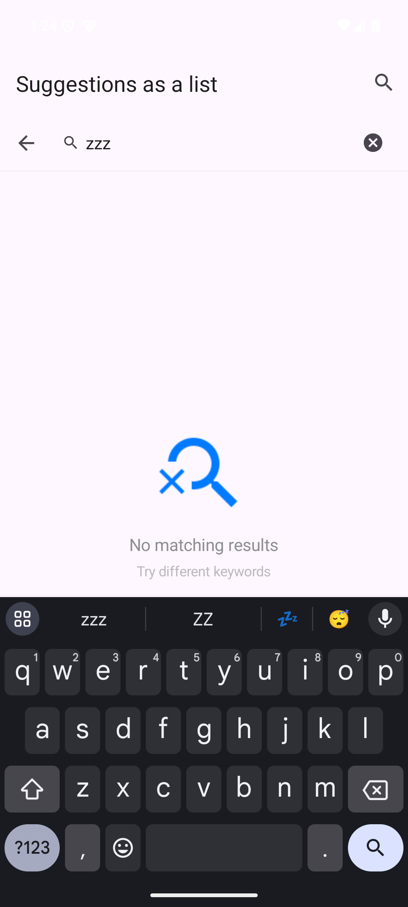

  - Still `TODO`: the scenarios' Lottie / PAG animations on Android, and the other categories (load failed,
    permission, progress, success, HUD).

### 已完成：Android 占位图播放 Lottie 动画 / Done: Lottie animations in the Android placeholder

| 中文 | English |
| --- | --- |
| 状态：已完成（2026-11-15）：PR #30（`091fa90`）合并进 `feat/android-refresh-port`（`af23ea0`）。测试：placeholder 36/36、placeholder-lottie 3/3；CYLSearchViewController `cylsearch` 16/16，Android 15 模拟器上空缓存占位图播放仙人掌动画（截图在其 `docs/assets/android-empty-cache-lottie-placeholder.png`）。合并到 master 前另行询问。 | Status: done (2026-11-15): PR #30 (`091fa90`) merged into `feat/android-refresh-port` (`af23ea0`). Tests: placeholder 36/36, placeholder-lottie 3/3; CYLSearchViewController's `cylsearch` 16/16, and on the Android 15 emulator the empty-cache placeholder plays the cactus (screenshot there: `docs/assets/android-empty-cache-lottie-placeholder.png`). Merging to master is asked separately. |
| 用户原始提示词：“Android animated placeholder: CYLTableViewPlaceHolder PR #28 merged with a Lottie animator. order is 3。4 1 2。” | The user's original prompt (verbatim, left). The order means: this task first, then CYLTabBarController's raised plus button, then the mini program components, then HarmonyOS. |
| 要求：①Lottie 动画器（`com.airbnb.android:lottie`），单独模块，对应 iOS 的 `CYLPlaceholderAnimation/Lottie` subspec；②场景的 Lottie JSON 进入 Android assets（iOS `Animations/CYLPlaceholder<Name>.json`，表为 `animationFileNamesForScenario`）；③`CYLPlaceholderStackView` 播放场景动画，静态图作后备；④测试；⑤合并进 PR #28（合并到 master 前先问）；⑥CYLSearchViewController 的 `cylsearch` 依赖该模块并更新 pin。 | Requirements: (1) a Lottie animator (`com.airbnb.android:lottie`) in its own module, the counterpart of the iOS `CYLPlaceholderAnimation/Lottie` subspec; (2) the scenarios' Lottie JSON in the Android assets (iOS `Animations/CYLPlaceholder<Name>.json`, table `animationFileNamesForScenario`); (3) `CYLPlaceholderStackView` plays its scenario's animation, the still image as the fallback; (4) tests; (5) merged into PR #28 (ask before merging to master); (6) CYLSearchViewController's `cylsearch` depends on the module, pin updated. |
| 上下文：PR #28 已有动画基础设施（`CYLPlaceholderItemAnimationFactory`、动画器注册表、`CYLPlaceholderAnimationView`、GIF 动画器），但没有 Lottie 动画器，栈视图不播放动画，JSON 不在 assets（`android/scripts/import-ios-resources.py` 只导入图片与字符串）。iOS 由 CYLSearchViewController 核心依赖 Lottie subspec，空缓存占位图播放 `CYLPlaceholderNoDrafts.json`。 | Context: PR #28 has the animation infrastructure (`CYLPlaceholderItemAnimationFactory`, the animator registry, `CYLPlaceholderAnimationView`, a GIF animator) but no Lottie animator, the stack view plays nothing, and the JSON is not in the assets (`android/scripts/import-ios-resources.py` imports images and strings only). On iOS, CYLSearchViewController's core depends on the Lottie subspec and the empty-cache placeholder plays `CYLPlaceholderNoDrafts.json`. |

## README 中的 Android 说明（2026-11-20 移入） / Android notes from the README (moved 2026-11-20)

| 中文 | English |
| --- | --- |
| `android/` 是本库的 Android 版本（Kotlin）：`placeholder`（占位图与 HUD，HUD 在 `placeholder/.../hud/`）与 CYLRefresh（`android/merged/library`，包名 `com.cyl.refresh.*`）。CYLRefresh 是唯一的刷新内核：容器 `CYLRefreshLayout`，各样式在 `com.cyl.refresh.header` / `footer` / `classics` / `drawable`，Rive 刷新头在 `android/merged/library/rive`（模块 `:merged-rive`）。用法与 iOS 相同：`layout.cyl_header = CYLRefreshNormalHeader(context)`、`layout.cyl_footer = CYLRefreshAutoNormalFooter(context)`，`cyl_header = null` 关闭下拉。示例 `:merged-example` 用 CYLTabBarController 的 Android TabBar，中间是凸出的加号按钮。API 对照见 [Android-API-Map.md](Android-API-Map.md) 与 [iOS-Android-Parity.md](iOS-Android-Parity.md)，进度见 [Android-Port.md](Android-Port.md)。 | `android/` is this library's Android version (Kotlin): `placeholder` (the placeholder views and the HUD, in `placeholder/.../hud/`) and CYLRefresh (`android/merged/library`, packages `com.cyl.refresh.*`). CYLRefresh is the only refresh kernel: the container `CYLRefreshLayout`, the styles in `com.cyl.refresh.header` / `footer` / `classics` / `drawable`, and the Rive refresh header in `android/merged/library/rive` (module `:merged-rive`). Usage matches iOS: `layout.cyl_header = CYLRefreshNormalHeader(context)`, `layout.cyl_footer = CYLRefreshAutoNormalFooter(context)`, and `cyl_header = null` turns pull to refresh off. The example `:merged-example` uses CYLTabBarController's Android tab bar with a raised plus button. API tables: [Android-API-Map.md](Android-API-Map.md) and [iOS-Android-Parity.md](iOS-Android-Parity.md); progress: [Android-Port.md](Android-Port.md). |
| 构建：在 `android/` 运行 `./gradlew :merged-example:assembleDebug`。CYLTabBarController 的 Android 模块（`cylanimateditem`、`cyltabbar`）尚未发布到 Maven Central，按 commit 从源码构建：依次使用 `-PcylTabBarDir=<检出>/Example-Android`、`Carthage/Checkouts/CYLTabBarController`、与本仓库同级的 `CYLTabBarController/`；都没有时 Gradle 自动运行 `scripts/cyltabbarcontroller-checkout.sh` 检出 `Cartfile` 固定的 commit（与 iOS 相同）。截图：Android 15 模拟器（API 35），提交 `2623a1c`，2026-11-14。 | Build: in `android/`, run `./gradlew :merged-example:assembleDebug`. CYLTabBarController's Android modules (`cylanimateditem`, `cyltabbar`) are not on Maven Central yet, so they are built from source at a commit: `-PcylTabBarDir=<checkout>/Example-Android`, else `Carthage/Checkouts/CYLTabBarController`, else the `CYLTabBarController/` next to this repository; with none of them, Gradle runs `scripts/cyltabbarcontroller-checkout.sh` and checks out the commit the `Cartfile` pins (the same as iOS). Screenshots: Android 15 emulator (API 35), commit `2623a1c`, 2026-11-14. |

| 中文 | English |
| --- | --- |
| 第一个 Tab 是 iOS 示例“场景”页的移植：三个分组列出全部占位场景，点击进入场景页，最后一组是 JSON 配置文件，顶部切换七种语言；第五个 Tab 是“动态”页（下拉刷新交替失败并显示“重试”，上拉加载到“没有更多”），加号按钮页是“上传中 → 成功”（Android 15 模拟器，API 35，提交 `d11eb93`，2026-11-14）。其余页面的移植进度见 [Android-Port.md](Android-Port.md)。 | The first tab is a port of the iOS example's "Scenarios" page: three sections list every placeholder scenario, a row opens its page, the last group is the JSON configuration files, and the top row switches the seven languages; the fifth tab is the "Feed" page (a pull-down refresh that alternately fails and shows "Retry", pull-up loading to "No more data"), and the plus button page is "Uploading → Success" (Android 15 emulator, API 35, commit `d11eb93`, 2026-11-14). The progress of the other pages is in [Android-Port.md](Android-Port.md). |

### 已完成（90 / 100）：为 Android 库模块配置 Maven 发布坐标 / Done (90 / 100): Maven publication coordinates for the Android library modules

| 中文 | English |
| --- | --- |
| 状态：已完成（2026-11-21，分支 `feat/android-refresh-port-followup`，PR #31），评分 90 / 100。 | Status: done (2026-11-21, branch `feat/android-refresh-port-followup`, PR #31), score 90 / 100. |
| 来源：CYLSearchViewController 的会话（分支 `feat/harmonyos-parity`）告知：其 Android 库已有 Maven 发布（`com.cyl:cylsearch:0.1.0`），但 POM 中本仓库的 `:placeholder`（`android/placeholder`）与 `:placeholder-refresh`（`android/merged/library`）显示为 `CYLSearchAndroid:placeholder:unspecified`，因为这两个模块没有 `maven-publish` 坐标。 | Source: the CYLSearchViewController session (branch `feat/harmonyos-parity`) reported that its Android library now has a Maven publication (`com.cyl:cylsearch:0.1.0`), but its POM lists this repository's `:placeholder` (`android/placeholder`) and `:placeholder-refresh` (`android/merged/library`) as `CYLSearchAndroid:placeholder:unspecified`, because neither module has `maven-publish` coordinates. |
| 需要 owner 决定：groupId、artifactId 与版本号（公开约定，例如与上游 `io.github.chenyilong:cyltabbarcontroller-animateditem` 同一个 groupId）。之后：两个模块加 `maven-publish`（含 `LICENSE`，见 "License in every published package"），`publishToMavenLocal` 验证 POM，再把坐标告诉 CYLSearchViewController 以便映射。 | Needs the owner's decision: groupId, artifactIds and version (a public contract; for example the same groupId as upstream `io.github.chenyilong:cyltabbarcontroller-animateditem`). Then: add `maven-publish` to both modules (with the `LICENSE`, see "License in every published package"), check the POM with `publishToMavenLocal`, and send the coordinates to CYLSearchViewController so it can map them. |
| 评分标准：100 = 两个模块以 owner 确定的坐标发布（至少 `publishToMavenLocal` 生成正确的 POM 与 LICENSE），CYLSearchViewController 的 POM 引用这些坐标；60 = 坐标已确定并在两个模块中配置，`publishToMavenLocal` 通过。 | Acceptance: 100 = both modules publish under the owner's coordinates (at least `publishToMavenLocal` produces a correct POM and LICENSE) and CYLSearchViewController's POM references them; 60 = the coordinates are decided and configured in both modules, and `publishToMavenLocal` passes. |
| owner 决定（2026-11-21）：groupId `io.github.chenyilong`，版本 `0.1.0`。坐标：`io.github.chenyilong:cyltableviewplaceholder:0.1.0`（`:placeholder`）与 `io.github.chenyilong:cyltableviewplaceholder-refresh:0.1.0`（`:merged`，CYLRefresh，依赖前者）。配置在各模块自己的 `build.gradle.kts` 中（`-PcylPlaceholderVersion` 可覆盖版本）。 | The owner's decision (2026-11-21): groupId `io.github.chenyilong`, version `0.1.0`. Coordinates: `io.github.chenyilong:cyltableviewplaceholder:0.1.0` (`:placeholder`) and `io.github.chenyilong:cyltableviewplaceholder-refresh:0.1.0` (`:merged`, CYLRefresh, which depends on the first). Configured in each module's own `build.gradle.kts` (`-PcylPlaceholderVersion` overrides the version). |
| 验证（2026-11-21，Windows，JDK 17）：`./gradlew publishToMavenLocal` 生成 AAR、sources jar、Gradle module 与 POM；POM 带 MIT 许可、SCM 与带版本的依赖（`cyltabbarcontroller-animateditem:1.100.0`，取自所构建的 CYLTabBarController 副本的 podspec；refresh 依赖 `cyltableviewplaceholder:0.1.0`）；AAR 的 `classes.jar` 含 `META-INF/cylplaceholder/LICENSE` 与 `META-INF/cylrefresh/LICENSE` 及第三方许可。 | Verified (2026-11-21, Windows, JDK 17): `./gradlew publishToMavenLocal` produces the AAR, sources jar, Gradle module file and POM; the POMs carry the MIT license, SCM and versioned dependencies (`cyltabbarcontroller-animateditem:1.100.0`, read from the podspec of the CYLTabBarController checkout that is built; the refresh module depends on `cyltableviewplaceholder:0.1.0`); each AAR's `classes.jar` holds `META-INF/cylplaceholder/LICENSE` or `META-INF/cylrefresh/LICENSE` with the third-party licenses. |
| TODO（-10）：尚未发布到 Maven Central / GitHub Packages（需要 owner 的账号与签名密钥）；上游 `io.github.chenyilong:cyltabbarcontroller-animateditem` 也尚未发布，所以在本仓库的复合构建之外，使用者暂时无法解析该依赖。`:merged-rive`（Rive 刷新头部）未发布，需要 owner 决定是否发布及其 artifactId。 | TODO (-10): not published to Maven Central / GitHub Packages yet (needs the owner's account and signing key); upstream `io.github.chenyilong:cyltabbarcontroller-animateditem` is not published either, so outside this repository's composite build a consumer cannot resolve that dependency yet. `:merged-rive` (the Rive refresh header) is not published; the owner decides whether to publish it and its artifactId. |
| 修复（2026-11-21）：CYLSearchViewController 以子项目（`include(":cylanimateditem")`，没有 `includeBuild`）引入 CYLTabBarController，`gradle.includedBuilds` 为空，`android/placeholder/build.gradle.kts` 因此在配置阶段抛出异常（该会话报告）。现在版本依次取 `-PcylAnimatedItemVersion`、included build 的 podspec、`:cylanimateditem` 子项目的 `../../CYLTabBarController.podspec`；都没有时依赖不带版本，不再抛出异常。本仓库验证：POM 仍为 `1.100.0`，`-PcylAnimatedItemVersion=9.9.9` 生效；子项目布局由 CYLSearchViewController 会话验证。 | Fixed (2026-11-21): CYLSearchViewController brings CYLTabBarController in as subprojects (`include(":cylanimateditem")`, no `includeBuild`), so `gradle.includedBuilds` is empty and `android/placeholder/build.gradle.kts` threw at configuration (reported by that session). The version now comes from `-PcylAnimatedItemVersion`, else the included build's podspec, else `../../CYLTabBarController.podspec` from the `:cylanimateditem` subproject; with none the dependency stays unversioned instead of throwing. Checked here: the POM still says `1.100.0`, and `-PcylAnimatedItemVersion=9.9.9` takes effect; the subproject layout is checked by the CYLSearchViewController session. |
| 改进（2026-11-21）：发布配置从 `android/build.gradle.kts` 的 `subprojects {}` 移到 `android/placeholder/build.gradle.kts` 与 `android/merged/library/build.gradle.kts`。只引入这两个模块的宿主（CYLSearchViewController 的 `android/merged`）不会执行本仓库的根构建文件，之前它的 POM 里这两个模块显示为 `CYLSearchAndroid:placeholder:unspecified`；现在宿主也能得到 `io.github.chenyilong:cyltableviewplaceholder(-refresh):0.1.0`。本仓库验证：`publishToMavenLocal testDebugUnitTest :merged-example:assembleDebug` 成功，两个 POM 的坐标与依赖不变。 | Improved (2026-11-21): the publication moved from `subprojects {}` in `android/build.gradle.kts` into `android/placeholder/build.gradle.kts` and `android/merged/library/build.gradle.kts`. A host that includes only these modules (CYLSearchViewController's `android/merged`) never evaluates this repository's root build file, so its POM still named them `CYLSearchAndroid:placeholder:unspecified`; now the host gets `io.github.chenyilong:cyltableviewplaceholder(-refresh):0.1.0` too. Checked here: `publishToMavenLocal testDebugUnitTest :merged-example:assembleDebug` succeeds, and both POMs keep the same coordinates and dependencies. |
| 宿主验证（2026-11-21）：CYLSearchViewController 会话在本地把固定提交设为 `94c7bbd` 并去掉其 `pom.withXml` 映射后，其 `cylsearch` POM 自行写出 `io.github.chenyilong:cyltableviewplaceholder(-refresh):0.1.0`；该映射会随其下一次固定提交更新而移除（其 `docs/licenses.md`）。 | Checked in the host (2026-11-21): with its pin set to `94c7bbd` locally and its `pom.withXml` mapping removed, the CYLSearchViewController session's `cylsearch` POM names `io.github.chenyilong:cyltableviewplaceholder(-refresh):0.1.0` on its own; the mapping goes with its next pin move (its `docs/licenses.md`). |
