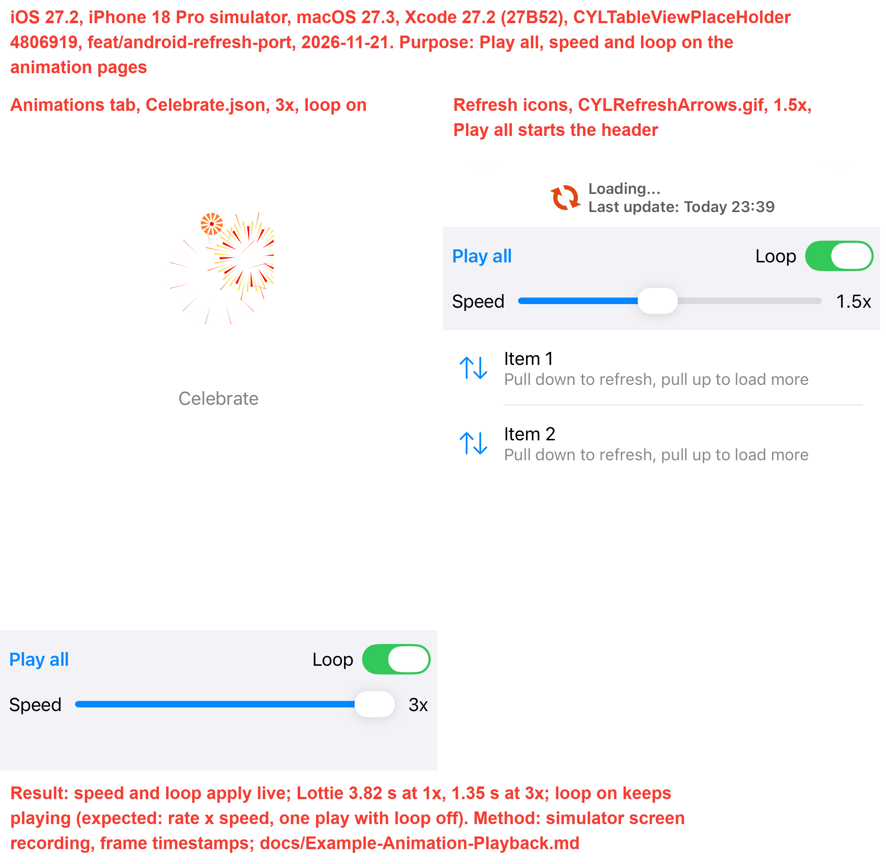

# Animation playback controls in examples

<!-- bound-classes: none -->

<!-- docs-navigation:start -->

| 中文 | English |
| --- | --- |
| [Rule](#rule) | [Rule](#rule) |
| [Controls](#controls) | [Controls](#controls) |
| [Engines](#engines) | [Engines](#engines) |
| [Pages](#pages) | [Pages](#pages) |
| [iOS implementation (2026-11-21)](#ios-implementation-2026-11-21) | [iOS implementation (2026-11-21)](#ios-implementation-2026-11-21) |

<!-- docs-navigation:end -->

<!-- docs-binding:start -->

| 类 / Class | 头文件 / Header |
| --- | --- |
| 无 / none | — |

<!-- docs-binding:end -->

Written in English only, as the owner asked on 2026-11-13 (task in `docs/Task-Log.md`).

## Rule

Every example page that shows animations (placeholder animations, refresh icons, tab bar item animations, any
Lottie / Rive / PAG / GIF / frame animation) has three playback controls next to its one-shot "Play all":

1. **Play all** restarts every animation on the page from progress 0, every time it is tapped, also while they are
   playing or finished.
2. **Speed slider**: the playback rate, applied live to the animations that are playing and to the next ones.
3. **Loop switch**: on, the animations repeat; off, they play once and stop at their last frame. Applied live.

The three controls combine: for example 0.5x with the loop on plays every animation slowly forever; 2x with the loop
off plays each once, fast; Play all then restarts them all from 0 with the current speed and loop setting. Changing a
control never needs a restart of the page.

This applies to the examples of every layer: iOS (Swift examples), Android (Kotlin examples), React Native, Flutter,
mini programs and HarmonyOS. When an engine or the core cannot do it yet, change the core (a Swift naming macro or a
new core API; an Objective-C interface change follows the compatibility rules in `instructions.md`) instead of
hiding the control.

## Controls

| Control | Values | Default | Label (accessibility) |
| --- | --- | --- | --- |
| Play all | button | — | "Play all"; a button |
| Speed | 0.25x to 3x, steps of 0.25x; the current value shown next to it ("1x") | 1x | "Speed", value "1.5x"; adjustable (VoiceOver increment / decrement, TalkBack scroll actions) |
| Loop | switch | off for one-shot demos, on for spinners | "Loop", value on / off |

- The texts are localized in the example's own bundle (seven languages), never hard-coded.
- The page remembers the setting while it is open; leaving the page may reset it.
- Reduce Motion: the controls still work; an example that pauses animations for Reduce Motion says so next to Play all.
- Screenshots of the page show the controls with a non-default speed and the loop state visible.

## Engines

How each engine gets the three settings. "Core" means the library's own API should offer it, so examples do not
reach into the engine.

| Engine | Restart from 0 | Speed | Loop |
| --- | --- | --- | --- |
| Lottie (iOS `LottieAnimationView`, Android `LottieAnimationView`, lottie-web, lottie-react-native, Flutter `lottie`) | progress 0, then play | `animationSpeed` / `speed` | `loopMode` / `repeatCount` |
| Rive | reset the state machine or animation, then play | drive the time (`advance(delta * speed)`) where the runtime has no speed | the animation's loop mode, or restart on end |
| PAG | `progress = 0`, then play | drive the progress per frame where the view has no speed | `repeatCount` (0 = forever) |
| GIF / frame animations | frame 0 | scale the frame durations | `animationRepeatCount` / repeat count |
| System animations (`CAAnimation`, `ValueAnimator`, Flutter `AnimationController`) | remove and add again / `start()` from 0 / `forward(from: 0)` | `speed` on the layer / duration scale / duration | `repeatCount` / `repeat()` |

## Pages

TODO until each page has the three controls and a screenshot. The order follows the task order in `docs/Task-Log.md`
(after the Android port in progress).

| Page | Platform | Status |
| --- | --- | --- |
| Example-Scenarios "Animations" tab (`CYLAnimationListViewController.swift`, each file's page) | iOS | Done (2026-11-21): controls at the bottom; loop on by default for loading / progress / refresh files, off for one-shot scenes; the old 4-second replay timer is gone |
| Example-Scenarios "Refresh icons" page (Feed tab, `CYLRefreshIconDemoViewController`) | iOS | Done (2026-11-21): controls as the table header of every row with an animated icon; Play all starts the header (its icon plays from 0) or restarts the icons |
| Refresh demo pages with animated headers (`CYLRefreshTableViewController` example51–56: GIF, Lottie, PAG, Rive, image sequences, mixed) | iOS | Done (2026-11-21): same table-header controls; the arrow / spinner examples (01–21) have no animation and show none |
| `CYLRefreshCollectionViewController` (animated header on a collection view) | iOS | TODO: a collection view has no table header; needs a supplementary header or a bar |
| `android/merged` example, refresh styles and animations | Android | TODO (the example is being built) |
| CYLTabBarController "Animated icons" page (Lottie tab bar items: "Animation engine: CYLTabBarItemAnimationFactory is linked", "1x", "Play all"), for example the Android ClassifyMenu demo in the owner's 2026-11-13 screenshot | Android, iOS (CYLTabBarController's examples) | TODO: an example of a page this rule applies to; record it in that repository too |
| React Native, Flutter, mini program and HarmonyOS examples | cross-platform | TODO (when each example shows animations) |

## iOS implementation (2026-11-21)

- Example: `Examples/Example-Scenarios/Sources/CYLAnimationPlaybackControls.swift`, shared by the pages above. Texts in
  `CYLScenarioExample.bundle` (`CYLScenarioPlaybackPlayAll`, `CYLScenarioPlaybackSpeed`, `CYLScenarioPlaybackLoop`,
  `CYLScenarioFormatPlaybackSpeed`, seven languages). The slider moves by 0.25x for VoiceOver and Switch Control
  (adjustable, value "1.5x"); the switch is "Loop"; the visible titles are hidden from VoiceOver so nothing is read twice.
- Core:
  - `CYLPlaceholderView -setPlaceholderAnimationSpeed:` now works for the built-in GIF decoder (the layer's speed, live,
    from the current frame).
  - `CYLRefreshIconView` has `animationSpeed`, `animationRepeatCount` (0 loops, the default) and `-restartAnimation`;
    both values survive the icon being rebuilt for another state.
  - Engine adapters: the GIF subspec view, PAG (`PAGFile setDuration:`, progress kept) and legacy Rive (a `RiveView` that
    advances by the frame time times the speed) take a speed through the new optional
    `cyl_setAnimationViewSpeed:` of `CYLPlaceholderItemAnimationPlayableView`. Lottie already had it.
- Known gap: the data-binding Rive runtime (`CYLPlaceholderRiveItemAnimationView`, `RiveUIView`) has no speed hook, so
  for those files the speed returns NO and the slider has no effect; image-sequence icons
  (`setAnimationImages`) keep their own duration.
- Verification (Xcode 27.2, iOS 27.2 simulator "iPhone 18 Pro (CYL test)"): unit tests
  `testIconSpeedAndRepeatCountApplyLiveAndSurviveStateChanges` and `testBuiltInGIFDecoderSupportsPlaybackSpeed` (173 of
  173 pass); Example-Scenarios builds; on the simulator the Celebrate Lottie ran 3.82 s at 1x and 1.35 s at 3x (ratio
  2.83, measured from a screen recording, frame timestamps), stopped on its last frame with the loop off, and kept
  changing for the whole 6.8 s recording with the loop on; on the Refresh icons page Play all started the header with its
  GIF icon.

Commit: `4806919`.
