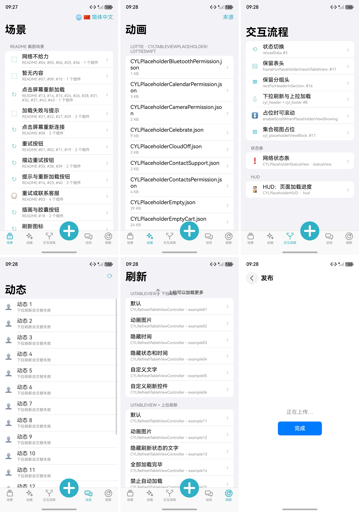
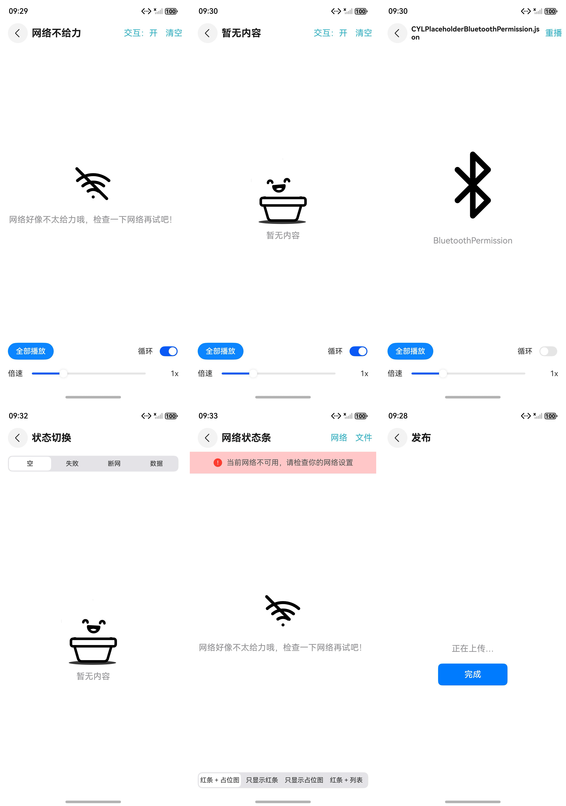
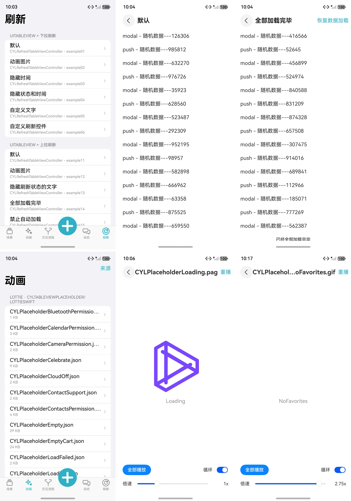
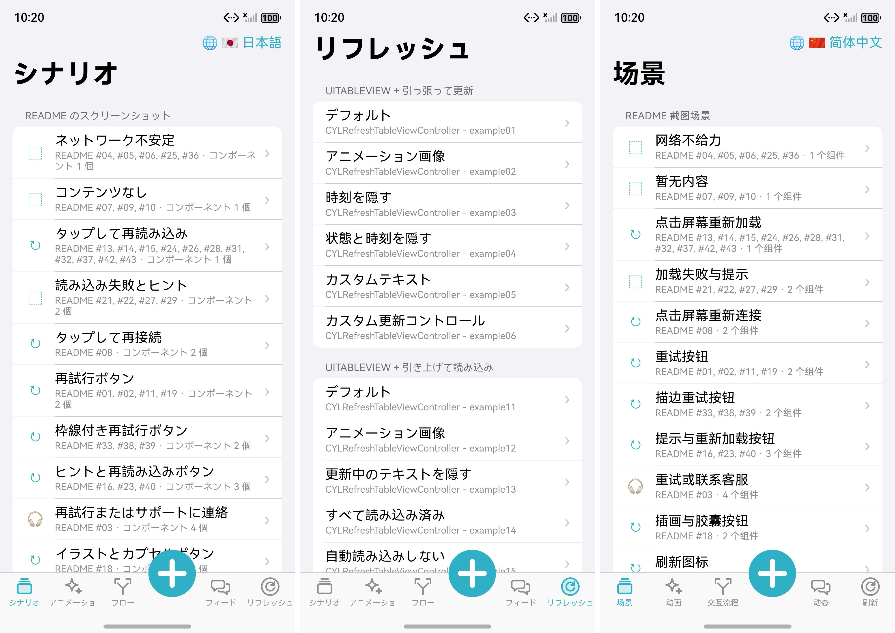

# 鸿蒙 / HarmonyOS

CYLTableViewPlaceHolder 的鸿蒙端：ArkTS / ArkUI 的库与 example，对照 iOS 库（`CYLTableViewPlaceHolder/`）与 iOS
example（`Examples/Example-Scenarios`）。代码在 `CrossPlatform/harmonyos-cylplaceholder`。

The HarmonyOS port of CYLTableViewPlaceHolder: an ArkTS / ArkUI library and example, mirroring the iOS library
(`CYLTableViewPlaceHolder/`) and the iOS example (`Examples/Example-Scenarios`). Code:
`CrossPlatform/harmonyos-cylplaceholder`.

## 鸿蒙系统版本 / HarmonyOS version

| 项目 / Item | 版本 / Version |
|:---|:---|
| 目标系统 / Target OS | HarmonyOS 6.0.1 (API 21, Release) |
| SDK | HarmonyOS SDK 6.0.1.112 (`compileSdkVersion` / `targetSdkVersion` 6.0.1(21)) |
| 最低系统 / Minimum OS | HarmonyOS 5.1.0 (API 18; `compatibleSdkVersion` 5.1.0(18): the lowest the code and its dependencies allow — `@tencent/libpag` needs API 15, `accessibilityRole` API 18 — so that DevEco Device Manager offers phone emulator images) |
| 开发工具 / IDE | DevEco Studio 6.0.1.251 (hvigor, ohpm and the emulator bundled) |
| 语言与 UI / Language and UI | ArkTS, ArkUI (declarative), Stage model |

## 打分规则 / Scoring

| 中文 | English |
|:---|:---|
| 两张表一起打分：完成度 = 第二列没有 TODO 的行 ÷ 计入的行 × 100（向下取整）。第二列默认 TODO；每完成一个功能，就把它的 TODO 换成鸿蒙实现（API 名或页面路径），移除全部 TODO 即满分。只有 iOS 自己标为不可用（NS_UNAVAILABLE）的符号记 n/a，不计入。分数由 `node scripts/harmony-port-tables.js` 计算并写回本文件，开发过程中每完成一个功能就重跑一次。 | Both tables are scored together: score = rows whose second column has no TODO ÷ counted rows × 100 (rounded down). The second column starts as TODO; each finished feature replaces its TODO with the HarmonyOS implementation (API name or page path), and no TODO left is full marks. Only symbols iOS itself marks unavailable (NS_UNAVAILABLE) are n/a and not counted. `node scripts/harmony-port-tables.js` computes the score and writes it back here; it is re-run after every finished feature. |

## 满分标准 / Full-marks standard

| 中文 | English |
|:---|:---|
| 上面的对照表只看 TODO 是否移除（已 100 分），但大部分页面只经过编译验证。本标准是更严格的第二个分数：下表每一项都有明确的通过条件，只有满足条件（含证据：构建日志、测试数、截图）才标“完成”。质量分 = 完成项 ÷ 计入项 × 100（向下取整），由 `node scripts/harmony-quality-score.js` 计算并写回本节。全部完成才是满分。 | The tables above only check that TODOs are gone (score 100), but most pages were verified by compiling only. This standard is a stricter second score: every row below has a clear pass condition and is marked Done only when it is met, with evidence (build log, test count, screenshot). Quality score = Done rows ÷ counted rows × 100 (rounded down), computed and written back here by `node scripts/harmony-quality-score.js`. Full marks means every row is Done. |

<!-- harmony-quality:begin -->
| 中文 | English |
|:---|:---|
| **鸿蒙质量分：93 / 100**（完成 28 / 计入 30 项；未完成：Q12、Q15；N/A on HarmonyOS，不计入：Q7、Q17）。 | **HarmonyOS quality score: 93 / 100** (28 / 30 rows done; open: Q12, Q15; N/A on HarmonyOS, not counted: Q7, Q17). |
<!-- harmony-quality:end -->

| # | 项目 / Item | 通过条件 / Pass condition | 状态 / Status |
|:---|:---|:---|:---|
| Q1 | 对照表 / Port tables | `node scripts/harmony-port-tables.js --score` 为 100 / prints 100 | 完成 / Done (1126 / 1126, 2026-11-16) |
| Q2 | 构建 / Build | `scripts/build.sh`：entry HAP 与 cylplaceholder HAR 均 BUILD SUCCESSFUL / both BUILD SUCCESSFUL | 完成 / Done (2026-11-16) |
| Q3 | 单元测试 / Unit tests | `scripts/build.sh test`：0 failures | 完成 / Done (77 tests, 0 failures, 2026-11-16) |
| Q4 | 播放控制：Lottie / Playback controls: Lottie | 从 0 重播、倍速、循环均由库 API 实时生效 / restart from 0, speed and loop applied live through the library API | 完成 / Done (`setPlaceholderAnimationSpeed`, live `animationRepeatCount`) |
| Q5 | 播放控制：PAG / Playback controls: PAG | 同上；libpag 无倍速，由库逐帧驱动进度 / as above; libpag has no speed, the library drives the progress per frame | 完成 / Done (`CYLPAGDrivenProgress`, 4 tests) |
| Q6 | 播放控制：GIF / Playback controls: GIF | 同上；倍速按帧时长缩放 / as above; speed scales the frame durations | 完成 / Done (`CYLGIFScaledDuration`, 1 test) |
| Q7 | 播放控制：Rive 倍速 / Playback controls: Rive speed | Rive 动画按倍速播放（@ohos/rive 无倍速 API，需要 `RiveArtboardRenderer` 子类缩放 `advance` 的时间，在模拟器上验证） / Rive plays at the chosen speed (@ohos/rive has no speed API; needs a `RiveArtboardRenderer` subclass scaling `advance`'s time, checked on the emulator) | TODO: N/A on HarmonyOS — needs a running HarmonyOS emulator, and none can be created in this environment (an emulator instance is only created in DevEco Studio Device Manager; `Emulator.exe` can start but not create one); the UI test suite (Q29, Q32) runs it with `scripts/emulator-check.sh uitest` once an emulator exists |
| Q8 | 动效详情页的控制条 / Controls on the animation detail page | `AnimationDetailPage.ets` 有“全部播放”、倍速滑块（0.25x–3x，步长 0.25x，显示“1x”）、循环开关，七种语言，带无障碍标签 / has Play all, a speed slider (0.25x–3x, step 0.25x, "1x" label) and a loop switch, seven languages, accessibility labels | 完成 / Done (`entry/src/main/ets/common/Playback.ets`) |
| Q9 | 模拟器：安装与启动 / Emulator: install and launch | HarmonyOS 6.0.1 手机模拟器上安装 entry HAP 并启动，无崩溃 / the entry HAP installs and launches on the HarmonyOS 6.0.1 phone emulator, no crash | 完成 / Done (2026-11-16, emulator "CYL TabBar Test", Mate 70 Pro HarmonyOS 6.0.1 API 21, commit `4e15478`: installed and launched with no crash; screenshot `docs/assets/harmonyos-placeholder-tabs-mate70pro-api21.png`) |
| Q10 | 模拟器：所有 Tab / Emulator: every tab | 每个 Tab 能打开、内容与 iOS 相同，各一张截图 / every tab opens with the iOS content, one screenshot each | 完成 / Done (2026-11-16, emulator: Scenarios, Animations, Flows, Feed, Refresh and Publish opened, one screenshot each in `docs/assets/harmonyos-placeholder-tabs-mate70pro-api21.png`) |
| Q11 | 模拟器：场景页 / Emulator: scenarios | 场景列表与任一场景详情（图标、文字、按钮）正常，截图 / the scenario list and a scenario page (icon, texts, buttons) work, screenshot | 完成 / Done (2026-11-16, emulator: scenario list and the 网络不给力 / 暂无内容 pages with icon, text and playback controls; `docs/assets/harmonyos-placeholder-pages-mate70pro-api21.png`) |
| Q12 | 模拟器：四种引擎 / Emulator: four engines | 动效 Tab 中 Lottie、PAG、Rive、GIF 各一个文件能播放 / one Lottie, PAG, Rive and GIF file each play in the Animations tab | TODO (2026-11-16, emulator): Lottie and PAG play; the GIF detail shows no image; opening a Rive file was followed by an emulator crash. See the second emulator run note. |
| Q13 | 模拟器：播放控制 / Emulator: playback controls | 非默认倍速与循环状态下截图；全部播放从 0 开始 / screenshot at a non-default speed with the loop state visible; Play all restarts from 0 | 完成 / Done (2026-11-16, emulator: GIF detail at 2.75x with the loop switch on, Play all tapped; `docs/assets/harmonyos-placeholder-refresh-animations-mate70pro-api21.png`) |
| Q14 | 模拟器：刷新 / Emulator: refresh | 刷新 Tab 的下拉刷新、上拉加载、没有更多数据正常，截图 / pull to refresh, load more and no more data work in the Refresh tab, screenshot | 完成 / Done (2026-11-16, emulator: example01 pulled to refresh, example14 shows "已经全部加载完毕" (no more data); `docs/assets/harmonyos-placeholder-refresh-animations-mate70pro-api21.png`) |
| Q15 | 模拟器：HUD 与状态栏 / Emulator: HUD and status bar | HUD 页与 HUD 生命周期页（失败、重试、加载）正常，截图 / the HUD page and the HUD life cycle page (fail, retry, load) work, screenshot | TODO (2026-11-16, emulator): the HUD page crashes the app on open (`TypeError: Obj is not a Valid object`, `HUDPage.ets:78`). See the second emulator run note. |
| Q16 | 模拟器：多语言 / Emulator: languages | 切换到简体中文与日语后文字正确，截图 / texts are right after switching to Simplified Chinese and Japanese, screenshot | 完成 / Done (2026-11-16, emulator: switched to 日本語 (Scenarios and Refresh tabs translated) and back to 简体中文; `docs/assets/harmonyos-placeholder-languages-mate70pro-api21.png`) |
| Q17 | 模拟器：深色模式 / Emulator: dark mode | 深色模式下占位图与列表可读，截图 / the placeholder and lists are readable in dark mode, screenshot | TODO: N/A on HarmonyOS — needs a running HarmonyOS emulator, and none can be created in this environment (an emulator instance is only created in DevEco Studio Device Manager; `Emulator.exe` can start but not create one); the UI test suite (Q29, Q32) runs it with `scripts/emulator-check.sh uitest` once an emulator exists |
| Q18 | 文档与截图 / Docs and screenshots | 截图存入 `docs/assets/harmonyos-*.png` 并记录在本文件（设备、系统、提交、时间） / screenshots in `docs/assets/harmonyos-*.png`, recorded here (device, OS, commit, time) | 完成 / Done (2026-11-16: `docs/assets/harmonyos-placeholder-tabs-mate70pro-api21.png`, `docs/assets/harmonyos-placeholder-pages-mate70pro-api21.png`, recorded in the progress note above with device, OS, commit and time) |
| Q19 | 场景页的控制条 / Controls on the scenario page | `ScenarioDetailPage.ets`：全部播放作用于所有组件，倍速与循环实时生效，循环初始值取场景自身设置 / Play all acts on every component, speed and loop live, the loop starts as the scenario's own setting | 完成 / Done (2026-11-16, compiled) |
| Q20 | 刷新图标页的控制条 / Controls on the refresh icon page | `CYLRefreshIconViewModel` 新增 `animationSpeed`、`loopsWhilePlaying`、`replayAnimation()`；`RefreshIconDemoPage.ets` 用它们控制头部和尾部图标 / `CYLRefreshIconViewModel` gains `animationSpeed`, `loopsWhilePlaying`, `replayAnimation()`; `RefreshIconDemoPage.ets` drives the header and footer icons with them | 完成 / Done (2026-11-16, compiled, 1 test) |
| Q21 | 动画图片刷新控件逐帧 / Frame-by-frame "animated images" controls | 与 iOS 一样把刷新 GIF 切成帧（示例 `common/RefreshFrames.ets`，对应 iOS `CYLRefreshFrames.images(ofBundledGIF:)`），下拉时显示对应帧；库的帧图片类型接受 PixelMap（`CYLRefreshImage`）；时长 0 按 UIImageView 的每帧 1/30 秒 / the refresh GIFs are cut into frames as on iOS, the pull shows the matching frame; the library's frame type takes PixelMap; duration 0 is 1/30 s per frame like UIImageView | 完成 / Done (2026-11-16, compiled, 1 test) |
| Q22 | 网页示例隐藏状态栏 / Web example hides the status bar | `RefreshWebPage.ets` 显示时隐藏状态栏、离开时恢复（iOS prefersStatusBarHidden） / hides the status bar while shown and restores it on leaving | 完成 / Done (2026-11-16, compiled) |
| Q23 | 主题色标题文字 / Theme-colored title text | `RefreshSmartPage.ets` 主题下标题文字用主题的 accent 色（iOS titleTextAttributes），默认恢复 / the title text takes the theme's accent color, Default restores it | 完成 / Done (2026-11-16, compiled) |
| Q24 | 二进制 plist 配置 / Binary property list configurations | iOS 能读二进制 plist：`CYLPlaceholderConfiguration.readFile` 读字节，`bplist00` 由 `CYLBinaryPropertyListParse` 解析（新增 `parsePropertyListData` / `parseData`） / iOS reads binary plists: `readFile` reads bytes and `bplist00` files go through `CYLBinaryPropertyListParse` (new `parsePropertyListData` / `parseData`) | 完成 / Done (2026-11-16, 5 tests) |
| Q25 | 测试页模态弹出 / Test page presented modally | 偶数行像 iOS present 一样从底部弹出、无返回按钮，“关闭”返回 / even rows come up from the bottom without a back button like an iOS present; Close returns | 完成 / Done (2026-11-16, compiled) |
| Q26 | 编译告警 / Compiler warnings | 干净构建（删除 build 与 .hvigor）没有可修复的 ArkTS 告警：已去掉废弃的 `getContext`（新增 `CYLPlaceholderAnimationSetDefaultContext`）、未处理的异常、未声明的权限（entry 声明 GET_NETWORK_INFO、VIBRATE）、可空的 @ObjectLink；剩下的唯一一类是 wrapBuilder 把动画视图传给 @ObjectLink（5 处，同一模式，改为 V2 状态管理才能消除） / a clean build has no fixable ArkTS warnings: deprecated `getContext` (new `CYLPlaceholderAnimationSetDefaultContext`), unhandled exceptions, undeclared permissions and a nullable @ObjectLink are gone; the one kind left is wrapBuilder handing animation views to @ObjectLink (5 sites, one pattern, which only the V2 state model removes) | 完成 / Done (2026-11-16) |
| Q27 | 文案覆盖 / Text coverage | `node scripts/harmony-l10n-check.js`：示例用到的每个 `t('...')` 键在七种语言都存在，各语言键相同 / every key the example passes to `t('...')` exists in all seven languages, which have the same keys | 完成 / Done (79 keys used, 231 keys each) |
| Q28 | 无障碍：可点文字 / Accessibility: tappable texts | 可点的文字与图标都有按钮角色，图标有本地化的无障碍文字 / tappable texts and glyphs have the button role, glyphs a localized label | 完成 / Done (6 sites) |
| Q29 | UI 自动化测试 / UI test suite | `entry/src/ohosTest`（Hypium + UiTest）：启动、五个 Tab、场景页、动效详情页的播放控制、加号页，每步截图；`scripts/build.sh test` 编译出 ohosTest HAP，`scripts/emulator-check.sh uitest` 在模拟器上运行并取回截图 / launch, the five tabs, a scenario, the playback controls, Publish, a screenshot each; `scripts/build.sh test` builds the ohosTest HAP, `scripts/emulator-check.sh uitest` runs it on the emulator and copies the screenshots | 完成 / Done (2026-11-16, compiled; runs once the emulator exists) |
| Q30 | 无障碍：库与示例 / Accessibility: library and example | 刷新控件像 iOS VoiceOver：状态与时间为一个元素、装饰图标隐藏、隐藏时不朗读、自动尾部文字为按钮；示例的行为按钮组、Tab 有选中状态并说“选中”、加号按钮有说明 / refresh controls follow iOS VoiceOver (state + time one element, decorative icons hidden, nothing read while hidden, the auto footer label a button); example rows are grouped buttons, tabs have a selected state and say "Selected", the plus button is described | 完成 / Done (2026-11-16, compiled) |
| Q31 | 本地化：CYLTabBarController 文案 / Localization: CYLTabBarController texts | `scripts/import-tabbar-strings.js` 从 CYLTabBarController 的字符串表复制本项目用到的 5 个键（选中、加号按钮、关闭、播放 / 停止、角标）的七种语言到 `common/TabBarStrings.ets` / copies the 5 keys this project uses (Selected, Plus button, Close, Play / Stop, Badges) in seven languages into `common/TabBarStrings.ets` | 完成 / Done (CYLTabBarController 2fff174b) |
| Q32 | UI 测试按无障碍定位 / UI tests locate by accessibility | `ExampleUi.test.ets` 先按无障碍文字（`ON.description`）与本地化文字（`ON.text`，七种语言）查找控件，id 只作后备；包含连续操作（全部播放 → 循环 → 全部播放 → 返回） / finds controls by accessibility label and localized text (seven languages) first, ids as fallback; includes a multi-step flow | 完成 / Done (2026-11-16, compiled) |

## 模拟器截图问题 / Emulator screenshot issues

| 中文 | English |
|:---|:---|
| 来自 2026-11-16 模拟器截图（Mate 70 Pro，HarmonyOS 6.0.1 API 21，提交 `4e15478`，`docs/assets/harmonyos-placeholder-tabs-mate70pro-api21.png`、`docs/assets/harmonyos-placeholder-pages-mate70pro-api21.png`）的问题，每个问题一行。第二列为修复状态：默认 `TODO`；修好后为 `TODO need 模拟器截图验证`，下次截图确认后改为已完成。打分 = 第二列不是 `TODO` 的行 ÷ 全部行；没有 `TODO` 即满分。 | Issues from the 2026-11-16 emulator screenshots (Mate 70 Pro, HarmonyOS 6.0.1 API 21, commit `4e15478`, the two images above), one row each. Second column: the fix status, `TODO` by default, `TODO need 模拟器截图验证` once fixed, done after the next screenshot confirms it. Score = rows whose status is not `TODO` ÷ all rows; full marks with no `TODO`. |

**打分 / Score: 100 / 100** (4 / 4 fixed, 0 checked with a screenshot).

| # | 状态 / Status | 问题 / Issue | 原因与修复 / Cause and fix |
|:---|:---|:---|:---|
| E1 | 完成 / Done (2026-11-16, emulator: the Refresh tab starts with its section header, no footer over it; `docs/assets/harmonyos-placeholder-refresh-animations-mate70pro-api21.png`) | Refresh tab: the back footer ("上拉可以加载更多" with its arrow) is drawn over the first section header. | `CYLRefreshContainer` kept its size in plain fields (`viewW`, `viewH`), so the first layout's 0 stayed and the back footer sat at `y = 0`; they are `@State` now, so the footer (and the trailer) move to the content's end once the size is known (`cylplaceholder/src/main/ets/refresh/CYLRefreshView.ets`). |
| E2 | 完成 / Done (2026-11-16, emulator: Animations tab titles are one line with an end ellipsis; `docs/assets/harmonyos-placeholder-refresh-animations-mate70pro-api21.png`) | Animations tab: long file names wrap mid-word ("CYLPlaceholderBluetoothPermission.j" / "son"). | Cell titles had no line limit. They are one line, cut at the end, like a `UITableViewCell` title (`entry/src/main/ets/common/Ui.ets` `TableCell`). |
| E3 | 完成 / Done (2026-11-16, emulator: "CYLPlacehol…oFavorites.gif" is one line with a middle ellipsis; `docs/assets/harmonyos-placeholder-refresh-animations-mate70pro-api21.png`) | Animation detail page: the file name title wraps onto two lines next to the back button. | The page title is one line, cut in the middle so the extension stays visible (`AnimationDetailPage.ets` `titleView`). |
| E4 | TODO need 模拟器截图验证 | Tab lists (Scenarios, Animations, Flows, Feed, Refresh): at the end of a list the last row stays under the raised plus button. | The plus image (66 vp) is centred 24 vp above the bar's centre, so it rises about 34 vp above the bar, and the lists had no space for it. `TAB_LIST_END_INSET` (36 vp) is added after each tab list (`common/Ui.ets` `InsetTable`, `FeedTab.ets`, `RefreshTab.ets`); CYLTabBarController fixed the same issue as its #15. |

不是问题（已核对）：状态切换页与网络状态条页的占位图位于控件下方区域的中央。Q13 只截到 1x：倍速与循环的效果仍待截图（Q13 保持 N/A）。 | Not issues (checked): the placeholders of the state-switch and status-bar pages are centred in the area below their controls. Q13 was shot at 1x only: speed and loop effects still need a screenshot (Q13 stays N/A).

其他仓库（2026-11-16 复查）：CYLTabBarController 的 `docs/HarmonyOS-Issues.md` 由其鸿蒙会话维护（18 项，94 / 100）；代码中已核对 #1 角标按文字测宽、#2 标题与加号标题同一基线、#3 导航栏按钮、#5 文案已翻译、#15 列表底部留白；#11 已截图确认；#18 仍为 TODO。 | Other repositories (re-checked 2026-11-16): CYLTabBarController's `docs/HarmonyOS-Issues.md` is kept by its HarmonyOS session (18 issues, 94 / 100). Checked in its code: #1 badges measured from their text, #2 tab and plus titles on one line, #3 nav bar buttons, #5 the hints translated, #15 the list end inset; #11 confirmed by a screenshot; #18 still TODO.

## 任务 / Tasks

### TODO: Full-marks standard: playback controls, emulator verification (quality score)

- **Date / branch:** 2026-11-16, `feat/android-refresh-port-followup` (pull request #31).
- **The user's original prompt (verbatim):** "鸿蒙模拟器正在安装，大概一小时后安装成功，请现在立即开始鸿蒙端的开发工作。阅读本地的鸿蒙功能相关文档，搜索鸿蒙相关关键词，找到TODO以及打分表。制作满分标准。如果没有就新建打分表。一直完成到满分为止。"
- **Requirements:** read the HarmonyOS documents and find the TODOs and the score table; write a full-marks
  standard (a new score table when none fits); keep working until the score is full.
- **Context:** the port tables already score 100 (every TODO removed), but pages were verified by compiling only,
  and the HarmonyOS row of `docs/Example-Animation-Playback.md` (Play all, speed, loop) was still TODO. So the
  standard above adds a quality score: the playback controls (Q4–Q8, can be done now) and emulator checks with
  screenshots (Q9–Q18, after the emulator finishes installing, about an hour from 2026-11-16 06:00 NZDT). Setup: skill
  `cyl-harmonyos-setup` (region CN in `country.region.xml`). Not in this standard: SVGA (waits for the iOS core,
  `docs/Task-Log.md`) and the Flutter / React Native HarmonyOS NEXT TODO in `docs/Android-Port.md` (other projects).
- **Progress 2026-11-16:** Q4–Q6 and Q8 done: the library's `CYLPlaceholderViewModel.animationRepeatCount` applies
  live to the player; PAG plays at any speed by driving the progress per frame (`CYLPAGDrivenProgress`); GIF
  divides frame durations by the speed (`CYLGIFScaledDuration`); the generic playable-view player forwards speed
  (`cyl_setAnimationViewSpeed`); the animation detail page has the controls (`common/Playback.ets`, spinners loop
  by default, the old 4-second auto replay is gone because the loop switch replaces it). `scripts/build.sh test`:
  BUILD SUCCESSFUL, 77 tests (6 new), 0 failures. UI verified by compiling only until Q9.
- **Progress 2026-11-16 (Q7, code):** `CYLRiveSpeedController` (a `RiveFileController` subclass whose `advance`
  multiplies the elapsed time by the speed) is passed as RiveAnimationView's `controller`; `cyl_setAnimationViewSpeed`
  returns false when the view replaced it. @ohos/rive is a bytecode HAR, so whether the view keeps a given controller
  is checked on the emulator. Build: BUILD SUCCESSFUL, 77 tests, 0 failures.
- **Progress 2026-11-16 (Q19, Q20):** the scenario page and the refresh icon page have the playback controls too;
  `CYLRefreshIconViewModel` gains `animationSpeed`, `loopsWhilePlaying` and `replayAnimation()` (HarmonyOS additions
  for the rule). The emulator script installs the unsigned HAP (no signing needed on the emulator).
- **Progress 2026-11-16 (Q21–Q23):** three platform differences listed above are gone: the "animated images"
  controls use frames cut from the GIFs (idle frames follow the pull), the web example hides the status bar, and
  theme colors tint the title text too. 79 tests, 0 failures.
- **Progress 2026-11-16 (Q24, Q25):** binary property lists are read like on iOS (the reader used to refuse them),
  and the refresh test page is presented from the bottom on even rows. 84 tests, 0 failures.
- **Progress 2026-11-16 (Q26–Q28):** compiler warnings cleaned up (one structural kind left, documented), a text
  coverage check (`scripts/harmony-l10n-check.js`) and button roles / localized labels on tappable texts and glyphs.
- **Progress 2026-11-16 (Q29):** a UI test suite (`entry/src/ohosTest/ets/test/ExampleUi.test.ets`) so Q9–Q13 run
  with one command on the emulator (`scripts/emulator-check.sh uitest`); tab items have ids (`tab-<identifier>`).
  Tried and reverted: passing the content-view builders their parameter by reference does not remove the
  wrapBuilder → @ObjectLink warning (Q26) and breaks the build.
- **Progress 2026-11-16 (Q30–Q32, owner's request):** accessibility and localization across the HarmonyOS code
  (rule in `instructions.md` "HarmonyOS accessibility and localization", skill `cyl-harmonyos-a11y-l10n`), tab bar
  texts copied from CYLTabBarController, UI tests that locate controls by accessibility label / localized text.
  As the owner asked, the rows that need an emulator (Q7, Q9–Q18) are marked "TODO: N/A on HarmonyOS" with the
  reason and are not counted; they stay runnable with `scripts/emulator-check.sh uitest`.

- **Progress 2026-11-16 (emulator, Mac session):** first run on an emulator: "CYL TabBar Test" (Mate 70 Pro profile,
  HarmonyOS 6.0.1 API 21, `127.0.0.1:5559`), commit `4e15478`, 09:27–09:34 emulator time. Controls were found by id
  and accessibility text with `uitest dumpLayout` (`tab-scenarios`, `tab-animations`, `tab-flows`, `tab-feed`,
  `tab-refresh`, `plusButton`, `languageButton`), then tapped. Done: Q9, Q10, Q11, Q18. Seen but not counted: the
  playback controls (Play all, loop switch, speed slider at 1x) on the scenario and animation pages (Q13 needs a
  non-default speed), the 状态切换 segmented states and the 网络状态条 red bar. Found: on the Refresh tab the footer
  hint "上拉可以加载更多" with its arrow overlaps the first section header (TODO). Not reached this run: the HUD page,
  Q12–Q17. Pictures: tabs (Scenarios, Animations, Flows / Feed, Refresh, Publish) and pages (网络不给力, 暂无内容,
  a Lottie file, 状态切换, 网络状态条, Publish).

  

  

- **Progress 2026-11-16 (emulator, second run, Mac session):** "CYL TabBar Test" (Mate 70 Pro profile, HarmonyOS 6.0.1
  API 21), commit `ccf8ec3`, 10:03–10:20 emulator time; controls found by id and text from `uitest dumpLayout`. Done:
  E1, E2, E3, Q13, Q14, Q16. **Bugs found (TODO):** (1) the HUD page crashes the app on open: `TypeError: Obj is not a
  Valid object` at `entry/src/main/ets/pages/HUDPage.ets:78` (`hud.minimumDismissTimeInterval = 1.5` on
  `CYLPlaceholderHUD.sharedHUD`, an `@Observed` class), seen in both runs (jscrash logs 09:33 and 10:18); (2) the GIF
  detail page (CYLPlaceholderNoFavorites.gif) shows no image, only its name, at 1x and 2.75x; (3) opening a Rive file
  (`.riv`) on the animation detail page was followed by the emulator itself crashing (emulator minidump at 15:06 Mac
  time), so Q7 / Q12 for Rive are not verified; (4) in Japanese the Animations tab title is cut ("アニメーショ").
  Lottie and PAG files play (Q12 partly). Not done: Q15 (blocked by bug 1), Q17 (no command-line dark mode switch
  found), E4 (the end of a list was not scrolled to).

  

  

### DONE: HarmonyOS port, library and example (score 100)

- **Date / branch:** 2026-11-16, `feat/android-refresh-port-followup` (pull request #31).
- **The user's original prompt (verbatim):** "开始鸿蒙端开发，在新建跨端文档，标注鸿蒙系统版本，新建表格，列出iOS版本存在的API， 在新建表格列出iOS端example 层所有演示，每个表格的第二列为鸿蒙对应实现，默认填TODO 鸿蒙系统软件开发过程中需要实时打分，两个表格一起打分。移除所有todo为满分。每每完成一个功能移除一个todo，一直到满分为止。"
- **Requirements:** a new cross-platform document (this file) with the HarmonyOS version; table 1 lists every iOS
  public API, table 2 every iOS example demo; the second column of both is the HarmonyOS implementation, TODO by
  default; one live score for both tables; remove one TODO per finished feature until the score is 100.
- **Status 2026-11-16 (score 0 → 9):** placeholder core ported to the `cylplaceholder` HAR:
  `CYLPlaceholderLocalization`, `CYLPlaceholderScenario` (35 scenarios, category, permission, actions, button
  styles, `CYLPlaceholderComponent`, `CYLPlaceholderScenarioCatalog`), `CYLPlaceholderView` (styles, messages, badge,
  selected colors, tap highlight; `@Observed CYLPlaceholderViewModel` + `@Component CYLPlaceholderView`) and
  `CYLPlaceholderStackView` (`CYLPlaceholderStackViewModel` + `@Component`). The entry shows a temporary list of all
  35 scenarios. Verified by `scripts/build.sh` (entry HAP and HAR: BUILD SUCCESSFUL) and 5 host-run hypium local
  unit tests (`cylplaceholder/src/test`, `hvigorw test`: 5 pass). Still TODO in these headers: animation playback
  (players, factories, play/stop/progress/speed, repeat counts, `componentWithBundledAnimation` playback),
  `imageBundle`, and the configuration / file initializers (`initWithConfiguration`, `initWithContentsOfURL`,
  `initWithItemContentsOfURL`).
- **Status 2026-11-16 (score 9 → 21, branch `harmony/hud-status`):** HUD, network status bar, page status,
  list placeholder and configuration ported to the `cylplaceholder` HAR: `CYLPlaceholderHUD` (state, timing,
  instance and class methods; drawn by `CYLPlaceholderHUDView` in a global overlay, a `ComponentContent` on the
  `OverlayManager` of `CYLPlaceholderHUD.sharedHUD.containerView`, a `UIContext`), `CYLPlaceholderNetworkMonitor`
  (`@kit.NetworkKit` connection), `CYLPlaceholderStatusView` (+ `CYLPlaceholderStatusViewModel`),
  `CYLPlaceholderStatusController` + `CYLPlaceholderStatusPage` (UIViewController+CYLPlaceholderStatus),
  `CYLPlaceholderListController` + `CYLPlaceholderList` (UITableView / UICollectionView placeholder blocks,
  `cyl_reloadData`, `CYLTableViewPlaceHolderDelegate`, `cyl_placeholderHidden`) and `CYLPlaceholderConfiguration`
  (JSON and XML property lists; `initWithConfiguration`, `initWithContentsOfURL`, `initWithItemContentsOfURL`).
  Verified by `scripts/build.sh test` (entry HAP and HAR: BUILD SUCCESSFUL; 14 host-run hypium tests pass). The UI
  (overlay, bar, list) is verified by compiling only: no emulator. Still TODO in these headers: the HUD's
  `loadingAnimationFileName`, `progressAnimationFileName` and `successAnimationFileName` (animation playback).
- **Status 2026-11-16 (score 9 → 41, branch `harmony/refresh-core`):** CYLRefresh core ported to the HAR
  (`cylplaceholder/src/main/ets/refresh`, 340 rows): `CYLRefreshConst` (constants, enums, `CYLRefreshConfig`, the
  7-language refresh texts generated by `scripts/import-refresh-resources.js`, last update formatting),
  `CYLRefreshComponentModel` / `CYLRefreshHeaderModel` / `CYLRefreshFooterModel` / `CYLRefreshAutoFooterModel` /
  `CYLRefreshBackFooterModel` / `CYLRefreshTrailerModel` (the iOS state machine: Idle → Pulling → Refreshing →
  Idle / NoMoreData, WillRefresh off screen, phases, finishDuration, exclusivity, auto hide, second floors, auto
  trigger counts), the State / Normal / Gif / Animation headers and footers, the trailers, Cupertino,
  `CYLRefreshIconViewModel` (frame images and GIF files), `CYLRefreshPaging`, `CYLRefreshBundle` and
  `CYLRefreshScrollViewModel` (`UIScrollView (CYLRefresh / CYLExtension)`, `UIView (CYLExtension)`). UI:
  `CYLRefreshContainer` wraps a List / Scroll / Grid; the pull is a parallel `PanGesture` at the content's edges
  (the content uses `.edgeEffect(EdgeEffect.None)`; the container draws the over-scroll with a 0.5 rubber band and
  feeds it to the model as the iOS contentOffset, so the MJRefresh logic runs unchanged); an auto footer is the list's
  last item (`CYLRefreshFooterView`, whose visible share replaces the iOS offset check). Example: a "Refresh" page
  (header + auto footer + paging). Verified by `scripts/build.sh test` (HAP and HAR: BUILD SUCCESSFUL; 15 host
  unit tests, 10 for CYLRefresh: 0 failures); the UI is verified by compiling only (no emulator). Still TODO here:
  `flipsHorizontallyInOppositeLayoutDirectionViews` / `additionalFlipsViews` / `UICollectionViewLayout(CYLRefresh)`
  (right-to-left collection flipping) and `CYLRefreshIconView.placeholderView` (Lottie / PAG / Rive playback: the
  animation player step).
- **Status 2026-11-16 (score 21 → 33, branch `harmony/animation`):** animation playback ported to the
  `cylplaceholder` HAR (`CYLPlaceholderAnimation.ets`, internals from `CYLPlaceholderAnimation.kt`):
  `CYLPlaceholderItemAnimatorRegistry` (priority, binding, attribute keys), `CYLPlaceholderItemAnimationFactory`,
  players, `CYLPlaceholderItemViewAnimator`, `CYLPlaceholderAnimationViewModel` + `@Component
  CYLPlaceholderAnimationView`, `CYLPlaceholderAnimationPlayer` / `CYLPlaceholderAnimationFactory` and
  `CYLPlaceholderViewModel.registerAnimationFactory`, play / stop / last frame / progress / speed / repeat counts.
  Engines, registered when the HAR is imported: GIF (`@kit.ImageKit` frames in ArkUI `ImageAnimator`), Lottie
  (`@ohos/lottie` 2.0.28, fallback priority), PAG (Tencent's `@tencent/libpag` 4.5.102) and Rive (`@ohos/rive`
  1.0.4, which needs `useNormalizedOHMUrl`). Placeholder views, stack views (scenario icons and
  `componentWithBundledAnimation` loop) and the HUD (loading / progress / success files, iOS defaults) play bundled
  animations with the static icon until they are ready and when they fail; the GIF, PAG and Rive files of the iOS
  bundle were added to `rawfile/cylplaceholder/animations` with their licenses. Verified by `scripts/build.sh test`
  (entry HAP and HAR: BUILD SUCCESSFUL; 22 host-run hypium tests pass); playback on screen is verified by compiling
  only: no emulator. Still TODO: the Rive options `active`, `trigger` and `color` (view-model properties, not yet
  wired to `@ohos/rive`'s view-model API) and `legacy` (one runtime only).

- **Status 2026-11-16 (score 65 → 73, branch `harmony/example-tabs`):** the example as a 1:1 copy of the iOS
  example (shell, Scenarios, Animations, Flows, Feed; 90 demo rows): `entry/src/main/ets/pages/Index.ets` (Navigation +
  ArkUI Tabs with a custom bar and the raised teal plus button at index 3, since CYLTabBarController has no HarmonyOS
  port), `common/L10n.ets` (the example texts in 7 languages generated by `scripts/import-example-strings.js`, the 🌐
  menu with follow system, stored in preferences, rebuilding the interface), every Scenarios/Animations/Flows/Feed page,
  example assets in `rawfile/example/` (configurations, StatusBar, RefreshIcons, tab SVGs, example animations with their
  LICENSE/NOTICE, core refresh animations the library rawfile lacks). Verified by `scripts/build.sh test` (HAP and HAR:
  BUILD SUCCESSFUL; 32 unit tests, 0 failures); pages are verified by compiling only: no emulator. Platform differences:
  SF Symbols replaced by the mini program's SVG icons and glyphs/emoji; the language menu is an ArkUI bindMenu; Publish is
  a pushed NavDestination (back = Close); segmented controls drawn by hand; placeholders sit as a list-height ListItem.
  Still TODO (Refresh tab: see the refresh-tab status below): 24
  refresh-icon rows (Lottie, PAG, Rive icons and the per-state / file / attributes / configuration ways): the library's
  refresh icon view plays only GIF and frame images so far.
- **Status 2026-11-16 (score 53 → 70, branch `harmony/refresh-drawn`):** SmartRefreshControl drawn headers and
  footers ported to the HAR (`cylplaceholder/src/main/ets/refresh/drawn`, 178 rows): `CYLRefreshDrawnHeaderModel`
  (SmartRefreshControl hooks and status order: releasing before refreshing, finishing until retracted) and
  `CYLRefreshDrawnFooterModel` hosting a driven style; BezierCircle, BezierRadar, Material, Original, WaveSwipe,
  Delivery, DropBox, Phoenix, Taurus, StoreHouse, Fly (always open: adds its height to the top inset) and the games
  HitBlock and BattleCity (playable: drag further while refreshing, as on iOS, or touch the header), plus the
  BezierRadar / Material / Delivery / Phoenix / Taurus footers. Support: `CYLRefreshValueAnimator` (display timer,
  interpolators, repeats, points, delegate), the SVG `CYLRefreshVectorPathsParser` (NSScanner → `CYLRefreshScanner`,
  CGPath → `CYLRefreshMutablePath`, arcs as cubics), the vector element / path element / image / utilities / view
  models, the StoreHouse line and letter table, the game scenes, the fly and mountain views. Drawing: an ArkUI
  `Canvas` (`CYLRefreshDrawnView`) inside `CYLRefreshComponentView`, one frame per 16 ms tick while there is
  something to draw; Front styles let touches through; SpriteKit physics is replaced by box overlap tests. Example:
  the "Refresh" page has a style picker (Classic + 13 drawn headers + 5 drawn footers). Verified by
  `scripts/build.sh test` (HAP and HAR: BUILD SUCCESSFUL; 43 host unit tests, 19 new: animator timing /
  interpolation / repeats / points, path parser and vector sizing, StoreHouse letters, status order, style defaults,
  game rules: 0 failures); the drawing is verified by compiling only (no emulator).
- **Status 2026-11-16 (score 90 → 99 with the Refresh tab merged, branch `harmony/finish-lib`):** refresh icons play every engine and the last
  library rows. `CYLRefreshIconViewModel.placeholderView` makes the icon of a state with
  `CYLPlaceholderItemAnimationFactory` (the animator registry: GIF, Lottie, PAG, Rive) and drives it by the iOS policy
  (`CYLRefreshIconPlaybackFor`: stopped at rest, scrubbed with `progress` while pulled when the engine seeks, else
  played; looping while pulling / refreshing; stopped for no more data); attributes carry engine `options`. Rive:
  without legacy options the view model bound by @ohos/rive's autoBind is driven as on iOS (`active` boolean for
  `duration`, `trigger`, `color` on load); `legacy` = "1" picks the input / linear animation API (one runtime has
  both). Right-to-left: `CYLRefreshScrollViewModel.flipsHorizontallyInOppositeLayoutDirection` flips each control's
  iOS list plus `additionalFlipsViews` back with `.scale({ x: -1 })`. `CYLPlaceholderComponent.imageBundle` /
  `initWithItemAttributes(attributes, imageBundle)` look names up in a `CYLPlaceholderImageBundle` (another module's
  or HAR's resource manager media). Example: the refresh icon rows use the iOS APIs (image sequences from the frames
  of the bundled GIFs, `setIconAnimationAttributes` with Rive options, `refresh-icons.json`); the Feed header plays
  Lottie / PAG. Verified by `scripts/build.sh test` (HAP and HAR: BUILD SUCCESSFUL; 56 host unit tests, 5 new: icon
  engines, playback policy, RTL flips, image bundle, Rive options: 0 failures); the UI is verified by compiling only
  (no emulator). After merging the Refresh tab (e17d8f4): examples 52, 53, 54 (Rive options), 56 and collection
  example32 play through the icon view. Still TODO: the 7 Rive SmartRefresh styles (they need a port of iOS
  `CYLRefreshRiveHeader` / `CYLRefreshRiveStyle`, a drawn header hosting a RiveAnimationView driven by inputs).
- **Status 2026-11-16 (score 90 → 95, branch `harmony/refresh-tab`):** the Refresh tab's demos as a 1:1 copy of the
  iOS example (53 of 65 rows): each menu row opens its page in `entry/src/main/ets/pages/`: `RefreshTablePage.ets`
  (CYLRefreshTableViewController example01–06, 11–21, 51–56: random rows, loadNewData / loadMoreData / loadLastData /
  loadOnceData after 2 s, "Resume loading", custom texts / fonts / colors, the DIY header and footers),
  `RefreshTestPage.ets` (CYLRefreshTestViewController), `RefreshCollectionPage.ets` (grid example31 / example32,
  pinned header, horizontal pager with CYLRefreshNormalTrailer), `RefreshWebPage.ets` (ArkWeb, header over the web
  page), `RefreshI18nPage.ets` (languageCode, i18nFilename + i18nBundle from the example's CYLRefreshCustom keys),
  `RefreshSmartPage.ets` (the drawn SmartRefreshControl headers and footers with the theme rows and bar colors),
  `RefreshEasyPage.ets` (Cupertino, second floor, trigger modes, start header, CYLRefreshPaging, listener header,
  chat, Behind user profile); the temporary `RefreshDemo.ets` is gone; the entry asks for `ohos.permission.INTERNET`
  (web demo). The three texts `CYLScenarioMJAutoBack01/02` and `CYLScenarioMJSectionI18n` were already imported in all
  7 languages. Verified by `scripts/build.sh test` (HAP and HAR: BUILD SUCCESSFUL; 51 host unit tests, 0 failures);
  pages are verified by compiling only (no emulator). Differences from iOS: the DIY controls are plain header / footer
  models whose label, switch, logo (an SVG instead of the SF Symbol) and spinner the page draws over the container
  (the container has no custom-view slot); the "animated images" controls use one GIF per state played by Image
  instead of frames cut from the GIF (no GIF-frame helper), so idle frames do not follow the pull; a presented test
  page is pushed too ("Close" pops it); the web page hides the title bar but not the status bar, and its Web is laid
  out FIT_CONTENT inside a Scroll so the container can drive it; theme colors tint the title bar background only
  (title text stays default); the auto footer's DIY item reports its visible ratio itself. Still TODO: example52, 53,
  54, 56 and the collection example32 (Lottie / PAG / Rive refresh icons: the library's icon view plays only GIF and
  frames; the pages already set the iOS icons and will play them once it does; example54's artboard / animation
  options have no CYLRefreshIconAttributes field yet) and the 7 Rive SmartRefresh styles (no Rive runtime on
  HarmonyOS; they fall back to CYLRefreshNormalHeader as iOS does without the file).
- **Status 2026-11-16 (score 99 → 100, branch `harmony/rive-header`):** the 7 Rive SmartRefresh styles: iOS
  `CYLRefreshRiveStyle` / `CYLRefreshRiveHeader` ported as `CYLRefreshRiveStyle` / `CYLRefreshRiveHeaderModel`
  (`refresh/drawn/CYLRefreshRiveHeader.ets`, a stretching drawn header: pull input with minimum / start /
  refreshing value, release / finish / restart triggers, loading boolean, loading number timer, pull animation
  scrubbed by time, trigger → loading animations, idle loop, reset on idle) driving a `CYLRefreshRiveDriver`, which
  `CYLRefreshRiveView` implements on @ohos/rive's RiveAnimationView (bottom-aligned in at least `minimumHeight`);
  `CYLRefreshComponentView` shows it for a Rive header and for a drawn footer hosting one
  (`CYLRefreshDrawnFooterModel.initWithStyle`). `RefreshSmartPage.ets` builds smartRiveBow / Bubbles / Halloween /
  Skating / Space / Squats / SpaceFooter with the iOS names per file. Library gaps: `CYLRefreshContainer`
  `headerBuilder` / `footerBuilder` and `CYLRefreshFooterView.footerBuilder` (WrappedBuilder given the control model,
  `CYLRefreshCustomControlView`) draw custom controls inside the header / footer area, so examples 06 / 20 / 21 no
  longer draw over the container; `hidden` on a control re-renders it and `CYLRefreshFooterView` follows its footer,
  so example17 only sets `footer.hidden`. Verified by `scripts/build.sh test` (HAP and HAR: BUILD SUCCESSFUL; 64
  host unit tests, 8 new: Rive input mapping from pull / status, driver attach during a refresh, drawn footer
  hosting, auto footer hidden rule: 0 failures); the UI is verified by compiling only (no emulator). Table 1 has no
  rows for iOS `CYLRefreshRiveStyle` / `CYLRefreshRiveHeader` (Swift classes in `RiveSwift/`, missed by the table
  generator), so they are not scored there.
- **Status 2026-11-16 (score 94 → 100, branch `harmony/swift-api`):** the 62 table 1 rows of the iOS public Swift
  API (`LottieSwift/`, `RiveSwift/`). `CYLPlaceholderRiveItemAnimationView` / `CYLPlaceholderRiveLegacyItemAnimationView`
  (`CYLPlaceholderRiveItemAnimationView.ets`) are thin `@Observed` classes over the library's Rive player
  (`CYLRiveAnimationContentView`, @ohos/rive) with the iOS names: `makeAnimationView` (legacy options go to
  `legacyViewProvider`, the legacy view by default; null shows nothing), ready / error handlers, `isAnimationReady`,
  play / last frame / stop, `applyAnimationColors` (now implemented in the player: view-model color properties,
  originals restored on null), legacy `setAnimationRepeatCount` (0 / 1 on a named animation); the legacy view returns
  null for a file that does not exist (synchronous check) and plays named animations with Rive `Loop.AUTO` like iOS
  `.autoLoop`. `CYLPlaceholderCompatibleLOTAnimation` / `...LOTAnimationView` (`CYLPlaceholderCompatibleLottie.ets`,
  drawn by `CYLPlaceholderCompatibleLOTAnimationViewComponent`) over @ohos/lottie: synchronous read and decode,
  loop count (-1 loops, N plays N times, plays once by default), contentMode, progress, duration, realtime progress,
  speed, playing state, play / stop / pause, forceDrawingUpdate; lottie-ohos recolors whole layers only, so
  `setColorValue` writes the color into the fills and strokes a lottie-ios keypath names (`*`, `**`, precomps) and
  reloads at the same frame, `removeValueProvider` restores the file's value. `CYLRefreshRiveHeaderModel.initWithStyle`
  now returns null when the .riv file does not exist (synchronous rawfile / sandbox check,
  `CYLPlaceholderAnimationFileExists`), so the page falls back to the normal header like iOS `init?(style:)`.
  Verified by `scripts/build.sh test` (HAP and HAR: BUILD SUCCESSFUL; 71 host unit tests, 7 new: Lottie loop count,
  duration / progress, keypath matching and color writing, Rive legacy option and color integer, Rive style defaults,
  null header for a missing file: 0 failures); the views are verified by compiling only (no emulator).

## 对照表 / Tables

<!-- harmony-tables:begin -->
<!-- Generated by scripts/harmony-port-tables.js; edit the second column by hand, then re-run it for the score. -->

| 中文 | English |
|:---|:---|
| **鸿蒙完成度：100 / 100**（两张表合计：没有 TODO 的行 1126 / 计入的行 1126；n/a 22 行不计入）。API 表 946 / 946，演示表 180 / 180。 | **HarmonyOS score: 100 / 100** (both tables: rows without TODO 1126 / counted rows 1126; 22 n/a rows not counted). API table 946 / 946, demo table 180 / 180. |

### 表 1：iOS 公开 API / Table 1: iOS public API

#### `CYLPlaceholderAnimation/CYLPlaceholderAnimationView.h`

| iOS API | 鸿蒙对应实现 / HarmonyOS |
|:---|:---|
| `CYLPlaceholderAnimationBackend` | `CYLPlaceholderAnimationBackend` |
| `CYLPlaceholderAnimationErrorHandler` | `CYLPlaceholderAnimationErrorHandler` (`CYLPlaceholderAnimationError`: domain + `CYLPlaceholderAnimationErrorCode`) |
| `CYLPlaceholderAnimationView` | `CYLPlaceholderAnimationViewModel` + `@Component CYLPlaceholderAnimationView` |
| `CYLPlaceholderAnimationView` `animationView` | `CYLPlaceholderAnimationViewModel.animationView` (a `CYLPlaceholderAnimationContentView`) |
| `CYLPlaceholderAnimationView` `player` | `CYLPlaceholderAnimationViewModel.player` |
| `CYLPlaceholderAnimationView` `animatorIdentifier` | `CYLPlaceholderAnimationViewModel.animatorIdentifier` |
| `CYLPlaceholderAnimationView` `backend` | `CYLPlaceholderAnimationViewModel.backend` |
| `CYLPlaceholderAnimationView` `playing` | `CYLPlaceholderAnimationViewModel.playing` |
| `CYLPlaceholderAnimationView` `ready` | `CYLPlaceholderAnimationViewModel.ready` |
| `CYLPlaceholderAnimationView` `errorHandler` | `CYLPlaceholderAnimationViewModel.errorHandler` |
| `CYLPlaceholderAnimationView` `readyHandler` | `CYLPlaceholderAnimationViewModel.readyHandler` |
| `CYLPlaceholderAnimationView` `-initWithFileURL:size:contentMode:error:` | `CYLPlaceholderAnimationViewModel.initWithFileURL(fileURL, width, height, contentMode, onError)` (rawfile or sandbox path) |
| `CYLPlaceholderAnimationView` `-initWithFileURL:size:contentMode:options:error:` | `CYLPlaceholderAnimationViewModel.initWithFileURLOptions(fileURL, width, height, contentMode, options, onError)` |
| `CYLPlaceholderAnimationView` `-initWithFrame:` | n/a (NS_UNAVAILABLE on iOS) |
| `CYLPlaceholderAnimationView` `-initWithCoder:` | n/a (NS_UNAVAILABLE on iOS) |
| `CYLPlaceholderAnimationView` `-play` | `CYLPlaceholderAnimationViewModel.play()` |
| `CYLPlaceholderAnimationView` `-stop` | `CYLPlaceholderAnimationViewModel.stop()` |
| `CYLPlaceholderAnimationView` `-showLastFrame` | `CYLPlaceholderAnimationViewModel.showLastFrame()` |
| `CYLPlaceholderAnimationView` `-setAnimationProgress:` | `CYLPlaceholderAnimationViewModel.setAnimationProgress(progress)` |
| `CYLPlaceholderAnimationView` `-setAnimationSpeed:` | `CYLPlaceholderAnimationViewModel.setAnimationSpeed(speed)` |
| `CYLPlaceholderAnimationView` `-setAnimationRepeatCount:` | `CYLPlaceholderAnimationViewModel.setAnimationRepeatCount(count)` |
| `CYLPlaceholderAnimationView` `-setAnimationColors:` | `CYLPlaceholderAnimationViewModel.setAnimationColors(colors)` |

#### `CYLPlaceholderAnimation/CYLPlaceholderItemAnimationFactory.h`

| iOS API | 鸿蒙对应实现 / HarmonyOS |
|:---|:---|
| `CYLPlaceholderItemAnimationViewMaking` | `CYLPlaceholderItemAnimationViewMaking` |
| `CYLPlaceholderItemAnimationViewMaking` `-animationViewWithURL:size:contentMode:` | `CYLPlaceholderItemAnimationViewMaking.animationViewWithURL(URL, width, height, contentMode)` |
| `CYLPlaceholderItemAnimationViewMaking` `-playerForView:` | `CYLPlaceholderItemAnimationViewMaking.playerForView(view)` |
| `CYLPlaceholderItemAnimationViewMaking` `-isAnimationView:` | `CYLPlaceholderItemAnimationViewMaking.isAnimationView(view)` |
| `CYLPlaceholderItemAnimationFactory` | `CYLPlaceholderItemAnimationFactory` |
| `CYLPlaceholderItemAnimationFactory` `registry` | `CYLPlaceholderItemAnimationFactory.registry` |
| `CYLPlaceholderItemAnimationFactory` `-initWithRegistry:` | `CYLPlaceholderItemAnimationFactory.initWithRegistry(registry)` |
| `CYLPlaceholderItemAnimationFactory` `-init` | `CYLPlaceholderItemAnimationFactory.init()` / `new CYLPlaceholderItemAnimationFactory()` |
| `CYLPlaceholderItemAnimationFactory` `+sharedFactory` | `CYLPlaceholderItemAnimationFactory.sharedFactory()` |
| `CYLPlaceholderItemAnimationFactory` `+animationViewWithURL:size:contentMode:` | `CYLPlaceholderItemAnimationFactory.animationViewWithURL(URL, width, height, contentMode)` (static) |
| `CYLPlaceholderItemAnimationFactory` `+playerForView:` | `CYLPlaceholderItemAnimationFactory.playerForView(view)` (static) |
| `CYLPlaceholderItemAnimationFactory` `+isAnimationView:` | `CYLPlaceholderItemAnimationFactory.isAnimationView(view)` (static) |

#### `CYLPlaceholderAnimation/CYLPlaceholderItemAnimationPlayableView.h`

| iOS API | 鸿蒙对应实现 / HarmonyOS |
|:---|:---|
| `CYLPlaceholderItemAnimationPlayableView` | `CYLPlaceholderItemAnimationPlayableView` (base: `CYLPlaceholderPlayableContentView`) |
| `CYLPlaceholderItemAnimationPlayableView` `-cyl_playAnimationView` | `CYLPlaceholderItemAnimationPlayableView.cyl_playAnimationView()` |
| `CYLPlaceholderItemAnimationPlayableView` `-cyl_showAnimationViewLastFrame` | `CYLPlaceholderItemAnimationPlayableView.cyl_showAnimationViewLastFrame()` |
| `CYLPlaceholderItemAnimationPlayableView` `-cyl_stopAnimationView` | `CYLPlaceholderItemAnimationPlayableView.cyl_stopAnimationView()` |
| `CYLPlaceholderItemAnimationPlayableView` `-cyl_applyAnimationViewColors:` | `CYLPlaceholderItemAnimationPlayableView.cyl_applyAnimationViewColors(colors)` |
| `CYLPlaceholderItemAnimationPlayableView` `-cyl_setAnimationViewRepeatCount:` | `CYLPlaceholderItemAnimationPlayableView.cyl_setAnimationViewRepeatCount(count)` |
| `CYLPlaceholderItemAnimationPlayableView` `cyl_isAnimationViewReady` | `CYLPlaceholderItemAnimationPlayableView.cyl_isAnimationViewReady` |
| `CYLPlaceholderItemAnimationPlayableView` `cyl_animationViewReadyHandler` | `CYLPlaceholderItemAnimationPlayableView.cyl_animationViewReadyHandler` |
| `CYLPlaceholderItemAnimationPlayableView` `cyl_animationViewErrorHandler` | `CYLPlaceholderItemAnimationPlayableView.cyl_animationViewErrorHandler` |
| `CYLPlaceholderItemAnimationViewProviding` | `CYLPlaceholderItemAnimationViewProviding` |
| `CYLPlaceholderItemAnimationViewProviding` `+cyl_animationViewWithFileURL:options:contentMode:` | `CYLPlaceholderItemAnimationViewProviding.cyl_animationViewWithFileURL(fileURL, options, contentMode)` |

#### `CYLPlaceholderAnimation/CYLPlaceholderItemAnimationPlayer.h`

| iOS API | 鸿蒙对应实现 / HarmonyOS |
|:---|:---|
| `CYLPlaceholderItemAnimationPlayer` | `CYLPlaceholderItemAnimationPlayer` |
| `CYLPlaceholderItemAnimationPlayer` `animationView` | `CYLPlaceholderItemAnimationPlayer.animationView` |
| `CYLPlaceholderItemAnimationPlayer` `-play` | `CYLPlaceholderItemAnimationPlayer.play()` |
| `CYLPlaceholderItemAnimationPlayer` `-showLastFrame` | `CYLPlaceholderItemAnimationPlayer.showLastFrame()` |
| `CYLPlaceholderItemAnimationPlayer` `-stop` | `CYLPlaceholderItemAnimationPlayer.stop()` |
| `CYLPlaceholderItemAnimationPlayer` `progress` | `CYLPlaceholderItemAnimationPlayer.progress` (optional on iOS: `supportsProgress`) |
| `CYLPlaceholderItemAnimationPlayer` `animationSpeed` | `CYLPlaceholderItemAnimationPlayer.animationSpeed` (optional on iOS: `supportsAnimationSpeed`) |
| `CYLPlaceholderItemAnimationPlayer` `-setAnimationRepeatCount:` | `CYLPlaceholderItemAnimationPlayer.setAnimationRepeatCount(count)` |
| `CYLPlaceholderItemAnimationPlayer` `-applyDarkColors:traitCollection:` | `CYLPlaceholderItemAnimationPlayer.applyDarkColors(darkColors, dark)` (a dark flag for the trait collection) |
| `CYLPlaceholderItemAnimationPlayer` `-applyColors:traitCollection:` | `CYLPlaceholderItemAnimationPlayer.applyColors(colors, dark)` |
| `CYLPlaceholderItemAnimationBasePlayer` | `CYLPlaceholderItemAnimationBasePlayer` |
| `CYLPlaceholderItemAnimationBasePlayer` `-initWithAnimationView:` | `CYLPlaceholderItemAnimationBasePlayer.initWithAnimationView(view)` / `new CYLPlaceholderItemAnimationBasePlayer(view)` (WeakRef) |
| `CYLPlaceholderItemAnimationBasePlayer` `-init` | n/a (NS_UNAVAILABLE on iOS) |
| `CYLPlaceholderItemAnimationBasePlayer` `+new` | n/a (NS_UNAVAILABLE on iOS) |
| `CYLPlaceholderItemAnimationBasePlayer` `animationView` | `CYLPlaceholderItemAnimationBasePlayer.animationView` |

#### `CYLPlaceholderAnimation/CYLPlaceholderItemAnimator.h`

| iOS API | 鸿蒙对应实现 / HarmonyOS |
|:---|:---|
| `CYLPlaceholderItemAnimatorPriority` | `CYLPlaceholderItemAnimatorPriority` (`...PriorityDefault` 0, `...PriorityFallback` -1000) |
| `CYLPlaceholderItemAnimationFileMatching` | `CYLPlaceholderItemAnimationFileMatching` |
| `CYLPlaceholderItemAnimationFileMatching` `identifier` | `CYLPlaceholderItemAnimationFileMatching.identifier` |
| `CYLPlaceholderItemAnimationFileMatching` `-canAnimateFileAtURL:` | `CYLPlaceholderItemAnimationFileMatching.canAnimateFileAtURL(URL)` |
| `CYLPlaceholderItemAnimationFileMatching` `priority` | `CYLPlaceholderItemAnimationFileMatching.priority` |
| `CYLPlaceholderItemAnimationFileMatching` `fileExtensions` | `CYLPlaceholderItemAnimationFileMatching.fileExtensions` |
| `CYLPlaceholderItemAnimationFileMatching` `attributeKeys` | `CYLPlaceholderItemAnimationFileMatching.attributeKeys` |
| `CYLPlaceholderItemAnimationViewFactory` | `CYLPlaceholderItemAnimationViewFactory` |
| `CYLPlaceholderItemAnimationViewFactory` `-animationViewWithURL:size:contentMode:` | `CYLPlaceholderItemAnimationViewFactory.animationViewWithURL(URL, width, height, contentMode)` |
| `CYLPlaceholderItemAnimationViewFactory` `-playerForAnimationView:` | `CYLPlaceholderItemAnimationViewFactory.playerForAnimationView(view)` |
| `CYLPlaceholderItemAnimator` | `CYLPlaceholderItemAnimator` |

#### `CYLPlaceholderAnimation/CYLPlaceholderItemAnimatorRegistry.h`

| iOS API | 鸿蒙对应实现 / HarmonyOS |
|:---|:---|
| `CYLPlaceholderItemAnimatorRegistering` | `CYLPlaceholderItemAnimatorRegistering` |
| `CYLPlaceholderItemAnimatorRegistering` `-registerAnimator:` | `CYLPlaceholderItemAnimatorRegistering.registerAnimator(animator)` |
| `CYLPlaceholderItemAnimatorRegistering` `-unregisterAnimatorWithIdentifier:` | `CYLPlaceholderItemAnimatorRegistering.unregisterAnimatorWithIdentifier(identifier)` |
| `CYLPlaceholderItemAnimatorRegistering` `-animators` | `CYLPlaceholderItemAnimatorRegistering.animators()` |
| `CYLPlaceholderItemAnimatorRegistering` `-animatorWithIdentifier:` | `CYLPlaceholderItemAnimatorRegistering.animatorWithIdentifier(identifier)` |
| `CYLPlaceholderItemAnimatorRegistering` `-animatorForURL:` | `CYLPlaceholderItemAnimatorRegistering.animatorForURL(URL)` |
| `CYLPlaceholderItemAnimatorRegistering` `-animatorForAttributes:` | `CYLPlaceholderItemAnimatorRegistering.animatorForAttributes(attributes)` |
| `CYLPlaceholderItemAnimatorRegistering` `-attributeKeyForGenericKey:inAttributes:` | `CYLPlaceholderItemAnimatorRegistering.attributeKeyForGenericKey(genericKey, attributes)` |
| `CYLPlaceholderItemAnimatorRegistering` `-bindURL:toAnimator:` | `CYLPlaceholderItemAnimatorRegistering.bindURL(URL, animator)` |
| `CYLPlaceholderItemAnimatorRegistering` `-attributeKeysForGenericKey:` | `CYLPlaceholderItemAnimatorRegistering.attributeKeysForGenericKey(genericKey)` |
| `CYLPlaceholderItemAnimatorRegistering` `-fileExtensions` | `CYLPlaceholderItemAnimatorRegistering.fileExtensions()` |
| `CYLPlaceholderItemAnimatorRegistry` | `CYLPlaceholderItemAnimatorRegistry` (GIF, Lottie, PAG, Rive registered by `CYLPlaceholderItemAnimationEngine` when the HAR is imported) |
| `CYLPlaceholderItemAnimatorRegistry` `+sharedRegistry` | `CYLPlaceholderItemAnimatorRegistry.sharedRegistry()` |
| `CYLPlaceholderItemAnimatorRegistry` `+registerAnimator:` | `CYLPlaceholderItemAnimatorRegistry.registerAnimator(animator)` (static, shared registry) |
| `CYLPlaceholderItemAnimatorRegistry` `+unregisterAnimatorWithIdentifier:` | `CYLPlaceholderItemAnimatorRegistry.unregisterAnimatorWithIdentifier(identifier)` (static, shared registry) |
| `CYLPlaceholderItemAnimatorRegistry` `+animators` | `CYLPlaceholderItemAnimatorRegistry.animators()` (static, shared registry) |
| `CYLPlaceholderItemAnimatorRegistry` `+animatorWithIdentifier:` | `CYLPlaceholderItemAnimatorRegistry.animatorWithIdentifier(identifier)` (static, shared registry) |
| `CYLPlaceholderItemAnimatorRegistry` `+animatorForURL:` | `CYLPlaceholderItemAnimatorRegistry.animatorForURL(URL)` (static, shared registry) |
| `CYLPlaceholderItemAnimatorRegistry` `+animatorForAttributes:` | `CYLPlaceholderItemAnimatorRegistry.animatorForAttributes(attributes)` (static, shared registry) |
| `CYLPlaceholderItemAnimatorRegistry` `+attributeKeyForGenericKey:inAttributes:` | `CYLPlaceholderItemAnimatorRegistry.attributeKeyForGenericKey(genericKey, attributes)` (static, shared registry) |
| `CYLPlaceholderItemAnimatorRegistry` `+bindURL:toAnimator:` | `CYLPlaceholderItemAnimatorRegistry.bindURL(URL, animator)` (static, shared registry) |
| `CYLPlaceholderItemAnimatorRegistry` `+attributeKeysForGenericKey:` | `CYLPlaceholderItemAnimatorRegistry.attributeKeysForGenericKey(genericKey)` (static, shared registry) |
| `CYLPlaceholderItemAnimatorRegistry` `+fileExtensions` | `CYLPlaceholderItemAnimatorRegistry.fileExtensions()` (static, shared registry) |

#### `CYLPlaceholderAnimation/CYLPlaceholderItemViewAnimator.h`

| iOS API | 鸿蒙对应实现 / HarmonyOS |
|:---|:---|
| `CYLPlaceholderItemViewAnimator` | `CYLPlaceholderItemViewAnimator` |
| `CYLPlaceholderItemViewAnimator` `-initWithIdentifier:fileExtensions:attributeKeys:viewProvider:` | `CYLPlaceholderItemViewAnimator.initWithIdentifier(identifier, fileExtensions, attributeKeys, viewProvider)` / `new CYLPlaceholderItemViewAnimator(...)` |
| `CYLPlaceholderItemViewAnimator` `-init` | n/a (NS_UNAVAILABLE on iOS) |
| `CYLPlaceholderItemViewAnimator` `+new` | n/a (NS_UNAVAILABLE on iOS) |
| `CYLPlaceholderItemViewAnimator` `viewProvider` | `CYLPlaceholderItemViewAnimator.viewProvider` (null resets it) |

#### `CYLPlaceholderAnimation/GIF/CYLGIFPlaceholderItemAnimator.h`

| iOS API | 鸿蒙对应实现 / HarmonyOS |
|:---|:---|
| `CYLGIFPlaceholderItemAnimator` | `CYLGIFPlaceholderItemAnimator` (@kit.ImageKit frames + ArkUI `ImageAnimator`) |
| `CYLGIFPlaceholderItemAnimator` `animator` | `CYLGIFPlaceholderItemAnimator.animator` |

#### `CYLPlaceholderAnimation/PAG/CYLPAGPlaceholderItemAnimator.h`

| iOS API | 鸿蒙对应实现 / HarmonyOS |
|:---|:---|
| `CYLPAGPlaceholderItemAnimator` | `CYLPAGPlaceholderItemAnimator` (@tencent/libpag 4.5.102: `PAGFile`, `PAGViewController`, `PAGView`; no speed in libpag) |

#### `CYLPlaceholderAnimation/Rive/CYLRivePlaceholderItemAnimator.h`

| iOS API | 鸿蒙对应实现 / HarmonyOS |
|:---|:---|
| `CYLPlaceholderAnimationOption` | `CYLPlaceholderAnimationOption` |
| `CYLPlaceholderAnimationOptionRiveArtboard` | `CYLPlaceholderAnimationOptionRiveArtboard` |
| `CYLPlaceholderAnimationOptionRiveStateMachine` | `CYLPlaceholderAnimationOptionRiveStateMachine` |
| `CYLPlaceholderAnimationOptionRiveActiveProperty` | `CYLPlaceholderAnimationOptionRiveActiveProperty` (the bound view model's boolean, "active" by default, true for `duration` seconds: `RiveAnimationView` state machine `viewModelInstance.getBooleanProperty`; `CYLRiveActivePropertyPath`) |
| `CYLPlaceholderAnimationOptionRiveActiveDuration` | `CYLPlaceholderAnimationOptionRiveActiveDuration` (for the `input` option, as the iOS legacy runtime) |
| `CYLPlaceholderAnimationOptionRiveTriggerProperty` | `CYLPlaceholderAnimationOptionRiveTriggerProperty` (view-model trigger fired on play: `getTriggerProperty(path).trigger()`; `CYLRiveTriggerPropertyPath`) |
| `CYLPlaceholderAnimationOptionRiveColor` | `CYLPlaceholderAnimationOptionRiveColor` ("#RRGGBB[AA]" written to the view model's "color" property on load: `getColorProperty`; `CYLRiveColorValue`) |
| `CYLPlaceholderAnimationOptionRiveInput` | `CYLPlaceholderAnimationOptionRiveInput` |
| `CYLPlaceholderAnimationOptionRiveTriggerInput` | `CYLPlaceholderAnimationOptionRiveTriggerInput` |
| `CYLPlaceholderAnimationOptionRiveAnimation` | `CYLPlaceholderAnimationOptionRiveAnimation` |
| `CYLPlaceholderAnimationOptionRiveLegacyRuntime` | `CYLPlaceholderAnimationOptionRiveLegacyRuntime` ("1" plays with the state machine input / linear animation API, like `input` / `triggerInput` / `animation`: `CYLRiveUsesLegacyRuntime`; @ohos/rive is one runtime with both APIs, so nothing is unavailable) |
| `CYLRivePlaceholderItemAnimator` | `CYLRivePlaceholderItemAnimator` (@ohos/rive 1.0.4 `RiveAnimationView`) |
| `CYLRivePlaceholderItemAnimator` `animator` | `CYLRivePlaceholderItemAnimator.animator` |

#### `CYLRefresh/Base/CYLRefreshAutoFooter.h`

| iOS API | 鸿蒙对应实现 / HarmonyOS |
|:---|:---|
| `CYLRefreshAutoFooter` | `CYLRefreshAutoFooterModel` + `CYLRefreshFooterView` |
| `CYLRefreshAutoFooter` `automaticallyRefresh` | `CYLRefreshAutoFooterModel.automaticallyRefresh` |
| `CYLRefreshAutoFooter` `triggerAutomaticallyRefreshPercent` | `CYLRefreshAutoFooterModel.triggerAutomaticallyRefreshPercent` |
| `CYLRefreshAutoFooter` `autoTriggerTimes` | `CYLRefreshAutoFooterModel.autoTriggerTimes` |

#### `CYLRefresh/Base/CYLRefreshBackFooter.h`

| iOS API | 鸿蒙对应实现 / HarmonyOS |
|:---|:---|
| `CYLRefreshBackFooter` | `CYLRefreshBackFooterModel` |
| `CYLRefreshBackFooter` `noMoreDataDisplayDuration` | `CYLRefreshBackFooterModel.noMoreDataDisplayDuration` |
| `CYLRefreshBackFooter` `secondaryTriggerOffset` | `CYLRefreshBackFooterModel.secondaryTriggerOffset` |
| `CYLRefreshBackFooter` `secondaryDimension` | `CYLRefreshBackFooterModel.secondaryDimension` |
| `CYLRefreshBackFooter` `secondaryCloseTriggerOffset` | `CYLRefreshBackFooterModel.secondaryCloseTriggerOffset` |
| `CYLRefreshBackFooter` `secondaryView` | `CYLRefreshBackFooterModel.secondaryView` |
| `CYLRefreshBackFooter` `secondaryOpen` | `CYLRefreshBackFooterModel.secondaryOpen` |
| `CYLRefreshBackFooter` `secondaryOpenedBlock` | `CYLRefreshBackFooterModel.secondaryOpenedBlock` |
| `CYLRefreshBackFooter` `secondaryClosedBlock` | `CYLRefreshBackFooterModel.secondaryClosedBlock` |
| `CYLRefreshBackFooter` `secondaryVelocity` | `CYLRefreshBackFooterModel.secondaryVelocity` |
| `CYLRefreshBackFooter` `-openSecondary` | `CYLRefreshBackFooterModel.openSecondary()` |
| `CYLRefreshBackFooter` `-closeSecondary` | `CYLRefreshBackFooterModel.closeSecondary()` |

#### `CYLRefresh/Base/CYLRefreshComponent.h`

| iOS API | 鸿蒙对应实现 / HarmonyOS |
|:---|:---|
| `CYLRefreshState` | `CYLRefreshState` |
| `CYLRefreshScrollMode` | `CYLRefreshScrollMode` |
| `CYLRefreshTriggerMode` | `CYLRefreshTriggerMode` |
| `CYLRefreshPhase` | `CYLRefreshPhase` |
| `CYLRefreshComponentHandler` | `CYLRefreshComponentHandler` |
| `CYLRefreshComponentRefreshingBlock` | `CYLRefreshComponentRefreshingBlock` |
| `CYLRefreshComponentBeginRefreshingCompletionBlock` | `CYLRefreshComponentBeginRefreshingCompletionBlock` |
| `CYLRefreshComponentEndRefreshingCompletionBlock` | `CYLRefreshComponentEndRefreshingCompletionBlock` |
| `CYLRefreshComponentAction` | `CYLRefreshComponentAction` |
| `CYLRefreshComponent` | `CYLRefreshComponentModel` + `CYLRefreshComponentView` |
| `CYLRefreshComponent` `fastAnimationDuration` | `CYLRefreshComponentModel.fastAnimationDuration` |
| `CYLRefreshComponent` `slowAnimationDuration` | `CYLRefreshComponentModel.slowAnimationDuration` |
| `CYLRefreshComponent` `-setAnimationDisabled` | `CYLRefreshComponentModel.setAnimationDisabled()` |
| `CYLRefreshComponent` `refreshingBlock` | `CYLRefreshComponentModel.refreshingBlock` |
| `CYLRefreshComponent` `-setRefreshingTarget:refreshingAction:` | `CYLRefreshComponentModel.setRefreshingTarget(target, action)` |
| `CYLRefreshComponent` `refreshingTarget` | `CYLRefreshComponentModel.refreshingTarget` |
| `CYLRefreshComponent` `refreshingAction` | `CYLRefreshComponentModel.refreshingAction` |
| `CYLRefreshComponent` `-executeRefreshingCallback` | `CYLRefreshComponentModel.executeRefreshingCallback()` |
| `CYLRefreshComponent` `-beginRefreshing` | `CYLRefreshComponentModel.beginRefreshing()` |
| `CYLRefreshComponent` `-beginRefreshingWithCompletionBlock:` | `CYLRefreshComponentModel.beginRefreshingWithCompletionBlock(completion)` |
| `CYLRefreshComponent` `beginRefreshingCompletionBlock` | `CYLRefreshComponentModel.beginRefreshingCompletionBlock` |
| `CYLRefreshComponent` `CYLRefreshDeprecated` | `CYLRefreshComponentModel.autoChangeAlpha` |
| `CYLRefreshComponent` `endRefreshingAnimationBeginAction` | `CYLRefreshComponentModel.endRefreshingAnimationBeginAction` |
| `CYLRefreshComponent` `endRefreshingCompletionBlock` | `CYLRefreshComponentModel.endRefreshingCompletionBlock` |
| `CYLRefreshComponent` `-endRefreshing` | `CYLRefreshComponentModel.endRefreshing()` |
| `CYLRefreshComponent` `-endRefreshingWithCompletionBlock:` | `CYLRefreshComponentModel.endRefreshingWithCompletionBlock(completion)` |
| `CYLRefreshComponent` `refreshing` | `CYLRefreshComponentModel.refreshing` |
| `CYLRefreshComponent` `exclusiveWithOtherRefresh` | `CYLRefreshComponentModel.exclusiveWithOtherRefresh` |
| `CYLRefreshComponent` `blockedByOtherRefreshBlock` | `CYLRefreshComponentModel.blockedByOtherRefreshBlock` |
| `CYLRefreshComponent` `state` | `CYLRefreshComponentModel.state` |
| `CYLRefreshComponent` `scrollViewOriginalInset` | `CYLRefreshComponentModel.scrollViewOriginalInset` |
| `CYLRefreshComponent` `scrollView` | `CYLRefreshComponentModel.scrollView` |
| `CYLRefreshComponent` `flipsHorizontallyInOppositeLayoutDirectionViews` | `CYLRefreshComponentModel.flipsHorizontallyInOppositeLayoutDirectionViews` (per class as iOS; drawn with `.scale({ x: cyl_flipScaleX(view) })` when `CYLRefreshScrollViewModel.flipsHorizontallyInOppositeLayoutDirection`) |
| `CYLRefreshComponent` `additionalFlipsViews` | `CYLRefreshComponentModel.additionalFlipsViews` |
| `CYLRefreshComponent` `-prepare` | `CYLRefreshComponentModel.prepare()` |
| `CYLRefreshComponent` `-placeSubviews` | `CYLRefreshComponentModel.placeSubviews()` |
| `CYLRefreshComponent` `-scrollViewContentOffsetDidChange:` | `CYLRefreshComponentModel.scrollViewContentOffsetDidChange(change)` |
| `CYLRefreshComponent` `-scrollViewContentSizeDidChange:` | `CYLRefreshComponentModel.scrollViewContentSizeDidChange()` |
| `CYLRefreshComponent` `-scrollViewPanStateDidChange:` | `CYLRefreshComponentModel.scrollViewPanStateDidChange(state)` |
| `CYLRefreshComponent` `-i18nDidChange` | `CYLRefreshComponentModel.i18nDidChange()` |
| `CYLRefreshComponent` `pullingPercent` | `CYLRefreshComponentModel.pullingPercent` |
| `CYLRefreshComponent` `CYLRefreshDeprecated` | `CYLRefreshComponentModel.autoChangeAlpha` |
| `CYLRefreshComponent` `automaticallyChangeAlpha` | `CYLRefreshComponentModel.automaticallyChangeAlpha` |
| `CYLRefreshComponent` `+attach:` | `CYLRefreshComponentModel.attach(scrollView)` |
| `CYLRefreshComponent` `+attach:target:action:` | `CYLRefreshComponentModel.attachWithTarget(scrollView, target, action)` |
| `CYLRefreshComponent` `-attach:` | `CYLRefreshComponentModel.attach(scrollView)` |
| `CYLRefreshComponent` `-addTarget:action:` | `CYLRefreshComponentModel.addTarget(target, action)` |
| `CYLRefreshComponent` `-removeTarget:action:` | `CYLRefreshComponentModel.removeTarget(target, action)` |
| `CYLRefreshComponent` `refreshingHandler` | `CYLRefreshComponentModel.refreshingHandler` |
| `CYLRefreshComponent` `attached` | `CYLRefreshComponentModel.attached` |
| `CYLRefreshComponent` `triggerRate` | `CYLRefreshComponentModel.triggerRate` |
| `CYLRefreshComponent` `finishDuration` | `CYLRefreshComponentModel.finishDuration` |
| `CYLRefreshComponent` `scrollMode` | `CYLRefreshComponentModel.scrollMode` |
| `CYLRefreshComponent` `colorAccent` | `CYLRefreshComponentModel.colorAccent` |
| `CYLRefreshComponent` `colorPrimary` | `CYLRefreshComponentModel.colorPrimary` |
| `CYLRefreshComponent` `expanded` | `CYLRefreshComponentModel.expanded` |
| `CYLRefreshComponent` `expandHeight` | `CYLRefreshComponentModel.expandHeight` |
| `CYLRefreshComponent` `dragOffset` | `CYLRefreshComponentModel.dragOffset` |
| `CYLRefreshComponent` `phase` | `CYLRefreshComponentModel.phase` |
| `CYLRefreshComponent` `-isInAnyPhase:` | `CYLRefreshComponentModel.isInAnyPhase(phases)` |
| `CYLRefreshComponent` `-isInPhases:` | `CYLRefreshComponentModel.isInPhases(...phases)` |
| `CYLRefreshComponent` `-endRefreshingWithSuccess:` | `CYLRefreshComponentModel.endRefreshingWithSuccess(success)` |
| `CYLRefreshComponent` `-beginRefreshingWithDuration:overOffset:force:` | `CYLRefreshComponentModel.beginRefreshingWithDuration(duration, overOffset, force)` |
| `CYLRefreshComponent` `lastRefreshSucceeded` | `CYLRefreshComponentModel.lastRefreshSucceeded` |
| `CYLRefreshComponent` `autoHideRefresh` | `CYLRefreshComponentModel.autoHideRefresh` |
| `CYLRefreshComponent` `-isReadyToAutoHide` | `CYLRefreshComponentModel.isReadyToAutoHide()` |
| `CYLRefreshComponent` `-updateAutoHideVisibility` | `CYLRefreshComponentModel.updateAutoHideVisibility()` |
| `CYLRefreshComponent` `refreshEnabled` | `CYLRefreshComponentModel.refreshEnabled` |
| `CYLRefreshComponent` `triggersWhenReached` | `CYLRefreshComponentModel.triggersWhenReached` |
| `CYLRefreshComponent` `triggerMode` | `CYLRefreshComponentModel.triggerMode` |
| `CYLRefreshComponent` `hapticFeedback` | `CYLRefreshComponentModel.hapticFeedback` |
| `CYLRefreshComponent` `maxPullDistance` | `CYLRefreshComponentModel.maxPullDistance` |
| `CYLRefreshComponent` `notifiesWhenHidden` | `CYLRefreshComponentModel.notifiesWhenHidden` |
| `CYLRefreshComponent` `-addPhaseObserver:` | `CYLRefreshComponentModel.addPhaseObserver(observer)` |
| `CYLRefreshComponent` `-removePhaseObserver:` | `CYLRefreshComponentModel.removePhaseObserver(token)` |
| `CYLRefreshComponent` `-addObservers` | `CYLRefreshComponentModel.addObservers()` |
| `CYLRefreshComponent` `-removeObservers` | `CYLRefreshComponentModel.removeObservers()` |
| `CYLRefreshComponent` `-didAttachToScrollView:` | `CYLRefreshComponentModel.didAttachToScrollView(scrollView)` |
| `CYLRefreshComponent` `-willDetachFromScrollView:` | `CYLRefreshComponentModel.willDetachFromScrollView(scrollView)` |
| `CYLRefreshComponent` `-scrollViewContentInsetDidChange:` | `CYLRefreshComponentModel.scrollViewContentInsetDidChange()` |
| `CYLRefreshComponent` `-didScrollWithOffset:percent:dragging:` | `CYLRefreshComponentModel.didScrollWithOffset(offset, percent, dragging)` |
| `CYLRefreshComponent` `-phaseDidChangeFrom:to:` | `CYLRefreshComponentModel.phaseDidChangeFrom(oldPhase, phase)` |
| `CYLRefreshComponent` `-refreshDidFinishWithSuccess:` | `CYLRefreshComponentModel.refreshDidFinishWithSuccess(success)` |
| `CYLRefreshComponent` `-finishingDurationWithSuccess:` | `CYLRefreshComponentModel.finishingDurationWithSuccess(success)` |
| `UILabel(CYLRefresh)` | `CYLRefreshLabel` |
| `UILabel(CYLRefresh)` `+cyl_label` | `CYLRefreshLabel.cyl_label()` |
| `UILabel(CYLRefresh)` `-cyl_textWidth` | `CYLRefreshLabel.cyl_textWidth()` |
| `CYLRefreshComponent(ChainingGrammar)` | `CYLRefreshComponentModel` (chaining) |
| `CYLRefreshComponent(ChainingGrammar)` `-cyl_autoChangeTransparency:` | `CYLRefreshComponentModel.cyl_autoChangeTransparency(enabled)` |
| `CYLRefreshComponent(ChainingGrammar)` `-cyl_afterBeginningAction:` | `CYLRefreshComponentModel.cyl_afterBeginningAction(action)` |
| `CYLRefreshComponent(ChainingGrammar)` `-cyl_endingAnimationBeginningAction:` | `CYLRefreshComponentModel.cyl_endingAnimationBeginningAction(action)` |
| `CYLRefreshComponent(ChainingGrammar)` `-cyl_afterEndingAction:` | `CYLRefreshComponentModel.cyl_afterEndingAction(action)` |
| `CYLRefreshComponent(ChainingGrammar)` `-cyl_linkTo:` | `CYLRefreshComponentModel.cyl_linkTo(scrollView)` |

#### `CYLRefresh/Base/CYLRefreshFooter.h`

| iOS API | 鸿蒙对应实现 / HarmonyOS |
|:---|:---|
| `CYLRefreshFooter` | `CYLRefreshFooterModel` |
| `CYLRefreshFooter` `+footerWithRefreshingBlock:` | `CYLRefreshFooterModel.footerWithRefreshingBlock(block)` |
| `CYLRefreshFooter` `+footerWithRefreshingTarget:refreshingAction:` | `CYLRefreshFooterModel.footerWithRefreshingTarget(target, action)` |
| `CYLRefreshFooter` `-endRefreshingWithNoMoreData` | `CYLRefreshFooterModel.endRefreshingWithNoMoreData()` |
| `CYLRefreshFooter` `-noticeNoMoreData` | `CYLRefreshFooterModel.noticeNoMoreData()` |
| `CYLRefreshFooter` `-resetNoMoreData` | `CYLRefreshFooterModel.resetNoMoreData()` |
| `CYLRefreshFooter` `noMoreData` | `CYLRefreshFooterModel.noMoreData` |
| `CYLRefreshFooter` `loadsAfterNoMoreData` | `CYLRefreshFooterModel.loadsAfterNoMoreData` |
| `CYLRefreshFooter` `ignoredScrollViewContentInsetBottom` | `CYLRefreshFooterModel.ignoredScrollViewContentInsetBottom` |
| `CYLRefreshFooter` `CYLRefreshDeprecated` | `CYLRefreshFooterModel.automaticallyHidden` |

#### `CYLRefresh/Base/CYLRefreshHeader.h`

| iOS API | 鸿蒙对应实现 / HarmonyOS |
|:---|:---|
| `CYLRefreshHeader` | `CYLRefreshHeaderModel` |
| `CYLRefreshHeader` `+headerWithRefreshingBlock:` | `CYLRefreshHeaderModel.headerWithRefreshingBlock(block)` |
| `CYLRefreshHeader` `+headerWithRefreshingTarget:refreshingAction:` | `CYLRefreshHeaderModel.headerWithRefreshingTarget(target, action)` |
| `CYLRefreshHeader` `lastUpdatedTimeKey` | `CYLRefreshHeaderModel.lastUpdatedTimeKey` |
| `CYLRefreshHeader` `lastUpdatedTime` | `CYLRefreshHeaderModel.lastUpdatedTime` |
| `CYLRefreshHeader` `ignoredScrollViewContentInsetTop` | `CYLRefreshHeaderModel.ignoredScrollViewContentInsetTop` |
| `CYLRefreshHeader` `isCollectionViewAnimationBug` | `CYLRefreshHeaderModel.isCollectionViewAnimationBug` |
| `CYLRefreshHeader` `-setExpandHeight:` | `CYLRefreshHeaderModel.setExpandHeight(expandHeight)` |
| `CYLRefreshHeader` `addsRefreshingInset` | `CYLRefreshHeaderModel.addsRefreshingInset` |
| `CYLRefreshHeader` `resetsFooterAfterRefresh` | `CYLRefreshHeaderModel.resetsFooterAfterRefresh` |
| `CYLRefreshHeader` `secondaryTriggerOffset` | `CYLRefreshHeaderModel.secondaryTriggerOffset` |
| `CYLRefreshHeader` `secondaryDimension` | `CYLRefreshHeaderModel.secondaryDimension` |
| `CYLRefreshHeader` `secondaryCloseTriggerOffset` | `CYLRefreshHeaderModel.secondaryCloseTriggerOffset` |
| `CYLRefreshHeader` `secondaryVelocity` | `CYLRefreshHeaderModel.secondaryVelocity` |
| `CYLRefreshHeader` `secondaryView` | `CYLRefreshHeaderModel.secondaryView` |
| `CYLRefreshHeader` `secondaryOpen` | `CYLRefreshHeaderModel.secondaryOpen` |
| `CYLRefreshHeader` `secondaryOpenedBlock` | `CYLRefreshHeaderModel.secondaryOpenedBlock` |
| `CYLRefreshHeader` `secondaryClosedBlock` | `CYLRefreshHeaderModel.secondaryClosedBlock` |
| `CYLRefreshHeader` `-openSecondary` | `CYLRefreshHeaderModel.openSecondary()` |
| `CYLRefreshHeader` `-closeSecondary` | `CYLRefreshHeaderModel.closeSecondary()` |

#### `CYLRefresh/Base/CYLRefreshIconView.h`

| iOS API | 鸿蒙对应实现 / HarmonyOS |
|:---|:---|
| `CYLRefreshIconView` | `CYLRefreshIconViewModel` |
| `CYLRefreshIconView` `-setAnimationAttributes:forState:` | `CYLRefreshIconViewModel.setAnimationAttributes(attributes, state)` |
| `CYLRefreshIconView` `-animationAttributesForState:` | `CYLRefreshIconViewModel.animationAttributesForState(state)` |
| `CYLRefreshIconView` `hasAnimations` | `CYLRefreshIconViewModel.hasAnimations` |
| `CYLRefreshIconView` `placeholderView` | `CYLRefreshIconViewModel.placeholderView` (a `CYLPlaceholderItemAnimationFactory` view: GIF, Lottie, PAG, Rive through the animator registry; `CYLRefreshIconPlaybackFor` policy, scrubbing with `progress`) |
| `CYLRefreshIconView` `iconSize` | `CYLRefreshIconViewModel.iconSize` |
| `CYLRefreshIconView` `title` | `CYLRefreshIconViewModel.title` |
| `CYLRefreshIconView` `titleFont` | `CYLRefreshIconViewModel.titleFont` |
| `CYLRefreshIconView` `titleColor` | `CYLRefreshIconViewModel.titleColor` |
| `CYLRefreshIconView` `fittingSize` | `CYLRefreshIconViewModel.fittingSize` |
| `CYLRefreshIconView` `scrubsWhilePulling` | `CYLRefreshIconViewModel.scrubsWhilePulling` |
| `CYLRefreshIconView` `-updateForState:` | `CYLRefreshIconViewModel.updateForState(state)` |
| `CYLRefreshIconView` `-updateForPullingPercent:` | `CYLRefreshIconViewModel.updateForPullingPercent(percent)` |
| `CYLRefreshIconAnimating` | `CYLRefreshIconAnimating` |
| `CYLRefreshIconAnimating` `iconView` | `CYLRefreshAnimationHeaderModel.iconView` |
| `CYLRefreshIconAnimating` `usesIconView` | `CYLRefreshAnimationHeaderModel.usesIconView` |
| `CYLRefreshIconAnimating` `-setIconAnimationAttributes:forState:` | `CYLRefreshAnimationHeaderModel.setIconAnimationAttributes(attributes, state)` |
| `CYLRefreshIconAnimating` `-setIconAnimationFilePath:size:forState:` | `CYLRefreshAnimationHeaderModel.setIconAnimationFilePath(filePath, size, state)` |
| `CYLRefreshIconAnimating` `-setBundledIconAnimation:size:forState:` | `CYLRefreshAnimationHeaderModel.setBundledIconAnimation(fileName, size, state)` |
| `CYLRefreshIconAnimating` `bundledIconAnimationFileNames` | `CYLRefreshAnimationHeaderModel.bundledIconAnimationFileNames` |
| `CYLRefreshIconView(CYLRefreshIconAttributes)` | `CYLRefreshIconViewModel` (static) |
| `CYLRefreshIconView(CYLRefreshIconAttributes)` `+attributesForAnimationFilePath:size:` | `CYLRefreshIconViewModel.attributesForAnimationFilePath(filePath, size)` |
| `CYLRefreshIconView(CYLRefreshIconAttributes)` `+attributesForBundledAnimation:size:` | `CYLRefreshIconViewModel.attributesForBundledAnimation(fileName, size)` |
| `CYLRefreshIconView(CYLRefreshIconAttributes)` `bundledAnimationFileNames` | `CYLRefreshIconViewModel.bundledAnimationFileNames` |
| `CYLRefreshComponent(CYLRefreshIconLayout)` | `CYLRefreshComponentModel` (icon layout) |
| `CYLRefreshComponent(CYLRefreshIconLayout)` `cyl_iconView` | `CYLRefreshComponentModel.cyl_iconView` |
| `CYLRefreshComponent(CYLRefreshIconLayout)` `cyl_usesIconView` | `CYLRefreshComponentModel.cyl_usesIconView` |
| `CYLRefreshComponent(CYLRefreshIconLayout)` `-cyl_setIconAnimationAttributes:forState:` | `CYLRefreshComponentModel.cyl_setIconAnimationAttributes(attributes, state)` |
| `CYLRefreshComponent(CYLRefreshIconLayout)` `-cyl_placeIconViewAtCenter:visible:replacingViews:` | `CYLRefreshComponentModel.cyl_placeIconViewAtCenter(center, visible, views)` |
| `CYLRefreshComponent(CYLRefreshIconLayout)` `-cyl_updateIconViewVisible:replacingViews:` | `CYLRefreshComponentModel.cyl_updateIconViewVisible(visible, views)` |
| `CYLRefreshComponent(CYLRefreshIconLayout)` `-cyl_placeIconViewWithTitle:labels:visible:replacingViews:` | `CYLRefreshComponentModel.cyl_placeIconViewWithTitle(title, labels, visible, views)` |
| `CYLRefreshComponent(CYLRefreshIconLayout)` `-cyl_setIconImages:duration:forState:` | `CYLRefreshComponentModel.cyl_setIconImages(images, duration, state)` |
| `CYLRefreshComponent(CYLRefreshIconLayout)` `-cyl_showIconImageFrameOf:pullingPercent:` | `CYLRefreshComponentModel.cyl_showIconImageFrameOf(images, pullingPercent)` |

#### `CYLRefresh/Base/CYLRefreshPaging.h`

| iOS API | 鸿蒙对应实现 / HarmonyOS |
|:---|:---|
| `CYLRefreshPagingCompletion` | `CYLRefreshPagingCompletion` |
| `CYLRefreshPagingLoader` | `CYLRefreshPagingLoader` |
| `CYLRefreshPaging` | `CYLRefreshPaging` |
| `CYLRefreshPaging` `-initWithHeader:footer:loader:` | `new CYLRefreshPaging(header, footer, loader)` |
| `CYLRefreshPaging` `-init` | n/a (NS_UNAVAILABLE on iOS) |
| `CYLRefreshPaging` `header` | `CYLRefreshPaging.header` |
| `CYLRefreshPaging` `footer` | `CYLRefreshPaging.footer` |
| `CYLRefreshPaging` `firstPage` | `CYLRefreshPaging.firstPage` |
| `CYLRefreshPaging` `items` | `CYLRefreshPaging.items` |
| `CYLRefreshPaging` `count` | `CYLRefreshPaging.count` |
| `CYLRefreshPaging` `page` | `CYLRefreshPaging.page` |
| `CYLRefreshPaging` `total` | `CYLRefreshPaging.total` |
| `CYLRefreshPaging` `totalPage` | `CYLRefreshPaging.totalPage` |
| `CYLRefreshPaging` `isEmpty` | `CYLRefreshPaging.isEmpty` |
| `CYLRefreshPaging` `isNoMore` | `CYLRefreshPaging.isNoMore` |
| `CYLRefreshPaging` `resetsFooterAfterRefresh` | `CYLRefreshPaging.resetsFooterAfterRefresh` |
| `CYLRefreshPaging` `itemsDidChange` | `CYLRefreshPaging.itemsDidChange` |
| `CYLRefreshPaging` `-start` | `CYLRefreshPaging.start()` |
| `CYLRefreshPaging` `-refresh` | `CYLRefreshPaging.refresh()` |
| `CYLRefreshPaging` `-loadMore` | `CYLRefreshPaging.loadMore()` |

#### `CYLRefresh/Base/CYLRefreshTrailer.h`

| iOS API | 鸿蒙对应实现 / HarmonyOS |
|:---|:---|
| `CYLRefreshTrailer` | `CYLRefreshTrailerModel` |
| `CYLRefreshTrailer` `+trailerWithRefreshingBlock:` | `CYLRefreshTrailerModel.trailerWithRefreshingBlock(block)` |
| `CYLRefreshTrailer` `+trailerWithRefreshingTarget:refreshingAction:` | `CYLRefreshTrailerModel.trailerWithRefreshingTarget(target, action)` |
| `CYLRefreshTrailer` `ignoredScrollViewContentInsetRight` | `CYLRefreshTrailerModel.ignoredScrollViewContentInsetRight` |
| `CYLRefreshTrailer` `automaticallyRefresh` | `CYLRefreshTrailerModel.automaticallyRefresh` |
| `CYLRefreshTrailer` `triggerAutomaticallyRefreshPercent` | `CYLRefreshTrailerModel.triggerAutomaticallyRefreshPercent` |
| `CYLRefreshTrailer` `autoTriggerTimes` | `CYLRefreshTrailerModel.autoTriggerTimes` |

#### `CYLRefresh/CYLRefreshConfig.h`

| iOS API | 鸿蒙对应实现 / HarmonyOS |
|:---|:---|
| `CYLRefreshConfig` | `CYLRefreshConfig` |
| `CYLRefreshConfig` `languageCode` | `CYLRefreshConfig.defaultConfig.languageCode` |
| `CYLRefreshConfig` `i18nFilename` | `CYLRefreshConfig.defaultConfig.i18nFilename` |
| `CYLRefreshConfig` `i18nBundle` | `CYLRefreshConfig.defaultConfig.i18nBundle` |
| `CYLRefreshConfig` `defaultConfig` | `CYLRefreshConfig.defaultConfig` |
| `CYLRefreshConfig` `-init` | n/a (NS_UNAVAILABLE on iOS) |
| `CYLRefreshConfig` `+new` | n/a (NS_UNAVAILABLE on iOS) |

#### `CYLRefresh/CYLRefreshConst.h`

| iOS API | 鸿蒙对应实现 / HarmonyOS |
|:---|:---|
| `CYLRefreshLabelLeftInset` | `CYLRefreshLabelLeftInset` |
| `CYLRefreshHeaderHeight` | `CYLRefreshHeaderHeight` |
| `CYLRefreshFooterHeight` | `CYLRefreshFooterHeight` |
| `CYLRefreshTrailWidth` | `CYLRefreshTrailWidth` |
| `CYLRefreshFastAnimationDuration` | `CYLRefreshFastAnimationDuration` |
| `CYLRefreshSlowAnimationDuration` | `CYLRefreshSlowAnimationDuration` |
| `CYLRefreshKeyPathContentOffset` | `CYLRefreshKeyPathContentOffset` |
| `CYLRefreshKeyPathContentSize` | `CYLRefreshKeyPathContentSize` |
| `CYLRefreshKeyPathContentInset` | `CYLRefreshKeyPathContentInset` |
| `CYLRefreshKeyPathPanState` | `CYLRefreshKeyPathPanState` |
| `CYLRefreshHeaderLastUpdatedTimeKey` | `CYLRefreshHeaderLastUpdatedTimeKey` |
| `CYLRefreshHeaderIdleText` | `CYLRefreshHeaderIdleText` |
| `CYLRefreshHeaderPullingText` | `CYLRefreshHeaderPullingText` |
| `CYLRefreshHeaderRefreshingText` | `CYLRefreshHeaderRefreshingText` |
| `CYLRefreshTrailerIdleText` | `CYLRefreshTrailerIdleText` |
| `CYLRefreshTrailerPullingText` | `CYLRefreshTrailerPullingText` |
| `CYLRefreshAutoFooterIdleText` | `CYLRefreshAutoFooterIdleText` |
| `CYLRefreshAutoFooterRefreshingText` | `CYLRefreshAutoFooterRefreshingText` |
| `CYLRefreshAutoFooterNoMoreDataText` | `CYLRefreshAutoFooterNoMoreDataText` |
| `CYLRefreshBackFooterIdleText` | `CYLRefreshBackFooterIdleText` |
| `CYLRefreshBackFooterPullingText` | `CYLRefreshBackFooterPullingText` |
| `CYLRefreshBackFooterRefreshingText` | `CYLRefreshBackFooterRefreshingText` |
| `CYLRefreshBackFooterNoMoreDataText` | `CYLRefreshBackFooterNoMoreDataText` |
| `CYLRefreshHeaderFinishedText` | `CYLRefreshHeaderFinishedText` |
| `CYLRefreshHeaderFailedText` | `CYLRefreshHeaderFailedText` |
| `CYLRefreshFooterFinishedText` | `CYLRefreshFooterFinishedText` |
| `CYLRefreshFooterFailedText` | `CYLRefreshFooterFailedText` |
| `CYLRefreshHeaderLastTimeText` | `CYLRefreshHeaderLastTimeText` |
| `CYLRefreshHeaderDateTodayText` | `CYLRefreshHeaderDateTodayText` |
| `CYLRefreshHeaderNoneLastDateText` | `CYLRefreshHeaderNoneLastDateText` |
| `CYLRefreshDidChangeLanguageNotification` | `CYLRefreshDidChangeLanguageNotification` |

#### `CYLRefresh/Custom/Cupertino/CYLRefreshCupertinoFooter.h`

| iOS API | 鸿蒙对应实现 / HarmonyOS |
|:---|:---|
| `CYLRefreshCupertinoFooter` | `CYLRefreshCupertinoFooterModel` |
| `CYLRefreshCupertinoFooter` `activityIndicator` | `CYLRefreshCupertinoFooterModel.activityIndicator` |

#### `CYLRefresh/Custom/Cupertino/CYLRefreshCupertinoHeader.h`

| iOS API | 鸿蒙对应实现 / HarmonyOS |
|:---|:---|
| `CYLRefreshCupertinoHeader` | `CYLRefreshCupertinoHeaderModel` |
| `CYLRefreshCupertinoHeader` `activityIndicator` | `CYLRefreshCupertinoHeaderModel.activityIndicator` |

#### `CYLRefresh/Custom/Drawn/CYLRefreshBezierCircleHeader.h`

| iOS API | 鸿蒙对应实现 / HarmonyOS |
|:---|:---|
| `CYLRefreshBezierCircleHeader` | `CYLRefreshBezierCircleHeaderModel` |

#### `CYLRefresh/Custom/Drawn/CYLRefreshBezierRadarHeader.h`

| iOS API | 鸿蒙对应实现 / HarmonyOS |
|:---|:---|
| `CYLRefreshBezierRadarHeader` | `CYLRefreshBezierRadarHeaderModel` |

#### `CYLRefresh/Custom/Drawn/CYLRefreshDeliveryHeader.h`

| iOS API | 鸿蒙对应实现 / HarmonyOS |
|:---|:---|
| `CYLRefreshDeliveryHeader` | `CYLRefreshDeliveryHeaderModel` |

#### `CYLRefresh/Custom/Drawn/CYLRefreshDrawnFooter.h`

| iOS API | 鸿蒙对应实现 / HarmonyOS |
|:---|:---|
| `CYLRefreshDrawnFooter` | `CYLRefreshDrawnFooterModel` |
| `CYLRefreshDrawnFooter` `styleClass` | `CYLRefreshDrawnFooterModel.newStyle()` (the subclass makes its style; class is not a value in ArkTS) |
| `CYLRefreshDrawnFooter` `-initWithStyle:` | `CYLRefreshDrawnFooterModel.initWithStyle(style)` |
| `CYLRefreshDrawnFooter` `style` | `CYLRefreshDrawnFooterModel.style` |
| `CYLRefreshBezierRadarFooter` | `CYLRefreshBezierRadarFooterModel` |
| `CYLRefreshMaterialFooter` | `CYLRefreshMaterialFooterModel` |
| `CYLRefreshDeliveryFooter` | `CYLRefreshDeliveryFooterModel` |
| `CYLRefreshPhoenixFooter` | `CYLRefreshPhoenixFooterModel` |
| `CYLRefreshTaurusFooter` | `CYLRefreshTaurusFooterModel` |

#### `CYLRefresh/Custom/Drawn/CYLRefreshDrawnHeader.h`

| iOS API | 鸿蒙对应实现 / HarmonyOS |
|:---|:---|
| `CYLRefreshDrawnHeader` | `CYLRefreshDrawnHeaderModel` (drawn on a Canvas by `CYLRefreshDrawnView` in `CYLRefreshComponentView`) |
| `CYLRefreshDrawnHeader` `width` | `CYLRefreshDrawnHeaderModel.width` |
| `CYLRefreshDrawnHeader` `height` | `CYLRefreshDrawnHeaderModel.height` |
| `CYLRefreshDrawnHeader` `durationFast` | `CYLRefreshDrawnHeaderModel.durationFast` |
| `CYLRefreshDrawnHeader` `durationNormal` | `CYLRefreshDrawnHeaderModel.durationNormal` |
| `CYLRefreshDrawnHeader` `status` | `CYLRefreshDrawnHeaderModel.status` |
| `CYLRefreshDrawnHeader` `dragOffset` | `CYLRefreshDrawnHeaderModel.dragOffset` |
| `CYLRefreshDrawnHeader` `dragPercent` | `CYLRefreshDrawnHeaderModel.dragPercent` |
| `CYLRefreshDrawnHeader` `isSuccess` | `CYLRefreshDrawnHeaderModel.isSuccess` |
| `CYLRefreshDrawnHeader` `-setUpComponent` | `CYLRefreshDrawnHeaderModel.setUpComponent()` |
| `CYLRefreshDrawnHeader` `-onStatus:changed:` | `CYLRefreshDrawnHeaderModel.onStatus(oldStatus, status)` |
| `CYLRefreshDrawnHeader` `-scrollView:didScroll:percent:drag:` | `CYLRefreshDrawnHeaderModel.scrollViewDidScroll(scrollView, offset, percent, drag)` |
| `CYLRefreshDrawnHeader` `-onScrollingWithOffset:percent:drag:` | `CYLRefreshDrawnHeaderModel.onScrollingWithOffset(offset, percent, drag)` |
| `CYLRefreshDrawnHeader` `-onStartAnimationWhenRealeasing` | `CYLRefreshDrawnHeaderModel.onStartAnimationWhenRealeasing()` |
| `CYLRefreshDrawnHeader` `-onStartAnimationWhenRefreshing` | `CYLRefreshDrawnHeaderModel.onStartAnimationWhenRefreshing()` |
| `CYLRefreshDrawnHeader` `-onRefreshFinished:` | `CYLRefreshDrawnHeaderModel.onRefreshFinished(success)` |
| `CYLRefreshDrawnHeader` `-onRefreshFinishing:` | `CYLRefreshDrawnHeaderModel.onRefreshFinishing(success)` |
| `CYLRefreshDrawnHeader` `-scrollView:attached:` | `CYLRefreshDrawnHeaderModel.scrollViewAttached(scrollView, attach)` |
| `CYLRefreshDrawnHeader` `-beginRefresh` | `CYLRefreshDrawnHeaderModel.beginRefresh()` |
| `CYLRefreshDrawnHeader` `-finishRefresh` | `CYLRefreshDrawnHeaderModel.finishRefresh()` |
| `CYLRefreshDrawnHeader` `-finishRefreshWithSuccess:` | `CYLRefreshDrawnHeaderModel.finishRefreshWithSuccess(success)` |
| `CYLRefreshDrawnHeader` `-inStatus:` | `CYLRefreshDrawnHeaderModel.inStatus(...statuses)` |

#### `CYLRefresh/Custom/Drawn/CYLRefreshDropBoxHeader.h`

| iOS API | 鸿蒙对应实现 / HarmonyOS |
|:---|:---|
| `CYLRefreshDropBoxHeader` | `CYLRefreshDropBoxHeaderModel` |

#### `CYLRefresh/Custom/Drawn/CYLRefreshFlyHeader.h`

| iOS API | 鸿蒙对应实现 / HarmonyOS |
|:---|:---|
| `CYLRefreshFlyHeader` | `CYLRefreshFlyHeaderModel` (always open: adds its height to the top inset) |

#### `CYLRefresh/Custom/Drawn/CYLRefreshGameBattleCityHeader.h`

| iOS API | 鸿蒙对应实现 / HarmonyOS |
|:---|:---|
| `CYLRefreshGameBattleCityHeader` | `CYLRefreshGameBattleCityHeaderModel` (played by dragging further or touching the header) |

#### `CYLRefresh/Custom/Drawn/CYLRefreshGameHeader.h`

| iOS API | 鸿蒙对应实现 / HarmonyOS |
|:---|:---|
| `CYLRefreshGameHeader` | `CYLRefreshGameHeaderModel` |

#### `CYLRefresh/Custom/Drawn/CYLRefreshGameHitBlockHeader.h`

| iOS API | 鸿蒙对应实现 / HarmonyOS |
|:---|:---|
| `CYLRefreshGameHitBlockHeader` | `CYLRefreshGameHitBlockHeaderModel` (played by dragging further or touching the header) |

#### `CYLRefresh/Custom/Drawn/CYLRefreshMaterialHeader.h`

| iOS API | 鸿蒙对应实现 / HarmonyOS |
|:---|:---|
| `CYLRefreshMaterialHeader` | `CYLRefreshMaterialHeaderModel` |

#### `CYLRefresh/Custom/Drawn/CYLRefreshOriginalHeader.h`

| iOS API | 鸿蒙对应实现 / HarmonyOS |
|:---|:---|
| `CYLRefreshOriginalHeader` | `CYLRefreshOriginalHeaderModel` |
| `CYLRefreshOriginalHeader` `enableAutoRefresh` | `CYLRefreshOriginalHeaderModel.enableAutoRefresh` |

#### `CYLRefresh/Custom/Drawn/CYLRefreshPhoenixHeader.h`

| iOS API | 鸿蒙对应实现 / HarmonyOS |
|:---|:---|
| `CYLRefreshPhoenixHeader` | `CYLRefreshPhoenixHeaderModel` |

#### `CYLRefresh/Custom/Drawn/CYLRefreshStoreHouseHeader.h`

| iOS API | 鸿蒙对应实现 / HarmonyOS |
|:---|:---|
| `CYLRefreshStoreHouseHeader` | `CYLRefreshStoreHouseHeaderModel` |
| `CYLRefreshStoreHouseHeader` `lineWidth` | `CYLRefreshStoreHouseHeaderModel.lineWidth` |
| `CYLRefreshStoreHouseHeader` `enableReverseFlash` | `CYLRefreshStoreHouseHeaderModel.enableReverseFlash` |
| `CYLRefreshStoreHouseHeader` `enableFadeAnimation` | `CYLRefreshStoreHouseHeaderModel.enableFadeAnimation` |
| `CYLRefreshStoreHouseHeader` `+newWithString:` | `CYLRefreshStoreHouseHeaderModel.newWithString(string)` |
| `CYLRefreshStoreHouseHeader` `+newWithString:scale:` | `CYLRefreshStoreHouseHeaderModel.newWithString(string, scale)` |
| `CYLRefreshStoreHouseHeader` `+newWithString:scale:padding:` | `CYLRefreshStoreHouseHeaderModel.newWithString(string, scale, padding)` |
| `CYLRefreshStoreHouseHeader` `-initLinesWithString:` | `CYLRefreshStoreHouseHeaderModel.initLinesWithString(string)` |
| `CYLRefreshStoreHouseHeader` `-initLinesWithString:scale:` | `CYLRefreshStoreHouseHeaderModel.initLinesWithString(string, scale)` |
| `CYLRefreshStoreHouseHeader` `-initLinesWithString:scale:padding:` | `CYLRefreshStoreHouseHeaderModel.initLinesWithString(string, scale, padding)` |
| `CYLRefreshStoreHouseHeader` `-initLinesWithArray:` | `CYLRefreshStoreHouseHeaderModel.initLinesWithArray(array)` |
| `CYLRefreshStoreHouseHeader` `-initLinesWithArray:padding:` | `CYLRefreshStoreHouseHeaderModel.initLinesWithArray(array, padding)` |

#### `CYLRefresh/Custom/Drawn/CYLRefreshTaurusHeader.h`

| iOS API | 鸿蒙对应实现 / HarmonyOS |
|:---|:---|
| `CYLRefreshTaurusHeader` | `CYLRefreshTaurusHeaderModel` |

#### `CYLRefresh/Custom/Drawn/CYLRefreshWaveSwipeHeader.h`

| iOS API | 鸿蒙对应实现 / HarmonyOS |
|:---|:---|
| `CYLRefreshWaveSwipeHeader` | `CYLRefreshWaveSwipeHeaderModel` |

#### `CYLRefresh/Custom/Drawn/Support/CYLRefreshFlyView.h`

| iOS API | 鸿蒙对应实现 / HarmonyOS |
|:---|:---|
| `CYLRefreshFlyView` | `CYLRefreshFlyViewModel` |
| `CYLRefreshFlyView` `colorAccent` | `CYLRefreshFlyViewModel.colorAccent` |

#### `CYLRefresh/Custom/Drawn/Support/CYLRefreshGamePlayingScene.h`

| iOS API | 鸿蒙对应实现 / HarmonyOS |
|:---|:---|
| `CYLRefreshGamePlayingScene` | `CYLRefreshGamePlayingScene` |
| `CYLRefreshGamePlayingScene` `title` | `CYLRefreshGamePlayingScene.title` |
| `CYLRefreshGamePlayingScene` `colorAccent` | `CYLRefreshGamePlayingScene.colorAccent` |
| `CYLRefreshGamePlayingScene` `colorPrimary` | `CYLRefreshGamePlayingScene.colorPrimary` |
| `CYLRefreshGamePlayingScene` `-reset` | `CYLRefreshGamePlayingScene.reset()` |
| `CYLRefreshGamePlayingScene` `-start` | `CYLRefreshGamePlayingScene.start()` |
| `CYLRefreshGamePlayingScene` `-gameWin` | `CYLRefreshGamePlayingScene.gameWin()` |
| `CYLRefreshGamePlayingScene` `-gameOver` | `CYLRefreshGamePlayingScene.gameOver()` |
| `CYLRefreshGamePlayingScene` `-moveHandle:` | `CYLRefreshGamePlayingScene.moveHandle(percent)` |
| `CYLRefreshGamePlayingScene` `-finishWithSuccess:` | `CYLRefreshGamePlayingScene.finishWithSuccess(success)` |

#### `CYLRefresh/Custom/Drawn/Support/CYLRefreshGameStartScene.h`

| iOS API | 鸿蒙对应实现 / HarmonyOS |
|:---|:---|
| `CYLRefreshGameStartScene` | `CYLRefreshGameStartScene` |
| `CYLRefreshGameStartScene` `colorAccent` | `CYLRefreshGameStartScene.colorAccent` |
| `CYLRefreshGameStartScene` `colorPrimary` | `CYLRefreshGameStartScene.colorPrimary` |

#### `CYLRefresh/Custom/Drawn/Support/CYLRefreshMountainView.h`

| iOS API | 鸿蒙对应实现 / HarmonyOS |
|:---|:---|
| `CYLRefreshMountainView` | `CYLRefreshMountainViewModel` |
| `CYLRefreshMountainView` `colorAccent` | `CYLRefreshMountainViewModel.colorAccent` |
| `CYLRefreshMountainView` `colorPrimary` | `CYLRefreshMountainViewModel.colorPrimary` |
| `CYLRefreshMountainView` `-onScrollingWithOffset:percent:` | `CYLRefreshMountainViewModel.onScrollingWithOffset(offset, percent)` |

#### `CYLRefresh/Custom/Drawn/Support/CYLRefreshStoreHouseLine.h`

| iOS API | 鸿蒙对应实现 / HarmonyOS |
|:---|:---|
| `CYLRefreshStoreHouseLine` | `CYLRefreshStoreHouseLine` |
| `CYLRefreshStoreHouseLine` `start` | `CYLRefreshStoreHouseLine.start` |
| `CYLRefreshStoreHouseLine` `end` | `CYLRefreshStoreHouseLine.end` |
| `CYLRefreshStoreHouseLine` `middle` | `CYLRefreshStoreHouseLine.middle` |
| `CYLRefreshStoreHouseLine` `alpha` | `CYLRefreshStoreHouseLine.alpha` |
| `CYLRefreshStoreHouseLine` `offset` | `CYLRefreshStoreHouseLine.offset` |
| `CYLRefreshStoreHouseLine` `index` | `CYLRefreshStoreHouseLine.index` |
| `CYLRefreshStoreHouseLine` `transform` | `CYLRefreshStoreHouseLine.transform` |

#### `CYLRefresh/Custom/Drawn/Support/CYLRefreshStoreHousePath.h`

| iOS API | 鸿蒙对应实现 / HarmonyOS |
|:---|:---|
| `CYLRefreshStoreHousePath` | `CYLRefreshStoreHousePath` |
| `CYLRefreshStoreHousePath` `+linesFromArray:` | `CYLRefreshStoreHousePath.linesFromArray(array)` |
| `CYLRefreshStoreHousePath` `+linesFrom:scale:space:` | `CYLRefreshStoreHousePath.linesFrom(str, scale, space)` |
| `CYLRefreshStoreHousePath` `+arrayAkta` | `CYLRefreshStoreHousePath.arrayAkta()` |
| `CYLRefreshStoreHousePath` `+arrayStoreHouse` | `CYLRefreshStoreHousePath.arrayStoreHouse()` |

#### `CYLRefresh/Custom/Drawn/Support/CYLRefreshValueAnimator.h`

| iOS API | 鸿蒙对应实现 / HarmonyOS |
|:---|:---|
| `CYLRefreshAnimatorInterpolator` | `CYLRefreshAnimatorInterpolator` |
| `CYLRefreshAnimatorRepeatMode` | `CYLRefreshAnimatorRepeatMode` |
| `CYLRefreshValueAnimatorDelegate` | `CYLRefreshValueAnimatorDelegate` |
| `CYLRefreshValueAnimatorDelegate` `-onAnimationStart:` | `CYLRefreshValueAnimatorDelegate.onAnimationStart` |
| `CYLRefreshValueAnimatorDelegate` `-onAnimationRepeat:` | `CYLRefreshValueAnimatorDelegate.onAnimationRepeat` |
| `CYLRefreshValueAnimatorDelegate` `-onAnimationEnd:` | `CYLRefreshValueAnimatorDelegate.onAnimationEnd` |
| `CYLRefreshAnimatorInterpolatorBlock` | `CYLRefreshAnimatorInterpolatorBlock` |
| `CYLRefreshValueAnimator` | `CYLRefreshValueAnimator` |
| `CYLRefreshValueAnimator` `+newWithFrom:to:` | `CYLRefreshValueAnimator.newWithFrom(from, to)` |
| `CYLRefreshValueAnimator` `+newWithTarget:selector:` | `CYLRefreshValueAnimator.newWithTarget(target, action)` (the selector is a callback) |
| `CYLRefreshValueAnimator` `-setTarget:selector:` | `CYLRefreshValueAnimator.setTarget(target, action)` |
| `CYLRefreshValueAnimator` `-setFrom:to:` | `CYLRefreshValueAnimator.setFrom(from, to)` |
| `CYLRefreshValueAnimator` `-setFromToPoints:` | `CYLRefreshValueAnimator.setFromToPoints(points)` |
| `CYLRefreshValueAnimator` `fromValue` | `CYLRefreshValueAnimator.fromValue` |
| `CYLRefreshValueAnimator` `toValue` | `CYLRefreshValueAnimator.toValue` |
| `CYLRefreshValueAnimator` `speed` | `CYLRefreshValueAnimator.speed` |
| `CYLRefreshValueAnimator` `repeatCount` | `CYLRefreshValueAnimator.repeatCount` |
| `CYLRefreshValueAnimator` `beginTime` | `CYLRefreshValueAnimator.beginTime` |
| `CYLRefreshValueAnimator` `duration` | `CYLRefreshValueAnimator.duration` |
| `CYLRefreshValueAnimator` `repeatMode` | `CYLRefreshValueAnimator.repeatMode` |
| `CYLRefreshValueAnimator` `interpolator` | `CYLRefreshValueAnimator.interpolator` |
| `CYLRefreshValueAnimator` `delegate` | `CYLRefreshValueAnimator.delegate` |
| `CYLRefreshValueAnimator` `interpolatorBlock` | `CYLRefreshValueAnimator.interpolatorBlock` |
| `CYLRefreshValueAnimator` `isRunning` | `CYLRefreshValueAnimator.isRunning` |
| `CYLRefreshValueAnimator` `value` | `CYLRefreshValueAnimator.value` |
| `CYLRefreshValueAnimator` `percent` | `CYLRefreshValueAnimator.percent` |
| `CYLRefreshValueAnimator` `-start` | `CYLRefreshValueAnimator.start()` |
| `CYLRefreshValueAnimator` `-stop` | `CYLRefreshValueAnimator.stop()` |

#### `CYLRefresh/Custom/Drawn/Support/CYLRefreshVectorElement.h`

| iOS API | 鸿蒙对应实现 / HarmonyOS |
|:---|:---|
| `CYLRefreshVectorElement` | `CYLRefreshVectorElement` |
| `CYLRefreshVectorElement` `identifier` | `CYLRefreshVectorElement.identifier` |
| `CYLRefreshVectorElement` `stroke` | `CYLRefreshVectorElement.stroke` |
| `CYLRefreshVectorElement` `fill` | `CYLRefreshVectorElement.fill` |
| `CYLRefreshVectorElement` `opacity` | `CYLRefreshVectorElement.opacity` |
| `CYLRefreshVectorElement` `strokeWidth` | `CYLRefreshVectorElement.strokeWidth` |
| `CYLRefreshVectorElement` `strokeOpacity` | `CYLRefreshVectorElement.strokeOpacity` |
| `CYLRefreshVectorElement` `viewport` | `CYLRefreshVectorElement.viewport` |
| `CYLRefreshVectorElement` `changed` | `CYLRefreshVectorElement.changed` |
| `CYLRefreshVectorElement` `layer` | `CYLRefreshVectorElement.layer` (a `CYLRefreshVectorLayer`, the CAShapeLayer) |
| `CYLRefreshVectorElement` `-newLayer` | `CYLRefreshVectorElement.newLayer()` |

#### `CYLRefresh/Custom/Drawn/Support/CYLRefreshVectorImage.h`

| iOS API | 鸿蒙对应实现 / HarmonyOS |
|:---|:---|
| `CYLRefreshVectorImage` | `CYLRefreshVectorImage` |
| `CYLRefreshVectorImage` `elements` | `CYLRefreshVectorImage.elements` |
| `CYLRefreshVectorImage` `size` | `CYLRefreshVectorImage.size` |
| `CYLRefreshVectorImage` `frame` | `CYLRefreshVectorImage.frame` |
| `CYLRefreshVectorImage` `viewport` | `CYLRefreshVectorImage.viewport` |
| `CYLRefreshVectorImage` `opacity` | `CYLRefreshVectorImage.opacity` |
| `CYLRefreshVectorImage` `-addElement:` | `CYLRefreshVectorImage.addElement(element)` |
| `CYLRefreshVectorImage` `-parserPaths:` | `CYLRefreshVectorImage.parserPaths(paths)` |
| `CYLRefreshVectorImage` `-parserColors:` | `CYLRefreshVectorImage.parserColors(colors)` |
| `CYLRefreshVectorImage` `-scaleToFitInside:` | `CYLRefreshVectorImage.scaleToFitInside(maxSize)` |
| `CYLRefreshVectorImage` `-renderInContext:` | `CYLRefreshVectorImage.renderInContext(ctx)` |
| `CYLRefreshVectorImage` `-setGeometricWidth:` | `CYLRefreshVectorImage.setGeometricWidth(width)` |
| `CYLRefreshVectorImage` `-setGeometricHeight:` | `CYLRefreshVectorImage.setGeometricHeight(height)` |
| `CYLRefreshVectorImage` `-moveTo:` | `CYLRefreshVectorImage.moveTo(pt)` |

#### `CYLRefresh/Custom/Drawn/Support/CYLRefreshVectorPathElement.h`

| iOS API | 鸿蒙对应实现 / HarmonyOS |
|:---|:---|
| `CYLRefreshVectorPathElement` | `CYLRefreshVectorPathElement` |
| `CYLRefreshVectorPathElement` `+newWith:` | `CYLRefreshVectorPathElement.newWith(data)` |
| `CYLRefreshVectorPathElement` `pathForShape` | `CYLRefreshVectorPathElement.pathForShape` |

#### `CYLRefresh/Custom/Drawn/Support/CYLRefreshVectorPathsParser.h`

| iOS API | 鸿蒙对应实现 / HarmonyOS |
|:---|:---|
| `CYLRefreshCurveType` | `CYLRefreshCurveType` |
| `CYLRefreshVectorPathsParser` | `CYLRefreshVectorPathsParser` |
| `CYLRefreshVectorPathsParser` `+startingCurve` | `CYLRefreshVectorPathsParser.startingCurve()` |
| `CYLRefreshVectorPathsParser` `+readMovetoDrawToCmdGroups:path:relativeTo:isRelative:` | `CYLRefreshVectorPathsParser.readMovetoDrawToCmdGroups(scanner, path, origin, isRelative)` |
| `CYLRefreshVectorPathsParser` `+readMovetoDrawto:path:relativeTo:isRelative:` | `CYLRefreshVectorPathsParser.readMovetoDrawto(scanner, path, origin, isRelative)` |
| `CYLRefreshVectorPathsParser` `+readMoveto:path:relativeTo:isRelative:` | `CYLRefreshVectorPathsParser.readMoveto(scanner, path, origin, isRelative)` |
| `CYLRefreshVectorPathsParser` `+readMovetoArgumentSequence:path:relativeTo:isRelative:` | `CYLRefreshVectorPathsParser.readMovetoArgumentSequence(scanner, path, origin, isRelative)` |
| `CYLRefreshVectorPathsParser` `+readLineToCmd:path:relativeTo:isRelative:` | `CYLRefreshVectorPathsParser.readLineToCmd(scanner, path, origin, isRelative)` |
| `CYLRefreshVectorPathsParser` `+readLinetoArgumentSequence:path:relativeTo:isRelative:` | `CYLRefreshVectorPathsParser.readLinetoArgumentSequence(scanner, path, origin, isRelative)` |
| `CYLRefreshVectorPathsParser` `+readVerticalLineToCmd:path:relativeTo:` | `CYLRefreshVectorPathsParser.readVerticalLineToCmd(scanner, path, origin)` |
| `CYLRefreshVectorPathsParser` `+readVerticalLinetoArgumentSequence:path:relativeTo:` | `CYLRefreshVectorPathsParser.readVerticalLinetoArgumentSequence(scanner, path, origin)` |
| `CYLRefreshVectorPathsParser` `+readHorizontalLinetoArgumentSequence:path:relativeTo:` | `CYLRefreshVectorPathsParser.readHorizontalLinetoArgumentSequence(scanner, path, origin)` |
| `CYLRefreshVectorPathsParser` `+readHorizontalLineToCmd:path:relativeTo:` | `CYLRefreshVectorPathsParser.readHorizontalLineToCmd(scanner, path, origin)` |
| `CYLRefreshVectorPathsParser` `+readQuadraticCurveToCmd:path:relativeTo:isRelative:` | `CYLRefreshVectorPathsParser.readQuadraticCurveToCmd(scanner, path, origin, isRelative)` |
| `CYLRefreshVectorPathsParser` `+readQuadraticCurvetoArgumentSequence:path:relativeTo:isRelative:` | `CYLRefreshVectorPathsParser.readQuadraticCurvetoArgumentSequence(scanner, path, origin, isRelative)` |
| `CYLRefreshVectorPathsParser` `+readQuadraticCurvetoArgument:path:relativeTo:` | `CYLRefreshVectorPathsParser.readQuadraticCurvetoArgument(scanner, path, origin)` |
| `CYLRefreshVectorPathsParser` `+readSmoothQuadraticCurveToCmd:path:relativeTo:withPrevCurve:` | `CYLRefreshVectorPathsParser.readSmoothQuadraticCurveToCmd(scanner, path, origin, prevCurve)` |
| `CYLRefreshVectorPathsParser` `+readSmoothQuadraticCurvetoArgumentSequence:path:relativeTo:withPrevCurve:` | `CYLRefreshVectorPathsParser.readSmoothQuadraticCurvetoArgumentSequence(scanner, path, origin, prevCurve)` |
| `CYLRefreshVectorPathsParser` `+readSmoothQuadraticCurvetoArgument:path:relativeTo:withPrevCurve:` | `CYLRefreshVectorPathsParser.readSmoothQuadraticCurvetoArgument(scanner, path, origin, prevCurve)` |
| `CYLRefreshVectorPathsParser` `+readCurveToCmd:path:relativeTo:isRelative:` | `CYLRefreshVectorPathsParser.readCurveToCmd(scanner, path, origin, isRelative)` |
| `CYLRefreshVectorPathsParser` `+readCurvetoArgumentSequence:path:relativeTo:isRelative:` | `CYLRefreshVectorPathsParser.readCurvetoArgumentSequence(scanner, path, origin, isRelative)` |
| `CYLRefreshVectorPathsParser` `+readCurvetoArgument:path:relativeTo:` | `CYLRefreshVectorPathsParser.readCurvetoArgument(scanner, path, origin)` |
| `CYLRefreshVectorPathsParser` `+readSmoothCurveToCmd:path:relativeTo:withPrevCurve:isRelative:` | `CYLRefreshVectorPathsParser.readSmoothCurveToCmd(scanner, path, origin, prevCurve, isRelative)` |
| `CYLRefreshVectorPathsParser` `+readSmoothCurvetoArgumentSequence:path:relativeTo:withPrevCurve:isRelative:` | `CYLRefreshVectorPathsParser.readSmoothCurvetoArgumentSequence(scanner, path, origin, prevCurve, isRelative)` |
| `CYLRefreshVectorPathsParser` `+readSmoothCurvetoArgument:path:relativeTo:withPrevCurve:` | `CYLRefreshVectorPathsParser.readSmoothCurvetoArgument(scanner, path, origin, prevCurve)` |
| `CYLRefreshVectorPathsParser` `+readEllipticalArcArguments:path:relativeTo:isRelative:` | `CYLRefreshVectorPathsParser.readEllipticalArcArguments(scanner, path, origin, isRelative)` |
| `CYLRefreshVectorPathsParser` `+readCloseCommand:path:relativeTo:` | `CYLRefreshVectorPathsParser.readCloseCommand(scanner, path, origin)` |

#### `CYLRefresh/Custom/Drawn/Support/CYLRefreshVectorUtilities.h`

| iOS API | 鸿蒙对应实现 / HarmonyOS |
|:---|:---|
| `CYLRefreshVectorUtilities` | `CYLRefreshVectorUtilities` |
| `CYLRefreshVectorUtilities` `+newLayerForElement:withPath:` | `CYLRefreshVectorUtilities.newLayerForElement(element, path)` (a `CYLRefreshVectorLayer`) |

#### `CYLRefresh/Custom/Drawn/Support/CYLRefreshVectorView.h`

| iOS API | 鸿蒙对应实现 / HarmonyOS |
|:---|:---|
| `CYLRefreshVectorView` | `CYLRefreshVectorViewModel` + `CYLRefreshVectorViewComponent` |
| `CYLRefreshVectorView` `image` | `CYLRefreshVectorViewModel.image` |
| `CYLRefreshVectorView` `-parserPaths:` | `CYLRefreshVectorViewModel.parserPaths(paths)` |
| `CYLRefreshVectorView` `-parserColors:` | `CYLRefreshVectorViewModel.parserColors(colors)` |

#### `CYLRefresh/Custom/Footer/Auto/CYLRefreshAutoAnimationFooter.h`

| iOS API | 鸿蒙对应实现 / HarmonyOS |
|:---|:---|
| `CYLRefreshAutoAnimationFooter` | `CYLRefreshAutoAnimationFooterModel` |
| `CYLRefreshAutoAnimationFooter` `animationView` | `CYLRefreshAutoAnimationFooterModel.animationView` |
| `CYLRefreshAutoAnimationFooter` `-setAnimationImages:duration:forState:` | `CYLRefreshAutoAnimationFooterModel.setAnimationImages(images, duration, state)` |
| `CYLRefreshAutoAnimationFooter` `-setAnimationImages:forState:` | `CYLRefreshAutoAnimationFooterModel.setAnimationImagesForState(images, state)` |

#### `CYLRefresh/Custom/Footer/Auto/CYLRefreshAutoGifFooter.h`

| iOS API | 鸿蒙对应实现 / HarmonyOS |
|:---|:---|
| `CYLRefreshAutoGifFooter` | `CYLRefreshAutoGifFooterModel` |
| `CYLRefreshAutoGifFooter` `gifView` | `CYLRefreshAutoGifFooterModel.gifView` |
| `CYLRefreshAutoGifFooter` `-setImages:duration:forState:` | `CYLRefreshAutoGifFooterModel.setImages(images, duration, state)` |
| `CYLRefreshAutoGifFooter` `-setImages:forState:` | `CYLRefreshAutoGifFooterModel.setImagesForState(images, state)` |

#### `CYLRefresh/Custom/Footer/Auto/CYLRefreshAutoNormalFooter.h`

| iOS API | 鸿蒙对应实现 / HarmonyOS |
|:---|:---|
| `CYLRefreshAutoNormalFooter` | `CYLRefreshAutoNormalFooterModel` |
| `CYLRefreshAutoNormalFooter` `loadingView` | `CYLRefreshAutoNormalFooterModel.loadingView` |
| `CYLRefreshAutoNormalFooter` `noMoreDataImage` | `CYLRefreshAutoNormalFooterModel.noMoreDataImage` |
| `CYLRefreshAutoNormalFooter` `CYLRefreshDeprecated` | `CYLRefreshAutoNormalFooterModel.activityIndicatorViewStyle` |

#### `CYLRefresh/Custom/Footer/Auto/CYLRefreshAutoStateFooter.h`

| iOS API | 鸿蒙对应实现 / HarmonyOS |
|:---|:---|
| `CYLRefreshAutoStateFooter` | `CYLRefreshAutoStateFooterModel` |
| `CYLRefreshAutoStateFooter` `labelLeftInset` | `CYLRefreshAutoStateFooterModel.labelLeftInset` |
| `CYLRefreshAutoStateFooter` `stateLabel` | `CYLRefreshAutoStateFooterModel.stateLabel` |
| `CYLRefreshAutoStateFooter` `-setTitle:forState:` | `CYLRefreshAutoStateFooterModel.setTitle(title, state)` |
| `CYLRefreshAutoStateFooter` `refreshingTitleHidden` | `CYLRefreshAutoStateFooterModel.refreshingTitleHidden` |

#### `CYLRefresh/Custom/Footer/Back/CYLRefreshBackAnimationFooter.h`

| iOS API | 鸿蒙对应实现 / HarmonyOS |
|:---|:---|
| `CYLRefreshBackAnimationFooter` | `CYLRefreshBackAnimationFooterModel` |
| `CYLRefreshBackAnimationFooter` `animationView` | `CYLRefreshBackAnimationFooterModel.animationView` |
| `CYLRefreshBackAnimationFooter` `-setAnimationImages:duration:forState:` | `CYLRefreshBackAnimationFooterModel.setAnimationImages(images, duration, state)` |
| `CYLRefreshBackAnimationFooter` `-setAnimationImages:forState:` | `CYLRefreshBackAnimationFooterModel.setAnimationImagesForState(images, state)` |

#### `CYLRefresh/Custom/Footer/Back/CYLRefreshBackGifFooter.h`

| iOS API | 鸿蒙对应实现 / HarmonyOS |
|:---|:---|
| `CYLRefreshBackGifFooter` | `CYLRefreshBackGifFooterModel` |
| `CYLRefreshBackGifFooter` `gifView` | `CYLRefreshBackGifFooterModel.gifView` |
| `CYLRefreshBackGifFooter` `-setImages:duration:forState:` | `CYLRefreshBackGifFooterModel.setImages(images, duration, state)` |
| `CYLRefreshBackGifFooter` `-setImages:forState:` | `CYLRefreshBackGifFooterModel.setImagesForState(images, state)` |

#### `CYLRefresh/Custom/Footer/Back/CYLRefreshBackNormalFooter.h`

| iOS API | 鸿蒙对应实现 / HarmonyOS |
|:---|:---|
| `CYLRefreshBackNormalFooter` | `CYLRefreshBackNormalFooterModel` |
| `CYLRefreshBackNormalFooter` `arrowView` | `CYLRefreshBackNormalFooterModel.arrowView` |
| `CYLRefreshBackNormalFooter` `loadingView` | `CYLRefreshBackNormalFooterModel.loadingView` |
| `CYLRefreshBackNormalFooter` `noMoreDataImage` | `CYLRefreshBackNormalFooterModel.noMoreDataImage` |
| `CYLRefreshBackNormalFooter` `iconSize` | `CYLRefreshBackNormalFooterModel.iconSize` |
| `CYLRefreshBackNormalFooter` `CYLRefreshDeprecated` | `CYLRefreshBackNormalFooterModel.activityIndicatorViewStyle` |

#### `CYLRefresh/Custom/Footer/Back/CYLRefreshBackStateFooter.h`

| iOS API | 鸿蒙对应实现 / HarmonyOS |
|:---|:---|
| `CYLRefreshBackStateFooter` | `CYLRefreshBackStateFooterModel` |
| `CYLRefreshBackStateFooter` `labelLeftInset` | `CYLRefreshBackStateFooterModel.labelLeftInset` |
| `CYLRefreshBackStateFooter` `stateLabel` | `CYLRefreshBackStateFooterModel.stateLabel` |
| `CYLRefreshBackStateFooter` `-setTitle:forState:` | `CYLRefreshBackStateFooterModel.setTitle(title, state)` |
| `CYLRefreshBackStateFooter` `-titleForState:` | `CYLRefreshBackStateFooterModel.titleForState(state)` |

#### `CYLRefresh/Custom/Header/CYLRefreshAnimationHeader.h`

| iOS API | 鸿蒙对应实现 / HarmonyOS |
|:---|:---|
| `CYLRefreshAnimationHeader` | `CYLRefreshAnimationHeaderModel` |
| `CYLRefreshAnimationHeader` `animationView` | `CYLRefreshAnimationHeaderModel.animationView` |
| `CYLRefreshAnimationHeader` `-setAnimationImages:duration:forState:` | `CYLRefreshAnimationHeaderModel.setAnimationImages(images, duration, state)` |
| `CYLRefreshAnimationHeader` `-setAnimationImages:forState:` | `CYLRefreshAnimationHeaderModel.setAnimationImagesForState(images, state)` |

#### `CYLRefresh/Custom/Header/CYLRefreshGifHeader.h`

| iOS API | 鸿蒙对应实现 / HarmonyOS |
|:---|:---|
| `CYLRefreshGifHeader` | `CYLRefreshGifHeaderModel` |
| `CYLRefreshGifHeader` `gifView` | `CYLRefreshGifHeaderModel.gifView` |
| `CYLRefreshGifHeader` `-setImages:duration:forState:` | `CYLRefreshGifHeaderModel.setImages(images, duration, state)` |
| `CYLRefreshGifHeader` `-setImages:forState:` | `CYLRefreshGifHeaderModel.setImagesForState(images, state)` |

#### `CYLRefresh/Custom/Header/CYLRefreshNormalHeader.h`

| iOS API | 鸿蒙对应实现 / HarmonyOS |
|:---|:---|
| `CYLRefreshNormalHeader` | `CYLRefreshNormalHeaderModel` |
| `CYLRefreshNormalHeader` `arrowView` | `CYLRefreshNormalHeaderModel.arrowView` |
| `CYLRefreshNormalHeader` `iconSize` | `CYLRefreshNormalHeaderModel.iconSize` |
| `CYLRefreshNormalHeader` `loadingView` | `CYLRefreshNormalHeaderModel.loadingView` |
| `CYLRefreshNormalHeader` `CYLRefreshDeprecated` | `CYLRefreshNormalHeaderModel.activityIndicatorViewStyle` |

#### `CYLRefresh/Custom/Header/CYLRefreshStateHeader.h`

| iOS API | 鸿蒙对应实现 / HarmonyOS |
|:---|:---|
| `CYLRefreshStateHeader` | `CYLRefreshStateHeaderModel` |
| `CYLRefreshStateHeader` `lastUpdatedTimeText` | `CYLRefreshStateHeaderModel.lastUpdatedTimeText` |
| `CYLRefreshStateHeader` `lastUpdatedTimeLabel` | `CYLRefreshStateHeaderModel.lastUpdatedTimeLabel` |
| `CYLRefreshStateHeader` `labelLeftInset` | `CYLRefreshStateHeaderModel.labelLeftInset` |
| `CYLRefreshStateHeader` `stateLabel` | `CYLRefreshStateHeaderModel.stateLabel` |
| `CYLRefreshStateHeader` `-setTitle:forState:` | `CYLRefreshStateHeaderModel.setTitle(title, state)` |
| `CYLRefreshStateHeader` `lastUpdatedTimeFormatter` | `CYLRefreshStateHeaderModel.lastUpdatedTimeFormatter` |
| `CYLRefreshStateHeader` `lastUpdatedTimeString` | `CYLRefreshStateHeaderModel.lastUpdatedTimeString` |
| `CYLRefreshStateHeader` `titleTimeSpacing` | `CYLRefreshStateHeaderModel.titleTimeSpacing` |
| `CYLRefreshStateHeader` `succeededImage` | `CYLRefreshStateHeaderModel.succeededImage` |
| `CYLRefreshStateHeader` `failedImage` | `CYLRefreshStateHeaderModel.failedImage` |
| `CYLRefreshStateHeader` `iconOnTrailingSide` | `CYLRefreshStateHeaderModel.iconOnTrailingSide` |
| `CYLRefreshStateHeader(ChainingGrammar)` | `CYLRefreshStateHeaderModel` |
| `CYLRefreshStateHeader(ChainingGrammar)` `-cyl_modifyLastUpdatedTimeText:` | `CYLRefreshStateHeaderModel.cyl_modifyLastUpdatedTimeText(handler)` |

#### `CYLRefresh/Custom/Trailer/CYLRefreshNormalTrailer.h`

| iOS API | 鸿蒙对应实现 / HarmonyOS |
|:---|:---|
| `CYLRefreshNormalTrailer` | `CYLRefreshNormalTrailerModel` |
| `CYLRefreshNormalTrailer` `arrowView` | `CYLRefreshNormalTrailerModel.arrowView` |

#### `CYLRefresh/Custom/Trailer/CYLRefreshStateTrailer.h`

| iOS API | 鸿蒙对应实现 / HarmonyOS |
|:---|:---|
| `CYLRefreshStateTrailer` | `CYLRefreshStateTrailerModel` |
| `CYLRefreshStateTrailer` `stateLabel` | `CYLRefreshStateTrailerModel.stateLabel` |
| `CYLRefreshStateTrailer` `-setTitle:forState:` | `CYLRefreshStateTrailerModel.setTitle(title, state)` |
| `CYLRefreshStateTrailer` `-cyl_placeStateLabelAtCenterX:` | `CYLRefreshStateTrailerModel.cyl_placeStateLabelAtCenterX(centerX)` |

#### `CYLRefresh/NSBundle+CYLRefresh.h`

| iOS API | 鸿蒙对应实现 / HarmonyOS |
|:---|:---|
| `NSBundle(CYLRefresh)` | `CYLRefreshBundle` |
| `NSBundle(CYLRefresh)` `+cyl_refreshBundle` | `CYLRefreshBundle.cyl_refreshBundle()` |
| `NSBundle(CYLRefresh)` `+cyl_arrowImage` | `CYLRefreshBundle.cyl_arrowImage()` |
| `NSBundle(CYLRefresh)` `+cyl_trailArrowImage` | `CYLRefreshBundle.cyl_trailArrowImage()` |
| `NSBundle(CYLRefresh)` `+cyl_localizedStringForKey:value:` | `CYLRefreshBundle.cyl_localizedStringForKeyValue(key, value)` |
| `NSBundle(CYLRefresh)` `+cyl_localizedStringForKey:` | `CYLRefreshBundle.cyl_localizedStringForKey(key)` |

#### `CYLRefresh/UICollectionViewLayout+CYLRefresh.h`

| iOS API | 鸿蒙对应实现 / HarmonyOS |
|:---|:---|
| `UICollectionViewLayout(CYLRefresh)` | `CYLRefreshScrollViewModel.flipsHorizontallyInOppositeLayoutDirection` (the layout flag) + `cyl_contentW` / `cyl_contentH` setters (content size changes reach the footer's `scrollViewContentSizeDidChange`, the `finalizeCollectionViewUpdates` hook) |

#### `CYLRefresh/UIScrollView+CYLExtension.h`

| iOS API | 鸿蒙对应实现 / HarmonyOS |
|:---|:---|
| `CYLScrollDirection` | `CYLScrollDirection` |
| `UIScrollView(CYLExtension)` | `CYLRefreshScrollViewModel` |
| `UIScrollView(CYLExtension)` `cyl_inset` | `CYLRefreshScrollViewModel.cyl_inset` |
| `UIScrollView(CYLExtension)` `cyl_insetT` | `CYLRefreshScrollViewModel.cyl_insetT` |
| `UIScrollView(CYLExtension)` `cyl_insetB` | `CYLRefreshScrollViewModel.cyl_insetB` |
| `UIScrollView(CYLExtension)` `cyl_insetL` | `CYLRefreshScrollViewModel.cyl_insetL` |
| `UIScrollView(CYLExtension)` `cyl_insetR` | `CYLRefreshScrollViewModel.cyl_insetR` |
| `UIScrollView(CYLExtension)` `cyl_offsetX` | `CYLRefreshScrollViewModel.cyl_offsetX` |
| `UIScrollView(CYLExtension)` `cyl_offsetY` | `CYLRefreshScrollViewModel.cyl_offsetY` |
| `UIScrollView(CYLExtension)` `cyl_contentW` | `CYLRefreshScrollViewModel.cyl_contentW` |
| `UIScrollView(CYLExtension)` `cyl_contentH` | `CYLRefreshScrollViewModel.cyl_contentH` |
| `UIScrollView(CYLExtension)` `-cyl_updateScrollMetrics` | `CYLRefreshScrollViewModel.cyl_updateScrollMetrics()` |
| `UIScrollView(CYLExtension)` `cyl_scrollDistance` | `CYLRefreshScrollViewModel.cyl_scrollDistance` |
| `UIScrollView(CYLExtension)` `cyl_scrollDirection` | `CYLRefreshScrollViewModel.cyl_scrollDirection` |

#### `CYLRefresh/UIScrollView+CYLRefresh.h`

| iOS API | 鸿蒙对应实现 / HarmonyOS |
|:---|:---|
| `UIScrollView(CYLRefresh)` | `CYLRefreshScrollViewModel` + `CYLRefreshContainer` |
| `UIScrollView(CYLRefresh)` `cyl_header` | `CYLRefreshScrollViewModel.cyl_header` |
| `UIScrollView(CYLRefresh)` `cyl_footer` | `CYLRefreshScrollViewModel.cyl_footer` |
| `UIScrollView(CYLRefresh)` `cyl_trailer` | `CYLRefreshScrollViewModel.cyl_trailer` |
| `UIScrollView(CYLRefresh)` `cyl_autoHideRefresh` | `CYLRefreshScrollViewModel.cyl_autoHideRefresh` |
| `UIScrollView(CYLRefresh)` `cyl_autoHideRefreshHeader` | `CYLRefreshScrollViewModel.cyl_autoHideRefreshHeader` |
| `UIScrollView(CYLRefresh)` `cyl_autoHideRefreshFooter` | `CYLRefreshScrollViewModel.cyl_autoHideRefreshFooter` |
| `UIScrollView(CYLRefresh)` `-cyl_beginRefreshingWithStartHeader:` | `CYLRefreshScrollViewModel.cyl_beginRefreshingWithStartHeader(startHeader)` |
| `UIScrollView(CYLRefresh)` `-cyl_totalDataCount` | `CYLRefreshScrollViewModel.cyl_totalDataCount()` |

#### `CYLRefresh/UIView+CYLExtension.h`

| iOS API | 鸿蒙对应实现 / HarmonyOS |
|:---|:---|
| `UIView(CYLExtension)` | `CYLRefreshViewModel` |
| `UIView(CYLExtension)` `cyl_x` | `CYLRefreshViewModel.cyl_x` |
| `UIView(CYLExtension)` `cyl_y` | `CYLRefreshViewModel.cyl_y` |
| `UIView(CYLExtension)` `cyl_w` | `CYLRefreshViewModel.cyl_w` |
| `UIView(CYLExtension)` `cyl_h` | `CYLRefreshViewModel.cyl_h` |
| `UIView(CYLExtension)` `cyl_size` | `CYLRefreshViewModel.cyl_size` |
| `UIView(CYLExtension)` `cyl_origin` | `CYLRefreshViewModel.cyl_origin` |

#### `CYLTableViewPlaceHolder/CYLPlaceholderHUD.h`

| iOS API | 鸿蒙对应实现 / HarmonyOS |
|:---|:---|
| `CYLPlaceholderHUDStyle` | `CYLPlaceholderHUDStyle` (enum) |
| `CYLPlaceholderHUDMaskType` | `CYLPlaceholderHUDMaskType` (enum) |
| `CYLPlaceholderHUDState` | `CYLPlaceholderHUDState` (enum) |
| `CYLPlaceholderHUDDismissCompletion` | `CYLPlaceholderHUDDismissCompletion` (`() => void`) |
| `CYLPlaceholderHUD` | `CYLPlaceholderHUD` (`@Observed` state) + `CYLPlaceholderHUDView` drawn in a global overlay (`ComponentContent` on the `OverlayManager`) |
| `CYLPlaceholderHUD` `sharedHUD` | `CYLPlaceholderHUD.sharedHUD` (set its `containerView` to the page's `UIContext` once) |
| `CYLPlaceholderHUD` `-initWithContainerView:` | `CYLPlaceholderHUD.initWithContainerView(uiContext)` / `new CYLPlaceholderHUD(uiContext)` |
| `CYLPlaceholderHUD` `-init` | `CYLPlaceholderHUD.init()` |
| `CYLPlaceholderHUD` `-initWithFrame:` | n/a (NS_UNAVAILABLE on iOS) |
| `CYLPlaceholderHUD` `-initWithCoder:` | n/a (NS_UNAVAILABLE on iOS) |
| `CYLPlaceholderHUD` `contentView` | `CYLPlaceholderHUD.contentView` (`CYLPlaceholderViewModel`) |
| `CYLPlaceholderHUD` `placeholderView` | `CYLPlaceholderHUD.placeholderView` (`CYLPlaceholderStackViewModel`) |
| `CYLPlaceholderHUD` `hudView` | `CYLPlaceholderHUD.hudView` (the overlay `ComponentContent` while shown) |
| `CYLPlaceholderHUD` `actions` | `CYLPlaceholderHUD.actions` |
| `CYLPlaceholderHUD` `state` | `CYLPlaceholderHUD.state` |
| `CYLPlaceholderHUD` `status` | `CYLPlaceholderHUD.status` |
| `CYLPlaceholderHUD` `progress` | `CYLPlaceholderHUD.progress` |
| `CYLPlaceholderHUD` `visible` | `CYLPlaceholderHUD.visible` |
| `CYLPlaceholderHUD` `activityCount` | `CYLPlaceholderHUD.activityCount` |
| `CYLPlaceholderHUD` `containerView` | `CYLPlaceholderHUD.containerView` (a `UIContext`) |
| `CYLPlaceholderHUD` `style` | `CYLPlaceholderHUD.style` |
| `CYLPlaceholderHUD` `maskType` | `CYLPlaceholderHUD.maskType` |
| `CYLPlaceholderHUD` `foregroundColor` | `CYLPlaceholderHUD.foregroundColor` |
| `CYLPlaceholderHUD` `hudBackgroundColor` | `CYLPlaceholderHUD.hudBackgroundColor` |
| `CYLPlaceholderHUD` `backgroundLayerColor` | `CYLPlaceholderHUD.backgroundLayerColor` |
| `CYLPlaceholderHUD` `font` | `CYLPlaceholderHUD.font` (fp; null resets) |
| `CYLPlaceholderHUD` `cornerRadius` | `CYLPlaceholderHUD.cornerRadius` |
| `CYLPlaceholderHUD` `minimumSize` | `CYLPlaceholderHUD.minimumSize` (`CYLPlaceholderHUDSize`) |
| `CYLPlaceholderHUD` `animationSize` | `CYLPlaceholderHUD.animationSize` (`CYLPlaceholderHUDSize`) |
| `CYLPlaceholderHUD` `offsetFromCenter` | `CYLPlaceholderHUD.offsetFromCenter` (`CYLPlaceholderHUDOffset`) |
| `CYLPlaceholderHUD` `loadingAnimationFileName` | `CYLPlaceholderHUD.loadingAnimationFileName` ("CYLRefreshActivity.gif" by default, null resets) |
| `CYLPlaceholderHUD` `progressAnimationFileName` | `CYLPlaceholderHUD.progressAnimationFileName` (scrubbed; null loops the loading animation with a percentage title) |
| `CYLPlaceholderHUD` `successAnimationFileName` | `CYLPlaceholderHUD.successAnimationFileName` ("CYLRefreshDoneCircle.json" by default) |
| `CYLPlaceholderHUD` `successImage` | `CYLPlaceholderHUD.successImage` |
| `CYLPlaceholderHUD` `errorImage` | `CYLPlaceholderHUD.errorImage` |
| `CYLPlaceholderHUD` `infoImage` | `CYLPlaceholderHUD.infoImage` |
| `CYLPlaceholderHUD` `graceTimeInterval` | `CYLPlaceholderHUD.graceTimeInterval` |
| `CYLPlaceholderHUD` `minimumDismissTimeInterval` | `CYLPlaceholderHUD.minimumDismissTimeInterval` |
| `CYLPlaceholderHUD` `maximumDismissTimeInterval` | `CYLPlaceholderHUD.maximumDismissTimeInterval` |
| `CYLPlaceholderHUD` `fadeInAnimationDuration` | `CYLPlaceholderHUD.fadeInAnimationDuration` |
| `CYLPlaceholderHUD` `fadeOutAnimationDuration` | `CYLPlaceholderHUD.fadeOutAnimationDuration` |
| `CYLPlaceholderHUD` `hapticsEnabled` | `CYLPlaceholderHUD.hapticsEnabled` (vibrator) |
| `CYLPlaceholderHUD` `-show` | `hud.show()` |
| `CYLPlaceholderHUD` `-showWithStatus:` | `hud.showWithStatus(status)` |
| `CYLPlaceholderHUD` `-showProgress:` | `hud.showProgress(progress)` |
| `CYLPlaceholderHUD` `-showProgress:status:` | `hud.showProgressStatus(progress, status)` |
| `CYLPlaceholderHUD` `-setStatus:` | `hud.setStatus(status)` |
| `CYLPlaceholderHUD` `-showInfoWithStatus:` | `hud.showInfoWithStatus(status)` |
| `CYLPlaceholderHUD` `-showSuccessWithStatus:` | `hud.showSuccessWithStatus(status)` |
| `CYLPlaceholderHUD` `-showErrorWithStatus:` | `hud.showErrorWithStatus(status)` |
| `CYLPlaceholderHUD` `-showImage:status:` | `hud.showImageStatus(image, status)` |
| `CYLPlaceholderHUD` `-showComponents:actions:` | `hud.showComponentsActions(components, actions)` |
| `CYLPlaceholderHUD` `-showScenario:actions:` | `hud.showScenarioActions(scenario, actions)` |
| `CYLPlaceholderHUD` `-popActivity` | `hud.popActivity()` |
| `CYLPlaceholderHUD` `-dismiss` | `hud.dismiss()` |
| `CYLPlaceholderHUD` `-dismissWithCompletion:` | `hud.dismissWithCompletion(completion)` |
| `CYLPlaceholderHUD` `-dismissWithDelay:` | `hud.dismissWithDelay(delay)` |
| `CYLPlaceholderHUD` `-dismissWithDelay:completion:` | `hud.dismissWithDelayCompletion(delay, completion)` |
| `CYLPlaceholderHUD` `-displayDurationForString:` | `hud.displayDurationForString(string)` |
| `CYLPlaceholderHUD` `+show` | `CYLPlaceholderHUD.show()` (static) |
| `CYLPlaceholderHUD` `+showWithStatus:` | `CYLPlaceholderHUD.showWithStatus(status)` (static) |
| `CYLPlaceholderHUD` `+showProgress:` | `CYLPlaceholderHUD.showProgress(progress)` (static) |
| `CYLPlaceholderHUD` `+showProgress:status:` | `CYLPlaceholderHUD.showProgressStatus(progress, status)` (static) |
| `CYLPlaceholderHUD` `+setStatus:` | `CYLPlaceholderHUD.setStatus(status)` (static) |
| `CYLPlaceholderHUD` `+showInfoWithStatus:` | `CYLPlaceholderHUD.showInfoWithStatus(status)` (static) |
| `CYLPlaceholderHUD` `+showSuccessWithStatus:` | `CYLPlaceholderHUD.showSuccessWithStatus(status)` (static) |
| `CYLPlaceholderHUD` `+showErrorWithStatus:` | `CYLPlaceholderHUD.showErrorWithStatus(status)` (static) |
| `CYLPlaceholderHUD` `+showImage:status:` | `CYLPlaceholderHUD.showImageStatus(image, status)` (static) |
| `CYLPlaceholderHUD` `+popActivity` | `CYLPlaceholderHUD.popActivity()` (static) |
| `CYLPlaceholderHUD` `+dismiss` | `CYLPlaceholderHUD.dismiss()` (static) |
| `CYLPlaceholderHUD` `+dismissWithCompletion:` | `CYLPlaceholderHUD.dismissWithCompletion(completion)` (static) |
| `CYLPlaceholderHUD` `+dismissWithDelay:` | `CYLPlaceholderHUD.dismissWithDelay(delay)` (static) |
| `CYLPlaceholderHUD` `+dismissWithDelay:completion:` | `CYLPlaceholderHUD.dismissWithDelayCompletion(delay, completion)` (static) |
| `CYLPlaceholderHUD` `+isVisible` | `CYLPlaceholderHUD.isVisible()` |
| `CYLPlaceholderHUD` `+displayDurationForString:` | `CYLPlaceholderHUD.displayDurationForString(string)` (static) |

#### `CYLTableViewPlaceHolder/CYLPlaceholderLocalization.h`

| iOS API | 鸿蒙对应实现 / HarmonyOS |
|:---|:---|
| `CYLPlaceholderLocalization` | `CYLPlaceholderLocalization` (class with static members) |
| `CYLPlaceholderLocalization` `supportedLanguages` | `CYLPlaceholderLocalization.supportedLanguages` |
| `CYLPlaceholderLocalization` `language` | `CYLPlaceholderLocalization.language` (get / set, null follows the app language) |
| `CYLPlaceholderLocalization` `effectiveLanguage` | `CYLPlaceholderLocalization.effectiveLanguage` |
| `CYLPlaceholderLocalization` `+localizedStringForKey:fallback:` | `CYLPlaceholderLocalization.localizedStringForKey(key, fallback)` |
| `CYLPlaceholderLocalization` `-init` | n/a (NS_UNAVAILABLE on iOS) |
| `CYLPlaceholderLocalization` `+new` | n/a (NS_UNAVAILABLE on iOS) |

#### `CYLTableViewPlaceHolder/CYLPlaceholderNetworkMonitor.h`

| iOS API | 鸿蒙对应实现 / HarmonyOS |
|:---|:---|
| `CYLPlaceholderNetworkStatus` | `CYLPlaceholderNetworkStatus` (enum, same raw values) |
| `CYLPlaceholderNetworkStatusBlock` | `CYLPlaceholderNetworkStatusBlock` |
| `CYLPlaceholderNetworkMonitor` | `CYLPlaceholderNetworkMonitor` (`@kit.NetworkKit` connection) |
| `CYLPlaceholderNetworkMonitor` `sharedMonitor` | `CYLPlaceholderNetworkMonitor.sharedMonitor` |
| `CYLPlaceholderNetworkMonitor` `networkStatus` | `CYLPlaceholderNetworkMonitor.networkStatus` |
| `CYLPlaceholderNetworkMonitor` `reachable` | `CYLPlaceholderNetworkMonitor.reachable` |
| `CYLPlaceholderNetworkMonitor` `constrained` | `CYLPlaceholderNetworkMonitor.constrained` (always false: HarmonyOS reports no Low Data Mode) |
| `CYLPlaceholderNetworkMonitor` `expensive` | `CYLPlaceholderNetworkMonitor.expensive` (metered or cellular) |
| `CYLPlaceholderNetworkMonitor` `monitoring` | `CYLPlaceholderNetworkMonitor.monitoring` |
| `CYLPlaceholderNetworkMonitor` `-startMonitoring` | `CYLPlaceholderNetworkMonitor.startMonitoring()` |
| `CYLPlaceholderNetworkMonitor` `-stopMonitoring` | `CYLPlaceholderNetworkMonitor.stopMonitoring()` |
| `CYLPlaceholderNetworkMonitor` `-setNetworkStatusChangeBlock:` | `CYLPlaceholderNetworkMonitor.setNetworkStatusChangeBlock(block)` |
| `CYLPlaceholderNetworkMonitor` `+nameForStatus:` | `CYLPlaceholderNetworkMonitor.nameForStatus(status)` |

#### `CYLTableViewPlaceHolder/CYLPlaceholderScenario.h`

| iOS API | 鸿蒙对应实现 / HarmonyOS |
|:---|:---|
| `CYLPlaceholderScenario` | `CYLPlaceholderScenario` (enum) |
| `CYLPlaceholderScenarioCategory` | `CYLPlaceholderScenarioCategory` (enum) |
| `CYLPlaceholderPermission` | `CYLPlaceholderPermission` (enum) |
| `CYLPlaceholderAction` | `CYLPlaceholderAction` (string type) + `CYLPlaceholderActions.Retry` etc. |
| `CYLPlaceholderButtonStyle` | `CYLPlaceholderButtonStyle` (enum) |
| `CYLPlaceholderComponent` | `CYLPlaceholderComponent` (class) |
| `CYLPlaceholderComponent` `attributes` | `CYLPlaceholderComponent.attributes` |
| `CYLPlaceholderComponent` `action` | `CYLPlaceholderComponent.action` |
| `CYLPlaceholderComponent` `imageBundle` | `CYLPlaceholderComponent.imageBundle` (`CYLPlaceholderImageBundle.bundleWithResourceManager(moduleContext.resourceManager)` or `bundleWithLookup`; null = the library's icons; a missing name fails as on iOS) |
| `CYLPlaceholderComponent` `spacingBefore` | `CYLPlaceholderComponent.spacingBefore` |
| `CYLPlaceholderComponent` `interactionEnabled` | `CYLPlaceholderComponent.interactionEnabled` |
| `CYLPlaceholderComponent` `tapHighlightStyle` | `CYLPlaceholderComponent.tapHighlightStyle` |
| `CYLPlaceholderComponent` `animationRepeatCount` | `CYLPlaceholderComponent.animationRepeatCount` (1; 0 for bundled animations and scenario icons) |
| `CYLPlaceholderComponent` `+componentWithAttributes:action:` | `CYLPlaceholderComponent.componentWithAttributes(attributes, action)` |
| `CYLPlaceholderComponent` `+componentWithBundledAnimation:fallbackStyle:title:size:action:` | `CYLPlaceholderComponent.componentWithBundledAnimation(fileName, fallbackStyle, title, size, action)` (played by the stack view, fallback icon until ready) |
| `CYLPlaceholderComponent` `+hintComponentWithText:` | `CYLPlaceholderComponent.hintComponentWithText(text)` |
| `CYLPlaceholderComponent` `+buttonComponentWithTitle:style:action:` | `CYLPlaceholderComponent.buttonComponentWithTitle(title, style, action)` |
| `CYLPlaceholderComponent` `+separatorComponentWithText:` | `CYLPlaceholderComponent.separatorComponentWithText(text)` |
| `CYLPlaceholderComponent` `+componentWithDictionary:error:` | `CYLPlaceholderComponent.componentWithDictionary(dictionary, onError)` |
| `CYLPlaceholderComponent` `-init` | n/a (NS_UNAVAILABLE on iOS) |
| `CYLPlaceholderComponent` `+new` | n/a (NS_UNAVAILABLE on iOS) |
| `CYLPlaceholderScenarioCatalog` | `CYLPlaceholderScenarioCatalog` (class with static members) |
| `CYLPlaceholderScenarioCatalog` `allScenarios` | `CYLPlaceholderScenarioCatalog.allScenarios` |
| `CYLPlaceholderScenarioCatalog` `+componentsForScenario:` | `CYLPlaceholderScenarioCatalog.componentsForScenario(scenario)` |
| `CYLPlaceholderScenarioCatalog` `+backgroundActionForScenario:` | `CYLPlaceholderScenarioCatalog.backgroundActionForScenario(scenario)` |
| `CYLPlaceholderScenarioCatalog` `+localizedNameForScenario:` | `CYLPlaceholderScenarioCatalog.localizedNameForScenario(scenario)` |
| `CYLPlaceholderScenarioCatalog` `+readmeScreenshotNumbersForScenario:` | `CYLPlaceholderScenarioCatalog.readmeScreenshotNumbersForScenario(scenario)` |
| `CYLPlaceholderScenarioCatalog` `+animationFileNamesForScenario:` | `CYLPlaceholderScenarioCatalog.animationFileNamesForScenario(scenario)` |
| `CYLPlaceholderScenarioCatalog` `+categoryForScenario:` | `CYLPlaceholderScenarioCatalog.categoryForScenario(scenario)` |
| `CYLPlaceholderScenarioCatalog` `+permissionForScenario:` | `CYLPlaceholderScenarioCatalog.permissionForScenario(scenario)` |
| `CYLPlaceholderScenarioCatalog` `+scenarioForPermission:` | `CYLPlaceholderScenarioCatalog.scenarioForPermission(permission)` |
| `CYLPlaceholderScenarioCatalog` `+nameForScenario:` | `CYLPlaceholderScenarioCatalog.nameForScenario(scenario)` |
| `CYLPlaceholderScenarioCatalog` `+scenarioNamed:` | `CYLPlaceholderScenarioCatalog.scenarioNamed(name)` (null instead of -1) |
| `CYLPlaceholderScenarioCatalog` `+actionNamed:` | `CYLPlaceholderScenarioCatalog.actionNamed(name)` |
| `CYLPlaceholderScenarioCatalog` `+localizedTitleForAction:` | `CYLPlaceholderScenarioCatalog.localizedTitleForAction(action)` |
| `CYLPlaceholderScenarioCatalog` `-init` | n/a (NS_UNAVAILABLE on iOS) |
| `CYLPlaceholderScenarioCatalog` `+new` | n/a (NS_UNAVAILABLE on iOS) |

#### `CYLTableViewPlaceHolder/CYLPlaceholderStackView.h`

| iOS API | 鸿蒙对应实现 / HarmonyOS |
|:---|:---|
| `CYLPlaceholderActionHandler` | `CYLPlaceholderActionHandler` (`(placeholder, action) => void`) |
| `CYLPlaceholderStackView` | `@Component CYLPlaceholderStackView({ model })` + `CYLPlaceholderStackViewModel` |
| `CYLPlaceholderStackView` `stackView` | `CYLPlaceholderStackViewModel.entries` (the stacked rows) |
| `CYLPlaceholderStackView` `placeholderView` | `CYLPlaceholderStackViewModel.placeholderView` |
| `CYLPlaceholderStackView` `componentViews` | `CYLPlaceholderStackViewModel.componentViews` |
| `CYLPlaceholderStackView` `scenario` | `CYLPlaceholderStackViewModel.scenario` (null for components) |
| `CYLPlaceholderStackView` `backgroundAction` | `CYLPlaceholderStackViewModel.backgroundAction` |
| `CYLPlaceholderStackView` `-initWithScenario:actions:` | `CYLPlaceholderStackViewModel.initWithScenario(scenario, actions)` |
| `CYLPlaceholderStackView` `-initWithComponents:actions:` | `CYLPlaceholderStackViewModel.initWithComponents(components, actions)` |
| `CYLPlaceholderStackView` `-initWithConfiguration:actions:error:` | `CYLPlaceholderStackViewModel.initWithConfiguration(configuration, actions, onError)` |
| `CYLPlaceholderStackView` `-initWithContentsOfURL:actions:error:` | `CYLPlaceholderStackViewModel.initWithContentsOfURL(path, actions, onError)` (.json / XML .plist) |
| `CYLPlaceholderStackView` `-initWithFrame:` | n/a (NS_UNAVAILABLE on iOS) |
| `CYLPlaceholderStackView` `-initWithCoder:` | n/a (NS_UNAVAILABLE on iOS) |
| `CYLPlaceholderStackView` `-appendComponent:` | `CYLPlaceholderStackViewModel.appendComponent(component)` |
| `CYLPlaceholderStackView` `-appendComponentView:action:spacingBefore:` | `CYLPlaceholderStackViewModel.appendComponentView(view, action, spacingBefore)` |
| `CYLPlaceholderStackView` `-setHandler:forAction:` | `CYLPlaceholderStackViewModel.setHandler(handler, action)` |
| `CYLPlaceholderStackView` `-componentViewForAction:` | `CYLPlaceholderStackViewModel.componentViewForAction(action)` |
| `CYLPlaceholderStackView` `-performAction:` | `CYLPlaceholderStackViewModel.performAction(action)` |

#### `CYLTableViewPlaceHolder/CYLPlaceholderStatusView.h`

| iOS API | 鸿蒙对应实现 / HarmonyOS |
|:---|:---|
| `CYLPlaceholderStatusViewDelegate` | `CYLPlaceholderStatusViewDelegate` (interface) |
| `CYLPlaceholderStatusViewDelegate` `-statusViewClicked:` | `CYLPlaceholderStatusViewDelegate.statusViewClicked?(sender)` |
| `CYLPlaceholderStatusViewTapHandler` | `CYLPlaceholderStatusViewTapHandler` |
| `CYLPlaceholderStatusView` | `@Component CYLPlaceholderStatusView({ model })` + `CYLPlaceholderStatusViewModel` |
| `CYLPlaceholderStatusView` `delegate` | `CYLPlaceholderStatusViewModel.delegate` |
| `CYLPlaceholderStatusView` `-initWithFrame:` | `CYLPlaceholderStatusViewModel.initWithFrame()` |
| `CYLPlaceholderStatusView` `-initWithItemAttributes:error:` | `CYLPlaceholderStatusViewModel.initWithItemAttributes(attributes, onError)` |
| `CYLPlaceholderStatusView` `networkUnavailableItemAttributes` | `CYLPlaceholderStatusViewModel.networkUnavailableItemAttributes` |
| `CYLPlaceholderStatusView` `-initWithConfiguration:error:` | `CYLPlaceholderStatusViewModel.initWithConfiguration(configuration, onError)` |
| `CYLPlaceholderStatusView` `-initWithCoder:` | n/a (NS_UNAVAILABLE on iOS) |
| `CYLPlaceholderStatusView` `placeholderView` | `CYLPlaceholderStatusViewModel.placeholderView` |
| `CYLPlaceholderStatusView` `text` | `CYLPlaceholderStatusViewModel.text` |
| `CYLPlaceholderStatusView` `tapHandler` | `CYLPlaceholderStatusViewModel.tapHandler` |

#### `CYLTableViewPlaceHolder/CYLPlaceholderView.h`

| iOS API | 鸿蒙对应实现 / HarmonyOS |
|:---|:---|
| `CYLPlaceholderStyle` | `CYLPlaceholderStyle` (enum, with `Count`) |
| `CYLPlaceholderMessage` | `CYLPlaceholderMessage` (enum, with `Count`) |
| `CYLPlaceholderTapHighlightStyle` | `CYLPlaceholderTapHighlightStyle` (enum) |
| `CYLPlaceholderBadgeStyle` | `CYLPlaceholderBadgeStyle` (enum) |
| `CYLPlaceholderBadgeAppearance` | `CYLPlaceholderBadgeAppearance` (class) |
| `CYLPlaceholderBadgeAppearance` `backgroundColor` | `CYLPlaceholderBadgeAppearance.sharedAppearance.backgroundColor` |
| `CYLPlaceholderBadgeAppearance` `textColor` | `CYLPlaceholderBadgeAppearance.sharedAppearance.textColor` |
| `CYLPlaceholderBadgeAppearance` `font` | `CYLPlaceholderBadgeAppearance.sharedAppearance.font` |
| `CYLPlaceholderBadgeAppearance` `cornerRadius` | `CYLPlaceholderBadgeAppearance.sharedAppearance.cornerRadius` |
| `CYLPlaceholderBadgeAppearance` `contentInsets` | `CYLPlaceholderBadgeAppearance.sharedAppearance.contentInsets` |
| `CYLPlaceholderBadgeAppearance` `animationDuration` | `CYLPlaceholderBadgeAppearance.sharedAppearance.animationDuration` |
| `CYLPlaceholderBadgeAppearance` `animatesChanges` | `CYLPlaceholderBadgeAppearance.sharedAppearance.animatesChanges` |
| `CYLPlaceholderBadgeAppearance` `+sharedAppearance` | `CYLPlaceholderBadgeAppearance.sharedAppearance` |
| `CYLPlaceholderAnimationPlayer` | `CYLPlaceholderAnimationPlayer` (`view` is what is drawn) |
| `CYLPlaceholderAnimationPlayer` `ready` | `CYLPlaceholderAnimationPlayer.ready` |
| `CYLPlaceholderAnimationPlayer` `errorHandler` | `CYLPlaceholderAnimationPlayer.errorHandler` |
| `CYLPlaceholderAnimationPlayer` `readyHandler` | `CYLPlaceholderAnimationPlayer.readyHandler` |
| `CYLPlaceholderAnimationPlayer` `-play` | `CYLPlaceholderAnimationPlayer.play()` |
| `CYLPlaceholderAnimationPlayer` `-stop` | `CYLPlaceholderAnimationPlayer.stop()` |
| `CYLPlaceholderAnimationPlayer` `-showLastFrame` | `CYLPlaceholderAnimationPlayer.showLastFrame()` |
| `CYLPlaceholderAnimationPlayer` `-setAnimationProgress:` | `CYLPlaceholderAnimationPlayer.setAnimationProgress(progress)` |
| `CYLPlaceholderAnimationPlayer` `-setAnimationSpeed:` | `CYLPlaceholderAnimationPlayer.setAnimationSpeed(speed)` |
| `CYLPlaceholderAnimationPlayer` `-setAnimationRepeatCount:` | `CYLPlaceholderAnimationPlayer.setAnimationRepeatCount(count)` |
| `CYLPlaceholderAnimationPlayer` `-setAnimationColors:` | `CYLPlaceholderAnimationPlayer.setAnimationColors(colors)` |
| `CYLPlaceholderAnimationFactory` | `CYLPlaceholderAnimationFactory` (fileURL, width, height, contentMode, options) => player | null |
| `CYLPlaceholderView` | `@Component CYLPlaceholderView({ model })` + `@Observed CYLPlaceholderViewModel` |
| `CYLPlaceholderView` `imageView` | `CYLPlaceholderViewModel.image` (drawn by an ArkUI `Image`) |
| `CYLPlaceholderView` `textLabel` | `CYLPlaceholderViewModel.text` (drawn by an ArkUI `Text`) |
| `CYLPlaceholderView` `badgeValue` | `CYLPlaceholderViewModel.badgeValue` |
| `CYLPlaceholderView` `badgeLabel` | `CYLPlaceholderViewModel.badgeText` / `badgeStyle` (drawn by an ArkUI `Text`) |
| `CYLPlaceholderView` `badgeCenterOffset` | `CYLPlaceholderViewModel.badgeCenterOffset` |
| `CYLPlaceholderView` `-showBadgeWithStyle:value:` | `CYLPlaceholderViewModel.showBadgeWithStyle(style, value)` |
| `CYLPlaceholderView` `selected` | `CYLPlaceholderViewModel.selected` |
| `CYLPlaceholderView` `selectionIndicatorImage` | `CYLPlaceholderViewModel.selectionIndicatorImage` |
| `CYLPlaceholderView` `selectionIndicatorTintColor` | `CYLPlaceholderViewModel.selectionIndicatorTintColor` |
| `CYLPlaceholderView` `defaultTitleColor` | `CYLPlaceholderViewModel.defaultTitleColor` |
| `CYLPlaceholderView` `defaultIconColor` | `CYLPlaceholderViewModel.defaultIconColor` |
| `CYLPlaceholderView` `defaultBackgroundColor` | `CYLPlaceholderViewModel.defaultBackgroundColor` |
| `CYLPlaceholderView` `defaultTitleFont` | `CYLPlaceholderViewModel.defaultTitleFont` |
| `CYLPlaceholderView` `defaultTitlePositionAdjustment` | `CYLPlaceholderViewModel.defaultTitlePositionAdjustment` |
| `CYLPlaceholderView` `defaultSelectedTitleColor` | `CYLPlaceholderViewModel.defaultSelectedTitleColor` |
| `CYLPlaceholderView` `defaultSelectedIconColor` | `CYLPlaceholderViewModel.defaultSelectedIconColor` |
| `CYLPlaceholderView` `defaultSelectedBackgroundColor` | `CYLPlaceholderViewModel.defaultSelectedBackgroundColor` |
| `CYLPlaceholderView` `defaultSelectedTitleFont` | `CYLPlaceholderViewModel.defaultSelectedTitleFont` |
| `CYLPlaceholderView` `defaultSelectionIndicatorImage` | `CYLPlaceholderViewModel.defaultSelectionIndicatorImage` |
| `CYLPlaceholderView` `defaultSelectionIndicatorTintColor` | `CYLPlaceholderViewModel.defaultSelectionIndicatorTintColor` |
| `CYLPlaceholderView` `itemAttributes` | `CYLPlaceholderViewModel.itemAttributes` |
| `CYLPlaceholderView` `reportsContentSize` | `CYLPlaceholderViewModel.reportsContentSize` |
| `CYLPlaceholderView` `preferredMaxLayoutWidth` | `CYLPlaceholderViewModel.preferredMaxLayoutWidth` |
| `CYLPlaceholderView` `contentMargin` | `CYLPlaceholderViewModel.contentMargin` |
| `CYLPlaceholderTapHandler` | `CYLPlaceholderTapHandler` (`(placeholderView) => void`) |
| `CYLPlaceholderView` `tapHandler` | `CYLPlaceholderViewModel.tapHandler` |
| `CYLPlaceholderView` `tapInteractionEnabled` | `CYLPlaceholderViewModel.tapInteractionEnabled` |
| `CYLPlaceholderView` `tapHighlightStyle` | `CYLPlaceholderViewModel.tapHighlightStyle` |
| `CYLPlaceholderView` `tapHighlighted` | `CYLPlaceholderViewModel.tapHighlighted` |
| `CYLPlaceholderView` `tapInteractive` | `CYLPlaceholderViewModel.tapInteractive` |
| `CYLPlaceholderView` `-performTap` | `CYLPlaceholderViewModel.performTap()` |
| `CYLPlaceholderView` `animationRepeatCount` | `CYLPlaceholderViewModel.animationRepeatCount` (1 by default) |
| `CYLPlaceholderView` `+registerAnimationFactory:forFileExtension:` | `CYLPlaceholderViewModel.registerAnimationFactory(factory, fileExtension)` |
| `CYLPlaceholderView` `-playPlaceholderAnimation` | `CYLPlaceholderViewModel.playPlaceholderAnimation()` |
| `CYLPlaceholderView` `-stopPlaceholderAnimation` | `CYLPlaceholderViewModel.stopPlaceholderAnimation()` |
| `CYLPlaceholderView` `-showPlaceholderAnimationLastFrame` | `CYLPlaceholderViewModel.showPlaceholderAnimationLastFrame()` |
| `CYLPlaceholderView` `-setPlaceholderAnimationProgress:` | `CYLPlaceholderViewModel.setPlaceholderAnimationProgress(progress)` |
| `CYLPlaceholderView` `-setPlaceholderAnimationSpeed:` | `CYLPlaceholderViewModel.setPlaceholderAnimationSpeed(speed)` |
| `CYLPlaceholderView` `-initWithItemAttributes:imageBundle:error:` | `CYLPlaceholderViewModel.initWithItemAttributes(attributes, imageBundle, onError)` (imageBundle ignored: images are bundled icon names, Resources or paths) |
| `CYLPlaceholderView` `-initWithItemContentsOfURL:imageBundle:error:` | `CYLPlaceholderViewModel.initWithItemContentsOfURL(path, imageBundle, onError)` (.json / XML .plist) |
| `CYLPlaceholderView` `-initWithStyle:message:` | `CYLPlaceholderViewModel.initWithStyleMessage(style, message)` |
| `CYLPlaceholderView` `-initWithStyle:text:` | `CYLPlaceholderViewModel.initWithStyleText(style, text)` |
| `CYLPlaceholderView` `-initWithImage:text:` | `CYLPlaceholderViewModel.initWithImageText(image, text)` |
| `CYLPlaceholderView` `+imageForStyle:` | `CYLPlaceholderViewModel.imageForStyle(style)` (a Resource) |
| `CYLPlaceholderView` `+imageNameForStyle:` | `CYLPlaceholderViewModel.imageNameForStyle(style)` |
| `CYLPlaceholderView` `+localizedTextForMessage:` | `CYLPlaceholderViewModel.localizedTextForMessage(message)` |
| `CYLPlaceholderView` `+bundledAnimationFileNames` | `CYLPlaceholderViewModel.bundledAnimationFileNames()` |
| `CYLPlaceholderView` `+pathForBundledAnimation:` | `CYLPlaceholderViewModel.pathForBundledAnimation(fileName)` (rawfile path) |

#### `CYLTableViewPlaceHolder/CYLTableViewPlaceHolderDelegate.h`

| iOS API | 鸿蒙对应实现 / HarmonyOS |
|:---|:---|
| `CYLTableViewPlaceHolderDelegate` | `CYLTableViewPlaceHolderDelegate` (interface, the `CYLPlaceholderListController.delegate`) |
| `CYLTableViewPlaceHolderDelegate` `-makePlaceHolderView` | `CYLTableViewPlaceHolderDelegate.makePlaceHolderView()` |
| `CYLTableViewPlaceHolderDelegate` `-enableScrollWhenPlaceHolderViewShowing` | `CYLTableViewPlaceHolderDelegate.enableScrollWhenPlaceHolderViewShowing?()` |
| `CYLTableViewPlaceHolderDelegate` `-frameForPlaceHolderViewInTableView:` | `CYLTableViewPlaceHolderDelegate.frameForPlaceHolderViewInTableView?(tableView)` (`CYLPlaceholderRect`) |

#### `CYLTableViewPlaceHolder/UICollectionView+CYLPlaceholder.h`

| iOS API | 鸿蒙对应实现 / HarmonyOS |
|:---|:---|
| `CYLCollectionPlaceholderViewBlock` | `CYLCollectionPlaceholderViewBlock` |
| `CYLCollectionPlaceholderNormalBlock` | `CYLCollectionPlaceholderNormalBlock` |
| `UICollectionView(CYLPlaceholder)` | `CYLPlaceholderListController` (alias `CYLPlaceholderCollectionController`) + `@Component CYLPlaceholderList` around the Grid |
| `UICollectionView(CYLPlaceholder)` `-cyl_placeholderViewBlock:` | `CYLPlaceholderListController.cyl_placeholderViewBlock(block)` |
| `UICollectionView(CYLPlaceholder)` `-cyl_placeholderViewBlock:backToNormalBlock:` | `CYLPlaceholderListController.cyl_placeholderViewBlockBackToNormalBlock(block, backToNormalBlock)` |

#### `CYLTableViewPlaceHolder/UITableView+CYLPlaceholder.h`

| iOS API | 鸿蒙对应实现 / HarmonyOS |
|:---|:---|
| `CYLTablePlaceholderViewBlock` | `CYLTablePlaceholderViewBlock` |
| `CYLTablePlaceholderNormalBlock` | `CYLTablePlaceholderNormalBlock` |
| `UITableView(CYLPlaceholder)` | `CYLPlaceholderListController` (alias `CYLPlaceholderTableController`) + `@Component CYLPlaceholderList` around the List |
| `UITableView(CYLPlaceholder)` `-cyl_placeholderViewBlock:` | `CYLPlaceholderListController.cyl_placeholderViewBlock(block)` |
| `UITableView(CYLPlaceholder)` `-cyl_placeholderViewBlock:backToNormalBlock:` | `CYLPlaceholderListController.cyl_placeholderViewBlockBackToNormalBlock(block, backToNormalBlock)` |

#### `CYLTableViewPlaceHolder/UITableView+CYLTableViewPlaceHolder.h`

| iOS API | 鸿蒙对应实现 / HarmonyOS |
|:---|:---|
| `UITableView(CYLTableViewPlaceHolder)` | `CYLPlaceholderListController` (with a `CYLTableViewPlaceHolderDelegate`) |
| `UITableView(CYLTableViewPlaceHolder)` `-cyl_reloadData` | `CYLPlaceholderListController.cyl_reloadData()` |

#### `CYLTableViewPlaceHolder/UIViewController+CYLPlaceholderStatus.h`

| iOS API | 鸿蒙对应实现 / HarmonyOS |
|:---|:---|
| `CYLPlaceholderStatusDisplay` | `CYLPlaceholderStatusDisplay` (None / StatusBar / Placeholder / All, combine with `|`) |
| `UIViewController(CYLPlaceholderStatus)` | `CYLPlaceholderStatusController` (the page's UIViewController) + `@Component CYLPlaceholderStatusPage` |
| `UIViewController(CYLPlaceholderStatus)` `cyl_statusView` | `CYLPlaceholderStatusController.cyl_statusView` |
| `UIViewController(CYLPlaceholderStatus)` `cyl_placeholderScrollView` | `CYLPlaceholderStatusController.cyl_placeholderScrollView` |
| `UIViewController(CYLPlaceholderStatus)` `cyl_statusDisplay` | `CYLPlaceholderStatusController.cyl_statusDisplay` |
| `UIViewController(CYLPlaceholderStatus)` `-cyl_setStatusDisplay:animated:` | `CYLPlaceholderStatusController.cyl_setStatusDisplay(display, animated)` |
| `UIViewController(CYLPlaceholderStatus)` `cyl_showsStatusViewWhenOffline` | `CYLPlaceholderStatusController.cyl_showsStatusViewWhenOffline` |
| `UIViewController(CYLPlaceholderStatus)` `-cyl_applyStatusConfiguration:error:` | `CYLPlaceholderStatusController.cyl_applyStatusConfiguration(configuration, onError)` |
| `UIViewController(CYLPlaceholderStatus)` `-cyl_applyStatusConfigurationWithContentsOfURL:error:` | `CYLPlaceholderStatusController.cyl_applyStatusConfigurationWithContentsOfURL(path, onError)` |
| `UIScrollView(CYLPlaceholderVisibility)` | `CYLPlaceholderListController` |
| `UIScrollView(CYLPlaceholderVisibility)` `cyl_placeholderHidden` | `CYLPlaceholderListController.cyl_placeholderHidden` |

#### `LottieSwift/CYLPlaceholderCompatibleLottie.swift`

| iOS API | 鸿蒙对应实现 / HarmonyOS |
|:---|:---|
| `CYLPlaceholderCompatibleLOTAnimation` | `CYLPlaceholderCompatibleLOTAnimation` (`CYLPlaceholderCompatibleLottie.ets`) |
| `CYLPlaceholderCompatibleLOTAnimation` `init(filepath:)` | `new CYLPlaceholderCompatibleLOTAnimation(filepath, context?)` (synchronous read and decode) |
| `CYLPlaceholderCompatibleLOTAnimation` `isLoaded` | `CYLPlaceholderCompatibleLOTAnimation.isLoaded` |
| `CYLPlaceholderCompatibleLOTAnimationView` | `CYLPlaceholderCompatibleLOTAnimationView` (`@Observed`) + `CYLPlaceholderCompatibleLOTAnimationViewComponent` |
| `CYLPlaceholderCompatibleLOTAnimationView` `init(compatibleAnimation:)` | `new CYLPlaceholderCompatibleLOTAnimationView(compatibleAnimation)` + `CYLPlaceholderCompatibleLOTAnimationViewComponent({ view })` |
| `CYLPlaceholderCompatibleLOTAnimationView` `loopAnimationCount` | `CYLPlaceholderCompatibleLOTAnimationView.loopAnimationCount` (`CYLCompatibleLOTLoopValue`) |
| `CYLPlaceholderCompatibleLOTAnimationView` `contentMode` | `CYLPlaceholderCompatibleLOTAnimationView.contentMode` (ImageFit) |
| `CYLPlaceholderCompatibleLOTAnimationView` `animationProgress` | `CYLPlaceholderCompatibleLOTAnimationView.animationProgress` |
| `CYLPlaceholderCompatibleLOTAnimationView` `duration` | `CYLPlaceholderCompatibleLOTAnimationView.duration` |
| `CYLPlaceholderCompatibleLOTAnimationView` `realtimeAnimationProgress` | `CYLPlaceholderCompatibleLOTAnimationView.realtimeAnimationProgress` |
| `CYLPlaceholderCompatibleLOTAnimationView` `animationSpeed` | `CYLPlaceholderCompatibleLOTAnimationView.animationSpeed` |
| `CYLPlaceholderCompatibleLOTAnimationView` `isAnimationPlaying` | `CYLPlaceholderCompatibleLOTAnimationView.isAnimationPlaying` |
| `CYLPlaceholderCompatibleLOTAnimationView` `-play()` | `CYLPlaceholderCompatibleLOTAnimationView.play()` |
| `CYLPlaceholderCompatibleLOTAnimationView` `-stop()` | `CYLPlaceholderCompatibleLOTAnimationView.stop()` |
| `CYLPlaceholderCompatibleLOTAnimationView` `-pause()` | `CYLPlaceholderCompatibleLOTAnimationView.pause()` |
| `CYLPlaceholderCompatibleLOTAnimationView` `-forceDrawingUpdate()` | `CYLPlaceholderCompatibleLOTAnimationView.forceDrawingUpdate()` |
| `CYLPlaceholderCompatibleLOTAnimationView` `-setColorValue(_:forKeypathString:)` | `CYLPlaceholderCompatibleLOTAnimationView.setColorValue(color, keypath)` (keypath fills and strokes, `CYLCompatibleLOTSetColor`) |
| `CYLPlaceholderCompatibleLOTAnimationView` `-removeValueProvider(forKeypathString:)` | `CYLPlaceholderCompatibleLOTAnimationView.removeValueProvider(keypath)` |

#### `RiveSwift/CYLPlaceholderRiveItemAnimationView.swift`

| iOS API | 鸿蒙对应实现 / HarmonyOS |
|:---|:---|
| `CYLPlaceholderRiveItemAnimationView` | `CYLPlaceholderRiveItemAnimationView` (`CYLPlaceholderRiveItemAnimationView.ets`) |
| `CYLPlaceholderRiveItemAnimationView` `legacyViewProvider` | `CYLPlaceholderRiveItemAnimationView.legacyViewProvider` |
| `CYLPlaceholderRiveItemAnimationView` `animationReadyHandler` | `CYLPlaceholderRiveItemAnimationView.animationReadyHandler` |
| `CYLPlaceholderRiveItemAnimationView` `animationErrorHandler` | `CYLPlaceholderRiveItemAnimationView.animationErrorHandler` |
| `CYLPlaceholderRiveItemAnimationView` `isAnimationReady` | `CYLPlaceholderRiveItemAnimationView.isAnimationReady` |
| `CYLPlaceholderRiveItemAnimationView` `+makeAnimationView(fileURL:options:contentMode:)` | `CYLPlaceholderRiveItemAnimationView.makeAnimationView(fileURL, options, contentMode)` |
| `CYLPlaceholderRiveItemAnimationView` `init(coder:)` | n/a (NSCoding initializer, unavailable on iOS) |
| `CYLPlaceholderRiveItemAnimationView` `-playAnimation()` | `CYLPlaceholderRiveItemAnimationView.playAnimation()` |
| `CYLPlaceholderRiveItemAnimationView` `-showAnimationLastFrame()` | `CYLPlaceholderRiveItemAnimationView.showAnimationLastFrame()` |
| `CYLPlaceholderRiveItemAnimationView` `-stopAnimation()` | `CYLPlaceholderRiveItemAnimationView.stopAnimation()` |
| `CYLPlaceholderRiveItemAnimationView` `-applyAnimationColors(_:)` | `CYLPlaceholderRiveItemAnimationView.applyAnimationColors(colors)` |

#### `RiveSwift/CYLPlaceholderRiveLegacyItemAnimationView.swift`

| iOS API | 鸿蒙对应实现 / HarmonyOS |
|:---|:---|
| `CYLPlaceholderRiveLegacyItemAnimationView` | `CYLPlaceholderRiveLegacyItemAnimationView` (`CYLPlaceholderRiveItemAnimationView.ets`) |
| `CYLPlaceholderRiveLegacyItemAnimationView` `+makeAnimationView(fileURL:options:contentMode:)` | `CYLPlaceholderRiveLegacyItemAnimationView.makeAnimationView(fileURL, options, contentMode, context?)` |
| `CYLPlaceholderRiveLegacyItemAnimationView` `init(coder:)` | n/a (NSCoding initializer, unavailable on iOS) |
| `CYLPlaceholderRiveLegacyItemAnimationView` `-playAnimation()` | `CYLPlaceholderRiveLegacyItemAnimationView.playAnimation()` |
| `CYLPlaceholderRiveLegacyItemAnimationView` `-setAnimationRepeatCount(_:)` | `CYLPlaceholderRiveLegacyItemAnimationView.setAnimationRepeatCount(repeatCount)` |
| `CYLPlaceholderRiveLegacyItemAnimationView` `-showAnimationLastFrame()` | `CYLPlaceholderRiveLegacyItemAnimationView.showAnimationLastFrame()` |
| `CYLPlaceholderRiveLegacyItemAnimationView` `-stopAnimation()` | `CYLPlaceholderRiveLegacyItemAnimationView.stopAnimation()` |

#### `RiveSwift/CYLRefreshRiveHeader.swift`

| iOS API | 鸿蒙对应实现 / HarmonyOS |
|:---|:---|
| `CYLRefreshRiveStyle` | `CYLRefreshRiveStyle` (`refresh/drawn/CYLRefreshRiveHeader.ets`) |
| `CYLRefreshRiveStyle` `fileURL` | `CYLRefreshRiveStyle.fileURL` |
| `CYLRefreshRiveStyle` `artboardName` | `CYLRefreshRiveStyle.artboardName` |
| `CYLRefreshRiveStyle` `stateMachineName` | `CYLRefreshRiveStyle.stateMachineName` |
| `CYLRefreshRiveStyle` `triggerOffset` | `CYLRefreshRiveStyle.triggerOffset` |
| `CYLRefreshRiveStyle` `minimumHeight` | `CYLRefreshRiveStyle.minimumHeight` |
| `CYLRefreshRiveStyle` `fitsWidth` | `CYLRefreshRiveStyle.fitsWidth` |
| `CYLRefreshRiveStyle` `pullInput` | `CYLRefreshRiveStyle.pullInput` |
| `CYLRefreshRiveStyle` `pullInputMinimum` | `CYLRefreshRiveStyle.pullInputMinimum` |
| `CYLRefreshRiveStyle` `pullInputMaximum` | `CYLRefreshRiveStyle.pullInputMaximum` |
| `CYLRefreshRiveStyle` `pullInputStart` | `CYLRefreshRiveStyle.pullInputStart` |
| `CYLRefreshRiveStyle` `pullInputRefreshingValue` | `CYLRefreshRiveStyle.pullInputRefreshingValue` |
| `CYLRefreshRiveStyle` `releaseTrigger` | `CYLRefreshRiveStyle.releaseTrigger` |
| `CYLRefreshRiveStyle` `finishTrigger` | `CYLRefreshRiveStyle.finishTrigger` |
| `CYLRefreshRiveStyle` `restartTrigger` | `CYLRefreshRiveStyle.restartTrigger` |
| `CYLRefreshRiveStyle` `loadingBoolean` | `CYLRefreshRiveStyle.loadingBoolean` |
| `CYLRefreshRiveStyle` `loadingNumber` | `CYLRefreshRiveStyle.loadingNumber` |
| `CYLRefreshRiveStyle` `loadingNumberMaximum` | `CYLRefreshRiveStyle.loadingNumberMaximum` |
| `CYLRefreshRiveStyle` `loadingNumberFinished` | `CYLRefreshRiveStyle.loadingNumberFinished` |
| `CYLRefreshRiveStyle` `loadingNumberDuration` | `CYLRefreshRiveStyle.loadingNumberDuration` |
| `CYLRefreshRiveStyle` `pullAnimation` | `CYLRefreshRiveStyle.pullAnimation` |
| `CYLRefreshRiveStyle` `triggerAnimation` | `CYLRefreshRiveStyle.triggerAnimation` |
| `CYLRefreshRiveStyle` `loadingAnimation` | `CYLRefreshRiveStyle.loadingAnimation` |
| `CYLRefreshRiveStyle` `idleAnimation` | `CYLRefreshRiveStyle.idleAnimation` |
| `CYLRefreshRiveStyle` `init(fileURL:)` | `new CYLRefreshRiveStyle(fileURL)` |
| `CYLRefreshRiveHeader` | `CYLRefreshRiveHeaderModel` + `CYLRefreshRiveView` / `cylRefreshRiveHeader` |
| `CYLRefreshRiveHeader` `riveStyle` | `CYLRefreshRiveHeaderModel.riveStyle` |
| `CYLRefreshRiveHeader` `init(style:)` | `CYLRefreshRiveHeaderModel.initWithStyle(style, context?)` (null when the file does not exist) |

### 表 2：iOS example 演示 / Table 2: iOS example demos

#### App shell (CYLScenarioAppDelegate, CYLTabBarController)

| iOS 演示 / iOS demo | 鸿蒙对应实现 / HarmonyOS |
|:---|:---|
| Tab bar: Scenarios, Animations, Flows, Feed, Refresh and the raised teal plus button at index 3 | `entry/src/main/ets/pages/Index.ets` (Tabs + custom bar) |
| Publish (plus button): Uploading, then Success with Done | `entry/src/main/ets/pages/PublishPage.ets` |
| Language menu (🌐): 7 languages + follow system, rebuilds the interface | `entry/src/main/ets/pages/ScenariosTab.ets` (bindMenu) + `common/L10n.ets` |

#### Scenarios tab (CYLScenarioListViewController, CYLScenarioDetailViewController)

| iOS 演示 / iOS demo | 鸿蒙对应实现 / HarmonyOS |
|:---|:---|
| Scenario `NetworkUnavailable`: Network unavailable | `entry/src/main/ets/pages/ScenarioDetailPage.ets` |
| Scenario `NoContent`: No content | `entry/src/main/ets/pages/ScenarioDetailPage.ets` |
| Scenario `TapToReload`: Tap to reload | `entry/src/main/ets/pages/ScenarioDetailPage.ets` |
| Scenario `LoadFailedWithHint`: Load failed with a hint | `entry/src/main/ets/pages/ScenarioDetailPage.ets` |
| Scenario `TapToReconnect`: Tap to reconnect | `entry/src/main/ets/pages/ScenarioDetailPage.ets` |
| Scenario `RetryButton`: Retry button | `entry/src/main/ets/pages/ScenarioDetailPage.ets` |
| Scenario `RetryOutlinedButton`: Outlined retry button | `entry/src/main/ets/pages/ScenarioDetailPage.ets` |
| Scenario `RetryWithHint`: Hint and reload button | `entry/src/main/ets/pages/ScenarioDetailPage.ets` |
| Scenario `RetryOrContactSupport`: Retry or contact support | `entry/src/main/ets/pages/ScenarioDetailPage.ets` |
| Scenario `IllustrationRetry`: Illustration and capsule button | `entry/src/main/ets/pages/ScenarioDetailPage.ets` |
| Scenario `RefreshIcon`: Refresh icon | `entry/src/main/ets/pages/ScenarioDetailPage.ets` |
| Scenario `TitleAboveIllustration`: Title above the illustration | `entry/src/main/ets/pages/ScenarioDetailPage.ets` |
| Scenario `TextOnly`: Text only | `entry/src/main/ets/pages/ScenarioDetailPage.ets` |
| Scenario `TapMeRetry`: Tap me and reload | `entry/src/main/ets/pages/ScenarioDetailPage.ets` |
| Scenario `LocationPermissionDenied`: Location permission denied | `entry/src/main/ets/pages/ScenarioDetailPage.ets` |
| Scenario `NoSearchResults`: No search results | `entry/src/main/ets/pages/ScenarioDetailPage.ets` |
| Scenario `EmptyCart`: Empty cart | `entry/src/main/ets/pages/ScenarioDetailPage.ets` |
| Scenario `NoOrders`: No orders | `entry/src/main/ets/pages/ScenarioDetailPage.ets` |
| Scenario `NoFavorites`: No favorites | `entry/src/main/ets/pages/ScenarioDetailPage.ets` |
| Scenario `NoMessages`: No messages | `entry/src/main/ets/pages/ScenarioDetailPage.ets` |
| Scenario `NoNotifications`: No notifications | `entry/src/main/ets/pages/ScenarioDetailPage.ets` |
| Scenario `NoPermission`: No permission | `entry/src/main/ets/pages/ScenarioDetailPage.ets` |
| Scenario `CameraPermissionDenied`: Camera permission denied | `entry/src/main/ets/pages/ScenarioDetailPage.ets` |
| Scenario `PhotoLibraryPermissionDenied`: Photo permission denied | `entry/src/main/ets/pages/ScenarioDetailPage.ets` |
| Scenario `MicrophonePermissionDenied`: Microphone permission denied | `entry/src/main/ets/pages/ScenarioDetailPage.ets` |
| Scenario `ContactsPermissionDenied`: Contacts permission denied | `entry/src/main/ets/pages/ScenarioDetailPage.ets` |
| Scenario `CalendarPermissionDenied`: Calendar permission denied | `entry/src/main/ets/pages/ScenarioDetailPage.ets` |
| Scenario `BluetoothPermissionDenied`: Bluetooth permission denied | `entry/src/main/ets/pages/ScenarioDetailPage.ets` |
| Scenario `NotificationPermissionDenied`: Notification permission denied | `entry/src/main/ets/pages/ScenarioDetailPage.ets` |
| Scenario `ServerError`: Server error | `entry/src/main/ets/pages/ScenarioDetailPage.ets` |
| Scenario `SyncFailed`: Sync failed | `entry/src/main/ets/pages/ScenarioDetailPage.ets` |
| Scenario `Loading`: Loading | `entry/src/main/ets/pages/ScenarioDetailPage.ets` |
| Scenario `Uploading`: Uploading | `entry/src/main/ets/pages/ScenarioDetailPage.ets` |
| Scenario `Success`: Success | `entry/src/main/ets/pages/ScenarioDetailPage.ets` |
| Scenario `HUD`: HUD | `entry/src/main/ets/pages/ScenarioDetailPage.ets` |
| Contact support page (CYLSupportViewController) | `entry/src/main/ets/pages/SupportPage.ets` |
| Configuration file `animation-formats` (CYLConfigurationViewController) | `entry/src/main/ets/pages/ConfigurationPage.ets` |
| Configuration file `ctrip-retry-or-contact-support` (CYLConfigurationViewController) | `entry/src/main/ets/pages/ConfigurationPage.ets` |
| Configuration file `interaction-switches` (CYLConfigurationViewController) | `entry/src/main/ets/pages/ConfigurationPage.ets` |
| Configuration file `location-permission` (CYLConfigurationViewController) | `entry/src/main/ets/pages/ConfigurationPage.ets` |
| Configuration file `playback-policies` (CYLConfigurationViewController) | `entry/src/main/ets/pages/ConfigurationPage.ets` |
| Configuration file `raw-item-attributes` (CYLConfigurationViewController) | `entry/src/main/ets/pages/ConfigurationPage.ets` |
| Configuration file `smzdm-capsule.plist` (CYLConfigurationViewController) | `entry/src/main/ets/pages/ConfigurationPage.ets` |
| Configuration file raw text (CYLTextFileViewController) | `entry/src/main/ets/pages/TextFilePage.ets` |

#### Animations tab (CYLAnimationListViewController, CYLAnimationDetailViewController)

| iOS 演示 / iOS demo | 鸿蒙对应实现 / HarmonyOS |
|:---|:---|
| Animation files: Lottie · CYLTableViewPlaceHolder/LottieSwift (47 files, detail replays every 4 s) | `entry/src/main/ets/pages/AnimationDetailPage.ets` |
| Animation files: PAG · CYLTableViewPlaceHolder/PAG (4 files, detail replays every 4 s) | `entry/src/main/ets/pages/AnimationDetailPage.ets` |
| Animation files: Rive · CYLTableViewPlaceHolder/Rive (4 files, detail replays every 4 s) | `entry/src/main/ets/pages/AnimationDetailPage.ets` |
| Animation files: GIF · Core (7 files, detail replays every 4 s) | `entry/src/main/ets/pages/AnimationDetailPage.ets` |
| Animation files: CYLScenarioExample.bundle/Animations (12 files, detail replays every 4 s) | `entry/src/main/ets/pages/AnimationDetailPage.ets` |
| Sources (NOTICE.animations) | `entry/src/main/ets/pages/TextFilePage.ets` (from AnimationsTab) |

#### Flows tab (CYLFlowListViewController)

| iOS 演示 / iOS demo | 鸿蒙对应实现 / HarmonyOS |
|:---|:---|
| Flow `switchStates`: Switch states (reloadData #3) | `entry/src/main/ets/pages/FlowDetailPage.ets` |
| Flow `keepTableHeader`: Keep table header (frameForPlaceHolderViewInTableView: #17) | `entry/src/main/ets/pages/FlowDetailPage.ets` |
| Flow `keepSectionHeaders`: Keep section headers (rectForHeaderInSection: #16) | `entry/src/main/ets/pages/FlowDetailPage.ets` |
| Flow `refreshControls`: Refresh controls (cyl_header + cyl_footer #8) | `entry/src/main/ets/pages/FlowDetailPage.ets` |
| Flow `scrollable`: Scrollable (enableScrollWhenPlaceHolderViewShowing) | `entry/src/main/ets/pages/FlowDetailPage.ets` |
| Flow `collection`: Collection view (cyl_placeholderViewBlock: #11) | `entry/src/main/ets/pages/CollectionFlowPage.ets` |
| Network status bar (CYLStatusBarViewController): Bar + placeholder | `entry/src/main/ets/pages/StatusBarPage.ets` |
| Network status bar (CYLStatusBarViewController): Bar only | `entry/src/main/ets/pages/StatusBarPage.ets` |
| Network status bar (CYLStatusBarViewController): Placeholder only | `entry/src/main/ets/pages/StatusBarPage.ets` |
| Network status bar (CYLStatusBarViewController): Bar + list | `entry/src/main/ets/pages/StatusBarPage.ets` |
| Network status bar: follow the network, apply StatusBar/*.json files | `entry/src/main/ets/pages/StatusBarPage.ets` |
| HUD (CYLHUDViewController): Show | `entry/src/main/ets/pages/HUDPage.ets` |
| HUD (CYLHUDViewController): Show with a status | `entry/src/main/ets/pages/HUDPage.ets` |
| HUD (CYLHUDViewController): Show a progress | `entry/src/main/ets/pages/HUDPage.ets` |
| HUD (CYLHUDViewController): Success | `entry/src/main/ets/pages/HUDPage.ets` |
| HUD (CYLHUDViewController): Error | `entry/src/main/ets/pages/HUDPage.ets` |
| HUD (CYLHUDViewController): Info | `entry/src/main/ets/pages/HUDPage.ets` |
| HUD (CYLHUDViewController): Image | `entry/src/main/ets/pages/HUDPage.ets` |
| HUD (CYLHUDViewController): Components with a Cancel button | `entry/src/main/ets/pages/HUDPage.ets` |
| HUD (CYLHUDViewController): A scenario in the box (Uploading) | `entry/src/main/ets/pages/HUDPage.ets` |
| HUD (CYLHUDViewController): Three shows, three pops | `entry/src/main/ets/pages/HUDPage.ets` |
| HUD (CYLHUDViewController): Dismiss | `entry/src/main/ets/pages/HUDPage.ets` |
| HUD (CYLHUDViewController): Style | `entry/src/main/ets/pages/HUDPage.ets` |
| HUD (CYLHUDViewController): Mask | `entry/src/main/ets/pages/HUDPage.ets` |
| HUD (CYLHUDViewController): Loading animation | `entry/src/main/ets/pages/HUDPage.ets` |
| HUD (CYLHUDViewController): Haptics | `entry/src/main/ets/pages/HUDPage.ets` |
| HUD (CYLHUDViewController): Loading, failed, refresh, load more | `entry/src/main/ets/pages/HUDPage.ets` |
| HUD life cycle (CYLHUDLifecycleViewController) | `entry/src/main/ets/pages/HUDLifecyclePage.ets` |

#### Feed tab (CYLFeedViewController)

| iOS 演示 / iOS demo | 鸿蒙对应实现 / HarmonyOS |
|:---|:---|
| Feed: loading, 15 posts, every other refresh fails with RetryButton, load more to 30 then No more data | `entry/src/main/ets/pages/FeedTab.ets` |
| Refresh icons (CYLRefreshIconListViewController): Default arrow style (unchanged) · Arrow header, auto footer | `entry/src/main/ets/pages/RefreshIconDemoPage.ets` |
| Refresh icons (CYLRefreshIconListViewController): Default arrow style (unchanged) · Arrow header, back footer | `entry/src/main/ets/pages/RefreshIconDemoPage.ets` |
| Refresh icons (CYLRefreshIconListViewController): GIF · Core · CYLRefreshActivity.gif | `entry/src/main/ets/pages/RefreshIconDemoPage.ets` |
| Refresh icons (CYLRefreshIconListViewController): GIF · Core · CYLRefreshArrows.gif | `entry/src/main/ets/pages/RefreshIconDemoPage.ets` |
| Refresh icons (CYLRefreshIconListViewController): GIF · Core · CYLRefreshPetals.gif | `entry/src/main/ets/pages/RefreshIconDemoPage.ets` |
| Refresh icons (CYLRefreshIconListViewController): GIF · Core · CYLRefreshRing.gif | `entry/src/main/ets/pages/RefreshIconDemoPage.ets` |
| Refresh icons (CYLRefreshIconListViewController): GIF · Core · CYLRefreshThrobber.gif | `entry/src/main/ets/pages/RefreshIconDemoPage.ets` |
| Refresh icons (CYLRefreshIconListViewController): Lottie · CYLTableViewPlaceHolder/LottieSwift · CYLPlaceholderRefresh.json | `entry/src/main/ets/pages/RefreshIconDemoPage.ets` (`feed/RefreshSetups.ets`) |
| Refresh icons (CYLRefreshIconListViewController): Lottie · CYLTableViewPlaceHolder/LottieSwift · CYLRefreshArc.json | `entry/src/main/ets/pages/RefreshIconDemoPage.ets` (`feed/RefreshSetups.ets`) |
| Refresh icons (CYLRefreshIconListViewController): Lottie · CYLTableViewPlaceHolder/LottieSwift · CYLRefreshClockwise.json | `entry/src/main/ets/pages/RefreshIconDemoPage.ets` (`feed/RefreshSetups.ets`) |
| Refresh icons (CYLRefreshIconListViewController): Lottie · CYLTableViewPlaceHolder/LottieSwift · CYLRefreshCounterClockwise.json | `entry/src/main/ets/pages/RefreshIconDemoPage.ets` (`feed/RefreshSetups.ets`) |
| Refresh icons (CYLRefreshIconListViewController): Lottie · CYLTableViewPlaceHolder/LottieSwift · CYLRefreshCycle.json | `entry/src/main/ets/pages/RefreshIconDemoPage.ets` (`feed/RefreshSetups.ets`) |
| Refresh icons (CYLRefreshIconListViewController): Lottie · CYLTableViewPlaceHolder/LottieSwift · CYLRefreshDone.json | `entry/src/main/ets/pages/RefreshIconDemoPage.ets` (`feed/RefreshSetups.ets`) |
| Refresh icons (CYLRefreshIconListViewController): Lottie · CYLTableViewPlaceHolder/LottieSwift · CYLRefreshDoneCircle.json | `entry/src/main/ets/pages/RefreshIconDemoPage.ets` (`feed/RefreshSetups.ets`) |
| Refresh icons (CYLRefreshIconListViewController): Lottie · CYLTableViewPlaceHolder/LottieSwift · CYLRefreshDonePop.json | `entry/src/main/ets/pages/RefreshIconDemoPage.ets` (`feed/RefreshSetups.ets`) |
| Refresh icons (CYLRefreshIconListViewController): Lottie · CYLTableViewPlaceHolder/LottieSwift · CYLRefreshDots.json | `entry/src/main/ets/pages/RefreshIconDemoPage.ets` (`feed/RefreshSetups.ets`) |
| Refresh icons (CYLRefreshIconListViewController): Lottie · CYLTableViewPlaceHolder/LottieSwift · CYLRefreshDotsPulse.json | `entry/src/main/ets/pages/RefreshIconDemoPage.ets` (`feed/RefreshSetups.ets`) |
| Refresh icons (CYLRefreshIconListViewController): Lottie · CYLTableViewPlaceHolder/LottieSwift · CYLRefreshGradientSpinner.json | `entry/src/main/ets/pages/RefreshIconDemoPage.ets` (`feed/RefreshSetups.ets`) |
| Refresh icons (CYLRefreshIconListViewController): Lottie · CYLTableViewPlaceHolder/LottieSwift · CYLRefreshLoadMore.json | `entry/src/main/ets/pages/RefreshIconDemoPage.ets` (`feed/RefreshSetups.ets`) |
| Refresh icons (CYLRefreshIconListViewController): Lottie · CYLTableViewPlaceHolder/LottieSwift · CYLRefreshMaterialSpinner.json | `entry/src/main/ets/pages/RefreshIconDemoPage.ets` (`feed/RefreshSetups.ets`) |
| Refresh icons (CYLRefreshIconListViewController): Lottie · CYLTableViewPlaceHolder/LottieSwift · CYLRefreshMoreDots.json | `entry/src/main/ets/pages/RefreshIconDemoPage.ets` (`feed/RefreshSetups.ets`) |
| Refresh icons (CYLRefreshIconListViewController): Lottie · CYLTableViewPlaceHolder/LottieSwift · CYLRefreshPullArrow.json | `entry/src/main/ets/pages/RefreshIconDemoPage.ets` (`feed/RefreshSetups.ets`) |
| Refresh icons (CYLRefreshIconListViewController): Lottie · CYLTableViewPlaceHolder/LottieSwift · CYLRefreshPullCircle.json | `entry/src/main/ets/pages/RefreshIconDemoPage.ets` (`feed/RefreshSetups.ets`) |
| Refresh icons (CYLRefreshIconListViewController): Lottie · CYLTableViewPlaceHolder/LottieSwift · CYLRefreshSpinnerRing.json | `entry/src/main/ets/pages/RefreshIconDemoPage.ets` (`feed/RefreshSetups.ets`) |
| Refresh icons (CYLRefreshIconListViewController): PAG · CYLTableViewPlaceHolder/PAG · CYLPlaceholderProgress.pag | `entry/src/main/ets/pages/RefreshIconDemoPage.ets` (`feed/RefreshSetups.ets`) |
| Refresh icons (CYLRefreshIconListViewController): Rive · CYLTableViewPlaceHolder/Rive · CYLRefreshIcon.riv | `entry/src/main/ets/pages/RefreshIconDemoPage.ets` (`feed/RefreshSetups.ets`) |
| Refresh icons (CYLRefreshIconListViewController): Other ways to set an icon · Image sequence per state | `entry/src/main/ets/pages/RefreshIconDemoPage.ets` (`feed/RefreshSetups.ets`) |
| Refresh icons (CYLRefreshIconListViewController): Other ways to set an icon · A different icon for each state | `entry/src/main/ets/pages/RefreshIconDemoPage.ets` (`feed/RefreshSetups.ets`) |
| Refresh icons (CYLRefreshIconListViewController): Other ways to set an icon · Back footer, icon per state | `entry/src/main/ets/pages/RefreshIconDemoPage.ets` (`feed/RefreshSetups.ets`) |
| Refresh icons (CYLRefreshIconListViewController): Other ways to set an icon · By file path | `entry/src/main/ets/pages/RefreshIconDemoPage.ets` (`feed/RefreshSetups.ets`) |
| Refresh icons (CYLRefreshIconListViewController): Other ways to set an icon · By item attributes (Rive artboard) | `entry/src/main/ets/pages/RefreshIconDemoPage.ets` (`feed/RefreshSetups.ets`) |
| Refresh icons (CYLRefreshIconListViewController): Other ways to set an icon · By configuration file | `entry/src/main/ets/pages/RefreshIconDemoPage.ets` (`feed/RefreshSetups.ets`) |
| Refresh icons (CYLRefreshIconListViewController): Other ways to set an icon · MJRefresh Gif names (compatible) | `entry/src/main/ets/pages/RefreshIconDemoPage.ets` |

#### Refresh tab (CYLRefreshExampleViewController)

| iOS 演示 / iOS demo | 鸿蒙对应实现 / HarmonyOS |
|:---|:---|
| UITableView + pull-down refresh · Default (CYLRefreshTableViewController - example01) | `entry/src/main/ets/pages/RefreshTablePage.ets` |
| UITableView + pull-down refresh · Animated images (CYLRefreshTableViewController - example02) | `entry/src/main/ets/pages/RefreshTablePage.ets` |
| UITableView + pull-down refresh · Hide the time (CYLRefreshTableViewController - example03) | `entry/src/main/ets/pages/RefreshTablePage.ets` |
| UITableView + pull-down refresh · Hide the state and time (CYLRefreshTableViewController - example04) | `entry/src/main/ets/pages/RefreshTablePage.ets` |
| UITableView + pull-down refresh · Custom text (CYLRefreshTableViewController - example05) | `entry/src/main/ets/pages/RefreshTablePage.ets` |
| UITableView + pull-down refresh · Custom refresh control (CYLRefreshTableViewController - example06) | `entry/src/main/ets/pages/RefreshTablePage.ets` |
| UITableView + pull-up loading · Default (CYLRefreshTableViewController - example11) | `entry/src/main/ets/pages/RefreshTablePage.ets` |
| UITableView + pull-up loading · Animated images (CYLRefreshTableViewController - example12) | `entry/src/main/ets/pages/RefreshTablePage.ets` |
| UITableView + pull-up loading · Hide the refreshing text (CYLRefreshTableViewController - example13) | `entry/src/main/ets/pages/RefreshTablePage.ets` |
| UITableView + pull-up loading · Everything loaded (CYLRefreshTableViewController - example14) | `entry/src/main/ets/pages/RefreshTablePage.ets` |
| UITableView + pull-up loading · No automatic loading (CYLRefreshTableViewController - example15) | `entry/src/main/ets/pages/RefreshTablePage.ets` |
| UITableView + pull-up loading · Custom text (CYLRefreshTableViewController - example16) | `entry/src/main/ets/pages/RefreshTablePage.ets` |
| UITableView + pull-up loading · Hide after loading (CYLRefreshTableViewController - example17) | `entry/src/main/ets/pages/RefreshTablePage.ets` |
| UITableView + pull-up loading · Springing-back footer 01 (CYLRefreshTableViewController - example18) | `entry/src/main/ets/pages/RefreshTablePage.ets` |
| UITableView + pull-up loading · Springing-back footer 02 (CYLRefreshTableViewController - example19) | `entry/src/main/ets/pages/RefreshTablePage.ets` |
| UITableView + pull-up loading · Custom control (loads automatically) (CYLRefreshTableViewController - example20) | `entry/src/main/ets/pages/RefreshTablePage.ets` |
| UITableView + pull-up loading · Custom control (springs back) (CYLRefreshTableViewController - example21) | `entry/src/main/ets/pages/RefreshTablePage.ets` |
| UICollectionView · Pull down and up (CYLRefreshCollectionViewController - example31) | `entry/src/main/ets/pages/RefreshCollectionPage.ets` |
| UICollectionView · Pull down and up, pinned header (CYLRefreshPinHeaderCollectionViewController - example31) | `entry/src/main/ets/pages/RefreshCollectionPage.ets` |
| UICollectionView · Pull left (CYLRefreshHorizontalCollectionViewController - example42) | `entry/src/main/ets/pages/RefreshCollectionPage.ets` |
| WKWebView · Pull down (the former UIWebView sample) (CYLRefreshWKWebViewController - example40) | `entry/src/main/ets/pages/RefreshWebPage.ets` |
| WKWebView · Pull down to reload (CYLRefreshWKWebViewController - example41) | `entry/src/main/ets/pages/RefreshWebPage.ets` |
| Localization · Refresh text languages (CYLRefreshI18NExampleViewController - i18n) | `entry/src/main/ets/pages/RefreshI18nPage.ets` |
| Animated icons: GIF, Lottie, PAG, Rive · GIF icon in place of the images (CYLRefreshTableViewController - example51) | `entry/src/main/ets/pages/RefreshTablePage.ets` |
| Animated icons: GIF, Lottie, PAG, Rive · Lottie icon for each state (CYLRefreshTableViewController - example52) | `entry/src/main/ets/pages/RefreshTablePage.ets` |
| Animated icons: GIF, Lottie, PAG, Rive · PAG progress ring (CYLRefreshTableViewController - example53) | `entry/src/main/ets/pages/RefreshTablePage.ets` |
| Animated icons: GIF, Lottie, PAG, Rive · Rive refresh icon (CYLRefreshTableViewController - example54) | `entry/src/main/ets/pages/RefreshTablePage.ets` |
| Animated icons: GIF, Lottie, PAG, Rive · Animated images from GIF frames (CYLRefreshTableViewController - example55) | `entry/src/main/ets/pages/RefreshTablePage.ets` |
| Animated icons: GIF, Lottie, PAG, Rive · A different engine for each state (CYLRefreshTableViewController - example56) | `entry/src/main/ets/pages/RefreshTablePage.ets` |
| Animated icons: GIF, Lottie, PAG, Rive · UICollectionView with animated icons (CYLRefreshCollectionViewController - example32) | `entry/src/main/ets/pages/RefreshCollectionPage.ets` |
| SmartRefreshControl styles · Delivery (CYLSmartRefreshDemoViewController - smartDelivery) | `entry/src/main/ets/pages/RefreshSmartPage.ets` |
| SmartRefreshControl styles · Classics (CYLSmartRefreshDemoViewController - smartClassics) | `entry/src/main/ets/pages/RefreshSmartPage.ets` |
| SmartRefreshControl styles · DropBox (CYLSmartRefreshDemoViewController - smartDropBox) | `entry/src/main/ets/pages/RefreshSmartPage.ets` |
| SmartRefreshControl styles · Phoenix (CYLSmartRefreshDemoViewController - smartPhoenix) | `entry/src/main/ets/pages/RefreshSmartPage.ets` |
| SmartRefreshControl styles · Taurus (CYLSmartRefreshDemoViewController - smartTaurus) | `entry/src/main/ets/pages/RefreshSmartPage.ets` |
| SmartRefreshControl styles · BezierRadar (CYLSmartRefreshDemoViewController - smartBezierRadar) | `entry/src/main/ets/pages/RefreshSmartPage.ets` |
| SmartRefreshControl styles · BezierCircle (CYLSmartRefreshDemoViewController - smartBezierCircle) | `entry/src/main/ets/pages/RefreshSmartPage.ets` |
| SmartRefreshControl styles · StoreHouse (CYLSmartRefreshDemoViewController - smartStoreHouse) | `entry/src/main/ets/pages/RefreshSmartPage.ets` |
| SmartRefreshControl styles · WaveSwipe (CYLSmartRefreshDemoViewController - smartWaveSwipe) | `entry/src/main/ets/pages/RefreshSmartPage.ets` |
| SmartRefreshControl styles · Original (CYLSmartRefreshDemoViewController - smartOriginal) | `entry/src/main/ets/pages/RefreshSmartPage.ets` |
| SmartRefreshControl styles · Material (CYLSmartRefreshDemoViewController - smartMaterial) | `entry/src/main/ets/pages/RefreshSmartPage.ets` |
| SmartRefreshControl styles · GameHitBlock (CYLSmartRefreshDemoViewController - smartGameHitBlock) | `entry/src/main/ets/pages/RefreshSmartPage.ets` |
| SmartRefreshControl styles · GameBattleCity (CYLSmartRefreshDemoViewController - smartGameBattleCity) | `entry/src/main/ets/pages/RefreshSmartPage.ets` |
| SmartRefreshControl styles · Fly (CYLSmartRefreshDemoViewController - smartFly) | `entry/src/main/ets/pages/RefreshSmartPage.ets` |
| SmartRefreshControl styles · Classics footer (CYLSmartRefreshDemoViewController - smartClassicsFooter) | `entry/src/main/ets/pages/RefreshSmartPage.ets` |
| SmartRefreshControl styles · BezierRadar footer (CYLSmartRefreshDemoViewController - smartBezierRadarFooter) | `entry/src/main/ets/pages/RefreshSmartPage.ets` |
| SmartRefreshControl styles · Material footer (CYLSmartRefreshDemoViewController - smartMaterialFooter) | `entry/src/main/ets/pages/RefreshSmartPage.ets` |
| SmartRefreshControl styles · Delivery footer (CYLSmartRefreshDemoViewController - smartDeliveryFooter) | `entry/src/main/ets/pages/RefreshSmartPage.ets` |
| SmartRefreshControl styles · Phoenix footer (CYLSmartRefreshDemoViewController - smartPhoenixFooter) | `entry/src/main/ets/pages/RefreshSmartPage.ets` |
| SmartRefreshControl styles · Taurus footer (CYLSmartRefreshDemoViewController - smartTaurusFooter) | `entry/src/main/ets/pages/RefreshSmartPage.ets` |
| SmartRefreshControl styles · Rive · Bow (CYLSmartRefreshDemoViewController - smartRiveBow) | `entry/src/main/ets/pages/RefreshSmartPage.ets` |
| SmartRefreshControl styles · Rive · Bubbles (CYLSmartRefreshDemoViewController - smartRiveBubbles) | `entry/src/main/ets/pages/RefreshSmartPage.ets` |
| SmartRefreshControl styles · Rive · Halloween (CYLSmartRefreshDemoViewController - smartRiveHalloween) | `entry/src/main/ets/pages/RefreshSmartPage.ets` |
| SmartRefreshControl styles · Rive · Skating (CYLSmartRefreshDemoViewController - smartRiveSkating) | `entry/src/main/ets/pages/RefreshSmartPage.ets` |
| SmartRefreshControl styles · Rive · Space (CYLSmartRefreshDemoViewController - smartRiveSpace) | `entry/src/main/ets/pages/RefreshSmartPage.ets` |
| SmartRefreshControl styles · Rive · Squats (CYLSmartRefreshDemoViewController - smartRiveSquats) | `entry/src/main/ets/pages/RefreshSmartPage.ets` |
| SmartRefreshControl styles · Rive · Space footer (CYLSmartRefreshDemoViewController - smartRiveSpaceFooter) | `entry/src/main/ets/pages/RefreshSmartPage.ets` |
| flutter_easy_refresh samples · Cupertino style (CYLEasyRefreshDemoViewController - easyCupertino) | `entry/src/main/ets/pages/RefreshEasyPage.ets` |
| flutter_easy_refresh samples · Second floor (CYLEasyRefreshDemoViewController - easySecondary) | `entry/src/main/ets/pages/RefreshEasyPage.ets` |
| flutter_easy_refresh samples · Trigger mode (CYLEasyRefreshDemoViewController - easyTriggerMode) | `entry/src/main/ets/pages/RefreshEasyPage.ets` |
| flutter_easy_refresh samples · Refresh on start (CYLEasyRefreshDemoViewController - easyRefreshOnStart) | `entry/src/main/ets/pages/RefreshEasyPage.ets` |
| flutter_easy_refresh samples · Paging (CYLEasyRefreshDemoViewController - easyPaging) | `entry/src/main/ets/pages/RefreshEasyPage.ets` |
| flutter_easy_refresh samples · Listener header (CYLEasyRefreshDemoViewController - easyListener) | `entry/src/main/ets/pages/RefreshEasyPage.ets` |
| flutter_easy_refresh samples · Chat (CYLEasyRefreshDemoViewController - easyChat) | `entry/src/main/ets/pages/RefreshEasyPage.ets` |
| flutter_easy_refresh samples · User profile (CYLEasyRefreshDemoViewController - easyUserProfile) | `entry/src/main/ets/pages/RefreshEasyPage.ets` |

<!-- harmony-tables:end -->
