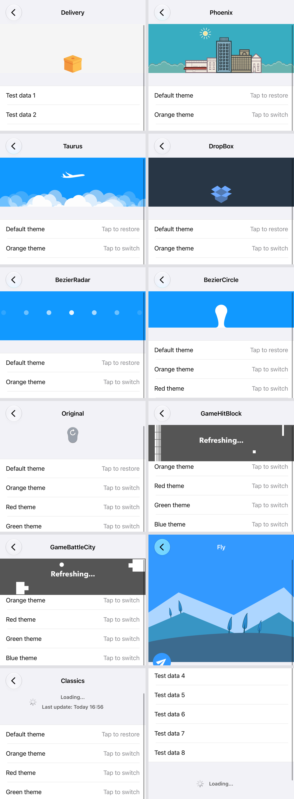
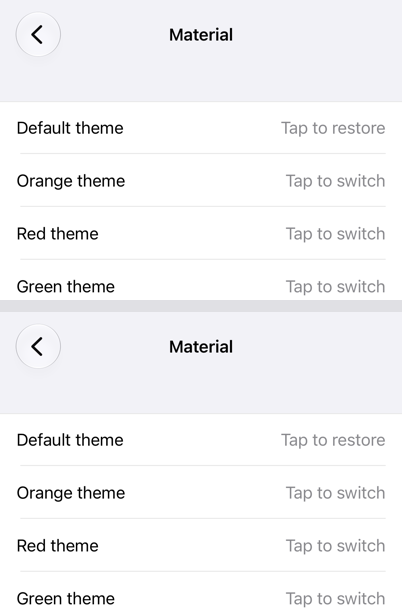
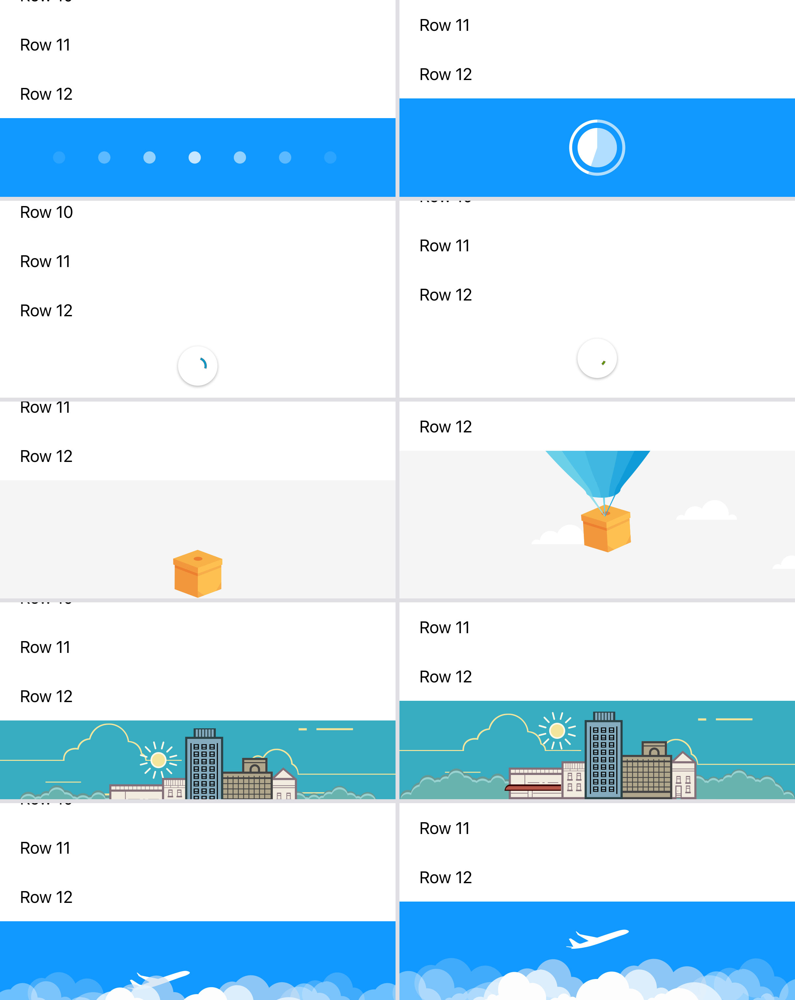

# 刷新库对齐 / Refresh library parity

<!-- bound-classes: CYLRefreshComponent, CYLRefreshHeader, CYLRefreshFooter -->

<!-- docs-navigation:start -->

| 中文 | English |
| --- | --- |
| [任务](#任务--tasks) | [Tasks](#任务--tasks) |
| [SmartRefreshControl 对照表](#smartrefreshcontrol-对照表--smartrefreshcontrol-comparison) | [SmartRefreshControl comparison](#smartrefreshcontrol-对照表--smartrefreshcontrol-comparison) |
| [SmartRefreshControl 示例截图](#smartrefreshcontrol-示例截图--smartrefreshcontrol-demo-screenshots) | [SmartRefreshControl demo screenshots](#smartrefreshcontrol-示例截图--smartrefreshcontrol-demo-screenshots) |
| [flutter_easy_refresh 对照表](#flutter_easy_refresh-对照表--flutter_easy_refresh-comparison) | [flutter_easy_refresh comparison](#flutter_easy_refresh-对照表--flutter_easy_refresh-comparison) |
| [flutter_easy_refresh 刷新尾截图](#flutter_easy_refresh-刷新尾截图--flutter_easy_refresh-footer-screenshots) | [flutter_easy_refresh footer screenshots](#flutter_easy_refresh-刷新尾截图--flutter_easy_refresh-footer-screenshots) |
| [外部项目的 open PR 与 issue](#外部项目的-open-pr-与-issue--open-pull-requests-and-issues-of-the-source-projects) | [Open pull requests and issues of the source projects](#外部项目的-open-pr-与-issue--open-pull-requests-and-issues-of-the-source-projects) |

<!-- docs-navigation:end -->

<!-- docs-binding:start -->

| 类 / Class | 头文件 / Header |
| --- | --- |
| `CYLRefreshComponent` | [`CYLTableViewPlaceHolder/CYLRefresh/Base/CYLRefreshComponent.h`](../CYLTableViewPlaceHolder/CYLRefresh/Base/CYLRefreshComponent.h) |
| `CYLRefreshHeader` | [`CYLTableViewPlaceHolder/CYLRefresh/Base/CYLRefreshHeader.h`](../CYLTableViewPlaceHolder/CYLRefresh/Base/CYLRefreshHeader.h) |
| `CYLRefreshFooter` | [`CYLTableViewPlaceHolder/CYLRefresh/Base/CYLRefreshFooter.h`](../CYLTableViewPlaceHolder/CYLRefresh/Base/CYLRefreshFooter.h) |

<!-- docs-binding:end -->

## 任务 / Tasks

### TODO：对齐 SmartRefreshControl 并复刻其示例 / TODO: Match SmartRefreshControl and port its demo

| 中文 | English |
| --- | --- |
| 状态：进行中（2026-11-12 开始，分支 `feat/smartrefresh-parity`，来源分支 `claude/docs-todo-completion-xoef38`）。 | Status: in progress (started 2026-11-12, branch `feat/smartrefresh-parity`, source branch `claude/docs-todo-completion-xoef38`). |
| 用户原始提示词：“注意本任务主要针对 CYLRefresh文件夹代码修改 ：阅读该项目代码 以及readme <https://github.com/scwang90/SmartRefreshControl>  加入我们缺失的功能。第二步对齐api ，学习该项目的初始化方式，新增我们原有api。保证我们得功能要比这个项目更多，绝对不能少。docs中写个表格，第一列为SmartRefreshControl的公开api，第二列为我们的api。如果能找到对应的，就列出，最后查看我们少了什么API。如果SmartRefreshControl API 完全存在对应版本，那么就满分，持续更新我们的API，一直到100分 。满分后的，将SmartRefreshControl 里面的example完全复刻为swift版本 加入我们的example 。包括截图里的两个场景。优先更新core层面代码，example仅仅负责数据传入以及样式参数输入，点击事件实现。” | The user's original prompt (Chinese, verbatim on the left): mainly change the code in the CYLRefresh folder. Read SmartRefreshControl's code and README and add the features we lack. Then align the API: learn its way of initializing and add it next to our existing API. Our features must be a superset, never fewer. Write a table in docs: column 1 SmartRefreshControl's public API, column 2 ours; list the match where one exists, then see which API we lack. Full marks when every SmartRefreshControl API has a counterpart; keep adding API until 100. After full marks, port SmartRefreshControl's example completely to Swift into our example, including the two scenarios in the screenshot. Core code first; the example only passes data and style parameters and handles taps. |
| 追加提示词（同一任务中）：“同样要求处理： <https://github.com/xuelongqy/flutter_easy_refresh> 新建表格打分 复刻demo” | Added prompt (same task): treat <https://github.com/xuelongqy/flutter_easy_refresh> the same way: a new scored table, and port its demo. |
| 要求：①只改 `CYLTableViewPlaceHolder/CYLRefresh`（核心优先），示例只传数据、样式参数和点击处理；②补齐缺失功能，学习 `attach` 式初始化并新增到现有 API 旁；③表格：SmartRefreshControl 公开 API → 我们的 API，算分，补到 100；④满分后用 Swift 完整复刻其 demo（含截图中的两个场景）；⑤flutter_easy_refresh 同样处理：新表格、打分、复刻 demo；⑥功能只能比对方多。 | Requirements: (1) change only `CYLTableViewPlaceHolder/CYLRefresh` (core first); the example only passes data and style parameters and handles taps; (2) add the missing features, learn the `attach`-style initialization and add it next to the existing API; (3) table: SmartRefreshControl's public API → ours, scored, raised to 100; (4) after 100, port its demo completely to Swift (including the two scenarios in the screenshot); (5) the same for flutter_easy_refresh: a new table, a score, a demo port; (6) we may only have more features, never fewer. |
| 上下文：SmartRefreshControl（MIT，`9319448`，2022-07-07）是 Objective-C，约 9,300 行：基类 `UIRefreshComponent`（UIControl）/ `UIRefreshHeader` / `UIRefreshFooter`，经典样式 `UIRefreshClassicsHeader/Footer`，以及 12 个手绘矢量动画头（Delivery、Material、BezierRadar、BezierCircle、Fly、DropBox、Phoenix、Taurus、BattleCity、HitBlock、StoreHouse、WaveSwipe）与 Original；demo 是 Swift（每个样式一个控制器）。flutter_easy_refresh（MIT，`dcdbb81`，2026-10-23）是 Dart：核心包约 10,700 行（`EasyRefresh`、`EasyRefreshController`、`IndicatorMode`、Classic/Bezier/Material/Cupertino/Phoenix/Taurus/Delivery 等样式、二楼、多种触发模式），另有 6 个 Rive 样式包和 `easy_paging`；示例 49 个 Dart 文件（样式页、聊天、轮播、PageView、嵌套、二楼、主题切换、分页等）。用户提到的“截图里的两个场景”：本条消息未附截图，待确认。待用户决定：手绘矢量动画头需要自定义绘制视图，而 “Reuse CYLPlaceholderView in the core” 规定自定义视图需明确同意。 | Context: SmartRefreshControl (MIT, `9319448`, 2022-07-07) is Objective-C, about 9,300 lines: base classes `UIRefreshComponent` (a UIControl) / `UIRefreshHeader` / `UIRefreshFooter`, the classic `UIRefreshClassicsHeader/Footer`, and 12 hand-drawn vector headers (Delivery, Material, BezierRadar, BezierCircle, Fly, DropBox, Phoenix, Taurus, BattleCity, HitBlock, StoreHouse, WaveSwipe) plus Original; its demo is Swift (one controller per style). flutter_easy_refresh (MIT, `dcdbb81`, 2026-10-23) is Dart: the core package is about 10,700 lines (`EasyRefresh`, `EasyRefreshController`, `IndicatorMode`, Classic/Bezier/Material/Cupertino/Phoenix/Taurus/Delivery styles, a second floor, several trigger modes), plus 6 Rive style packages and `easy_paging`; its example has 49 Dart files (style pages, chat, carousel, PageView, nesting, second floor, theme switch, paging…). The "two scenarios in the screenshot": no screenshot came with this message; to confirm. For the user to decide: the hand-drawn vector headers need custom drawing views, and "Reuse CYLPlaceholderView in the core" requires explicit approval for a custom view. |
| 进度：①分支与 PR（#25）✅；②SmartRefreshControl 表格与评分 ✅（77/100）；③核心补齐基类 API ✅：`attach` 系列、`addTarget:action:`、`refreshingHandler`、`triggerRate`、`finishDuration` 与 `endRefreshingWithSuccess:`（含七种语言的完成 / 失败文字）、`scrollMode`、`colorAccent` / `colorPrimary`、`phase` 与 `isInPhases:`、`expandHeight` / `dragOffset`、可写 `lastUpdatedTime`、`lastUpdatedTimeFormatter`、`titleTimeSpacing`、`isNoMoreData` 与 7 个子类钩子；新增 `Tests/CYLRefreshSmartAPITests.m`（5 个测试），150 个测试在 iOS 27.2 通过；④手绘样式 ✅（100/100）：13 个样式与支撑代码移植到 `CYLRefresh/Custom/Drawn/`（54 个文件，MIT 署名在 `LICENSE.third-party`），新增基类 `CYLRefreshDrawnHeader`、`CYLRefreshHeader.setExpandHeight:` 与 `addsRefreshingInset`；滚动模式按 SmartRefreshControl 调整（拉伸从 0 开始，前置不推动内容）；Fly 的常驻 inset 与游戏头刷新中切换模式都能恢复 inset；新增 `Tests/CYLRefreshDrawnHeaderTests.m`（3 个测试：13 个样式各跑一次完整刷新并绘制、状态顺序、模式切换后的 inset），153 个测试在 iOS 27.2 通过，framework 目标编译通过；⑤示例复刻 ✅（`dc8e90b`）：“刷新”Tab 新增 “SmartRefreshControl styles” 一节（14 个刷新头 + 经典刷新尾），`CYLSmartRefreshDemoViewController` 复刻主题切换、测试数据、刷新与加载更多；模拟器截图进行中；⑥flutter_easy_refresh：对照表 **72/100**（36/50；4 行只属于 Flutter 不计分）：新增 `refreshEnabled`、`triggersWhenReached`、`hapticFeedback`、`maxPullDistance`、`notifiesWhenHidden`、`addPhaseObserver:` / `removePhaseObserver:`、`resetsFooterAfterRefresh`、`loadsAfterNoMoreData`，156 个测试通过；继续补齐剩余 14 行。 | Progress: (1) branch and PR (#25) ✅; (2) SmartRefreshControl table and score ✅ (77/100); (3) the base-class API in the core ✅: the `attach` family, `addTarget:action:`, `refreshingHandler`, `triggerRate`, `finishDuration` with `endRefreshingWithSuccess:` (done / failed texts in seven languages), `scrollMode`, `colorAccent` / `colorPrimary`, `phase` and `isInPhases:`, `expandHeight` / `dragOffset`, writable `lastUpdatedTime`, `lastUpdatedTimeFormatter`, `titleTimeSpacing`, `isNoMoreData` and 7 subclass hooks; new `Tests/CYLRefreshSmartAPITests.m` (5 tests), 150 tests pass on iOS 27.2; (4) the hand-drawn styles ✅ (100/100): 13 styles and their support code ported to `CYLRefresh/Custom/Drawn/` (54 files, MIT notice in `LICENSE.third-party`), with the new base `CYLRefreshDrawnHeader`, `CYLRefreshHeader.setExpandHeight:` and `addsRefreshingInset`; the scroll modes now follow SmartRefreshControl (stretch grows from 0, front never moves the content); Fly's permanent inset and the game headers' mid-refresh mode switch both restore the inset; new `Tests/CYLRefreshDrawnHeaderTests.m` (3 tests: each of the 13 styles runs a whole refresh and draws, the status order, the inset after a mode switch); 153 tests pass on iOS 27.2 and the framework target builds;  (5) the demo port ✅ (`dc8e90b`): the Refresh tab has a "SmartRefreshControl styles" section (14 headers and the classic footer), and `CYLSmartRefreshDemoViewController` ports the theme switch, test data, refresh and load more; simulator screenshots in progress; (6) flutter_easy_refresh: table at **72/100** (36 of 50; 4 Flutter-only rows not scored): new `refreshEnabled`, `triggersWhenReached`, `hapticFeedback`, `maxPullDistance`, `notifiesWhenHidden`, `addPhaseObserver:` / `removePhaseObserver:`, `resetsFooterAfterRefresh` and `loadsAfterNoMoreData`; 156 tests pass; the remaining 14 rows next. |

### TODO：SVPullToRefresh、SmartRefreshLayout、android-Ultra-Pull-To-Refresh 对照与 Swift 示例；合并所有开放分支 / TODO: SVPullToRefresh, SmartRefreshLayout and android-Ultra-Pull-To-Refresh tables and Swift demos; merge every open branch

| 中文 | English |
| --- | --- |
| 状态：进行中（2026-11-12 记录，分支 `feat/smartrefresh-parity`）。 | Status: in progress (recorded 2026-11-12, branch `feat/smartrefresh-parity`). |
| 进度（2026-11-12）：②已完成：#20、#24、#23 的 base 改为本分支后合并（`51a8a7d`、`8d451a0`、`878844a`；#23 的 `AGENTS.md`、`instructions.md` 冲突保留本分支更完整的规则），三个 PR 显示为已合并；已删除完全包含在本分支中的远端分支 `claude/docs-todo-completion-xoef38`、`fix/rive-loading-placeholder-background`、`docs/auto-pr-for-new-branches`、`fix/rive-refresh-icon-background`、`ci/github-actions`；#25 的 base 改为 `master`（原 base 已并入并删除）。保留：`master`、`ci-screenshots`、`ci/ios12-runtime`（PR #19 已关闭，不是开放分支）。①③未开始。 | Progress (2026-11-12): (2) done: #20, #24 and #23 were retargeted to this branch and merged (`51a8a7d`, `8d451a0`, `878844a`; #23's conflicts in `AGENTS.md` and `instructions.md` kept this branch's fuller rules), and the three pull requests show as merged; the remote branches fully contained in this branch were deleted: `claude/docs-todo-completion-xoef38`, `fix/rive-loading-placeholder-background`, `docs/auto-pr-for-new-branches`, `fix/rive-refresh-icon-background`, `ci/github-actions`; #25 now targets `master` (its old base was merged in and deleted). Kept: `master`, `ci-screenshots`, `ci/ios12-runtime` (PR #19 is closed, so it is not an open branch). (1) and (3) not started. |
| 用户原始提示词：“同样要求处理 <https://github.com/samvermette/SVPullToRefresh> 新建表格 打分 复刻demo” “同样要求处理 <https://github.com/scwang90/SmartRefreshLayout>    <https://github.com/liaohuqiu/android-Ultra-Pull-To-Refresh>   新建表格 打分 复刻swift demo” “将所有处于open状态的分支的target branch指向本分支，当前分支，全部合并仅仅保留当前分支，处理冲突后合并，继续以上未完成的任务。” “按指令顺序执行，以commit时间戳为准。参考指令发出时间戳，没完成的任务继续完成。” | The user's original prompts (Chinese, verbatim on the left): treat SVPullToRefresh the same way (a new table, a score, a demo port); treat SmartRefreshLayout and android-Ultra-Pull-To-Refresh the same way (a new table, a score, a Swift demo port); point every open branch's pull request at this (the current) branch, merge them all so only the current branch remains, resolve conflicts, then continue the unfinished tasks; run the tasks in the order they were given, by commit timestamp, and finish what is unfinished. |
| 要求：①SVPullToRefresh（iOS，Objective-C）、SmartRefreshLayout（Android，Java/Kotlin）、android-Ultra-Pull-To-Refresh（Android，Java）各一张表：对方公开 API → CYLRefresh API，打分，补到 100，再用 Swift 复刻其 demo；②开放 PR 的 base 改为 `feat/smartrefresh-parity`，处理冲突后全部合并进来，合并后删除这些 PR 的分支；③之后按 TODO 记录的提交时间顺序继续：SmartRefreshControl → flutter_easy_refresh →（`docs/Android-Port.md`）Android →（`docs/Swift-Migration.md`）Swift 转写 → 本条的三个库。 | Requirements: (1) one table each for SVPullToRefresh (iOS, Objective-C), SmartRefreshLayout (Android, Java/Kotlin) and android-Ultra-Pull-To-Refresh (Android, Java): their public API → CYLRefresh API, scored, raised to 100, then their demos ported to Swift; (2) retarget the open pull requests to `feat/smartrefresh-parity`, resolve conflicts, merge them all, and delete their branches afterwards; (3) then continue in the order of the TODO records' commit times: SmartRefreshControl → flutter_easy_refresh → Android (`docs/Android-Port.md`) → the Swift migration (`docs/Swift-Migration.md`) → the three libraries in this entry. |
| 上下文：开放 PR（2026-11-12）：#25 本分支 → `claude/docs-todo-completion-xoef38`；#24 `fix/rive-loading-placeholder-background`（比本分支多 1 个提交）；#23 `docs/auto-pr-for-new-branches`（多 2 个，有冲突）；#20 `claude/docs-todo-completion-xoef38` → `master`（多 1 个）。不删除：`master`（默认分支）、`ci-screenshots`（CI 截图发布分支，`scripts/ci-publish-screenshots.sh` 写入）。无开放 PR 的旧分支：`ci/ios12-runtime`（4 个未合并提交，保留并报告）、`ci/github-actions`（已合并进 master）、`fix/rive-refresh-icon-background`（PR #22 已合并）。“继续以上未完成的任务”视为同意移植 SmartRefreshControl 的手绘样式（自定义绘制视图）。 | Context: open pull requests (2026-11-12): #25 this branch → `claude/docs-todo-completion-xoef38`; #24 `fix/rive-loading-placeholder-background` (1 commit ahead of this branch); #23 `docs/auto-pr-for-new-branches` (2 ahead, conflicting); #20 `claude/docs-todo-completion-xoef38` → `master` (1 ahead). Not deleted: `master` (default branch) and `ci-screenshots` (the CI screenshot branch written by `scripts/ci-publish-screenshots.sh`). Old branches without an open pull request: `ci/ios12-runtime` (4 unmerged commits, kept and reported), `ci/github-actions` (merged into master), `fix/rive-refresh-icon-background` (PR #22 merged). "Continue the unfinished tasks" is taken as approval to port SmartRefreshControl's hand-drawn styles (custom drawing views). |

## SmartRefreshControl 对照表 / SmartRefreshControl comparison

| 中文 | English |
| --- | --- |
| 评分：**100/100**（56/56 行有对应 API，2026-11-12，`feat/smartrefresh-parity`；此前 77/100，`a30557c`）。每行是一组相关的公开 API（按 SmartRefreshControl 头文件 `UIRefreshComponent.h`、`UIRefreshHeader.h`、`UIRefreshFooter.h`、`UIRefreshClassics*.h` 及各样式头文件分组）；一行全部有对应才算对齐。手绘样式（最后 13 行）移植在 `CYLRefresh/Custom/Drawn/`，基类 `CYLRefreshDrawnHeader` 提供 SmartRefreshControl 的子类接口（`setUpComponent`、`onStatus:changed:`、`onScrollingWithOffset:percent:drag:` 等）。 | Score: **100/100** (56 of 56 rows have a counterpart, 2026-11-12, `feat/smartrefresh-parity`; 77/100 before, `a30557c`). Each row is one group of related public API (grouped by SmartRefreshControl's headers `UIRefreshComponent.h`, `UIRefreshHeader.h`, `UIRefreshFooter.h`, `UIRefreshClassics*.h` and the style headers); a row counts only when all of it has a counterpart. The hand-drawn styles (the last 13 rows) are ported in `CYLRefresh/Custom/Drawn/`; their base `CYLRefreshDrawnHeader` offers SmartRefreshControl's subclass API (`setUpComponent`, `onStatus:changed:`, `onScrollingWithOffset:percent:drag:` and the rest). |
| 我们多出的功能（对方没有）：trailer（左拉）、`autoHideRefresh`、`exclusiveWithOtherRefresh`、`noMoreDataDisplayDuration`、`autoTriggerTimes`、GIF / Lottie / PAG / Rive 图标动画、`setAnimationImages:`、七种语言本地化与语言切换、完成 / 失败的本地化文字、`isCollectionViewAnimationBug`、RTL 翻转、链式写法、`cyl_scrollDistance` / `cyl_scrollDirection`、`beginRefreshingWithCompletionBlock:` 等回调。 | Features we have that it lacks: the trailer (pull left), `autoHideRefresh`, `exclusiveWithOtherRefresh`, `noMoreDataDisplayDuration`, `autoTriggerTimes`, GIF / Lottie / PAG / Rive icon animations, `setAnimationImages:`, seven languages with a language switch, localized done / failed texts, `isCollectionViewAnimationBug`, RTL flipping, chaining, `cyl_scrollDistance` / `cyl_scrollDirection`, completion callbacks such as `beginRefreshingWithCompletionBlock:`. |

| SmartRefreshControl 公开 API / public API | CYLRefresh API | 对齐 / Aligned |
| --- | --- | --- |
| `UISmartScrollMode`（Move / Stretch / Front） | `CYLRefreshScrollMode`（Move / Stretch / Front） | ✅ |
| `width` / `height` | `cyl_w` / `cyl_h`（UIView+CYLExtension） | ✅ |
| `triggerRate` | `triggerRate`（刷新头、返回式尾、trailer / header, back footer, trailer） | ✅ |
| `finishDuration` | `finishDuration` | ✅ |
| `durationFast` / `durationNormal` | `fastAnimationDuration` / `slowAnimationDuration` | ✅ |
| `scrollMode` | `scrollMode` | ✅ |
| `colorAccent` / `colorPrimary` | `colorAccent` / `colorPrimary` | ✅ |
| `isAttached` / `isExpanded` | `isAttached` / `isExpanded` | ✅ |
| `dragOffset` / `dragPercent` | `dragOffset` / `pullingPercent` | ✅ |
| `expandHeight` | `expandHeight` | ✅ |
| `target` / `scrollView` | `refreshingTarget` / `scrollView` | ✅ |
| `setUpComponent` | `prepare` | ✅ |
| `addObservers:` / `removeObservers:` | `addObservers` / `removeObservers` | ✅ |
| `scrollView:attached:` / `scrollView:detached:` | `didAttachToScrollView:` / `willDetachFromScrollView:` | ✅ |
| `scrollView:didChange:contentOffset:` / `…contentInset:` | `scrollViewContentOffsetDidChange:` / `scrollViewContentInsetDidChange:` | ✅ |
| `scrollView:didScroll:percent:drag:` | `didScrollWithOffset:percent:dragging:` | ✅ |
| `adjustFrameWithHeight:inset:expand:offset:` | `placeSubviews` + `scrollMode` | ✅ |
| `finalyContentInsetsFrom:` | `scrollViewOriginalInset` | ✅ |
| `+attach:` / `+attach:target:action:` / `-attach:` | `+attach:` / `+attach:target:action:` / `-attach:` | ✅ |
| `-addTarget:action:`（UIControl） | `-addTarget:action:` / `-removeTarget:action:`（可多个 / several） | ✅ |
| `UIRefreshStatus`（7 种 / 7 cases） | `CYLRefreshPhase`（8 种 / 8 cases） | ✅ |
| `RefreshBlock` / `refreshBlock` | `CYLRefreshComponentHandler` / `refreshingHandler`（另有 / also `refreshingBlock`） | ✅ |
| `keyForLastRefreshTime` / `nameForLastRefreshTime` | `lastUpdatedTimeKey` / `lastUpdatedTimeText` | ✅ |
| `lastRefreshTime`（可写 / writable） | `lastUpdatedTime`（可写 / writable） | ✅ |
| `lastRefreshTimeFormatter` | `lastUpdatedTimeFormatter` | ✅ |
| `isRefreshing` / `status` / `textLastRefreshTime` | `isRefreshing` / `phase` / `lastUpdatedTimeString` | ✅ |
| `inStatus:…` | `isInPhases:…` / `isInAnyPhase:` | ✅ |
| `beginRefresh` / `finishRefresh` / `finishRefreshWithSuccess:` | `beginRefreshing` / `endRefreshing` / `endRefreshingWithSuccess:` | ✅ |
| `performRefreshEvent` | `executeRefreshingCallback` | ✅ |
| `onStartAnimationWhenRealeasing` / `…WhenRefreshing` / `onStatus:changed:` | `phaseDidChangeFrom:to:`（Releasing / Refreshing） | ✅ |
| `onScrollingWithOffset:percent:drag:` | `didScrollWithOffset:percent:dragging:` | ✅ |
| `onRefreshFinished:` / `onRefreshFinishing:` | `refreshDidFinishWithSuccess:` / `finishingDurationWithSuccess:` | ✅ |
| `UISmartFooterStatus`（8 种 / 8 cases） | `CYLRefreshPhase`（含 / with `NoMoreData`） | ✅ |
| `UISmartFooterBlock` / `loadMoreBlock` | `refreshingHandler` / `refreshingBlock` | ✅ |
| `isAutoLoadMore` | `CYLRefreshAutoFooter.automaticallyRefresh` | ✅ |
| `isLoading` / `isNoMoreData` / `status` / `inStatus:` | `isRefreshing` / `isNoMoreData` / `phase` / `isInPhases:` | ✅ |
| `finishLoadMore` / `…WithNoMoreData` / `…WithSuccess:` | `endRefreshing` / `endRefreshingWithNoMoreData` / `endRefreshingWithSuccess:` | ✅ |
| `performLoadMoreEvent` / `resetNoMoreData` | `executeRefreshingCallback` / `resetNoMoreData` | ✅ |
| `onStartAnimationWhenLoading` / `…WhenRealeasing` / `onStatus:changed:` | `phaseDidChangeFrom:to:` | ✅ |
| `onScrollingWithOffset:…` / `onLoadMoreFinished:` / `onLoadMoreFinishing:` | `didScrollWithOffset:…` / `refreshDidFinishWithSuccess:` / `finishingDurationWithSuccess:` | ✅ |
| `UIRefreshClassicsHeader`：`spaceOfTitleAndTime` / `spaceOfLoadingAndText` | `CYLRefreshNormalHeader`：`titleTimeSpacing` / `labelLeftInset` | ✅ |
| `UIRefreshClassicsHeader`：`labelTitle` / `labelLastTime` / `viewArrow` / `viewLoading` | `stateLabel` / `lastUpdatedTimeLabel` / `arrowView` / `loadingView` | ✅ |
| `UIRefreshClassicsFooter`：`spaceOfLoadingAndText` / `labelTitle` / `viewArrow` / `viewLoading` | `CYLRefreshBackNormalFooter`：`labelLeftInset` / `stateLabel` / `arrowView` / `loadingView` | ✅ |
| `UIRefreshBezierCircleHeader` | `CYLRefreshBezierCircleHeader` | ✅ |
| `UIRefreshBezierRadarHeader` | `CYLRefreshBezierRadarHeader` | ✅ |
| `UIRefreshDeliveryHeader` | `CYLRefreshDeliveryHeader` | ✅ |
| `UIRefreshDropBoxHeader` | `CYLRefreshDropBoxHeader` | ✅ |
| `UIRefreshFlyHeader`（含 / with `FlyView`、`MountainView`） | `CYLRefreshFlyHeader`（内部 / internal `CYLRefreshFlyView`、`CYLRefreshMountainView`） | ✅ |
| `UIRefreshGameBattleCityHeader` | `CYLRefreshGameBattleCityHeader` | ✅ |
| `UIRefreshGameHitBlockHeader` | `CYLRefreshGameHitBlockHeader` | ✅ |
| `UIRefreshMaterialHeader` | `CYLRefreshMaterialHeader` | ✅ |
| `UIRefreshOriginalHeader`（`enableAutoRefresh`） | `CYLRefreshOriginalHeader`（`enableAutoRefresh`） | ✅ |
| `UIRefreshPhoenixHeader` | `CYLRefreshPhoenixHeader` | ✅ |
| `UIRefreshStoreHouseHeader`（`lineWidth`、`enableReverseFlash`、`enableFadeAnimation`、`newWithString:…`、`initLinesWith…`） | `CYLRefreshStoreHouseHeader`（`lineWidth`、`enableReverseFlash`、`enableFadeAnimation`、`newWithString:…`、`initLinesWith…`；Swift：`init(string:…)`、`setLines(…)`） | ✅ |
| `UIRefreshTaurusHeader` | `CYLRefreshTaurusHeader` | ✅ |
| `UIRefreshWaveSwipeHeader` | `CYLRefreshWaveSwipeHeader` | ✅ |

## SmartRefreshControl 示例截图 / SmartRefreshControl demo screenshots

| 中文 | English |
| --- | --- |
| 运行平台：iOS。环境：macOS 27.3（26C5035r）、Xcode 27.2（27B5028f）、iOS SDK 27.2、iPhone 17 Pro 模拟器 iOS 27.2（24B5089g）。版本：分支 `feat/smartrefresh-parity`，截图基于 `b9420c8` 的工作区（<https://github.com/ChenYilong/CYLTableViewPlaceHolder/commit/b9420c8>，含本次修复）。时间：2026-11-12 16:50–18:15（NZDT）。页面：Example-Scenarios › 刷新 › SmartRefreshControl styles。截图方式：按住下拉（axe 连续按下事件）后截取下拉状态，或松手后截取刷新中状态；从左到右、从上到下（与示例列表顺序相同）：Delivery、Classics（刷新中）、DropBox、Phoenix、Taurus、BezierRadar、BezierCircle（刷新中）、StoreHouse（刷新中）、WaveSwipe、Original、Material、GameHitBlock（刷新中）、GameBattleCity（刷新中）、Fly、Classics 刷新尾（加载中）。 | Platform: iOS. Environment: macOS 27.3 (26C5035r), Xcode 27.2 (27B5028f), iOS SDK 27.2, iPhone 17 Pro simulator, iOS 27.2 (24B5089g). Version: branch `feat/smartrefresh-parity`, working tree on `b9420c8` (<https://github.com/ChenYilong/CYLTableViewPlaceHolder/commit/b9420c8>, with this round's fixes). Time: 2026-11-12 16:50–18:15 (NZDT). Page: Example-Scenarios › Refresh › SmartRefreshControl styles. Method: a held pull (repeated axe touch-down events) for the pull state, or right after the release for the refreshing state; left to right, top to bottom (the demo list's order): Delivery, Classics (refreshing), DropBox, Phoenix, Taurus, BezierRadar, BezierCircle (refreshing), StoreHouse (refreshing), WaveSwipe, Original, Material, GameHitBlock (refreshing), GameBattleCity (refreshing), Fly, the Classics footer (loading). |
| 已修复（2026-11-12）：三个样式此前在模拟器上不正确。①StoreHouse 比屏幕窄：SmartRefreshControl 原代码在进度为 0 时设置了 `self.transform`（整个刷新头按最后一条线段的偏移横移），应为 `line.transform`，已修正并注释；②Material、WaveSwipe 什么都不显示：这两个样式关闭了用户交互以让触摸穿透，而 CYLRefresh（与 MJRefresh 相同）在交互关闭时不再跟随滚动视图，`CYLRefreshDrawnHeader` 改为保持交互开启、用 `hitTest:` 让触摸穿透；③SmartRefreshControl 的 `colorPrimary` 只是绘制颜色，不是背景，`CYLRefreshDrawnHeader` 现在保持背景透明（否则纯色背景盖住绘制）。158 个测试通过（新增前置模式样式的显示与触摸穿透测试）。截图方式说明：主机负载很高时 `simctl` 截图会延迟数秒，因此用按住下拉截图。 | Fixed (2026-11-12): three styles were wrong on the simulator. (1) StoreHouse was narrower than the screen: SmartRefreshControl set `self.transform` at progress 0 (moving the whole header by the last segment's offset) where `line.transform` was meant; fixed, with a comment. (2) Material and WaveSwipe showed nothing: they turn user interaction off so touches pass through, and CYLRefresh (like MJRefresh) stops following the scroll view when it is off; `CYLRefreshDrawnHeader` now keeps it on and passes touches through in `hitTest:`. (3) SmartRefreshControl's `colorPrimary` is a drawing color, not a background; `CYLRefreshDrawnHeader` keeps the background clear (a solid background covered the drawing). 158 tests pass (new: front-mode styles show and pass touches through). Capture method: with the host heavily loaded, `simctl` screenshots lag by seconds, so the captures use held pulls. |

| 中文 | English |
| --- | --- |
| 核对（2026-11-12，用户询问 Material 刷新后为何不消失）：不是缺陷。上图中 Material 的“刷新中”截图是在松手后 0.35 秒、2.5 秒的刷新期间拍的，Material 的圆圈按设计（与 Android SwipeRefreshLayout 相同）在刷新期间浮在列表顶部。刷新结束后圆圈消失，刷新头被 `autoHideRefresh` 隐藏：下图从上到下为打开页面的首次刷新结束后、手动下拉刷新结束后约 6–8 秒（iOS 27.2 模拟器）。`testFrontModeStylesDrawWhilePulled` 也断言刷新结束后刷新头被隐藏。 | Checked (2026-11-12, the user asked why Material does not go away after refreshing): not a defect. The Material "refreshing" shot above was taken 0.35 seconds after the release, during the 2.5-second refresh, and by design (as in Android's SwipeRefreshLayout) Material's circle floats over the top of the list while refreshing. When the refresh ends the circle goes away and `autoHideRefresh` hides the header: below, top to bottom, about 6–8 seconds after the opening refresh and after a manual pull (iOS 27.2 simulator). `testFrontModeStylesDrawWhilePulled` also asserts that the header hides after the refresh. |

## flutter_easy_refresh 对照表 / flutter_easy_refresh comparison

| 中文 | English |
| --- | --- |
| 评分：**96/100**（46/48 行有对应 API；二楼一行拆成刷新头与刷新尾两行；阻尼、弹簧与嵌套滚动 3 行改判为不适用；此前 94（`a890e12`）、92（`d29c511`）、84（`af17600`）、82（`2ca3af5`）、72（`2ea8d2b`）、54（`08150a2`）；另有 7 行只属于 Flutter 或 UIKit 无对应概念，不计分；2026-11-12，`feat/smartrefresh-parity`，对照 flutter_easy_refresh `dcdbb81`）。每行是一组相关的公开 API（`EasyRefresh`、`EasyRefreshController`、`Indicator` 及其枚举、各类 Header / Footer、各样式、样式扩展包与 `easy_paging`）。剩下的缺口：6 个 Rive 样式包与 `easy_paging`。 | Score: **96/100** (46 of 48 rows have a counterpart; the second-floor row is split into header and footer; friction, springs and nested scrolling are now judged not applicable; before: 94 (`a890e12`), 92 (`d29c511`), 84 (`af17600`), 82 (`2ca3af5`), 72 (`2ea8d2b`), 54 (`08150a2`); 7 rows belong to Flutter only or have no UIKit concept and are not scored; 4 more rows belong to Flutter only and are not scored; 2026-11-12, `feat/smartrefresh-parity`, against flutter_easy_refresh `dcdbb81`). Each row is one group of related public API (`EasyRefresh`, `EasyRefreshController`, `Indicator` and its enums, the Header / Footer kinds, the styles, the style packages and `easy_paging`). Remaining gaps: the 6 Rive style packages and `easy_paging`. |

| flutter_easy_refresh 公开 API / public API | CYLRefresh API | 对齐 / Aligned |
| --- | --- | --- |
| `EasyRefresh(child:)`：包住滚动视图 / wraps the scroll view | `UIScrollView.cyl_header` / `cyl_footer` / `cyl_trailer`、`+attach:` | ✅ |
| `header` / `footer` | `cyl_header` / `cyl_footer` | ✅ |
| `onRefresh` / `onLoad`（返回 `IndicatorResult`） | `refreshingBlock` / `refreshingHandler` / target-action；结果用 `endRefreshingWithSuccess:` / `endRefreshingWithNoMoreData` | ✅ |
| `EasyRefreshController.callRefresh` / `callLoad` | `[header beginRefreshing]` / `[footer beginRefreshing]` | ✅ |
| `finishRefresh([result])` / `finishLoad([result])` | `endRefreshingWithSuccess:` / `endRefreshingWithNoMoreData` | ✅ |
| `resetHeader` / `resetFooter` | `endRefreshing` / `resetNoMoreData` | ✅ |
| `controlFinishRefresh` / `controlFinishLoad` | 总是由调用方结束 / always ended by the caller | ✅ |
| `headerState` / `footerState`（`IndicatorState`：mode、result、offset） | `phase`、`dragOffset`、`pullingPercent`、`lastRefreshSucceeded` | ✅ |
| `IndicatorResult`（none / success / fail / noMore） | `lastRefreshSucceeded` + `endRefreshingWithNoMoreData` / `isNoMoreData` | ✅ |
| `simultaneously` | `exclusiveWithOtherRefresh`（默认允许同时 / both allowed by default） | ✅ |
| `refreshOnStart` | 页面加载时调用 `beginRefreshing` / call `beginRefreshing` on load | ✅ |
| `scrollController` / `triggerAxis` | `scrollView`；纵向 header / footer，横向 `CYLRefreshTrailer` | ✅ |
| `triggerOffset` | `expandHeight` × `triggerRate` | ✅ |
| `processedDuration` | `finishDuration` | ✅ |
| `clamping`（内容不动，指示器浮在上面） | `CYLRefreshScrollModeFront` / `addsRefreshingInset = NO` | ✅ |
| `safeArea` | `ignoredScrollViewContentInsetTop`、UIKit `adjustedContentInset` | ✅ |
| `infiniteOffset`（自动加载） | `CYLRefreshAutoFooter.automaticallyRefresh` / `triggerAutomaticallyRefreshPercent` / `autoTriggerTimes` | ✅ |
| `BuilderHeader` / `BuilderFooter`（自定义外观） | 子类化 `CYLRefreshComponent` / `CYLRefreshDrawnHeader`；图标动画 `setIconAnimation…` | ✅ |
| `ClassicHeader` / `ClassicFooter` 的各状态文字（drag / armed / ready / processing / processed / noMore / failed） | `setTitle:forState:` + 完成 / 失败文字（`finishDuration`） | ✅ |
| `ClassicHeader` 的时间信息 `messageText` / `showMessage` | `lastUpdatedTimeLabel` / `lastUpdatedTimeText` / `lastUpdatedTimeFormatter` | ✅ |
| `BezierHeader` | `CYLRefreshBezierRadarHeader` | ✅ |
| `BezierCircleHeader` | `CYLRefreshBezierCircleHeader` | ✅ |
| `MaterialHeader` | `CYLRefreshMaterialHeader` | ✅ |
| `DeliveryHeader` | `CYLRefreshDeliveryHeader` | ✅ |
| `PhoenixHeader` | `CYLRefreshPhoenixHeader` | ✅ |
| `TaurusHeader` | `CYLRefreshTaurusHeader` | ✅ |
| `IndicatorMode`（inactive / drag / armed / ready / processing / processed / done） | `CYLRefreshPhase`（Idle / PullToRefresh / ReleaseToRefresh / Releasing / Refreshing / Finishing） | ✅ |
| 刷新头二楼：`openHeaderSecondary` / `closeHeaderSecondary`、`SecondaryHeader` / `SecondaryBuilderHeader`、`secondaryTriggerOffset` / `secondaryDimension` / `secondaryCloseTriggerOffset`、`IndicatorMode.secondary*` | `openSecondary` / `closeSecondary`、`secondaryView`、`secondaryTriggerOffset` / `secondaryDimension` / `secondaryCloseTriggerOffset`、`secondaryOpenedBlock` / `secondaryClosedBlock`、`CYLRefreshPhaseSecondaryArmed` / `SecondaryOpen` / `SecondaryClosing`；`secondaryVelocity` | ✅ |
| 刷新尾二楼：`openFooterSecondary` / `closeFooterSecondary`、`SecondaryBuilderFooter` | `CYLRefreshBackFooter`：`openSecondary` / `closeSecondary`、`secondaryView`、`secondaryTriggerOffset` / `secondaryDimension` / `secondaryCloseTriggerOffset`、`secondaryOpenedBlock` / `secondaryClosedBlock` | ✅ |
| `IndicatorTriggerMode`（anywhere / onEdge） | `CYLRefreshTriggerMode` / `triggerMode`（刷新头、返回式尾） | ✅ |
| `IndicatorPosition.behind`（指示器固定在内容后面） | `CYLRefreshScrollModeBehind` | ✅ |
| `triggerWhenReach` / `triggerWhenRelease` / `triggerWhenReleaseNoWait` | `triggersWhenReached`；松手即刷新是默认行为 / refreshing on release is the default | ✅ |
| `frictionFactor` / `horizontalFrictionFactor`（拖动阻尼） | 不适用：UIScrollView 的越界阻尼由系统决定，不能替换；限制拉动距离用 `maxPullDistance` / not applicable: UIScrollView's overscroll resistance is the system's and cannot be replaced; `maxPullDistance` limits the pull | 不适用 / N/A |
| `readySpringBuilder` / `horizontalReadySpringBuilder` / `springRebound`（弹簧回弹） | 不适用：回弹动画由 UIScrollView 自身完成；进入刷新位置的时长用 `fastAnimationDuration` / not applicable: UIScrollView runs its own rebound; `fastAnimationDuration` sets the move to the refreshing position | 不适用 / N/A |
| `maxOverOffset` / `hitOver` / `infiniteHitOver` | `maxPullDistance`（刷新头、返回式尾）；越过触发点继续拉动、无限加载重复触发是默认行为（`autoTriggerTimes`） / pulling past the trigger point and repeated infinite loading are the default (`autoTriggerTimes`) | ✅ |
| `hapticFeedback` | `hapticFeedback` | ✅ |
| `notifyWhenInvisible` | `notifiesWhenHidden` | ✅ |
| `listenable`（`IndicatorStateListenable`，外部监听状态） | `addPhaseObserver:` / `removePhaseObserver:`（另有子类钩子 / also the subclass hook `phaseDidChangeFrom:to:`） | ✅ |
| `ListenerHeader` / `ListenerFooter`（不可见、只监听） | 不绘制内容的 `CYLRefreshHeader` / `CYLRefreshBackFooter` + `addPhaseObserver:` / a drawing-free `CYLRefreshHeader` / `CYLRefreshBackFooter` with `addPhaseObserver:` | ✅ |
| `NotRefreshHeader` / `NotLoadFooter`（不刷新但保留回弹配置） | `refreshEnabled = NO` | ✅ |
| `OverrideHeader` / `OverrideFooter`（覆盖已有指示器的属性） | 直接修改控件实例的属性（UIKit 不需要包装类） / set the properties on the control instance (UIKit needs no wrapper) | ✅ |
| `refreshOnStartHeader`（首次刷新用另一个刷新头） | `-[UIScrollView cyl_beginRefreshingWithStartHeader:]` | ✅ |
| `callRefreshOverOffset` / `callLoadOverOffset`；`callRefresh(overOffset:duration:curve:force:)` 的参数 | `beginRefreshingWithDuration:overOffset:force:`（`curve` 用 UIKit 默认曲线 / `curve` uses UIKit's default curve） | ✅ |
| `canRefreshAfterNoMore` / `canLoadAfterNoMore` | 无更多数据时仍可下拉刷新（默认） / `loadsAfterNoMoreData` / refreshing is always allowed after no more data (default); `loadsAfterNoMoreData` | ✅ |
| `resetAfterRefresh`（刷新后自动重置无更多数据） | `resetsFooterAfterRefresh` | ✅ |
| `isNested` / `nestedOuterController` / `nestedInnerController`（嵌套滚动） | 不适用：UIKit 没有 NestedScrollView；嵌套的滚动视图把控件挂在需要的那个滚动视图上即可 / not applicable: UIKit has no NestedScrollView; attach the control to the scroll view that should refresh | 不适用 / N/A |
| `ClassicHeader` 的结果图标 `succeededIcon` / `failedIcon` / `noMoreIcon`、`pullIconBuilder`、`reverse`、`textBuilder` / `messageBuilder`、`spacing` / `iconDimension` | `succeededImage` / `failedImage`、经典刷新尾的 `noMoreDataImage`、`iconOnTrailingSide`、`iconSize`；`pullIconBuilder` → `arrowView.image`；`textBuilder` → `setTitle:forState:`；`messageBuilder` → `lastUpdatedTimeText`；`spacing` → `labelLeftInset` / the classic footers' `noMoreDataImage`, and the mappings listed | ✅ |
| `CupertinoHeader` / `CupertinoFooter` | `CYLRefreshCupertinoHeader` / `CYLRefreshCupertinoFooter` | ✅ |
| `BezierFooter` / `MaterialFooter` / `DeliveryFooter` / `PhoenixFooter` / `TaurusFooter` | `CYLRefreshBezierRadarFooter` / `CYLRefreshMaterialFooter` / `CYLRefreshDeliveryFooter` / `CYLRefreshPhoenixFooter` / `CYLRefreshTaurusFooter`（`CYLRefreshDrawnFooter` 内嵌对应的手绘刷新头并驱动它；任何手绘刷新头都可用 `initWithStyle:` 变成刷新尾 / `CYLRefreshDrawnFooter` hosts and drives the matching drawn header; `initWithStyle:` turns any drawn header into a footer） | ✅ |
| Rive 样式包 / Rive style packages：`easy_refresh_bow` / `bubbles` / `halloween` / `skating` / `space` / `squats` | 通用 Rive 图标 `setIconAnimation…`，但未带这 6 个文件 / generic Rive icons, without these 6 files | TODO |
| `easy_paging`（`EasyPaging`：分页加载、空数据、错误状态） | 部分：占位图场景 + 自动加载尾 / partly: placeholder scenarios + auto footer | TODO |
| `childBuilder`（把 physics 交给子组件） | 不适用：Flutter 组件树 / not applicable: Flutter widget tree | 不适用 / N/A |
| `fit` / `clipBehavior` | 不适用：Flutter 布局 / not applicable: Flutter layout | 不适用 / N/A |
| `scrollBehaviorBuilder` / `ERScrollBehavior` / `_ERScrollPhysics` | 不适用：UIKit 没有可替换的滚动物理 / not applicable: UIKit has no replaceable scroll physics | 不适用 / N/A |
| `HeaderLocator` / `FooterLocator`（`IndicatorPosition.locator`，放进 sliver） | 不适用：Flutter slivers / not applicable: Flutter slivers | 不适用 / N/A |

## flutter_easy_refresh 刷新尾截图 / flutter_easy_refresh footer screenshots

| 中文 | English |
| --- | --- |
| 5 个手绘刷新尾的渲染（2026-11-12 23:05，NZDT）：左列为上拉到展开高度的 80%（手指按住），右列为加载中；从上到下依次为 BezierRadar、Material、Delivery、Phoenix、Taurus。由 `testDrawnFooterSnapshots` 在 iOS 27.2 模拟器（iPhone 17 Pro，24B5089g；macOS 27.3、Xcode 27.2、iOS SDK 27.2）上把窗口图层渲染成 PNG，基于 `a890e12` 的工作区（含本次的 `CYLRefreshDrawnFooter`），原图未缩小，只裁剪了列表底部。机器负载过高（load average 约 700），通过 UI 点击进入示例页截图不稳定，所以用测试渲染；示例页（刷新 › SmartRefreshControl 样式 › 各 footer 行）使用同一套控件。 | The 5 drawn footers rendered (2026-11-12 23:05, NZDT): left, pulled up to 80 % of the open height (finger down); right, loading; top to bottom BezierRadar, Material, Delivery, Phoenix, Taurus. `testDrawnFooterSnapshots` renders the window's layer to PNG on the iOS 27.2 simulator (iPhone 17 Pro, 24B5089g; macOS 27.3, Xcode 27.2, iOS SDK 27.2), on the `a890e12` working tree with this change's `CYLRefreshDrawnFooter`; originals, not downscaled, cropped to the bottom of the list. The machine was overloaded (load average about 700) and driving the example app through taps was unreliable, so the test renders them; the example page (Refresh › SmartRefreshControl styles › the footer rows) uses the same controls. |

## 外部项目的 open PR 与 issue / Open pull requests and issues of the source projects

| 中文 | English |
| --- | --- |
| 规则见 `instructions.md` 的 “Translating or porting another project”（2026-11-12）：移植前后合并来源项目的 open PR，并把 open issue 列成表格、在本项目中修复、逐个打分到 100；未开始翻译时 issue 达到 60 分即可开始。查询时间：2026-11-12。 | The rule is "Translating or porting another project" in `instructions.md` (2026-11-12): bring in the source's open pull requests before or after porting, list its open issues, fix them here and rescore after each until 100; a translation not yet started may start at 60. Checked on 2026-11-12. |
| SmartRefreshControl：0 个 open PR，0 个 open issue，**100/100**。 | SmartRefreshControl: 0 open pull requests, 0 open issues, **100/100**. |
| flutter_easy_refresh：0 个 open PR；4 个 open issue，**50/100**（2 个不适用，2 个待核对）。 | flutter_easy_refresh: 0 open pull requests; 4 open issues, **50/100** (2 do not apply, 2 to check). |
| SVPullToRefresh（43 个 open PR、103 个 open issue）、SmartRefreshLayout（5 个、337 个）、android-Ultra-Pull-To-Refresh（23 个、151 个）：在各自任务开始时建表（按任务顺序排在后面）。 | SVPullToRefresh (43 open pull requests, 103 open issues), SmartRefreshLayout (5, 337) and android-Ultra-Pull-To-Refresh (23, 151): tables when their tasks start (later in the task order). |

| flutter_easy_refresh issue | 描述 / Description | 状态 / Status |
| --- | --- | --- |
| <https://github.com/xuelongqy/flutter_easy_refresh/issues/752> | macOS 上双指滚动在列表中可用，在 EasyRefresh 中不可用。本项目对应：iPad 触控板 / 鼠标与 Mac（Designed for iPad / Catalyst）上的间接指针滚动能否触发刷新与加载。 / Two-finger scrolling works in a list but not in EasyRefresh on macOS. Counterpart here: whether indirect-pointer scrolling (iPad trackpad / mouse, Mac "Designed for iPad" / Catalyst) triggers refresh and loading. | TODO |
| <https://github.com/xuelongqy/flutter_easy_refresh/issues/631> | Web 上鼠标滚轮不能触发加载更多，只能拖拽。本项目对应：滚轮 / 触控板滚动到底部时自动加载尾是否触发（自动加载尾按偏移触发、不要求拖动，预计可用，待验证）。 / On the web a mouse wheel does not trigger load more, only a drag does. Counterpart here: whether the auto footer triggers when a wheel or trackpad scrolls to the end (it triggers on the offset without requiring a drag, so it should work; to verify). | TODO |
| <https://github.com/xuelongqy/flutter_easy_refresh/issues/145> | 置顶说明：如何提一条有用的 issue（英文）。 / Pinned note: how to write a useful issue (English). | 不适用（不是缺陷） / Does not apply (not a defect) |
| <https://github.com/xuelongqy/flutter_easy_refresh/issues/144> | 置顶说明：如何提一条有用的 issue（中文）。 / Pinned note: how to write a useful issue (Chinese). | 不适用（不是缺陷） / Does not apply (not a defect) |
