# 刷新库对齐 / Refresh library parity

<!-- bound-classes: CYLRefreshComponent, CYLRefreshHeader, CYLRefreshFooter -->

<!-- docs-navigation:start -->

| 中文 | English |
| --- | --- |
| [现状](#现状--current-state) | [Current state](#现状--current-state) |
| [任务](#任务--tasks) | [Tasks](#任务--tasks) |
| [Android CYLRefreshLayout 对齐（iOS）](#android-cylrefreshlayout-对齐ios--matching-androids-cylrefreshlayout-ios) | [Matching Android's CYLRefreshLayout (iOS)](#android-cylrefreshlayout-对齐ios--matching-androids-cylrefreshlayout-ios) |
| [CYLRefresh styles 对照表](#cylrefresh-styles-对照表--cylrefresh-styles-comparison) | [CYLRefresh styles comparison](#cylrefresh-styles-对照表--cylrefresh-styles-comparison) |
| [CYLRefresh styles 示例截图](#cylrefresh-styles-示例截图--cylrefresh-styles-demo-screenshots) | [CYLRefresh styles demo screenshots](#cylrefresh-styles-示例截图--cylrefresh-styles-demo-screenshots) |
| [flutter_easy_refresh 对照表](#flutter_easy_refresh-对照表--flutter_easy_refresh-comparison) | [flutter_easy_refresh comparison](#flutter_easy_refresh-对照表--flutter_easy_refresh-comparison) |
| [flutter_easy_refresh to Flutter package (CYL API)](#flutter_easy_refresh-to-flutter-package-cyl-api--flutter-package-score-table) | [Flutter package score table](#flutter_easy_refresh-to-flutter-package-cyl-api--flutter-package-score-table) |
| [React Native package score table (react-native-cylplaceholder)](#react-native-package-score-table-react-native-cylplaceholder) | [React Native package score table (react-native-cylplaceholder)](#react-native-package-score-table-react-native-cylplaceholder) |
| [Native bridge map (Flutter and React Native call the iOS and Android components)](#native-bridge-map-flutter-and-react-native-call-the-ios-and-android-components) | [Native bridge map (Flutter and React Native call the iOS and Android components)](#native-bridge-map-flutter-and-react-native-call-the-ios-and-android-components) |
| [Demo porting map (the Flutter example to every other platform)](#demo-porting-map-the-flutter-example-to-every-other-platform) | [Demo porting map (the Flutter example to every other platform)](#demo-porting-map-the-flutter-example-to-every-other-platform) |
| [Progress scoreboard, all platforms (2026-11-23, advisor)](#progress-scoreboard-all-platforms-2026-11-23-advisor) | [Progress scoreboard, all platforms (2026-11-23, advisor)](#progress-scoreboard-all-platforms-2026-11-23-advisor) |
| [Progress scoreboard, all platforms (2026-11-24, evidence)](#progress-scoreboard-all-platforms-2026-11-24-evidence) | [Progress scoreboard, all platforms (2026-11-24, evidence)](#progress-scoreboard-all-platforms-2026-11-24-evidence) |
| [Feature freeze and hand-off (2026-11-23, steps 6 and 7 of the advisor plan)](#feature-freeze-and-hand-off-2026-11-23-steps-6-and-7-of-the-advisor-plan) | [Feature freeze and hand-off (2026-11-23, steps 6 and 7 of the advisor plan)](#feature-freeze-and-hand-off-2026-11-23-steps-6-and-7-of-the-advisor-plan) |
| [Flutter example screenshots](#flutter-example-screenshots) | [Flutter example screenshots](#flutter-example-screenshots) |
| [flutter_easy_refresh 示例复刻](#flutter_easy_refresh-示例复刻--flutter_easy_refresh-demo-port) | [flutter_easy_refresh demo port](#flutter_easy_refresh-示例复刻--flutter_easy_refresh-demo-port) |
| [flutter_easy_refresh 示例截图](#flutter_easy_refresh-示例截图--flutter_easy_refresh-demo-screenshots) | [flutter_easy_refresh demo screenshots](#flutter_easy_refresh-示例截图--flutter_easy_refresh-demo-screenshots) |
| [flutter_easy_refresh 刷新尾截图](#flutter_easy_refresh-刷新尾截图--flutter_easy_refresh-footer-screenshots) | [flutter_easy_refresh footer screenshots](#flutter_easy_refresh-刷新尾截图--flutter_easy_refresh-footer-screenshots) |
| [flutter_easy_refresh Rive 样式截图](#flutter_easy_refresh-rive-样式截图--flutter_easy_refresh-rive-style-screenshots) | [flutter_easy_refresh Rive style screenshots](#flutter_easy_refresh-rive-样式截图--flutter_easy_refresh-rive-style-screenshots) |
| [外部项目的 open PR 与 issue](#外部项目的-open-pr-与-issue--open-pull-requests-and-issues-of-the-source-projects) | [Open pull requests and issues of the source projects](#外部项目的-open-pr-与-issue--open-pull-requests-and-issues-of-the-source-projects) |

<!-- docs-navigation:end -->

<!-- docs-binding:start -->

| 类 / Class | 头文件 / Header |
| --- | --- |
| `CYLRefreshComponent` | [`CYLTableViewPlaceHolder/CYLRefresh/Base/CYLRefreshComponent.h`](../CYLTableViewPlaceHolder/CYLRefresh/Base/CYLRefreshComponent.h) |
| `CYLRefreshHeader` | [`CYLTableViewPlaceHolder/CYLRefresh/Base/CYLRefreshHeader.h`](../CYLTableViewPlaceHolder/CYLRefresh/Base/CYLRefreshHeader.h) |
| `CYLRefreshFooter` | [`CYLTableViewPlaceHolder/CYLRefresh/Base/CYLRefreshFooter.h`](../CYLTableViewPlaceHolder/CYLRefresh/Base/CYLRefreshFooter.h) |

<!-- docs-binding:end -->

## 现状 / Current state

| 中文 | English |
| --- | --- |
| CYLRefresh 是每个平台唯一的刷新库与刷新内核（`instructions.md` “One refresh library: CYLRefresh”）。iOS：全部刷新代码在 `CYLTableViewPlaceHolder/CYLRefresh/`（Rive 刷新头在 `CYLRefresh/Custom/Rive/`，由 Rive 子 spec 编译），所有控件继承 `CYLRefreshComponent`；多个控件共用的逻辑只实现一次：状态文字（`setTitle:forState:` / `titleForState:`，基于 `cyl_setStateTitle:forState:` / `cyl_stateTitleForState:`）、动画图片（`setAnimationImages:forState:`，基于 `cyl_setAnimationImages:duration:forState:`）、Normal 尾部的无更多数据图片（`CYLRefreshFooter` 的 `cyl_updateNoMoreDataImage:`）。Android：CYLRefresh 在 `android/merged/library`（容器 `CYLRefreshLayout`，包名 `com.cyl.refresh.*`），`CYLRefreshHeader(context)` 是不绘制的监听刷新头，`cyl_header = null` / `cyl_footer = null` 关闭对应拉动。微信小程序：`cyl-refresh` 与尾随组件 `cyl-refresh/trailer`。下方各表把其他库的 API 对应到 CYLRefresh，记录 CYLRefresh 覆盖的功能。 | CYLRefresh is the only refresh library and refresh kernel on every platform ("One refresh library: CYLRefresh" in `instructions.md`). iOS: all refresh code is in `CYLTableViewPlaceHolder/CYLRefresh/` (the Rive refresh header in `CYLRefresh/Custom/Rive/`, compiled by the Rive subspec), and every control subclasses `CYLRefreshComponent`; logic shared by several controls is implemented once: the state texts (`setTitle:forState:` / `titleForState:`, on `cyl_setStateTitle:forState:` / `cyl_stateTitleForState:`), the animation images (`setAnimationImages:forState:`, on `cyl_setAnimationImages:duration:forState:`) and the normal footers' no-more-data image (`CYLRefreshFooter` `cyl_updateNoMoreDataImage:`). Android: CYLRefresh is in `android/merged/library` (the container `CYLRefreshLayout`, packages `com.cyl.refresh.*`); `CYLRefreshHeader(context)` is a listener header that draws nothing, and `cyl_header = null` / `cyl_footer = null` turn that pull off. WeChat mini program: `cyl-refresh` and the trailer component `cyl-refresh/trailer`. The tables below map other libraries' APIs to CYLRefresh, recording what CYLRefresh covers. |

## 任务 / Tasks

### 已完成 / Done：对齐 CYLRefresh styles 并复刻其示例 / Match CYLRefresh styles and port its demo

| 中文 | English |
| --- | --- |
| 状态：已完成（2026-11-13）。开始于 2026-11-12，分支 `an earlier parity branch`，来源分支 `claude/docs-todo-completion-xoef38`。CYLRefresh styles：对照表 100/100、示例已复刻并截图；flutter_easy_refresh：对照表 100/100（48/48）、外部 issue 100/100、示例 8 个页面已复刻并在模拟器上核对（`7e9a9ef`、`8758fb1`）；单元测试 171 个全部通过。 | Status: done (2026-11-13). Started 2026-11-12, branch `an earlier parity branch`, source branch `claude/docs-todo-completion-xoef38`. CYLRefresh styles: table 100/100, demo ported with screenshots; flutter_easy_refresh: table 100/100 (48 of 48), source issues 100/100, 8 demo pages ported and checked on the simulator (`7e9a9ef`, `8758fb1`); 171 unit tests pass. |
| 用户原始提示词：“注意本任务主要针对 CYLRefresh文件夹代码修改 ：阅读该项目代码 以及readme <https://github.com/scwang90/SmartRefreshControl>  加入我们缺失的功能。第二步对齐api ，学习该项目的初始化方式，新增我们原有api。保证我们得功能要比这个项目更多，绝对不能少。docs中写个表格，第一列为SmartRefreshControl的公开api，第二列为我们的api。如果能找到对应的，就列出，最后查看我们少了什么API。如果SmartRefreshControl API 完全存在对应版本，那么就满分，持续更新我们的API，一直到100分 。满分后的，将SmartRefreshControl 里面的example完全复刻为swift版本 加入我们的example 。包括截图里的两个场景。优先更新core层面代码，example仅仅负责数据传入以及样式参数输入，点击事件实现。” | The user's original prompt (Chinese, verbatim on the left): mainly change the code in the CYLRefresh folder. Read SmartRefreshControl's code and README and add the features we lack. Then align the API: learn its way of initializing and add it next to our existing API. Our features must be a superset, never fewer. Write a table in docs: column 1 SmartRefreshControl's public API, column 2 ours; list the match where one exists, then see which API we lack. Full marks when every SmartRefreshControl API has a counterpart; keep adding API until 100. After full marks, port SmartRefreshControl's example completely to Swift into our example, including the two scenarios in the screenshot. Core code first; the example only passes data and style parameters and handles taps. |
| 追加提示词（同一任务中）：“同样要求处理： <https://github.com/xuelongqy/flutter_easy_refresh> 新建表格打分 复刻demo” | Added prompt (same task): treat <https://github.com/xuelongqy/flutter_easy_refresh> the same way: a new scored table, and port its demo. |
| 要求：①只改 `CYLTableViewPlaceHolder/CYLRefresh`（核心优先），示例只传数据、样式参数和点击处理；②补齐缺失功能，学习 `attach` 式初始化并新增到现有 API 旁；③表格：CYLRefresh styles 公开 API → 我们的 API，算分，补到 100；④满分后用 Swift 完整复刻其 demo（含截图中的两个场景）；⑤flutter_easy_refresh 同样处理：新表格、打分、复刻 demo；⑥功能只能比对方多。 | Requirements: (1) change only `CYLTableViewPlaceHolder/CYLRefresh` (core first); the example only passes data and style parameters and handles taps; (2) add the missing features, learn the `attach`-style initialization and add it next to the existing API; (3) table: CYLRefresh styles's public API → ours, scored, raised to 100; (4) after 100, port its demo completely to Swift (including the two scenarios in the screenshot); (5) the same for flutter_easy_refresh: a new table, a score, a demo port; (6) we may only have more features, never fewer. |
| 上下文：CYLRefresh styles（MIT，`9319448`，2022-07-07）是 Objective-C，约 9,300 行：基类 `UIRefreshComponent`（UIControl）/ `UIRefreshHeader` / `UIRefreshFooter`，经典样式 `UIRefreshClassicsHeader/Footer`，以及 12 个手绘矢量动画头（Delivery、Material、BezierRadar、BezierCircle、Fly、DropBox、Phoenix、Taurus、BattleCity、HitBlock、StoreHouse、WaveSwipe）与 Original；demo 是 Swift（每个样式一个控制器）。flutter_easy_refresh（MIT，`dcdbb81`，2026-10-23）是 Dart：核心包约 10,700 行（`EasyRefresh`、`EasyRefreshController`、`IndicatorMode`、Classic/Bezier/Material/Cupertino/Phoenix/Taurus/Delivery 等样式、二楼、多种触发模式），另有 6 个 Rive 样式包和 `easy_paging`；示例 49 个 Dart 文件（样式页、聊天、轮播、PageView、嵌套、二楼、主题切换、分页等）。用户提到的“截图里的两个场景”：本条消息未附截图，待确认。待用户决定：手绘矢量动画头需要自定义绘制视图，而 “Reuse CYLPlaceholderView in the core” 规定自定义视图需明确同意。 | Context: CYLRefresh styles (MIT, `9319448`, 2022-07-07) is Objective-C, about 9,300 lines: base classes `UIRefreshComponent` (a UIControl) / `UIRefreshHeader` / `UIRefreshFooter`, the classic `UIRefreshClassicsHeader/Footer`, and 12 hand-drawn vector headers (Delivery, Material, BezierRadar, BezierCircle, Fly, DropBox, Phoenix, Taurus, BattleCity, HitBlock, StoreHouse, WaveSwipe) plus Original; its demo is Swift (one controller per style). flutter_easy_refresh (MIT, `dcdbb81`, 2026-10-23) is Dart: the core package is about 10,700 lines (`EasyRefresh`, `EasyRefreshController`, `IndicatorMode`, Classic/Bezier/Material/Cupertino/Phoenix/Taurus/Delivery styles, a second floor, several trigger modes), plus 6 Rive style packages and `easy_paging`; its example has 49 Dart files (style pages, chat, carousel, PageView, nesting, second floor, theme switch, paging…). The "two scenarios in the screenshot": no screenshot came with this message; to confirm. For the user to decide: the hand-drawn vector headers need custom drawing views, and "Reuse CYLPlaceholderView in the core" requires explicit approval for a custom view. |
| 进度：①分支与 PR（#25）✅；②CYLRefresh styles 表格与评分 ✅（77/100）；③核心补齐基类 API ✅：`attach` 系列、`addTarget:action:`、`refreshingHandler`、`triggerRate`、`finishDuration` 与 `endRefreshingWithSuccess:`（含七种语言的完成 / 失败文字）、`scrollMode`、`colorAccent` / `colorPrimary`、`phase` 与 `isInPhases:`、`expandHeight` / `dragOffset`、可写 `lastUpdatedTime`、`lastUpdatedTimeFormatter`、`titleTimeSpacing`、`isNoMoreData` 与 7 个子类钩子；新增 `Tests/CYLRefreshStylesAPITests.m`（5 个测试），150 个测试在 iOS 27.2 通过；④手绘样式 ✅（100/100）：13 个样式与支撑代码移植到 `CYLRefresh/Custom/Drawn/`（54 个文件，MIT 署名在 `LICENSE.third-party`），新增基类 `CYLRefreshDrawnHeader`、`CYLRefreshHeader.setExpandHeight:` 与 `addsRefreshingInset`；滚动模式按 CYLRefresh styles 调整（拉伸从 0 开始，前置不推动内容）；Fly 的常驻 inset 与游戏头刷新中切换模式都能恢复 inset；新增 `Tests/CYLRefreshDrawnHeaderTests.m`（3 个测试：13 个样式各跑一次完整刷新并绘制、状态顺序、模式切换后的 inset），153 个测试在 iOS 27.2 通过，framework 目标编译通过；⑤示例复刻 ✅（`dc8e90b`）：“刷新”Tab 新增 “CYLRefresh styles” 一节（14 个刷新头 + 经典刷新尾），`CYLRefreshStylesDemoViewController` 复刻主题切换、测试数据、刷新与加载更多；模拟器截图进行中；⑥flutter_easy_refresh：对照表 **72/100**（36/50；4 行只属于 Flutter 不计分）：新增 `refreshEnabled`、`triggersWhenReached`、`hapticFeedback`、`maxPullDistance`、`notifiesWhenHidden`、`addPhaseObserver:` / `removePhaseObserver:`、`resetsFooterAfterRefresh`、`loadsAfterNoMoreData`，156 个测试通过；继续补齐剩余 14 行。 | Progress: (1) branch and PR (#25) ✅; (2) CYLRefresh styles table and score ✅ (77/100); (3) the base-class API in the core ✅: the `attach` family, `addTarget:action:`, `refreshingHandler`, `triggerRate`, `finishDuration` with `endRefreshingWithSuccess:` (done / failed texts in seven languages), `scrollMode`, `colorAccent` / `colorPrimary`, `phase` and `isInPhases:`, `expandHeight` / `dragOffset`, writable `lastUpdatedTime`, `lastUpdatedTimeFormatter`, `titleTimeSpacing`, `isNoMoreData` and 7 subclass hooks; new `Tests/CYLRefreshStylesAPITests.m` (5 tests), 150 tests pass on iOS 27.2; (4) the hand-drawn styles ✅ (100/100): 13 styles and their support code ported to `CYLRefresh/Custom/Drawn/` (54 files, MIT notice in `LICENSE.third-party`), with the new base `CYLRefreshDrawnHeader`, `CYLRefreshHeader.setExpandHeight:` and `addsRefreshingInset`; the scroll modes now follow CYLRefresh styles (stretch grows from 0, front never moves the content); Fly's permanent inset and the game headers' mid-refresh mode switch both restore the inset; new `Tests/CYLRefreshDrawnHeaderTests.m` (3 tests: each of the 13 styles runs a whole refresh and draws, the status order, the inset after a mode switch); 153 tests pass on iOS 27.2 and the framework target builds;  (5) the demo port ✅ (`dc8e90b`): the Refresh tab has a "CYLRefresh styles" section (14 headers and the classic footer), and `CYLRefreshStylesDemoViewController` ports the theme switch, test data, refresh and load more; simulator screenshots in progress; (6) flutter_easy_refresh: table at **72/100** (36 of 50; 4 Flutter-only rows not scored): new `refreshEnabled`, `triggersWhenReached`, `hapticFeedback`, `maxPullDistance`, `notifiesWhenHidden`, `addPhaseObserver:` / `removePhaseObserver:`, `resetsFooterAfterRefresh` and `loadsAfterNoMoreData`; 156 tests pass; the remaining 14 rows next. |

### TODO：SVPullToRefresh、CYLRefreshLayout、android-Ultra-Pull-To-Refresh 对照与 Swift 示例；合并所有开放分支 / TODO: SVPullToRefresh, CYLRefreshLayout and android-Ultra-Pull-To-Refresh tables and Swift demos; merge every open branch

| 中文 | English |
| --- | --- |
| 状态：进行中（2026-11-12 记录，分支 `an earlier parity branch`）。 | Status: in progress (recorded 2026-11-12, branch `an earlier parity branch`). |
| 进度（2026-11-12）：②已完成：#20、#24、#23 的 base 改为本分支后合并（`51a8a7d`、`8d451a0`、`878844a`；#23 的 `AGENTS.md`、`instructions.md` 冲突保留本分支更完整的规则），三个 PR 显示为已合并；已删除完全包含在本分支中的远端分支 `claude/docs-todo-completion-xoef38`、`fix/rive-loading-placeholder-background`、`docs/auto-pr-for-new-branches`、`fix/rive-refresh-icon-background`、`ci/github-actions`；#25 的 base 改为 `master`（原 base 已并入并删除）。保留：`master`、`ci-screenshots`、`ci/ios12-runtime`（PR #19 已关闭，不是开放分支）。①③未开始。 | Progress (2026-11-12): (2) done: #20, #24 and #23 were retargeted to this branch and merged (`51a8a7d`, `8d451a0`, `878844a`; #23's conflicts in `AGENTS.md` and `instructions.md` kept this branch's fuller rules), and the three pull requests show as merged; the remote branches fully contained in this branch were deleted: `claude/docs-todo-completion-xoef38`, `fix/rive-loading-placeholder-background`, `docs/auto-pr-for-new-branches`, `fix/rive-refresh-icon-background`, `ci/github-actions`; #25 now targets `master` (its old base was merged in and deleted). Kept: `master`, `ci-screenshots`, `ci/ios12-runtime` (PR #19 is closed, so it is not an open branch). (1) and (3) not started. |
| 用户原始提示词：“同样要求处理 <https://github.com/samvermette/SVPullToRefresh> 新建表格 打分 复刻demo” “同样要求处理 <https://github.com/scwang90/SmartRefreshLayout>    <https://github.com/liaohuqiu/android-Ultra-Pull-To-Refresh>   新建表格 打分 复刻swift demo” “将所有处于open状态的分支的target branch指向本分支，当前分支，全部合并仅仅保留当前分支，处理冲突后合并，继续以上未完成的任务。” “按指令顺序执行，以commit时间戳为准。参考指令发出时间戳，没完成的任务继续完成。” | The user's original prompts (Chinese, verbatim on the left): treat SVPullToRefresh the same way (a new table, a score, a demo port); treat SmartRefreshLayout and android-Ultra-Pull-To-Refresh the same way (a new table, a score, a Swift demo port); point every open branch's pull request at this (the current) branch, merge them all so only the current branch remains, resolve conflicts, then continue the unfinished tasks; run the tasks in the order they were given, by commit timestamp, and finish what is unfinished. |
| 要求：①SVPullToRefresh（iOS，Objective-C）、CYLRefreshLayout（Android，Java/Kotlin）、android-Ultra-Pull-To-Refresh（Android，Java）各一张表：对方公开 API → CYLRefresh API，打分，补到 100，再用 Swift 复刻其 demo；②开放 PR 的 base 改为 `an earlier parity branch`，处理冲突后全部合并进来，合并后删除这些 PR 的分支；③之后按 TODO 记录的提交时间顺序继续：CYLRefresh styles → flutter_easy_refresh →（`docs/Android-Port.md`）Android →（`docs/Swift-Migration.md`）Swift 转写 → 本条的三个库。 | Requirements: (1) one table each for SVPullToRefresh (iOS, Objective-C), CYLRefreshLayout (Android, Java/Kotlin) and android-Ultra-Pull-To-Refresh (Android, Java): their public API → CYLRefresh API, scored, raised to 100, then their demos ported to Swift; (2) retarget the open pull requests to `an earlier parity branch`, resolve conflicts, merge them all, and delete their branches afterwards; (3) then continue in the order of the TODO records' commit times: CYLRefresh styles → flutter_easy_refresh → Android (`docs/Android-Port.md`) → the Swift migration (`docs/Swift-Migration.md`) → the three libraries in this entry. |
| 上下文：开放 PR（2026-11-12）：#25 本分支 → `claude/docs-todo-completion-xoef38`；#24 `fix/rive-loading-placeholder-background`（比本分支多 1 个提交）；#23 `docs/auto-pr-for-new-branches`（多 2 个，有冲突）；#20 `claude/docs-todo-completion-xoef38` → `master`（多 1 个）。不删除：`master`（默认分支）、`ci-screenshots`（CI 截图发布分支，`scripts/ci-publish-screenshots.sh` 写入）。无开放 PR 的旧分支：`ci/ios12-runtime`（4 个未合并提交，保留并报告）、`ci/github-actions`（已合并进 master）、`fix/rive-refresh-icon-background`（PR #22 已合并）。“继续以上未完成的任务”视为同意移植 CYLRefresh styles 的手绘样式（自定义绘制视图）。 | Context: open pull requests (2026-11-12): #25 this branch → `claude/docs-todo-completion-xoef38`; #24 `fix/rive-loading-placeholder-background` (1 commit ahead of this branch); #23 `docs/auto-pr-for-new-branches` (2 ahead, conflicting); #20 `claude/docs-todo-completion-xoef38` → `master` (1 ahead). Not deleted: `master` (default branch) and `ci-screenshots` (the CI screenshot branch written by `scripts/ci-publish-screenshots.sh`). Old branches without an open pull request: `ci/ios12-runtime` (4 unmerged commits, kept and reported), `ci/github-actions` (merged into master), `fix/rive-refresh-icon-background` (PR #22 merged). "Continue the unfinished tasks" is taken as approval to port CYLRefresh styles's hand-drawn styles (custom drawing views). |

## Android CYLRefreshLayout 对齐（iOS） / Matching Android's CYLRefreshLayout (iOS)

| 中文 | English |
| --- | --- |
| Android 的刷新内核来自 CYLRefreshLayout；iOS 按 [iOS-API-Map.md](iOS-API-Map.md)（Android → iOS 表，评分循环）补齐缺少的 API（2026-11-17，第一批）。均在 core（`CYLRefreshComponent` / `CYLRefreshHeader` / `UIScrollView+CYLRefresh` / `CYLRefreshConfig`），单元测试在 `Tests/CYLRefreshStylesAPITests.m`。在 Windows 上编写（没有 Xcode）；2026-11-17 在 Mac 上验证（macOS 27、Xcode 27.2）：单元测试 190 个、0 失败（含 `CYLRefreshStylesAPITests`），Example-Scenarios 在 iPhone 17 Pro 模拟器（iOS 26.4）上运行，Phoenix 尾部的上拉与加载见截图（`1d070cb`）。 | Android's refresh kernel comes from CYLRefreshLayout; iOS adds the APIs it lacked, following [iOS-API-Map.md](iOS-API-Map.md) (the Android → iOS table and its scoring loop), 2026-11-17, first batch. All are in the core (`CYLRefreshComponent` / `CYLRefreshHeader` / `UIScrollView+CYLRefresh` / `CYLRefreshConfig`), with unit tests in `Tests/CYLRefreshStylesAPITests.m`. Written on Windows with no Xcode; checked on a Mac on 2026-11-17 (macOS 27, Xcode 27.2): unit tests 190, 0 failures (`CYLRefreshStylesAPITests` included); Example-Scenarios runs on an iPhone 17 Pro simulator (iOS 26.4), the Phoenix footer's pull and load are in the screenshot (`1d070cb`). 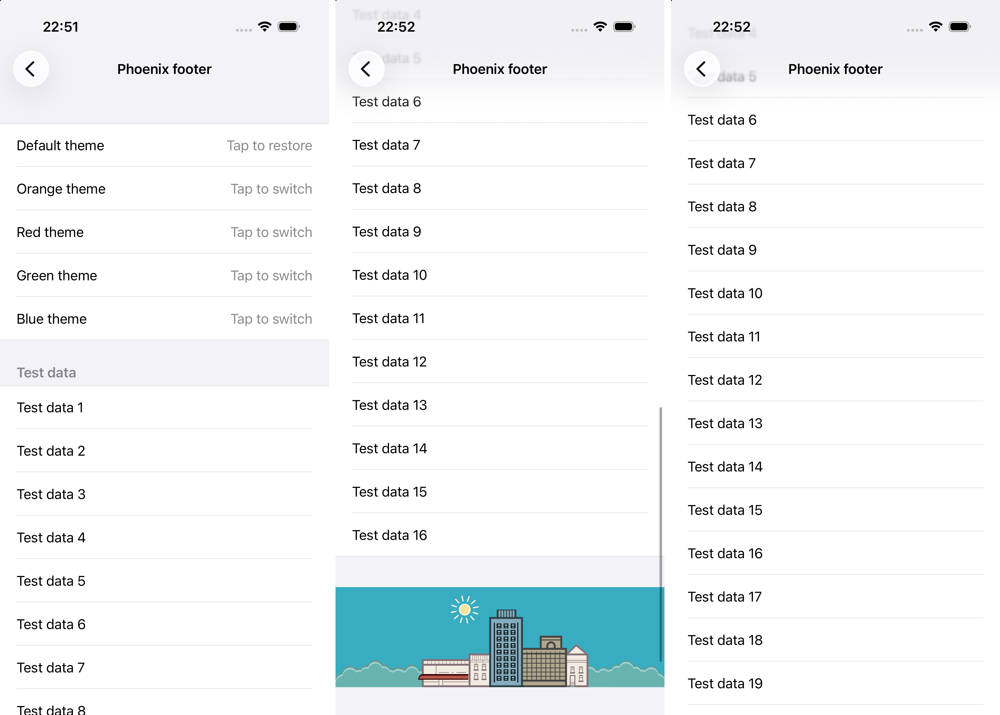 |
| `isAutoRefresh` 与钩子 `-autoRefreshDidChange:`：区分代码开始的刷新与拉动（`isAutoRefresh`、`onAutoRefresh`）。 | `isAutoRefresh` and the hook `-autoRefreshDidChange:`: tell a refresh started in code from a pull (`isAutoRefresh`, `onAutoRefresh`). |
| `-beginRefreshingAfterDelay:`、`-beginRefreshingAnimationOnly`、`-endRefreshingAfterDelay:success:`：延迟开始、只显示动画不回调、延迟结束（`autoRefresh(delayed)`、`autoRefreshAnimationOnly`、`finishRefresh(delayed, success)`，尾部同理）。 | `-beginRefreshingAfterDelay:`, `-beginRefreshingAnimationOnly`, `-endRefreshingAfterDelay:success:`: a delayed start, the animation without the callbacks, a delayed end (`autoRefresh(delayed)`, `autoRefreshAnimationOnly`, `finishRefresh(delayed, success)`, and the same for the footer). |
| `UIScrollView` 的 `-cyl_endRefreshingAfterDelay:success:noMoreData:` 与 `-cyl_endLoadingMoreAfterDelay:success:noMoreData:`：结束时一并设置“没有更多数据”。 | `UIScrollView`'s `-cyl_endRefreshingAfterDelay:success:noMoreData:` and `-cyl_endLoadingMoreAfterDelay:success:noMoreData:`: end and set "no more data" together. |
| `-addScrollObserver:`：外部监听拉动偏移（`OnMultiListener.onHeaderMoving` / `onFooterMoving`）。`canTriggerBlock`：自定义能否触发（`ScrollBoundaryDecider`）。`disablesContentWhileRefreshing`：刷新期间忽略内容触摸。 | `-addScrollObserver:`: observe the pull offset from outside (`OnMultiListener.onHeaderMoving` / `onFooterMoving`). `canTriggerBlock`: decide whether a pull may trigger (`ScrollBoundaryDecider`). `disablesContentWhileRefreshing`: ignore touches on the content while refreshing. |
| 二楼：`secondaryShouldOpenBlock`（打开前可拒绝，`OnTwoLevelListener`）与 `secondaryAnimationDuration`（`requestFloorDuration`）。 | Second floor: `secondaryShouldOpenBlock` (a veto before it opens, `OnTwoLevelListener`) and `secondaryAnimationDuration` (`requestFloorDuration`). |
| 全局默认：`CYLRefreshConfig` 的 `defaultHeaderCreator`、`defaultFooterCreator`（由 `-cyl_installDefaultRefreshControls` 安装）与 `defaultInitializer`。 | App-wide defaults: `CYLRefreshConfig`'s `defaultHeaderCreator`, `defaultFooterCreator` (installed by `-cyl_installDefaultRefreshControls`) and `defaultInitializer`. |
| 样式（第二批）：`CYLRefreshBallPulseFooter`（三个跳动小球的自动加载尾部，`normalColor` / `animatingColor`）；`CYLRefreshMaterialHeader` 的 `colorSchemeColors` 与 `progressSize`（`CYLRefreshMaterialSizeDefault` / `Large`）；`CYLRefreshWaveSwipeHeader` 的 `waveShadowRadius` / `waveShadowColor`。 | Styles (second batch): `CYLRefreshBallPulseFooter` (an auto footer with three pulsing balls, `normalColor` / `animatingColor`); `CYLRefreshMaterialHeader`'s `colorSchemeColors` and `progressSize` (`CYLRefreshMaterialSizeDefault` / `Large`); `CYLRefreshWaveSwipeHeader`'s `waveShadowRadius` / `waveShadowColor`. |
| 布局选项（第三批）：`dragRate`、`reboundAnimationOptions`、`insetStart`、`pinnedView`、`translationView`、`supportsHorizontalDrag` 与 `-didDragHorizontallyWithOffset:percent:`、`-openForAutoRefreshWithDuration:`（`autoOpen`）；刷新头 `clipsWhenBehind`；返回式尾部 `followsContentWhenNoMoreData`、`scrollsContentAfterLoading`；自动尾部 `loadsWhenContentNotFull`。Android → iOS 与 iOS → Android 两张表均为 100 / 100（2026-11-17）。 | Layout options (third batch): `dragRate`, `reboundAnimationOptions`, `insetStart`, `pinnedView`, `translationView`, `supportsHorizontalDrag` with `-didDragHorizontallyWithOffset:percent:`, `-openForAutoRefreshWithDuration:` (`autoOpen`); the header's `clipsWhenBehind`; the back footer's `followsContentWhenNoMoreData` and `scrollsContentAfterLoading`; the auto footer's `loadsWhenContentNotFull`. The Android → iOS and the iOS → Android tables are both 100 / 100 (2026-11-17). |

## CYLRefresh styles 对照表 / CYLRefresh styles comparison

| 中文 | English |
| --- | --- |
| 评分：**100/100**（56/56 行有对应 API，2026-11-12，`an earlier parity branch`；此前 77/100，`a30557c`）。每行是一组相关的公开 API（按 CYLRefresh styles 头文件 `UIRefreshComponent.h`、`UIRefreshHeader.h`、`UIRefreshFooter.h`、`UIRefreshClassics*.h` 及各样式头文件分组）；一行全部有对应才算对齐。手绘样式（最后 13 行）移植在 `CYLRefresh/Custom/Drawn/`，基类 `CYLRefreshDrawnHeader` 提供 CYLRefresh styles 的子类接口（`setUpComponent`、`onStatus:changed:`、`onScrollingWithOffset:percent:drag:` 等）。 | Score: **100/100** (56 of 56 rows have a counterpart, 2026-11-12, `an earlier parity branch`; 77/100 before, `a30557c`). Each row is one group of related public API (grouped by CYLRefresh styles's headers `UIRefreshComponent.h`, `UIRefreshHeader.h`, `UIRefreshFooter.h`, `UIRefreshClassics*.h` and the style headers); a row counts only when all of it has a counterpart. The hand-drawn styles (the last 13 rows) are ported in `CYLRefresh/Custom/Drawn/`; their base `CYLRefreshDrawnHeader` offers CYLRefresh styles's subclass API (`setUpComponent`, `onStatus:changed:`, `onScrollingWithOffset:percent:drag:` and the rest). |
| 我们多出的功能（对方没有）：trailer（左拉）、`autoHideRefresh`、`exclusiveWithOtherRefresh`、`noMoreDataDisplayDuration`、`autoTriggerTimes`、GIF / Lottie / PAG / Rive 图标动画、`setAnimationImages:`、七种语言本地化与语言切换、完成 / 失败的本地化文字、`isCollectionViewAnimationBug`、RTL 翻转、链式写法、`cyl_scrollDistance` / `cyl_scrollDirection`、`beginRefreshingWithCompletionBlock:` 等回调。 | Features we have that it lacks: the trailer (pull left), `autoHideRefresh`, `exclusiveWithOtherRefresh`, `noMoreDataDisplayDuration`, `autoTriggerTimes`, GIF / Lottie / PAG / Rive icon animations, `setAnimationImages:`, seven languages with a language switch, localized done / failed texts, `isCollectionViewAnimationBug`, RTL flipping, chaining, `cyl_scrollDistance` / `cyl_scrollDirection`, completion callbacks such as `beginRefreshingWithCompletionBlock:`. |

| CYLRefresh styles 公开 API / public API | CYLRefresh API | 对齐 / Aligned |
| --- | --- | --- |
| `UIScrollMode`（Move / Stretch / Front） | `CYLRefreshScrollMode`（Move / Stretch / Front） | ✅ |
| `width` / `height` | `cyl_w` / `cyl_h`（UIView+CYLExtension） | ✅ |
| `triggerRate` | `triggerRate`（刷新头、返回式尾、trailer / header, back footer, trailer） | ✅ |
| `finishDuration` | `finishDuration` | ✅ |
| `durationFast` / `durationNormal` | `fastAnimationDuration` / `slowAnimationDuration` | ✅ |
| `scrollMode` | `scrollMode` | ✅ |
| `colorAccent` / `colorPrimary` | `colorAccent` / `colorPrimary` | ✅ |
| `isAttached` / `isExpanded` | `isAttached` / `isExpanded` | ✅ |
| `dragOffset` / `dragPercent` | `dragOffset` / `pullingPercent` | ✅ |
| `expandHeight` | `expandHeight` | ✅ |
| `target` / `scrollView` | `refreshingTarget` / `scrollView` | ✅ |
| `setUpComponent` | `prepare` | ✅ |
| `addObservers:` / `removeObservers:` | `addObservers` / `removeObservers` | ✅ |
| `scrollView:attached:` / `scrollView:detached:` | `didAttachToScrollView:` / `willDetachFromScrollView:` | ✅ |
| `scrollView:didChange:contentOffset:` / `…contentInset:` | `scrollViewContentOffsetDidChange:` / `scrollViewContentInsetDidChange:` | ✅ |
| `scrollView:didScroll:percent:drag:` | `didScrollWithOffset:percent:dragging:` | ✅ |
| `adjustFrameWithHeight:inset:expand:offset:` | `placeSubviews` + `scrollMode` | ✅ |
| `finalyContentInsetsFrom:` | `scrollViewOriginalInset` | ✅ |
| `+attach:` / `+attach:target:action:` / `-attach:` | `+attach:` / `+attach:target:action:` / `-attach:` | ✅ |
| `-addTarget:action:`（UIControl） | `-addTarget:action:` / `-removeTarget:action:`（可多个 / several） | ✅ |
| `UIRefreshStatus`（7 种 / 7 cases） | `CYLRefreshPhase`（8 种 / 8 cases） | ✅ |
| `RefreshBlock` / `refreshBlock` | `CYLRefreshComponentHandler` / `refreshingHandler`（另有 / also `refreshingBlock`） | ✅ |
| `keyForLastRefreshTime` / `nameForLastRefreshTime` | `lastUpdatedTimeKey` / `lastUpdatedTimeText` | ✅ |
| `lastRefreshTime`（可写 / writable） | `lastUpdatedTime`（可写 / writable） | ✅ |
| `lastRefreshTimeFormatter` | `lastUpdatedTimeFormatter` | ✅ |
| `isRefreshing` / `status` / `textLastRefreshTime` | `isRefreshing` / `phase` / `lastUpdatedTimeString` | ✅ |
| `inStatus:…` | `isInPhases:…` / `isInAnyPhase:` | ✅ |
| `beginRefresh` / `finishRefresh` / `finishRefreshWithSuccess:` | `beginRefreshing` / `endRefreshing` / `endRefreshingWithSuccess:` | ✅ |
| `performRefreshEvent` | `executeRefreshingCallback` | ✅ |
| `onStartAnimationWhenRealeasing` / `…WhenRefreshing` / `onStatus:changed:` | `phaseDidChangeFrom:to:`（Releasing / Refreshing） | ✅ |
| `onScrollingWithOffset:percent:drag:` | `didScrollWithOffset:percent:dragging:` | ✅ |
| `onRefreshFinished:` / `onRefreshFinishing:` | `refreshDidFinishWithSuccess:` / `finishingDurationWithSuccess:` | ✅ |
| `UIFooterStatus`（8 种 / 8 cases） | `CYLRefreshPhase`（含 / with `NoMoreData`） | ✅ |
| `UIFooterBlock` / `loadMoreBlock` | `refreshingHandler` / `refreshingBlock` | ✅ |
| `isAutoLoadMore` | `CYLRefreshAutoFooter.automaticallyRefresh` | ✅ |
| `isLoading` / `isNoMoreData` / `status` / `inStatus:` | `isRefreshing` / `isNoMoreData` / `phase` / `isInPhases:` | ✅ |
| `finishLoadMore` / `…WithNoMoreData` / `…WithSuccess:` | `endRefreshing` / `endRefreshingWithNoMoreData` / `endRefreshingWithSuccess:` | ✅ |
| `performLoadMoreEvent` / `resetNoMoreData` | `executeRefreshingCallback` / `resetNoMoreData` | ✅ |
| `onStartAnimationWhenLoading` / `…WhenRealeasing` / `onStatus:changed:` | `phaseDidChangeFrom:to:` | ✅ |
| `onScrollingWithOffset:…` / `onLoadMoreFinished:` / `onLoadMoreFinishing:` | `didScrollWithOffset:…` / `refreshDidFinishWithSuccess:` / `finishingDurationWithSuccess:` | ✅ |
| `UIRefreshClassicsHeader`：`spaceOfTitleAndTime` / `spaceOfLoadingAndText` | `CYLRefreshNormalHeader`：`titleTimeSpacing` / `labelLeftInset` | ✅ |
| `UIRefreshClassicsHeader`：`labelTitle` / `labelLastTime` / `viewArrow` / `viewLoading` | `stateLabel` / `lastUpdatedTimeLabel` / `arrowView` / `loadingView` | ✅ |
| `UIRefreshClassicsFooter`：`spaceOfLoadingAndText` / `labelTitle` / `viewArrow` / `viewLoading` | `CYLRefreshBackNormalFooter`：`labelLeftInset` / `stateLabel` / `arrowView` / `loadingView` | ✅ |
| `UIRefreshBezierCircleHeader` | `CYLRefreshBezierCircleHeader` | ✅ |
| `UIRefreshBezierRadarHeader` | `CYLRefreshBezierRadarHeader` | ✅ |
| `UIRefreshDeliveryHeader` | `CYLRefreshDeliveryHeader` | ✅ |
| `UIRefreshDropBoxHeader` | `CYLRefreshDropBoxHeader` | ✅ |
| `UIRefreshFlyHeader`（含 / with `FlyView`、`MountainView`） | `CYLRefreshFlyHeader`（内部 / internal `CYLRefreshFlyView`、`CYLRefreshMountainView`） | ✅ |
| `UIRefreshGameBattleCityHeader` | `CYLRefreshGameBattleCityHeader` | ✅ |
| `UIRefreshGameHitBlockHeader` | `CYLRefreshGameHitBlockHeader` | ✅ |
| `UIRefreshMaterialHeader` | `CYLRefreshMaterialHeader` | ✅ |
| `UIRefreshOriginalHeader`（`enableAutoRefresh`） | `CYLRefreshOriginalHeader`（`enableAutoRefresh`） | ✅ |
| `UIRefreshPhoenixHeader` | `CYLRefreshPhoenixHeader` | ✅ |
| `UIRefreshStoreHouseHeader`（`lineWidth`、`enableReverseFlash`、`enableFadeAnimation`、`newWithString:…`、`initLinesWith…`） | `CYLRefreshStoreHouseHeader`（`lineWidth`、`enableReverseFlash`、`enableFadeAnimation`、`newWithString:…`、`initLinesWith…`；Swift：`init(string:…)`、`setLines(…)`） | ✅ |
| `UIRefreshTaurusHeader` | `CYLRefreshTaurusHeader` | ✅ |
| `UIRefreshWaveSwipeHeader` | `CYLRefreshWaveSwipeHeader` | ✅ |

## CYLRefresh styles 示例截图 / CYLRefresh styles demo screenshots

| 中文 | English |
| --- | --- |
| 运行平台：iOS。环境：macOS 27.3（26C5035r）、Xcode 27.2（27B5028f）、iOS SDK 27.2、iPhone 17 Pro 模拟器 iOS 27.2（24B5089g）。版本：分支 `an earlier parity branch`，截图基于 `b9420c8` 的工作区（<https://github.com/ChenYilong/CYLTableViewPlaceHolder/commit/b9420c8>，含本次修复）。时间：2026-11-12 16:50–18:15（NZDT）。页面：Example-Scenarios › 刷新 › CYLRefresh styles。截图方式：按住下拉（axe 连续按下事件）后截取下拉状态，或松手后截取刷新中状态；从左到右、从上到下（与示例列表顺序相同）：Delivery、Classics（刷新中）、DropBox、Phoenix、Taurus、BezierRadar、BezierCircle（刷新中）、StoreHouse（刷新中）、WaveSwipe、Original、Material、GameHitBlock（刷新中）、GameBattleCity（刷新中）、Fly、Classics 刷新尾（加载中）。 | Platform: iOS. Environment: macOS 27.3 (26C5035r), Xcode 27.2 (27B5028f), iOS SDK 27.2, iPhone 17 Pro simulator, iOS 27.2 (24B5089g). Version: branch `an earlier parity branch`, working tree on `b9420c8` (<https://github.com/ChenYilong/CYLTableViewPlaceHolder/commit/b9420c8>, with this round's fixes). Time: 2026-11-12 16:50–18:15 (NZDT). Page: Example-Scenarios › Refresh › CYLRefresh styles. Method: a held pull (repeated axe touch-down events) for the pull state, or right after the release for the refreshing state; left to right, top to bottom (the demo list's order): Delivery, Classics (refreshing), DropBox, Phoenix, Taurus, BezierRadar, BezierCircle (refreshing), StoreHouse (refreshing), WaveSwipe, Original, Material, GameHitBlock (refreshing), GameBattleCity (refreshing), Fly, the Classics footer (loading). |
| 已修复（2026-11-12）：三个样式此前在模拟器上不正确。①StoreHouse 比屏幕窄：CYLRefresh styles 原代码在进度为 0 时设置了 `self.transform`（整个刷新头按最后一条线段的偏移横移），应为 `line.transform`，已修正并注释；②Material、WaveSwipe 什么都不显示：这两个样式关闭了用户交互以让触摸穿透，而 CYLRefresh（与 MJRefresh 相同）在交互关闭时不再跟随滚动视图，`CYLRefreshDrawnHeader` 改为保持交互开启、用 `hitTest:` 让触摸穿透；③CYLRefresh styles 的 `colorPrimary` 只是绘制颜色，不是背景，`CYLRefreshDrawnHeader` 现在保持背景透明（否则纯色背景盖住绘制）。158 个测试通过（新增前置模式样式的显示与触摸穿透测试）。截图方式说明：主机负载很高时 `simctl` 截图会延迟数秒，因此用按住下拉截图。 | Fixed (2026-11-12): three styles were wrong on the simulator. (1) StoreHouse was narrower than the screen: CYLRefresh styles set `self.transform` at progress 0 (moving the whole header by the last segment's offset) where `line.transform` was meant; fixed, with a comment. (2) Material and WaveSwipe showed nothing: they turn user interaction off so touches pass through, and CYLRefresh (like MJRefresh) stops following the scroll view when it is off; `CYLRefreshDrawnHeader` now keeps it on and passes touches through in `hitTest:`. (3) CYLRefresh styles's `colorPrimary` is a drawing color, not a background; `CYLRefreshDrawnHeader` keeps the background clear (a solid background covered the drawing). 158 tests pass (new: front-mode styles show and pass touches through). Capture method: with the host heavily loaded, `simctl` screenshots lag by seconds, so the captures use held pulls. |

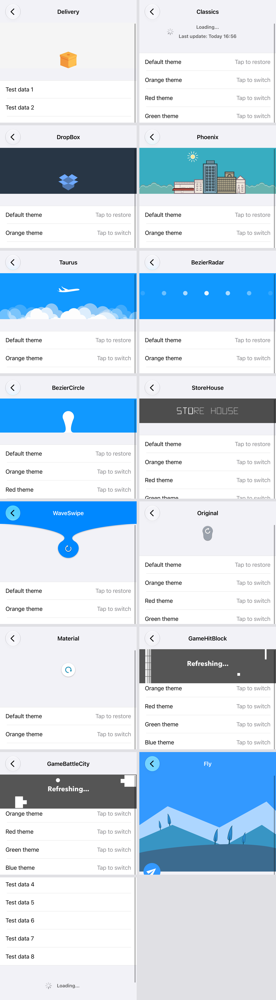

| 中文 | English |
| --- | --- |
| 核对（2026-11-12，用户询问 Material 刷新后为何不消失）：不是缺陷。上图中 Material 的“刷新中”截图是在松手后 0.35 秒、2.5 秒的刷新期间拍的，Material 的圆圈按设计（与 Android SwipeRefreshLayout 相同）在刷新期间浮在列表顶部。刷新结束后圆圈消失，刷新头被 `autoHideRefresh` 隐藏：下图从上到下为打开页面的首次刷新结束后、手动下拉刷新结束后约 6–8 秒（iOS 27.2 模拟器）。`testFrontModeStylesDrawWhilePulled` 也断言刷新结束后刷新头被隐藏。 | Checked (2026-11-12, the user asked why Material does not go away after refreshing): not a defect. The Material "refreshing" shot above was taken 0.35 seconds after the release, during the 2.5-second refresh, and by design (as in Android's SwipeRefreshLayout) Material's circle floats over the top of the list while refreshing. When the refresh ends the circle goes away and `autoHideRefresh` hides the header: below, top to bottom, about 6–8 seconds after the opening refresh and after a manual pull (iOS 27.2 simulator). `testFrontModeStylesDrawWhilePulled` also asserts that the header hides after the refresh. |

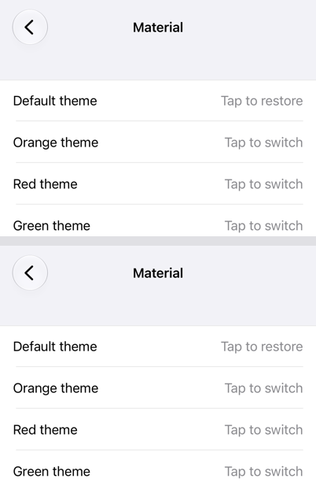

## flutter_easy_refresh 对照表 / flutter_easy_refresh comparison

| 中文 | English |
| --- | --- |
| 评分：**100/100**（48/48 行有对应 API；二楼一行拆成刷新头与刷新尾两行；阻尼、弹簧与嵌套滚动 3 行改判为不适用；此前 96（`3c4ec11`）、94（`a890e12`）、92（`d29c511`）、84（`af17600`）、82（`2ca3af5`）、72（`2ea8d2b`）、54（`08150a2`）；另有 7 行只属于 Flutter 或 UIKit 无对应概念，不计分；2026-11-12，`an earlier parity branch`，对照 flutter_easy_refresh `dcdbb81`）。每行是一组相关的公开 API（`EasyRefresh`、`EasyRefreshController`、`Indicator` 及其枚举、各类 Header / Footer、各样式、样式扩展包与 `easy_paging`）。对照表已全部对齐；剩下的是外部项目 issue（#752、#631）与 Swift 示例复刻。 | Score: **100/100** (48 of 48 rows have a counterpart; the second-floor row is split into header and footer; friction, springs and nested scrolling are now judged not applicable; before: 96 (`3c4ec11`), 94 (`a890e12`), 92 (`d29c511`), 84 (`af17600`), 82 (`2ca3af5`), 72 (`2ea8d2b`), 54 (`08150a2`); 7 rows belong to Flutter only or have no UIKit concept and are not scored; 4 more rows belong to Flutter only and are not scored; 2026-11-12, `an earlier parity branch`, against flutter_easy_refresh `dcdbb81`). Each row is one group of related public API (`EasyRefresh`, `EasyRefreshController`, `Indicator` and its enums, the Header / Footer kinds, the styles, the style packages and `easy_paging`). Every row has a counterpart; left: the source project's issues (#752, #631) and the Swift demo port. |

| flutter_easy_refresh 公开 API / public API | CYLRefresh API | 对齐 / Aligned |
| --- | --- | --- |
| `EasyRefresh(child:)`：包住滚动视图 / wraps the scroll view | `UIScrollView.cyl_header` / `cyl_footer` / `cyl_trailer`、`+attach:` | ✅ |
| `header` / `footer` | `cyl_header` / `cyl_footer` | ✅ |
| `onRefresh` / `onLoad`（返回 `IndicatorResult`） | `refreshingBlock` / `refreshingHandler` / target-action；结果用 `endRefreshingWithSuccess:` / `endRefreshingWithNoMoreData` | ✅ |
| `EasyRefreshController.callRefresh` / `callLoad` | `[header beginRefreshing]` / `[footer beginRefreshing]` | ✅ |
| `finishRefresh([result])` / `finishLoad([result])` | `endRefreshingWithSuccess:` / `endRefreshingWithNoMoreData` | ✅ |
| `resetHeader` / `resetFooter` | `endRefreshing` / `resetNoMoreData` | ✅ |
| `controlFinishRefresh` / `controlFinishLoad` | 总是由调用方结束 / always ended by the caller | ✅ |
| `headerState` / `footerState`（`IndicatorState`：mode、result、offset） | `phase`、`dragOffset`、`pullingPercent`、`lastRefreshSucceeded` | ✅ |
| `IndicatorResult`（none / success / fail / noMore） | `lastRefreshSucceeded` + `endRefreshingWithNoMoreData` / `isNoMoreData` | ✅ |
| `simultaneously` | `exclusiveWithOtherRefresh`（默认允许同时 / both allowed by default） | ✅ |
| `refreshOnStart` | 页面加载时调用 `beginRefreshing` / call `beginRefreshing` on load | ✅ |
| `scrollController` / `triggerAxis` | `scrollView`；纵向 header / footer，横向 `CYLRefreshTrailer` | ✅ |
| `triggerOffset` | `expandHeight` × `triggerRate` | ✅ |
| `processedDuration` | `finishDuration` | ✅ |
| `clamping`（内容不动，指示器浮在上面） | `CYLRefreshScrollModeFront` / `addsRefreshingInset = NO` | ✅ |
| `safeArea` | `ignoredScrollViewContentInsetTop`、UIKit `adjustedContentInset` | ✅ |
| `infiniteOffset`（自动加载） | `CYLRefreshAutoFooter.automaticallyRefresh` / `triggerAutomaticallyRefreshPercent` / `autoTriggerTimes` | ✅ |
| `BuilderHeader` / `BuilderFooter`（自定义外观） | 子类化 `CYLRefreshComponent` / `CYLRefreshDrawnHeader`；图标动画 `setIconAnimation…` | ✅ |
| `ClassicHeader` / `ClassicFooter` 的各状态文字（drag / armed / ready / processing / processed / noMore / failed） | `setTitle:forState:` + 完成 / 失败文字（`finishDuration`） | ✅ |
| `ClassicHeader` 的时间信息 `messageText` / `showMessage` | `lastUpdatedTimeLabel` / `lastUpdatedTimeText` / `lastUpdatedTimeFormatter` | ✅ |
| `BezierHeader` | `CYLRefreshBezierRadarHeader` | ✅ |
| `BezierCircleHeader` | `CYLRefreshBezierCircleHeader` | ✅ |
| `MaterialHeader` | `CYLRefreshMaterialHeader` | ✅ |
| `DeliveryHeader` | `CYLRefreshDeliveryHeader` | ✅ |
| `PhoenixHeader` | `CYLRefreshPhoenixHeader` | ✅ |
| `TaurusHeader` | `CYLRefreshTaurusHeader` | ✅ |
| `IndicatorMode`（inactive / drag / armed / ready / processing / processed / done） | `CYLRefreshPhase`（Idle / PullToRefresh / ReleaseToRefresh / Releasing / Refreshing / Finishing） | ✅ |
| 刷新头二楼：`openHeaderSecondary` / `closeHeaderSecondary`、`SecondaryHeader` / `SecondaryBuilderHeader`、`secondaryTriggerOffset` / `secondaryDimension` / `secondaryCloseTriggerOffset`、`IndicatorMode.secondary*` | `openSecondary` / `closeSecondary`、`secondaryView`、`secondaryTriggerOffset` / `secondaryDimension` / `secondaryCloseTriggerOffset`、`secondaryOpenedBlock` / `secondaryClosedBlock`、`CYLRefreshPhaseSecondaryArmed` / `SecondaryOpen` / `SecondaryClosing`；`secondaryVelocity` | ✅ |
| 刷新尾二楼：`openFooterSecondary` / `closeFooterSecondary`、`SecondaryBuilderFooter` | `CYLRefreshBackFooter`：`openSecondary` / `closeSecondary`、`secondaryView`、`secondaryTriggerOffset` / `secondaryDimension` / `secondaryCloseTriggerOffset`、`secondaryOpenedBlock` / `secondaryClosedBlock` | ✅ |
| `IndicatorTriggerMode`（anywhere / onEdge） | `CYLRefreshTriggerMode` / `triggerMode`（刷新头、返回式尾） | ✅ |
| `IndicatorPosition.behind`（指示器固定在内容后面） | `CYLRefreshScrollModeBehind` | ✅ |
| `triggerWhenReach` / `triggerWhenRelease` / `triggerWhenReleaseNoWait` | `triggersWhenReached`；松手即刷新是默认行为 / refreshing on release is the default | ✅ |
| `frictionFactor` / `horizontalFrictionFactor`（拖动阻尼） | 不适用：UIScrollView 的越界阻尼由系统决定，不能替换；限制拉动距离用 `maxPullDistance` / not applicable: UIScrollView's overscroll resistance is the system's and cannot be replaced; `maxPullDistance` limits the pull | 不适用 / N/A |
| `readySpringBuilder` / `horizontalReadySpringBuilder` / `springRebound`（弹簧回弹） | 不适用：回弹动画由 UIScrollView 自身完成；进入刷新位置的时长用 `fastAnimationDuration` / not applicable: UIScrollView runs its own rebound; `fastAnimationDuration` sets the move to the refreshing position | 不适用 / N/A |
| `maxOverOffset` / `hitOver` / `infiniteHitOver` | `maxPullDistance`（刷新头、返回式尾）；越过触发点继续拉动、无限加载重复触发是默认行为（`autoTriggerTimes`） / pulling past the trigger point and repeated infinite loading are the default (`autoTriggerTimes`) | ✅ |
| `hapticFeedback` | `hapticFeedback` | ✅ |
| `notifyWhenInvisible` | `notifiesWhenHidden` | ✅ |
| `listenable`（`IndicatorStateListenable`，外部监听状态） | `addPhaseObserver:` / `removePhaseObserver:`（另有子类钩子 / also the subclass hook `phaseDidChangeFrom:to:`） | ✅ |
| `ListenerHeader` / `ListenerFooter`（不可见、只监听） | 不绘制内容的 `CYLRefreshHeader` / `CYLRefreshBackFooter` + `addPhaseObserver:` / a drawing-free `CYLRefreshHeader` / `CYLRefreshBackFooter` with `addPhaseObserver:` | ✅ |
| `NotRefreshHeader` / `NotLoadFooter`（不刷新但保留回弹配置） | `refreshEnabled = NO` | ✅ |
| `OverrideHeader` / `OverrideFooter`（覆盖已有指示器的属性） | 直接修改控件实例的属性（UIKit 不需要包装类） / set the properties on the control instance (UIKit needs no wrapper) | ✅ |
| `refreshOnStartHeader`（首次刷新用另一个刷新头） | `-[UIScrollView cyl_beginRefreshingWithStartHeader:]` | ✅ |
| `callRefreshOverOffset` / `callLoadOverOffset`；`callRefresh(overOffset:duration:curve:force:)` 的参数 | `beginRefreshingWithDuration:overOffset:force:`（`curve` 用 UIKit 默认曲线 / `curve` uses UIKit's default curve） | ✅ |
| `canRefreshAfterNoMore` / `canLoadAfterNoMore` | 无更多数据时仍可下拉刷新（默认） / `loadsAfterNoMoreData` / refreshing is always allowed after no more data (default); `loadsAfterNoMoreData` | ✅ |
| `resetAfterRefresh`（刷新后自动重置无更多数据） | `resetsFooterAfterRefresh` | ✅ |
| `isNested` / `nestedOuterController` / `nestedInnerController`（嵌套滚动） | 不适用：UIKit 没有 NestedScrollView；嵌套的滚动视图把控件挂在需要的那个滚动视图上即可 / not applicable: UIKit has no NestedScrollView; attach the control to the scroll view that should refresh | 不适用 / N/A |
| `ClassicHeader` 的结果图标 `succeededIcon` / `failedIcon` / `noMoreIcon`、`pullIconBuilder`、`reverse`、`textBuilder` / `messageBuilder`、`spacing` / `iconDimension` | `succeededImage` / `failedImage`、经典刷新尾的 `noMoreDataImage`、`iconOnTrailingSide`、`iconSize`；`pullIconBuilder` → `arrowView.image`；`textBuilder` → `setTitle:forState:`；`messageBuilder` → `lastUpdatedTimeText`；`spacing` → `labelLeftInset` / the classic footers' `noMoreDataImage`, and the mappings listed | ✅ |
| `CupertinoHeader` / `CupertinoFooter` | `CYLRefreshCupertinoHeader` / `CYLRefreshCupertinoFooter` | ✅ |
| `BezierFooter` / `MaterialFooter` / `DeliveryFooter` / `PhoenixFooter` / `TaurusFooter` | `CYLRefreshBezierRadarFooter` / `CYLRefreshMaterialFooter` / `CYLRefreshDeliveryFooter` / `CYLRefreshPhoenixFooter` / `CYLRefreshTaurusFooter`（`CYLRefreshDrawnFooter` 内嵌对应的手绘刷新头并驱动它；任何手绘刷新头都可用 `initWithStyle:` 变成刷新尾 / `CYLRefreshDrawnFooter` hosts and drives the matching drawn header; `initWithStyle:` turns any drawn header into a footer） | ✅ |
| Rive 样式包 / Rive style packages：`easy_refresh_bow` / `bubbles` / `halloween` / `skating` / `space` / `squats` | 核心 `CYLRefreshRiveHeader` + `CYLRefreshRiveStyle`（状态机输入与线性动画两种驱动方式；刷新尾用 `CYLRefreshDrawnFooter(style:)`）；6 个 .riv 放在示例自己的 bundle（MIT / CC BY 4.0，来源、作者与 SHA-256 记录在 `NOTICE.animations`），示例 7 行（6 个刷新头 + Space 刷新尾），已在模拟器上目测（见下方截图） / the core `CYLRefreshRiveHeader` + `CYLRefreshRiveStyle` (state machine inputs or linear animations; footers through `CYLRefreshDrawnFooter(style:)`); the 6 .riv files in the example's own bundle (MIT / CC BY 4.0, sources, authors and SHA-256 in `NOTICE.animations`); 7 example rows (6 headers + the Space footer), checked on the simulator (screenshots below) | ✅ |
| `easy_paging`（`EasyPaging`：分页加载、空数据、错误状态） | `CYLRefreshPaging`：`items` / `count` / `page` / `total` / `totalPage`、`isEmpty` / `isNoMore`（先看 total，再看页数）、刷新替换 / 加载追加、只在成功后提交（失败重试同一页）、`resetsFooterAfterRefresh`、`start`（refreshOnStart）、`itemsDidChange`；空数据用本库的占位图 / empty data uses this library's placeholder | ✅ |
| `childBuilder`（把 physics 交给子组件） | 不适用：Flutter 组件树 / not applicable: Flutter widget tree | 不适用 / N/A |
| `fit` / `clipBehavior` | 不适用：Flutter 布局 / not applicable: Flutter layout | 不适用 / N/A |
| `scrollBehaviorBuilder` / `ERScrollBehavior` / `_ERScrollPhysics` | 不适用：UIKit 没有可替换的滚动物理 / not applicable: UIKit has no replaceable scroll physics | 不适用 / N/A |
| `HeaderLocator` / `FooterLocator`（`IndicatorPosition.locator`，放进 sliver） | 不适用：Flutter slivers / not applicable: Flutter slivers | 不适用 / N/A |

## flutter_easy_refresh to Flutter package (CYL API) / Flutter package score table

Task: `CrossPlatform/flutter_cylplaceholder` (planned), structured like CYLTabBarController's `flutter_cyltabbar`. The reference API is the CYLRefresh already ported to iOS Swift and Android (Kotlin names, lowerCamelCase; the iOS selector is named in column 2). flutter_easy_refresh (`dcdbb81`, MIT) is only the behavior reference: the package is a complete rewrite named `cyl_refresh` (no vendored copy, no adapter layer, no `EasyRefresh` names; owner decision 2026-11-23: more customization, simpler architecture), with the MIT attribution kept in `NOTICE`. Component objects are long-lived `ChangeNotifier`s that hold both configuration and state, like iOS and Android. Design by the advisor, 2026-11-23.

**Score** = rows whose column 3 is not `TODO` divided by all rows, times 100. All `TODO` is 0; no `TODO` is 100. A row may be `N/A: <reason>` only when the feature cannot exist in Flutter. Loop: (1) search existing code and match TODO rows; (2) score; (3) work TODO rows one by one and replace `TODO` with the implementation (file and symbol); (4) score again; repeat to 100. Sonnet writes the code.

**Current score: 98 / 100 (64 of 65 rows), the API surface of the Dart fallback (not native-backed; see the native bridge map and the scoreboard).** The package exists at `CrossPlatform/flutter_cylplaceholder` (updated 2026-11-23).

| flutter_easy_refresh feature | Description (iOS / Android reference) | Flutter API (this package) |
| --- | --- | --- |
| `EasyRefresh(child:)` | Wrap a scrollable; iOS `cyl_header` / `cyl_footer` / `cyl_trailer`, `+attach:` | `CrossPlatform/flutter_cylplaceholder/lib/src/refresh/refresh.dart` `CYLRefresh` (tests: `test/refresh_widget_test.dart`, header group) |
| `header` / `footer` | Attach a header and a footer component | `CrossPlatform/flutter_cylplaceholder/lib/src/refresh/refresh.dart` `CYLRefresh.header` / `CYLRefresh.footer` (`test/refresh_widget_test.dart`, header and footer groups) |
| Component as a long-lived object | iOS / Android components hold config and state; Flutter `CYLRefreshComponent extends ChangeNotifier`, created in `initState`, disposed in `dispose` | `CrossPlatform/flutter_cylplaceholder/lib/src/refresh/component.dart` `CYLRefreshComponent extends ChangeNotifier` (`test/refresh_component_test.dart`, component state group) |
| `onRefresh` / `onLoad` returning `IndicatorResult` | `refreshingHandler`; the caller always ends refreshing (`endRefreshing`) | `CrossPlatform/flutter_cylplaceholder/lib/src/refresh/component.dart` `CYLRefreshComponent.refreshingHandler` (`test/refresh_component_test.dart`) |
| `EasyRefreshController.callRefresh` / `callLoad` | `beginRefreshing()` | `CrossPlatform/flutter_cylplaceholder/lib/src/refresh/component.dart` `CYLRefreshComponent.beginRefreshing` (`test/refresh_widget_test.dart`, beginRefreshing group) |
| `callRefresh(overOffset, duration, curve, force)` | `beginRefreshing(duration, overOffset, force)` | `CrossPlatform/flutter_cylplaceholder/lib/src/refresh/component.dart` `beginRefreshing({duration, overOffset, force})` (`test/refresh_widget_test.dart`) |
| `callRefreshOverOffset` / `callLoadOverOffset` | Default over-offset of `beginRefreshing` | `CrossPlatform/flutter_cylplaceholder/lib/src/refresh/component.dart` `CYLRefreshComponent.defaultOverOffset`, used by `beginRefreshing()` (`test/refresh_widget_test.dart`) |
| `finishRefresh([result])` / `finishLoad([result])` | `endRefreshing(success)`, `endRefreshingWithNoMoreData()` | `CrossPlatform/flutter_cylplaceholder/lib/src/refresh/component.dart` `endRefreshing({success})`, `CYLRefreshFooter.endRefreshingWithNoMoreData` (`test/refresh_component_test.dart`, footer group) |
| `resetHeader` / `resetFooter` | `endRefreshing()` / `resetNoMoreData()` | `CrossPlatform/flutter_cylplaceholder/lib/src/refresh/component.dart` `endRefreshing()`, `CYLRefreshFooter.resetNoMoreData` (`test/refresh_component_test.dart`) |
| `controlFinishRefresh` / `controlFinishLoad` | Always ended by the caller; documented, no switch | `CrossPlatform/flutter_cylplaceholder/lib/src/refresh/component.dart` no switch: the component stays in `refreshing` until the caller's `endRefreshing` (`test/refresh_component_test.dart`, 'the caller always ends refreshing') |
| `headerState` / `footerState` (`IndicatorState`) | `phase`, `state`, `dragOffset`, `pullingPercent`, `lastRefreshSucceeded` | `CrossPlatform/flutter_cylplaceholder/lib/src/refresh/component.dart` `phase`, `state`, `dragOffset`, `pullingPercent`, `lastRefreshSucceeded` (`test/refresh_component_test.dart`) |
| `IndicatorMode` | `CYLRefreshPhase` (idle, pullToRefresh, releaseToRefresh, releasing, refreshing, finishing) | `CrossPlatform/flutter_cylplaceholder/lib/src/refresh/refresh_types.dart` `CYLRefreshPhase` (`test/refresh_component_test.dart`) |
| `IndicatorResult` (none, success, fail, noMore) | `lastRefreshSucceeded`, `isNoMoreData` | `CrossPlatform/flutter_cylplaceholder/lib/src/refresh/component.dart` `lastRefreshSucceeded`, `CYLRefreshFooter.isNoMoreData` (`test/refresh_component_test.dart`) |
| `simultaneously` | `exclusiveWithOtherRefresh` | `CrossPlatform/flutter_cylplaceholder/lib/src/refresh/component.dart` `exclusiveWithOtherRefresh`; `CrossPlatform/flutter_cylplaceholder/lib/src/refresh/refresh.dart` `CYLRefresh.exclusiveWithOtherRefresh` (`test/refresh_widget_test.dart`, exclusive test) |
| `refreshOnStart` | `CYLRefresh(refreshOnStart:)` / call `beginRefreshing` after the first frame | `CrossPlatform/flutter_cylplaceholder/lib/src/refresh/refresh.dart` `CYLRefresh.refreshOnStart` (`test/refresh_widget_test.dart`) |
| `refreshOnStartHeader` | iOS `cyl_beginRefreshingWithStartHeader:`; a header used only for the first refresh | `CrossPlatform/flutter_cylplaceholder/lib/src/refresh/refresh.dart` `CYLRefresh.refreshOnStartHeader` (`test/refresh_widget_test.dart`) |
| `scrollController` / `triggerAxis` | Pass-through `scrollController`; vertical header / footer, horizontal `CYLRefreshTrailer` | `CrossPlatform/flutter_cylplaceholder/lib/src/refresh/refresh.dart` `CYLRefresh.scrollController` (a `PrimaryScrollController` of the trigger axis) and `triggerAxis`; `CrossPlatform/flutter_cylplaceholder/lib/src/refresh/component.dart` `CYLRefreshTrailer` (`CrossPlatform/flutter_cylplaceholder/test/refresh_layout_test.dart`, triggerAxis and scrollController groups) |
| `triggerOffset` | `expandHeight` times `triggerRate` | `CrossPlatform/flutter_cylplaceholder/lib/src/refresh/component.dart` `CYLRefreshComponent.triggerOffset` = `expandHeight * triggerRate` (`test/refresh_component_test.dart`) |
| `processedDuration` | `finishDuration` | `CrossPlatform/flutter_cylplaceholder/lib/src/refresh/component.dart` `CYLRefreshComponent.finishDuration` (`test/refresh_component_test.dart`) |
| `clamping` | `scrollMode = front`; indicator floats over the content | `CrossPlatform/flutter_cylplaceholder/lib/src/refresh/refresh_types.dart` `CYLRefreshScrollMode.front` (`test/refresh_widget_test.dart`, scroll modes group) |
| `IndicatorPosition.behind` | `scrollMode = behind` | `CrossPlatform/flutter_cylplaceholder/lib/src/refresh/refresh_types.dart` `CYLRefreshScrollMode.behind` (`test/refresh_widget_test.dart`) |
| `IndicatorPosition.locator`, `HeaderLocator` / `FooterLocator` | Place an indicator inside a sliver list; Flutter-only, kept | `CrossPlatform/flutter_cylplaceholder/lib/src/refresh/refresh.dart` `CYLRefreshHeaderLocator` / `CYLRefreshFooterLocator` with `CYLRefreshScrollMode.locator` (`CrossPlatform/flutter_cylplaceholder/test/refresh_layout_test.dart`, locator group) |
| `safeArea` | Respect the safe area / `ignoredScrollViewContentInsetTop` | `CrossPlatform/flutter_cylplaceholder/lib/src/refresh/refresh.dart` `CYLRefresh.safeArea` (`test/refresh_widget_test.dart`) |
| `infiniteOffset` | `CYLRefreshAutoFooter`: `automaticallyRefresh`, `triggerAutomaticallyRefreshPercent`, `autoTriggerTimes` | `CrossPlatform/flutter_cylplaceholder/lib/src/refresh/component.dart` `CYLRefreshAutoFooter` (`automaticallyRefresh`, `triggerAutomaticallyRefreshPercent`, `autoTriggerTimes`; `test/refresh_widget_test.dart`, auto footer group) |
| `IndicatorTriggerMode` (anywhere, onEdge) | `triggerMode` | `CrossPlatform/flutter_cylplaceholder/lib/src/refresh/component.dart` `CYLRefreshComponent.triggerMode` (`test/refresh_component_test.dart`) |
| `triggerWhenReach` / `triggerWhenRelease` / `triggerWhenReleaseNoWait` | `triggersWhenReached`; refreshing on release is the default | `CrossPlatform/flutter_cylplaceholder/lib/src/refresh/component.dart` `CYLRefreshComponent.triggersWhenReached` (`test/refresh_component_test.dart`) |
| `frictionFactor` / `horizontalFrictionFactor` | Optional `CYLRefresh` parameters, same names (Flutter-only, kept) | `CrossPlatform/flutter_cylplaceholder/lib/src/refresh/physics.dart` `CYLRefreshPhysics` via `CYLRefresh.frictionFactor` / `horizontalFrictionFactor` (`test/refresh_widget_test.dart`) |
| `readySpringBuilder` / `horizontalReadySpringBuilder` / `springRebound` | Optional `CYLRefresh` parameters, same names (Flutter-only, kept) | `CrossPlatform/flutter_cylplaceholder/lib/src/refresh/physics.dart` `CYLRefreshPhysics.readySpringBuilder` / `horizontalReadySpringBuilder` / `springRebound`, passed by `CYLRefresh` (`CrossPlatform/flutter_cylplaceholder/test/refresh_layout_test.dart`, springs group) |
| `maxOverOffset` / `hitOver` / `infiniteHitOver` | `maxPullDistance`; `autoTriggerTimes` | `CrossPlatform/flutter_cylplaceholder/lib/src/refresh/physics.dart` `CYLRefreshPhysics.maxHeaderPull` / `maxFooterPull` from `maxPullDistance`; `CrossPlatform/flutter_cylplaceholder/lib/src/refresh/component.dart` `autoTriggerTimes` (`test/refresh_widget_test.dart`) |
| `hapticFeedback` | `hapticFeedback` | `CrossPlatform/flutter_cylplaceholder/lib/src/refresh/component.dart` `CYLRefreshComponent.hapticFeedback` (`test/refresh_component_test.dart`) |
| `notifyWhenInvisible` | `notifiesWhenHidden` | `CrossPlatform/flutter_cylplaceholder/lib/src/refresh/component.dart` `CYLRefreshComponent.notifiesWhenHidden`, default true as on iOS and Android; a hidden indicator is not built, so it costs one listener call per scroll update and no rebuild (`test/refresh_component_test.dart`) |
| `listenable` (`IndicatorStateListenable`) | `addPhaseObserver` / `removePhaseObserver` | `CrossPlatform/flutter_cylplaceholder/lib/src/refresh/component.dart` `addPhaseObserver` / `removePhaseObserver` (`test/refresh_component_test.dart`) |
| `ListenerHeader` / `ListenerFooter` | Drawing-free header / footer plus `addPhaseObserver` | `CrossPlatform/flutter_cylplaceholder/lib/src/refresh/component.dart` `CYLRefreshListenerHeader` / `CYLRefreshListenerFooter` (`test/refresh_styles_test.dart`) |
| `NotRefreshHeader` / `NotLoadFooter` | `refreshEnabled = false` | `CrossPlatform/flutter_cylplaceholder/lib/src/refresh/component.dart` `CYLRefreshComponent.refreshEnabled = false` (`test/refresh_component_test.dart`) |
| `OverrideHeader` / `OverrideFooter` | Set properties on the component instance; no wrapper class | `CrossPlatform/flutter_cylplaceholder/lib/src/refresh/component.dart` properties set on the instance, no wrapper class (`test/refresh_component_test.dart`) |
| `canRefreshAfterNoMore` / `canLoadAfterNoMore` | `loadsAfterNoMoreData` | `CrossPlatform/flutter_cylplaceholder/lib/src/refresh/component.dart` `CYLRefreshFooter.loadsAfterNoMoreData` (`test/refresh_component_test.dart`) |
| `resetAfterRefresh` | `resetsFooterAfterRefresh` | `CrossPlatform/flutter_cylplaceholder/lib/src/refresh/component.dart` `CYLRefreshHeader.resetsFooterAfterRefresh`, `CrossPlatform/flutter_cylplaceholder/lib/src/refresh/paging.dart` `CYLRefreshPaging.resetsFooterAfterRefresh` (`test/refresh_widget_test.dart`, `test/refresh_paging_test.dart`) |
| `isNested` / `nestedOuterController` / `nestedInnerController` | Optional `CYLRefresh` parameters, same names (Flutter-only, kept) | `CrossPlatform/flutter_cylplaceholder/lib/src/refresh/refresh.dart` `CYLRefresh.isNested` / `nestedOuterController` / `nestedInnerController` (`CrossPlatform/flutter_cylplaceholder/test/refresh_layout_test.dart`, nested group) |
| `childBuilder` | Optional `CYLRefresh` parameter (Flutter-only, kept) | `CrossPlatform/flutter_cylplaceholder/lib/src/refresh/refresh.dart` `CYLRefresh.childBuilder` (`test/refresh_widget_test.dart`) |
| `fit` / `clipBehavior` | Optional `CYLRefresh` parameters (Flutter-only, kept) | `CrossPlatform/flutter_cylplaceholder/lib/src/refresh/refresh.dart` `CYLRefresh.fit` / `clipBehavior` (`test/refresh_widget_test.dart`) |
| `scrollBehaviorBuilder`, `ERScrollBehavior` | Optional `CYLRefresh` parameter (Flutter-only, kept) | `CrossPlatform/flutter_cylplaceholder/lib/src/refresh/refresh.dart` `CYLRefresh.scrollBehaviorBuilder`, `CYLRefreshPhysics` (`test/refresh_widget_test.dart`) |
| `ClassicHeader` / `ClassicFooter` | `CYLRefreshClassicHeader` / `CYLRefreshClassicFooter` | `CrossPlatform/flutter_cylplaceholder/lib/src/refresh/styles.dart` `CYLRefreshClassicHeader` / `CYLRefreshClassicFooter` / `CYLRefreshClassicAutoFooter` (`test/refresh_styles_test.dart`) |
| Classic per-state texts (drag, armed, ready, processing, processed, noMore, failed) | `setTitle(text, state)` plus done and failed texts | `CrossPlatform/flutter_cylplaceholder/lib/src/refresh/styles.dart` `CYLRefreshClassicStyle.setTitle(text, state)` / `titleForState` with `CYLRefreshTitleState` (`test/refresh_styles_test.dart`) |
| Classic `messageText` / `showMessage` | `lastUpdatedTimeText`, `lastUpdatedTimeFormatter` | `CrossPlatform/flutter_cylplaceholder/lib/src/refresh/styles.dart` `CYLRefreshClassicHeader.lastUpdatedTimeText` / `lastUpdatedTimeFormatter` / `showsLastUpdatedTime` (`test/refresh_styles_test.dart`) |
| Classic icons (`succeededIcon`, `failedIcon`, `noMoreIcon`, `pullIconBuilder`, `reverse`, `iconDimension`, `spacing`, `textBuilder`, `messageBuilder`) | `succeededImage`, `failedImage`, `noMoreDataImage`, `iconOnTrailingSide`, `iconSize`, builders | `CrossPlatform/flutter_cylplaceholder/lib/src/refresh/styles.dart` `succeededImage`, `failedImage`, `noMoreDataImage`, `iconOnTrailingSide`, `iconSize`, `iconSpacing`, `pullIconBuilder`, `textBuilder`, `messageBuilder` (`test/refresh_styles_test.dart`) |
| `BuilderHeader` / `BuilderFooter` | Subclass `CYLRefreshComponent` or pass a `builder` | `CrossPlatform/flutter_cylplaceholder/lib/src/refresh/component.dart` `CYLRefreshComponent.builder` / overridable `buildIndicator` (`test/refresh_widget_test.dart` uses `builder`) |
| `CupertinoHeader` / `CupertinoFooter` | `CYLRefreshCupertinoHeader` / `CYLRefreshCupertinoFooter` | `CrossPlatform/flutter_cylplaceholder/lib/src/refresh/styles.dart` `CYLRefreshCupertinoHeader` / `CYLRefreshCupertinoFooter` (`test/refresh_styles_test.dart`) |
| `BezierHeader` / `BezierFooter` | `CYLRefreshBezierRadarHeader` / `CYLRefreshBezierRadarFooter` | `CrossPlatform/flutter_cylplaceholder/lib/src/refresh/drawn_styles.dart` `CYLRefreshBezierRadarHeader` / `CYLRefreshBezierRadarFooter` (drawn with our own painters (behavior from the reference: pull-driven, a loop while refreshing, a result mark, no-more-data); not a pixel copy; rendered and inspected in the test run; `CrossPlatform/flutter_cylplaceholder/test/refresh_drawn_test.dart`) |
| `BezierCircleHeader` | `CYLRefreshBezierCircleHeader` | `CrossPlatform/flutter_cylplaceholder/lib/src/refresh/drawn_styles.dart` `CYLRefreshBezierCircleHeader` (`CrossPlatform/flutter_cylplaceholder/test/refresh_drawn_test.dart`) |
| `MaterialHeader` / `MaterialFooter` | `CYLRefreshMaterialHeader` / `CYLRefreshMaterialFooter` | `CrossPlatform/flutter_cylplaceholder/lib/src/refresh/styles.dart` `CYLRefreshMaterialHeader` / `CYLRefreshMaterialFooter` (`test/refresh_styles_test.dart`) |
| `DeliveryHeader` / `DeliveryFooter` | `CYLRefreshDeliveryHeader` / `CYLRefreshDeliveryFooter` | `CrossPlatform/flutter_cylplaceholder/lib/src/refresh/drawn_styles.dart` `CYLRefreshDeliveryHeader` / `CYLRefreshDeliveryFooter` (`CrossPlatform/flutter_cylplaceholder/test/refresh_drawn_test.dart`) |
| `PhoenixHeader` / `PhoenixFooter` | `CYLRefreshPhoenixHeader` / `CYLRefreshPhoenixFooter` | `CrossPlatform/flutter_cylplaceholder/lib/src/refresh/drawn_styles.dart` `CYLRefreshPhoenixHeader` / `CYLRefreshPhoenixFooter` (`CrossPlatform/flutter_cylplaceholder/test/refresh_drawn_test.dart`) |
| `TaurusHeader` / `TaurusFooter` | `CYLRefreshTaurusHeader` / `CYLRefreshTaurusFooter` | `CrossPlatform/flutter_cylplaceholder/lib/src/refresh/drawn_styles.dart` `CYLRefreshTaurusHeader` / `CYLRefreshTaurusFooter` (`CrossPlatform/flutter_cylplaceholder/test/refresh_drawn_test.dart`) |
| Header second floor (`openHeaderSecondary`, `closeHeaderSecondary`, `SecondaryHeader`, trigger / dimension fields) | `openSecondary`, `closeSecondary`, `secondaryView`, `secondaryTriggerOffset`, `secondaryDimension`, `secondaryCloseTriggerOffset` | `CrossPlatform/flutter_cylplaceholder/lib/src/refresh/component.dart` `CYLRefreshComponent.openSecondary` / `closeSecondary` / `secondaryView` / `secondaryTriggerOffset` / `secondaryDimension` / `secondaryCloseTriggerOffset` / `isSecondaryArmed`, drawn by `CYLRefresh` (`CrossPlatform/flutter_cylplaceholder/test/refresh_secondary_test.dart`, header group) |
| Footer second floor (`openFooterSecondary`, `closeFooterSecondary`, `SecondaryBuilderFooter`) | `CYLRefreshBackFooter`: same secondary API, `secondaryOpenedBlock` / `secondaryClosedBlock` | `CrossPlatform/flutter_cylplaceholder/lib/src/refresh/component.dart` the same API on every footer, `secondaryOpenedBlock` / `secondaryClosedBlock` (`CrossPlatform/flutter_cylplaceholder/test/refresh_secondary_test.dart`, footer group) |
| Rive style packages (`easy_refresh_bow`, `bubbles`, `halloween`, `skating`, `space`, `squats`) | `CYLRefreshRiveHeader(style: CYLRefreshRiveStyle)`; footer through `CYLRefreshDrawnFooter(style:)` | `CrossPlatform/flutter_cylplaceholder/lib/src/refresh/rive.dart` `CYLRefreshRiveStyle` (the Android field names), `CYLRefreshRiveHeader`, `CYLRefreshDrawnFooter`, `CYLRefreshRiveIndicator`: upstream `CYLAnimationView` with `drivesAnimationPlayback: false`, scrubbed with `stopAtProgress(pull)`, `play()` while refreshing (`CrossPlatform/flutter_cylplaceholder/test/refresh_rive_test.dart`). Partial: upstream's contract has no per-frame named number input, finish / restart triggers or loading number, so `pullInput`, `finishTrigger`, `restartTrigger`, `loadingNumber` are kept as data (upstream request TODO); the six presets are not shipped (their .riv files are not in this package) |
| `easy_paging` (`EasyPaging`) | `CYLRefreshPaging<T>`: `items`, `page`, `total`, `isEmpty`, `isNoMore`, `start`, `itemsDidChange` | `CrossPlatform/flutter_cylplaceholder/lib/src/refresh/paging.dart` `CYLRefreshPaging<T>` (`test/refresh_paging_test.dart`) |
| Example pages (49 Dart files in `example/lib`) | Ported pages run in `example/` with the iOS / Android demo's names and data | TODO |
| Placeholder: `CYLPlaceholderView` | Error / empty placeholder widget, same item API as iOS / Android | `CrossPlatform/flutter_cylplaceholder/lib/src/placeholder/cyl_placeholder_view.dart` `CYLPlaceholderView` (`test/placeholder_view_test.dart`) |
| Placeholder: `CYLPlaceholderComponent` and stack | Components, `restartAnimation()`, `animationLoops`, `animationSpeed` | `CrossPlatform/flutter_cylplaceholder/lib/src/placeholder/cyl_placeholder_stack.dart` `CYLPlaceholderComponent` (icon, hint, button, separator, item; `animationLoops`, `animationSpeed`, `interactionEnabled`, `spacingBefore`), `CYLPlaceholderStackView` and `CYLPlaceholderStackController.restartAnimation()` (bumps each animation's upstream `animationRestartToken`; no engine here); `CYLPlaceholderView.animationLoops` / `animationSpeed` / `animationRestartToken` (`CrossPlatform/flutter_cylplaceholder/test/placeholder_stack_test.dart`) |
| Placeholder: HUD and status bar | `CYLPlaceholderHUD` equivalent | `CrossPlatform/flutter_cylplaceholder/lib/src/hud/cyl_placeholder_hud.dart` `CYLPlaceholderHUD` (the Android names: `show`, `showWithStatus`, `showProgress`, `setStatus`, `showInfo/Success/ErrorWithStatus`, `showImage`, `showComponents`, `popActivity`, `dismiss`, `dismissWithCompletion`, `dismissWithDelay`, `displayDurationForString`, style, mask type, grace and dismiss intervals) and `CYLPlaceholderHUDHost` (a live accessibility region; only the mask blocks touches) (`CrossPlatform/flutter_cylplaceholder/test/hud_test.dart`, 10 tests). The status bar of the row title is the iOS / Android status component, not part of this row's description (`CYLPlaceholderHUD` equivalent) |
| Placeholder animations | Depend on `flutter_cyltabbar`'s `CYLAnimationView`; no duplicate engine | `CYLPlaceholderItem` (`lib/src/cyl_placeholder_item.dart`, 2026-11-23, written statically, not built) re-exports upstream's `CYLAnimationView` and `CYLAnimationController`; names `animationSpeed`, `animationLoops`, `animationRestartToken`, `controller.restart()`; also `CrossPlatform/flutter_cylplaceholder/lib/src/placeholder/cyl_placeholder_view.dart` `CYLPlaceholderView(animationFile:)` builds the same `CYLAnimationView` (`test/placeholder_view_test.dart`) |
| Refresh + error-placeholder example | Example page: pull to refresh, a failed load shows the placeholder, retry refreshes | `CrossPlatform/flutter_cylplaceholder/example/lib/error_placeholder_page.dart` (first load fails, `CYLPlaceholderView` shown, tap retries), `refresh_page.dart`, `paging_page.dart`; run on iOS 27.2 simulator (screenshots below) |
| Example screenshots in `docs/` | Original pixels, labeled per `docs/instructions/testing.md` | `docs/assets/flutter-ios27.2-iphone18pro-cylplaceholder-error-placeholder-0356b56-20261123-sheet.png` and `...-refresh-0356b56-20261123-sheet.png` (originals next to them; `scripts/check_screenshots.py` passes) |
| Unit and widget tests | One test per API group above, `flutter test` green | `CrossPlatform/flutter_cylplaceholder/test/` 12 files, 100 tests, one group per API group above (component state, trigger rules, footer, paging, widget wiring, layout / axis / springs / locators / nested, second floor, styles, drawn styles, Rive styles, placeholder view, stack, HUD), `flutter test` green on Flutter 3.50.1 (2026-11-23); `CrossPlatform/flutter_cylplaceholder/example/test/example_pages_test.dart` 4 tests; `flutter analyze` has no issue beyond the framework's own deprecation notices |

## React Native package score table (react-native-cylplaceholder)

Task: `CrossPlatform/react-native-cylplaceholder`, interface aligned with `flutter_cylplaceholder` (same names, phases, defaults and callback order; the iOS / Android CYLRefresh is the reference). Columns 1 and 2 are copied from the Flutter table above; column 3 is the React Native API, `TODO` until it exists. Score = rows whose column 3 is not `TODO` (an `N/A: <reason>` row counts) divided by all rows, times 100. Claimed 2026-11-23 by session cyltableviewplaceholder-0a (no other session was reachable); the Flutter session owns the Flutter table.

Design (advisor, 2026-11-23): two layers. Pure TypeScript with no React import (types as `as const` objects, `CYLRefreshComponent` and its Header / Footer / AutoFooter / BackFooter subclasses, `CYLRefreshPaging`), long-lived objects holding configuration and state, with a small subscribe / notify base in place of `ChangeNotifier`, tested with `node --test --experimental-strip-types`. React layer: a `useSyncExternalStore` hook, `<CYLRefresh>` with a render-prop child that receives the scroll props, the Classic / Cupertino / Material indicators and `CYLPlaceholderView`. No native code. The pull-down header on Android has no negative overscroll offset and no `contentInset` in `ScrollView`, so the header is driven by a `PanResponder` at the top (JavaScript only, behaves differently from iOS bounce); the limitation stays a `TODO` in the header rows until it is checked on a device.

**Current score: 65 / 100 (42 of 65 rows are not TODO), the API surface of the TypeScript fallback (not native-backed).** Done: the pure TypeScript layer (types, components, paging, classic styles, placeholder attributes; 24 `node --test` tests, clean `tsc`) and the React layer (`CYLRefresh`, `CYLRefreshClassicIndicator`, `useCYLRefreshComponent`, `CYLPlaceholderView`, `CYLPlaceholderItem`; type-checked only, never run on a device). Rows marked "Partial" are implemented for iOS-style overscroll only. Still TODO: Cupertino / Material / Bezier / Delivery / Phoenix / Taurus styles, the second floor, the Rive styles, the Android pull-down header, placeholder components and stack, HUD, the example pages and the tests of the React layer.

| flutter_easy_refresh feature | Description (iOS / Android reference) | React Native API (this package) |
| --- | --- | --- |
| `EasyRefresh(child:)` | Wrap a scrollable; iOS `cyl_header` / `cyl_footer` / `cyl_trailer`, `+attach:` | `CrossPlatform/react-native-cylplaceholder/src/refresh/CYLRefresh.tsx` `CYLRefresh` (render-prop child receiving the scroll props; type-checked with `ScrollView` and `FlatList` in `CrossPlatform/react-native-cylplaceholder/test/usage.typecheck.tsx`). Partial: the pull is read from the scroll offset, so the pulled-down header / pulled-up footer need a scroll view that reports offsets past its edges (iOS); on Android only the auto footer and `beginRefreshing` work (device check TODO) |
| `header` / `footer` | Attach a header and a footer component | `CrossPlatform/react-native-cylplaceholder/src/refresh/CYLRefresh.tsx` `CYLRefresh.header` / `CYLRefresh.footer` (same partial note as the wrapper row) |
| Component as a long-lived object | iOS / Android components hold config and state; Flutter `CYLRefreshComponent extends ChangeNotifier`, created in `initState`, disposed in `dispose` | `CrossPlatform/react-native-cylplaceholder/src/refresh/component.ts` `CYLRefreshComponent extends CYLRefreshNotifier` (subscribe / notify base, `version` snapshot for `useSyncExternalStore`) (`CrossPlatform/react-native-cylplaceholder/test/refresh_component.test.ts`) |
| `onRefresh` / `onLoad` returning `IndicatorResult` | `refreshingHandler`; the caller always ends refreshing (`endRefreshing`) | `CrossPlatform/react-native-cylplaceholder/src/refresh/component.ts` `refreshingHandler` (`CrossPlatform/react-native-cylplaceholder/test/refresh_component.test.ts`) |
| `EasyRefreshController.callRefresh` / `callLoad` | `beginRefreshing()` | `CrossPlatform/react-native-cylplaceholder/src/refresh/component.ts` `beginRefreshing()` (`CrossPlatform/react-native-cylplaceholder/test/refresh_component.test.ts`, footer tests) |
| `callRefresh(overOffset, duration, curve, force)` | `beginRefreshing(duration, overOffset, force)` | `CrossPlatform/react-native-cylplaceholder/src/refresh/component.ts` `beginRefreshing({duration, overOffset, force})`, durations in milliseconds (`CrossPlatform/react-native-cylplaceholder/test/refresh_component.test.ts`) |
| `callRefreshOverOffset` / `callLoadOverOffset` | Default over-offset of `beginRefreshing` | `CrossPlatform/react-native-cylplaceholder/src/refresh/component.ts` `defaultOverOffset` |
| `finishRefresh([result])` / `finishLoad([result])` | `endRefreshing(success)`, `endRefreshingWithNoMoreData()` | `CrossPlatform/react-native-cylplaceholder/src/refresh/component.ts` `endRefreshing(success)`, `CYLRefreshFooter.endRefreshingWithNoMoreData()` (`CrossPlatform/react-native-cylplaceholder/test/refresh_component.test.ts`) |
| `resetHeader` / `resetFooter` | `endRefreshing()` / `resetNoMoreData()` | `CrossPlatform/react-native-cylplaceholder/src/refresh/component.ts` `endRefreshing()`, `CYLRefreshFooter.resetNoMoreData()` (`CrossPlatform/react-native-cylplaceholder/test/refresh_component.test.ts`) |
| `controlFinishRefresh` / `controlFinishLoad` | Always ended by the caller; documented, no switch | `CrossPlatform/react-native-cylplaceholder/src/refresh/component.ts` no switch: the component stays in `refreshing` until the caller ends it (`CrossPlatform/react-native-cylplaceholder/test/refresh_component.test.ts`, 'the caller always ends refreshing') |
| `headerState` / `footerState` (`IndicatorState`) | `phase`, `state`, `dragOffset`, `pullingPercent`, `lastRefreshSucceeded` | TODO |
| `IndicatorMode` | `CYLRefreshPhase` (idle, pullToRefresh, releaseToRefresh, releasing, refreshing, finishing) | `CrossPlatform/react-native-cylplaceholder/src/refresh/refreshTypes.ts` `CYLRefreshPhase` (constant object plus union type) (`CrossPlatform/react-native-cylplaceholder/test/refresh_component.test.ts`) |
| `IndicatorResult` (none, success, fail, noMore) | `lastRefreshSucceeded`, `isNoMoreData` | `CrossPlatform/react-native-cylplaceholder/src/refresh/component.ts` `lastRefreshSucceeded`, `isNoMoreData` (`CrossPlatform/react-native-cylplaceholder/test/refresh_component.test.ts`) |
| `simultaneously` | `exclusiveWithOtherRefresh` | `CrossPlatform/react-native-cylplaceholder/src/refresh/component.ts` `exclusiveWithOtherRefresh` and the `CYLRefreshHost.isOtherRefreshing` hook (the view side is TODO with `CYLRefresh`) |
| `refreshOnStart` | `CYLRefresh(refreshOnStart:)` / call `beginRefreshing` after the first frame | `CrossPlatform/react-native-cylplaceholder/src/refresh/CYLRefresh.tsx` `CYLRefresh.refreshOnStart` (begins after the component is attached; not run on a device) |
| `refreshOnStartHeader` | iOS `cyl_beginRefreshingWithStartHeader:`; a header used only for the first refresh | `CrossPlatform/react-native-cylplaceholder/src/refresh/CYLRefresh.tsx` `CYLRefresh.refreshOnStartHeader` (not run on a device) |
| `scrollController` / `triggerAxis` | Pass-through `scrollController`; vertical header / footer, horizontal `CYLRefreshTrailer` | TODO |
| `triggerOffset` | `expandHeight` times `triggerRate` | `CrossPlatform/react-native-cylplaceholder/src/refresh/component.ts` `triggerOffset` = `expandHeight * triggerRate` (`CrossPlatform/react-native-cylplaceholder/test/refresh_component.test.ts`) |
| `processedDuration` | `finishDuration` | `CrossPlatform/react-native-cylplaceholder/src/refresh/component.ts` `finishDuration` in milliseconds (`CrossPlatform/react-native-cylplaceholder/test/refresh_component.test.ts`) |
| `clamping` | `scrollMode = front`; indicator floats over the content | TODO |
| `IndicatorPosition.behind` | `scrollMode = behind` | TODO |
| `IndicatorPosition.locator`, `HeaderLocator` / `FooterLocator` | Place an indicator inside a sliver list; Flutter-only, kept | N/A: Flutter-only API (sliver locators, scroll physics objects, nested controllers, `ScrollBehavior`, `Clip`, `childBuilder`); React Native passes `ScrollView` / `FlatList` props straight through the child render prop |
| `safeArea` | Respect the safe area / `ignoredScrollViewContentInsetTop` | TODO |
| `infiniteOffset` | `CYLRefreshAutoFooter`: `automaticallyRefresh`, `triggerAutomaticallyRefreshPercent`, `autoTriggerTimes` | `CrossPlatform/react-native-cylplaceholder/src/refresh/component.ts` `CYLRefreshAutoFooter` (`automaticallyRefresh`, `triggerAutomaticallyRefreshPercent`, `autoTriggerTimes`, `handleDistanceToEnd`); the scroll hookup is TODO with `CYLRefresh` |
| `IndicatorTriggerMode` (anywhere, onEdge) | `triggerMode` | `CrossPlatform/react-native-cylplaceholder/src/refresh/component.ts` `triggerMode` (`CrossPlatform/react-native-cylplaceholder/test/refresh_component.test.ts`) |
| `triggerWhenReach` / `triggerWhenRelease` / `triggerWhenReleaseNoWait` | `triggersWhenReached`; refreshing on release is the default | `CrossPlatform/react-native-cylplaceholder/src/refresh/component.ts` `triggersWhenReached` (`CrossPlatform/react-native-cylplaceholder/test/refresh_component.test.ts`) |
| `frictionFactor` / `horizontalFrictionFactor` | Optional `CYLRefresh` parameters, same names (Flutter-only, kept) | N/A: Flutter-only API (sliver locators, scroll physics objects, nested controllers, `ScrollBehavior`, `Clip`, `childBuilder`); React Native passes `ScrollView` / `FlatList` props straight through the child render prop |
| `readySpringBuilder` / `horizontalReadySpringBuilder` / `springRebound` | Optional `CYLRefresh` parameters, same names (Flutter-only, kept) | N/A: Flutter-only API (sliver locators, scroll physics objects, nested controllers, `ScrollBehavior`, `Clip`, `childBuilder`); React Native passes `ScrollView` / `FlatList` props straight through the child render prop |
| `maxOverOffset` / `hitOver` / `infiniteHitOver` | `maxPullDistance`; `autoTriggerTimes` | TODO |
| `hapticFeedback` | `hapticFeedback` | `CrossPlatform/react-native-cylplaceholder/src/refresh/component.ts` `hapticFeedback` through `CYLRefreshComponent.hapticImpact` (the React layer sets it) (`CrossPlatform/react-native-cylplaceholder/test/refresh_component.test.ts`) |
| `notifyWhenInvisible` | `notifiesWhenHidden` | `CrossPlatform/react-native-cylplaceholder/src/refresh/component.ts` `notifiesWhenHidden` (`CrossPlatform/react-native-cylplaceholder/test/refresh_component.test.ts`) |
| `listenable` (`IndicatorStateListenable`) | `addPhaseObserver` / `removePhaseObserver` | `CrossPlatform/react-native-cylplaceholder/src/refresh/component.ts` `addPhaseObserver` / `removePhaseObserver`, `subscribe` (`CrossPlatform/react-native-cylplaceholder/test/refresh_component.test.ts`) |
| `ListenerHeader` / `ListenerFooter` | Drawing-free header / footer plus `addPhaseObserver` | `CrossPlatform/react-native-cylplaceholder/src/refresh/component.ts` `CYLRefreshListenerHeader` / `CYLRefreshListenerFooter` |
| `NotRefreshHeader` / `NotLoadFooter` | `refreshEnabled = false` | `CrossPlatform/react-native-cylplaceholder/src/refresh/component.ts` `refreshEnabled = false` (`CrossPlatform/react-native-cylplaceholder/test/refresh_component.test.ts`) |
| `OverrideHeader` / `OverrideFooter` | Set properties on the component instance; no wrapper class | `CrossPlatform/react-native-cylplaceholder/src/refresh/component.ts` properties set on the instance, no wrapper class (`CrossPlatform/react-native-cylplaceholder/test/refresh_component.test.ts`) |
| `canRefreshAfterNoMore` / `canLoadAfterNoMore` | `loadsAfterNoMoreData` | `CrossPlatform/react-native-cylplaceholder/src/refresh/component.ts` `CYLRefreshFooter.loadsAfterNoMoreData` (`CrossPlatform/react-native-cylplaceholder/test/refresh_component.test.ts`) |
| `resetAfterRefresh` | `resetsFooterAfterRefresh` | `CrossPlatform/react-native-cylplaceholder/src/refresh/component.ts` `CYLRefreshHeader.resetsFooterAfterRefresh`, `CrossPlatform/react-native-cylplaceholder/src/refresh/paging.ts` `CYLRefreshPaging.resetsFooterAfterRefresh` (`CrossPlatform/react-native-cylplaceholder/test/refresh_paging.test.ts`) |
| `isNested` / `nestedOuterController` / `nestedInnerController` | Optional `CYLRefresh` parameters, same names (Flutter-only, kept) | N/A: Flutter-only API (sliver locators, scroll physics objects, nested controllers, `ScrollBehavior`, `Clip`, `childBuilder`); React Native passes `ScrollView` / `FlatList` props straight through the child render prop |
| `childBuilder` | Optional `CYLRefresh` parameter (Flutter-only, kept) | N/A: Flutter-only API (sliver locators, scroll physics objects, nested controllers, `ScrollBehavior`, `Clip`, `childBuilder`); React Native passes `ScrollView` / `FlatList` props straight through the child render prop |
| `fit` / `clipBehavior` | Optional `CYLRefresh` parameters (Flutter-only, kept) | N/A: Flutter-only API (sliver locators, scroll physics objects, nested controllers, `ScrollBehavior`, `Clip`, `childBuilder`); React Native passes `ScrollView` / `FlatList` props straight through the child render prop |
| `scrollBehaviorBuilder`, `ERScrollBehavior` | Optional `CYLRefresh` parameter (Flutter-only, kept) | N/A: Flutter-only API (sliver locators, scroll physics objects, nested controllers, `ScrollBehavior`, `Clip`, `childBuilder`); React Native passes `ScrollView` / `FlatList` props straight through the child render prop |
| `ClassicHeader` / `ClassicFooter` | `CYLRefreshClassicHeader` / `CYLRefreshClassicFooter` | `CrossPlatform/react-native-cylplaceholder/src/refresh/styles.ts` `CYLRefreshClassicHeader` / `CYLRefreshClassicFooter` / `CYLRefreshClassicAutoFooter`, drawn by `CYLRefreshClassicIndicator` (`CrossPlatform/react-native-cylplaceholder/test/refresh_component.test.ts`) |
| Classic per-state texts (drag, armed, ready, processing, processed, noMore, failed) | `setTitle(text, state)` plus done and failed texts | `CrossPlatform/react-native-cylplaceholder/src/refresh/styles.ts` `setTitle(text, state)` / `titleForState` / `currentTitle` with `CYLRefreshTitleState` (`CrossPlatform/react-native-cylplaceholder/test/refresh_component.test.ts`) |
| Classic `messageText` / `showMessage` | `lastUpdatedTimeText`, `lastUpdatedTimeFormatter` | `CrossPlatform/react-native-cylplaceholder/src/refresh/styles.ts` `CYLRefreshClassicHeader.lastUpdatedTimeText` / `lastUpdatedTimeFormatter` / `showsLastUpdatedTime` (`CrossPlatform/react-native-cylplaceholder/test/refresh_component.test.ts`) |
| Classic icons (`succeededIcon`, `failedIcon`, `noMoreIcon`, `pullIconBuilder`, `reverse`, `iconDimension`, `spacing`, `textBuilder`, `messageBuilder`) | `succeededImage`, `failedImage`, `noMoreDataImage`, `iconOnTrailingSide`, `iconSize`, builders | TODO |
| `BuilderHeader` / `BuilderFooter` | Subclass `CYLRefreshComponent` or pass a `builder` | `CrossPlatform/react-native-cylplaceholder/src/refresh/component.ts` `CYLRefreshComponent.builder` (returns a React node) / overridable `buildIndicator`; `CYLRefresh` draws it |
| `CupertinoHeader` / `CupertinoFooter` | `CYLRefreshCupertinoHeader` / `CYLRefreshCupertinoFooter` | TODO |
| `BezierHeader` / `BezierFooter` | `CYLRefreshBezierRadarHeader` / `CYLRefreshBezierRadarFooter` | TODO |
| `BezierCircleHeader` | `CYLRefreshBezierCircleHeader` | TODO |
| `MaterialHeader` / `MaterialFooter` | `CYLRefreshMaterialHeader` / `CYLRefreshMaterialFooter` | TODO |
| `DeliveryHeader` / `DeliveryFooter` | `CYLRefreshDeliveryHeader` / `CYLRefreshDeliveryFooter` | TODO |
| `PhoenixHeader` / `PhoenixFooter` | `CYLRefreshPhoenixHeader` / `CYLRefreshPhoenixFooter` | TODO |
| `TaurusHeader` / `TaurusFooter` | `CYLRefreshTaurusHeader` / `CYLRefreshTaurusFooter` | TODO |
| Header second floor (`openHeaderSecondary`, `closeHeaderSecondary`, `SecondaryHeader`, trigger / dimension fields) | `openSecondary`, `closeSecondary`, `secondaryView`, `secondaryTriggerOffset`, `secondaryDimension`, `secondaryCloseTriggerOffset` | TODO |
| Footer second floor (`openFooterSecondary`, `closeFooterSecondary`, `SecondaryBuilderFooter`) | `CYLRefreshBackFooter`: same secondary API, `secondaryOpenedBlock` / `secondaryClosedBlock` | TODO |
| Rive style packages (`easy_refresh_bow`, `bubbles`, `halloween`, `skating`, `space`, `squats`) | `CYLRefreshRiveHeader(style: CYLRefreshRiveStyle)`; footer through `CYLRefreshDrawnFooter(style:)` | TODO |
| `easy_paging` (`EasyPaging`) | `CYLRefreshPaging<T>`: `items`, `page`, `total`, `isEmpty`, `isNoMore`, `start`, `itemsDidChange` | `CrossPlatform/react-native-cylplaceholder/src/refresh/paging.ts` `CYLRefreshPaging<T>` (`CrossPlatform/react-native-cylplaceholder/test/refresh_paging.test.ts`) |
| Example pages (49 Dart files in `example/lib`) | Ported pages run in `example/` with the iOS / Android demo's names and data | TODO |
| Placeholder: `CYLPlaceholderView` | Error / empty placeholder widget, same item API as iOS / Android | `CrossPlatform/react-native-cylplaceholder/src/placeholder/CYLPlaceholderView.tsx` `CYLPlaceholderView` (one labelled accessibility element, a button with `tapHandler`), `CrossPlatform/react-native-cylplaceholder/src/placeholder/attributes.ts` `CYLPlaceholderStyle`, `CYLPlaceholderItemKey`, `cylPlaceholderValuesFromAttributes` (`CrossPlatform/react-native-cylplaceholder/test/placeholder_attributes.test.ts`, 4 tests). The style icons are emoji glyphs (React Native ships no icon font); the animation is drawn through `renderAnimation` so the root entry does not import `react-native-cyltabbar` |
| Placeholder: `CYLPlaceholderComponent` and stack | Components, `restartAnimation()`, `animationLoops`, `animationSpeed` | `CrossPlatform/react-native-cylplaceholder/src/placeholder/CYLPlaceholderStack.tsx` `CYLPlaceholderStack` and `components.ts` `CYLPlaceholderComponent` builders over the Android native stack (2026-11-24, commit `d8c4ec6d`; `test/placeholder_hud.test.ts`); iOS TODO |
| Placeholder: HUD and status bar | `CYLPlaceholderHUD` equivalent | `CrossPlatform/react-native-cylplaceholder/src/hud/` `CYLPlaceholderHUD` over the Android native HUD (2026-11-24, commit `d8c4ec6d`; status bar and the Dart look fields TODO; iOS TODO) |
| Placeholder animations | Depend on `flutter_cyltabbar`'s `CYLAnimationView`; no duplicate engine | `CrossPlatform/react-native-cylplaceholder/src/item.tsx` `CYLPlaceholderItem` and `renderCYLAnimation` re-export / call upstream's `CYLAnimationView` (entry `react-native-cylplaceholder/item`); names `animationSpeed`, `animationLoops`, `animationRestartToken`, `ref.restart()`; no engine of its own |
| Refresh + error-placeholder example | Example page: pull to refresh, a failed load shows the placeholder, retry refreshes | TODO |
| Example screenshots in `docs/` | Original pixels, labeled per `docs/instructions/testing.md` | TODO |
| Unit and widget tests | One test per API group above, `flutter test` green | TODO |

**React Native example, Android run (2026-11-24, emulator-5556, Android 17, local commit `d22153ed`).** Stitched with `scripts/screenshot_sheet.py`, `scripts/check_screenshots.py` passes:

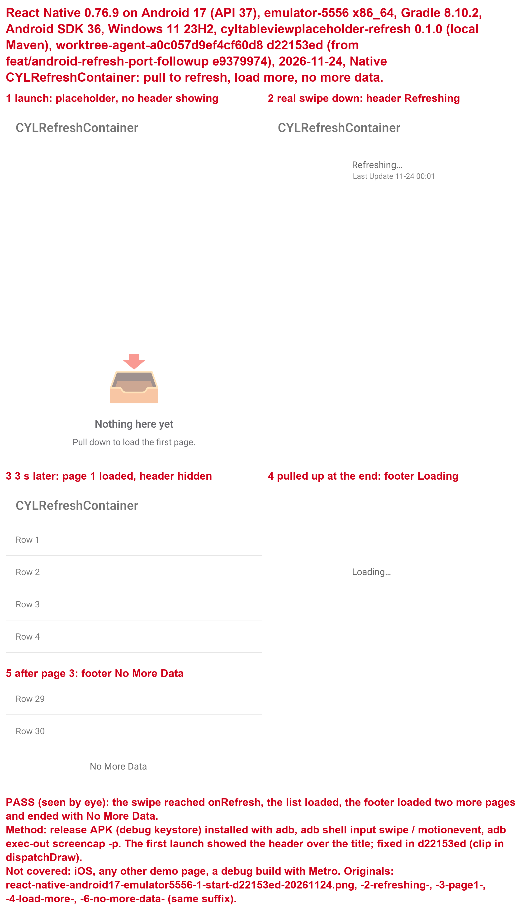

**React Native example, demo menu with the paging and error placeholder pages (2026-11-24, emulator-5556, local commit `464f7bef`):**

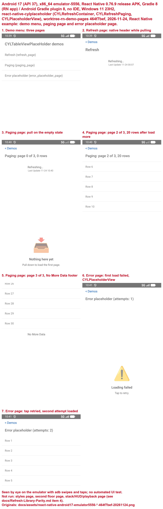
**React Native example, placeholder stack and HUD pages (2026-11-24, emulator-5554, local commit `d8c4ec6d`):**  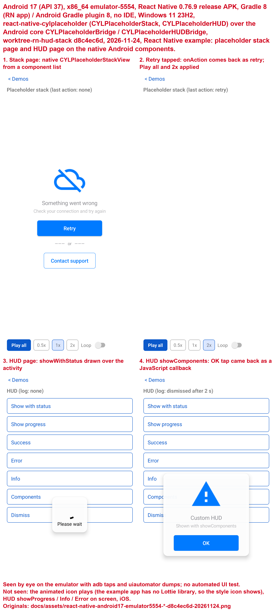

## Native bridge map (Flutter and React Native call the iOS and Android components)

**Decision (2026-11-23, the owner's prompt, recorded in `docs/Task-Log.md`):** this reverses the earlier decision that the Flutter package is a complete Dart rewrite with no adapter layer. Flutter and React Native keep the API of this document's tables (the names, the defaults, the phases) and implement it by calling the iOS and Android components; where a native component cannot do what the API expects, the native component gets a new interface. The current Dart / TypeScript implementations stay as (a) the behavior reference, (b) the fallback on platforms with no native half (web, desktop, `flutter test`), and (c) the regression tests: they are named as a platform interface, as in a federated plugin. **The Dart and TypeScript unit tests do not cover native behavior**: native code is covered by the Android Gradle tests (Robolectric), by `ios.yml` for the iOS core, and by contract tests with mock method channels; the Flutter and React Native iOS halves have no CI build yet.

**What the inventory found (2026-11-23):**
- iOS `CYLRefreshComponent` reads its pull through KVO on a `UIScrollView` (`contentOffset`, `contentSize`, the pan gesture: `scrollViewContentOffsetDidChange`, `scrollViewPanStateDidChange`) and runs the phase machine itself. It has no way to be fed an offset by a caller.
- Android `CYLRefreshComponent` is the facade of a `CYLRefreshLayout` (a `ViewGroup` of about 2,600 lines that handles the touches of its scrolling child and moves the spinner with the protected `moveSpinner` / `animSpinner` / `overSpinner`). It has no public way to be fed an offset either.
- So a native header cannot follow a Flutter `ListView` as it is. Flutter needs a new native **driven mode** (the caller feeds the pull and the drag state, the component runs the same phase machine and reports phases back). React Native does not: its scrollables are real native scroll views, so the native component wraps them (iOS `cyl_header` attached to the child's `UIScrollView`, Android `CYLRefreshLayout` as the parent view).
- The placeholder view, the stack and the HUD are plain native views with item dictionaries shared with the Dart / TypeScript names (`CYLPlaceholderItemKey`, `fromItemAttributes`, the component configuration in `docs/Placeholder-Scenarios.md`), so they need almost no new native API.

**Order of work:** (1) this map; (2) Android placeholder, stack and HUD bridges, tested with the Android SDK in this container; (3) the Android driven mode with Robolectric tests; (4) the iOS counterparts, built by `ios.yml`; (5) the React Native native container. `NEEDS NATIVE API` marks a row whose native interface does not exist yet.

| Bridge group | Dart / TypeScript API kept | iOS native | Android native | Bridge design | Status |
| --- | --- | --- | --- | --- | --- |
| Placeholder view | `CYLPlaceholderView`, `CYLPlaceholderStyle`, `CYLPlaceholderItemKey`, `fromItemAttributes`, `animationLoops`, `animationSpeed`, `animationRestartToken` | `CYLPlaceholderView` (`CYLPlaceholderItem*` attributes, `animationLoops`, `animationSpeed`, `restartAnimation()`) | `CYLPlaceholderView.fromItemAttributes(context, map)`, `animationLoops`, `animationSpeed`, `restartAnimation()` | Flutter: a platform view (`UiKitView` / `AndroidView`) created with the item dictionary, a method channel for live updates; React Native: a Fabric component with the same props | Android native entry point done (2026-11-23): `CYLPlaceholderBridge.placeholderView` / `updatePlaceholderView` (`android/placeholder/.../bridge/CYLPlaceholderBridge.kt`, 7 Robolectric tests); Flutter Android half done (2026-11-23): the plugin (`flutter_cylplaceholder/android`: `FlutterCylplaceholderPlugin`, `CYLPlaceholderPlatformViewFactory`, `CYLPlaceholderPlatformView`) hosts the native view as a platform view, `CYLPlaceholderView` uses it on Android through `CYLNativePlaceholderView` (the Dart widget stays the fallback elsewhere and for a Flutter `image` / `titleStyle`), live updates go through the view's method channel; built into `flutter build apk --debug` (the APK contains the plugin and bridge classes), Dart contract tests with a mock channel (108 tests); **not run on a device** (no emulator image here). **Flutter iOS half done (2026-11-24, commit `aca2e528`):** `flutter_cylplaceholder/ios` (`FlutterCylplaceholderPlugin`, `CYLPlaceholderPlatformViewFactory`, `CYLPlaceholderPlatformView`) hosts the native view as a `UiKitView` with the Android channel, method and key names, calling `CYLPlaceholderBridge`; `CYLPlaceholderBridgeTests` (18 XCTest tests, `ruby Tests/run-tests.rb`: 237 tests, 0 failures) cover the keys, `animationLoops`, `animationSpeed`, live updates and invalid input; the tests found that the Dart item map (a style name, a text message, an `asset:` animation name) did not build a view on iOS, so the bridge now normalizes them like Android (core change in `CYLPlaceholderBridge.swift`); Dart contract tests run for Android and iOS (`flutter test`); `flutter build ios --simulator` of the example succeeds and the Error placeholder page shows the native view on the iOS 27.2 simulator (sheet in "Flutter example screenshots"). TODO: a device run, loop / speed / tap checks on the simulator (only the stack's Play all was driven), the platform view's size, React Native. The `message` of a single placeholder is joined to the title (the native item has one text), and Android does not accept a text `message` (it returns no view): TODO on Android |
| Placeholder components and stack | `CYLPlaceholderComponent`, `CYLPlaceholderStackView`, `CYLPlaceholderStackController.restartAnimation()` | `CYLPlaceholderComponent`, `CYLPlaceholderStackView`, `restartAnimation()` | `CYLPlaceholderComponent`, `CYLPlaceholderStackView(context, components, actions)`, `restartAnimation()` | The component list serialized to the configuration dictionary; button actions come back as events | Android native entry point done (2026-11-23): `CYLPlaceholderBridge.stackView` / `updateStackView` and the new `animationLoops` / `animationSpeed` keys of the component dictionary (`CYLPlaceholderConfiguration.kt`); Flutter Android half done (2026-11-23, local, commit `fd00aa80`): `CYLPlaceholderStackPlatformView` hosts the native stack, `CYLPlaceholderStackView` uses it on Android through `CYLNativePlaceholderStack` (channel `flutter_cylplaceholder/CYLPlaceholderStackView/<id>`: `update` restartAnimation, `onAction` back; contract in `flutter_cylplaceholder/README.md`), 3 mock-channel tests, run on emulator-5556: the stack draws and its Lottie animation plays (`docs/assets/android-17-api37-x86_64-emulator-flutter-native-stack-81abbd77-20261123-sheet.png`). Core gap found: the native `icon` component validates "animation" but never plays it (`CYLPlaceholderConfiguration.kt`), so the plugin sends an animated icon as an `item` component with `CYLPlaceholderItemAnimationFilePath` (an Android asset the example copies). **Flutter iOS half done (2026-11-24, `aca2e528`):** `CYLPlaceholderStackPlatformView` hosts the native stack (`UiKitView`, channel `flutter_cylplaceholder/CYLPlaceholderStackView/<id>`: `update` restartAnimation, `onAction` back), 4 stack bridge tests in `CYLPlaceholderBridgeTests`, 3 mock-channel tests run for both platforms; on the iOS 27.2 simulator the Placeholder stack page draws the native stack, "Play all" restarts the native Lottie icon (255 x 255 px changed) and the Retry tap reaches Dart by name (same sheet). TODO: loop and speed switches and the size events on the simulator, React Native; React Native Android half (2026-11-24, local, commit `d8c4ec6d`): `CYLPlaceholderStack` (`CrossPlatform/react-native-cylplaceholder/android`: `CYLPlaceholderStackManager`, props `components` / `scenario` / `backgroundAction` / `restartToken`, event `onAction`, command `restartAnimation`; TypeScript `CYLPlaceholderStack`, `CYLPlaceholderComponent` builders), 9 Robolectric tests, example stack page seen on emulator-5554 (Retry came back as `onAction("retry")`); the animated icon did not play there (no Lottie library in the example app); iOS not done |
| HUD | `CYLPlaceholderHUD`, `CYLPlaceholderHUDHost` | `CYLPlaceholderHUD` (`show`, `showProgress`, `showSuccess`, ..., `dismiss`) | `CYLPlaceholderHUD(context, container)` with the same calls | A method channel / native module that drives the native HUD over the host view; no platform view | Android native entry point done (2026-11-23): `CYLPlaceholderHUDBridge.handle(method, arguments)` (`show`, `showWithStatus`, `showProgress`, `setStatus`, timed info / success / error, `showComponents`, `popActivity`, `dismiss`, `dismissWithDelay`); Flutter Android half done (2026-11-23): `CYLPlaceholderHUD` forwards each call to the native HUD over the method channel `flutter_cylplaceholder/hud` (the plugin drives `CYLPlaceholderHUDBridge` over the activity's content view), keeps its Dart state in step, `CYLPlaceholderHUDHost` draws nothing when native; a native button tap comes back as `onAction`; Dart contract tests; **not run on a device**. **Flutter iOS half done (2026-11-24, `aca2e528`):** the plugin's method channel `flutter_cylplaceholder/hud` drives `CYLPlaceholderHUDBridge` over the root view of the foreground window; 8 HUD bridge tests (every method name, progress clamping, `showComponents`, a button tap by name), the Dart HUD contract tests run for both platforms, and on the iOS 27.2 simulator the Retry button shows the native HUD "Loaded" (same sheet). TODO: a device run, `showComponents` on the simulator, React Native; React Native Android half (2026-11-24, local, commit `d8c4ec6d`): the native module `CYLPlaceholderHUD` (`CYLPlaceholderHUDModule` / `CYLPlaceholderHUDController` over the content view of the current activity, event `CYLPlaceholderHUDAction`) and the TypeScript `CYLPlaceholderHUD` with the Dart method names, run on emulator-5554: `showWithStatus`, `dismissWithDelay` completion, `showComponents` and its button callback seen; `showProgress`, info and error not seen on screen; none of the Dart look fields; iOS not done |
| Refresh component state machine | `CYLRefreshComponent`, `CYLRefreshHeader`, `CYLRefreshFooter`, `CYLRefreshAutoFooter`, `CYLRefreshBackFooter`, phases, `beginRefreshing`, `endRefreshing`, trigger rules | `CYLRefreshComponent` (KVO of a `UIScrollView`); driven mode (2026-11-24, local, simulator tests only): `CYLRefreshDrivenLayout` (`CYLRefreshDrivenLayout.swift`) with `header`, `footer`, `drive(offset:dragging:startedAtEdge:)` (negative offset pulls the footer, as Android) and `release()` (Objective-C `releaseDrivenPull`); `CYLRefreshAutoFooter` loads on a release after a pull at the bottom; 7 header and 11 footer / combined tests in `Tests/CYLRefreshDrivenLayoutTests.swift`, run on an iOS 27.2 simulator (`run-tests.rb`, counts in `docs/Task-Log.md`); TODO: the Flutter and React Native iOS glue that calls it, haptics, second floor | `CYLRefreshComponent` (facade of `CYLRefreshLayout`) | Flutter: **driven mode**; React Native: the component wraps the real scroll view | NEEDS NATIVE API: iOS and Android `driveOffset(offset, dragging, startedAtEdge)` and `endDrag()` that run the phase machine with no scroll view, plus phase events (a phase observer already exists on both). Android spike (2026-11-23, `CYLRefreshDrivenModeSpikeTest`): the phase machine runs without a layout (`moved` / `setPhase`), but the headers draw from the layout's `RefreshState` callbacks, so a stand-in `CYLRefreshLayout` and feeding the header views are still needed: a conditional go. 2026-11-23: the stand-in is written, `CYLRefreshDrivenLayout.drive` / `release` (9 Robolectric tests pass, header path only); Flutter Android glue done (2026-11-23, local, commit `81abbd77`: `CYLRefreshPlatformView` + `CYLNativeRefreshIndicator`, header only; shown on emulator-5556, `docs/assets/android-17-api37-x86_64-emulator-flutter-native-refresh-81abbd77-20261123-sheet.png`); TODO: footer path (tests and glue), the iOS half, the core draws a warning text when a `CYLRefreshDrivenLayout` has no content view (the plugin adds an empty view as a workaround) |
| Refresh container | `CYLRefresh` | `UIScrollView.cyl_header` / `cyl_footer`; for Flutter `CYLRefreshDrivenLayout.header` / `footer` (see the row above; not yet hosted by a plugin) | `CYLRefreshLayout` | Flutter keeps its own scrolling and layout and mirrors native state; React Native: a native container component | NEEDS NATIVE API (Flutter, see above); React Native, written 2026-11-23: the native container `CYLRefreshContainer` (`CrossPlatform/react-native-cylplaceholder/android`: `CYLRefreshContainerView` is a `CYLRefreshLayout` with `cyl_header`, `CYLRefreshContainerManager`, `CYLPlaceholderPackage`, 9 Robolectric tests (2026-11-23, `testDebugUnitTest` run locally: 9 of 9 pass; `aRealPullGestureReachesOnRefresh` drags the container with a real touch sequence and sees one `onRefresh`, a disabled container sees none; footer, 2026-11-23: `CYLRefreshContainerView` also carries a `CYLRefreshAutoNormalFooter` (`cyl_footer`) behind the props `loadMoreEnabled` (default off), `loadingMore`, `noMoreData` and the event `onLoadMore`, with 5 tests: footer attached and off by default, a JS-set load does not call back, `noMoreData` set and cleared, a load ended with no more data, and a real upward drag reaching `onLoadMore`; the JS props are typed in `CYLRefreshContainer.tsx` and type-checked in `usage.typecheck.tsx`; **Android only, the iOS container has no footer: TODO**; `CYLRefreshPaging` is not wired to the container: TODO), compiled against `react-android`; `ios/`: `CYLRefreshContainerView` puts a `CYLRefreshNormalHeader` on the first `UIScrollView` below it, **not built**; JS `CYLRefreshContainer`, `isCYLRefreshContainerAvailable()`). TODO: iOS build, an iOS app run (the Android half now runs in the example app on emulator-5556, 2026-11-24; that run found the resting header drawn outside the container, fixed in `d22153ed` by clipping to the bounds) |
| Drawn indicators | `CYLRefresh*` styles (Classic, Cupertino, Material, Bezier radar / circle, Delivery, Phoenix, Taurus, Rive) | the native styles of `CYLRefresh` | the native styles of `CYLRefresh` | Flutter: the native indicator view as a platform view in the indicator slot (hybrid composition cost and clipping are risks); React Native: drawn by the native container | NEEDS NATIVE API: an indicator view that draws from a driven component without a scroll view |
| Second floor | `secondaryView`, `openSecondary`, `closeSecondary`, trigger and dimension fields | `openSecondary` / `closeSecondary` and the secondary fields | `secondaryTriggerOffset`, `secondaryDimension`, `secondaryCloseTriggerOffset`, `floor` | Method channel calls and events | **Contract written 2026-11-24** (names below, section "Row 7 and 8 native contract"); Android: written, not built (2026-11-24, Windows, static); iOS: written, not built |
| Paging | `CYLRefreshPaging<T>` | `CYLRefreshPaging` (if present; to be confirmed) | `CYLRefreshPaging.kt` | Paging logic stays in Dart / TypeScript (owner, 2026-11-24); the native container only gets the page-complete, no-more-data and reset inputs and the refresh / load-more events it already has | **Not bridged by design; container contract = existing names, no new native name** (section "Row 7 and 8 native contract") |
| Flutter-only layout | `CYLRefreshHeaderLocator` / `FooterLocator`, `readySpringBuilder`, nested controllers, `scrollMode`, `triggerAxis` | none | none | Stay in Dart: they are about Flutter's scrolling | N/A: Flutter-only |

### Row 7 and 8 native contract (2026-11-24, written before the iOS and Android code; the Windows session implements Android against these names)

Names mirror the Dart API in `CrossPlatform/flutter_cylplaceholder/lib/src/refresh/component.dart` (`secondaryTriggerOffset`, `secondaryDimension`, `secondaryCloseTriggerOffset`, `openSecondary`, `closeSecondary`, `secondaryOpenedBlock`, `secondaryClosedBlock`) and the existing phase names `secondaryArmed`, `secondaryOpen`, `secondaryClosing` (already in `CYLRefreshPhase` on both platforms). Lengths are logical pixels in Dart and JavaScript, points on iOS, dp on Android. No offset is ever in native pixels.

**Row 7, Flutter (channel `flutter_cylplaceholder/CYLRefreshView/<id>`, header and footer views, same names for both):**

| Direction | Name | Arguments | Meaning |
| --- | --- | --- | --- |
| creation parameter | `secondaryTriggerOffset` | double, > 0 | The pull past which a release opens the second floor. Missing or 0: no second floor (Dart sends it only when `secondaryView != null`). Native reports phase `secondaryArmed` while a dragging pull is at or past it. |
| creation parameter | `secondaryDimension` | double, 0 = whole view | The open extent of the floor. Informational for the native view (Dart draws the floor content and sizes the slot). |
| creation parameter | `secondaryCloseTriggerOffset` | double | Pushing back this far closes it. Informational: Dart does the closing (as `refresh.dart` does today) and tells native with `closeSecondary`. |
| Dart to native | `openSecondary` | none | Open the floor. A no-op while open or while refreshing. Native phase becomes `secondaryOpen`. |
| Dart to native | `closeSecondary` | none | Close it. A no-op unless open. Phase `secondaryClosing`, then idle. |
| native to Dart | `onSecondaryOpened` | none | After the floor opened (by `openSecondary`, or by a `release` / `drive(dragging: false)` after a pull past `secondaryTriggerOffset`). |
| native to Dart | `onSecondaryClosed` | none | After it closed. |

Rules: Dart is the authority (Flutter keeps the scrolling and the phase machine). The native events are informational and must not be sent back as calls (no echo loop); `openSecondary` on an open native floor and `closeSecondary` on a closed one are silent no-ops. The existing `onPhase` events carry `secondaryArmed`, `secondaryOpen` and `secondaryClosing` as phase names. The floor's content is a Flutter widget and stays in Dart: the native indicator draws nothing for it. Unknown or missing keys keep the native default (no second floor).

**Row 7, React Native (`CYLRefreshContainer`, props and events, both platforms):**

| Kind | Name | Type | Meaning |
| --- | --- | --- | --- |
| prop | `secondaryTriggerOffset` | number, default 0 | As above; 0 = no second floor. |
| prop | `secondaryDimension` | number, default 0 | Open extent of the floor; 0 = the scroll view's visible height. |
| prop | `secondaryCloseTriggerOffset` | number, default 80 | Pushing the content up this far and releasing closes it (iOS `CYLRefreshHeader.secondaryCloseTriggerOffset`). |
| prop | `secondaryOpen` | boolean, default false | Controlled like `refreshing`: true opens, false closes. A change JavaScript made does not call the event back. |
| event | `onSecondaryOpen` | `{}` | The floor finished opening from a pull (not from the prop). |
| event | `onSecondaryClose` | `{}` | The floor finished closing from a push or a pull (not from the prop). |
| child | `nativeID="cyl.refresh.secondary"` | any native view | The floor's content: the container takes the child view with this `nativeID` as the header's `secondaryView` (placed behind the header above the list, as iOS does) and looks for the scroll view in its other children. No such child: the pull still opens and reports the events, the floor is empty. |

JavaScript owns `secondaryOpen` as state: set it true in `onSecondaryOpen` and false in `onSecondaryClose`, as `refreshing` is set in `onRefresh`.

**Row 8, paging (container contract only).** Paging logic (`CYLRefreshPaging`: page counter, totals, `isNoMore`, loader, error rules) stays in Dart / TypeScript over the native indicators (owner decision 2026-11-24). Nothing crosses the native boundary except the three inputs the container already has; **no new native name is needed**, so there is nothing for the Windows session to add beyond keeping these working:

| Paging step | Flutter channel | React Native container |
| --- | --- | --- |
| page complete, more pages (first page or next page) | `finishRefresh {success}` | `refreshing: false` / `loadingMore: false` |
| last page loaded (no more data) | footer `finishRefresh {success, noMoreData: true}` | `loadingMore: false` with `noMoreData: true` (or `noMoreData: true` while loading) |
| after a refresh of the first page: reset | footer `noMoreData {value: false}` (or `{value: true}` when the first page is also the last) | `noMoreData: false` (or `true`) |
| a pull or the footer starts a load | `onRefreshing` | `onRefresh` (header) / `onLoadMore` (footer) |
| a pull may load again after "no more data" | creation parameter `loadsAfterNoMoreData` | prop `loadsAfterNoMoreData` (iOS; Android and the TypeScript spec 2026-11-24, written, not run) |

A failed page is `finishRefresh {success: false}` / the same props as page complete; the retry rule (the same page again) is Dart / TypeScript's.

**Slot rule for the driven refresh view (2026-11-24, `126d439b`; Flutter iOS `CYLRefreshDrivenHost.updateSlot`, Android to follow).** The owner's report was "拉伸被裁" (the stretch is clipped on a deep pull). Rule: the header is laid out at its own height on the slot edge at every pull, and the slot is never shorter than the header while it is pulled or refreshing. Per scroll mode (Dart sizes the platform view: one open height for move, front and behind; the pull for stretch):
- **move**: the header spans the bottom `pull` points of the layout, the layout is anchored at the slot's bottom (header at the slot edge, not scrolled a second time);
- **stretch**: the same, the header is as tall as the pull and so is the view;
- **front and behind**: the header is `open` tall at the top of the layout whatever the pull, the layout is at least as tall as the header, Dart slides (front) or covers (behind) the view itself; a behind header is pinned like a front one (native behind slides in with the content until the pull passes its height, which doubles Dart's reveal); the container does **not** clip, so what a front header draws below its own frame (the Material circle drops up to about 1.5 open heights) stays visible;
- **footer**: anchored at the top, as tall as the pull.
Measured on ADAFD92B (Flutter example, Refresh styles page, same axe swipe y 200 to 760 in 6 s, finger down at 3.6 s, maximum logged pull 206.5 pt): Classic (move) whole before and after (the Android "title 6 px in a 157 px slot" does not reproduce on iOS: the classic header was whole at a 206 pt pull, title and arrow visible); Bezier radar (stretch) whole before and after; **Material (front) cut at the view's lower edge before, whole after**. Not captured: Bezier circle, Delivery (chips off screen), behind (no Dart style uses it; unit test only). Swift tests that fail without the fix (`CYLRefreshDrivenHostTests`: `testABehindHeaderStaysWholeInTheSlotAtEveryPull`, `testAFrontHeaderIsWholeAndItsDrawingBelowItsFrameIsNotClipped`; move and stretch tests pass before and after as regression guards). **Dart request (Windows-owned `native_refresh.dart`, not edited here):** add the creation parameters `'scrollMode': component.scrollMode.name` (`move`, `front`, `behind`; the host applies `front`, `behind` and `stretch`, anything else keeps the style's own) and `'expandHeight': component.expandHeight` (the host already reads it) so the native open height equals Dart's (native classic 54 pt against Dart's 60 leaves a 6 pt gap at the slot edge). The same rule applies to Android `CYLRefreshPlatformView.fitSlot`: the 6 px title may be a header compressed to the slot (not proven).

**The same 8 rows by half (2026-11-24, evidence).** "Done" means built, tested and seen where the row says so; the Flutter-only layout row is N/A and not counted. The Android half is the Android native component plus the Flutter and React Native glue that calls it; the iOS half is the iOS native component plus the same glue. Status words: done, partial, NEEDS NATIVE API (the native interface does not exist), TODO (not started).

| # | Bridge group | Android half | iOS half |
| --- | --- | --- | --- |
| 1 | Placeholder view | **done**: `CYLPlaceholderBridge` (7 Robolectric tests), Flutter platform view seen on emulator-5556 | **done** (2026-11-24, Mac): `CYLPlaceholderBridge` + the Flutter iOS plugin (`flutter_cylplaceholder/ios`, `UiKitView`); `Tests/CYLPlaceholderBridgeTests.swift` 18 tests; full suite `ruby Tests/run-tests.rb` **248 tests, 0 failures** at `cda76669` (re-run by the main session on iOS 27.2); the example's error placeholder page holds a native `platform_view` (axe) labeled "Load failed / Tap to retry", sheet `flutter-ios27.2-iphone18pro-cylplaceholderscreens-native-placeholder-stack-hud-aca2e528-20261124-sheet.png`; a real core bug found and fixed (item map style name, text `message`, `asset:` name were rejected). Not driven on iOS: the loop switch, speed slider, the single placeholder's tap |
| 2 | Components and stack | **done**: `stackView` / `updateStackView`, Flutter native stack platform view (`fd00aa80`), animated icon plays through the native `icon` component, seen on emulator-5556; React Native (2026-11-24, `d8c4ec6d`): `CYLPlaceholderStack` view manager + wrapper, 9 Robolectric tests, example stack page seen on emulator-5554 (animated icon not playing there: no Lottie library in the example app) | **done** (2026-11-24, Mac): the Flutter iOS plugin's stack `UiKitView` (`cyl.native.placeholderStack`, seen as a `platform_view` with UIKit children), "Play all" changed 255 x 255 icon pixels between two captures 0.3 s apart (native animation plays); same tests and sheet as row 1 ; **React Native iOS (2026-11-24, built and seen on the iOS 27.2 simulator, `e35e49a3`; Retry reached JS `onAction`, native id `cyl.native.placeholderStack`, [sheet](assets/react-native-ios27.2-iphone18pro-cylplaceholderscreens-native-placeholder-stack-retry-e35e49a3-20261124-sheet.png); Play all and speed not shown):** `CrossPlatform/react-native-cylplaceholder/ios` `CYLPlaceholderStackManager` ("CYLPlaceholderStack": props `components`, `scenario`, `backgroundAction`, `restartToken`, event `onAction`, command `restartAnimation`) over `CYLPlaceholderStackHostView` and `CYLPlaceholderBridge.stackView`; `Tests/CYLPlaceholderReactBridgeTests.swift`; a core bug fixed on the way: `CYLPlaceholderBridge.actionHandlers` keyed handlers by the raw name, so a catalog name ("retry") never fired |
| 3 | HUD | **done** to the native call: `CYLPlaceholderHUDBridge`, method channel, Dart contract tests; **not run on a device**; React Native (2026-11-24, `d8c4ec6d`): `CYLPlaceholderHUD` module + wrapper, run on emulator-5554 (`showWithStatus`, `dismissWithDelay`, `showComponents` button seen; progress, info, error not seen) | **done** (2026-11-24, Mac): the Flutter iOS plugin's HUD method channel calls `CYLPlaceholderHUDBridge.handle`; the Retry tap on the simulator sent the action to Dart and Dart showed the native HUD "Loaded"; covered by the same 18 bridge tests ; **React Native iOS (2026-11-24, built and seen on the iOS 27.2 simulator, `e35e49a3`; progress and components HUD drawn, OK tap reached JS, [sheet](assets/react-native-ios27.2-iphone18pro-cylplaceholderscreens-native-hud-progress-components-e35e49a3-20261124-sheet.png); Error, Info not seen):** the module "CYLPlaceholderHUD" (`CYLPlaceholderHUDModule`: `call(method, arguments)`, event `CYLPlaceholderHUDAction`) drives `CYLPlaceholderHUDBridge` through `CYLPlaceholderHUDController` over the topmost view controller of the foreground window |
| 4 | Refresh state machine | **partial**: `CYLRefreshDrivenLayout.drive` / `release`, header and footer paths tested (`:merged` 54 tests, `b87c5c20`); Flutter glue (2026-11-24, written statically, not built or run on a device): `CYLRefreshPlatformView` footer mode (`footer: true`, `CYLRefreshBackNormalFooter`, `noMoreData`, `loadsAfterNoMoreData`) and `CYLNativeRefreshIndicator` used by the classic footers on Android, 5 new mock-channel Dart tests (`flutter test` 120 pass); the Dart indicator stays the fallback | **partial** (2026-11-24, Mac): the native interface now exists on iOS as `CYLRefreshDrivenLayout.drive(offset:dragging:startedAtEdge:)` / `release()` (header: `37c1f8da`; footer: `3061e2ad`, a negative offset pulls from the bottom edge, `loadsAfterNoMoreData`, auto footer), 11 new tests in `Tests/CYLRefreshDrivenLayoutTests.swift`, suite 248 / 0 failures; a back footer dragged back to the edge no longer stayed armed (core bug fixed in `CYLRefreshBackFooter.swift`). **Flutter iOS glue (2026-11-24, commits `90cf77f1` .. `cb840621`, simulator run):** `CYLRefreshPlatformView` (`UiKitView`, view type `flutter_cylplaceholder/CYLRefreshView`, Android's channel and keys) hosts `CYLRefreshDrivenLayout` with the classic header or back footer; `CYLNativeRefreshIndicator` uses it on iOS and Android (the Dart indicator stays the fallback); `CYLRefreshDrivenHostTests` 8 tests, `run-tests.rb` **257 tests, 0 failures**; `flutter test` **140 pass**, `flutter analyze` no issues; two core bugs found by the real run and fixed in `CYLRefreshDrivenLayout` (the footer was never placed below the visible area, so its loading view stayed hidden; the "No more data" label was hidden at rest). On ADAFD92B (axe swipes, sheet `flutter-ios27.2-iphone18pro-cylplaceholderscreens-native-refresh-cb840621-20261124-sheet.png`): a pull on the Refresh page shows a native `platform_view` with 'Loading...', Dart's `refreshingHandler` ran and `endRefreshing` removed the view; the footer loaded 10 to 15 to 20 rows and ended with the native 'No more data' label, a later pull did not load. **Batch run 2026-11-24 (`a251f7b0`, Mac):** the mid-pull clip is fixed in `CYLRefreshDrivenHost` (slot sized to the pull, anchored at the slot edge; a front-mode header anchored at the top): classic header seen on ADAFD92B with a real axe swipe, mid-pull title, arrow and 'Release to refresh', after release 'Loading...' with the spinner, sheet `flutter-ios27.2-iphone18pro-cylplaceholderscreens-drawn-styles-part1-a251f7b0-20261124-sheet.png`; `run-tests.rb` **295 tests, 0 failures**. **Still open (stays partial):** the footer spinner was not visible in the final capture although the UI tree held it, the native `onRefreshing` event reaching Dart was not observed, haptics and second floor are not driven, no device run **Footers in the Flutter example, batch run 2026-11-24 (`e3affc8b`, Mac, ADAFD92B, real axe swipes on 'Refresh styles', sheets [classic, cupertino](assets/flutter-ios27.2-iphone18pro-cylplaceholderscreens-footers-classic-cupertino-e3affc8b-20261124-sheet.png), [material, bezier radar](assets/flutter-ios27.2-iphone18pro-cylplaceholderscreens-footers-material-bezierradar-e3affc8b-20261124-sheet.png), [bezier circle, delivery](assets/flutter-ios27.2-iphone18pro-cylplaceholderscreens-footers-beziercircle-delivery-e3affc8b-20261124-sheet.png), [phoenix, taurus](assets/flutter-ios27.2-iphone18pro-cylplaceholderscreens-footers-phoenix-taurus-e3affc8b-20261124-sheet.png)):** all 8 footers seen while pulled up and while loading, and the localized 'No more data' label seen after the last page for 7 of 8 (axe describe-ui lists it for all 8; the Cupertino footer is a spinner-only auto footer and draws no text there: TODO). **Core bug found and fixed (`e3affc8b`, test fails first):** the automatic footer (Cupertino) rested at y 0 of the driven layout, whose scroll view has no content, so a pull scrolled it out above the top and its spinner was never visible (this is also the earlier open item 'the footer spinner was not visible although the UI tree held it'); the layout's content size now equals the view; `testEveryFooterStyleDrawsMidPullAndWhileLoadingInTheHeldSlot` failed with the footer at y -44 and passes. **Not fixable on the Mac (Windows-owned Dart):** Dart sends no `expandHeight`, so the Delivery footer (native open height 150, Dart slot 100) never armed natively and stayed blank while loading (log: pulled 115 of 150); with the creation parameter `expandHeight` added locally (not committed, `native_refresh.dart` is Windows-owned) it draws the box, clouds and umbrella while loading. Request for the Windows session: send `'expandHeight': widget.component.expandHeight` (and `scrollMode`) in the creation parameters. **Self-score of the iOS half of row 4: 90** (footers seen, one core bug fixed with a failing-first test; minus 10: the Delivery footer stays blank with the stock Dart until it sends `expandHeight`, the Cupertino footer has no end text, no device, CI not seen). Suite `run-tests.rb` **327 tests, 0 failures**; `flutter test` 178 pass, `flutter analyze` no issues. **Update 2026-11-25 (Mac, session chenyilong-d4, tree `2c5116b0`, simulator 53D5A10D iPhone 18 Pro, iOS 27.2): the Delivery footer with the committed Dart (Windows `65098e51` sends `expandHeight`) now draws while loading** in the Flutter example's 'Refresh styles' page (real axe pull up, frames from a `simctl recordVideo` capture): after the release the held footer shows the box, clouds and the balloon canopy, and the rows load after it; it used to stay at 'pulling' (box only), sheet [Delivery footer](assets/flutter-ios27.2-iphone18pro-ph-d4-delivery-footer-2c5116b0-20261125-sheet.png). The pulling frame is in the same sheet. **Self-score of the iOS half of row 4: 94** (minus 2: the Cupertino footer has no end text; minus 2: the Delivery loading animation was seen over the slot's 2 s hold only, not a longer one; minus 1: no device; minus 1: CI not seen). |
| 5 | Refresh container | **partial**: React Native `CYLRefreshContainer` with header and load-more footer, 9 Robolectric tests, three example pages seen on emulator-5556 (`464f7bef`); `CYLRefreshPaging` is wired to it from JavaScript (2026-11-24, `CYLRefreshPagingContainer`, 5 `node --test` tests; component not run on a device) | **done** for the classic header and the back footer (2026-11-24, Mac, `4b8124c4`): `CYLRefreshContainerView` (iOS) wraps the first `UIScrollView` below it with `CYLRefreshNormalHeader` and, while `loadMoreEnabled`, `CYLRefreshBackNormalFooter`; Android's props (`refreshing`, `enabled`, `loadMoreEnabled`, `loadingMore`, `noMoreData`) and events (`onRefresh`, `onLoadMore`) plus `loadsAfterNoMoreData` (iOS only, not in the TypeScript spec: TODO); `Tests/CYLRefreshContainerViewTests.swift` 13 tests, `ruby Tests/run-tests.rb` **270 tests, 0 failures**, `npm test` 33 pass. The example (`example/ios`, React Native 0.76.9, old architecture) builds for the iOS 27.2 simulator and runs the unchanged `RefreshPage`: a real axe pull down showed the native header (`Release to refresh`, `Loading...`) and reached `onRefresh` (rows 1 to 10 came from JavaScript state), real pull ups reached `onLoadMore` (3 pages, 30 rows) and ended in the native `No more data` label (axe describe-ui; no JavaScript file has these strings); sheets `react-native-ios27.2-iphone18pro-cylplaceholderscreens-native-header-pull-down-4b8124c4-20261124-sheet.png`, `...-native-footer-pull-up-4b8124c4-20261124-sheet.png`. Not done: the new architecture (Fabric interop not tried), `PagingPage` on iOS not run, no commands (Android has none), no device, haptics, a footer spinner capture, the mid-load footer state was not captured, CI not seen |
| 6 | Drawn indicators | **partial** (2026-11-24, `d4a9652a`, Windows): the Flutter native refresh view takes the creation parameter `style` (`classic`, `cupertino`, `material`, `bezierRadar`, `bezierCircle`, `delivery`, `phoenix`, `taurus`; unknown or missing falls back to `classic` with one log line) through `CYLRefreshStyle` (`:merged` 60 tests, 0 failures, 3 new); the Dart style classes route to `CYLNativeRefreshIndicator(style: ...)` when the native switch is on (`flutter test` 172 pass, 41 new); native headers of all 8 styles seen on emulator-5554 during a held pull ([sheet](assets/android-17-api37-x86_64-emulator-flutter-native-refresh-style-8-styles-headers-mid-pull-d4a9652a-20261124-sheet.png)); footers not run on a device; the classic header is clipped mid-pull (title 6 px high in a 158 px slot, cause not proven when captured). **Android follow-up (2026-11-24, Windows, written, not built, no test run):** the iOS clip cause (the header moved twice: Dart shows the bottom `pull` points of a view one open height tall while the native layout also scrolled the header by the pull) maps to Android for the mid-pull case; `CYLRefreshPlatformView.fitSlot` now sizes the driven layout to the pull (`CYLRefreshDrivenLayout.slotHeight`) anchored at the slot edge (the indicator keeps its own open height, as iOS's final revision); whether this also explains the held 6 px title is not proven (see "Batch hand-off W1b" in `docs/Task-Log.md`); drawn footers show the localized "no more data" text and hide the style (`CYLDrawnFooterView`, as iOS `CYLRefreshDrawnFooter`); the five drawn styles send `foregroundColor` / `backgroundColor` (ARGB integers) as creation parameters, applied as the layout's accent / primary color (key names in the plugin README for the iOS mirror); 5 new Kotlin tests and 4 new Dart test runs written, not run | **partial (batch run 2026-11-24, Mac, `a251f7b0`)**: the 'NEEDS NATIVE API' verdict was wrong: `Tests/CYLRefreshDrivenStylesTests.swift` runs all 8 header styles and the drawn footers under `CYLRefreshDrivenLayout` with no core change. `DESTINATION=...ADAFD92B... ruby Tests/run-tests.rb`: **295 tests, 0 failures** (270 before the row; 12 host, 10 factory, 3 styles, 2 container tests and 1 new front-header test added), `ios-api-map.py --check` 827 / 827, `check_doc_comments.py` passes, `flutter test` 172 pass, `flutter analyze` no issues, clean `flutter build ios --simulator --debug` succeeds. **Seen on ADAFD92B** in the Flutter example's 'Refresh styles' page with real axe swipes (y 200 to 720 in 3 s; `axe describe-ui` listed `platform_view[9]` during the pull): all 8 styles (classic, cupertino, material, bezierRadar, bezierCircle, delivery, phoenix, taurus) drawn mid-pull with the finger down and drawn while refreshing 0.3 s after release; sheets [part 1](assets/flutter-ios27.2-iphone18pro-cylplaceholderscreens-drawn-styles-part1-a251f7b0-20261124-sheet.png) and [part 2](assets/flutter-ios27.2-iphone18pro-cylplaceholderscreens-drawn-styles-part2-a251f7b0-20261124-sheet.png). **Bug found by the capture and fixed (`a251f7b0`):** the Material header (front mode) was blank at a deep pull because the host anchored every layout at the bottom of the open-height view; a front header is now anchored at the top (a new test fails without the fix). **Fixed 2026-11-24 (`126d439b`, see "Slot rule" below):** the Material circle that dropped below its open-height view and was cut at the view's lower edge on a deep pull (circle half cut at about 170 pt) is whole now: seen on ADAFD92B, sheet [deep pull before and after](assets/flutter-ios27.2-iphone18pro-cylplaceholderscreens-refresh-deep-pull-before-after-126d439b-20261124-sheet.png). React Native iOS `headerStyle="phoenix"` (temporary edit, not committed) seen with a real pull: the native Phoenix header drew mid-pull and while refreshing, `onRefresh` ran in JavaScript and the `refreshing` prop closed it ([sheet](assets/react-native-ios27.2-iphone18pro-cylplaceholderscreens-phoenix-header-pull-a251f7b0-20261124-sheet.png)); `npm test` 33 pass. Not seen: the drawn footers on the simulator, `footerStyle`, Rive (not included: the row stays partial), a device, CI **Rive added 2026-11-24 (`f2cb31e4`, owner decision "支持rive", required):** the ninth style key `rive` (contract: "The rive style: creation parameters" below) through the Swift factory, the Flutter creation parameter `style` + `rive...` keys and the React Native `headerStyle` / `footerStyle` + `headerRive` / `footerRive`; Rive stays optional (no `CYLTableViewPlaceHolder/Rive` subspec, no `riveFile` or an unreadable file: classic and one log line). `ruby Tests/run-tests.rb` on ADAFD92B: **342 tests, 0 failures** (15 new, fake builder); `npm test` 33, `flutter test` 188, `ios-api-map.py --check` 829 / 829, `check_doc_comments.py` 1291 / 1291. Seen: the Flutter example's Rive chip with a real axe pull draws the Bow file and follows the pull ([sheet](assets/flutter-ios27.2-iphone18pro-cylplaceholderscreens-rive-header-f2cb31e4-20261124-sheet.png); needs the Dart request in `docs/Task-Log.md`, applied locally and reverted). Not seen: the Rive refreshing frame and footer, React Native `rive` on the simulator (written, not run), Android (Windows implements it from the contract), a device, CI. **Self-score of the iOS half of row 6 now: 93.** **Batch run 2026-11-24 (`e3affc8b`, `4eb3595f`, Mac):** the drawn footers (bezier radar, material, delivery, phoenix, taurus) are now seen in the Flutter example at a real pull-up, while loading and with 'No more data' (sheets in row 4 above); Bezier circle and Delivery headers seen at a deep pull and refreshing ([sheet](assets/flutter-ios27.2-iphone18pro-cylplaceholderscreens-headers-bezier-circle-delivery-e3affc8b-20261124-sheet.png)); React Native iOS `footerStyle` (native and TypeScript existed since `a251f7b0`; the styles page `RefreshStylesPage` with wrapping chips is new) seen with real pull-ups for all 8 style names on the simulator, 7 draw their own footer and `bezierCircle` shows the classic footer by design, 'No more data' seen during a pull-up after page 3 for 7 of 8 (Cupertino: no text), sheets [classic, cupertino](assets/react-native-ios27.2-iphone18pro-cylplaceholderscreens-footers-classic-cupertino-4eb3595f-20261124-sheet.png), [material, bezier radar](assets/react-native-ios27.2-iphone18pro-cylplaceholderscreens-footers-material-bezierradar-4eb3595f-20261124-sheet.png), [bezier circle, delivery](assets/react-native-ios27.2-iphone18pro-cylplaceholderscreens-footers-beziercircle-delivery-4eb3595f-20261124-sheet.png), [phoenix, taurus](assets/react-native-ios27.2-iphone18pro-cylplaceholderscreens-footers-phoenix-taurus-4eb3595f-20261124-sheet.png); the drawn footers' loading frames were not captured in React Native (the JavaScript load had ended before the screenshot). **Self-score of the iOS half of row 6: 88** (all 8 headers and footers seen on both hosts; minus 12: Rive not included, the Delivery footer's Dart `expandHeight` request, RN loading frames of the drawn footers, no device, CI not seen). **Update 2026-11-24 (Mac session c32b88, Rive worker, pushed by `db6f8dc4`):** the Rive refresh style is seen in the Flutter example on iOS; not seen: Rive in React Native, a Rive footer, the Rive refreshing frame. **Self-score of the iOS half of row 6: 93.** **Update 2026-11-25 (Mac, session chenyilong-d4, tree `2c5116b0`, simulator 53D5A10D, real axe swipes, frames from `simctl recordVideo` captures at full resolution):** (1) **React Native `headerStyle="rive"` and `footerStyle="rive"` built (old architecture, `pod install` with the Rive subspec, `xcodebuild` Debug, Metro 8123) and seen:** the Bow file is drawn in the native header during a real pull down, stays while `refreshing`, and the header closes after the JavaScript refresh; the footer draws the Bow during a pull up, while `loadingMore`, and closes after; sheets [header](assets/react-native-ios27.2-iphone18pro-ph-d4-rive-header-2c5116b0-20261125-sheet.png), [footer](assets/react-native-ios27.2-iphone18pro-ph-d4-rive-footer-2c5116b0-20261125-sheet.png). (2) **Flutter iOS Rive (local, uncommitted Dart patch from the "Dart for the rive style" request):** the refreshing frame after release (held header with the Bow) and the Rive footer (pull up, loading, after) seen; sheets [header](assets/flutter-ios27.2-iphone18pro-ph-d4-rive-header-2c5116b0-20261125-sheet.png), [footer](assets/flutter-ios27.2-iphone18pro-ph-d4-rive-footer-2c5116b0-20261125-sheet.png). (3) **React Native drawn footers' loading frames seen** (`loadingMore` held 4 s by the example): phoenix, taurus, delivery, bezierRadar, material draw their own footer in the held frame and the cupertino auto footer shows its spinner; sheets [phoenix, taurus, delivery](assets/react-native-ios27.2-iphone18pro-ph-d4-drawn-footers-phoenix-taurus-delivery-2c5116b0-20261125-sheet.png), [bezierRadar, material, cupertino](assets/react-native-ios27.2-iphone18pro-ph-d4-drawn-footers-bezierradar-material-cupertino-2c5116b0-20261125-sheet.png). (4) The Flutter Delivery footer with the committed Dart: see row 4. **Finding (not fixed):** in both hosts the Rive view shows a black band for the first frames of a pull and a thin black strip while the header or footer retracts (first-frame panel in the React Native header sheet; Flutter shows a blank gap for the first ~2 s of the pull, then the drawing, then a black strip on the retract): cause not proven; the likely one is an opaque Metal layer under the Rive view (`backgroundColor = .clear` is already set and does not make a layer transparent); a fix (`isOpaque = false` on the Rive view and its `CAMetalLayer`) was not tried because the test target has no RiveRuntime, so no failing-first Swift test is possible, and a fix without one breaks the core-first rule. **Self-score of the iOS half of row 6: 92** (minus 3: the black band / strip, unfixed; minus 2: Flutter Rive with the committed Dart (`b616da45`, `CYLRefreshRiveNativeHeader`, merged after this run) was not run on iOS, the evidence used the local patch; minus 2: no device; minus 1: CI not seen; React Native new architecture is out of scope by the owner's decision). |
| 7 | Second floor | **written, not built or run** (2026-11-24, Windows, static): Flutter `CYLRefreshPlatformView.kt` (creation parameters, `openSecondary` / `closeSecondary`, `onSecondaryOpened` / `onSecondaryClosed`, phase names through `onPhase`), Dart `CYLNativeRefreshIndicator` (sends the parameters and the calls), React Native `CYLRefreshContainerView` / `Manager` (props, events, the `nativeID` child); tests written, not run (Task-Log, "Batch hand-off W2"); **update (W2b, 2026-11-24, Windows): built and run, now partial**: round 1 failed to compile (`CYLRefreshPlatformView.kt` called the floor API on `CYLRefreshComponent`), fixed in `011d4e99`; the React Native Robolectric floor tests pass (22 / 22); on the emulator the Flutter example opened the Dart floor after a deep pull and release; the native `onSecondaryOpened` was not logged (Task-Log, 'RESULTS of batch W2b') | **done for React Native and Flutter (opened by a real pull)** (2026-11-24, Mac, `adc583e8`, `61a16c61`): the example page `SecondFloorPage` on the simulator with real swipes: a pull past `secondaryTriggerOffset` 120 opened the floor and `onSecondaryOpen` reached JavaScript (counter 1); a push of 200 pt and a lift closed it and `onSecondaryClose` reached JavaScript; pulling again gave 2; tapping Unmount while the floor was open did not crash (the status line read 'Container unmounted: no crash'), Mount and a pull opened it again (3); the Open and Close buttons (JavaScript sets `secondaryOpen`) left both counters at 0 (no echo); sheet [second floor](assets/react-native-ios27.2-iphone18pro-cylplaceholderscreens-second-floor-4eb3595f-20261124-sheet.png). **Core bug found and fixed (`adc583e8`, test fails first):** a push past the close trigger left the floor open when the finger lifted at rest (the close was only decided on a later offset change, which a lift without deceleration never produces); the pan end now closes it (`CYLRefreshHeader` and `CYLRefreshBackFooter`; `testAPushPastTheCloseTriggerClosesTheFloorWhenTheFingerLiftsAtRest`). **Flutter second floor, seen after the Windows Dart change (`native_refresh.dart` now sends `secondaryTriggerOffset` and calls `openSecondary` / `closeSecondary`, merged in `61a16c61`):** on the Flutter example's Second floor page a real pull past 140 opened the floor and it stayed open after release, the Close button closed it and the Dart log read 'Second floor closed', a second pull opened it again; sheet [Flutter second floor](assets/flutter-ios27.2-iphone18pro-cylplaceholderscreens-second-floor-61a16c61-20261124-sheet.png). Not seen: the 'Second floor opened' log line (the floor covers it), a footer floor, Android, new architecture, a device. **Self-score of the iOS half of row 7: 90** (React Native and Flutter seen with real pulls, one core bug fixed; minus 10: the opened log line not read, no footer floor seen, no device). |
| 8 | Paging | **N/A by design (not counted)**; **partial** (React Native only, 2026-11-24): the TypeScript `CYLRefreshPaging` drives the native container through `CYLRefreshPagingContainer`; Flutter keeps the Dart paging over the native header and footer indicators; `CYLRefreshPaging.kt` is **not bridged by design** (owner, 2026-11-24: the paging logic stays in Dart / TypeScript over the native indicators; a loader callback with a completion token across the channel would only add complexity and latency), so this row is not a gap | **N/A by design (not counted)**; **no new native code needed**: the container names of rows 4 and 5 already carry the page-complete, no-more-data and reset inputs (section "Row 7 and 8 native contract"); not a gap |

**Count (recounted 2026-11-24 at `db6f8dc4`, docs merge by session chenyilong-d4; row 8 is N/A by design and not counted):** Android half: 3 of 7 done (rows 1 to 3), 4 partial (rows 4 to 7; row 7 was built and its example page opened the Dart floor in W2b, the native `onSecondaryOpened` was not logged). iOS half: 5 of 7 done (rows 1 to 3, 5 and 7), 2 partial (row 4: open visual items; row 6: self-score 93 after the Rive style was seen in Flutter, minus React Native Rive, the Rive footer and its refreshing frame). Swift suite 327 tests, 0 failures. History: Android half: 3 of 8 done (rows 1 to 3), 2 partial (rows 4, 5), 1 NEEDS NATIVE API, 2 TODO. iOS half (updated 2026-11-24, batch of `4eb3595f`: rows 4, 6 and 7 gained real-run evidence, self-scores 90, 88 and 85, suite 327 / 0 failures): 4 of 8 done (rows 1 to 3 and row 5, built and run on the iOS 27.2 simulator; row 5 added 2026-11-24 with real gestures), 1 partial (row 4: native interface and Flutter glue built, tested and run on the simulator, with the open visual items above), 1 partial that is written, not built (row 6: drawn indicators, see its cell), 2 TODO. The iOS halves are the Mac session's (c32b88); nothing here counts a row that is not built. Swift test counts were re-run by the main session (248 / 0 failures); the Dart counts (130) are the agent's report.

### The rive style: creation parameters (2026-11-24, iOS written and tested first; the Windows session implements Android against these names)

Owner decision 2026-11-24: "支持rive" (Rive support is required for the native refresh styles). `rive` is the ninth style key (lower camel case) next to `classic`, `cupertino`, `material`, `bezierRadar`, `bezierCircle`, `delivery`, `phoenix`, `taurus`, chosen by the same path as the others: Flutter creation parameter `style: 'rive'`, React Native `headerStyle="rive"` / `footerStyle="rive"`, iOS `CYLRefreshStyle.rive` (`newHeader(riveOptions:)`, `newFooter(riveOptions:)`, `fromKey("rive")`), Android `CYLRefreshStyle.Rive` (key `"rive"`, to add). It is driven by **named Rive state machine inputs** (or named linear animations) through the existing `CYLRefreshRiveHeader` / `CYLRefreshRiveStyle`; upstream `CYLAnimationView` needs nothing new (row 7 of the hand-off table). Every key below is a `rive...` creation parameter: a Flutter creation parameter map entry, or an entry of the React Native `headerRive` / `footerRive` object (same keys, JSON types). The field it sets in `CYLRefreshRiveStyle` has the same name without the `rive` prefix (iOS and Android: `stateMachineName` for `riveStateMachine`, `artboardName` for `riveArtboard`).

| Key | Type | Meaning |
| --- | --- | --- |
| `riveFile` | string, **required** | The .riv file: an absolute path, or the name (with or without `.riv`) or relative path of an app asset (Flutter: an asset under `flutter_assets`, so `Bow`, `Bow.riv` and `assets/animations/Bow.riv` all find `assets/animations/Bow.riv`; Android: an asset or a Flutter asset key). Not found or unreadable: see the fallback. |
| `riveArtboard`, `riveStateMachine` | string | The artboard (default one when missing) and the state machine the inputs belong to. |
| `riveTriggerOffset`, `riveMinimumHeight` | double, > 0 | The pull that counts as fully pulled, which is also the open height (default 180); the smallest height the art is laid out in (0: the trigger offset). |
| `riveFitsWidth` | bool | true: fit the artboard to the width; otherwise cover. |
| `rivePullInput` | string | Number input set from the pull: 0 at no pull, then `rivePullInputMinimum` (default 0) to `rivePullInputMaximum` (default 100) over the pull; `rivePullInputStart` (fraction of the trigger offset, default 0) is where it starts to rise; `rivePullInputRefreshingValue` (>= 0) is its value while refreshing, otherwise the maximum. |
| `riveReleaseTrigger`, `riveFinishTrigger`, `riveRestartTrigger` | string | Triggers fired on release, when the refresh ends, and after the reset before the next pull. |
| `riveFinishTimeout` | double, > 0 | **Finish rule (2026-11-25).** Seconds the header stays at its refreshing height after the refresh ends, at most: `riveFinishTrigger` is fired at once, the header keeps its refreshing height until the animation reports its end (the state machine settled, or the linear animation stopped) or this timeout passes, whichever comes first, then it collapses. Default 1.5 (the Rive runtimes expose no reliable end duration of a state machine). 0 or missing: the default; a style with no `riveFinishTrigger` and no finishing animation does not hold. |
| `riveLoadingBoolean` | string | Boolean input that is true from the release until the header is idle again. |
| `riveLoadingNumber` | string | Number input that rises from 0 to `riveLoadingNumberMaximum` (default 99) over `riveLoadingNumberDuration` seconds (default 2) while refreshing, and is set to `riveLoadingNumberFinished` (default 100) at the end. |
| `rivePullAnimation`, `riveTriggerAnimation`, `riveLoadingAnimation`, `riveIdleAnimation` | string | The linear-animation way: the pull animation is scrubbed by the pulled fraction; the trigger animation plays once on release, then the loading animation loops; the idle animation loops while pulling and idle. |

**The finish rule (2026-11-25, iOS first, Android and Dart mirror the names).** When the refresh ends: (1) `riveFinishTrigger` is fired (and `riveLoadingNumber` is set to its finished value) **at once**, never after the collapse starts; (2) the header **keeps its refreshing height** until the animation reports its end (state machine settled / animation stopped or paused after the trigger) **or `riveFinishTimeout` seconds passed**, whichever comes first; (3) then it collapses, and only then is the file reset (`riveRestartTrigger`). A style with neither `riveFinishTrigger` nor `riveLoadingNumber` has no end part and does not hold (the host's `finishDuration` applies). Where the host owns the collapse (Flutter: the Dart component's `finishDuration`, 600 ms by default; React Native and the Swift API: the native header) the host's hold must be at least `riveFinishTimeout`: the Dart `CYLRefreshRiveHeader` / `CYLRefreshRiveNativeHeader` should default `finishDuration` to `riveFinishTimeout` (a request to the Windows session, see `docs/Task-Log.md`, 2026-11-25). **Layout rule:** the art view is anchored at the slot's bottom edge, `max(slot height, riveMinimumHeight or the trigger offset)` tall, with no inset above or below it, so no band is left between the art and the content (iOS measured: the art's bottom edge is the slot's bottom edge at every pull, while refreshing and until it is gone). The pull amplitude is the same number everywhere: the art is as tall as the pull up to `riveTriggerOffset` (iOS: Bow 200 pt) and `rivePullInput` rises from `rivePullInputMinimum` to `rivePullInputMaximum` over that distance.

An input or trigger name that is not set is skipped; a name the file does not have is ignored by the Rive runtime. Footers: the header wrapped by `CYLRefreshDrawnFooter` (a pull up is the same input range). Dart can add `riveFile` and the rest to the creation parameters only when `native_refresh.dart` and `styles.dart` (Windows-owned) pass them: the request is in `docs/Task-Log.md`, "Request to the Windows session: Dart for the rive style".

**Fallback (the contract, same as an unknown style):** with no Rive runtime in the app (iOS: the `CYLTableViewPlaceHolder/Rive` subspec is not installed; Android: the `rive` module is not on the classpath), no `riveFile`, or a file that is not found or cannot be read, the view is the **classic** header or footer and **one log line** says why (iOS: `CYLRefresh: <reason>, using classic`; reasons: `rive runtime not linked (add the CYLTableViewPlaceHolder/Rive subspec)`, `rive needs the creation parameter riveFile`, `rive file <riveFile> not found or unreadable`). Rive stays an optional dependency: the core links no Rive runtime (iOS finds the subspec's `CYLRefreshRiveBuilder` class by name at run time). A creation parameter the platform does not know is ignored.

iOS names: `CYLRefreshRiveOptions` (Core, pure Foundation: parses the keys, `resolvedFileURL`), `CYLRefreshRiveBuilding` (protocol), `CYLRefreshRiveBuilder` (Rive subspec: options to `CYLRefreshRiveStyle`, header and footer), `CYLRefreshStyleFactory.header(style:options:onFallback:)` / `footer(style:options:onFallback:)` (`headerWithStyle:options:onFallback:` in Objective-C), `CYLRefreshStyleFactory.riveBuilder`. Android (2026-11-24, Windows, **written, not built or run**, see "Batch hand-off W4" in `docs/Task-Log.md`): `CYLRefreshStyle.Rive` (key `rive`), `newHeader(context, riveOptions, onFallback)` / `newFooter(...)`, `CYLRefreshRiveOptions` (core, pure Kotlin: the same keys, properties named without the `rive` prefix), `CYLRefreshRiveBuilding` and `CYLRefreshRiveSupport` (core: finds the builder `com.cyl.refresh.rive.CYLRefreshRiveBuilder` of the optional module `:merged-rive` by name; the reasons are the iOS ones with `:merged-rive module` for the subspec; one `Log.w("CYLRefresh", "CYLRefresh: <reason>, using classic")` line), read by Flutter's `CYLRefreshPlatformView` (the whole creation parameter map) and the React Native `CYLRefreshContainerView` (`headerRive` / `footerRive` as maps, applied once per prop batch). A file name is tried as given, with `.riv`, and under `flutter_assets/`, `flutter_assets/assets/animations/` and `assets/animations/` in the app's assets (so the Flutter example's Bow file is found on Android too). Dart: `CYLRefreshRiveStyle.nativeParameters`, `CYLRefreshRiveNativeHeader` / `CYLRefreshRiveNativeFooter` (Dart-drawn fallback when the native half is off) and the example's Rive chip.

### Rive Bow file: black pixels at a low pull input, an OPTION for the owner (2026-11-25, iOS measured; nothing implemented)

- **Measured on iOS** (Flutter example, Rive chip, Bow file, held pulls; sheet `docs/assets/flutter-ios27.2-iphone18pro-phrivefinish-rive-header-low-pull-black-568b58c1-20261125-sheet.png`): the Bow file draws black pixels at the bottom of the Rive view at a low `pull` input, the same as Android. Header pt -> input -> black rows of the header (3 px per pt): 29.9 -> 23.4 -> 89 of 90 (whole header); 44.0 -> 29.8 -> 131 of 132 (whole); 48.5 -> 31.8 -> 125 of 146; 57.5 -> 35.9 -> 98 of 172; 66.2 -> 39.8 -> 67 of 199; 74.7 -> 43.6 -> 41 of 224; 83 -> 47.3 -> 14 of 249; 91 -> 50.9 -> 0. So the whole header is black up to input about 30, and the black is gone from input about 50 (header about 90 pt). The earlier iOS captures from 75 pt (input 44) only saw its tail. It also shows while the header retracts after a release (black from header 45 pt down, about 0.2 s).
- **Option A, raise `rivePullInputStart`:** no effect on the black itself (the input already starts at 10 and rises with the pull), but it moves where the input is below 50: start the input at 10 + 40 = 50 at once, e.g. `rivePullInputMinimum: 50`, so every visible frame has input >= 50 and no black is drawn; the bow would then lose its first 40 percent of the pull animation. Cheap, per style, no code change; the cost is the animation. Not tested (the measurement above is the evidence for the 50 threshold).
- **Option B, clip the header to the drawn height:** hide the rows that are black by sizing the Rive view (or a mask) to the part the file draws at the current input: at input `i` below 50 the drawn height is about `header * (1 - black share)`; needs a per-file table, so it is file specific.
- **Option C, leave it:** the black is the Bow file's own drawing at low input; whether flutter_easy_refresh shows it too was not checked.
- **DECISION (2026-11-25, owner, typed in this session): B.** 'B： 把 header 裁到实际画出的高度，需要每个文件一张表。' This overrides the Option A a peer relayed earlier the same day (the iOS example is back at `pullInputMinimum = 10`). Contract: see "Rive drawn-height table" below.
- **Recommendation:** Option A for the Bow style in the examples (the parameter already exists), keep the library default 0; decision belongs to the owner, not implemented.

## Demo porting map (the Flutter example to every other platform)

**Decision (2026-11-23, the owner's prompt):** the Flutter example (`CrossPlatform/flutter_cylplaceholder/example`) is kept as it is. Each of its demos is a `TODO` to be ported to every other platform, **with its resource files**, and every other platform gets more demo styles where it lacks them. The Flutter example now carries its resource file next to it: `example/assets/animations/CYLPlaceholderLoadFailed.json` with `LICENSE.useanimations` and a `NOTICE.animations` entry (copied unmodified; SHA-256 `44c61ede...81b2`, the same as the core's `NOTICE.animations`), declared as assets in its `pubspec.yaml`. `CYLAnimationView` finds a file by name in the native bundle (iOS main bundle, Android assets), so a Flutter app also copies the files there (a `TODO` for the example's `ios/` and the missing `android/` folder).

Cells: the existing equivalent demo of that platform, or `TODO`. Resource files: every platform already has `CYLPlaceholderLoadFailed.json` in its animation folder (iOS `CYLTableViewPlaceHolder.bundle/Animations`, Android `android/placeholder/src/main/assets/CYLPlaceholderAnimations`, HarmonyOS `cylplaceholder/src/main/resources/rawfile/cylplaceholder/animations`, mini program `src/cyl-placeholder/animations`); React Native has none yet.

| Flutter demo (`example/lib`) | What it shows | iOS (`Examples/Example-Scenarios`) | Android (`android/merged/example`) | HarmonyOS (`entry/.../pages`) | Mini program (`example/miniprogram`) | React Native |
| --- | --- | --- | --- | --- | --- | --- |
| `refresh_page.dart` | Classic header and footer, load more, no more data | `CYLEasyRefreshDemoViewController` | `EasyRefreshPage` | `RefreshEasyPage` | `refresh-demos/refresh-easy` | TODO |
| `paging_page.dart` | `CYLRefreshPaging` with a header and a footer | `CYLEasyRefreshDemoViewController` (paging) | `EasyRefreshPage` (`easyPaging`) | `RefreshEasyPage` (paging) | `refresh-demos/refresh-easy` (paging) | TODO |
| `styles_page.dart` | Every refresh style on one list, chosen by chips | `CYLRefreshStylesDemoViewController` | `RefreshStylesPage` | `RefreshStylesPage` | `refresh-demos/refresh-styles` | `RefreshStylesPage.tsx` (iOS, 2026-11-24, seen on the simulator; Android container ignores the style props) |
| `secondary_page.dart` | The second floor, opened by a far pull, a button or code | `CYLEasyRefreshDemoViewController` (second floor) | `EasyRefreshPage` (`easySecondary`) | `RefreshEasyPage` (secondary) | `refresh-demos/refresh-easy` (secondary) | `SecondFloorPage.tsx` (iOS, 2026-11-24, seen on the simulator; Android container: TODO) |
| `error_placeholder_page.dart` | A failed first load shows the placeholder, a tap retries | `CYLScenarioDetailViewController` (error scenarios with retry) | `ScenariosPage` | `ScenarioDetailPage` | `pages/scenario-detail` | TODO |
| `placeholder_stack_page.dart` | The placeholder stack, the HUD, and Play all, a speed slider and a loop switch | `CYLAnimationListViewController`, `CYLHUDViewController`, `CYLPlaybackControlsView` | `AnimationsPage`, `HudPage`, `PlaybackControls` | `AnimationsTab`, `HUDPage` | `pages/animations`, `pages/hud` | TODO |

**Correction (2026-11-23, found when the Android work started):** the first version of this map said that Android, HarmonyOS and the mini program lacked the Cupertino, second floor and paging demos. That was wrong: a search whose output was cut off had listed only iOS files. Every platform's easy-refresh page already ports the whole set (Cupertino, second floor, trigger mode, refresh on start, paging, listener, chat, user profile); the verified counts of files that mention each topic are in `docs/Task-Log.md`. The demos that really are missing are listed below; the Flutter example, in turn, lacks the demos the other platforms have (trigger mode, refresh on start, listener, chat, user profile).

**What is really missing (each a `TODO`):**

| Demo | iOS | Android | HarmonyOS | API table 865 / 868 by `harmony-port-tables.js` (it counts a row as done when its cell has no whole word TODO, so rows 'written' count; the honest state below) | Batch W2b (2026-11-24): `build.sh test` cylplaceholder 124 / 124, entry 3 / 3; `build.sh emulator` builds; unsigned x86_64 install; held pulls of Phoenix, Taurus, BezierRadar, BezierCircle, Delivery and Fly seen (sheet `harmonyos-x86_64-emulator-w2b-drawn-heldpull-and-feed-footer-011d4e9-20261124-sheet.png`); **the Feed footer at 30 rows shows a frozen spinner arc and no "No more data" text (FAIL, not fixed)** | 85 | The Feed "No more data" (the animation footer keeps its icon, label hidden: cause not found); drawn-footer held pulls and the BallPulse rows not captured; 3 API rows need the animator / gestures and a device; no CI |
| --- | --- | --- | --- | --- | --- | --- |
| Scroll modes (move, stretch, front, behind) on one page, chosen by chips | `CYLEasyRefreshDemoViewController` (`easyScrollMode`, 2026-11-23: the same four rows; written statically, **not built here**: no Xcode; the `ios.yml` Demo job builds it) | `EasyRefreshPage` (`easyScrollMode`, 2026-11-23: four tappable rows, the current one marked; built with `:merged-example:assembleDebug`, not run on a device; `EasyScrollModeDemoTest`, 4 Robolectric tests, run in `android.yml`) | `RefreshEasyPage` (`easyScrollMode`, 2026-11-23: the same four rows; written statically, **not built**: no DevEco here) | `refresh-demos/refresh-easy` (`easyScrollMode`, 2026-11-23: Move and Behind, the two modes `cyl-refresh` has; 4 node tests; Stretch and Front need a new `cyl-refresh` property: TODO) | TODO | has the three modes in the styles / layout tests only: TODO |
| Styles page completeness | present | present | present | present (verified 2026-11-23: `pages/refresh/menu.js` lists the same 35 styles as iOS, with `bezier-circle.js` and `store-house.js` among the renderers; the first map was wrong, I had only searched the page's own file) | TODO | present |
| The easy-refresh demos Flutter lacks (trigger mode, refresh on start, listener, chat, user profile) | present | present | present | present | TODO | TODO |
| A React Native example app | n/a | n/a | n/a | n/a | One screen exists (2026-11-23, `CrossPlatform/react-native-cylplaceholder/example`, React Native 0.76.9: `CYLRefreshContainer` with a `FlatList`, footer and `CYLPlaceholderView`); `:app:assembleDebug` BUILD SUCCESSFUL in 11 min 14 s on Windows (Android only, no iOS folder); run on emulator-5556 (Android 17) as a release APK on 2026-11-24: a real swipe reaches `onRefresh`, page 1 loads, the footer loads two more pages and ends with No More Data (screenshots below; seen by eye, no automated UI test). TODO: every other demo page of the map above, the iOS app | n/a |

## Progress scoreboard, all platforms (2026-11-23, advisor)

**History (2026-11-24 note):** the current scores are in "Progress scoreboard, all platforms (2026-11-24, evidence)" below; later batch rows written here were copied there. **How to read it.** "API names (measured)" comes from a score table of this repository; every other column is a judgement, marked as such. The owner's current requirement is that Flutter and React Native are backed by the iOS and Android components (see the native bridge map above), so the Dart / TypeScript API surface counts as a fallback, not as done. **CI: not seen.** Every push of today's iOS, Android and example edits (`d61c599`, `aa178d0`, `491e314`) was cancelled by the next push (`cancel-in-progress`); the run of `b297962` was still running when this was written. No edit of today has a completed CI result yet.

| Area | API names (measured) | Uses the native components (judgement) | How verified | Score (judgement) | Biggest gaps |
| --- | --- | --- | --- | --- | --- |
| iOS core | API map 823 / 823 (`ios-api-map.py --check` passes) | Bridge entry points `CYLPlaceholderBridge` and `CYLPlaceholderHUDBridge` (same names and keys as Android) and the dictionary keys `animationLoops` / `animationSpeed`; called by the Flutter iOS plugin (`flutter_cylplaceholder/ios`, 2026-11-24) | Built and tested on a Mac (2026-11-24): `ruby Tests/run-tests.rb` 219 tests, 0 failures; iOS workflow run 45171150542 on `abb5bc3b`, all 19 jobs green; the Success scenario bug fixed in `30a16310` (its Rive icon had no end callback on iOS, so `showsImageWhenAnimationEnds` never fired; now the Lottie file); `CYLPlaceholderBridgeTests` (18 tests) added 2026-11-24: 237 tests, 0 failures on the iOS 27.2 simulator (local run, CI not seen) | 85 | The driven mode and its footer (`CYLRefreshDrivenLayout`); the Flutter and React Native iOS halves |
| Android core | API map 854 symbols, score 100 (`android-api-map.py --check`) | Batch W3 (2026-11-24, CYLTabBarController `b4299707`): `:placeholder` 59, `:merged` 68, `:merged-example` 4, 0 failures; the core published to mavenLocal; Android CI not rerun | 94 | Drawn-footer colours while pulling not captured; `hapticFeedback` checks the call only; stretch not seen (Dart never sends it); footers in front / behind not seen |
| HarmonyOS | `speed` / `loops` / `restartToken` existed | n/a | The `cylanimateditemrive` import change and the scroll mode demo were never built | 60 | A DevEco build |
| Mini program | `npm test` 85 / 85 with `CYL_TABBAR_DIR` set (not rerun in W2b; the CYLSearchViewController example's `npm test` 116 / 116 ran) | Four scroll modes seen in WeChat DevTools with a real mouse drag, Front fixed (`860431c9`, `d65ba39f`) | 86 | Dark mode, other device sizes and a phone not seen; W2b DevTools run of the CYLSearchViewController example failed before any page rendered: `module '.../cyl-dealloc-block-executor/registry.js' is not defined` (vendored module, cause open) |
| Flutter | `flutter test` 190 pass (W3 harness count: 188 + the one new test, which runs for 2 platform variants; the hand-off said 189), `flutter analyze` 27 old deprecated infos | Android on the API 37 emulator (W3, `13451dc9`, fix `46040d51`): a deep pull (250 px) in move, front and behind for Classic, Cupertino, Material and Bezier radar; classic opens at 60 dp (extent 158 px, W2b 202 px); Material draws in all three modes now (it drew nothing in W2b); front and behind clipped Classic (no 'Last Update') and Cupertino (12 px sliver) before `46040d51`, whole after (sheet `android-api37-x86_64-emulator-flutter-w3-pinned-front-behind-deep-pull-after-fix-46040d51-20261124-sheet.png`) | 84 | Footers and the second floor not run in W3; Cupertino / Material footers not run on a device; the native component's own `scrollMode` spinner style is not set from the creation parameter; Dart has no `stretch` mode (stretched drawn styles use `stretchIndicator`) |
| React Native | TypeScript table 42 / 65, `tsc` and 24 tests | Native container: Android built and unit-tested (9 tests, including a real pull reaching `onRefresh` and a real pull-up reaching `onLoadMore`, Robolectric, run locally 2026-11-23), with a native load-more / no-more-data footer; iOS written not built, no footer there; JS wrapper; no drawn styles | Never run in an RN app; not synced to Flutter's newer names | 45 | The iOS build and iOS footer, paging in the container, an RN app run on iOS (the example's one screen runs on the Android emulator, 2026-11-24); the example's other demo pages |
| Native bridge map | n/a | 0 of 8 rows complete; placeholder view, stack and HUD done for Flutter on Android (APK built) and on iOS (simulator run, 2026-11-24); no device run, no React Native | Robolectric tests, an APK build | 30 | The driven mode, the iOS half, the stack's platform view, React Native |

**Headline:** the six platforms average about 60; the native bridge map, which is what the owner now asks for, is about 15.

**Next steps, in order:** (1) look at the CI of the current head before building more (iOS unit tests, the iOS Demo jobs, the Android workflow, the forced `43f94ad`, the new `:merged-example:testDebugUnitTest`); the bridge work sits on top of unbuilt iOS edits. (2) One complete Android path, Flutter → the native placeholder view: settle how a Flutter plugin's Android build gets `android/placeholder` (with the CYLTabBarController included build and JitPack), then the plugin's `android/` with a platform view factory and a method channel, the Dart side using `AndroidView` on Android and the current widget elsewhere, a mock-channel contract test, `flutter build apk --debug`; done = row 1 of the bridge map says "Android complete". (3) iOS entry points with the Android names, the two dictionary keys, regenerate `docs/iOS-API-Map.md`. (4) A timeboxed driven-mode spike on Android with a go / no-go (can `CYLRefreshComponent` run its phase machine without a `CYLRefreshLayout`?). (5) React Native after 2 to 4: the native container with Android `CYLRefreshLayout` as the parent, then the example app. (6) Freeze new pure Dart / TypeScript features. (7) Hand off what cannot be built here: the two HarmonyOS edits (DevEco), the `cyl-refresh` Stretch and Front property, the upstream request for named Rive inputs.

**Process guards:** count per platform across the whole tree, without `head`, before writing a gap (two TODOs this round came from truncated searches); run `ios-api-map.py --check` after any public API change; never call something CI-green without having seen the run.

## Progress scoreboard, all platforms (2026-11-24, evidence)

**How to read it.** Replaces the 2026-11-23 table above (kept as history). A score is a judgement: 100 means every hand-off "Done when" item of the platform has evidence, a finished green CI run was seen, and the screenshots pass `scripts/check_screenshots.py`; nothing is 100 yet. **CI seen:** the `Android` workflow finished green on `7e3f328f`, `be57edeb`, `745173aa`, `ff7ff80b`, `5a79c5f8`, `bc4e4a5a` and `cda76669` (steps include the local Maven publish and the React Native library tests, hand-off #9 verified); it failed on `32a0d723` and `1ed6565f` with Gradle's "Plugin [id: 'org.jetbrains.kotlin.android', version: '2.0.21'] was not found" (a download error before any compilation; `638cb05f` gives the workflow two retries). **Updated 2026-11-24 evening:** The `iOS` workflow had finished green on `abb5bc3b` (run 45171150542, 19 jobs); later runs were still queued when this was written, so no later iOS result is claimed. **Updated 2026-11-24, 09:19 UTC (docs merge by session chenyilong-d4, `gh run list`):** `Android` green on `65098e51`, `f165bd64`, `8215e101`, `61a16c61`, `e511fc6d`, `1fa6945f`, `85e4ce23`; it failed on `66d55e09` (`:placeholder:compileDebugKotlin`, green again on the next head `65098e51`); `Android` on `56f30d81` and `db6f8dc4` in progress. Every `iOS` and `iOS 15 runtime` run since `85e4ce23` is still queued (runner backlog), so no iOS result after `abb5bc3b` is claimed. **Moved from the 2026-11-23 table:** the W2b / W3 batch rows (Android, Flutter) had been written into the history table above; their text and scores are copied into this table unchanged.

| Area | Measured | Verified by | Score (judgement) | Open |
| --- | --- | --- | --- | --- |
| iOS core | API map 829 / 829, current (`ios-api-map.py --check`, 2026-11-24 at `db6f8dc4`) | Swift suite `ruby Tests/run-tests.rb` 327 tests, 0 failures (session chenyilong-d4 at `56f30d81` on its own simulator 53D5A10D, clean derived data; Mac session c32b88 the same count at `/tmp/xpa/ph-fin`); `scripts/framework-build.sh` builds with 0 warnings, `CYLPlaceholderBridge.swift` now in the framework target (`0975f33c`); deep-pull clip of the Flutter iOS host fixed (`126d439b`); iOS run 45171150542 (older head `abb5bc3b`); later iOS runs queued, none seen green | 92 | A green iOS run on the current head; sheet for the 87 `ph-anim` originals; Rive: `CYLRefreshRiveHeader.swift` lives in the podspec's `Rive` subspec (needs `RiveRuntime`), not in the framework target |
| Android core | API map 854 symbols, score 100 (`android-api-map.py --check`) | Batch W4t (2026-11-24, local head `dfd4a1a3`, Gradle 9.9.2, CYLTabBarController `12ed11ff` = the Cartfile pin): `:placeholder` **59** (**70** with W5t, 2026-11-25: +12 `CYLPlaceholderResourceMonitorTest`, the Cartfile pin), `:merged` **77**, `:merged-example` **4**, 0 failures, `:merged-rive:compileDebugKotlin` compiles; React Native library Robolectric **28** (10 + 18), 0 failures; the core and `:merged-rive` published to mavenLocal. With the newest commit by timestamp (`eff4fbc7`, branch `feat/cross-platform-components`) `:placeholder:compileDebugKotlin` FAILS: `CYLPlaceholderView.kt:624:9 Unresolved reference 'drivesAnimationPlayback'` (that commit lacks `82b85e064`, which is on the Harmony branch). Rive style on the emulator: Bow header draws and follows a held pull, no `using classic` line (sheet `android-api37-x86_64-emulator-flutter-w4t-rive-stretch-second-floor-sheet-dfd4a1a3-20261124.png`); Android CI not rerun | 94 | Drawn-footer colours while pulling not captured; `hapticFeedback` checks the call only; footers in front / behind not seen; Bezier circle showed its blue slot without the circle in the one held frame; the Rive footer and the fallback line (module removed) not run |
| HarmonyOS | API table 865 / 872 (total 1057 / 1064, score 99) by `node scripts/harmony-port-tables.js --score` at `db6f8dc4` (it counts a row as done when its cell has no whole word TODO) | W4t (2026-11-24): not rerun, W4 changed no file under `CrossPlatform/harmonyos-cylplaceholder` (`git diff` of the 2 local commits). Batch W2b (2026-11-24, Windows): `build.sh test` exit 0, cylplaceholder **124 / 124** (the float test fixed with a 1e-9 tolerance), entry 3 / 3; `build.sh emulator` and the unsigned x86_64 install pass; held pulls: Phoenix, Taurus, BezierRadar, BezierCircle, Delivery and Fly draw their header; the 21 rows of W1 are built and host-tested, not seen on a device | 85 | **Feed tab: the footer keeps a frozen spinner (Ring.gif) for 12 s and shows no 'No more data' (W2b FAIL, cause not proven)**; 3 API rows need the animator / gestures and a device; held pulls of the drawn footer rows and the BallPulse rows not captured; no CI |
| Mini program | `npm test` 85 / 85 with `CYL_TABBAR_DIR` set (not rerun in W1 or W4t: W4 changed no mini program file) | Four scroll modes seen in WeChat DevTools with a real mouse drag, Front fixed (`860431c9`, `d65ba39f`) | 86 | Dark mode, other device sizes and a phone not seen |
| Flutter | W4t (2026-11-24, `dfd4a1a3`): `flutter test` **205** pass (190 + 15, as the hand-off expected), `flutter analyze` 27 old deprecated infos (no new issue); example `flutter build apk --debug` from `C:/cylbuild/fpw4t` built; on the API 37 emulator the Rive chip (Bow) draws the art in the native header and follows a held pull (header 228 px for a 560 px pull, 106 px for 250 px), no `using classic` / `CYLRefresh` line in logcat; Classic, Bezier radar and Bezier circle with `scrollMode: 'stretch'` draw; the second floor opened on a long pull and closed with its button, no exception in logcat. Earlier: `flutter test` 190 pass (W3 harness count: 188 + the one new test, which runs for 2 platform variants; the hand-off said 189). | Android on the API 37 emulator (W3, `13451dc9`, fix `46040d51`): a deep pull (250 px) in move, front and behind for Classic, Cupertino, Material and Bezier radar; classic opens at 60 dp (extent 158 px, W2b 202 px); Material draws in all three modes now (it drew nothing in W2b); front and behind clipped Classic (no 'Last Update') and Cupertino (12 px sliver) before `46040d51`, whole after (sheet `android-api37-x86_64-emulator-flutter-w3-pinned-front-behind-deep-pull-after-fix-46040d51-20261124-sheet.png`) | 84 | The Rive footer and a pull-up with the Rive chip not run; the second floor's late `onSecondaryOpened` not exercised (Flutter floor widget); Footers not run in W3; Cupertino / Material footers not run on a device; the native component's own `scrollMode` spinner style is not set from the creation parameter; Dart has no `stretch` mode (stretched drawn styles use `stretchIndicator`) |
| React Native | `node --test` 33 / 33; library Robolectric 22 (W2b, 18 + 4); example `tsc` clean | Android: container, three example pages, `CYLPlaceholderStack` and `CYLPlaceholderHUD` on the emulator (Retry came back as `onAction`); iOS (Mac session): the same two natives render on the iOS simulator (`e1fb1b2b`); native header and back footer with real pulls (`4b8124c4`); `headerStyle` / `footerStyle` with all 8 names on `RefreshStylesPage` (`4eb3595f`); second floor opened and closed by real pulls, `onSecondaryOpen` / `onSecondaryClose` reached JavaScript, unmount while open did not crash (`adc583e8`) | 72 | Drawn footers' loading frames on iOS not captured; Rive style in React Native not seen; `loadsAfterNoMoreData` missing in the TypeScript spec and on Android; new architecture not tried; no device |
| Native bridge map | Android half: rows 1 to 3 done, rows 4 to 7 partial; iOS half: rows 1 to 3, 5 and 7 done, rows 4 and 6 partial; row 8 N/A by design on both halves (counted from the table 'the same 8 rows by half', 2026-11-24) | Rows as listed there | not scored | Android rows 4 to 7 (stretch and footers in front / behind not seen, native `onSecondaryOpened` not logged); iOS row 4 visual items, row 6 Rive in React Native and the Rive footer |

**Animated-Item-Migration:** its "93 / 100" is dated 2026-11-17 (upstream pin `57a527ef`) and the "done at 100" in `13c02db9` is the colour check task; neither is quoted here as a current score.

**Decisions of 2026-11-24 (owner, answered in session chenyilong-d4):** simulators and emulators are enough, no physical device is needed (a missing device run no longer costs points); the React Native new architecture is out of scope (the old-architecture example is the target). Rive is required ('支持rive', recorded by c32b88).

**Decision of 2026-11-25 (owner, typed in this session, first hand):** 'RN 新架构不在范围' (React Native new architecture is out of scope; the old-architecture example is the target). This confirms the second half of the 2026-11-24 line below.

**Decision of 2026-11-25 (owner, typed in this session, first hand):** '不要真机' (no physical devices). This confirms the 2026-11-24 line above, which until now came second-hand through chenyilong-d4.

**Decisions of 2026-11-24 (owner):** the CYLTabBarController CI pin of `abb5bc3b` stays as a temporary exception until PR #823 / #824 merge (Task-Log TODO); the last Flutter pure-Dart table row is not built (freeze).

## Feature freeze and hand-off (2026-11-23, steps 6 and 7 of the advisor plan)

**Freeze (step 6).** No new pure Dart or TypeScript features until the native halves below are verified: the Dart and TypeScript implementations stay as the fallback, the reference and the tests (owner's decision), and every new capability goes to the native components first and is exposed through the bridge. Bug fixes in the Dart / TypeScript code and tests for it are still allowed. The Dart table (64 / 65) and the TypeScript table (42 / 65) are therefore not extended; a row there changes only when its native counterpart works.

**Hand-off (step 7): what cannot be built or run in the Linux container, and who does it.** No other session was running on 2026-11-23, so none of these has an owner yet; each is a `TODO` with what to run and what counts as done.

| # | Needs | Task | Done when |
| --- | --- | --- | --- |
| 1 | Xcode (macOS session) | Build the iOS edits written without a compiler: `CYLPlaceholderBridge.swift`, the `animationLoops` / `animationSpeed` overrides and component keys, `CYLPlaceholderStackView.restartAnimation()`, the iOS scroll mode demo; add a bridge unit test in `Tests/` | `ruby Tests/run-tests.rb` and the `iOS` workflow are green |
| 2 | Xcode (macOS session) | Build `CrossPlatform/react-native-cylplaceholder/ios` (`CYLRefreshContainerView`) in a React Native app; write the Flutter plugin's iOS half that calls `CYLPlaceholderBridge` / `CYLPlaceholderHUDBridge` | The container refreshes in an app; Flutter's `ios/` plugin shows the native placeholder**Flutter half done (2026-11-24):** the plugin's `ios/` shows the native placeholder, stack and HUD on the iOS 27.2 simulator (`aca2e528`); the React Native container is still not built: TODO |
| 3 | An Android emulator or device | Run the Flutter example (platform view size, taps, native HUD) and a React Native app with `CYLRefreshContainer` (a real pull reaches `onRefresh`) | A screenshot per path, committed with `scripts/screenshot_sheet.py` |
| 4 | React Native toolchain | The React Native example app (the demo port map's last row) | The app builds and each demo page runs. **Progress (2026-11-24):** one screen builds for Android and runs on the emulator (pull, load more, no more data, screenshots below); the other demo pages and the iOS app are TODO. **Update (2026-11-24, local, `464f7bef`):** the example is now a demo menu with three pages: `refresh_page` (pull, load more, no more data, as before), `paging_page` (`CYLRefreshPaging` supplies the pages and "no more data", `CYLRefreshContainer` draws the header and footer; seen: pull loads page 1, two pull-ups reach page 3 of 3 with 30 rows and the No More Data footer) and `error_placeholder_page` (first load fails and shows `CYLPlaceholderView` in the error style, a tap retries and the second attempt loads 10 rows). Release APK built with `:app:assembleRelease` (BUILD SUCCESSFUL, 2 m 16 s), run on emulator-5556 with adb swipes and taps, seen by eye, no automated UI test; sheet `assets/react-native-android17-emulator5556-demo-pages-464f7bef-20261124-sheet.png`, `scripts/check_screenshots.py` passes. Local checks: `node --test` 24 tests passed; `:placeholder:testDebugUnitTest` 56, `:merged:testDebugUnitTest` 54 and the React Native library's own 9 Robolectric tests passed; the example's `tsc` shows no error in `App.tsx` or `pages/` (its only messages are `../src` files that cannot resolve `react` outside the example's `node_modules`). **TODO, not built, no screenshot:** `styles_page` (the package exposes only the JavaScript classic indicator, which needs iOS scroll offsets; the native container has one header style and no style API), `secondary_page` (the container has no second floor), `placeholder_stack_page` (no HUD or stack export; the animated item needs the optional `react-native-cyltabbar` package, not installed), the iOS app; the library's `tsc` reports 3 errors, all `Cannot find module 'react-native-cyltabbar'` in `src/item.tsx` (the optional peer is not installed here) |
| 5 | DevEco Studio (Windows or macOS session) | Build the HarmonyOS project: the `cylanimateditemrive` import change, `RefreshEasyPage.ets` scroll mode demo, the sync script and `build-profile.json5` entry | `scripts/build.sh emulator` builds; the demo runs on the emulator. **Progress (2026-11-24, `7fdeae45`, Windows, DevEco Studio 6.0.1):** `scripts/build.sh emulator` and `scripts/build.sh test` exit 0 (entry default HAP, `cylplaceholder.har`, entry emulator HAP, ohosTest HAP; host-run local tests 84 + 1 = 85 passed, 0 failed). The unsigned emulator HAP installs on the x86_64 emulator (`cyl_hap_x86_64.py install`, no signing). The scroll mode page opens and a pull in Move mode shows the refreshing header ([sheet](assets/harmonyos-x86_64-easy-refresh-scroll-mode-6.0.1-api21-emulator-x86_64-7fdeae4-20261124-sheet.png)). **Follow-up (2026-11-24, `83b038d0`):** the taps did not change the selection because `RefreshEasyPage` keyed its `ForEach` by row id only (the rows are not `@Observed`, so a changed text was never rebuilt); the key now includes the text, entry tests 3 / 3, cylplaceholder 84 / 84, and each of the 4 modes selects on the emulator ([sheet](assets/harmonyos-x86_64-easy-refresh-scroll-mode-fix-6.0.1-api21-emulator-x86_64-83b038d-20261124-sheet.png)); Front shows the header over the first row when pulled. **Not done:** a held pull per mode, so Stretch vs Behind is not told apart. |
| 6 | HarmonyOS component change | `cyl-refresh`: the Stretch / Front property (header behind or in front while pulling) the scroll mode demo needs. Mini program half: `scrollMode` property added and unit-tested (2026-11-23). **TODO:** WeChat DevTools check of the real layout (2026-11-24: header geometry seen with an injected pull, see the mini program row above; real finger pull and content push not seen), then Stretch / Front rows in the demo. | The demo's Move / Behind switch changes the real layout |
| 7 | Upstream request (CYLTabBarController) | Named Rive state-machine inputs in `CYLAnimationView`, so the refresh styles can drive Rive by input name | An issue or pull request on CYLTabBarController is open and linked here **Checked 2026-11-24 at pin `12ed11ff`: no request is needed, none was drafted or posted.** Named inputs already exist upstream: iOS `CYLTabBarAnimationOption` has `riveStateMachine`, `riveInput` (boolean), `riveTriggerInput`, `riveNumberInput` and `riveAnimation` (`CYLRiveTabBarItemAnimationView.swift`, used by `AnimatedItemEngineAPIViewController.swift`), and Android `cylanimateditem` carries the same keys (`CYLTabBarItemAnimationKeys.java`, test `CYLRiveInputsTest.kt`); this repository's own `CYLRefreshRiveHeader` / `CYLRefreshRiveStyle` already drive Rive by input name. The upstream `CrossPlatform/harmonyos` and `wechat-miniprogram-cyltabbar` sources have no such key (grep empty), but HarmonyOS plays Rive here through the example's own animator, so nothing is blocked; whether those two engines should gain named inputs is the owner's decision. |
| 8 | Android work, no special tool | Implement the driven mode (the spike's verdict: a stand-in `CYLRefreshLayout` and feeding the header views) with Robolectric ports of the Dart phase tests | Flutter's refresh can use the native headers**Android half done (2026-11-23, local only, CI not seen):** `CYLRefreshDrivenLayout` (`android/merged/library/.../CYLRefreshDriven.kt`: `drive(offset, dragging, startedAtEdge)`, `release()`) and 9 Robolectric tests in `CYLRefreshDrivenLayoutTest` (ports of the header cases of `refresh_component_test.dart`); `:merged:testDebugUnitTest` 47 tests and `:placeholder:testDebugUnitTest` 55 tests passed locally. **Flutter glue (2026-11-23, local, `81abbd77`):** the plugin hosts it as a platform view (`flutter_cylplaceholder/CYLRefreshView/<id>`: `drive`, `release`, `finishRefresh` to native, `onPhase`, `onRefreshing` back; `CYLRefreshClassicHeader` draws it on Android), 4 mock-channel tests, and a pull / release / finish was seen on the emulator (sheet in `docs/assets/`). **TODO:** footers still use the Dart indicator; the iOS counterpart is not public (3 new TODO rows in `docs/iOS-API-Map.md`); no device run. **Update (2026-11-24, local):** the empty child view workaround of the plugin is gone; `CYLRefreshDrivenLayout` supplies its own empty content (test `anAttachedDrivenLayoutShowsNoEmptyContentWarning`, `:merged` 48 tests), and the refresh page on emulator-5556 shows no orange text (`docs/assets/android-17-api37-x86_64-emulator-flutter-native-icon-and-refresh-95f24613-20261124-sheet.png`, 0 orange pixels)**Update (2026-11-24, local, Robolectric only):** 6 tests added to `CYLRefreshDrivenLayoutTest` (`:merged` 54 tests, `:placeholder` 56, all passed locally, CI not seen): the footer path of `drive` (negative offset: PullToRefresh, ReleaseToRefresh, Idle; short pull canceled; armed release loads once and ends), `endRefreshingWithNoMoreData` / `resetNoMoreData` (a pull does not load while no more data), `loadsAfterNoMoreData`, `hapticFeedback` (a `ClassicsHeader` subclass counts `performHapticFeedback`: one call when armed, none on the next pull), `notifiesWhenHidden` (hidden header, false: `dragOffset` stays 0; default true: it follows). The `loadsAfterNoMoreData` test found a real gap: after `noticeNoMoreData` a driven pull never armed, so `drive` now clears no-more-data first when `loadsAfterNoMoreData` is on (touches unchanged: only the 1500 ms timer after `endRefreshingWithNoMoreData`). Limits: the haptic test checks the call, not the constant or a device vibration; the Dart `notifiesWhenHidden` listener count has no Android counterpart (the Kotlin component has no listener), so it checks `dragOffset`; the Dart footer tests use `CYLRefreshBackFooter`, ported with `CYLRefreshBackNormalFooter`. |
| 9 | Android CI | Build and test `CrossPlatform/react-native-cylplaceholder/android` in `android.yml` (publish `:placeholder`, `:merged` and the animated item to the local Maven repository first) | The workflow runs its 2 tests. **TODO (verify):** the `Android` workflow now publishes `:placeholder`, `:merged` and `:cylanimateditem` to the local Maven repository and runs `testDebugUnitTest` of this library (2026-11-23); not yet run on a finished CI run, and not run locally. Done once that job is green with 2 tests |
| 10 | Flutter plugin | A platform view for the native stack (`CYLPlaceholderStackView`), and the Flutter example's `ios/` and `android/` copies of the animation resource | The bridge map's stack row says "Android complete" for Flutter. **Android half done (2026-11-23, local, `fd00aa80`):** platform view, channel, `CYLPlaceholderLoadFailed.json` copied into `example/android/app/src/main/assets/` (plus Lottie in the example app), seen animating on emulator-5556. **iOS half done (2026-11-24, `aca2e528`, Mac session):** the plugin's `ios/`, the example's Podfile and a simulator run; no animation file is copied into `example/ios` because the core bundle already holds `CYLPlaceholderLoadFailed.json` and the stack names it (the same reason the Android copy was removed). **TODO:** loop / speed / tap checks on the device. **Update (2026-11-24, local):** the `item` plus `CYLPlaceholderItemAnimationFilePath` substitute and the example's copy of the JSON are removed; the native `icon` component now plays its `animation` key as iOS does (test `anIconComponentPlaysItsNamedAnimationLikeIOS`, `:placeholder` 56 tests), and the stack icon animates on emulator-5556 through the icon path (11160 changed pixels between two frames, same sheet as row 8). **TODO** HarmonyOS never reads the `animation` key; the mini program plays only `.json` |

## Flutter example screenshots

Flutter 3.47.9 debug build of `CrossPlatform/flutter_cylplaceholder/example` on the iOS 27.2 simulator (iPhone 18 Pro), Xcode 27.2, macOS 27.3, commit `0356b56`, 2026-11-23. The Error placeholder page (a failed load shows `CYLPlaceholderView`, a tap retries) and the Refresh page (pull down, pull up, load, no more data). Originals are next to the sheets in `docs/assets/`.

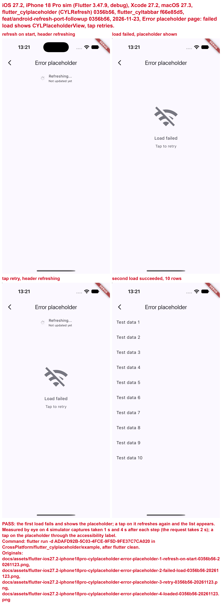

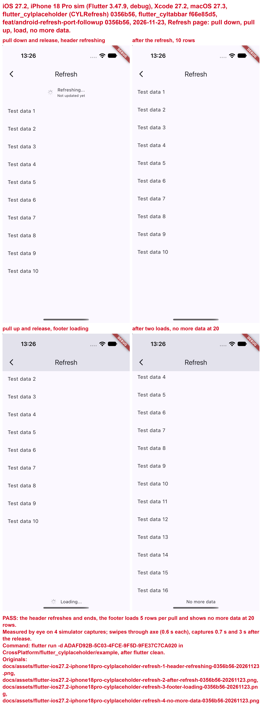

**Native iOS half (2026-11-24, commit `aca2e528`).** The two pages above were the Dart fallback. This sheet is the new iOS plugin (`CrossPlatform/flutter_cylplaceholder/ios`): the Error placeholder page and the Placeholder stack page draw UIKit views through `UiKitView`, and the Retry button's tap comes back over the method channel and shows the native HUD. `axe describe-ui` lists `platform_view[0]` holding the accessibility identifier `cyl.native.placeholderStack` (native children `CYLPlaceholderCloudOff`, the buttons) and `platform_view[1]` holding the native placeholder (label "Load failed\nTap to retry"); the Dart fallback has no `platform_view` node. "Play all" changed 255 x 255 pixels of the icon between captures 0.3 s apart, so the native Lottie plays.

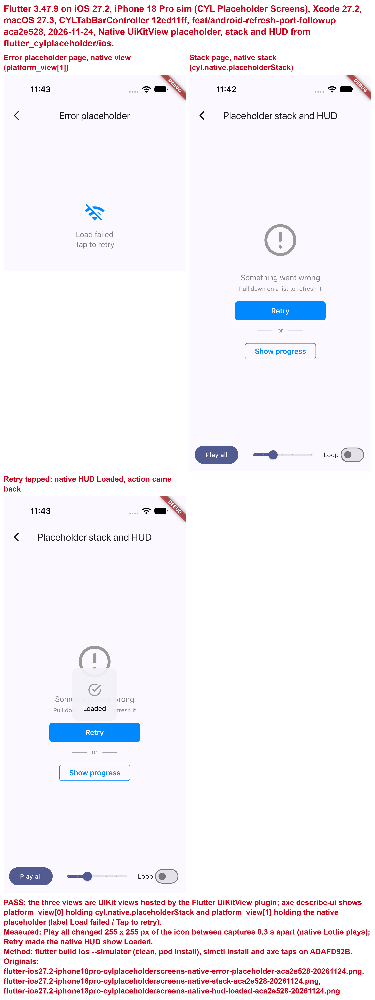

## flutter_easy_refresh 示例复刻 / flutter_easy_refresh demo port

| 中文 | English |
| --- | --- |
| flutter_easy_refresh 的 `example/lib/page`（`dcdbb81`）移植到 Example-Scenarios（Swift）：样式页并入已有的 CYLRefresh 样式区，其余页面在“刷新 › flutter_easy_refresh 示例”，由 `CYLEasyRefreshDemoViewController` 按方法名实现，示例只传数据、选项与点击，控件都来自核心。 | flutter_easy_refresh's `example/lib/page` (`dcdbb81`) ported to Example-Scenarios (Swift): the style pages joined the existing CYLRefresh styles section; the other pages are under "Refresh › flutter_easy_refresh samples", implemented by `CYLEasyRefreshDemoViewController` per method name; the example passes only data, options and taps, and every control comes from the core. |

| 原页面 / Page | 内容 / Content | 本项目 / Here | 状态 / Status |
| --- | --- | --- | --- |
| `style/classical_page` | 经典样式 / classic | CYLRefresh 样式 › Classics、Classics footer | ✅ |
| `style/material_page` | Material | CYLRefresh 样式 › Material、Material footer | ✅ |
| `style/bezier_page` | Bezier | CYLRefresh 样式 › BezierRadar、BezierRadar footer | ✅ |
| `style/bezier_circle_page` | BezierCircle | CYLRefresh 样式 › BezierCircle | ✅ |
| `style/delivery_page / phoenix_page / taurus_page` | Delivery / Phoenix / Taurus | CYLRefresh 样式 › 对应刷新头与刷新尾 / the matching headers and footers | ✅ |
| `style/bow_page … squats_page（6 页 / 6 pages）` | Rive 样式 / Rive styles | CYLRefresh 样式 › Rive · …（6 个刷新头 + Space 刷新尾） | ✅ |
| `style/cupertino_page` | Cupertino | flutter_easy_refresh 示例 › Cupertino 样式 / Cupertino style | ✅ |
| `sample/secondary_page` | 二楼 / second floor | flutter_easy_refresh 示例 › 二楼 / Second floor | ✅ |
| `sample/trigger_mode_page` | 触发模式 / trigger mode | flutter_easy_refresh 示例 › 触发模式 / Trigger mode。在 App 中验证：刷新头设为只从边缘触发后，从列表中间开始一路拉过顶部不刷新（次数保持 4），从顶部边缘开始的下拉会刷新 / checked in the app: with the header set to the edge only, a drag that starts mid-list and goes past the top does not refresh (the count stays 4); a drag from the top edge does | ✅ |
| `sample/refresh_on_start_page` | 首次刷新专用刷新头 / start header | flutter_easy_refresh 示例 › 启动时刷新 / Refresh on start。修复：用 `attach:target:action:`（`addTarget:action:`）设置回调时，起始刷新头没有复制这类回调，于是一直刷新、常规刷新头无法换回；现在一并复制（`testStartHeaderInPushedTableViewController`） / fixed: callbacks set with `attach:target:action:` (`addTarget:action:`) were not copied to the start header, so it never ended and the regular header never came back; they are copied now | ✅ |
| `sample/paging_page` | easy_paging | flutter_easy_refresh 示例 › 分页 / Paging（`CYLRefreshPaging`） | ✅ |
| `sample/listener_header_page` | 监听式刷新头 / listener header | flutter_easy_refresh 示例 › 监听式刷新头 / Listener header | ✅ |
| `sample/chat_page` | 聊天：顶部加载更早消息 / chat: earlier messages at the top | flutter_easy_refresh 示例 › 聊天 / Chat | ✅ |
| `sample/user_profile_page` | 指示器在内容后面 / indicator behind the content | flutter_easy_refresh 示例 › 个人主页 / User profile（`CYLRefreshScrollModeBehind`） | ✅ |
| `sample/theme_switch_page` | 切换主题 / theme switch | CYLRefresh 样式页的主题行 / the theme rows of the CYLRefresh styles pages | ✅ |
| `sample/carousel_page / page_view_page / tab_bar_view_page` | 横向翻页里的刷新 / refresh inside horizontal pages | 不适用：每页是独立的 UIScrollView，各自挂控件即可；横向拉动用已有的 `CYLRefreshTrailer`（示例 42） / not applicable: each page is its own UIScrollView with its own controls; horizontal pulls use the existing `CYLRefreshTrailer` (example 42) | 不适用 / N/A |
| `sample/nested_scroll_view / easy_refresh_nested_page / nested_secondary_page` | 嵌套滚动 / nested scrolling | 不适用：UIKit 没有 NestedScrollView（对照表同一行） / not applicable: UIKit has no NestedScrollView (same row in the table) | 不适用 / N/A |
| `sample/center_refresh_page` | 空列表居中显示指示器 / indicator centred in an empty list | 不适用：空列表由本库的占位图显示 / not applicable: this library's placeholder shows empty lists | 不适用 / N/A |
| `sample/test_page、more/*` | 开发测试页、关于 / 赞助 / 主题等 App 页面 / developer test page and the app's about, support and theme pages | 不移植：不是刷新功能 / not ported: not refresh features | 不适用 / N/A |

## flutter_easy_refresh 示例截图 / flutter_easy_refresh demo screenshots

| 中文 | English |
| --- | --- |
| 示例 App 实拍（2026-11-13 02:11–04:47，NZDT；iOS 27.2 模拟器 iPhone 17 Pro，24B5089g；macOS 27.3、Xcode 27.2、iOS SDK 27.2；分支 `an earlier parity branch`，基于 `7e9a9ef` 及本次修复）：从上到下依次为 Cupertino 样式、二楼（右：二楼打开，刷新头文字不再盖在上面）、触发模式（左：从边缘下拉后刷新次数 2；右：只从边缘触发时，从列表中间拉过顶部，次数保持 4）、启动时刷新（第一次用 Cupertino 刷新头，之后的下拉换回经典刷新头）、分页、监听式刷新头（列表上方的进度条）、聊天（在顶部加载更早的消息）、个人主页（刷新头在内容后面）。左列为手指按住下拉，右列为松手后（触发模式除外）。原图未缩小，只裁剪到上半屏。 | Example app captures (2026-11-13 02:11–04:47, NZDT; iOS 27.2 simulator, iPhone 17 Pro, 24B5089g; macOS 27.3, Xcode 27.2, iOS SDK 27.2; branch `an earlier parity branch`, on `7e9a9ef` with this change's fixes): top to bottom Cupertino style, second floor (right: open, the header's text no longer over it), trigger mode (left: refresh count 2 after pulls from the edge; right: edge only, a drag from mid-list past the top leaves it at 4), refresh on start (the first refresh uses the Cupertino header, later pulls the classic one), paging, listener header (the bar above the list), chat (earlier messages loaded at the top), user profile (the header behind the content). Left, finger down while pulling; right, after the release (trigger mode aside). Originals, not downscaled, cropped to the top of the screen. |

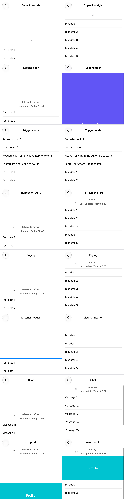

## flutter_easy_refresh 刷新尾截图 / flutter_easy_refresh footer screenshots

| 中文 | English |
| --- | --- |
| 5 个手绘刷新尾的渲染（2026-11-12 23:05，NZDT）：左列为上拉到展开高度的 80%（手指按住），右列为加载中；从上到下依次为 BezierRadar、Material、Delivery、Phoenix、Taurus。由 `testDrawnFooterSnapshots` 在 iOS 27.2 模拟器（iPhone 17 Pro，24B5089g；macOS 27.3、Xcode 27.2、iOS SDK 27.2）上把窗口图层渲染成 PNG，基于 `a890e12` 的工作区（含本次的 `CYLRefreshDrawnFooter`），原图未缩小，只裁剪了列表底部。机器负载过高（load average 约 700），通过 UI 点击进入示例页截图不稳定，所以用测试渲染；示例页（刷新 › CYLRefresh 样式 › 各 footer 行）使用同一套控件。 | The 5 drawn footers rendered (2026-11-12 23:05, NZDT): left, pulled up to 80 % of the open height (finger down); right, loading; top to bottom BezierRadar, Material, Delivery, Phoenix, Taurus. `testDrawnFooterSnapshots` renders the window's layer to PNG on the iOS 27.2 simulator (iPhone 17 Pro, 24B5089g; macOS 27.3, Xcode 27.2, iOS SDK 27.2), on the `a890e12` working tree with this change's `CYLRefreshDrawnFooter`; originals, not downscaled, cropped to the bottom of the list. The machine was overloaded (load average about 700) and driving the example app through taps was unreliable, so the test renders them; the example page (Refresh › CYLRefresh styles › the footer rows) uses the same controls. |

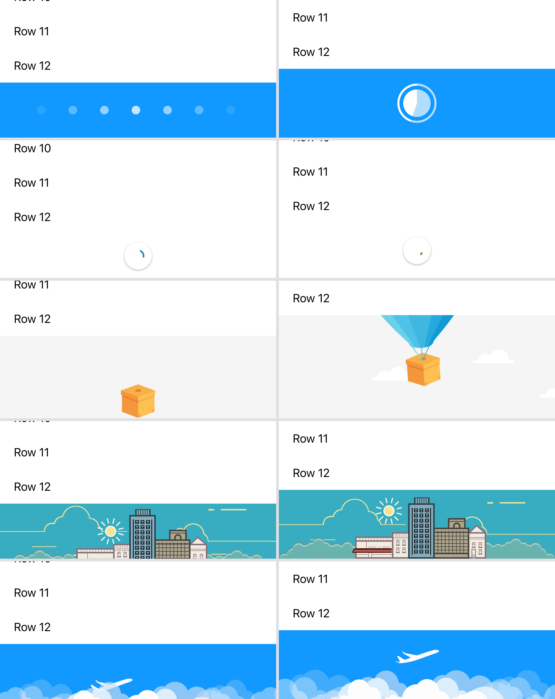

| 中文 | English |
| --- | --- |
| 示例 App 实拍（2026-11-12 23:40–23:55，NZDT；同一模拟器与环境；分支 `an earlier parity branch`，基于 `3c4ec11`）：刷新 › CYLRefresh 样式 › 各 footer 页面，手指按住上拉约 600 点时的截图，从上到下依次为 BezierRadar、Material、Delivery、Phoenix、Taurus，五个页面的导航标题都已核对。通过无障碍标签点击（`axe tap --label`）进入页面。加载中的样子以上面的测试渲染为准：机器负载过高，每张模拟器截图要数秒，松手后的 2.5 秒加载在截图前就已结束（只有 Material 拍到了加载中，与渲染一致）。 | Example app captures (2026-11-12 23:40–23:55, NZDT; same simulator and environment; branch `an earlier parity branch`, on `3c4ec11`): Refresh › CYLRefresh styles › each footer page, with the finger down after an upward pull of about 600 points; top to bottom BezierRadar, Material, Delivery, Phoenix, Taurus, each page's navigation title checked. Pages were opened by tapping accessibility labels (`axe tap --label`). For the loading look, the test renders above are the evidence: the machine was overloaded, each simulator screenshot took seconds, and the 2.5-second load after the release ended before the screenshot (only Material was caught loading, matching the render). |

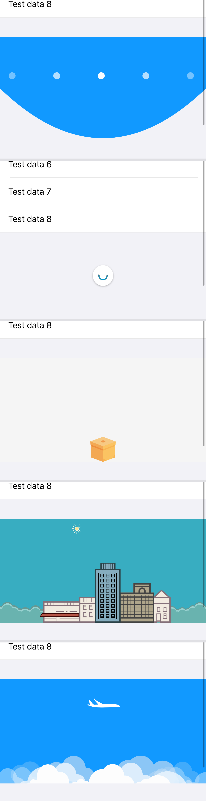

## flutter_easy_refresh Rive 样式截图 / flutter_easy_refresh Rive style screenshots

| 中文 | English |
| --- | --- |
| 示例 App 实拍（2026-11-13 01:00–01:12，NZDT；iOS 27.2 模拟器 iPhone 17 Pro，24B5089g；macOS 27.3、Xcode 27.2、iOS SDK 27.2；分支 `an earlier parity branch`，基于 `f38ce49`）：刷新 › CYLRefresh 样式 › Rive 各行。左列为手指按住下拉时，右列为松手后加载中；从上到下依次为 Bow、Bubbles、Halloween、Skating、Space、Squats，最后一行是 Space 刷新尾（上拉）。每张都核对了导航标题；通过无障碍标签点击进入页面。原图未缩小，只裁剪到刷新区域。 | Example app captures (2026-11-13 01:00–01:12, NZDT; iOS 27.2 simulator, iPhone 17 Pro, 24B5089g; macOS 27.3, Xcode 27.2, iOS SDK 27.2; branch `an earlier parity branch`, on `f38ce49`): Refresh › CYLRefresh styles › the Rive rows. Left, finger down while pulling; right, loading after the release; top to bottom Bow, Bubbles, Halloween, Skating, Space, Squats, and last the Space footer (pulled up). Each navigation title was checked; pages were opened by tapping accessibility labels. Originals, not downscaled, cropped to the refresh area. |

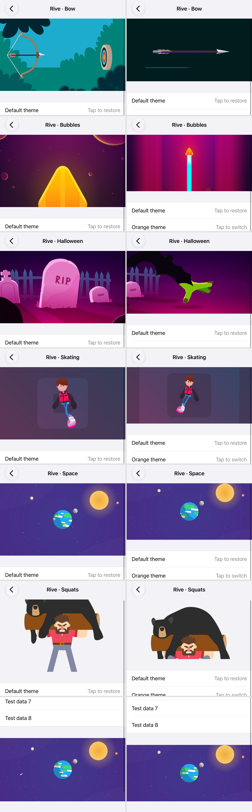

## 外部项目的 open PR 与 issue / Open pull requests and issues of the source projects

| 中文 | English |
| --- | --- |
| 规则见 `instructions.md` 的 “Translating or porting another project”（2026-11-12）：移植前后合并来源项目的 open PR，并把 open issue 列成表格、在本项目中修复、逐个打分到 100；未开始翻译时 issue 达到 60 分即可开始。查询时间：2026-11-12。 | The rule is "Translating or porting another project" in `instructions.md` (2026-11-12): bring in the source's open pull requests before or after porting, list its open issues, fix them here and rescore after each until 100; a translation not yet started may start at 60. Checked on 2026-11-12. |
| CYLRefresh styles：0 个 open PR，0 个 open issue，**100/100**。 | CYLRefresh styles: 0 open pull requests, 0 open issues, **100/100**. |
| flutter_easy_refresh：0 个 open PR；4 个 open issue，**100/100**（2 个不适用；#631 已用测试验证；#752 设计上可用，未用真实触控板验证；此前 50/100）。 | flutter_easy_refresh: 0 open pull requests; 4 open issues, **100/100** (2 do not apply; #631 verified by a test; #752 works by design, not tried with a real trackpad; 50/100 before). |
| SVPullToRefresh（43 个 open PR、103 个 open issue）、CYLRefreshLayout（5 个、337 个）、android-Ultra-Pull-To-Refresh（23 个、151 个）：在各自任务开始时建表（按任务顺序排在后面）。 | SVPullToRefresh (43 open pull requests, 103 open issues), CYLRefreshLayout (5, 337) and android-Ultra-Pull-To-Refresh (23, 151): tables when their tasks start (later in the task order). |

| flutter_easy_refresh issue | 描述 / Description | 状态 / Status |
| --- | --- | --- |
| <https://github.com/xuelongqy/flutter_easy_refresh/issues/752> | macOS 上双指滚动在列表中可用，在 EasyRefresh 中不可用。本项目对应：iPad 触控板 / 鼠标与 Mac（Designed for iPad / Catalyst）上的间接指针滚动能否触发刷新与加载。 / Two-finger scrolling works in a list but not in EasyRefresh on macOS. Counterpart here: whether indirect-pointer scrolling (iPad trackpad / mouse, Mac "Designed for iPad" / Catalyst) triggers refresh and loading. | 已处理（设计上可用，未用真实触控板验证） / Handled (works by design, not tried with a real trackpad)：UIKit 把触控板双指滚动交给滚动视图自己的 pan 手势，`isDragging` 为 YES、有越界回弹，与手指拖动走同一条路径，刷新头、返回式尾与自动加载尾都由现有拖动测试覆盖；模拟器自动化（axe）不能发送滚动事件，所以没有用真实触控板试过 / UIKit routes two-finger trackpad scrolling through the scroll view's own pan gesture (`isDragging` YES, rubber-banding), the same path as a finger drag, which the existing drag tests cover for the header, back footer and auto footer; simulator automation (axe) cannot send scroll events, so a real trackpad was not tried |
| <https://github.com/xuelongqy/flutter_easy_refresh/issues/631> | Web 上鼠标滚轮不能触发加载更多，只能拖拽。本项目对应：滚轮 / 触控板滚动到底部时自动加载尾是否触发（自动加载尾按偏移触发、不要求拖动，预计可用，待验证）。 / On the web a mouse wheel does not trigger load more, only a drag does. Counterpart here: whether the auto footer triggers when a wheel or trackpad scrolls to the end (it triggers on the offset without requiring a drag, so it should work; to verify). | ✅ 已验证（`testAutoFooterLoadsWhenWheelReachesBottom`，`afb5735` 之后的提交） / Verified (`testAutoFooterLoadsWhenWheelReachesBottom`, in the commit after `afb5735`)：滚轮只移动偏移、不拖动也不越界；自动加载尾按偏移触发，到底部即加载。返回式尾与下拉刷新头需要越界再松手，滚轮做不到（与系统 `UIRefreshControl` 相同），用鼠标的页面应使用自动加载尾 / a wheel only moves the offset, with no drag and no overscroll; the auto footer triggers on the offset and loads at the bottom. The back footer and the pull-down header need an overscroll and a release, which a wheel cannot give (as with the system `UIRefreshControl`), so pages used with a mouse should use the auto footer |
| <https://github.com/xuelongqy/flutter_easy_refresh/issues/145> | 置顶说明：如何提一条有用的 issue（英文）。 / Pinned note: how to write a useful issue (English). | 不适用（不是缺陷） / Does not apply (not a defect) |
| <https://github.com/xuelongqy/flutter_easy_refresh/issues/144> | 置顶说明：如何提一条有用的 issue（中文）。 / Pinned note: how to write a useful issue (Chinese). | 不适用（不是缺陷） / Does not apply (not a defect) |
