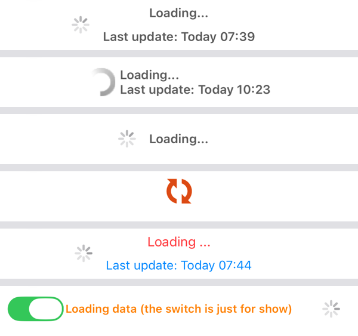
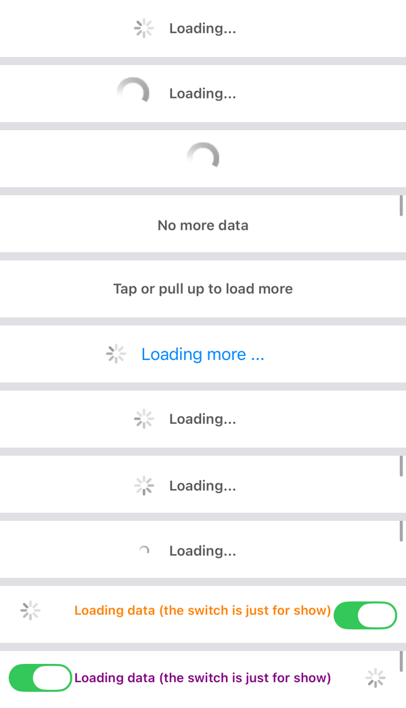
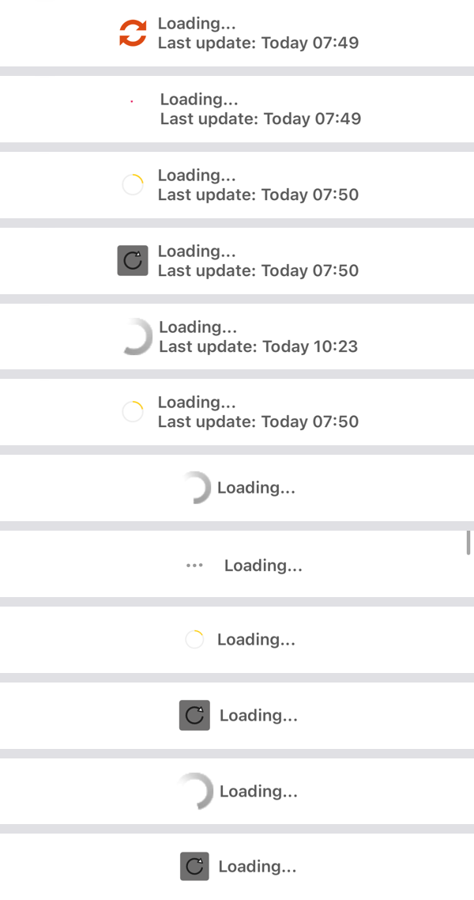
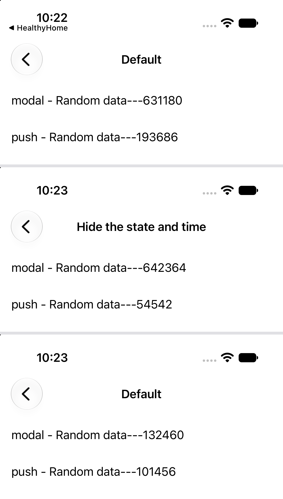
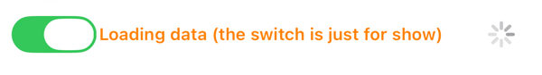
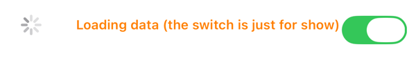
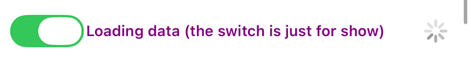
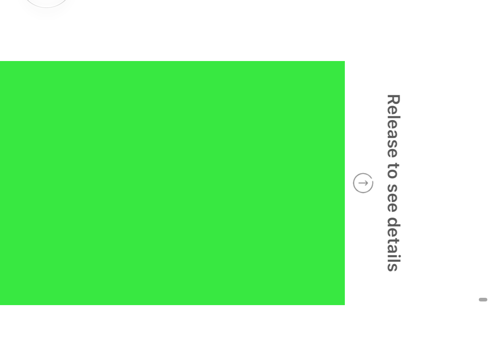

# CYLRefresh 刷新样式与行为参考 / CYLRefresh styles and behavior reference

<!-- bound-classes: CYLRefreshComponent, CYLRefreshHeader, CYLRefreshFooter -->

<!-- docs-navigation:start -->

| 中文 | English |
| --- | --- |
| [内置刷新组件](#内置刷新组件--built-in-refresh-components) | [Built-in refresh components](#内置刷新组件--built-in-refresh-components) |

<!-- docs-navigation:end -->

<!-- docs-binding:start -->

| 类 / Class | 头文件 / Header |
| --- | --- |
| `CYLRefreshComponent` | [`CYLTableViewPlaceHolder/CYLRefresh/Base/CYLRefreshComponent.h`](../CYLTableViewPlaceHolder/CYLRefresh/Base/CYLRefreshComponent.h) |
| `CYLRefreshHeader` | [`CYLTableViewPlaceHolder/CYLRefresh/Base/CYLRefreshHeader.h`](../CYLTableViewPlaceHolder/CYLRefresh/Base/CYLRefreshHeader.h) |
| `CYLRefreshFooter` | [`CYLTableViewPlaceHolder/CYLRefresh/Base/CYLRefreshFooter.h`](../CYLTableViewPlaceHolder/CYLRefresh/Base/CYLRefreshFooter.h) |

<!-- docs-binding:end -->

| 中文 | English |
| --- | --- |
| 自 README 移入（2026-11-20）的 CYLRefresh 参考：全部刷新样式与截图（下拉刷新 01–06、上拉加载 01–11、UICollectionView、WKWebView、刷新图标动画）、动画图片、国际化与资源包、刷新组件的行为。示例代码为 Swift。 | CYLRefresh reference moved from the README (2026-11-20): every refresh style with its screenshot (pull-down refresh 01–06, pull-up loading 01–11, UICollectionView, WKWebView, refresh icon animations), animated images, localization and the resource bundle, and the refresh component behavior. Sample code is Swift. |

## 内置刷新组件 / Built-in refresh components

| 中文 | English |
| --- | --- |
| `CYLRefresh` 源码位于 `CYLTableViewPlaceHolder/CYLRefresh/`，可直接修改，无需安装额外的刷新 Pod。导入 `CYLTableViewPlaceHolder.h` 后： | The `CYLRefresh` source is in `CYLTableViewPlaceHolder/CYLRefresh/` and can be modified directly; no extra refresh pod is needed. After importing `CYLTableViewPlaceHolder.h`: |

```swift
tableView.cyl_header = CYLRefreshNormalHeader { [weak self] in
    // [CN] 加载数据，完成后调用 endRefreshing
    // [EN] Load the data, then call endRefreshing when done
    self?.loadNewData()
}
tableView.cyl_footer = CYLRefreshAutoNormalFooter { [weak self] in
    // [CN] 加载更多数据，完成后调用 endRefreshing
    // [EN] Load more data, then call endRefreshing when done
    self?.loadMoreData()
}
```

| 中文 | English |
| --- | --- |
| `CYLRefresh` 的类名使用 `CYL` 前缀，分类属性和方法使用 `cyl_`（如 `cyl_header`、`cyl_footer`）。使用源码手动集成时，除所有 `.h`、`.m` 外，还须将 `CYLRefresh` 目录及其子目录加入 Header Search Paths，并复制 `CYLTableViewPlaceHolder.bundle`、`PrivacyInfo.xcprivacy`、`LICENSE.third-party` 和 `LICENSE.refresh-third-party.txt` 到应用资源。静态库集成需要使用 `-ObjC` 链接分类。 | `CYLRefresh` classes use the `CYL` prefix, and category properties and methods use `cyl_` (such as `cyl_header` and `cyl_footer`). For manual source integration, besides all `.h` and `.m` files, add the `CYLRefresh` directory and its subdirectories to Header Search Paths, and copy `CYLTableViewPlaceHolder.bundle`, `PrivacyInfo.xcprivacy`, `LICENSE.third-party` and `LICENSE.refresh-third-party.txt` into the app's resources. Static library integration needs `-ObjC` to link the categories. |

### 刷新样式一览 / All refresh styles

| 中文 | English |
| --- | --- |
| 本节列出全部样式（顺序与 CYLRefresh 改编自的 [MJRefresh](https://github.com/CoderMJLee/MJRefresh) 的 README 相同）。每个样式都对应 `Examples/Example-Scenarios` 的“刷新”页中的一个示例（`exampleNN`），截图是该示例在 iOS 27 模拟器上运行时、处于刷新中状态的控件。示例代码为 Swift，见 `Sources/CYLRefreshTableViewController.swift`；下文用 Objective-C 写出同样的调用。 | This section lists every style (in the order of the README of [MJRefresh](https://github.com/CoderMJLee/MJRefresh), which CYLRefresh is adapted from). Each style is one example (`exampleNN`) on the "Refresh" page of `Examples/Example-Scenarios`; each screenshot shows that example's control while refreshing, running on an iOS 27 simulator. The examples are Swift (`Sources/CYLRefreshTableViewController.swift`); the calls below are the same in Objective-C. |
| 一览：下拉刷新 01–06、上拉加载 01–11、刷新图标动画（每组从上到下）。 | Overview: pull-down refresh 01–06, pull-up loading 01–11, refresh icon animations (each group from top to bottom). |







| 中文 | English |
| --- | --- |
| 刷新结束自动隐藏刷新头（`autoHideRefresh`）：iOS 26 起导航栏默认是透明的玻璃效果，收回后的刷新头正好在导航栏下方，会透过导航栏显示在标题上。开启后，刷新头只在有动作时显示（下拉、刷新中、刷新结束后的收回），刷新结束、空闲且完全收回后自动隐藏；刷新尾同样只在上拉、加载、收回时显示，空闲（或显示“无更多数据”）且完全位于底部栏下方时隐藏，避免透过玻璃 tab bar 显示。刷新头与刷新尾各有开关（`header.autoHideRefresh`、`footer.autoHideRefresh`），也可以在滚动视图上分开或一起设置：`cyl_autoHideRefreshHeader`、`cyl_autoHideRefreshFooter`、`cyl_autoHideRefresh`（挂上控件之前设置也会生效）；`hidden`、`alpha` 与 `automaticallyChangeAlpha` 不受影响。在导航栏默认透明的系统上（iOS 26 及以后）默认开启，与 MJRefresh 不同；更早的系统默认关闭，需要时手动设为 YES。下图从上到下：example01、04、11 刷新结束后的导航栏。 | Auto-hide after refreshing (`autoHideRefresh`): since iOS 26 the navigation bar is transparent glass by default, and a retracted header sits right under it, showing through over the title. When on, the header shows only while an action is under way (pulling, refreshing, retracting after the refresh) and hides again once the refresh has ended and it is idle and fully retracted; the footer likewise shows only while pulled, loading or retracting, and hides when it is idle (or shows "no more data") and lies wholly below the bottom bars, so it no longer shows through a glass tab bar. Headers and footers have their own switch (`header.autoHideRefresh`, `footer.autoHideRefresh`), also settable on the scroll view, separately or together: `cyl_autoHideRefreshHeader`, `cyl_autoHideRefreshFooter`, `cyl_autoHideRefresh` (a value set before attaching applies when the control is attached); `hidden`, `alpha` and `automaticallyChangeAlpha` are untouched. On by default where the navigation bar is transparent by default (iOS 26 and later), unlike MJRefresh; off by default on earlier systems, where you set it to YES yourself. Below, top to bottom: the navigation bar of example01, 04 and 11 after the refresh ends. |

```swift
// [CN] iOS 26 之前的系统上手动开启：刷新结束后自动隐藏刷新头
// [EN] Turn it on yourself before iOS 26: the header hides once the refresh ends
tableView.cyl_header?.autoHideRefresh = true
// [CN] 刷新头、刷新尾分开或一起设置（挂上控件之前设置也会生效）
// [EN] Header and footer separately or together (also before the controls are attached)
tableView.cyl_autoHideRefreshHeader = true
tableView.cyl_autoHideRefreshFooter = false
tableView.cyl_autoHideRefresh = true
// [CN] 恢复 MJRefresh 的行为：收回后的刷新头保持可见
// [EN] MJRefresh's behavior: the retracted header stays visible
tableView.cyl_header?.autoHideRefresh = false
```



#### 下拉刷新 01：默认 / Pull-down refresh 01: Default

```swift
tableView.cyl_header = CYLRefreshNormalHeader { [weak self] in
    // [CN] 进入刷新状态后会自动调用这个闭包
    // [EN] Called automatically once the control enters the refreshing state
    self?.loadNewData()
}
// [CN] 或者：进入刷新状态后调用 target 的 action，即 loadNewData
// [EN] Or: once it enters the refreshing state, call the target's action, that is loadNewData
tableView.cyl_header = CYLRefreshNormalHeader(refreshingTarget: self, refreshingAction: #selector(loadNewData))

// [CN] 马上进入刷新状态
// [EN] Enter the refreshing state right away
tableView.cyl_header?.beginRefreshing()
```


#### 下拉刷新 02：GIF 帧图片 / Pull-down refresh 02: GIF frame images

| 中文 | English |
| --- | --- |
| 用法与通用名称见下文“[下拉刷新 02：动画图片](#下拉刷新-02动画图片--pull-down-refresh-02-animated-images)”。示例的图片取自本库内置刷新 GIF 的帧。 | For the usage and the general names, see "[Pull-down refresh 02: animated images](#下拉刷新-02动画图片--pull-down-refresh-02-animated-images)" below. The example's images are frames of this library's bundled refresh GIFs. |

```swift
let header = CYLRefreshGifHeader(refreshingTarget: self, refreshingAction: #selector(loadNewData))
header.setImages(idleImages, for: .idle)
header.setImages(pullingImages, for: .pulling)
header.setImages(refreshingImages, for: .refreshing)
tableView.cyl_header = header
```


#### 下拉刷新 03：隐藏时间 / Pull-down refresh 03: Hide the time

```swift
// [CN] 隐藏时间
// [EN] Hide the time
header.lastUpdatedTimeLabel.isHidden = true
```


#### 下拉刷新 04：隐藏状态和时间 / Pull-down refresh 04: Hide the state and time

```swift
// [CN] 隐藏时间
// [EN] Hide the time
header.lastUpdatedTimeLabel.isHidden = true
// [CN] 隐藏状态
// [EN] Hide the state
header.stateLabel.isHidden = true
```


#### 下拉刷新 05：自定义文字 / Pull-down refresh 05: Custom text

```swift
// [CN] 设置文字
// [EN] The texts
header.setTitle("Pull down to refresh", for: .idle)
header.setTitle("Release to refresh", for: .pulling)
header.setTitle("Loading ...", for: .refreshing)
// [CN] 设置字体
// [EN] The fonts
header.stateLabel.font = .systemFont(ofSize: 15)
header.lastUpdatedTimeLabel.font = .systemFont(ofSize: 14)
// [CN] 设置颜色
// [EN] The colors
header.stateLabel.textColor = .red
header.lastUpdatedTimeLabel.textColor = .blue
```


#### 下拉刷新 06：自定义刷新控件 / Pull-down refresh 06: Custom refresh control

```swift
tableView.cyl_header = CYLRefreshDIYHeader(refreshingTarget: self, refreshingAction: #selector(loadNewData))
// [CN] 实现见示例中的 CYLRefreshDIYControls.swift（CYLRefreshHeader 的子类）
// [EN] See CYLRefreshDIYControls.swift in the example (a subclass of CYLRefreshHeader)
```



#### 上拉加载 01：默认 / Pull-up loading 01: Default

```swift
tableView.cyl_footer = CYLRefreshAutoNormalFooter { [weak self] in
    // [CN] 进入刷新状态后会自动调用这个闭包
    // [EN] Called automatically once the control enters the refreshing state
    self?.loadMoreData()
}
// [CN] 或者：进入刷新状态后调用 loadMoreData
// [EN] Or: call loadMoreData once it enters the refreshing state
tableView.cyl_footer = CYLRefreshAutoNormalFooter(refreshingTarget: self, refreshingAction: #selector(loadMoreData))
```


#### 上拉加载 02：动画图片 / Pull-up loading 02: Animated images

```swift
let footer = CYLRefreshAutoGifFooter(refreshingTarget: self, refreshingAction: #selector(loadMoreData))
// [CN] 刷新中状态的动画图片
// [EN] The animated images of the refreshing state
footer.setImages(refreshingImages, for: .refreshing)
tableView.cyl_footer = footer
```


#### 上拉加载 03：隐藏刷新状态的文字 / Pull-up loading 03: Hide the refreshing text

```swift
// [CN] 隐藏刷新中状态的文字
// [EN] Hide the text of the refreshing state
footer.isRefreshingTitleHidden = true
```


#### 上拉加载 04：全部加载完毕 / Pull-up loading 04: Everything loaded

```swift
// [CN] 变为没有更多数据的状态；resetNoMoreData 恢复
// [EN] Switch to the no-more-data state; resetNoMoreData switches back
footer.endRefreshingWithNoMoreData()
```


#### 上拉加载 05：禁止自动加载 / Pull-up loading 05: No automatic loading

```swift
// [CN] 只有点击或拉动才加载
// [EN] Loads only on a tap or a pull
footer.isAutomaticallyRefresh = false
```


#### 上拉加载 06：自定义文字 / Pull-up loading 06: Custom text

```swift
footer.setTitle("Tap or pull up to load more", for: .idle)
footer.setTitle("Loading more ...", for: .refreshing)
footer.setTitle("No more data", for: .noMoreData)
footer.stateLabel.font = .systemFont(ofSize: 17)
footer.stateLabel.textColor = .blue
```


#### 上拉加载 07：加载后隐藏 / Pull-up loading 07: Hide after loading

```swift
// [CN] 隐藏上拉加载控件
// [EN] Hide the pull-up control
tableView.cyl_footer?.isHidden = true
```


#### 上拉加载 08：自动回弹 01 / Pull-up loading 08: Springing back 01

```swift
tableView.cyl_footer = CYLRefreshBackNormalFooter(refreshingTarget: self, refreshingAction: #selector(loadMoreData))
// [CN] 底部 inset 不计入控件位置
// [EN] A bottom inset that the footer ignores
tableView.contentInset = UIEdgeInsets(top: 0, left: 0, bottom: 30, right: 0)
tableView.cyl_footer?.ignoredScrollViewContentInsetBottom = 30
```


#### 上拉加载 09：自动回弹 02 / Pull-up loading 09: Springing back 02

```swift
let footer = CYLRefreshBackGifFooter(refreshingTarget: self, refreshingAction: #selector(loadMoreData))
footer.setImages(idleImages, for: .idle)
footer.setImages(pullingImages, for: .pulling)
footer.setImages(refreshingImages, for: .refreshing)
tableView.cyl_footer = footer
```


#### 上拉加载 10：自定义控件（自动加载） / Pull-up loading 10: Custom control (loads automatically)

```swift
tableView.cyl_footer = CYLRefreshDIYAutoFooter(refreshingTarget: self, refreshingAction: #selector(loadMoreData))
// [CN] CYLRefreshAutoFooter 的子类，见 CYLRefreshDIYControls.swift
// [EN] A subclass of CYLRefreshAutoFooter; see CYLRefreshDIYControls.swift
```



#### 上拉加载 11：自定义控件（自动回弹） / Pull-up loading 11: Custom control (springs back)

```swift
tableView.cyl_footer = CYLRefreshDIYBackFooter(refreshingTarget: self, refreshingAction: #selector(loadMoreData))
// [CN] CYLRefreshBackFooter 的子类，见 CYLRefreshDIYControls.swift
// [EN] A subclass of CYLRefreshBackFooter; see CYLRefreshDIYControls.swift
```



#### UICollectionView 01：上下拉刷新 / UICollectionView 01: Pull down and up

```swift
collectionView.cyl_header = CYLRefreshNormalHeader {
    // [CN] 下拉刷新
    // [EN] Pull down
}
collectionView.cyl_footer = CYLRefreshBackNormalFooter {
    // [CN] 上拉加载
    // [EN] Pull up
}
```


#### UICollectionView 02：左拉刷新 / UICollectionView 02: Pull left

```swift
collectionView.cyl_trailer = CYLRefreshNormalTrailer {
    // [CN] 拉过最后一页后松手
    // [EN] Pull past the last page and release
}
```

| 中文 | English |
| --- | --- |
| 状态文字是箭头右侧的竖列，任何语言都完整、可读：中日韩文字放得下时与 MJRefresh 一样逐字竖排、保持正立；英文、俄文等文字（或放不下的中日韩文字）顺时针旋转 90° 从上往下读，过长时换行而不是截断（MJRefresh 一个字宽的竖列会把英文单词逐字母拆开并截断）。自定义 trailer 可调用 `-cyl_placeStateLabelAtCenterX:` 使用同样的排版。下图：拉过最后一页时显示完整的 “Release to see details”。 | The state text is a vertical column right of the arrow, complete and readable in every language: CJK text stands upright one character per line, as in MJRefresh, when it fits; English, Russian and other text (or CJK text that does not fit) is rotated 90° clockwise to read top to bottom, and wraps instead of being cut off (MJRefresh's one-character-wide column splits English words letter by letter and cuts them off). Custom trailers get the same layout from `-cyl_placeStateLabelAtCenterX:`. Below: the full "Release to see details" past the last page. |



#### WKWebView 01：下拉刷新 / WKWebView 01: Pull-down refresh

```swift
webView.scrollView.cyl_header = CYLRefreshNormalHeader { [weak self] in
    self?.webView.reload()
}
```


#### 刷新图标动画：GIF、Lottie、PAG、Rive / Refresh icon animations: GIF, Lottie, PAG, Rive

| 中文 | English |
| --- | --- |
| MJRefresh 没有这一组。动画图片控件（`CYLRefreshAnimationHeader`、`CYLRefreshAutoAnimationFooter`、`CYLRefreshBackAnimationFooter`，即 GIF 类控件，不是箭头样式的 `CYLRefreshNormalHeader`）可以显示本库内置的 GIF、Lottie、PAG、Rive 动画。图标和状态文字放在同一个 `CYLPlaceholderView` 中，作为一个整体居中，所以图标和文字不会错位。用法见下文“[下拉刷新 02：动画图片](#下拉刷新-02动画图片--pull-down-refresh-02-animated-images)”和 [Refresh-Icon-Animation.md](Refresh-Icon-Animation.md)。 | MJRefresh has no such group. The animated-image controls (`CYLRefreshAnimationHeader`, `CYLRefreshAutoAnimationFooter`, `CYLRefreshBackAnimationFooter`: the GIF controls, not the arrow `CYLRefreshNormalHeader`) can show the library's bundled GIF, Lottie, PAG and Rive animations. The icon and the state text are in one `CYLPlaceholderView` and centered as one, so they cannot drift apart. For the usage, see "[Pull-down refresh 02: animated images](#下拉刷新-02动画图片--pull-down-refresh-02-animated-images)" below and [Refresh-Icon-Animation.md](Refresh-Icon-Animation.md). |

| 示例 | 下拉刷新 | 上拉加载 |
| --- | --- | --- |
| example51：GIF 图标 |  |  |
| example52：每个状态一个 Lottie 图标 |  |  |
| example53：PAG 进度环 |  |  |
| example54：Rive 刷新图标 |  |  |
| example55：`setImages` 使用 GIF 帧 |  |  |
| example56：每个状态换一种引擎 |  |  |

| Example | Pull-down refresh | Pull-up loading |
| --- | --- | --- |
| example51: a GIF icon |  |  |
| example52: a Lottie icon for each state |  |  |
| example53: the PAG progress ring |  |  |
| example54: the Rive refresh icon |  |  |
| example55: `setImages` with GIF frames |  |  |
| example56: a different engine for each state |  |  |

| 中文 | English |
| --- | --- |
| example54 的 Rive 图标（`CYLRefreshIcon.riv`）在透明背景上旋转：来源与许可证见 `Animations/NOTICE.animations`。example52 的 Lottie 加载圈第一帧几乎是空的，所以截图中图标只有一个点。example55 用 `setImages`：图片序列与其他图标一样由图标的 `CYLPlaceholderView` 绘制，与状态文字合为一个整体居中。 | example54's Rive icon (`CYLRefreshIcon.riv`) turns on a transparent background: its source and license are in `Animations/NOTICE.animations`. The first frame of example52's Lottie spinner is almost empty, so its icon shows only a dot in the screenshot. example55 uses `setImages`: like every other icon, the image sequence is drawn by the icon's `CYLPlaceholderView`, centered as one with the state text. |

### 下拉刷新 02：动画图片 / Pull-down refresh 02: animated images

| 中文 | English |
| --- | --- |
| 动画图片：`CYLRefreshAnimationHeader`、`CYLRefreshBackAnimationFooter`、`CYLRefreshAutoAnimationFooter` 用 `setAnimationImages:forState:` / `setAnimationImages:duration:forState:` 显示各状态的动画图片（`animationView`）；`CYLRefreshGifHeader`、`CYLRefreshBackGifFooter`、`CYLRefreshAutoGifFooter` 是它们的子类，提供 `gifView` 与 `setImages:forState:` / `setImages:duration:forState:`。 | Animation images: `CYLRefreshAnimationHeader`, `CYLRefreshBackAnimationFooter` and `CYLRefreshAutoAnimationFooter` show each state's images with `setAnimationImages:forState:` / `setAnimationImages:duration:forState:` (`animationView`); `CYLRefreshGifHeader`, `CYLRefreshBackGifFooter` and `CYLRefreshAutoGifFooter` are their subclasses with `gifView` and `setImages:forState:` / `setImages:duration:forState:`. |

```swift
let header = CYLRefreshGifHeader(refreshingTarget: self, refreshingAction: #selector(loadNewData))
// [CN] 普通、松开即刷新、刷新中三种状态的动画图片
// [EN] The animated images of the idle, pulling and refreshing states
header.setImages(idleImages, for: .idle)
header.setImages(pullingImages, for: .pulling)
header.setImages(refreshingImages, for: .refreshing)
tableView.cyl_header = header

// [CN] 通用名称，效果相同 / [EN] The general names, with the same result
let animationHeader = CYLRefreshAnimationHeader(refreshingTarget: self, refreshingAction: #selector(loadNewData))
animationHeader.setAnimationImages(refreshingImages, for: .refreshing)
```

| 中文 | English |
| --- | --- |
| 同一个控件也可以用本库已有的 GIF、Lottie、PAG、Rive 动画代替这些图片（`CYLRefreshIconAnimating`），布局与显示时机不变；Lottie、PAG、Rive 需要对应的子规格（`LottieSwift` 或 `Lottie`、`PAG`、`Rive`），GIF 由 Core 播放。通用名称与 `CYLRefreshBackGifFooter`、`CYLRefreshAutoGifFooter` 用法相同。箭头样式的 `CYLRefreshNormalHeader` 等保持不变。 | The same control can draw the library's existing GIF, Lottie, PAG and Rive animations instead of the images (`CYLRefreshIconAnimating`), with the same layout and show/hide timing; Lottie, PAG and Rive need their subspec (`LottieSwift` or `Lottie`, `PAG`, `Rive`), and Core plays GIF. The general names, `CYLRefreshBackGifFooter` and `CYLRefreshAutoGifFooter` work the same way. The arrow controls such as `CYLRefreshNormalHeader` are unchanged. |

```swift
let size = CGSize(width: 32, height: 32)
// [CN] GIF：所有状态使用同一个图标（未单独设置的状态使用空闲状态的图标）
// [EN] GIF: one icon for every state (a state without its own uses the idle icon)
header.setIconAnimation(bundled: "CYLRefreshArrows.gif", size: size, for: .idle)
// [CN] Lottie：刷新中换成渐变加载圈
// [EN] Lottie: a gradient spinner while refreshing
header.setIconAnimation(bundled: "CYLRefreshGradientSpinner.json", size: size, for: .refreshing)
// [CN] PAG、Rive：同样传入内置文件名，或用 setIconAnimation(filePath:size:for:) 传入任意本地文件
// [EN] PAG and Rive: pass a bundled name the same way, or any local file with setIconAnimation(filePath:size:for:)
footer.setIconAnimation(bundled: "CYLPlaceholderProgress.pag", size: size, for: .refreshing)
otherHeader.setIconAnimation(bundled: "CYLRefreshIcon.riv", size: size, for: .idle)
// [CN] 所有可用的内置文件 / [EN] Every bundled file you can use
let names = CYLRefreshAnimationHeader.bundledIconAnimationFileNames
```

| 中文 | English |
| --- | --- |
| Swift：`header.setIconAnimation(bundled: "CYLRefreshArrows.gif", size: CGSize(width: 32, height: 32), for: .idle)`。`Examples/Example-Scenarios` 的“刷新图标”页按 GIF、Lottie、PAG、Rive 分组列出每个内置文件。详见 [Refresh-Icon-Animation.md](Refresh-Icon-Animation.md)。 | Swift: `header.setIconAnimation(bundled: "CYLRefreshArrows.gif", size: CGSize(width: 32, height: 32), for: .idle)`. The "Refresh icons" page of `Examples/Example-Scenarios` lists every bundled file, grouped by GIF, Lottie, PAG and Rive. See [Refresh-Icon-Animation.md](Refresh-Icon-Animation.md). |

### 国际化与资源包 / Localization and the resource bundle

| 中文 | English |
| --- | --- |
| 本库的全部本地化文件和图片统一放在一个资源包 `CYLTableViewPlaceHolder.bundle` 中： | All localization files and images of this library are in one resource bundle, `CYLTableViewPlaceHolder.bundle`: |

| 内容 | 位置 |
| --- | --- |
| 占位文案（`CYLPlaceholder…` key） | `<语言>.lproj/Localizable.strings` |
| 刷新控件文案（`CYLRefresh…` key） | `<语言>.lproj/CYLRefresh.strings` |
| 占位图标、刷新箭头（`CYLRefreshArrow@2x.png`、`CYLRefreshTrailArrow@2x.png`） | 资源包根目录 |

| Content | Location |
| --- | --- |
| Placeholder text (`CYLPlaceholder…` keys) | `<language>.lproj/Localizable.strings` |
| Refresh control text (`CYLRefresh…` keys) | `<language>.lproj/CYLRefresh.strings` |
| Placeholder icons and refresh arrows (`CYLRefreshArrow@2x.png`, `CYLRefreshTrailArrow@2x.png`) | The bundle root |

| 中文 | English |
| --- | --- |
| 两张字符串表都提供 `en`、`zh-Hans`、`zh-Hant`、`ja`、`ko`、`ru`、`uk` 七种语言，key 完全一致（单元测试逐项检查）；其他语言回退英文。`[NSBundle cyl_refreshBundle]` 返回该资源包。刷新文案可用 `CYLRefreshConfig` 的 `languageCode` 指定语言，或用 `i18nBundle` / `i18nFilename` 在应用自己的 bundle 中覆盖。 | Both strings tables provide seven languages, `en`, `zh-Hans`, `zh-Hant`, `ja`, `ko`, `ru` and `uk`, with exactly the same keys (checked one by one by the unit tests); other languages fall back to English. `[NSBundle cyl_refreshBundle]` returns this resource bundle. Refresh text can still be set to a language with `languageCode` of `CYLRefreshConfig`, or overridden in the app's own bundle with `i18nBundle` / `i18nFilename`. |
| 刷新组件的资源通过 `cyl_refreshBundle`、`cyl_arrowImage`、`cyl_trailArrowImage` 读取。 | The refresh component reads its resources through `cyl_refreshBundle`, `cyl_arrowImage` and `cyl_trailArrowImage`. |

### 刷新组件的行为 / Refresh component behavior

| 中文 | English |
| --- | --- |
| `endRefreshing`、`endRefreshingWithNoMoreData` 和 `resetNoMoreData` 在主线程立即更新状态；从后台线程调用时仍异步提交到主队列。自动 footer 在 header 正在刷新时不会自动触发；其余组合默认互不影响，可各自刷新。 | `endRefreshing`, `endRefreshingWithNoMoreData` and `resetNoMoreData` update the state immediately on the main thread; when called from a background thread they are still submitted to the main queue asynchronously. The automatic footer does not trigger automatically while the header is refreshing; the other combinations do not affect each other by default and can refresh independently. |
| 需要“下拉刷新与上拉加载互斥”（上游 #1587）时，在 header、footer（或 trailer）上设置 `exclusiveWithOtherRefresh = YES`（默认 NO，行为不变）：同一个滚动视图上的另一个组件正在刷新时，该组件不会开始刷新，被中断的拉动会回到空闲状态，并在主线程调用 `blockedByOtherRefreshBlock`，可用来提示“正在刷新数据，请稍候”。两个组件都设置才是双向互斥；只给一个设置，则只有它自己会被另一个挡住。这是开始刷新的互斥，不改变刷新控件的外观，也没有内置提示文字。 | To make pull-down refresh and pull-up loading mutually exclusive (upstream #1587), set `exclusiveWithOtherRefresh = YES` on the header, footer (or trailer) (default NO, behavior unchanged): while another component of the same scroll view is refreshing, this component does not start; the interrupted pull returns to idle, and `blockedByOtherRefreshBlock` is called on the main thread, which you can use to show "Refreshing, please wait". Both components must set it for a two-way exclusion; if only one sets it, only that one is blocked by the other. This is exclusion of starting a refresh; it does not change the look of the refresh controls, and there is no built-in message text. |

```swift
let notify = {
    // [CN] 例如 Toast：正在刷新数据
    // [EN] For example, a toast: "Refreshing data"
}
header.isExclusiveWithOtherRefresh = true
header.blockedByOtherRefreshBlock = notify
footer.isExclusiveWithOtherRefresh = true
footer.blockedByOtherRefreshBlock = notify
```

| 中文 | English |
| --- | --- |
| 上拉加载到最后一页时，`endRefreshingWithNoMoreData` 默认让滚动视图立即回弹。给 back footer 设置 `noMoreDataDisplayDuration`（秒，默认 0，行为不变；上游 #1585 场景二）后，该次加载以“无更多数据”结束时，footer 保持展开并显示提示文字这么久再回弹；在此期间调用 `resetNoMoreData`、开始新的加载或移除 footer，会立即归还展开的底部 inset。它只作用于“刚结束一次加载”的无更多数据；进入页面时就已处于无更多数据、再上拉显示 N 秒的场景一尚未实现。 | When pull-up loading reaches the last page, `endRefreshingWithNoMoreData` makes the scroll view rebound immediately by default. After you set `noMoreDataDisplayDuration` on a back footer (seconds, default 0, behavior unchanged; upstream #1585, scenario 2), a load that ends with "no more data" keeps the footer open and shows the message for that long before rebounding; calling `resetNoMoreData`, starting a new load, or removing the footer during that time gives the opened bottom inset back at once. It applies only to no-more-data right after a load ends; scenario 1, where the page is already in the no-more-data state on entry and a pull-up should show the message for N seconds, is not implemented yet. |

```swift
let footer = CYLRefreshBackNormalFooter {
    // [CN] 加载下一页
    // [EN] Load the next page
}
footer.noMoreDataDisplayDuration = 3
// [CN] 加载完最后一页后：footer.endRefreshingWithNoMoreData()；提示显示 3 秒后回弹
// [EN] After the last page loads: footer.endRefreshingWithNoMoreData(); the message shows for 3 seconds, then it rebounds
```

| 中文 | English |
| --- | --- |
| 开启分页时，自动 footer 结束刷新后，静止时只将超出正常内容范围的 offset 限制回边界；拖拽或减速期间不改写 offset，由滚动视图完成回弹。 | With paging enabled, when the automatic footer ends refreshing, at rest it only clamps an offset beyond the normal content range back to the boundary; during dragging or deceleration it does not rewrite the offset and leaves the rebound to the scroll view. |
| `Examples/Example-SwiftUI/` 是改编自上游 #1628 报告者示例的 SwiftUI 调查工程，也包含 #1589 的 `UIViewRepresentable` footer 生命周期页面。`Examples/Example-objc-01/` 是改编自上游 #1575 报告者示例的 UIKit collection 工程；虽然目录名为 objc，原示例使用 Swift。两个工程分别在各自目录运行 `pod install` 后打开对应的 `.xcworkspace`，都通过 `:path => '../..'` 使用本地库。SwiftUI 示例默认避免重复安装刷新控件；以启动参数 `-reproduce-1628` 可运行原始重复配置场景。真实下拉时的刷新可见性仍在调查，不能将默认示例视为完整修复。 | `Examples/Example-SwiftUI/` is a SwiftUI investigation project adapted from the example of the reporter of upstream #1628, and it also contains the `UIViewRepresentable` footer lifecycle page for #1589. `Examples/Example-objc-01/` is a UIKit collection project adapted from the example of the reporter of upstream #1575; although the directory name says objc, the original example uses Swift. Run `pod install` in each project's directory and open the matching `.xcworkspace`; both use the local library through `:path => '../..'`. The SwiftUI example avoids installing the refresh control repeatedly by default; the launch argument `-reproduce-1628` runs the original repeated configuration. The visibility of the refresh control during a real pull-down is still under investigation, so the default example must not be taken as a complete fix. |
| `Examples/Example-objc-02/` 目前移植了 #1523 原工程的 collection 控制器，而非原工程全部页面；增加 back footer 用于检查 #1506，并支持连续下拉检查 #1483。运行 `pod install` 后打开该目录下的 workspace；手势完成及静止位置测试不能替代对动画闪烁或漂移的逐帧验证。 | `Examples/Example-objc-02/` currently ports the collection controller of the original #1523 project, not all of its pages; it adds a back footer to check #1506 and supports repeated pull-downs to check #1483. Run `pod install` and open the workspace in that directory; gesture-completion and resting-position tests cannot replace a frame-by-frame check of animation flicker or drift. |
| 从横向刷新切换到纵向刷新时，应先设置 `scrollView.cyl_trailer = nil`，再配置纵向 footer。移除正在刷新的 trailer 会先结束刷新，撤回它增加的右侧 inset，并恢复之前的横向弹性滚动设置；同时保留调用方之后对 inset 所做的修改。如果在开始动画完成前结束或移除 trailer，该次刷新回调和开始完成回调不会执行，结束完成回调仍会执行。复用 trailer 时，旧动画不会触发新一轮刷新回调或重置新一轮的拉动进度；重叠的结束动画分别调用各自开始时的完成回调。 | When switching from horizontal to vertical refresh, first set `scrollView.cyl_trailer = nil`, then configure the vertical footer. Removing a trailer that is refreshing first ends the refresh, takes back the right inset it added, and restores the earlier horizontal bounce setting, while keeping the inset changes the caller made afterwards. If the trailer is ended or removed before its start animation completes, that refresh callback and the begin-completion callback do not run, while the end-completion callback still does. When a trailer is reused, an old animation does not trigger a new refresh callback or reset the new pull progress; overlapping end animations call the completion callbacks they each started with. |
| trailer 默认需要拉出后松手才刷新。设置 `automaticallyRefresh = YES` 后，内容宽于滚动视图时，向末端滚动到 trailer 露出 `triggerAutomaticallyRefreshPercent`（默认 1.0，即完全露出）即自动刷新，与自动 footer 的属性同名同义；每次拖拽最多自动触发 `autoTriggerTimes` 次（默认 1，-1 为不限），非拖拽滚动不受次数限制。回弹（向起点方向移动）、header 或 footer 正在刷新时不会自动触发；内容不足一屏宽时仍为拉出松手刷新。 | By default a trailer refreshes only after it is pulled out and released. After you set `automaticallyRefresh = YES`, when the content is wider than the scroll view, scrolling toward the end until the trailer shows `triggerAutomaticallyRefreshPercent` of itself (default 1.0, fully visible) refreshes automatically; the properties have the same names and meanings as on the automatic footer; each drag triggers at most `autoTriggerTimes` automatic refreshes (default 1, -1 for unlimited), and scrolling without a drag is not limited. It does not trigger on rebound (movement toward the start) or while the header or footer is refreshing; when the content is narrower than one screen, it is still pull-and-release. |

```swift
let trailer = CYLRefreshNormalTrailer {
    // [CN] 加载更多数据，完成后调用 endRefreshing
    // [EN] Load more data, then call endRefreshing when done
}
trailer.isAutomaticallyRefresh = true
collectionView.cyl_trailer = trailer
```

| 中文 | English |
| --- | --- |
| 需要跟踪滚动方向时，先调用一次 `[scrollView cyl_updateScrollMetrics]` 建立基准，再在每次 `scrollViewDidScroll:` 中调用一次；`cyl_scrollDistance` 和 `cyl_scrollDirection` 可重复读取同一次采样。距离为主导轴上的带符号点数，方向表示 content offset 的变化方向；首次采样距离为零，方向为 `CYLScrollDirectionNone`。 | To track the scroll direction, call `[scrollView cyl_updateScrollMetrics]` once to establish a baseline, then call it once in every `scrollViewDidScroll:`; `cyl_scrollDistance` and `cyl_scrollDirection` can be read repeatedly for the same sample. The distance is the signed number of points along the dominant axis, and the direction is the direction in which the content offset changed; for the first sample the distance is zero and the direction is `CYLScrollDirectionNone`. |
| 刷新组件依据本地源码中声明的 3.7.9 版本改造，适用第三方 MIT 许可证；原版权声明、许可证及来源说明保留在源码和 `CYLRefresh/LICENSE.third-party` 中。 | The refresh component is adapted from version 3.7.9, as declared in the local source, and the third-party MIT license applies; the original copyright notice, license and source notes are kept in the source and in `CYLRefresh/LICENSE.third-party`. |
