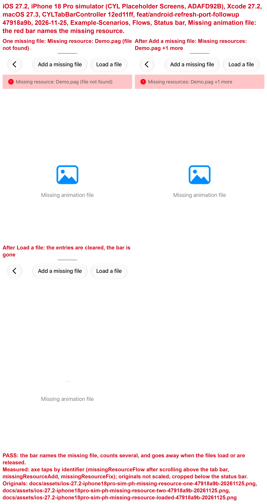
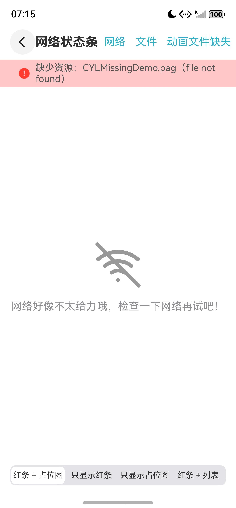

# 顶部状态红条 / Status bar (red bar)

<!-- bound-classes: CYLPlaceholderStatusView, CYLPlaceholderStackView -->

<!-- docs-navigation:start -->

| 中文 | English |
| --- | --- |
| [来源](#来源--source) | [Source](#来源--source) |
| [接口](#接口--api) | [API](#接口--api) |
| [与占位图组合](#与占位图组合--combined-with-the-placeholder) | [Combined with the placeholder](#与占位图组合--combined-with-the-placeholder) |
| [网络检测](#网络检测--network-detection) | [Network detection](#网络检测--network-detection) |
| [资源缺失](#资源缺失--missing-resource) | [Missing resource](#资源缺失--missing-resource) |
| [资源缺失监视（Android）](#资源缺失监视android--missing-resource-monitor-android) | [Missing resource monitor (Android)](#资源缺失监视android--missing-resource-monitor-android) |
| [资源缺失（HarmonyOS）](#资源缺失harmonyos--missing-resource-harmonyos) | [Missing resource (HarmonyOS)](#资源缺失harmonyos--missing-resource-harmonyos) |
| [演示](#演示--demo) | [Demo](#演示--demo) |
| [限制](#限制--limits) | [Limits](#限制--limits) |

<!-- docs-navigation:end -->

<!-- docs-binding:start -->

| 类 / Class | 头文件 / Header |
| --- | --- |
| `CYLPlaceholderStatusView` | [`CYLTableViewPlaceHolder/CYLTableViewPlaceHolder/CYLPlaceholderStatusView.h`](../CYLTableViewPlaceHolder/CYLTableViewPlaceHolder/CYLPlaceholderStatusView.h) |
| `CYLPlaceholderStackView` | [`CYLTableViewPlaceHolder/CYLTableViewPlaceHolder/CYLPlaceholderStackView.h`](../CYLTableViewPlaceHolder/CYLTableViewPlaceHolder/CYLPlaceholderStackView.h) |

<!-- docs-binding:end -->

## 来源 / Source

| 中文 | English |
| --- | --- |
| `CYLPlaceholderStatusView` 移植自 [CYLChatKit](https://github.com/ChenYilong/CYLChatKit)（commit `b730b8d`）的 `ChatKit/Class/View/LCCKStatusView`：聊天页顶部红色背景的“当前网络不可用，请检查你的网络设置”。仓库许可证为 MIT（Copyright (c) 2016 LeanCloud），原文件头的作者与版权信息保留在 `.m` 中，许可证全文随资源包提供（`CYLTableViewPlaceHolder.bundle/LICENSE.CYLChatKit`）。图标 `CYLPlaceholderStatusFail@2x/@3x.png` 是 ChatKit 的 `MessageBubble.bundle/MessageSendFail`，未修改（SHA-256：`678d93c0…b0831a`、`d5f1c487…c95c53`）。 | `CYLPlaceholderStatusView` is ported from `ChatKit/Class/View/LCCKStatusView` of [CYLChatKit](https://github.com/ChenYilong/CYLChatKit) (commit `b730b8d`): the red bar "Network unavailable, Check network" at the top of a chat. The repository is MIT licensed (Copyright (c) 2016 LeanCloud); the original file header with its author and copyright stays in the `.m` file, and the license text ships in the resource bundle (`CYLTableViewPlaceHolder.bundle/LICENSE.CYLChatKit`). The icon `CYLPlaceholderStatusFail@2x/@3x.png` is ChatKit's `MessageBubble.bundle/MessageSendFail`, unmodified (SHA-256 `678d93c0…b0831a`, `d5f1c487…c95c53`). |

## 接口 / API

| CYLChatKit | CYLTableViewPlaceHolder | Swift |
| --- | --- | --- |
| `LCCKStatusView` | `CYLPlaceholderStatusView` | `CYLPlaceholderStatusView` |
| `-initWithFrame:`（网络提示 / network message） | `-initWithFrame:` | `init(frame:)` |
| `LCCKStatusViewDelegate` / `-statusViewClicked:` | `CYLPlaceholderStatusViewDelegate` / `-statusViewClicked:` | `statusViewClicked(_:)` |
| `delegate` | `delegate` | `delegate` |
| `LCCKStatusViewHight`（44） | `CYLPlaceholderStatusViewHight`, `CYLPlaceholderStatusViewHeight` | 同名 / same |
| — | `-initWithItemAttributes:error:`, `networkUnavailableItemAttributes`, `placeholderView`, `text`, `tapHandler` | `init(itemAttributes:)`（throws）, … |

| 中文 | English |
| --- | --- |
| 接口保持 ChatKit 的形状，改用本库前缀，避免与同时集成 CYLChatKit 的应用产生重复符号。内部不再用 `UIImageView` 加 `UILabel`：红色背景是 `CYLPlaceholderStatusView` 本身（父视图），图标与文字是铺满它的子视图——本库的图标加标题组件 `CYLPlaceholderView`，通过新的 item 键 `CYLPlaceholderItemContentAxis` = `"horizontal"` 横向排列（图标在前缘、文字在后、垂直居中，右到左语言自动镜像）。图标按 ChatKit 的 20 点绘制（28 点图片加 4 点 `CYLPlaceholderItemImageInsets`），间距 5 点，字号 15 并随动态字体缩放；文字变高时状态条随之变高（`intrinsicContentSize` 至少 44）。 | The API keeps ChatKit's shape under this library's prefix, so an app that also uses CYLChatKit gets no duplicate symbols. Inside, the `UIImageView` and `UILabel` are gone: the red background is `CYLPlaceholderStatusView` itself (the parent), and the icon and text are its subview filling it — the library's icon-and-title component `CYLPlaceholderView`, laid out horizontally through the new item key `CYLPlaceholderItemContentAxis` = `"horizontal"` (the icon at the leading edge, the text after it, both centered vertically, mirrored for right-to-left languages). The icon is drawn at ChatKit's 20 points (the 28-point image with 4-point `CYLPlaceholderItemImageInsets`), 5 points from the text, which is 15 points and follows Dynamic Type; taller text makes the bar taller (`intrinsicContentSize`, at least 44). |
| 颜色：背景沿用 ChatKit 的 rgb(255, 199, 199)；文字由 ChatKit 的灰色（对比度约 3:1）改为 #555555（约 4.9:1，满足 WCAG AA）。深色模式下为暗红背景与浅粉文字。 | Colors: the background keeps ChatKit's rgb(255, 199, 199); the text changes from ChatKit's gray (about 3:1) to #555555 (about 4.9:1, WCAG AA). Dark Mode uses a dark red background with light pink text. |
| 文案：核心文案表新增 `CYLPlaceholderStatusNetworkUnavailable`（7 种语言，中文取自 ChatKit），只增不改。 | Text: the core string table gains `CYLPlaceholderStatusNetworkUnavailable` (7 languages, the Chinese from ChatKit), an additive change. |
| 无障碍：没有代理也没有 `tapHandler` 时，状态条对 VoiceOver 是普通文字；有其一时是按钮，可设置 `placeholderView.accessibilityHint` 说明点击结果。 | Accessibility: with neither a delegate nor a `tapHandler`, VoiceOver reads the bar as text; with one, it is a button, and `placeholderView.accessibilityHint` can say what a tap does. |

## 与占位图组合 / Combined with the placeholder

| 中文 | English |
| --- | --- |
| 红条与占位图是两个独立的组件，不放进 `CYLPlaceholderStackView`（与 UIStackView 无关）。红条按 CYLChatKit 的方式加在当前视图控制器的 view 上：位于顶端、导航栏正下方（底边固定在安全区域顶部，`zPosition` 高于列表内容），显示期间控制器的 `additionalSafeAreaInsets.top` 增加红条高度，使内容从红条下方开始；动态字体变大时红条与安全区域一起变高。占位图仍由 table / collection view 的 `cyl_placeholderViewBlock` 放置。二者的组合由一个参数决定：`UIViewController.cyl_statusDisplay`。 | The bar and the placeholder are two independent components; the bar is not put into `CYLPlaceholderStackView` (nothing to do with UIStackView). As in CYLChatKit, the bar is added to the current view controller's view: at the top, right below the navigation bar (its bottom edge on the safe area's top, its `zPosition` above the list's content), and while it shows the controller's `additionalSafeAreaInsets.top` grows by its height so the content starts below it; with a larger Dynamic Type size the bar and the safe area grow together. The placeholder stays where the table or collection view's `cyl_placeholderViewBlock` puts it. One parameter chooses the combination: `UIViewController.cyl_statusDisplay`. |

| 显示 / Shows | `cyl_statusDisplay` | 配置文件 `display` / Configuration file `display` |
| --- | --- | --- |
| 红条 + 占位图 / bar and placeholder | `.all` | `"statusAndPlaceholder"`（有 `statusBar` 时的默认 / the default with `statusBar`） |
| 只显示红条 / bar only | `.statusBar` | `"status"` |
| 只显示占位图 / placeholder only | `.placeholder`（默认 / default） | `"placeholder"` |
| 都不显示 / neither | `[]` | `"none"` |

```swift
// [CN] 红条 + 占位图 / [EN] the bar and the placeholder
tableView.cylPlaceholderViewBlock({ _ in CYLPlaceholderStackView(scenario: .networkUnavailable, actions: nil) })
cylStatusView.delegate = self            // [CN] 与 CYLChatKit 相同 / [EN] as in CYLChatKit
cylSetStatusDisplay(.all, animated: true)
// [CN] 只显示红条 / [EN] only the bar
cylStatusDisplay = .statusBar
// [CN] 断网时自动显示红条 / [EN] the bar while offline
cylShowsStatusViewWhenOffline = true
// [CN] 配置文件 / [EN] a configuration file
try cylApplyStatusConfiguration(contentsOf: url)
```

```json
{
  "statusBar": { "textKey": "CYLPlaceholderStatusNetworkUnavailable" },
  "display": "statusAndPlaceholder",
  "showsWhenOffline": true
}
```

| 中文 | English |
| --- | --- |
| 其他接口：`cyl_statusView`（默认网络提示条，可赋值自定义状态条，赋 nil 恢复）、`cyl_placeholderScrollView`（受控的列表，默认是控制器的 view，如 UITableViewController）、`UIScrollView.cyl_placeholderHidden`（列表为空也不显示占位图，由 `cyl_statusDisplay` 设置，只作用于 block 接口）。`"statusBar"` 可以是 `true`、`"networkUnavailable"` 或字典（`-[CYLPlaceholderStatusView initWithConfiguration:error:]`：`text`、`textKey`、`image`、`titleColor`、`backgroundColor`、`accessibilityIdentifier`）。配置无效时返回错误且不做任何修改。 | Also: `cyl_statusView` (the network bar by default; assign your own, nil restores it), `cyl_placeholderScrollView` (the list it controls; by default the controller's view, as in a UITableViewController), `UIScrollView.cyl_placeholderHidden` (no placeholder even for an empty list; set by `cyl_statusDisplay`; block API only). `"statusBar"` is `true`, `"networkUnavailable"` or a dictionary (`-[CYLPlaceholderStatusView initWithConfiguration:error:]`: `text`, `textKey`, `image`, `titleColor`, `backgroundColor`, `accessibilityIdentifier`). An invalid configuration returns an error and changes nothing. |

## 网络检测 / Network detection

| 中文 | English |
| --- | --- |
| CYLChatKit 的红条跟随 IM 客户端的连接状态，而连接状态依赖 LeanCloud SDK 中 `AVIMWebSocketWrapper` 的可达性监测（`LCNetworkReachabilityManager`，AFNetworkReachabilityManager 的变体，基于 `SCNetworkReachability`）。`CYLPlaceholderNetworkMonitor` 移植这段逻辑，用于高内聚网络失败场景：相同的状态值（未知 -1、不可达 0、蜂窝 1、Wi-Fi 2）、状态变化回调 `setNetworkStatusChangeBlock:`、`startMonitoring` / `stopMonitoring`、`reachable`（只有不可达时为 NO），并发送 `CYLPlaceholderNetworkStatusDidChangeNotification`。 | CYLChatKit's bar follows the IM client's connection, which depends on the reachability monitoring of LeanCloud's `AVIMWebSocketWrapper` (`LCNetworkReachabilityManager`, an AFNetworkReachabilityManager variant on `SCNetworkReachability`). `CYLPlaceholderNetworkMonitor` ports that logic so the network-failure scenario is self-contained: the same status values (unknown -1, not reachable 0, cellular 1, Wi-Fi 2), the change block `setNetworkStatusChangeBlock:`, `startMonitoring` / `stopMonitoring`, `reachable` (NO only when not reachable), and `CYLPlaceholderNetworkStatusDidChangeNotification`. |
| 适配新系统：`SCNetworkReachability` 自 iOS 17 起废弃，且只表示数据包能否离开设备；改用 Network.framework 的 `NWPathMonitor`（iOS 12 起，即本库最低版本，podspec 增加 `Network` framework）。新增有线以太网（`ReachableViaWiredEthernet`）与其他接口（`ReachableViaOther`，如 VPN）、低数据模式 `constrained`（iOS 13 起）与昂贵网络 `expensive`；“需要连接”（按需 VPN、需登录的网络）视为不可达；回调在主队列。未知状态不算离线，避免启动时红条闪现（ChatKit 把未知当作不可达）。 | Adapted to current systems: `SCNetworkReachability` is deprecated since iOS 17 and only says whether a packet could leave the device; this uses Network.framework's `NWPathMonitor` (iOS 12+, the library's minimum; the podspec adds the `Network` framework). New: wired Ethernet (`ReachableViaWiredEthernet`) and other interfaces (`ReachableViaOther`, such as a VPN), Low Data Mode `constrained` (iOS 13+) and `expensive` paths; "requires connection" (VPN on demand, a captive network) counts as not reachable; callbacks run on the main queue. An unknown status is not offline, so no bar flashes at launch (ChatKit treated unknown as unreachable). |
| 参照 Sentry 的 [getsentry/sentry-cocoa#5440](https://github.com/getsentry/sentry-cocoa/issues/5440)（由 #6019 改用 `NWPathMonitor`）：按主机名创建的 `SCNetworkReachability` 会在每次网络变化时发起 DNS 查询（即使关闭了遥测），因此这里不监测主机，只监测设备的网络路径；已启动的 `NWPathMonitor` 在取消前一直运行（即使没有强引用），取消后不能重新启动，所以每次 `startMonitoring` 新建监测器，`stopMonitoring` 与释放时取消；已取消的监测器可能仍送达排队中的更新，用启动序号忽略它们；在监测器自己的回调中取消会卡住其队列，所以监测器运行在私有串行队列（utility QoS），状态、回调与通知转到主队列。低数据模式或昂贵网络变化而状态不变时也会发送通知（回调只在状态变化时执行）。 | Following Sentry's [getsentry/sentry-cocoa#5440](https://github.com/getsentry/sentry-cocoa/issues/5440) (moved to `NWPathMonitor` by #6019): an `SCNetworkReachability` created with a host name makes a DNS query on every network change (even with telemetry off), so no host is watched here, only the device's network path; a started `NWPathMonitor` keeps running until it is cancelled (even without a strong reference) and cannot be restarted once cancelled, so every `startMonitoring` creates a new monitor and `stopMonitoring` and dealloc cancel it; a cancelled monitor can still deliver a queued update, which a start counter ignores; cancelling a monitor inside its own update handler wedges its queue, so the monitor runs on a private serial queue (utility QoS) and the status, the block and the notification move to the main queue. A change of Low Data Mode or of an expensive path without a status change posts the notification too (the block runs on status changes only). |
| 限制：有可用路径不代表服务器可达（例如需要登录的 Wi-Fi 在登录前可能仍是 satisfied）；请求失败时仍应由应用显示网络失败占位图。 | Limit: a usable path does not mean the server is reachable (a captive Wi-Fi may report satisfied before login); a failed request should still show the network-failure placeholder. |

## 资源缺失 / Missing resource

| 中文 | English |
| --- | --- |
| 动画资源（.pag / .riv / Lottie 路径）缺失时，红条显示缺了哪一个。各平台共用的约定：回调名 `onResourceMissing(resource, reason)`；`resource` 缩短为路径的最后一段（`asset:Folder/home.pag` 显示为 `home.pag`），使核心与引擎的报告合并为一条；`reason` 是简短的英文原因（不翻译）：`file not found`、`unreadable`。`no runtime` 属于引擎：没有运行时而退回静态图片是预期行为，核心不为它显示红条。每个页面一条红条：一个资源用 `CYLPlaceholderResourceMissing`，多个资源用 `CYLPlaceholderResourcesMissing`（第一个资源加“另有 N 项”）。同一资源只报告一次；页面消失或该资源之后加载成功时清除。网络离线时，离线文字优先；网络恢复后红条显示资源文字。 | When an animation resource (a .pag / .riv / Lottie path) is missing, the red bar names which one. The contract shared by every platform: callback `onResourceMissing(resource, reason)`; `resource` is shortened to the last path segment (`asset:Folder/home.pag` shows as `home.pag`) so the core and the engine dedupe to one entry; `reason` is a short English word (not translated): `file not found`, `unreadable`. `no runtime` belongs to the engine: falling back to a static image without the runtime is intended, so the core shows no bar for it. One bar per page: one resource reads with `CYLPlaceholderResourceMissing`, several with `CYLPlaceholderResourcesMissing` (the first resource plus "N more"). A resource is reported once; the entry is cleared when the page goes away or the resource later loads. While the network is offline, the offline text wins; the resource text returns with the network. |
| iOS 接口：`CYLPlaceholderResourceReporter.shared`（`report(resource:reason:source:)`、`resolve(resource:source:)`、`removeSource(_:)`、`reset()`、`missingResourceNames`、`text(visibleIn:)`、`onResourceMissing`）；`CYLPlaceholderView.onResourceMissing`；`UIViewController.cyl_showsMissingResources`（默认 NO）。`CYLPlaceholderView` 在解析动画路径时检测文件（`file not found`、`unreadable`），Rive 刷新头 / 刷新尾在文件导致退回经典样式时同样报告。引擎（CYLTabBarController `12ed11ff`）还没有 `onResourceMissing`，所以由核心检测；以后引擎的回调只需调用 `report`。视图被释放时其条目清除；没有来源视图的条目（刷新头）用 `resolve` 或 `reset` 清除。网络离线（`cyl_showsStatusViewWhenOffline`）时离线文字优先，网络恢复后显示资源文字，红条自己的文字在没有缺失资源时恢复。演示：Example-Scenarios“交互流程 → 状态条 → 动画文件缺失”。 | iOS API: `CYLPlaceholderResourceReporter.shared` (`report(resource:reason:source:)`, `resolve(resource:source:)`, `removeSource(_:)`, `reset()`, `missingResourceNames`, `text(visibleIn:)`, `onResourceMissing`); `CYLPlaceholderView.onResourceMissing`; `UIViewController.cyl_showsMissingResources` (NO by default). `CYLPlaceholderView` checks the file where it resolves the animation path (`file not found`, `unreadable`); the Rive refresh header and footer report too when the file is the reason for the classic fallback. The engine (CYLTabBarController `12ed11ff`) has no `onResourceMissing` yet, so the core detects it; a later engine callback only has to call `report`. A view's entries go when the view is released; entries without a source view (the refresh header) go with `resolve` or `reset`. While the network is offline (`cyl_showsStatusViewWhenOffline`) the offline text wins and the resource text returns with the network; the bar's own text comes back when nothing is missing. Demo: Example-Scenarios, "Flows → Status bar → Missing animation file". |



Texts of the two keys, for the core tables of every platform (`CYLPlaceholderResourceMissing`: first `%@` the resource, second the reason; `CYLPlaceholderResourcesMissing`: `%1$@` the first resource, `%2$ld` the number of the others):

| 语言 / Language | `CYLPlaceholderResourceMissing` | `CYLPlaceholderResourcesMissing` |
| --- | --- | --- |
| en | `Missing resource: %@ (%@)` | `Missing resources: %1$@ +%2$ld more` |
| zh-Hans | `缺少资源：%@（%@）` | `缺少资源：%1$@，另有 %2$ld 项` |
| zh-Hant | `缺少資源：%@（%@）` | `缺少資源：%1$@，另有 %2$ld 項` |
| ja | `リソースが見つかりません：%@（%@）` | `リソースが見つかりません：%1$@ ほか%2$ld件` |
| ko | `리소스 누락: %@ (%@)` | `리소스 누락: %1$@ 외 %2$ld개` |
| ru | `Отсутствует ресурс: %@ (%@)` | `Отсутствуют ресурсы: %1$@ и ещё %2$ld` |
| uk | `Відсутній ресурс: %@ (%@)` | `Відсутні ресурси: %1$@ та ще %2$ld` |

## 资源缺失监视（Android） / Missing resource monitor (Android)

| 中文 | English |
| --- | --- |
| 动画文件缺失时，红条说明缺的是哪个资源（Android：`CYLPlaceholderResourceMonitor`，在 `android/placeholder`）。约定（与 CYLTabBarController 和 Mac 会话一致）：文案键 `CYLPlaceholderResourceMissing`，英文 `Missing resource: %1$s (%2$s)`（iOS 为 `%1$@ (%2$@)`）；`<resource>` 是文件或资源名，`<reason>` 是简短的英文原因：`file not found`、`unreadable`、`no runtime`。同一资源只记一次（再次报告不做任何事）；页面消失或资源之后加载成功时清除。 | When an animation file is missing, the red bar says which resource it is (Android: `CYLPlaceholderResourceMonitor` in `android/placeholder`). The agreed contract (with CYLTabBarController and the Mac session): localization key `CYLPlaceholderResourceMissing`, English `Missing resource: %1$s (%2$s)` (`%1$@ (%2$@)` on iOS); `<resource>` is the file or asset name, `<reason>` a short English reason: `file not found`, `unreadable`, `no runtime`. A resource is listed once (a second report of it does nothing); the entry goes when the page goes away or the resource later loads. |
| 一个页面只有一条红条：缺失多个资源时显示第一个并计数，`Missing resources: home.pag +5 more`（新增键 `CYLPlaceholderResourcesMissing`，`%1$s +%2$d`；iOS 为 `%1$@ +%2$ld`），所以六个缺失的 `.pag` 不会出六条红条。接口：`report(activity, resource, reason)`、`clear(activity, resource)`、`missingResources(activity)`；`activity` 为 null 时用前台的 Activity。Activity 销毁时清空（`ActivityLifecycleCallbacks`，弱引用，惰性注册）。 | One bar per page: with several resources missing it names the first and counts the rest, `Missing resources: home.pag +5 more` (new key `CYLPlaceholderResourcesMissing`, `%1$s +%2$d`; `%1$@ +%2$ld` on iOS), so six missing `.pag` files do not make six bars. API: `report(activity, resource, reason)`, `clear(activity, resource)`, `missingResources(activity)`; a null `activity` means the one in front. The list is dropped when the Activity is destroyed (`ActivityLifecycleCallbacks`, weak references, registered lazily). |
| 与网络提示的关系：网络提示优先。`cyl_showsStatusViewWhenOffline` 开启且断网时，红条保持网络文案；网络恢复后再显示缺失的资源。红条原本没有显示时，由本类打开，列表清空时再关闭；页面自己打开的红条保持不变。 | With the network text: the network text wins. While `cyl_showsStatusViewWhenOffline` is on and the device is offline the bar keeps its network text; the missing resources show again once the network is back. A bar that was off is turned on by this class and off again when the list is empty; a bar the page turned on stays. |
| 核心的接线：`CYLPlaceholderView.setAnimationFile` 对不存在的 `asset:` 名或绝对 / `file:` 路径报告 `file not found`，加载成功时清除；应用的 `registerAnimationFactory` 播放器的 `errorHandler` 报告 `unreadable`，`readyHandler` 清除。缺少运行库（`no runtime`）由引擎报告，核心不重复。 | Wired in the core: `CYLPlaceholderView.setAnimationFile` reports `file not found` for an `asset:` name or an absolute / `file:` path that does not exist, and clears it on success; the `errorHandler` of an app's `registerAnimationFactory` player reports `unreadable`, its `readyHandler` clears. A missing runtime (`no runtime`) is the engine's report, not repeated by the core. |
| 引擎挂钩（CYLTabBarController，待提交）：`CYLAnimatedItemView.onResourceMissing` 与全局 `CYLAnimationEngines.resourceMissingListener`（`com.cyl.animateditem`），每个视图每个资源在主线程触发一次。核心不在编译时引用它们（否则缺少它们的提交会使 `:placeholder` 编译失败，如 `drivesAnimationPlayback`），而用反射：`CYLPlaceholderResourceMonitor.installEngineListener()`、`attach(view)`，没有该属性时什么也不做并记一行调试日志。待每个可解析的提交都有该挂钩后，改为直接调用。 | The engine hook (CYLTabBarController, pending commit): `CYLAnimatedItemView.onResourceMissing` and the global `CYLAnimationEngines.resourceMissingListener` (`com.cyl.animateditem`), fired once per resource per view on the main thread. The core does not name them at compile time (a commit without them would break `:placeholder`, as `drivesAnimationPlayback` did), it uses reflection: `CYLPlaceholderResourceMonitor.installEngineListener()` and `attach(view)`, which do nothing and log one debug line when the property is absent. A direct call replaces them once every commit that can be resolved has the hook. |
| 未验证：本机无法编译或运行，Robolectric 测试与示例（“状态条”页的 “Missing file” 按钮指向一个不存在的文件）只是写好，尚未运行；`CYLPlaceholderResourceMissing` 的各语言文案取自 Mac 会话的表；`CYLPlaceholderResourcesMissing`（“+N more”）暂用英文，待翻译。 | Not verified: nothing could be compiled or run here; the Robolectric tests and the example (the "Missing file" button on the status bar page points at a file that does not exist) are written, not run; the texts of `CYLPlaceholderResourceMissing` in every language are the Mac session's table; `CYLPlaceholderResourcesMissing` ("+N more") is English in every language until translated. |

## 资源缺失（HarmonyOS） / Missing resource (HarmonyOS)

| 中文 | English |
| --- | --- |
| 动画文件缺失时，红条说明缺的是哪个资源（HarmonyOS：`CYLPlaceholderResourceReporter`，在 `CrossPlatform/harmonyos-cylplaceholder/cylplaceholder`）。约定与 iOS、Android 相同：资源名取路径最后一段；原因 `file not found`、`unreadable`；同一资源只记一次；多个缺失时只显示一条 `Missing resources: first +N more`；文案键 `resource_missing` / `resources_missing`（7 种语言，由 `scripts/import-resources.js` 从 Android 表生成）。 | A missing animation file is named in the red bar (HarmonyOS: `CYLPlaceholderResourceReporter`, in `CrossPlatform/harmonyos-cylplaceholder/cylplaceholder`). Same contract as iOS and Android: the resource's last path segment; reasons `file not found` and `unreadable`; one report per resource; one bar for several (`Missing resources: first +N more`); string keys `resource_missing` / `resources_missing` (7 languages, generated from the Android tables by `scripts/import-resources.js`). |
| 接口：`CYLPlaceholderStatusController.cyl_showsMissingResources`（默认 `false`）；`CYLPlaceholderResourceReporter.sharedReporter`（`report(resource, reason, source)`、`resolve(resource, source)`、`removeSource(source)`、`reset()`、`missingResourceNames`、`text`、`onResourceMissing`、`addObserver`）。网络文案优先：`cyl_showsStatusViewWhenOffline` 开启且断网时红条保持网络文案，网络恢复后再显示缺失的资源；红条原本没有显示时由资源打开，列表清空时关闭，页面自己打开的红条保持不变。 | API: `CYLPlaceholderStatusController.cyl_showsMissingResources` (default `false`); `CYLPlaceholderResourceReporter.sharedReporter` (`report`, `resolve`, `removeSource`, `reset`, `missingResourceNames`, `text`, `onResourceMissing`, `addObserver`). The network text wins: while `cyl_showsStatusViewWhenOffline` is on and the network is not reachable the bar keeps the network text and the resources show again once it is back; a bar that was not showing is opened by the resources and closed when none are left; a bar the page opened stays. |
| 守卫：红条逻辑只在调试构建中运行，`CYLPlaceholderResourceReporter.enabled` 等于 `BuildProfile.DEBUG`（构建时确定；iOS 用 `#if DEBUG`，Android 用 `BuildConfig.DEBUG`），发布构建里 `report()` 什么也不做，核心也不做额外的文件检查。 | Guard: the red bar's logic runs only in debug builds, `CYLPlaceholderResourceReporter.enabled` is `BuildProfile.DEBUG` (decided at build time; iOS `#if DEBUG`, Android `BuildConfig.DEBUG`); in a release build `report()` does nothing and the core makes no extra file checks. |
| 核心的接线：`CYLPlaceholderViewModel.setAnimationFile` 和 `cyl_attachAnimation` 对不存在的文件报告 `file not found`，播放器出错报告 `unreadable`；播放器“就绪”时只在文件确实存在时才清除（Android 真机上动画器对不存在的文件也会“就绪”）。 | Wiring in the core: `CYLPlaceholderViewModel.setAnimationFile` and `cyl_attachAnimation` report `file not found` for a file that does not exist, a failing player reports `unreadable`; a player becoming "ready" clears the report only for a file that exists (on a device an animator is ready even for a missing file, the lesson from Android). |
| 验证（Windows，HarmonyOS 6.0.1 x86_64 Mate 70 Pro 模拟器）：`scripts/build.sh test` 构建成功，主机单元测试 133/133（新增 9 个：守卫、短名、格式、计数、多个、清除、红条文字与还原、页面自己打开的红条、网络优先）；示例“网络状态条”页新增按钮“动画文件缺失”，点击后红条显示 `缺少资源：CYLMissingDemo.pag（file not found）`，再点一次不变。未验证：多个缺失资源在模拟器上的画面（单元测试覆盖）、飞行模式、旋转。 | Verified (Windows, HarmonyOS 6.0.1 x86_64 Mate 70 Pro emulator): `scripts/build.sh test` builds, host unit tests 133/133 (9 new: the guard, short name, format, counting, several, clearing, the bar's text and restore, a bar the page opened, network first); the example's "Network status bar" page has a new "Missing animation file" button, and the bar then reads `缺少资源：CYLMissingDemo.pag（file not found）`, a second tap changes nothing. Not verified: several missing resources on the emulator (covered by unit tests), airplane mode, rotation. |



## 演示 / Demo

| 中文 | English |
| --- | --- |
| Example-Scenarios 的“交互流程 → 状态条 → 网络状态条”（`CYLStatusBarViewController`，UITableViewController）：底部切换红条 + 占位图、只显示红条、只显示占位图、红条 + 列表；“网络”打开 `cyl_showsStatusViewWhenOffline`（可用飞行模式验证）；“文件”应用 `CYLScenarioExample.bundle/StatusBar/` 中的三个配置文件。 | Example-Scenarios, "Flows → Status bar → Network status bar" (`CYLStatusBarViewController`, a UITableViewController): the toolbar switches between bar and placeholder, bar only, placeholder only, and bar over a list; "Network" turns on `cyl_showsStatusViewWhenOffline` (try airplane mode); "File" applies the three configuration files in `CYLScenarioExample.bundle/StatusBar/`. |

## 限制 / Limits

| 中文 | English |
| --- | --- |
| 未验证：本机无法编译或运行，等待 CI；横向布局、红条在导航栏下方的位置（尤其控制器的 view 本身是 table 时，红条约束在 frame 布局参考与安全区域上）、深色模式、右到左与动态字体需要在模拟器中查看；网络切换需要在真机或模拟器中手动验证。`cyl_placeholderHidden` 只作用于 block 接口（`cyl_placeholderViewBlock`），不作用于旧的代理接口。横向排列时不绘制标题装饰（背景、边框）。 | Not verified: nothing could be compiled or run here, so CI comes first; the horizontal layout, the bar's place below the navigation bar (especially when the controller's view is the table itself, where the bar is pinned to the frame layout guide and the safe area), Dark Mode, right-to-left and Dynamic Type need a look in the simulator; network changes need a manual check on a device or simulator. `cyl_placeholderHidden` only affects the block API (`cyl_placeholderViewBlock`), not the older delegate API. A horizontal item draws no title chrome (background, border). |
