# 任务记录 / Task log

<!-- bound-classes: none -->

<!-- docs-navigation:start -->

| 中文 | English |
| --- | --- |
| [用途](#用途--purpose) | [Purpose](#用途--purpose) |
| [任务](#任务--tasks) | [Tasks](#任务--tasks) |
| [TODO：按静态分析重新评估 `cyl_`](#todo按静态分析重新评估-cyl_--cyl-前缀并调整-swift-命名--todo-re-evaluate-the-cyl_--cyl-prefixes-from-the-static-analysis-and-adjust-swift-names) | [`CYL` 前缀并调整 Swift 命名 / TODO: Re-evaluate the `cyl_` / `CYL` prefixes from the static analysis and adjust Swift names](#todo按静态分析重新评估-cyl_--cyl-前缀并调整-swift-命名--todo-re-evaluate-the-cyl_--cyl-prefixes-from-the-static-analysis-and-adjust-swift-names) |
| [Batch hand-off W3: scrollMode + expandHeight (written, not run)](#batch-hand-off-w3-scrollmode--expandheight-written-not-run) | [Batch hand-off W3: scrollMode + expandHeight (written, not run)](#batch-hand-off-w3-scrollmode--expandheight-written-not-run) |
| [Batch hand-off W4: rive style and queued items (written, not run)](#batch-hand-off-w4-rive-style-and-queued-items-written-not-run) | [Batch hand-off W4: rive style and queued items (written, not run)](#batch-hand-off-w4-rive-style-and-queued-items-written-not-run) |
| [Batch hand-off W5: resource missing in the red status bar (written, not run)](#batch-hand-off-w5-resource-missing-in-the-red-status-bar-written-not-run) | [Batch hand-off W5: resource missing in the red status bar (written, not run)](#batch-hand-off-w5-resource-missing-in-the-red-status-bar-written-not-run) |
| [2026-11-25 owner decision: no physical devices (DONE)](#2026-11-25-owner-decision-no-physical-devices-done) | [2026-11-25 owner decision: no physical devices (DONE)](#2026-11-25-owner-decision-no-physical-devices-done) |
| [2026-11-25 owner decision: RN new architecture out of scope (DONE)](#2026-11-25-owner-decision-rn-new-architecture-out-of-scope-done) | [2026-11-25 owner decision: RN new architecture out of scope (DONE)](#2026-11-25-owner-decision-rn-new-architecture-out-of-scope-done) |
| [2026-11-25 owner decision: Rive black band option B (TODO)](#2026-11-25-owner-decision-rive-black-band-option-b-todo) | [2026-11-25 owner decision: Rive black band option B (TODO)](#2026-11-25-owner-decision-rive-black-band-option-b-todo) |
| [2026-11-25 advisor recommendations on three open items (owner delegated, revisable)](#2026-11-25-advisor-recommendations-on-three-open-items-owner-delegated-revisable) | [2026-11-25 advisor recommendations on three open items (owner delegated, revisable)](#2026-11-25-advisor-recommendations-on-three-open-items-owner-delegated-revisable) |
| [2026-11-25 owner rule for the Rive END animation black wipe (TODO)](#2026-11-25-owner-rule-for-the-rive-end-animation-black-wipe-todo) | [2026-11-25 owner rule for the Rive END animation black wipe (TODO)](#2026-11-25-owner-rule-for-the-rive-end-animation-black-wipe-todo) |
| [2026-11-25 Rive END black wipe: survey result and advisor judgement (accept, delegated, revisable)](#2026-11-25-rive-end-black-wipe-survey-result-and-advisor-judgement-accept-delegated-revisable) | [2026-11-25 Rive END black wipe: survey result and advisor judgement (accept, delegated, revisable)](#2026-11-25-rive-end-black-wipe-survey-result-and-advisor-judgement-accept-delegated-revisable) |
| [2026-11-25 CI error in run 45491722942 (Android unit tests) (DONE: fixed upstream, re-run pending)](#2026-11-25-ci-error-in-run-45491722942-android-unit-tests-done-fixed-upstream-re-run-pending) | [2026-11-25 CI error in run 45491722942 (Android unit tests) (DONE: fixed upstream, re-run pending)](#2026-11-25-ci-error-in-run-45491722942-android-unit-tests-done-fixed-upstream-re-run-pending) |
| [2026-11-25 REVISION: the 'accept' of the Rive END black rests on a premise Android contradicts (open)](#2026-11-25-revision-the-accept-of-the-rive-end-black-rests-on-a-premise-android-contradicts-open) | [2026-11-25 REVISION: the 'accept' of the Rive END black rests on a premise Android contradicts (open)](#2026-11-25-revision-the-accept-of-the-rive-end-black-rests-on-a-premise-android-contradicts-open) |
| [2026-11-25 CI errors in run 45389973115 (iOS, `3f599f7e`), five jobs (DONE locally, CI re-run pending)](#2026-11-25-ci-errors-in-run-45389973115-ios-3f599f7e-five-jobs-done-locally-ci-re-run-pending) | [2026-11-25 CI errors in run 45389973115 (iOS, `3f599f7e`), five jobs (DONE locally, CI re-run pending)](#2026-11-25-ci-errors-in-run-45389973115-ios-3f599f7e-five-jobs-done-locally-ci-re-run-pending) |
| [2026-11-25 iOS Rive black during the held refreshing state: investigation + fix (DONE)](#2026-11-25-ios-rive-black-during-the-held-refreshing-state-investigation--fix-done) | [2026-11-25 iOS Rive black during the held refreshing state: investigation + fix (DONE)](#2026-11-25-ios-rive-black-during-the-held-refreshing-state-investigation--fix-done) |
| [2026-11-25 iOS examples: sectioned index lists use CollectionViewClassifyMenu's tag list (DONE, see the entry at the end of this file; was TODO, then BLOCKED)](#2026-11-25-ios-examples-sectioned-index-lists-use-collectionviewclassifymenus-tag-list-done-see-the-entry-at-the-end-of-this-file-was-todo-then-blocked) | [2026-11-25 iOS examples: sectioned index lists use CollectionViewClassifyMenu's tag list (DONE, see the entry at the end of this file; was TODO, then BLOCKED)](#2026-11-25-ios-examples-sectioned-index-lists-use-collectionviewclassifymenus-tag-list-done-see-the-entry-at-the-end-of-this-file-was-todo-then-blocked) |
| [2026-11-26 iOS tag-list status bar turned white on the light gradient: bisect and example-side fix (DONE)](#2026-11-26-ios-tag-list-status-bar-turned-white-on-the-light-gradient-bisect-and-example-side-fix-done) | [2026-11-26 iOS tag-list status bar turned white on the light gradient: bisect and example-side fix (DONE)](#2026-11-26-ios-tag-list-status-bar-turned-white-on-the-light-gradient-bisect-and-example-side-fix-done) |
| [2026-11-26 Engine pin b0887513 (the engine owner's one SHA): repin, status bar workaround check (DONE)](#2026-11-26-engine-pin-b0887513-the-engine-owners-one-sha-repin-status-bar-workaround-check-done) | [2026-11-26 Engine pin b0887513 (the engine owner's one SHA): repin, status bar workaround check (DONE)](#2026-11-26-engine-pin-b0887513-the-engine-owners-one-sha-repin-status-bar-workaround-check-done) |
| [2026-11-26 Flaky test CYLRefreshDrivenStylesTests footer full load: root cause and deterministic fix (DONE)](#2026-11-26-flaky-test-cylrefreshdrivenstylestests-footer-full-load-root-cause-and-deterministic-fix-done) | [2026-11-26 Flaky test CYLRefreshDrivenStylesTests footer full load: root cause and deterministic fix (DONE)](#2026-11-26-flaky-test-cylrefreshdrivenstylestests-footer-full-load-root-cause-and-deterministic-fix-done) |
| [2026-11-26 CI failures: Docs navigation, iOS 15 runtime, Unit tests (DONE)](#2026-11-26-ci-failures-docs-navigation-ios-15-runtime-unit-tests-done) | [2026-11-26 CI failures: Docs navigation, iOS 15 runtime, Unit tests (DONE)](#2026-11-26-ci-failures-docs-navigation-ios-15-runtime-unit-tests-done) |
| [2026-11-26 CI failures: Unit tests and the three Animation jobs of run 45566803410 (TODO)](#2026-11-26-ci-failures-unit-tests-and-the-three-animation-jobs-of-run-45566803410-todo) | [2026-11-26 CI failures: Unit tests and the three Animation jobs of run 45566803410 (TODO)](#2026-11-26-ci-failures-unit-tests-and-the-three-animation-jobs-of-run-45566803410-todo) |
| [2026-11-26 Hand-over document: iOS chapter, iOS table cells, whole-project score (TODO)](#2026-11-26-hand-over-document-ios-chapter-ios-table-cells-whole-project-score-todo) | [2026-11-26 Hand-over document: iOS chapter, iOS table cells, whole-project score (TODO)](#2026-11-26-hand-over-document-ios-chapter-ios-table-cells-whole-project-score-todo) |
| [2026-11-26 Hand-over document: iOS chapter, iOS table cells, whole-project score (DONE)](#2026-11-26-hand-over-document-ios-chapter-ios-table-cells-whole-project-score-done) | [2026-11-26 Hand-over document: iOS chapter, iOS table cells, whole-project score (DONE)](#2026-11-26-hand-over-document-ios-chapter-ios-table-cells-whole-project-score-done) |
| [2026-11-25 Android example: menu lists become CollectionViewClassifyMenu tag lists (TODO)](#2026-11-25-android-example-menu-lists-become-collectionviewclassifymenu-tag-lists-todo) | [2026-11-25 Android example: menu lists become CollectionViewClassifyMenu tag lists (TODO)](#2026-11-25-android-example-menu-lists-become-collectionviewclassifymenu-tag-lists-todo) |
| [2026-11-27 Hand-over iOS priority 1: merge PR #35 into the integration branch (TODO)](#2026-11-27-hand-over-ios-priority-1-merge-pr-35-into-the-integration-branch-todo) | [2026-11-27 Hand-over iOS priority 1: merge PR #35 into the integration branch (TODO)](#2026-11-27-hand-over-ios-priority-1-merge-pr-35-into-the-integration-branch-todo) |
| [2026-11-27 Hand-over iOS priority 1: merge PR #35 into the integration branch (DONE), and priority 4 (DONE)](#2026-11-27-hand-over-ios-priority-1-merge-pr-35-into-the-integration-branch-done-and-priority-4-done) | [2026-11-27 Hand-over iOS priority 1: merge PR #35 into the integration branch (DONE), and priority 4 (DONE)](#2026-11-27-hand-over-ios-priority-1-merge-pr-35-into-the-integration-branch-done-and-priority-4-done) |
| [2026-11-27 Android example tab bar: icon tint and a dark bar in dark mode (TODO)](#2026-11-27-android-example-tab-bar-icon-tint-and-a-dark-bar-in-dark-mode-todo) | [2026-11-27 Android example tab bar: icon tint and a dark bar in dark mode (TODO)](#2026-11-27-android-example-tab-bar-icon-tint-and-a-dark-bar-in-dark-mode-todo) |
| [2026-11-27 Mini program: cyl-animated-item copy synced to the Cartfile pin b0887513 (TODO)](#2026-11-27-mini-program-cyl-animated-item-copy-synced-to-the-cartfile-pin-b0887513-todo) | [2026-11-27 Mini program: cyl-animated-item copy synced to the Cartfile pin b0887513 (TODO)](#2026-11-27-mini-program-cyl-animated-item-copy-synced-to-the-cartfile-pin-b0887513-todo) |
| [2026-11-27 Hand-over iOS TODOs 8 and 9 (section 5.6.3) (DONE](#2026-11-27-hand-over-ios-todos-8-and-9-section-563-done--not-needed) | [not needed)](#2026-11-27-hand-over-ios-todos-8-and-9-section-563-done--not-needed) |
| [2026-11-27 React Native iOS: second-floor flags, same race as `refreshing`? (TODO)](#2026-11-27-react-native-ios-second-floor-flags-same-race-as-refreshing-todo) | [2026-11-27 React Native iOS: second-floor flags, same race as `refreshing`? (TODO)](#2026-11-27-react-native-ios-second-floor-flags-same-race-as-refreshing-todo) |
| [2026-11-27 Android core does not compile on CYLTabBarController dd691795 (refreshColors clash) (TODO)](#2026-11-27-android-core-does-not-compile-on-cyltabbarcontroller-dd691795-refreshcolors-clash-todo) | [2026-11-27 Android core does not compile on CYLTabBarController dd691795 (refreshColors clash) (TODO)](#2026-11-27-android-core-does-not-compile-on-cyltabbarcontroller-dd691795-refreshcolors-clash-todo) |
| [2026-11-27 React Native iOS: second-floor flags (DONE)](#2026-11-27-react-native-ios-second-floor-flags-done) | [2026-11-27 React Native iOS: second-floor flags (DONE)](#2026-11-27-react-native-ios-second-floor-flags-done) |
| [2026-11-27 CI check: Android red from a new engine commit, a flaky pinned-header test (TODO)](#2026-11-27-ci-check-android-red-from-a-new-engine-commit-a-flaky-pinned-header-test-todo) | [2026-11-27 CI check: Android red from a new engine commit, a flaky pinned-header test (TODO)](#2026-11-27-ci-check-android-red-from-a-new-engine-commit-a-flaky-pinned-header-test-todo) |
| [2026-11-27 All-platform API score review by the advisor, then implement to 100 (TODO)](#2026-11-27-all-platform-api-score-review-by-the-advisor-then-implement-to-100-todo) | [2026-11-27 All-platform API score review by the advisor, then implement to 100 (TODO)](#2026-11-27-all-platform-api-score-review-by-the-advisor-then-implement-to-100-todo) |

<!-- docs-navigation:end -->

<!-- docs-binding:start -->

| 类 / Class | 头文件 / Header |
| --- | --- |
| 无 / none | — |

<!-- docs-binding:end -->

## 用途 / Purpose

| 中文 | English |
| --- | --- |
| 开始任何任务前，先在 `docs/` 中找到最合适的文档，把任务记为 TODO，写下任务的详细上下文、用户的要求和用户的原始提示词，然后才开始工作；任务结束后把该 TODO 标为已完成。这样任务中断后，下一次会话能从文档中找回上下文。没有更合适的文档时（例如流程、说明文件类任务），记在本文件。规则见 `instructions.md` 的 “Record every task in docs before starting it”。 | Before any task, find the most fitting document in `docs/`, record the task there as a TODO with its detailed context, the user's requirements and the user's original prompt, and only then start; when the task ends, mark that TODO done. If a task is interrupted, the next session finds its context in the document. Tasks with no better document (process or instruction changes, for example) are recorded here. The rule is "Record every task in docs before starting it" in `instructions.md`. |

## 任务 / Tasks

### TODO：Flutter 原生刷新视图的 `style` 参数（手绘指示器，Android 一半）/ TODO: Flutter native refresh view `style` creation parameter (drawn indicators, Android half)

- **日期 / Date:** 2026-11-24, branch `feat/android-refresh-port-followup`, code commit `d4a9652a` (local, not pushed).
- **用户原话 / Prompt (abridged):** bridge-map row 6, drawn indicators, Android half: `CYLRefreshPlatformView` takes one creation param `style` (`classic`, `cupertino`, `material`, `bezierRadar`, `bezierCircle`, `delivery`, `phoenix`, `taurus`), unknown or missing falls back to `classic` and is reported, never crashes; Dart style classes route to `CYLNativeRefreshIndicator(style: ...)` only when the native switch is on; README contract; check the classic header clipped mid-pull.
- **做了什么 / Done:** `CYLRefreshStyle` (`android/merged/library`, `newHeader` / `newFooter` / `fromKey`); `CYLRefreshPlatformView.kt` reads `style` (fallback `classic` plus one `Log.w`); Dart: `CYLNativeRefreshIndicator.style` and `.supports`, the eight style classes (headers and footers) route native; README contract.
- **证据 / Evidence:** `:merged:testDebugUnitTest` 60 tests, 0 failures (57 before; 3 new in `CYLRefreshStyleTest`: keys, header class per style, footer class per style); `flutter test` 172 passed (131 before; 41 new in `native_backend_test.dart`, two existing expectations updated: creation params now carry `style`, and the Cupertino footer is native now); `flutter analyze` 27 issues, all `deprecated_member_use` infos as before. Core published to mavenLocal (script exit 0); example `flutter build apk --debug` built from `C:/cylbuild/fpf3` (Kotlin compiled); on emulator-5554 (API 37) the Refresh styles page showed a native header for all 8 styles during a held pull: [sheet](assets/android-17-api37-x86_64-emulator-flutter-native-refresh-style-8-styles-headers-mid-pull-d4a9652a-20261124-sheet.png); `check_screenshots.py` passes.
- **没有 Android 类的样式 / Styles without an Android class:** none; headers exist for all 8. Footers: there is no `CYLRefreshBezierCircleFooter`, so `bezierCircle` wraps `CYLRefreshBezierCircleHeader` in `CYLRefreshDrawnFooter`; `cupertino` uses `CYLRefreshCupertinoFooter`, which is an auto footer (not a back footer like the Dart one).
- **经典页眉裁剪 / Classic header clipped (checked, not fixed):** reproduced on Android: during a held pull and while refreshing, the classic header shows no text. uiautomator dump of a held pull: platform view 0,353-1080,511 (158 px = Dart `expandHeight` 60 dp), but inside it the header view is 59 px high and the title text 6 px high (arrow 6 px), so the content is clipped; the other seven styles are not. The cause (Dart slot 60 dp versus the native classic header's own height, or the driven layout's translate) is not proven, so nothing was changed.
- **仍未做 / Still open:** footers of the non-classic styles were not run on a device (class mapping only); drawn styles' Dart `foregroundColor` / `backgroundColor` are not sent to native; drawn footers show no "no more data" drawing; the classic header clipping above; CI not seen.

### TODO：Flutter 原生页脚（Kotlin footer 模式）在 Android 上的运行证据 / TODO: Flutter native footer (Kotlin footer mode) running on Android

- **日期 / Date:** 2026-11-24, branch `feat/android-refresh-port-followup` at `bc799668` (includes footer glue `91665425`); local commit only, not pushed.
- **要求 / Requirements:** prove `CYLRefreshPlatformView.kt` footer mode compiles and runs; no code changed.
- **证据 / Evidence:** core published to mavenLocal with the Windows-fixed script (exit 0); copy of the plugin under `C:/cylbuild/fpf`: `flutter test` 120 of 120, `flutter analyze` 28 issues (27 `deprecated_member_use` infos plus 1 `unnecessary_import` info in `test/native_backend_test.dart`), `flutter build apk --debug` of the example built (Kotlin compiled, no error); installed on emulator-5556 (API 37). On the example's Refresh page an adb swipe up showed the native footer "Loading..." and the load added 5 rows (10 to 15). Sheet: `docs/assets/android-17-api37-x86_64-emulator-flutter-native-footer-pull-up-load-bc799668-20261124-sheet.png`; `check_screenshots.py` passes.
- **根因与修复 / Root cause and fix (2026-11-24, `76ebbab3`):** reproduced on the unchanged `bc799668` build: at 20 rows the footer slot below the list is blank, even at rest (uiautomator dump: the platform view is 1080x157 at the bottom with no text node; `dumpsys activity top`: `CYLClassicsFooterView` laid out at 0,158-1080,316 inside a `CYLRefreshDrivenLayout` 0,0-1080,158, i.e. entirely below the layout). Cause: not Dart (the mock-channel contract was already right: `finishRefresh` with `noMoreData: true`, then `drive` calls keep coming). In the core, the driven layout's footer is a Translate view that rests just below the layout and moves in only with the pull (`translationY = spinner`); Flutter keeps the slot open after no more data (`holdsSpace`) while the spinner is 0, so the footer sat outside the slot. Fix in `android/merged/library/.../CYLRefreshDriven.kt`: while `noMoreData` is set the layout holds the footer fully in (further in while pulled) and puts it back when cleared, in an `OnPreDrawListener` (a `dispatchDraw` hook first tried did not fire on device: a child-only invalidation does not redraw the parent; the first APK showed no label, the pre-draw version does).
- **证据（修复后）/ Evidence (after):** `:merged:testDebugUnitTest` 57 tests, 0 failures (54 before; +3 in `CYLRefreshDrivenLayoutTest`, two of them fail without the fix: `noMoreDataFooterStaysInsideTheLayoutAtRest`, `noticeNoMoreDataShowsTheFooterAtRestAndResetNoMoreDataHidesItAgain`); `flutter test` 131 passed (one new mock-channel test in `native_backend_test.dart`: a pull up after no more data keeps sending `drive`, sends no `noMoreData` clear and never releases; the Dart code is unchanged); core re-published to mavenLocal (exit 0), example rebuilt (`flutter build apk --debug`), on the Refresh page at 20 rows the footer shows "No More Data" at rest and while pulled up. Sheet (before / after): `docs/assets/android-17-api37-x86_64-emulator-flutter-native-footer-no-more-data-before-after-76ebbab-20261124-sheet.png`; `check_screenshots.py` passes (438 screenshots, 80 sheets). Device note: the before shots are from emulator-5556, which disappeared during the session (adb: `device 'emulator-5556' not found`); the after shots are from emulator-5554, the same AVD (Medium_Phone_API_37.0).
- **仍未做 / Still open:** header-style pages and the other footer styles were not run on the native footer; the 20-row check ran on the Refresh page only.

### TODO：Windows 脚本、两个核心缺口与 Flutter 变通方法的移除 / TODO: Windows script, two core gaps and removing the Flutter workarounds

- **日期 / Date:** 2026-11-24, branch `feat/android-refresh-port-followup` (PR #31), worktree branch of a Sonnet agent; local commits only, not pushed.
- **用户原话 / Prompt (verbatim, abridged by the owner's hand-off):** "advisor点评 ... 脚本在 Windows 上坏了 ... 核心有两个缺口 ... 将得分优化到100"
- **要求 / Requirements:** four fixes in order, one commit each, no new public declarations (`ios-api-map.py --check` stays 823 / 823, `android-api-map.py --check` passes): (1) `scripts/cyltabbarcontroller-checkout.sh` prints a mixed-form path (`C:/...`) on Windows and `scripts/publish-android-native-to-maven-local.sh` checks out first and publishes `:merged`; (2) `CYLRefreshDrivenLayout` supplies its own empty content so the orange warning text never shows; (3) the native `icon` component plays its `animation` like iOS; (4) remove the Flutter workarounds and show both fixes in screenshots. 100 = each fix has a test or a build log or a screenshot I saw; 60 = code written and unit tests pass. No score row moves without evidence; CI is not claimed.
- **上下文 / Context:** the earlier Flutter agent (`fd00aa80`, `81abbd77`) substituted an `item` component with `CYLPlaceholderItemAnimationFilePath` for the icon animation and added an empty child view to the driven layout; both hid core bugs (rule "Fix bugs in the core first").
- **进度 / Progress:** see the commits of this task; **TODO** until each fix below is marked with its evidence.
  - Fix 1: done locally (2026-11-24): the checkout script prints `C:/...` under Git Bash (`cygpath -m`, unchanged elsewhere); every consumer checked (`settings.gradle.kts`, `sync-harmonyos-cylanimateditem.sh`, `cyltabbarcontroller-xcframework.sh`, `pod-lint.sh`; the mini program scripts and workflows do not call it); `scripts/publish-android-native-to-maven-local.sh` ran end to end on Windows, exit 0, fresh timestamps of `cyltableviewplaceholder`, `cyltableviewplaceholder-refresh` and `cyltabbarcontroller-animateditem` AARs in `~/.m2`. `where.exe bash` lists only `C:Program FilesGitSrbinbash.exe` (no WSL bash), so the `ProcessBuilder("bash")` fallback is fine here. shellcheck is not installed (`bash -n` only). **TODO** CI not seen.
  - Fix 2: done locally (2026-11-24): `CYLRefreshDrivenLayout` adds its own empty content view in `init`; the new Robolectric test `anAttachedDrivenLayoutShowsNoEmptyContentWarning` failed before the change and passes after; `:merged:testDebugUnitTest` 48 tests (47 before), `:placeholder:testDebugUnitTest` 55, 0 failures; API maps 823 / 823 and Android check pass. The Flutter workaround is removed in Fix 4. **TODO** CI not seen; screenshot in Fix 4.
  - Fix 3: done locally (2026-11-24): iOS plays the `animation` key through `bundledAnimationParts` (`CYLPlaceholderScenario.swift`), so Android `componentWithDictionary` now returns `componentWithBundledAnimation(animation, style, title, size, action)` instead of the plain image (scenario-built stacks already used that factory and are unchanged); new test `anIconComponentPlaysItsNamedAnimationLikeIOS`; `:placeholder:testDebugUnitTest` 56 tests (55 before), `:merged` 48, 0 failures. Other platforms, report only: HarmonyOS `CYLPlaceholderConfiguration.ets` never reads the `animation` key (neither validates nor plays it) - **TODO**; the mini program validates it and plays `.json` files only, other formats keep the static icon (`cyl_configuration.js`). **TODO** screenshot in Fix 4, CI not seen.
  - Fix 4: done locally (2026-11-24): removed the `item` substitute in `native_stack.dart`, the example copy of `CYLPlaceholderLoadFailed.json` and the empty child view in `CYLRefreshPlatformView.kt`; core published with the fixed script; example APK built (`flutter build apk --debug`, from a copy under `C:/cylbuild` because impellerc hits the long-path limit and a junction or subst did not work: Flutter resolves the real path, the Kotlin cache fails across drives) and installed on emulator-5556; `flutter test` 115 of 115 (115 before), `flutter analyze` 27 issues, all `deprecated_member_use` infos as before. Screenshots: `docs/assets/android-17-api37-x86_64-emulator-flutter-native-icon-and-refresh-95f24613-20261124-sheet.png` (stack frames differ by 11160 pixels, 0 orange pixels on the refresh page). **TODO** CI not seen; iOS half of the stack row, loop / speed / tap on the device.

### TODO：交接任务（Refresh-Library-Parity.md 的 10 项）中非 iOS 的部分，以及全平台评分 / TODO: Non-iOS hand-off items (the 10 items of Refresh-Library-Parity.md) and the all-platform scores

- **日期 / Date:** 2026-11-23, branch `feat/android-refresh-port-followup` (PR #31).
- **用户原话 / Prompt (verbatim, Chinese):** "继续完成下面的交接任务" (followed by the hand-off report of the earlier container session), then "advisor点评目前全平台接口实现得分 以及下一步计划与建议。并立即让默认模型sonnet按照建议去实现。将得分优化到100".
- **要求 / Requirements:** do the hand-off items of `docs/Refresh-Library-Parity.md` ("Feature freeze and hand-off") that a Windows session can do; score every platform from evidence only. 100 = every row verified by a build log, test count, screenshot or finished CI run; 60 = code written and unit-tested but not seen running or in CI.
- **上下文 / Context:** iOS items (1, 2, the iOS half of 4, the last iOS API-map row) belong to a Mac session; `Mac-CYLTabBarController` [4c18ab] started them in an agent of its own, `c32b88` stays offline. A Windows session is working on HarmonyOS (`80452f9c`), so item 5 is not taken here. No other session was asked about item 7 (upstream issue on CYLTabBarController, outward-facing; waits for the owner's approval).
- **进度 / Progress (2026-11-23):**
  - Item 9 done: Android workflow run 45150180315 on `4bcd358b` is green; the new steps published `:placeholder`, `:merged`, `:cylanimateditem` and ran `testDebugUnitTest` of the React Native library (task executed, build successful; the test count is not in Gradle's log).
  - Item 6, mini program half: `cyl-refresh` `scrollMode` (`move`, `stretch`, `front`, `behind`), 84 of 84 tests with the CYLTabBarController checkout; WeChat DevTools check of the real layout done with a real mouse drag (2026-11-24, `860431c`, `docs/assets/wechat-miniprogram-devtools2.02.2609250-cylrefresh-scrollmodes-realdrag-860431c-20261124-sheet.png`): Move, Stretch, Behind and the runtime `scroll-mode` switch behave as designed (the native refresher pushes the rows down in all four; Stretch header height follows the pull, Behind header pinned at the top, Move header slides with the rows); Front pushed the rows too, fixed in `860431c` (the content cancels the push; 85 of 85 tests); **TODO** the HarmonyOS half.
  - Mini program tests: the two failures seen were a missing generated folder (`npm run sync-example`), no code fault.
  - Item 8 (Android driven mode): in progress in a Sonnet agent's worktree.
  - Items 3, 4, 7, 10 and the HarmonyOS build (5): **TODO**.

### 已完成（证据）：交接第 5 项，HarmonyOS 构建、本地测试与模拟器 / Done (evidence): hand-off item 5, HarmonyOS build, local tests and emulator

- **日期 / Date:** 2026-11-24, branch `feat/android-refresh-port-followup`, code at `7fdeae45`, Windows 11, DevEco Studio 6.0.1 (hvigor, bundled SDK and JBR).
- **用户原话 / Prompt (verbatim, abridged to the task):** take over hand-off item 5 (and the verify part of 6): run `scripts/build.sh emulator`, the host-run local unit tests, install the unsigned emulator HAP and screenshot the easy-refresh scroll mode demo; no signing; do not implement Stretch / Front.
- **Build (`scripts/build.sh emulator`):** exit 0. entry `default` HAP `entry-default-unsigned.hap` (36.6 MB), `cylplaceholder.har` (838 KB), entry `emulator` HAP `entry-emulator-unsigned.hap` (26.9 MB); three `BUILD SUCCESSFUL`. The checkout path is ASCII, so it was built in place (no mirror).
- **Tests (`scripts/build.sh test`):** exit 0. ohosTest HAP built; cylplaceholder 84 run, 84 pass, 0 failure, 0 error; entry 1 run, 1 pass (85 in total, equal to the 85 `it(` cases in `cylplaceholder/src/test` and `entry/src/test`; the "88-89" in the hand-off does not match the source).
- **Emulator:** `127.0.0.1:5555`, model `emulator`, OpenHarmony 6.0.1.112, ABI x86_64. `cyl_hap_x86_64.py install entry-emulator-unsigned.hap`: "install bundle successfully", no signing config used or created.
- **Screenshots:** `docs/assets/harmonyos-x86_64-easy-refresh-scroll-mode-6.0.1-api21-emulator-x86_64-7fdeae4-20261124-sheet.png` (originals `...-move-idle-...jpeg`, `...-move-pulled-...jpeg`); `scripts/check_screenshots.py` passes. Page route: Refresh tab, easy_refresh section, "Scroll mode" row; Move-mode pull shows the refreshing header.
- **Blocker / not verified:** tapping the 拉伸 (Stretch), 前置 (Front) and 后置 (Behind) rows (click, long click, double click via `uitest uiInput`) leaves the checkmark on 移动 (Move); the code path (`RefreshEasyPage.onRow`) looks correct, so the cause is open (not fixed, not part of this task). Stretch / Front for `cyl-refresh` on HarmonyOS not implemented here.
- **Rive / PAG x86_64 rule (read only):** the project follows it. `docs/instructions/harmonyos.md` / `AGENTS.md` say the debug guard was removed on 2026-11-23; the code reads `deviceInfo.abiList` and the kit is added only by `cyl_hap_x86_64.py` on an x86_64 device (the installer logged "x86_64 debug engine kit: PAG, Rive"; PAG 4.4.31 skipped because the app uses 4.5.102).

### 已完成：HarmonyOS 示例 Feed 页脚的 Ring.gif 冻结与 “No more data” 不显示 / Done: HarmonyOS Feed footer frozen Ring.gif and missing "No more data"

- **日期 / Date:** 2026-11-25, branch `w2-harmony-footer` (from `feat/android-refresh-port-followup`), Windows 11.
- **现象 / Symptom** (W2b, 2026-11-24): at 30 rows the Feed footer keeps a frozen spinner arc (Ring.gif) for 12 s and never shows "No more data".
- **根因（静态推理；未在设备上证明）/ Root cause (static reasoning, inferred, not proven on a device):**
  1. **文字被图标盖住 / The icon hid the text.** `CYLRefreshAutoAnimationFooterModel.cyl_stateDidChange` called `cyl_updateIconViewVisible(true, ...)` in every state. `CYLRefreshComponentView` draws the icon branch instead of the label row whenever the icon view is not hidden, and the footer has an icon for Refreshing only, so in Idle and NoMoreData it drew an empty icon column and the label "No more data" was never drawn. iOS `CYLRefreshAutoAnimationFooter.placeSubviews` passes `visible: state == .refreshing`. Android's footers (`CYLRefreshClassics.kt`) call `cyl_updateIconViewVisible(true, ...)` only when the icons are set, and keep the state text as a separate view (not checked on a device). `docs/Refresh-Library-Parity.md` lists the icon animation as `setIconAnimation…` for builder headers and footers (row marked done) and has no row for the icon-versus-text rule.
  2. **GIF 重新挂载后不播放 / The GIF did not play after a remount (inferred; fix 1 makes it matter on every load).** When the footer has no icon for the state, the icon branch is not drawn and the GIF engine view goes away; it is mounted again at the next load. The content view (`CYLAnimatedItemEngineContentView`) stays ready. A `play()` asked while the engine view was gone waits in `pendingCommand` (no player); when the new player arrives `didLoad` does not run again (`onLoaded` skips it once ready), so the wait was never played and the arc stayed on its first frame. Whether the old code remounted exactly at the second load depends on how ArkUI re-evaluates the builder, which was not proven; the code path is certain, the 12 s observation was not reproduced.
- **Fix:** (1) `CYLRefreshClassics.ets`: the auto animation footer shows its icon only while `Refreshing` (iOS rule); the back animation footer is unchanged (iOS puts the text into the icon's own view there, which these models do not do yet, so hiding the icon alone would be partial); (2) `CYLAnimatedItemEnginePlaceholderAnimator.ets`: `cylAdopt` runs a command that waited in `pendingCommand` when a new player arrives at a content view that is already ready.
- **Tests (host, `cylplaceholder/src/test`):** `animationFootersShowTheIconWhereIosDoes` (`CYLRefreshIcons.test.ets`, auto footer: icon only while Refreshing, label text for NoMoreData) and `aRemountedEngineViewPlaysTheCommandItWaitedFor` (`CYLPlaceholderAnimation.test.ets`).
- **Result / 结果:** `scripts/build.sh test` exit 0: cylplaceholder 126 run, 126 pass (124 + 2 new); entry 3 run, 3 pass; `scripts/build.sh emulator` BUILD SUCCESSFUL (unsigned x86_64 HAP, no signing profile). Not run on the emulator (127.0.0.1:5555 was up but shared; not touched), so the 12 s symptom itself is not re-measured after the fix: that is the next check (third load of the Feed list: Ring frames differ across captures, then "No more data").

### 已完成（证据）：HarmonyOS 滚动模式页点击 拉伸 / 前置 / 后置 不更新勾选 / Done (evidence): HarmonyOS scroll mode page did not move the check mark

- **日期 / Date:** 2026-11-24, branch `feat/android-refresh-port-followup`, fix at `83b038d0`, Windows 11, DevEco Studio 6.0.1, x86_64 emulator `127.0.0.1:5555`.
- **Reproduced first** (code `32a0d723`, HAP of the previous task): `uitest uiInput click` on the 拉伸 row (centre of its layout bounds `[0,488][1316,642]`) left the check on 移动 (screenshot `harmonyos-easy-scroll-mode-stretch-tapped-before-fix-32a0d72-20261124.jpeg`). `uitest dumpLayout` also listed a stale copy of the page after navigating away, so the layout dump is not a reliable check here; screenshots were used.
- **Root cause:** not the input and not `onRow`. `RefreshEasyPage.list()` keyed its `ForEach` by `row.id` only, and `EasyRow` is a plain (not `@Observed`) object. `reloadScrollMode()` replaced `this.rows` with new rows with the same ids and new text (`✓ 拉伸`); ForEach saw unchanged keys, kept the old row components and never rebuilt them, so the text stayed. `onRow` did set `header.scrollMode` / `footer.scrollMode`. The trigger mode page uses the same ids with changing texts (counts, On edge / Anywhere) and had the same defect.
- **Fix:** the key is `easyRowKey(row.id, row.text)` (`entry/src/main/ets/common/EasyRowKey.ets`: `id + '|' + text`), so a row whose text changed is rebuilt. Test: `entry/src/test/EasyRowKey.test.ets` (2 cases, in `List.test.ets`).
- **Tests (`scripts/build.sh test`, exit 0):** cylplaceholder 84 run, 84 pass; entry 3 run, 3 pass (was 1).
- **Emulator after:** `scripts/build.sh emulator` BUILD SUCCESSFUL, `cyl_hap_x86_64.py install` "install bundle successfully" (no signing). Each of 移动, 拉伸, 前置, 后置 now shows the check mark after one tap. A fling pull right after the tap: Front shows the header over the first row (the rows do not move for it); the other modes push the rows down. Stretch and Behind look alike in a refreshing frame. Sheet: `docs/assets/harmonyos-x86_64-easy-refresh-scroll-mode-fix-6.0.1-api21-emulator-x86_64-83b038d-20261124-sheet.png`; `scripts/check_screenshots.py` passes.
- **Not done / not verified:** a held finger pull per mode (uitest gives a fling, not a hold), so Stretch (header height = pulled distance) versus Behind is not told apart on the emulator. Stretch / Front as `cyl-refresh` features were not touched. Update (2026-11-24, `9619f518`): a held pull is possible with a slow `uitest uiInput swipe`; see the entry below.

### 已完成（证据）：HarmonyOS 滚动模式页的按住下拉，以及三个纯逻辑 API 行 / Done (evidence): held pull on the HarmonyOS scroll mode page, and three logic-only API rows

- **日期 / Date:** 2026-11-24, branch `feat/android-refresh-port-followup`, code `9619f518`, Windows 11, DevEco Studio 6.0.1 (hvigor), x86_64 emulator (OpenHarmony 6.0.1.112).
- **Goal 1, how a pull is held (item 5 / 6):** `uitest uiInput --help` lists `swipe/drag <from_x> <from_y> <to_x> <to_y> [velocity]` with velocity 200 to 40000, plus `fling`, `dircFling`, `click`, `longClick`, `keyEvent`; there is no touch down / hold command. `hdc shell uinput` (also `-h`, `--help`, `-T`, `-T -d 658 800`) printed nothing and exited with code 2 in this image; `uinput_inject` does not exist. What works: `uitest uiInput swipe 658 1000 658 2000 200` (the lowest speed, 1000 px in about 5 s) run in the background while `snapshot_display` captures frames, so the screenshots are taken with the finger still down (a frame shows the header text "Release to refresh", which only a held pull produces). No new HAP was needed for this (the emulator HAP at `9619f518` was built and installed unsigned with `cyl_hap_x86_64.py install --target 127.0.0.1:5557`).
- **Result:** Move, Stretch, Front and Behind each held mid-pull: the four frames look the same (header above the first row, rows pushed down by about the same amount). No difference between Stretch, Front and Behind was seen; none is claimed either way. The depth of a frame depends on the capture timing (about 0.7 s apart), so frames are only roughly equal depth, and the header growth of Stretch was not measured. Sheet: `docs/assets/harmonyos-x86_64-scroll-mode-held-pull-6.0.1-api21-emulator-x86_64-9619f51-20261124-sheet.png` (originals `harmonyos-scroll-mode-<mode>-midpull-9619f51-20261124.jpeg`); `scripts/check_screenshots.py` passes. TODO: decide from the iOS / Android behavior whether Front must draw the header over the first row and Stretch must grow it, then check a measured pull depth (for example `uitest uiInput swipe` with a fixed end point and the capture at a fixed delay after the finger stops, which needs a hold at the end that uitest cannot give).
- **Emulator note:** the emulator on `127.0.0.1:5555` was the Android emulator (qemu `Medium_Phone_API_37.0`, another session's); the HarmonyOS emulator was not running. It was started (region file set from NZ to CN first, backup `country.region.xml.bak-NZ2`); hdc sees it at `127.0.0.1:5557`.
- **Goal 2:** `followsContentWhenNoMoreData` and `scrollsContentAfterLoading` on `CYLRefreshBackFooterModel` (same logic as `CYLRefreshBackFooter.swift`: hold until the state changes; clamp the offset to the offset the load began at), and `CYLPlaceholderViewModel.setAnimationFile(path)` (false for an empty path, a missing file or no animator; true once a player exists; iOS's default 64 x 64 animation size is not applied because the HarmonyOS model has one `imageSide`). Host tests: `followsContentWhenNoMoreData`, `scrollsContentAfterLoading`, `setAnimationFileChecksTheFileAndTheAnimator`. `scripts/build.sh test`: cylplaceholder 105 run, 105 pass (was 102); entry 3 run, 3 pass.
- **Recount (`node scripts/harmony-port-tables.js`):** before: score 97, 1032 / 1060, api 841 / 868, demos 191 / 192, n/a 14. After: score 97, 1035 / 1060, api 844 / 868, demos 191 / 192, n/a 14.
- **Left as TODO (24 API rows), with the reason:** `disablesContentWhileRefreshing`, `supportsHorizontalDrag`, `-didDragHorizontallyWithOffset:percent:` (gestures); `reboundAnimationOptions` (animator); `insetStart`, `pinnedView`, `translationView`, `clipsWhenBehind`, `floatView`, the `CYLRefreshFooter(CYLRefreshNoMoreDataImage)` rows, `CYLRefreshBallPulseFooter` and its colors, `CYLRefreshMaterialSize`, `colorSchemeColors`, `progressSize`, `waveShadowRadius`, `waveShadowColor` (ArkUI views and drawing); `CYLPlaceholderStackView` `imageView`, `titleLabel`, `hintLabel`, `button` (ArkUI component handles). The demo row `flutter_easy_refresh samples - Scroll mode` stays TODO until Stretch / Front are verified (measured on 2026-11-24, see the next entry).

### 已完成（证据）：HarmonyOS 滚动模式按住下拉的布局实测 / Done (evidence): measured layout of the four scroll modes in a long held pull

- **日期 / Date:** 2026-11-24, branch `feat/android-refresh-port-followup`, code `175b504` (no code change), Windows 11, x86_64 emulator `127.0.0.1:5557` (OpenHarmony 6.0.1.112). Item 5 / 6 of the earlier held-pull entry (`9619f518`): Move, Stretch, Front and Behind looked the same.
- **Method:** the Scroll mode page (刷新 tab, flutter_easy_refresh section, 滚动模式); each mode selected by tapping its row (the check mark confirmed in the dump); `uitest uiInput swipe 658 600 658 2200 200` in the background (a 1600 px pull, about 8 s, finger down); during it nine times `uitest dumpLayout -i -p` plus `snapshot_display` in one `hdc shell` call (about 1.3 s apart), then the frame with the deepest pull per mode. Plain `dumpLayout` (merged and filtered) did not list the header; `-i` does (a `Stack` with the header text, listed after the rows). Bounds are px on the 1316 x 2832 screen; the page content starts at y 332.
- **Measured (deepest frame, header text "Release to refresh"):**

| Mode | Header top | Header height | Header z | First row top | Frames, header height 1 to 8 |
|---|---|---|---|---|---|
| Move | 899 | 189 | 1 | 1088 | 189 in every frame; top = row top - 189 (281, 373, 463, ...) |
| Stretch | 332 | 749 | 1 | 1080 | 142, 225, 308, 399, 485, 577, 664, 749 (grows with the pull) |
| Front | 332 | 189 | 2 (in front) | 1071 | 189 in every frame; top 332 in every frame |
| Behind | 332 | 189 | 0 (behind the content, z 1) | 1072 | 189 in every frame; top 332 in every frame |

  Refreshing frame after release: row top 521 for Move, Stretch and Behind (189 px inset), 332 for Front (the rows do not move while it refreshes; header 332 / 189). Stretch's refreshing header is 189 px high.
- **Result:** the measured bounds agree with `CYLRefreshHeaderHeightFor` / `CYLRefreshHeaderYFor` and the view (`CYLRefreshView.ets`); no bug found and no code changed. The earlier "all four look the same" frames were a shallow pull (the modes coincide while the pull is near the 54 px threshold). Front's rows follow the finger during a held pull and stay put only while refreshing, as the `CYLRefreshScrollMode.Front` doc comment says; they do not stay still during the pull.
- **Screenshots:** sheet `docs/assets/harmonyos-x86_64-scroll-mode-held-pull-measured-6.0.1-api21-emulator-x86_64-175b504-20261124-sheet.png`, originals `docs/assets/harmonyos-scroll-mode-<move|stretch|front|behind>-heldpull-175b504-20261124.jpeg`; `scripts/check_screenshots.py` passes. Not rebuilt or reinstalled (no code change; the installed HAP is the one of `9619f518`).

### TODO：iOS API 对照表补齐最后一行 showsImageWhenAnimationEnds / TODO: Close the last TODO row of the iOS API map (`showsImageWhenAnimationEnds`)

- **日期 / Date:** 2026-11-23, branch `feat/android-refresh-port-followup`.
- **用户原话 / Prompt (verbatim):** "fix to and score to 100"
- **要求 / Requirements:** `docs/iOS-API-Map.md` shows 819 of 820 rows with an iOS counterpart; the score line says 100 but one row is still TODO. Bring it to 820 / 820.
- **上下文 / Context:** the only TODO row is `CYLPlaceholderComponent.showsImageWhenAnimationEnds` (Android: `CYLPlaceholderComponent.kt`, wired in `CYLPlaceholderStackView.kt` as `item.showsImageWhenAnimationEnds`). iOS has no such property on `CYLPlaceholderComponent` (`CYLPlaceholderScenario.swift`) and `CYLPlaceholderItemStackView.swift` never sets it on the item view; the property to forward to is `CYLAnimatedItemView.showsImageWhenAnimationEnds` from CYLTabBarController (HarmonyOS already has it). The Success scenario's icon turns it on on Android (`CYLPlaceholderScenario.kt:697`).
- **计划 / Plan:** iOS is a Mac session's work (`cyl-session-roles`): add the property to `CYLPlaceholderComponent` (default off, Objective-C visible), forward it to the animated item view in the stack view, turn it on for the Success icon, then add the `android/merged/ios-map.json` entry, regenerate the table with `py -3.12 scripts/ios-api-map.py` and run its `--check`. Handed to the Mac session (`Mac-CYLTableViewPlaceHolder 文件夹`); verification: iOS unit tests and a simulator screenshot of the Success scenario.
### TODO：修复剩余 TODO 并把分数提到 100 / TODO: Fix the remaining TODOs and bring the scores to 100

| 中文 | English |
| :-- | :-- |
| 背景：本分支（PR #35）仍有未满分项：iOS API 映射表合并后新增 3 行 TODO；示例 Podfile 固定提交未随 Cartfile 移动（固定任务 95）；MJRefresh 问题 #920（60）、#1238（60）、#1535（50）；`docs/Swift-Naming.md` 尚无双语导航标记；iTerm2 标题（85）。 | Context: this branch (PR #35) still has items below 100: 3 TODO rows in the iOS API map after the merge; the example Podfiles' pin did not move with the Cartfile (pin task 95); MJRefresh issues #920 (60), #1238 (60), #1535 (50); `docs/Swift-Naming.md` has no bilingual navigation markers; the iTerm2 title (85). |
| 要求：逐项修复或用证据结案，测试通过，更新分数；需要用户本人操作的部分（iTerm2 目视确认）写明步骤。 | Requirements: fix each item or close it with evidence, tests pass, scores updated; parts only the user can do (checking the iTerm2 tab by eye) get written steps. |
| 用户原始提示词：“fix to do and score to 100” | The user's prompt (verbatim): "fix to do and score to 100" |

### 完成（95 / 100）：把 CYLTabBarController 固定提交移到公开名改名之后（f51057a7） / Done (95/100): Move the CYLTabBarController pin past the public-name rename (f51057a7)

| 中文 | English |
| :-- | :-- |
| 背景：chenyilong-e3 在 CYLTabBarController `feat/cross-platform-components` 完成公开 Swift 名改名（tip f51057a7：2bf6c409 库、e465e5e4 测试与示例、8164ea95 Sonar 排除、f51057a7 文档），Objective-C 选择子不变，旧 Swift 名保留为废弃转发；同一分支还有共享鸿蒙 Rive 模块（3074c51d）。本仓库 Cartfile 当前为 143fadff。 | Context: chenyilong-e3 finished the public Swift-name rename on CYLTabBarController `feat/cross-platform-components` (tip f51057a7: 2bf6c409 library, e465e5e4 tests and examples, 8164ea95 Sonar exclusion, f51057a7 docs); Objective-C selectors are unchanged and old Swift names stay as deprecated forwards; the same branch has the shared HarmonyOS Rive module (3074c51d). This repository's Cartfile is at 143fadff. |
| 要求：按 “依赖 CYLTabBarController 的最新提交” 规则移动固定提交，跑 231 个单元测试与 objc-02 UI 测试，确认本仓库 Swift 不调用已废弃的名字。 | Requirements: move the pin by the "newest CYLTabBarController commit" rule, run the 231 unit tests and the objc-02 UI tests, and check that this repository's Swift calls no deprecated name. |
| 来源：本会话此前答应 chenyilong-e3 “公开名落地后移动一次固定提交”（无单独的用户提示词；属于命名任务的后续）。 | Source: this session told chenyilong-e3 it would move the pin once the public names landed (no separate user prompt; a follow-up of the naming task). |
| 结果（2026-11-23）：Cartfile 固定为 f51057a7（`feat/cross-platform-components`，包含 3074c51d 共享鸿蒙 Rive 模块）。`resolve-cyltabbarcontroller-commit.sh` 选出的最新提交是 9e383feb（`feat/harmony-animated-item-engines`，PR #824，基于 090b0b4e），它不含公开名改名与 3074c51d，因此没有采用；#824 合并后再移动一次。单元测试 231 个 0 失败（iOS 27.2 模拟器），编译日志中没有改名产生的废弃警告（只有原有的 “引擎不在本构建中” 提示）。TODO（-5）：示例 Podfile 仍固定 882ece17，由 `ci-build-example.sh` 在 CI 中移到最新，本次未改。 | Result (2026-11-23): the Cartfile pins f51057a7 (`feat/cross-platform-components`, which contains 3074c51d, the shared HarmonyOS Rive module). `resolve-cyltabbarcontroller-commit.sh` picked 9e383feb as the newest commit (`feat/harmony-animated-item-engines`, PR #824, based on 090b0b4e), which has neither the public-name rename nor 3074c51d, so it was not taken; the pin moves once more when #824 merges. Merge update (2026-11-23): the base branch (PR #31) moved the pin to f66e85d5, which contains f51057a7 and merges PR #824's branch; the merge takes f66e85d5, and the 231 unit tests pass on it. 231 unit tests pass with 0 failures (iOS 27.2 simulator), and the build log has no deprecation warning from the rename (only the existing "engine not part of this build" notices). TODO (-5): the example Podfiles still pin 882ece17; `ci-build-example.sh` moves them to the newest commit on CI, not changed here. |

### TODO：所有端统一使用 CYLTabBarController 的 CYLAnimatedItemView 播放 Rive / TODO: Every platform plays Rive through CYLTabBarController's CYLAnimatedItemView

| 中文 | English |
| :-- | :-- |
| 背景：CYLTabBarController 鸿蒙端修好的 Rive 播放在 `cyltabbar` 模块的 `CYLRiveIcon`（`CYLRiveTabBarItemAnimator.ets`）中，不在 `cylanimateditem` 的 `CYLAnimatedItemView` 里；CYLSearchViewController 直接引用 `CYLRiveIcon`；本仓库鸿蒙示例另有一份移植副本 `CYLRivePlaceholderItemAnimator`（`entry/src/main/ets/engines/`，约 700 行）。 | Context: CYLTabBarController's fixed HarmonyOS Rive playback lives in `CYLRiveIcon` in the `cyltabbar` module (`CYLRiveTabBarItemAnimator.ets`), not in `cylanimateditem`'s `CYLAnimatedItemView`; CYLSearchViewController uses `CYLRiveIcon` directly; this repository's HarmonyOS example keeps its own ported copy, `CYLRivePlaceholderItemAnimator` (`entry/src/main/ets/engines/`, about 700 lines). |
| 已做（2026-11-23）：已通知 CYLTabBarController 会话（chenyilong-0b、chenyilong-e3）把 Rive 引擎放进 `cylanimateditem` 作为 `CYLAnimatedItemView` 的 Rive animator 并在各端同样处理；已通知 CYLSearchViewController 会话（chenyilong-e4）随后改用它。本会话不修改 CYLTabBarController。 | Done (2026-11-23): asked the CYLTabBarController sessions (chenyilong-0b, chenyilong-e3) to put the Rive engine in `cylanimateditem` as a Rive animator of `CYLAnimatedItemView`, the same on every platform; asked the CYLSearchViewController session (chenyilong-e4) to switch to it afterwards. This session does not edit CYLTabBarController. |
| 回复（2026-11-23）：chenyilong-0b——iOS 已经只有一条 Rive 路径：subspec `CYLAnimatedItem/Rive`（`CYLRiveTabBarItemAnimator` + RiveSwift，RiveRuntime ~> 6.29）注册为 `CYLAnimatedItemView` 引擎，可直接依赖 `feat/cross-platform-components` 的 79f8adca，iOS 无需新提交；非 iOS 平台按仓库规则归 Win 会话，今天的鸿蒙 Rive 提交（5b7af8c4、83800395、79f8adca）来自那个会话，0b 不接。chenyilong-e3 暂不开始，正在请 owner 决定由谁做。待办：owner 指定执行会话（鸿蒙 Rive 作者 Win 会话、e3 或 0b）。 | Replies (2026-11-23): chenyilong-0b: iOS already has one Rive path, the `CYLAnimatedItem/Rive` subspec (`CYLRiveTabBarItemAnimator` + RiveSwift, RiveRuntime ~> 6.29) registered as a `CYLAnimatedItemView` engine; depend on 79f8adca of `feat/cross-platform-components`, no new iOS commit needed. Non-iOS platforms belong to the Win sessions by the repository rule, and today's HarmonyOS Rive commits (5b7af8c4, 83800395, 79f8adca) came from that session, so 0b does not take it. chenyilong-e3 has not started and is asking the owner who should. Pending: the owner names the session (the Win session that wrote the HarmonyOS Rive code, e3 or 0b). |
| 进展（2026-11-23）：chenyilong-e4（CYLSearchViewController / ClassifyMenu）按 owner 要求接手 CYLTabBarController 鸿蒙部分：在 `feat/cross-platform-components` 新建模块 `cylanimateditemrive`（依赖 `cylanimateditem` + @ohos/rive 1.0.4），`CYLRiveIcon` 移入并提供一键注册，`cyltabbar` 重新导出；增加“播放后不停止”的循环模式（修复鸿蒙 Rive 忽略 Loop）。完成后发来提交，本仓库届时删除 `CYLRivePlaceholderItemAnimator`（鸿蒙部分由 Windows 会话负责）。 | Progress (2026-11-23): chenyilong-e4 (CYLSearchViewController / ClassifyMenu) takes the CYLTabBarController HarmonyOS part at the owner's request: a new module `cylanimateditemrive` on `feat/cross-platform-components` (depends on `cylanimateditem` + @ohos/rive 1.0.4), `CYLRiveIcon` moved into it with a one-call registration, re-exported by `cyltabbar`; a loop mode for "played and not stopped" (fixes HarmonyOS Rive ignoring Loop). It sends the commit when done; this repository then deletes `CYLRivePlaceholderItemAnimator` (the HarmonyOS part is the Windows session's). |
| 交接（2026-11-23，给负责鸿蒙的 Windows 会话）：CYLTabBarController `feat/cross-platform-components` 3074c51d（一次推送 8ddb7c19..3074c51d）已提供 `CrossPlatform/harmonyos-cyltabbar/cylanimateditemrive`（依赖 `cylanimateditem` + @ohos/rive 1.0.4；`cylanimateditem` 仍无依赖）：`CYLRiveLoopPolicy`（`WhileSelected` 默认，`WhilePlaying` 用于标签/占位图）、`CYLRiveAnimationBuilder`（`WhilePlaying`）、`cylRegisterRiveEngine(context?)`（保留 x86_64 调试包的 ABI 处理）。用法：先 `cylRegisterRiveEngine(hostContext)`，再 `CYLAnimatedItemView({ animationUrl: 'rive/x.riv#artboard=..&stateMachine=..', animationLoops: loops, animationBuilder: CYLRiveAnimationBuilder })`。e4 验证：Hypium 20/20（arm64）、Node 41/41。TODO：本仓库鸿蒙示例改依赖 `cylanimateditemrive`（固定 3074c51d），删除 `entry/src/main/ets/engines/CYLRivePlaceholderItemAnimator.ets`，Animations 页与刷新图标改用 `CYLRiveAnimationBuilder`；检查 Loop（Play all + Loop）与一次性状态机的 `didEnd`；在 x86_64 模拟器（debug 包）与 arm64 设备上验证；同步小程序与 Android 的 Rive 路径到 CYLAnimatedItemView。 | Handover (2026-11-23, for the Windows session that owns HarmonyOS): CYLTabBarController `feat/cross-platform-components` 3074c51d (one push, 8ddb7c19..3074c51d) adds `CrossPlatform/harmonyos-cyltabbar/cylanimateditemrive` (depends on `cylanimateditem` + @ohos/rive 1.0.4; `cylanimateditem` still has no dependencies): `CYLRiveLoopPolicy` (`WhileSelected` by default, `WhilePlaying` for tags and placeholders), `CYLRiveAnimationBuilder` (`WhilePlaying`), `cylRegisterRiveEngine(context?)` (keeps the x86_64 debug kit's ABI handling). Usage: call `cylRegisterRiveEngine(hostContext)`, then `CYLAnimatedItemView({ animationUrl: 'rive/x.riv#artboard=..&stateMachine=..', animationLoops: loops, animationBuilder: CYLRiveAnimationBuilder })`. e4 verified Hypium 20/20 (arm64) and Node 41/41. TODO: this repository's HarmonyOS example depends on `cylanimateditemrive` (pinned at 3074c51d), deletes `entry/src/main/ets/engines/CYLRivePlaceholderItemAnimator.ets`, and uses `CYLRiveAnimationBuilder` for the Animations page and refresh icons; check Loop (Play all + Loop) and `didEnd` of a play-once state machine; verify on the x86_64 emulator (debug kit) and an arm64 device; bring the mini program and Android Rive paths onto CYLAnimatedItemView too. |
| TODO：CYLTabBarController 提供提交后，本仓库重新固定该提交，删除 `CYLRivePlaceholderItemAnimator`，鸿蒙、Android、小程序、iOS 的 Rive 一律经 `CYLAnimatedItemView` 播放；在 x86_64 模拟器（debug 引擎包）与 arm64 设备上验证。 | TODO: once CYLTabBarController has the commit, this repository re-pins it, deletes `CYLRivePlaceholderItemAnimator`, and plays Rive through `CYLAnimatedItemView` on HarmonyOS, Android, the mini program and iOS; verified on the x86_64 emulator (debug engine kit) and an arm64 device. |
| 用户原始提示词：“你应该通知   CYLSearch's CYLRiveIcon， 让他把 CYLRiveIcon，封装进 CYLTabBarController 里的CYLAnimatedItemView中， 这样所有引用rive的库都能共享修复好的rive动画， 并且其他端也应该这样，统一使用CYLTabBarController 里的CYLAnimatedItemView。 请通知 CYLSearch来重构， 或者你自己修复，通知相关session。” | The user's prompt (translated): "You should notify CYLSearch (its CYLRiveIcon) to wrap CYLRiveIcon into CYLTabBarController's CYLAnimatedItemView, so every library that uses Rive shares the fixed Rive animation; the other platforms should do the same and all use CYLTabBarController's CYLAnimatedItemView. Ask CYLSearch to refactor, or fix it yourself, and notify the related sessions." |

### 完成（85 / 100）：让 iTerm2 标签页显示会话名或当前文件夹名 / Done (85/100): Show the session name or the current folder name in the iTerm2 tab

| 中文 | English |
| :-- | :-- |
| 背景：多个 Claude Code 会话同时运行在 iTerm2 中，标签页标题由 Claude Code 按对话主题自动改写，看不出哪个标签是哪个会话、哪个文件夹。 | Context: several Claude Code sessions run in iTerm2 at once, and Claude Code rewrites the tab title from the conversation topic, so a tab does not tell which session or folder it is. |
| 要求：标签页至少显示当前文件夹名，有会话名时一并显示；每次启动自动生效；在 docs/ 中写明操作步骤。 | Requirements: the tab shows at least the current folder name, plus the session name when there is one; it works on every start without manual steps; docs/ explains what to do. |
| 用户原始提示词：“让这个iterm2 显示我们session的名字， 至少展示我们当前文件夹的名字。 并更新docs/ 文档告诉我我应该怎么操作，才能保证每一次都能自动显示” | The user's prompt (translated): "Make iTerm2 show our session's name, or at least the name of our current folder, and update the docs/ document to tell me what to do so that it shows automatically every time." |
| 结果：用户级钩子 `~/.claude/hooks/iterm-session-title.sh`（SessionStart、UserPromptSubmit、Stop）通过 `terminalSequence` 把标题设为 `<会话名> · <文件夹名>`；`CLAUDE_CODE_DISABLE_TERMINAL_TITLE=1` 防止 Claude Code 覆盖。操作说明：[iTerm2-Session-Title.md](iTerm2-Session-Title.md)。TODO（-10）：在 iTerm2 中目视确认。TODO（-5）：`/rename` 的名字是否进入钩子输入。 | Result: a user-level hook `~/.claude/hooks/iterm-session-title.sh` (SessionStart, UserPromptSubmit, Stop) sets the title to `<session name> · <folder name>` through `terminalSequence`; `CLAUDE_CODE_DISABLE_TERMINAL_TITLE=1` keeps Claude Code from overwriting it. Steps: [iTerm2-Session-Title.md](iTerm2-Session-Title.md). TODO (-10): confirm by eye in iTerm2. TODO (-5): whether the `/rename` name reaches the hook input. |

### 已完成：修复 PR #31 的 Android CI（Robolectric 下载 429）/ Done: Fix PR #31's Android CI (Robolectric download answered 429)

- **日期 / Date:** 2026-11-23, branch `feat/android-refresh-port-followup` (PR #31).
- **用户原话 / Prompt (verbatim, Chinese):** "阅读pr  #31 以及分支feat/android-refresh-port-followup 并修复该pr的ci 错误https://github.com/ChenYilong/CYLTableViewPlaceHolder/actions/runs/45038131330/job/137256312788#step:6:1"
- **要求 / Requirements:** read PR #31 and the branch; fix the failing check "Android unit tests" (run 45038131330, job 137256312788, head 3569628); the only failing check of the PR.
- **上下文 / Context:** every test of `:placeholder` and `:merged` fails (172 tests) with `Failed to fetch maven artifact org.robolectric:android-all-instrumented:14-robolectric-10818077-i7`, cause `Server returned HTTP response code: 429 for URL: https://repo1.maven.org/...`: Maven Central rate-limits the shared GitHub runner address. Not a code failure: the Android workflow alternates green and red on the same code (45030305266 success, 45031954264 failure, 45029662579 success, 45028554775 failure on a Gradle `Could not HEAD ... nativeruntime-dist-compat` download). The existing one-retry step re-ran after 30 s and was answered 429 again. Robolectric caches the jar in `~/.m2/repository/org/robolectric/android-all-instrumented/` and reads the repository from `robolectric.dependency.repo.url`.
- **计划 / Plan:** cache `~/.m2/repository/org/robolectric` between runs (key from `android/gradle/libs.versions.toml`), and point Robolectric at the Google-hosted Maven Central mirror in CI only (`JAVA_TOOL_OPTIONS`), so a cold cache does not hit repo1.maven.org; verify the property locally with an empty `user.home`.
- **完成 / Done (2026-11-23, commit `11a95fe`):** `.github/workflows/android.yml` caches `~/.m2/repository/org/robolectric` (key from `libs.versions.toml`), points `robolectric.dependency.repo.url` at Google's Maven Central mirror in CI (`JAVA_TOOL_OPTIONS`) and waits 60 s before its one retry. Android run 45064584209 on that head passes ("Android unit tests" success). Checked: the mirror's jar has the same SHA-1 as the local copy; the property name is in Robolectric's `MavenRoboSettings`; actionlint passes. The cold-cache path (mirror) is what that run exercised; later runs use the cache.

### 已完成：把所有动效代码迁移到 CYLTabBarController 的 CYLAnimatedItemView（所有平台） / Done: Move all animation code into CYLTabBarController's CYLAnimatedItemView (all platforms)

| 中文 | English |
| --- | --- |
| 状态：已完成（2026-11-23，100 / 100；开始于 2026-11-22，分支 `feat/android-refresh-port-followup`，PR #31，Windows 会话 chen-yilong-3a；CYLTabBarController 侧由 chen-yilong-a8 在 `feat/harmony-animated-item-engines` 进行，分工已定（2026-11-22）：3a 负责 HarmonyOS 的 `cylanimateditem_rive` HAR（合并 cyltabbar、本仓库与 CollectionViewClassifyMenu 的 Rive 播放器）、`cylanimateditem` 内的 SVGA，之后是小程序；a8 负责公共引擎接口、Lottie、PAG、GIF、cyltabbar、Android 与 iOS；3a 在 a8 的接口提交之后开始）。 | Status: done (2026-11-23, 100 / 100; started 2026-11-22, branch `feat/android-refresh-port-followup`, PR #31, Windows session chen-yilong-3a; the CYLTabBarController side is being done by chen-yilong-a8 on `feat/harmony-animated-item-engines`, split agreed 2026-11-22: 3a takes the HarmonyOS `cylanimateditem_rive` HAR (merging the Rive players of cyltabbar, this repo and CollectionViewClassifyMenu), SVGA inside `cylanimateditem`, then the mini program; a8 takes the shared engine API, Lottie, PAG, GIF, cyltabbar, Android and iOS; 3a starts after a8's API commit). |
| 提示词（原文）："你应该将CYLRiveIcon 和CYLPagIcon等等所有动效相关的也可能涉及Lottie， gif ，svga， 等等， 你都需要封装进 CYLTabBarController 的CYLAnimatedItemView中， 然后调用的CYLAnimatedItemView中接口来完成example实现。你在 CYLRiveIcon 和CYLPagIcon 等等动效里修复的bug，其他项目也遇到了， 现在要让你帮忙修复后，他们直接更新  CYLTabBarController 的CYLAnimatedItemView，来共共享你的成果。刚刚我提交的要求，不仅仅适用于鸿蒙os，同时适用与所有平台， 包括iOS， Android ， 小程序， react native， flutter等等平台。迁移动效相关的代码， 重构到 cylanimateditem。。。" | Prompt (verbatim, Chinese): see the left column. English: wrap everything animation-related (CYLRiveIcon, CYLPagIcon, and Lottie, GIF, SVGA, ...) into CYLTabBarController's CYLAnimatedItemView, and implement the examples by calling its API; the bugs fixed in these players also hit other projects, which should get the fixes by updating CYLTabBarController. This applies to every platform (iOS, Android, mini program, React Native, Flutter): move the animation code into cylanimateditem. |
| 进展（2026-11-22，切换完成）：HarmonyOS 示例与核心改为调用 CYLTabBarController 的引擎（固定 a7374df3）。核心新增 `CYLAnimatedItemEnginePlaceholderAnimator`：在占位图的动画位置承载 App 注册的引擎视图（drivesPlayback 为 false），把播放器的播放、最后一帧、停止、进度、速度、重复次数、结束与颜色映射到引擎播放器；核心默认 GIF 改为 `CYLAnimatedItemGIF`。示例注册 GIF、SVGA、PAG、Rive、Lottie 引擎及其动画器。已删除：示例的 Lottie / PAG / SVGA / Rive 动画器、Rive 结束监视器（及测试）、SVGA 解码副本，核心的 GIF 动画器与 PAG 驱动进度（及测试）。上游修复：引擎注册不再覆盖 x86_64 调试包的 ABI 列表（a7374df3，此前 PAG / Rive 在 x86_64 上只显示静态图）。测试：核心 84/84、entry 1/1。x86_64 模拟器（PAG 4.5.102 与 Rive 调试包）：Lottie、PAG、SVGA、Rive 详情播放并停在最后一帧，无 jscrash；PAG 一遍 1.17 秒（duration 1166667 µs）。截图表 `docs/assets/harmonyos-x86_64-engines-adapter-d226ff2-20261122-sheet.png`。 | Progress (2026-11-22, switch done): the HarmonyOS example and core now call CYLTabBarController's engines (pin a7374df3). The core adds `CYLAnimatedItemEnginePlaceholderAnimator`: it hosts the engine view the app registered in the placeholder's animation slot (drivesPlayback false) and maps the player (play, last frame, stop, progress, speed, repeat counts, end, colors) onto the engine's player; the core's default GIF is now `CYLAnimatedItemGIF`. The example registers the GIF, SVGA, PAG, Rive and Lottie engines and their animators. Deleted: the example's Lottie / PAG / SVGA / Rive animators, the Rive end watcher (and its test), the SVGA decoder copy, the core's GIF animator and PAG driven progress (and their tests). Upstream fix on the way: engine registration no longer overwrites the x86_64 debug kit's ABI list (a7374df3; PAG / Rive showed still images on x86_64 before). Tests: core 84/84, entry 1/1. x86_64 emulator (PAG 4.5.102 and Rive kits): the Lottie, PAG, SVGA and Rive detail pages play and rest on their last frame, no jscrash; a PAG pass is 1.17 s (duration 1166667 us). Sheet `docs/assets/harmonyos-x86_64-engines-adapter-d226ff2-20261122-sheet.png`. Next: dark-mode colors on a phone or emulator, then the mini program. |
| 进展（2026-11-23，小程序核对）：小程序已经全部经 CYLTabBarController 的组件播放，无需迁移：`src/cyl-animated-item` 与 `src/cyl-animation-placeholder` 是 Cartfile 固定的 `f66e85d5` 的原样副本（`npm run sync-animated-item` 重新同步后没有任何改动），示例的 Lottie、SVGA、PAG、Rive 播放器是上游 `lottie-miniprogram` / `svga-miniprogram` / `pag-miniprogram` / `rive-miniprogram` 的 `miniprogram_dist`（与上游逐文件一致，只多出 NOTICE），本仓库没有自己的播放器或动效修复；`cyl_animated_icon.js` 只做路径解析与“引擎文件或图片”的分派。`npm test` 82/82。ClassifyMenu 的 `cyl-tag-animation-view` 分派组件由 a8 / ClassifyMenu 处理，本仓库不需要。剩余：深色模式颜色经适配器的设备验证（HarmonyOS）。 | Progress (2026-11-23, mini program check): the mini program already plays everything through CYLTabBarController's components, nothing to move: `src/cyl-animated-item` and `src/cyl-animation-placeholder` are unchanged copies at the Cartfile's `f66e85d5` (re-running `npm run sync-animated-item` changes nothing); the example's Lottie, SVGA, PAG and Rive players are upstream's `lottie-miniprogram` / `svga-miniprogram` / `pag-miniprogram` / `rive-miniprogram` `miniprogram_dist` (identical file by file, plus a NOTICE); this repo holds no player or animation fix of its own; `cyl_animated_icon.js` only resolves paths and routes a file to an engine or `<image>`. `npm test` 82/82. ClassifyMenu's `cyl-tag-animation-view` dispatch component is for a8 / ClassifyMenu; this repo does not need it. Left: a device check of dark-mode colors through the adapter (HarmonyOS). |
| 结果（2026-11-23）：已完成，评分 100 / 100。最后一项 TODO（颜色经适配器）在 x86_64 模拟器上验证：“网络不给力”场景的 `CYLPlaceholderNoInternet.json` 文件本身的描边为黑色 `[0,0,0,1]`，屏幕上按场景覆盖 `{"**.Color": "#999999"}` 显示为灰色，即颜色经 `CYLAnimatedItemEnginePlaceholderAnimator` 到达 `cylanimateditem_lottie` 的 `changeColor`；该覆盖在浅色与深色模式下相同（`CYLScenarioLineIconColor`），因此覆盖了深色模式的路径；无新的 jscrash。截图表 `docs/assets/harmonyos-x86_64-engines-adapter-line-art-recolor-581aeebb-20261123-sheet.png`。各平台：HarmonyOS 已切换（`3569628a`）；小程序、iOS、Android 已经只调用 `cyl-animated-item` / `CYLAnimatedItemView`（见上方核对）；React Native 与 Flutter 不含播放器（a8 核对）。模拟器在重启后为 `127.0.0.1:5555`（命令行启动需要 `-imageRoot`，否则报 “can not read sn”）。 | Result (2026-11-23): done, score 100 / 100. The last TODO (colors through the adapter) was verified on the x86_64 emulator: in the No Internet scenario, `CYLPlaceholderNoInternet.json` has a black stroke `[0,0,0,1]` and draws gray under the scenario override `{"**.Color": "#999999"}`, so colors reach `cylanimateditem_lottie`'s `changeColor` through `CYLAnimatedItemEnginePlaceholderAnimator`; the override is the same in light and dark mode (`CYLScenarioLineIconColor`), so this covers the dark-mode path; no new jscrash. Sheet `docs/assets/harmonyos-x86_64-engines-adapter-line-art-recolor-581aeebb-20261123-sheet.png`. Platforms: HarmonyOS switched (`3569628a`); the mini program, iOS and Android already only call `cyl-animated-item` / `CYLAnimatedItemView` (checks above); React Native and Flutter hold no players (a8's audit). After the restart the emulator is `127.0.0.1:5555` (a command-line start needs `-imageRoot`, else "can not read sn"). |
| 进展（2026-11-22）：固定到 CYLTabBarController b3c87fd1（PR #824 的最新提交），`scripts/sync-harmonyos-cylanimateditem.sh` 现在复制 cylanimateditem 与引擎模块 cylanimateditem_lottie / _pag / _rive（尚未加入 build-profile，切换时再加入）；HarmonyOS 构建通过，核心 91/91、entry 5/5。切换前需要的上游改动：颜色（本仓库的 CYLPlaceholderItemAnimationColors 用于 Lottie 与 Rive，共享引擎只有 tint）——a8 已加 b3eb0100 的 applyColors 接口，3a 负责 Lottie 与 Rive 的实现。 | Progress (2026-11-22): pinned CYLTabBarController b3c87fd1 (PR #824's newest commit); `scripts/sync-harmonyos-cylanimateditem.sh` now copies cylanimateditem and the engine modules cylanimateditem_lottie / _pag / _rive (not in build-profile yet; added when the example switches). HarmonyOS builds; core 91/91, entry 5/5. Upstream change needed before the switch: colors (this repo's CYLPlaceholderItemAnimationColors on Lottie and Rive; the shared engines had only a tint): a8 added the applyColors hook in b3eb0100, 3a implements it for Lottie and Rive. |
| 进展（2026-11-22）：已推送到 CYLTabBarController PR #824：1a48242e（GIF 截断文件与解码回退，来自本仓库 3fe1896d / 76762c6a）、9e383feb（cylanimateditem 内的 SVGA 引擎）、f92b73f7（cylanimateditem_rive 模块，CYLRiveIcon 的播放器迁到引擎接口，保留全部修复）、ebc15b68（cyltabbar 的 CYLRiveIcon 改为该引擎的薄封装；x86_64 模拟器加调试包：Rive Tab 选中时播放、之后静止，hilog 无错误，截图表在 CYLTabBarController 的 docs/assets/harmonyos-x86-64-rive-tabs-on-cylanimateditem-rive.png）。node 测试 52/52，HAR 编译通过。待办：本仓库示例与核心切换到这些引擎并删除副本；小程序。 | Progress (2026-11-22): pushed to CYLTabBarController PR #824: 1a48242e (GIF truncation and decode fallback, from this repo's 3fe1896d / 76762c6a), 9e383feb (SVGA engine in cylanimateditem), f92b73f7 (the cylanimateditem_rive module: CYLRiveIcon's player on the engine API, every fix kept), ebc15b68 (cyltabbar's CYLRiveIcon as a thin wrapper over it; x86_64 emulator with the debug kit: Rive tabs play on selection and rest after, no error in hilog; sheet in CYLTabBarController's docs/assets/harmonyos-x86-64-rive-tabs-on-cylanimateditem-rive.png). Node tests 52/52; the HARs build. Next: this repo's example and core switch to these engines and delete their copies; the mini program. |
| 排查（2026-11-22）：详见右栏（英文）。要点：HarmonyOS 的 Rive 修复都已在 cyltabbar 的 CYLRiveIcon 中，待 cylanimateditem_rive 接管后删除本仓库副本；GIF 的截断文件与解码回退修复不在 PR #824 的 CYLAnimatedItemGIF 中，需要贡献；PAG 的定时驱动进度待与 a8 的 cylanimateditem_pag 对比；SVGA 解析与渲染移入 cylanimateditem；CYLRefresh 的 Rive 刷新头属于刷新样式，暂留。 | Audit (2026-11-22, the owner's prompt, verbatim: "学习这个pr的做法， 排查我们的项目中是否可以向该pr贡献代码的相关代码，尤其是修复了动效相关的bug issue，但是没有将修复的代码提交给这个pr贡献给CYLAnimatedItemView。而是将修复代码保留在了我们项目中。https://github.com/ChenYilong/CYLTabBarController/pull/824"; English: study PR #824 and find code in this repo that fixed animation bugs but stayed here instead of going to CYLAnimatedItemView). Animation fixes kept in this repo, against CYLTabBarController at PR #824's 3daf5edd: (1) HarmonyOS Rive (entry/engines/CYLRivePlaceholderItemAnimator.ets: 19028525 Canvas renderer on the emulator, 2394e3d8 artboard kept after reset(), c4fb1cb8 state machine by name, 5dfd3077 play-once end watcher, cf5ea470 wait for controller.file, 9378da47 restart on every play / number input / loop by replay, fff727fb taps pass through, 2bbf880f no Rive without arm64) — all already in cyltabbar's CYLRiveTabBarItemAnimator.ets (CYLRiveIcon), not yet in cylanimateditem: they reach every app when the cylanimateditem_rive HAR (3a, PR #824) takes CYLRiveIcon's player and this repo's animator is deleted. (2) HarmonyOS GIF (cylplaceholder/CYLGIFPlaceholderItemAnimator.ets: 3fe1896d a truncated GIF without the 0x3B trailer drops its incomplete last frame and rests on the first; 76762c6a / d396eb87 decode fallback chain: all frames, else the first frame as a still image, else ArkUI Image on a cache copy, else the placeholder; bed0cbea re-render from the view's own state) — missing from PR #824's new CYLAnimatedItemGIF.ets (it fails at once when createPixelMapList fails): to contribute. (3) HarmonyOS PAG (cylplaceholder/CYLPAGPlayback.ets: progress driven on a timer because libpag has no speed on HarmonyOS, with repeat counts) — same approach as ClassifyMenu's player; to compare with a8's cylanimateditem_pag. (4) HarmonyOS SVGA (entry/engines/svga) — the same parser / renderer as cyltabbar's (two header lines differ): moves into cylanimateditem (3a). (5) CYLRefresh's Rive headers (iOS CYLRefreshRiveHeader.swift on RiveRuntime, Android CYLRefreshRiveHeader.kt on app.rive, HarmonyOS refresh/drawn/CYLRefreshRiveView.ets) drive Rive directly with pull-progress inputs; they are refresh styles, not item players, and stay in CYLRefresh until cylanimateditem exposes progress input. No animation fix is held in the iOS or mini program players (they already call CYLAnimatedItemView / cyl-animated-item). |
| 验收：满分（100）= 本仓库各平台的动效播放代码（播放器、引擎视图、修复）进入 CYLTabBarController 的 cylanimateditem，本仓库示例与核心只调用其接口，测试与截图通过，已推送。及格（60）= 迁移清单与分工确定，至少一个平台迁移完成并切换。 | Acceptance: full marks (100) = this repo's animation playback code on every platform (players, engine views, fixes) lives in CYLTabBarController's cylanimateditem, and this repo's examples and core only call its API, with tests and screenshots, pushed. Pass (60) = the inventory and split agreed, at least one platform moved and switched. |

### 完成（95 / 100）：固定 CYLTabBarController 5b7af8c4 / Done (95/100): Pin CYLTabBarController 5b7af8c4

| 中文 | English |
| --- | --- |
| 状态：已完成（2026-11-22，分支 `feat/android-refresh-port-followup`，PR #31，Windows 会话 chen-yilong-3a），95 / 100。 | Status: done (2026-11-22, branch `feat/android-refresh-port-followup`, PR #31, Windows session chen-yilong-3a), 95 / 100. |
| 提示词（原文）。 | Prompt (verbatim): "pin CYLTabBarController 5b7af8c4" |
| 验收：满分（100）= Cartfile、4 个 Podfile、HarmonyOS 与小程序副本固定到 5b7af8c4，同步检查与测试通过，已推送。及格（60）= 固定并推送。 | Acceptance: full marks (100) = the Cartfile, the 4 Podfiles and the HarmonyOS and mini program copies pinned to 5b7af8c4, sync checks and tests pass, pushed. Pass (60) = pinned and pushed. |
| 结果：Cartfile、4 个 Podfile 从 143fadff 改为 5b7af8c4（feat/cross-platform-components，“HarmonyOS Rive icon waits for the file before playing”）；`cyltabbarcontroller-checkout.sh`、`sync-harmonyos-cylanimateditem.sh`（`--check` 一致）与小程序 `sync-animated-item` / `sync-example` 已运行。5b7af8c4 只改了 CYLTabBarController 自己的 `cyltabbar` 模块（`CYLRiveTabBarItemAnimator.ets`），本仓库复制的 cylanimateditem 与小程序副本只有 `UPSTREAM_COMMIT` 变化；示例自己的 Rive 动画器已有同样的等待（b6 的 cf5ea470）。`harmonyos-cylplaceholder/instructions.md` 的固定提交已更新。测试：小程序 78/78。 | Result: the Cartfile and the 4 Podfiles move from 143fadff to 5b7af8c4 (feat/cross-platform-components, "HarmonyOS Rive icon waits for the file before playing"); `cyltabbarcontroller-checkout.sh`, `sync-harmonyos-cylanimateditem.sh` (`--check` matches) and the mini program's `sync-animated-item` / `sync-example` ran. 5b7af8c4 changes only CYLTabBarController's own `cyltabbar` module (`CYLRiveTabBarItemAnimator.ets`), so the copied cylanimateditem and mini program copies change only their `UPSTREAM_COMMIT`; the example's own Rive animator already has the same wait (b6's cf5ea470). The pin in `harmonyos-cylplaceholder/instructions.md` is updated. Tests: mini program 78/78. |
| 评分：95 / 100。TODO（-5）：按 “任意分支的最新提交” 规则，最新提交是草稿分支 feat/dealloc-block-executor-dependency 的 098b963d；按用户要求固定 5b7af8c4（CI 的示例构建仍会自动改用最新提交）。 | Score: 95 / 100. TODO (-5): under the "newest commit on any branch" rule the newest is 098b963d on the draft branch feat/dealloc-block-executor-dependency; pinned 5b7af8c4 as the user asked (CI's example builds still switch to the newest commit themselves). |

### 完成（待 CI，80 / 100）：修复 CI 失败（CYLDeallocBlockExecutor 1.4 未发布） / Done (pending CI, 80/100): Fix the CI failure (CYLDeallocBlockExecutor 1.4 not published)

| 中文 | English |
| --- | --- |
| 状态：已完成，待 CI 确认（2026-11-22，分支 `feat/android-refresh-port-followup` 与 `feat/android-refresh-port`，PR #31 / #36，Windows 会话 chen-yilong-3a），80 / 100。 | Status: done, pending CI (2026-11-22, branches `feat/android-refresh-port-followup` and `feat/android-refresh-port`, PR #31 / #36, Windows session chen-yilong-3a), 80 / 100. |
| 提示词（原文）。 | Prompt (verbatim): "fix ci fail" |
| 验收：满分（100）= 原因查明，修复后两个 PR 的 iOS 工作流通过。及格（60）= 原因查明并有修复提交。 | Acceptance: full marks (100) = cause found, and after the fix both PRs' iOS workflows pass. Pass (60) = cause found and a fix committed. |
| 原因（2026-11-22）：Demo Examples/Example-Scenarios 在 `pod install` 失败：CI 把 CYLTabBarController 固定到任意分支上的最新提交，现为 81d012a3（CYLTabBarController 草稿 PR #823），其 podspec 需要 `CYLDeallocBlockExecutor ~> 1.4`；CocoaPods trunk 只有 1.3.0，1.4.0 只在 CYLDeallocBlockExecutor 的 `feat/lifecycle-callbacks`（6fb97053）。修复：`scripts/ci-build-example.sh` 把 `CYLDeallocBlockExecutor` 固定到它自己任意分支上的最新提交（同一解析脚本，`CYL_TABBARCONTROLLER_URL`），写在 CYLTabBarController 那行之后；在 Podfile 副本上运行写入 6fb97053。Accessibility job 的 “Failed to terminate org.cyl.placeholder.accessibility.host” 是模拟器偶发问题，未改。 | Cause (2026-11-22): Demo Examples/Example-Scenarios failed in `pod install`: the CI pins CYLTabBarController to its newest commit on any branch, now 81d012a3 (CYLTabBarController draft PR #823), whose podspec needs `CYLDeallocBlockExecutor ~> 1.4`; CocoaPods trunk has 1.3.0, and 1.4.0 is only on CYLDeallocBlockExecutor's `feat/lifecycle-callbacks` (6fb97053). Fix: `scripts/ci-build-example.sh` pins `CYLDeallocBlockExecutor` to its own newest commit on any branch (the same resolver, `CYL_TABBARCONTROLLER_URL`) next to the CYLTabBarController line; run on a Podfile copy it wrote 6fb97053. The Accessibility job's "Failed to terminate org.cyl.placeholder.accessibility.host" is a simulator flake, not changed. |
| 评分：80 / 100。TODO（-20）：两个 PR 新提交上的 iOS 运行待确认；CYLDeallocBlockExecutor 1.4.0 发布到 trunk 后可去掉这段固定，或由所有者决定解析脚本是否跳过草稿分支。 | Score: 80 / 100. TODO (-20): the iOS runs on both PRs' new commits are pending; once CYLDeallocBlockExecutor 1.4.0 is on trunk this pin can go, or the owner decides whether the resolver skips draft branches. |
### 完成（95 / 100）：小程序动画 Tab 播放 PAG 与 Rive 文件 / Done (95/100): the mini program's Animations tab plays its PAG and Rive files

| 中文 | English |
| --- | --- |
| 状态：已完成（2026-11-22，分支 `feat/android-refresh-port-followup`，PR #31，Windows 会话 chen-yilong-b6），95 / 100。 | Status: done (2026-11-22, branch `feat/android-refresh-port-followup`, PR #31, Windows session chen-yilong-b6), 95 / 100. |
| 用户原话："continue, wire PAG and Rive into the Animations tab"。 | User prompt, verbatim: "continue, wire PAG and Rive into the Animations tab". |
| 验收：满分（100）= 动画 Tab 的全部 PAG 与 Rive 文件在开发者工具中播放并与 iOS 一致，分包在 2 MB 以内，测试通过，有截图，真机验证。及格（60）= 文件在详情页中加载并显示。 | Acceptance: full marks (100) = every PAG and Rive file of the Animations tab plays in DevTools and matches iOS, the subpackage under 2 MB, tests pass, screenshots, checked on a phone. Pass (60) = the files load and show on the detail page. |
| 结果：`scripts/sync-example.js` 把 iOS 核心包与示例包的全部 PAG、Rive 文件（21 个）复制为 `refresh-engines/assets/*.pag.bin` / `*.riv.bin`；`scripts/import-example-animations.js` 让列表指向这些副本，核心 Rive 文件带上 iOS 的选项（`CYLPlaceholderSuccess.riv`：`stateMachine=State Machine 1`；`CYLRefreshIcon.riv`：`artboard=refresh&animation=active`），新增 LICENSE.rive-ios / LICENSE.rive-flutter（LICENSE.libpag 与分包中的 libpag LICENSE.txt 相同，主包不再重复）；详情页移入分包 `refresh-engines/animation-detail`，传入 cyl-pag、cyl-rive 与 wasm 路径，去掉“没有播放器”的说明；Moonlight.pag 使用黑色背景与白色标题（与 iOS、Android、HarmonyOS 相同）。 | Result: `scripts/sync-example.js` copies every PAG and Rive file of the iOS core and example bundles (21) as `refresh-engines/assets/*.pag.bin` / `*.riv.bin`; `scripts/import-example-animations.js` points the list at those copies, with iOS's options on the core Rive files (`CYLPlaceholderSuccess.riv`: `stateMachine=State Machine 1`; `CYLRefreshIcon.riv`: `artboard=refresh&animation=active`), and ships LICENSE.rive-ios / LICENSE.rive-flutter (LICENSE.libpag is the same text as the subpackage's libpag LICENSE.txt, so the main package does not repeat it); the detail page moves into the subpackage (`refresh-engines/animation-detail`), passes cyl-pag, cyl-rive and their wasm paths, and drops the "no player" note; Moonlight.pag gets a black backdrop and a white title (as on iOS, Android and HarmonyOS). |
| 验证：WeChat DevTools 2.02（base library 3.17.6，miniprogram-automator）：21 个文件逐个打开，全部 `animationLoaded`，无 error，无控制台错误；主包 1.87 MB，`refresh-engines/` 2.02 MB（上限 2 MiB = 2,097,152 字节，已用 96%）；`npm test` 77 通过、1 跳过；[截图](assets/assets/wechat-miniprogram-devtools2.02-baselib3.17.6-animations-pag-rive-c7b86601-20261122-sheet.png)。 | Verified: WeChat DevTools 2.02 (base library 3.17.6, miniprogram-automator): all 21 files opened in turn, each `animationLoaded`, no error, no console error; main package 1.87 MB, `refresh-engines/` 2.02 MB (limit 2 MiB = 2,097,152 bytes, 96% used); `npm test` 77 pass, 1 skipped; [sheet](assets/assets/wechat-miniprogram-devtools2.02-baselib3.17.6-animations-pag-rive-c7b86601-20261122-sheet.png). |
| 修复（2026-11-23，用户原话："continue, fix RefreshBow and Success in the Animations tab"）：两者的状态机都在等待输入。`CYLPlaceholderSuccess.riv` 的 "State Machine 1" 只有一个触发器 "Trigger explosion"：现在每次播放（以及详情页每 4 秒的重播）都触发它，彩屑爆炸约 1 秒（相邻 0.25 秒帧 716–1262 个像素变化）；文件本身就是围绕应用自己的对勾图标的少量彩屑。`CYLScenarioExampleRefreshBow.riv`（Bow 刷新样式的文件）的状态机要由刷新头不断驱动 "pull" 数值才显示场景，单独播放时一直是黑色；详情页改为播放线性动画 "strainLoop"（拉满的弓，循环，115–1314 个像素变化）。选项写在 `scripts/import-example-animations.js` 的 `RIVE_OPTIONS`；[截图](assets/assets/wechat-miniprogram-devtools2.02-baselib3.17.6-animations-rive-bow-success-c7b86601-20261123-sheet.png)。Android 与 HarmonyOS（2026-11-23，用户原话："continue, check Bow and Success on Android and HarmonyOS"）：两个模拟器上都复现：Android 中 Bow 为黑色、Success 为空白；HarmonyOS 中两者都停在第一帧。修复：Android `AnimationsPage.kt` 与 HarmonyOS `AnimationDetailPage.ets` 的 `RIVE_OPTIONS` 加上相同的选项（HarmonyOS 原先不传任何选项，同时补上 `CYLRefreshIcon.riv` 的 refresh 画板）；HarmonyOS 示例的 `CYLRivePlaceholderItemAnimator` 还有一个问题：`setRiveBytes()` 返回后 @ohos/rive 约一帧后才建好文件，在此之前的 `play(animation)` 丢失（日志 "selectArtboard: cannot select an Artboard without a valid File"），线性动画停在第一帧；现在 `play()` 等文件建好（每帧检查，最多 60 帧）。验证：Android（API 37 x86_64）Bow 每帧 460–900 个像素变化，Success 彩屑 400–900；HarmonyOS（x86_64，Rive 调试引擎包）Success 打开与重播时都触发，Bow 在打开循环时持续拉弓（450–5847），关闭循环时播放一遍（该页对所有动画相同）；`hvigor test` 成功；[截图](assets/assets/android-harmonyos-x86_64-emulators-animations-bow-success-1ca0482f-20261123-sheet.png)。iOS 仍未验证（需要 Mac）。 | Fix (2026-11-23, user prompt verbatim: "continue, fix RefreshBow and Success in the Animations tab"): both state machines wait for input. `CYLPlaceholderSuccess.riv`'s "State Machine 1" has one trigger, "Trigger explosion": every play (and the detail page's 4 s replay) now fires it and the confetti burst plays for about 1 s (716-1262 changed pixels per 0.25 s frame); the file is just a few confetti around the app's own check icon. `CYLScenarioExampleRefreshBow.riv` (the Bow refresh style's file) shows its scene only while a refresh header keeps driving its "pull" number, so on its own it stayed black; the detail page now plays its linear animation "strainLoop" (the pulled bow, looping, 115-1314 changed pixels). The options are in `RIVE_OPTIONS` of `scripts/import-example-animations.js`; [sheet](assets/assets/wechat-miniprogram-devtools2.02-baselib3.17.6-animations-rive-bow-success-c7b86601-20261123-sheet.png). Android and HarmonyOS (2026-11-23, user prompt verbatim: "continue, check Bow and Success on Android and HarmonyOS"): reproduced on both emulators: on Android Bow was black and Success empty; on HarmonyOS both stayed on their first frame. Fix: the same options in `RIVE_OPTIONS` of Android's `AnimationsPage.kt` and HarmonyOS's `AnimationDetailPage.ets` (HarmonyOS passed no options at all; it also gets `CYLRefreshIcon.riv`'s refresh artboard). The HarmonyOS example's `CYLRivePlaceholderItemAnimator` had a second fault: @ohos/rive builds the file about a frame after `setRiveBytes()` returns, and a `play(animation)` before that was lost (log "selectArtboard: cannot select an Artboard without a valid File"), so a linear animation stayed on its first frame; `play()` now waits for the file (checked every frame, at most 60 frames). Verified: Android (API 37 x86_64) Bow 460-900 changed pixels per frame, Success's confetti 400-900; HarmonyOS (x86_64, Rive debug engine kit) Success fires on open and on Replay, Bow strains continuously with loop on (450-5847) and plays one pass with loop off (as that page does for every animation); `hvigor test` succeeded; [sheet](assets/assets/android-harmonyos-x86_64-emulators-animations-bow-success-1ca0482f-20261123-sheet.png). iOS is still not checked (needs a Mac). |
| 评分：95 / 100。TODO（-5）：真机验证。风险：分包只剩约 75 KB，新增 PAG / Rive 文件前需要再拆分包。 | Score: 95 / 100. TODO (-5): check on a phone. Risk: about 75 KB is left in the subpackage; split it before adding PAG / Rive files. |

### 完成（90 / 100）：小程序无法上拉加载更多 / Done (90/100): The mini program cannot pull up to load more

| 中文 | English |
| --- | --- |
| 状态：已完成（2026-11-22，分支 `feat/android-refresh-port-followup`，PR #31，Windows 会话 chen-yilong-3a），90 / 100。 | Status: done (2026-11-22, branch `feat/android-refresh-port-followup`, PR #31, Windows session chen-yilong-3a), 90 / 100. |
| 提示词（原文）。 | Prompt (verbatim): "小程序上无法pull up to load more" |
| 验收：满分（100）= 在微信开发者工具中复现，原因查明，在核心 `cyl-refresh` 修复，上拉加载在示例页面中可用，有测试与截图表，已推送。及格（60）= 复现并查明原因，有修复提交。 | Acceptance: full marks (100) = reproduced in WeChat DevTools, cause found, fixed in the core `cyl-refresh`, pull-up loading works on the example pages, with tests and a screenshot sheet, pushed. Pass (60) = reproduced, cause found, a fix committed. |
| 结果：原因：自动 footer 只靠 scroll-view 的 `scrolltolower` 加载；内容比视图短时（refresh-table 的 example11–21 开始只有 5 行，加载后约 10 行，753 px 的视图中 `scrollHeight` 等于视图高度）scroll-view 无法滚动，`scrolltolower` 永远不触发，上拉也不处理，而 footer 文案写着 “Tap or pull up to load more”。已在末尾时再次上拉同样不加载。修复（核心）：`cyl_refresh.js` 新增 `autoFooterLoadsOnDragEnd`（MJRefreshAutoFooter 的 scrollViewPanStateDidChange 规则：向上拖动超过 10 px 后松手，内容不高于视图或停在末尾时加载），`index.js` 在 touchend 时先测量再判断；`automaticallyRefresh: false` 的说明改为与 MJRefresh example15 一致（拖到末尾松手也加载）。测试：小程序 75/75（新增拖动规则测试）。微信开发者工具：example12 上拉松手加载（10 → 11 → 12 行），轻点（4 px）不加载，Feed 长列表顶部上拉不加载，[截图表](assets/wechat-miniprogram-cylrefresh-auto-footer-drag-up-devtools-8b8cf34-20261122-sheet.png)。 | Result: cause: the auto footer loaded only on the scroll-view's `scrolltolower`; when the content is shorter than the view (refresh-table example11–21 start with 5 rows, about 10 after the first refresh; in the 753 px view `scrollHeight` equals the view height) the scroll-view cannot scroll, `scrolltolower` never fires and a drag up was ignored, although the footer reads "Tap or pull up to load more". A second drag up while resting at the end did not load either. Fix (core): `cyl_refresh.js` adds `autoFooterLoadsOnDragEnd` (MJRefreshAutoFooter's scrollViewPanStateDidChange rule: a drag that moved up more than 10 px loads on release when the content is no taller than the view or the view rests at the end), and `index.js` measures and applies it on touchend; the `automaticallyRefresh: false` comment now matches MJRefresh example15 (a drag up that ends at the end also loads). Tests: mini program 75/75 (new drag-rule test). WeChat DevTools: example12 loads on drag up and release (10 → 11 → 12 rows), a tap (4 px) does not, a drag up at the top of the long Feed list does not, [screenshot sheet](assets/wechat-miniprogram-cylrefresh-auto-footer-drag-up-devtools-8b8cf34-20261122-sheet.png). |
| 评分：90 / 100。TODO（-10）：拖动通过 cyl-refresh 的 touch 处理函数在开发者工具运行时中驱动（工具无法选中组件内部的 scroll-view 发送原生触摸）；真机上的手指拖动未验证。 | Score: 90 / 100. TODO (-10): the drag was driven through cyl-refresh's touch handlers in the DevTools runtime (the tool cannot select the scroll-view inside the component to send native touches); a finger drag on a real phone is not verified. |

### 完成（95 / 100）：小程序 CYLRefresh 播放 PAG 与 Rive 图标 / Done (95/100): CYLRefresh plays PAG and Rive icons in the mini program

| 中文 | English |
| --- | --- |
| 状态：已完成（2026-11-22，分支 `feat/android-refresh-port-followup`，PR #31，Windows 会话 chen-yilong-b6，与 chen-yilong-3a 分工：b6 负责 example/libs、app.json 与 refresh-icon-demo 的 PAG/Rive 接入），95 / 100。 | Status: done (2026-11-22, branch `feat/android-refresh-port-followup`, PR #31, Windows session chen-yilong-b6; split with chen-yilong-3a: b6 owns example/libs, app.json and the PAG/Rive wiring of refresh-icon-demo), 95 / 100. |
| 用户原话："小程序上rive图标无法展示，我测试的是CYLRefresh"；"小程序上PAG图标无法展示，我测试的是CYLRefresh"；"you do it, wire PAG and Rive into the mini program"。 | User prompts, verbatim: "小程序上rive图标无法展示，我测试的是CYLRefresh"; "小程序上PAG图标无法展示，我测试的是CYLRefresh"; "you do it, wire PAG and Rive into the mini program" (English: the Rive / PAG icons do not show in the mini program, tested with CYLRefresh; do it yourself). |
| 原因：refresh-icon-demo 只把 Lottie（`generic:animation`）与 SVGA（`generic:cyl-svga-view`）传给 `cyl-refresh`，示例也没有安装 cyl-pag-miniprogram / cyl-rive-miniprogram，所以 PAG 与 Rive 使用默认的 `cyl-animation-placeholder`（空视图，发出 error）；`cyl-animated-item` 退回静态图片，而这些图标没有静态图片，于是空白。另外 Rive 文件没有选项时播放文件的第一个画板（挂锁），iOS 为它指定 "refresh" 画板与 "active" 动画。 | Cause: refresh-icon-demo passed only Lottie (`generic:animation`) and SVGA (`generic:cyl-svga-view`) to `cyl-refresh`, and the example installed neither cyl-pag-miniprogram nor cyl-rive-miniprogram, so PAG and Rive used the default `cyl-animation-placeholder` (an empty view that emits error); `cyl-animated-item` fell back to the still image, which these icons do not have: blank. Also, without options the Rive file plays its first artboard (a padlock); iOS gives it the "refresh" artboard and the "active" animation (`CYLScenarioAnimationOptions`). |
| 验收：满分（100）= 小程序中 CYLRefresh 的 PAG 与 Rive 图标（单独的行与混合行）在开发者工具中播放且与 iOS 一致，主包与分包都在 2 MB 以内，测试通过，有截图，真机验证。及格（60）= 两种引擎在开发者工具中显示。 | Acceptance: full marks (100) = CYLRefresh's PAG and Rive icons in the mini program (their own rows and the mixed rows) play in DevTools and match iOS, the main package and the subpackage each under 2 MB, tests pass, screenshots, checked on a phone. Pass (60) = both engines show in DevTools. |
| 结果：核心 `cyl-refresh` 新增 `pagWasmPath` / `riveWasmPath` 属性，转发给 `cyl-animated-item`；示例新增分包 `refresh-engines/`：`scripts/sync-example.js` 把 CYLTabBarController 的 cyl-pag-miniprogram 与 cyl-rive-miniprogram 复制到 `refresh-engines/libs/`，把 iOS 核心包的 `CYLPlaceholderProgress.pag`、`CYLRefreshIcon.riv` 复制为 `refresh-engines/assets/*.pag.bin`、`*.riv.bin`（均被 git 忽略）；refresh-icon-demo 移入该分包，传入 `generic:cyl-pag-view="cyl-pag"`、`generic:cyl-rive-view="cyl-rive"` 与两个 wasm 路径；`setups.js` 的 Rive 路径带上 `#artboard=refresh&animation=active`。 | Result: the core `cyl-refresh` gets `pagWasmPath` / `riveWasmPath`, forwarded to `cyl-animated-item`; the example gets the subpackage `refresh-engines/`: `scripts/sync-example.js` copies CYLTabBarController's cyl-pag-miniprogram and cyl-rive-miniprogram into `refresh-engines/libs/` and the iOS core bundle's `CYLPlaceholderProgress.pag` and `CYLRefreshIcon.riv` as `refresh-engines/assets/*.pag.bin` / `*.riv.bin` (all git-ignored); refresh-icon-demo moves into that subpackage and passes `generic:cyl-pag-view="cyl-pag"`, `generic:cyl-rive-view="cyl-rive"` and both wasm paths; `setups.js` adds `#artboard=refresh&animation=active` to the Rive path. |
| 验证：WeChat DevTools 2.02（base library 3.17.6，miniprogram-automator）：PAG 行与 Rive 行刷新时两个引擎都报告 ready（`animationLoaded`，无 error），wasm 从分包加载；画布快照显示 Rive 的刷新箭头在转（相邻帧 285–356 个像素变化），PAG 圆环在填充（567–634）；主包 1.87 MB，`refresh-engines/` 1.70 MB；chen-yilong-3a 修好上拉加载（d0eb87de）后，页脚（上拉加载）的 Rive 图标也在转（"by configuration" 行与 Rive 行，相邻帧 194–351 个像素变化）；`npm test` 74 通过、1 跳过；[截图](assets/wechat-miniprogram-devtools2.02-baselib3.17.6-refresh-pag-rive-8b8cf341-20261122-sheet.png)。 | Verified: WeChat DevTools 2.02 (base library 3.17.6, miniprogram-automator): on the PAG row and the Rive row both engines report ready while refreshing (`animationLoaded`, no error) with the wasm loaded from the subpackage; canvas snapshots show the Rive refresh arrow turning (285-356 changed pixels between frames) and the PAG ring filling (567-634); main package 1.87 MB, `refresh-engines/` 1.70 MB; after chen-yilong-3a fixed load more (d0eb87de), the load-more footer's Rive icon turns too (the "by configuration" and Rive rows, 194-351 changed pixels between frames); `npm test` 74 pass, 1 skipped; [sheet](assets/wechat-miniprogram-devtools2.02-baselib3.17.6-refresh-pag-rive-8b8cf341-20261122-sheet.png). |
| 评分：95 / 100。TODO（-5）：真机验证（WebAssembly 与 WebGL 在手机上）。未在本次范围：动画 Tab（Animations）已在上方的任务中接入；小程序核心没有 iOS `CYLScenarioAnimationOptions` 那样的按文件 Rive 选项表，由示例在路径中传入。 | Score: 95 / 100. TODO (-5): check on a phone (WebAssembly and WebGL on a device). Out of this task: the Animations tab, wired in the task above; the mini program core has no per-file Rive option table like iOS `CYLScenarioAnimationOptions`, the example passes the options in the path. |

### 完成（85 / 100）：Rive 输入路径按名称播放状态机，使播放一次的结束能被检测 / Done (85/100): Play the Rive state machine by name on the input paths so the play-once end is detected

| 中文 | English |
| --- | --- |
| 状态：已完成（2026-11-22，分支 `feat/android-refresh-port-followup`，PR #31，Windows 会话 chen-yilong-3a），85 / 100。 | Status: done (2026-11-22, branch `feat/android-refresh-port-followup`, PR #31, Windows session chen-yilong-3a), 85 / 100. |
| 来源：chen-yilong-b6 的会话消息（非用户提示）：@ohos/rive 中不带名称的 `view.play()` 也会启动循环的线性动画，`isPlaying()` 永远不会变为 false。 | Source: a message from session chen-yilong-b6 (not a user prompt): in @ohos/rive an unnamed `view.play()` also starts looping linear animations, so `isPlaying()` never turns false. |
| 验收：满分（100）= 触发器、数值、视图模型与布尔输入路径按名称播放状态机，结束检测在有状态机的文件上经模拟器验证，测试通过，已推送。及格（60）= 代码修改并通过测试。 | Acceptance: full marks (100) = the trigger, number, view-model and boolean-input paths play the state machine by name, the end detection checked on the emulator with a file that has a state machine, tests pass, pushed. Pass (60) = the change made and tests pass. |
| 结果：`CYLRivePlaceholderItemAnimator` 的 5 处 `view.play()` 改为 `playStateMachine(view, machine)`：有状态机时 `view.play(machine, undefined, undefined, true)`，否则保持不带名称的调用。HarmonyOS 核心 91/91、entry 5/5。x86_64 模拟器：`CYLPlaceholderSuccess.riv`（没有状态机，走回退路径）仍在播放后由对勾替换（点击后 1.5 s 为上传火箭，2.3 s 为对勾），无崩溃。 | Result: the 5 `view.play()` calls of `CYLRivePlaceholderItemAnimator` now go through `playStateMachine(view, machine)`: `view.play(machine, undefined, undefined, true)` when there is a state machine, the unnamed call otherwise. HarmonyOS core 91/91, entry 5/5. x86_64 emulator: `CYLPlaceholderSuccess.riv` (no state machine, so the fallback path) is still replaced by the check mark after it plays (tap + 1.5 s the uploading rocket, + 2.3 s the check mark), no crash. |
| 评分：85 / 100。TODO（-15）：在有状态机且使用输入或触发器的 Rive 文件上，在模拟器中验证结束检测（本次的 Success 文件没有状态机）。 | Score: 85 / 100. TODO (-15): check the end detection on the emulator with a Rive file that has a state machine driven by an input or trigger (this run's Success file has none). |

### 完成（100 / 100）：修复 CI 失败（Android 插件下载、Example-objc-02 自动 footer UI 测试） / Done (100/100): Fix the CI failures (Android plugin download, Example-objc-02 automatic-footer UI test)

| 中文 | English |
| --- | --- |
| 状态：已完成并经 CI 验证（2026-11-22，分支 `feat/android-refresh-port-followup`，PR #31，Windows 会话 chen-yilong-3a），100 / 100。 | Status: done and verified by CI (2026-11-22, branch `feat/android-refresh-port-followup`, PR #31, Windows session chen-yilong-3a), 100 / 100. |
| 提示词（原文）。 | Prompt (verbatim): "fix ci fail" |
| 验收：满分（100）= 失败原因查明，修复后 Android 与 iOS 工作流在新提交上全部通过。及格（60）= 原因查明并有修复提交。 | Acceptance: full marks (100) = causes found, and after the fix the Android and iOS workflows pass on the new commit. Pass (60) = causes found and a fix committed. |
| 结果：(1) Android（f51eb698、fee08e92）：“Plugin [id: 'org.jetbrains.kotlin.android', version: '2.0.21'] was not found”。上游 Example-Android 在 fe60097a 之后没有变化，插件在 Plugin Portal 与 Maven Central 都可下载（HTTP 200），本地同一命令通过，重跑失败的 job 通过：属于下载偶发失败。修复：`.github/workflows/android.yml` 的单元测试步骤仅在 Gradle 无法下载插件或依赖时等待 30 秒后用 `--refresh-dependencies` 重试一次，测试失败不重试。(2) iOS（fee08e92）：Example-objc-02 的 `testAutoFooterLoadWithoutNewDataReturnsToTheLastPage` 8 秒内没有出现 “Load completed”，之后最后一页对齐、无第 8 页：慢 runner 上合成的上滑没有到达自动 footer 的触发点。修复：两个自动 footer 测试改用 `swipeUpUntilLoadCompletes`，未加载时再上滑一次后才失败。 | Result: (1) Android (f51eb698, fee08e92): "Plugin [id: 'org.jetbrains.kotlin.android', version: '2.0.21'] was not found". The upstream Example-Android has not changed since fe60097a, the plugin downloads from the Plugin Portal and Maven Central (HTTP 200), the same command passes locally, and re-running the failed job passed: a transient download failure. Fix: the unit-test step of `.github/workflows/android.yml` retries once with `--refresh-dependencies` after 30 s, only when Gradle could not download a plugin or dependency; test failures do not retry. (2) iOS (fee08e92): Example-objc-02's `testAutoFooterLoadWithoutNewDataReturnsToTheLastPage` saw no "Load completed" within 8 s, and afterwards the last page was aligned with no page 8: on a slow runner the synthesized swipe did not reach the automatic footer's trigger. Fix: both automatic-footer tests use `swipeUpUntilLoadCompletes`, which swipes once more before failing when no load started. |
| 更新（2026-11-22）：c4fb1cb8 上又有两处偶发失败。(1) Android：Robolectric 下载 android-all 时 `MavenArtifactFetcher` 抛出 IOException，重试检查未覆盖该文本；已把 `MavenArtifactFetcher` 加入重试条件。(2) iOS：`testDraggingDuringHeaderRefreshKeepsFirstItemPosition` 第一次下拉在慢 runner 上未触发刷新（5 秒内没有 “Header refreshing”）；改为未出现时再下拉一次后才断言。 | Update (2026-11-22): two more transient failures on c4fb1cb8. (1) Android: Robolectric's `MavenArtifactFetcher` threw an IOException while downloading android-all, text the retry check did not match; `MavenArtifactFetcher` is now a retry condition. (2) iOS: the first pull of `testDraggingDuringHeaderRefreshKeepsFirstItemPosition` did not start the refresh on a slow runner (no "Header refreshing" within 5 s); it now pulls once more before asserting. |
| 评分：100 / 100。38b6b31e 上 Android、iOS（包括 Example-objc-02 UI 测试）与 iOS 15 runtime 工作流全部通过。 | Score: 100 / 100. On 38b6b31e the Android, iOS (including the Example-objc-02 UI tests) and iOS 15 runtime workflows all pass. |

### 完成（90 / 100）：跟进 CYLTabBarController 014cf3b5 / 143fadff 的 PAG x86_64 调试套件与 Rive reset() 画板问题 / Done (90/100): Follow up CYLTabBarController 014cf3b5 / 143fadff (PAG x86_64 debug kit) and the Rive reset() artboard issue

| 中文 | English |
| --- | --- |
| 状态：已完成（2026-11-22，分支 `feat/android-refresh-port-followup`，PR #31，Windows 会话 chen-yilong-3a），90 / 100。 | Status: done (2026-11-22, branch `feat/android-refresh-port-followup`, PR #31, Windows session chen-yilong-3a), 90 / 100. |
| 更新（2026-11-22）：b6 在 CYLTabBarController 143fadff 修复：安装工具只在应用的包版本与套件 `kit.json` 版本完全一致时加入引擎，并新增 `x86_64-debug-engines/pag-4.5.102`。已重新固定到 143fadff（Cartfile、4 个 Podfile、HarmonyOS 与小程序副本），工具输出 “skipped pag (@tencent/libpag 4.4.31) … PAG, Rive”；`CYLPlaceholderNoFavorites.pag` 详情页播放并停在最后一帧，没有新的 jscrash，[截图表](assets/harmonyos-x86_64-pag-4.5.102-kit-nofavorites-f51eb69-20261122-sheet.png)。测试：HarmonyOS 核心 91/91、entry 5/5、工具测试 9/9、小程序 74/74；许可、文档导航、截图检查通过。说明与技能文件已更新到 143fadff。 | Update (2026-11-22): b6 fixed it in CYLTabBarController 143fadff: the install tool adds an engine only when the app's package version equals the kit's `kit.json` version, and a new `x86_64-debug-engines/pag-4.5.102` kit. Re-pinned to 143fadff (Cartfile, the 4 Podfiles, the HarmonyOS and mini program copies); the tool printed "skipped pag (@tencent/libpag 4.4.31) ... PAG, Rive"; the `CYLPlaceholderNoFavorites.pag` detail page plays and rests on its last frame, no new jscrash, [screenshot sheet](assets/harmonyos-x86_64-pag-4.5.102-kit-nofavorites-f51eb69-20261122-sheet.png). Tests: HarmonyOS core 91/91, entry 5/5, tool tests 9/9, mini program 74/74; license, docs navigation and screenshot checks pass. Instruction and skill files updated to 143fadff. |
| 来源：chen-yilong-b6 的会话消息（非用户提示）：014cf3b5 在 x86_64 调试套件中加入 PAG（libpag 4.4.31），安装工具只加入 HAP 使用的引擎；@ohos/rive 1.0.4 的 `RiveAnimationView.reset()` 会重新选择文件的第一个画板。 | Source: a message from session chen-yilong-b6 (not a user prompt): 014cf3b5 adds PAG (libpag 4.4.31) to the x86_64 debug kit and the install tool adds only the engines the HAP uses; @ohos/rive 1.0.4's `RiveAnimationView.reset()` re-selects the file's first artboard. |
| 验收：满分（100）= 固定到含 PAG 套件的 CYLTabBarController 提交，x86_64 模拟器上 PAG 与 Rive 都播放且不崩溃并有截图表，reset() 后保持指定画板，测试通过，已推送。及格（60）= reset() 修复完成并通过测试，PAG 问题已查明并报告上游。 | Acceptance: full marks (100) = pinned to a CYLTabBarController commit with the PAG kit, PAG and Rive both play on the x86_64 emulator with no crash, with a screenshot sheet, the named artboard kept after reset(), tests pass, pushed. Pass (60) = the reset() fix done and tested, the PAG problem found and reported upstream. |
| 结果：(1) Rive：`CYLRivePlaceholderItemAnimator` 的三处 `reset()` 改为 `resetKeepingArtboard()`（之后用 `setArtboardName` 重新选择 `artboard` 选项），`CYLRefreshRiveView` 的 `reset()` 之后重新选择样式的 `artboardName`；x86_64 模拟器上 example54（Rive 刷新图标，`refresh` 画板）下拉刷新显示刷新图标并完成，无崩溃。(2) PAG：固定到 014cf3b5 后，安装工具加入 “PAG, Rive”，打开 `CYLPlaceholderNoFavorites.pag` 详情页时 JS 崩溃：`TypeError: undefined is not callable`，位于 @tencent/libpag 4.5.102 的 `PAGViewController.onVisibilityChanged`。原因：示例依赖 @tencent/libpag 4.5.102，套件是 4.4.31 的 `libpag.so`，缺少 4.5.102 调用的原生方法。已报告 b6，b6 确认为套件问题：工具将按版本精确匹配才加入引擎，并构建 4.5.102 的 x86_64 套件。按 Plan 1 “x86_64 不得崩溃”，固定提交保持 c8fee654（仅 Rive）。测试：HarmonyOS 核心 91/91、entry 5/5、`test_cyl_hap_x86_64.py` 7/7（014cf3b5 版本）。 | Result: (1) Rive: the three `reset()` calls of `CYLRivePlaceholderItemAnimator` now go through `resetKeepingArtboard()` (which re-selects the `artboard` option with `setArtboardName`), and `CYLRefreshRiveView`'s `reset()` re-selects the style's `artboardName`; on the x86_64 emulator example54 (Rive refresh icon, `refresh` artboard) shows the refresh icon while refreshing and finishes, no crash. (2) PAG: pinned to 014cf3b5, the tool added "PAG, Rive", and opening the `CYLPlaceholderNoFavorites.pag` detail page JS-crashed: `TypeError: undefined is not callable` in @tencent/libpag 4.5.102's `PAGViewController.onVisibilityChanged`. Cause: the example depends on @tencent/libpag 4.5.102 and the kit ships the 4.4.31 `libpag.so`, which lacks a native method 4.5.102 calls. Reported to b6, who confirmed it is the kit's bug: the tool will add an engine only on an exact version match, and a 4.5.102 x86_64 kit is being built. Under Plan 1's "x86_64 must not crash", the pin stays at c8fee654 (Rive only). Tests: HarmonyOS core 91/91, entry 5/5, `test_cyl_hap_x86_64.py` 7/7 (014cf3b5 version). |
| 评分：90 / 100（原 70；-20 项已完成）。TODO（-5）：reset() 修复只在单帧截图上检查了 `refresh` 画板（未提交截图表；多画板文件在修复前后的对比未做）。TODO（-5）：arm64 设备 / release 构建仍未覆盖。调试 guard 保留，移除需所有者同意。 | Score: 90 / 100 (was 70; the -20 item is done). TODO (-5): the reset() fix was checked on the `refresh` artboard from single frames only (no sheet committed; no before/after comparison on a multi-artboard file). TODO (-5): arm64 devices / release builds still not covered. The debug guard stays; removing it needs the owner's approval. |

### 完成（95 / 100）：补全 AGENTS.md 中被截断的摘要并修复 CI 构建失败 / Done (95/100): Complete the truncated AGENTS.md summaries and fix the failing CI build

| 中文 | English |
| --- | --- |
| 状态：已完成（2026-11-22，分支 `feat/android-refresh-port-followup`，PR #31，Windows 会话 chen-yilong-3a），90 / 100。 | Status: done (2026-11-22, branch `feat/android-refresh-port-followup`, PR #31, Windows session chen-yilong-3a), 90 / 100. |
| 提示词（原文）。 | Prompt (verbatim): "polish the truncated summaries in AGENTS.md. and fix ci bulid fail" |
| 验收：满分（100）= AGENTS.md 中所有以 “…” 截断的摘要行改写为完整句子且与 docs/instructions 中的全文一致、文件不超过 200 行；所有开放 PR 的 CI 失败已查明并修复或确认为偶发后重跑通过。及格（60）= 摘要全部补全，CI 失败原因已查明。 | Acceptance: full marks (100) = every summary line in AGENTS.md cut off with "…" rewritten as a complete sentence that matches the full text in docs/instructions, the file at most 200 lines; every open pull request's CI failure found and fixed, or shown flaky by a passing re-run. Pass (60) = all summaries complete and the CI failure's cause found. |
| 结果：AGENTS.md 的 36 个截断行（含 5 个子项）全部改写为完整摘要，并按 docs/instructions 的全文核对（142 行）。CI：本分支 bee691d4 的 iOS、iOS 15 runtime、Android 全部通过。唯一失败是 PR #35（`fix/ios-swift-todos-placeholder`，Mac 会话的分支，目前没有 Mac 会话在线）b2d7c5c2 的两个 iOS 测试：`testInvalidRiveRestoresStaticImage`（30 秒等待超时）与 `testBadgeInAccessibleContainerIsReadOnItsOwn`（等待结果 2 = 超时）；两个测试文件在两个分支相同，本分支同样测试通过，判断为 runner 偶发超时，已重跑失败的 job（run 44970686997）。 | Result: all 36 truncated lines in AGENTS.md (5 of them sub-items) rewritten as complete summaries and checked against the full text in docs/instructions (142 lines). CI: on this branch, bee691d4 passes iOS, iOS 15 runtime and Android. The only failure is PR #35 (`fix/ios-swift-todos-placeholder`, a Mac session's branch; no Mac session is active) at b2d7c5c2: two iOS tests, `testInvalidRiveRestoresStaticImage` (30 s wait timed out) and `testBadgeInAccessibleContainerIsReadOnItsOwn` (wait result 2 = timed out). Both test files are the same on both branches and pass here, so these look like runner timeouts; the failed jobs were re-run (run 44970686997). |
| 评分：95 / 100。PR #35 失败的 job 重跑通过（run 44970686997 第 2 次，success），确认为偶发超时。TODO（-5）：instructions.md 中仍有 9 个截断摘要（本次只要求 AGENTS.md）。PR #36 的旧失败仍待所有者决定关闭或更新。 | Score: 95 / 100. The PR #35 re-run of the failed jobs passed (run 44970686997, attempt 2, success): runner timeouts confirmed. TODO (-5): instructions.md still has 9 truncated summaries (this task asked only for AGENTS.md). PR #36's old failures still wait for the owner to close or update it. |

### 完成（100 / 100）：执行 git 操作前必须全文阅读 git tag 文件 / Done (100/100): Read the git tag file in full before any git operation

| 中文 | English |
| --- | --- |
| 状态：完成（2026-11-22，本条所在提交；分支 `feat/android-refresh-port-followup`，PR #31）。 | Status: done (2026-11-22, the commit with this entry; branch `feat/android-refresh-port-followup`, PR #31). |
| 用户原始提示词：“找到本项目instructions 相关文件（可能包含根目录的agent Claude文件instructions 文件， 首先确认下面内容的归类。如果agent Claude文件文件超出每个文件200行限制，则优先放入docs 里的instructions文件夹合适文件，）以及skills相关文件，如果没有就新增文件保证写入成功，全英文写入，并且在本次任务中就执行一次下面的指令：执行git 操作前，必须全文阅读git 对应的tag文件。再进行git操作。” | The user's original prompt (verbatim): see the Chinese column. In English: write into the instruction and skill files (English, 200-line limit, overflow in `docs/instructions/`) and apply once now: before any git operation, read the git tag file in full, then run the git operation. |
| 完成：归类为 tag `git`。规则写入 `AGENTS.md`（141 行）与 `instructions.md`（108 行）的 git tag 第一行、`docs/instructions/git.md` 顶部新节 “Read this file in full before any git operation”，并新建技能 `.agents/skills/cyl-git/SKILL.md`。本次已执行：提交前全文阅读 `docs/instructions/git.md`（320 行），并按其中的提交准备检查（`.gitignore` / 未跟踪文件、分支的打开 PR、提交信息无中文、`NO_AUTO_SYNC`）后提交并推送。 | Done: classified under the tag `git`. The rule is the first line of the git tag in `AGENTS.md` (141 lines) and `instructions.md` (108 lines), a new section "Read this file in full before any git operation" at the top of `docs/instructions/git.md`, and a new skill `.agents/skills/cyl-git/SKILL.md`. Applied now: read `docs/instructions/git.md` (320 lines) in full before committing, then committed and pushed after its readiness checks (`.gitignore` / untracked files, an open pull request for the branch, no Chinese in the commit message, `NO_AUTO_SYNC`). |

### 完成（100 / 100）：在根目录说明文件顶部链接行为准则（必须全文阅读） / Done (100/100): Link the behavioral guidelines at the top of the root instruction files (read in full)

| 中文 | English |
| --- | --- |
| 状态：完成（2026-11-22，本条所在提交；分支 `feat/android-refresh-port-followup`，PR #31）。更新（同日，用户：“按照我们之前约定的tag分类方式处理 Behavioral_guidelines_to_reduce_common_LLM_coding_mistakes 文件， 这个文件可以叫 Behavioral，大小写以及文件命名， 参考 docs/instructions文件夹下面其他文件命名，并调整引用了该文件的相对路径。”）：文件按 tag 命名为 `docs/instructions/behavioral.md`，tag 改为 `behavioral`，加上与其他 tag 文件相同的页眉（正文未改，标题降一级），所有引用（`instructions.md`、`AGENTS.md`、`CLAUDE.md`、`.github/copilot-instructions.md`、`docs/instructions/docs.md`、技能 `cyl-docs`）已改。 | Status: done (2026-11-22, the commit with this entry; branch `feat/android-refresh-port-followup`, PR #31). Update (same day, the user: "按照我们之前约定的tag分类方式处理 Behavioral_guidelines_to_reduce_common_LLM_coding_mistakes 文件， 这个文件可以叫 Behavioral，大小写以及文件命名， 参考 docs/instructions文件夹下面其他文件命名，并调整引用了该文件的相对路径。"): the file is named after its tag, `docs/instructions/behavioral.md`, the tag is now `behavioral`, it has the same header as the other tag files (text unchanged, headings one level down), and every reference (`instructions.md`, `AGENTS.md`, `CLAUDE.md`, `.github/copilot-instructions.md`, `docs/instructions/docs.md`, the `cyl-docs` skill) is updated. |
| 用户原始提示词：“找到本项目instructions 相关文件（可能包含根目录的agent Claude文件instructions 文件， 首先确认下面内容的归类。如果agent Claude文件文件超出每个文件200行限制，则优先放入docs 里的instructions文件夹合适文件，）以及skills相关文件，如果没有就新增文件保证写入成功，全英文写入，并且在本次任务中就执行一次下面的指令：找到本项目docs文件夹或者子文件夹里的如下文件，Behavioral_guidelines_to_reduce_common_LLM_coding_mistakes 使用相对路径的方式放入根目录instructions 相关文件 ，相关文件顶部，并标注必须全文阅读该文件。新建分类，新建tag标题。” | The user's original prompt (verbatim): see the Chinese column. In English: find `Behavioral_guidelines_to_reduce_common_LLM_coding_mistakes` under `docs/`, link it by relative path at the top of the root instruction files (including the agent / Claude files), marked as required reading in full, under a new category and tag heading; keep the 200-line limit (overflow to `docs/instructions/`); write the rule in English into the instruction and skill files. |
| 完成：文件位于 `docs/instructions/Behavioral_guidelines_to_reduce_common_LLM_coding_mistakes.md`（用户添加，内容未改，本次一并提交）。新 tag `guidelines`（“Behavioral guidelines”）作为第一个 tag 标题加在 `instructions.md`（107 行）、`AGENTS.md`（140 行）与 `.github/copilot-instructions.md` 顶部，标明必须全文阅读；`CLAUDE.md` 第一行 `@` 导入该文件，Claude 每次会话都会全文加载；tag 规则（`docs/instructions/docs.md`）与技能 `cyl-docs` 的 tag 列表加入 `guidelines`。 | Done: the file is `docs/instructions/Behavioral_guidelines_to_reduce_common_LLM_coding_mistakes.md` (added by the user, content unchanged, committed with this change). A new tag `guidelines` ("Behavioral guidelines") is the first tag heading at the top of `instructions.md` (107 lines), `AGENTS.md` (140 lines) and `.github/copilot-instructions.md`, marked as required reading in full; `CLAUDE.md` imports the file with `@` on its first line, so Claude loads it in full in every session; the tag rule (`docs/instructions/docs.md`) and the `cyl-docs` skill list `guidelines`. |

### 完成（95 / 100）：按 tag 整理说明文件，每个不超过 200 行 / Done (95/100): Organize the instruction files by tag, at most 200 lines each

| 中文 | English |
| --- | --- |
| 状态：完成（2026-11-22，本条所在提交；分支 `feat/android-refresh-port-followup`，PR #31）。 | Status: done (2026-11-22, the commit with this entry; branch `feat/android-refresh-port-followup`, PR #31). |
| 用户原始提示词：“找到本项目instructions 相关文件以及skills相关文件，如果没有就新增文件保证写入成功，全英文写入，并且在本次任务中就执行一次下面的指令：将项目的instructions相关文件，可能包含agent Claude文件， 首先将文件进行归类， 以及使用关键词管理，关键词可以称之为称作 tag， 使用标题形式将所有内容归类， 比如测试场景， windows场景， macos专属场景， 文档场景， 等等等等， 将现有的所有文件按照分类，并打上tag， 以标题形式展示。  每个分类标题不能隐藏， 将文件限制在200行以内，如果tag内的内容过多导致超出， 那么就将 超出的部分， 在docs文件夹中新建文件夹， 为instructions文件夹， 按照tag新建文件，将每个分类超出的部分放进去。以相对路径链接形式进行引用， 保证触发关键词，触发tag的时候才去看更详细的描述。” | The user's original prompt (verbatim): see the Chinese column. In English: write the rule (English) into the instruction and skill files and apply it once now: classify the instruction files (including the agent / Claude files) by keyword tags shown as headings (testing scenario, Windows scenario, macOS-only scenario, documentation scenario, ...), no hidden category headings, every file within 200 lines, overflow per tag in `docs/instructions/<tag>.md`, referenced by relative links so the details are read only when the keyword or tag is triggered. |
| 完成：10 个 tag（`workflow`、`testing`、`ci`、`windows`、`macos`、`harmonyos`、`code`、`l10n-a11y`、`docs`、`git`）。`instructions.md` 从 1472 行变为 103 行、`AGENTS.md` 从 446 行变为 136 行：每个 tag 一个可见的 `## Tag:` 标题，每条规则一行摘要并以相对链接指向 `docs/instructions/<tag>.md` 中的确切标题；原文逐字移入这 10 个文件（检查：除改名的 AGENTS.md 节标题外，旧文件的每一行都在 tag 文件中；所有链接锚点存在；移动后的相对链接加了 `../../`）。其余 28 个文件夹 `instructions.md` 与 `.github/copilot-instructions.md` 都加上 tag 标题（原节降一级，最长 104 行）；`CLAUDE.md` 仍只引用 `AGENTS.md`。规则本身写入 `docs/instructions/docs.md`、两个索引的 `docs` tag 与技能 `cyl-docs`。`docs/instructions/` 只用英文（用户要求），不在双语规则与文档导航范围内。未满分原因：摘要由脚本取每条规则的第一句，个别较长的规则被截断（以 “…” 结尾），需要逐条人工润色（-5）。 | Done: 10 tags (`workflow`, `testing`, `ci`, `windows`, `macos`, `harmonyos`, `code`, `l10n-a11y`, `docs`, `git`). `instructions.md` went from 1472 to 103 lines and `AGENTS.md` from 446 to 136: one visible `## Tag:` heading per tag, one summary line per rule with a relative link to the exact heading in `docs/instructions/<tag>.md`; the original text moved verbatim into those 10 files (checked: every line of the old files is in a tag file except the renamed AGENTS.md section headings; every link anchor exists; relative links in the moved text gained `../../`). The other 28 folder `instructions.md` files and `.github/copilot-instructions.md` gained tag headings (their sections one level down, at most 104 lines); `CLAUDE.md` still only includes `AGENTS.md`. The rule itself is in `docs/instructions/docs.md`, the `docs` tag of both indexes and the `cyl-docs` skill. `docs/instructions/` is English only (the user's request), outside the bilingual rule and the docs navigation. Missing points: the summaries are the first sentence of each rule, taken by a script; a few long rules are cut (ending in "…") and should be polished by hand (-5). |
| TODO（-5）：逐条润色 `AGENTS.md` 与 `instructions.md` 中以 “…” 截断的摘要。 | TODO (-5): polish the summaries cut with "…" in `AGENTS.md` and `instructions.md` by hand. |

### 已完成（100 / 100）：Rive 与 PAG 只能在 arm64 上运行的测试：两个方案 / Done (100 / 100): Rive and PAG tests that only run on arm64: two options

| 中文 | English |
| --- | --- |
| 状态：规则已写入，方案 1 已交给 CYLTabBarController 会话（2026-11-22，分支 `feat/android-refresh-port-followup`，PR #31）。 | Status: the rule is written down, option 1 handed to the CYLTabBarController session (2026-11-22, branch `feat/android-refresh-port-followup`, PR #31). |
| 用户原始提示词：“找到本项目instructions 相关文件以及skills相关文件，如果没有就新增文件保证写入成功，全英文写入：Rive; pag 编译问题：针对需要只能在arm64上才能执行的测试， 有两个方案可供实现， 第一个方案是在CYLTabBarController的CYLAnimatedItemView中进行改造， 从GitHub中引入x86 架构的依赖库， 以完成测试功能。判断guards条件为， 运行系统的版本。 为x86架构， 首先你要保证x86架构能编译通过，且不会crash影响其他功能，其次才是实现功能运行正常。 在该方案未测试通过前使用debug环境编译选项进行guards，因为该方案目前只在运行模拟器时候会触发， 当该方案验证可行时候才再移除debug编译guards，你在移除该guards前需要经过我的同意。如果该方案实现失败， 则选择第二个方案， 将任务转发给正在macOS上的session进行测试， 因为macOS就是arm64架构的。” | The user's original prompt (verbatim): see the Chinese column; in English: for tests that only run on arm64 (the Rive / PAG build problem), option 1: change CYLTabBarController's CYLAnimatedItemView to bring in x86 builds of the dependency libraries from GitHub; the guard is the running system's architecture (x86); first it must compile and not crash or affect other features, then work correctly; until it passes, also guard it with a debug build option, and remove that guard only after it is verified and with the owner's approval; if option 1 fails, option 2: forward the tests to a session on macOS (arm64). |
| 完成：英文规则 “Rive and PAG: tests that only run on arm64” 写入根 `instructions.md`、`AGENTS.md`、技能 `cyl-harmonyos-setup`（第 1a 节）与 `cyl-session-roles`、`CrossPlatform/harmonyos-cylplaceholder/instructions.md`。方案 1 的请求已发给 chen-yilong-b6（CYLTabBarController）。目前没有 macOS 会话，方案 2 只能记为 TODO。 | Done: the English rule "Rive and PAG: tests that only run on arm64" is in the root `instructions.md`, `AGENTS.md`, the skills `cyl-harmonyos-setup` (section 1a) and `cyl-session-roles`, and `CrossPlatform/harmonyos-cylplaceholder/instructions.md`. The option 1 request went to chen-yilong-b6 (CYLTabBarController). No macOS session is active, so option 2 can only be a TODO. |
| 进展（2026-11-22）：Rive 的方案 1 已在 CYLTabBarController `c8fee654` 完成（`cylanimateditem/x86_64-debug-engines/rive`，debug 守卫保留）；本仓库重新固定到 `c8fee654`，示例按 `isSupportedOnDevice('Rive')` 注册 Rive，在 x86_64 模拟器上验证 Rive 播放与结束（见上方 Rive 结束任务的截图）。PAG 还没有 x86_64 包。debug 守卫的移除需要 owner 同意。 | Progress (2026-11-22): Plan 1 for Rive is done in CYLTabBarController `c8fee654` (`cylanimateditem/x86_64-debug-engines/rive`, the debug guard kept); this repository re-pins `c8fee654`, the example registers Rive by `isSupportedOnDevice('Rive')`, and Rive playback and its end are verified on the x86_64 emulator (screenshots in the Rive end task above). PAG has no x86_64 kit yet. Removing the debug guard needs the owner's approval. |
| TODO：PAG 的 x86_64 包（方案 1，上游）；debug 守卫移除前征得 owner 同意。 | TODO: the x86_64 PAG kit (Plan 1, upstream); removing the debug guard needs the owner's approval. | TODO: option 1 upstream (x86_64 compiles, no crash, no effect on other features, then correct Rive / PAG playback), the debug-build guard kept, removed only with the owner's approval; this repository then re-pins and verifies on the x86_64 emulator. If option 1 fails, hand the tests to a macOS session. |
| 结果（2026-11-23）：100 / 100。方案 1 通过：x86_64 调试引擎包（Rive、PAG 4.4.31 与 4.5.102）在 x86_64 模拟器上播放 Rive 与 PAG，无崩溃（2026-11-22 与本次）。owner 于 2026-11-23 同意移除 debug 守卫（“Remove guard”）；CYLTabBarController `269eff24`（PR #824）：`loadX86_64DebugEngines` 在 debug 与 release 构建中都读取标记，守卫保留为标记文件（只由 `cyl_hap_x86_64.py install` 在 x86_64 设备上加入）与设备 ABI；README、调试包 README、工具与注释同步；Node 测试 60/60。本仓库固定到 `269eff24`（Cartfile、四个 Podfile、鸿蒙与小程序副本），核心 84/84、entry 1/1；release 模拟器 HAP（`bm dump` 显示 `"debug": false`）安装调试包后 Rive Truck.riv 与 PAG NoFavorites.pag 播放并停在最后一帧，无新的 jscrash。截图表 `docs/assets/harmonyos-x86_64-release-engine-kit-269eff24-20261123-sheet.png`。说明与技能文件（`AGENTS.md`、`docs/instructions/harmonyos.md`、`cyl-harmonyos-setup`、`cyl-session-roles`、鸿蒙 `instructions.md`）在规则下记录守卫已移除。方案 2 不再需要。 | Result (2026-11-23): 100 / 100. Option 1 passed: the x86_64 debug engine kit (Rive, PAG 4.4.31 and 4.5.102) plays Rive and PAG on the x86_64 emulator without crashes (2026-11-22 and this run). The owner approved removing the debug guard on 2026-11-23 ("Remove guard"); CYLTabBarController `269eff24` (PR #824): `loadX86_64DebugEngines` reads the marker in debug and release builds, and the guards left are the marker (added only by `cyl_hap_x86_64.py install` on an x86_64 device) and the device ABI; README, kit READMEs, the tool and comments updated; Node tests 60/60. This repo pins `269eff24` (Cartfile, the four Podfiles, the HarmonyOS and mini program copies); core 84/84, entry 1/1; a release emulator HAP (`bm dump`: `"debug": false`) with the kit plays Rive Truck.riv and PAG NoFavorites.pag and rests on the last frame, no new jscrash. Sheet `docs/assets/harmonyos-x86_64-release-engine-kit-269eff24-20261123-sheet.png`. The instruction and skill files (`AGENTS.md`, `docs/instructions/harmonyos.md`, `cyl-harmonyos-setup`, `cyl-session-roles`, the HarmonyOS `instructions.md`) note under the rule that the guard is removed. Option 2 is no longer needed. |

### 完成（100 / 100）：在说明与技能文件中写入 x86_64 模拟器 HAP 安装修复 / Done (100/100): Document the x86_64 emulator HAP install fix in the instructions and skills

| 中文 | English |
| --- | --- |
| 状态：完成（2026-11-22，本条所在提交；分支 `feat/android-refresh-port-followup`，PR #31）。 | Status: done (2026-11-22, the commit with this entry; branch `feat/android-refresh-port-followup`, PR #31). |
| 用户原始提示词：“到本项目instructions 相关文件以及skills相关文件，如果没有就新增文件保证写入成功，全英文写入：    to fix HAP won't install on this x86_64 emulator because its Rive and PAG libraries are arm64-only,” | The user's original prompt (verbatim): "到本项目instructions 相关文件以及skills相关文件，如果没有就新增文件保证写入成功，全英文写入：    to fix HAP won't install on this x86_64 emulator because its Rive and PAG libraries are arm64-only," |
| 要求：在本项目的说明文件与技能文件中（没有就新建）用全英文写入修复方法：x86_64 模拟器装不上 HAP，因为 Rive 与 PAG 的原生库只有 arm64。 | Requirements: write the fix, in English only, into the project's instruction files and skill files (creating them if missing): the HAP does not install on the x86_64 emulator because its Rive and PAG libraries are arm64-only. |
| 完成：(1) 新脚本 `CrossPlatform/harmonyos-cylplaceholder/scripts/strip-hap-native-libs.py`（取代会话临时目录中的 `strip_libs.py`）：复制 HAP 并去掉 `libs/`；在构建出的 HAP 上验证：去掉 3 个 arm64-v8a 条目，副本中为 0。(2) `scripts/emulator-check.sh`：设备 ABI 列表（`const.product.cpu.abilist`）没有 arm64-v8a 时自动安装去掉原生库的副本，`CYL_HAP_STRIP_LIBS=1` / `0` 强制开关（`bash -n` 通过）。(3) 英文说明写入：根 `instructions.md` 与 `AGENTS.md` 的 “HarmonyOS: IDE preparation and emulator prerequisites” 第 5 项、技能 `.agents/skills/cyl-harmonyos-setup/SKILL.md` 的 x86_64 条目（步骤 1–4）、`CrossPlatform/harmonyos-cylplaceholder/instructions.md` 新节 “x86_64 emulator: arm64-only Rive and PAG libraries”。未满分原因：`emulator-check.sh` 的自动判断未在模拟器上运行（模拟器当时由 chen-yilong-b6 使用）（-10）。 | Done: (1) a new script `CrossPlatform/harmonyos-cylplaceholder/scripts/strip-hap-native-libs.py` (replacing the session scratchpad's `strip_libs.py`): copies the HAP without `libs/`; checked on the built HAP: 3 arm64-v8a entries removed, 0 left in the copy. (2) `scripts/emulator-check.sh`: installs the copy without native libraries by itself when the device's ABI list (`const.product.cpu.abilist`) has no arm64-v8a; `CYL_HAP_STRIP_LIBS=1` / `0` forces it (`bash -n` passes). (3) English text in: the root `instructions.md` and `AGENTS.md`, "HarmonyOS: IDE preparation and emulator prerequisites", item 5; the skill `.agents/skills/cyl-harmonyos-setup/SKILL.md`, the x86_64 item (steps 1-4); `CrossPlatform/harmonyos-cylplaceholder/instructions.md`, new section "x86_64 emulator: arm64-only Rive and PAG libraries". Missing points: the automatic check in `emulator-check.sh` was not run on the emulator (chen-yilong-b6 was using it) (-10). |
| 补充（2026-11-22）：用户第二条消息：“最好的CYLTabBarController里的CYLAnimatedItemView库中完成该测试方案， 以让依赖该组件的example以及其他库完成完整测试 x86_64 emulator”。已把请求发给 CYLTabBarController 会话（chen-yilong-b6）：在 HarmonyOS CYLAnimatedItem 中提供去掉原生库与安装的工具、只在 arm64-v8a 注册 Rive 与 PAG 引擎的 ABI 判断、x86_64 测试方案与单元测试、说明与技能文档；四个说明 / 技能文件已写明首选位置。上游提交后本仓库重新固定并改用上游工具。 | Addendum (2026-11-22): the user's second message: "最好的CYLTabBarController里的CYLAnimatedItemView库中完成该测试方案， 以让依赖该组件的example以及其他库完成完整测试 x86_64 emulator" (best done in CYLTabBarController's CYLAnimatedItemView, so the examples and libraries that depend on it can test fully on the x86_64 emulator). Requested from the CYLTabBarController session (chen-yilong-b6): a strip-and-install helper in the HarmonyOS CYLAnimatedItem, an ABI guard registering the Rive and PAG engines only on arm64-v8a, an x86_64 test plan with unit tests, and docs / skill sections; the four instruction / skill files now name that preferred home. Once upstream has it, this repository re-pins and uses the upstream helper. |
| 上游完成并采用（2026-11-22）：CYLTabBarController `62715829`（chen-yilong-b6）：`CYLAnimatedItemEngines` 读取 `deviceInfo.abiList`，没有 arm64-v8a 时 Rive 与 PAG 的 `canPlay` 为 false（显示静态图，`isSupportedOnDevice`、`unsupportedReason`）；`cylanimateditem/tools/cyl_hap_x86_64.py`（strip / install，读取设备 ABI）；README “x86_64 emulator”（`emulator` 目标与 `emulatorTest` 模式、测试方案）。本仓库：Cartfile 与四个 Podfile 固定到 `882ece17`（其后的提交：上游 x86_64 回退的 hypium 测试 6 / 6 与工具的 Windows 路径修复），同步鸿蒙 `cylanimateditem` 与小程序副本；`entry/build-profile.json5` 新增 `emulator` 目标（排除 `**/arm64-v8a/*.so`）与 `emulatorTest` 模式，根 `build-profile.json5` 登记；`scripts/build.sh emulator` 构建它；`emulator-check.sh` 在没有 arm64-v8a 的设备上用它并通过上游工具安装（Windows 下传本地路径）；删除本仓库自己的 `strip-hap-native-libs.py`；四个说明 / 技能文件改为上游方案。验证：emulator HAP 中 0 个原生库（default HAP 3 个：libc++_shared、libohos_rive、libpag）；鸿蒙核心 91 / 91、示例 5 / 5、上游工具测试 2 / 2；小程序 74 / 74；Android 单元测试与示例构建通过；许可与文档注释检查通过。模拟器：hilog 显示 “[CYLAnimatedItem] Rive animation (…CYLPlaceholderSuccess.riv…) cannot play … Showing the static image”，即 x86_64 上的静态图回退生效；但新 HAP 的安装失败：Windows 的 hdc 把 `C:/…` 正斜杠路径当作相对路径（已告诉 b6：工具应传 `os.path.abspath(os.path.normpath(path))`；本仓库的 `emulator-check.sh` 已用 `cygpath -w`），重试前模拟器已被 chen-yilong-a8 占用。 | Upstream done and adopted (2026-11-22): CYLTabBarController `62715829` (chen-yilong-b6): `CYLAnimatedItemEngines` reads `deviceInfo.abiList`; without arm64-v8a, `canPlay` is false for Rive and PAG (still image, `isSupportedOnDevice`, `unsupportedReason`); `cylanimateditem/tools/cyl_hap_x86_64.py` (strip / install, reads the device ABIs); README "x86_64 emulator" (the `emulator` target and `emulatorTest` mode, the test plan). Here: the Cartfile and four Podfiles pin `882ece17` (the next commit: upstream hypium tests of the x86_64 fallback, 6 / 6, and the tool's Windows path fix); the HarmonyOS `cylanimateditem` and mini program copies are synced; `entry/build-profile.json5` gains the `emulator` target (excluding `**/arm64-v8a/*.so`) and the `emulatorTest` mode, listed in the root `build-profile.json5`; `scripts/build.sh emulator` builds it; `emulator-check.sh` uses it on a device without arm64-v8a and installs through the upstream tool (native path on Windows); this repository's own `strip-hap-native-libs.py` is removed; the four instruction / skill files describe the upstream path. Verified: 0 native libraries in the emulator HAP (3 in the default HAP: libc++_shared, libohos_rive, libpag); HarmonyOS core 91 / 91, example 5 / 5, upstream tool tests 2 / 2; mini program 74 / 74; Android unit tests and example build; license and doc comment checks. Emulator: hilog shows "[CYLAnimatedItem] Rive animation (…CYLPlaceholderSuccess.riv…) cannot play … Showing the static image", so the still-image fallback works on x86_64; but installing the new HAP failed: Windows hdc reads the forward-slash `C:/…` path as relative (reported to b6: the tool should pass `os.path.abspath(os.path.normpath(path))`; this repository's `emulator-check.sh` now uses `cygpath -w`), and chen-yilong-a8 took the emulator before a retry. | TODO (upstream): wait for CYLTabBarController to implement the above, then re-pin, sync `cylanimateditem` and switch to the upstream helper. |
| 已验证（2026-11-22，`e30790b`，CYLTabBarController `882ece17`）：x86_64 模拟器 127.0.0.1:5557 上 `cyl_hap_x86_64.py install`（Windows 路径修复后）报告 “install bundle successfully”，读取设备 ABI 为 x86_64，HAP 中没有原生库；应用启动正常，加号页 Success 显示对勾静态图（hilog：Rive 无法播放，显示静态图），无崩溃。Rive 与 PAG 的播放仍需 arm64 设备。 | Verified (2026-11-22, `e30790b`, CYLTabBarController `882ece17`): on the x86_64 emulator 127.0.0.1:5557, `cyl_hap_x86_64.py install` (after the Windows path fix) reported "install bundle successfully", read the device ABI as x86_64, and the HAP carries no native libraries; the app launches, and the plus page's Success shows the check mark still image (hilog: Rive cannot play, showing the static image), no crash. Rive and PAG playback still need an arm64 device. |
| 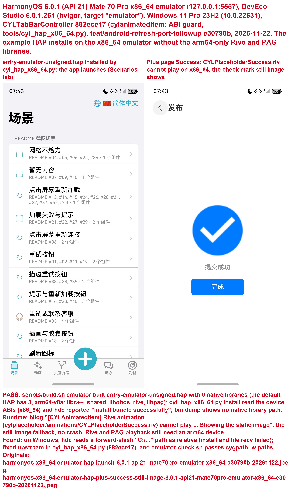 |  |

### 完成（待 CI）：修复 CI 错误 / Done (pending CI): Fix the CI error

| 中文 | English |
| --- | --- |
| 状态：完成，等待 CI 结果（2026-11-22，分支 `feat/android-refresh-port-followup`，PR #31）。 | Status: done, waiting for CI (2026-11-22, branch `feat/android-refresh-port-followup`, PR #31). |
| 用户原始提示词：“fix ci error” | The user's original prompt (verbatim): "fix ci error" |
| 背景：本分支最近完成的 iOS 工作流（运行 44908035550，提交 `e822b76`）失败；之后的运行都被更新的推送取消。两个作业失败：(1) “Docs navigation”：`docs/iOS-API-Map.md is stale`，因为 Android 新增的 `CYLPlaceholderComponent.showsImageWhenAnimationEnds`（`150772a`）没有重新生成该表；(2) “Demo Examples/Example-objc-02”：UI 测试 `CYLSectionsUITests.testFloatingSectionHeaderPinsBelowTheBarWhileRefreshing`（“the drag happens during the refresh”）与 `CYLPagingUITests.testAutoFooterLoadWithoutNewDataReturnsToTheLastPage`（-44 而非 0，“the last page is aligned”）。前者在 `a2ff08c` 的运行中也失败过（连同旋转测试），后者那次通过：都是时间相关的竞争，不是代码回归。 | Context: the branch's latest completed iOS workflow (run 44908035550, commit `e822b76`) failed; later runs were all cancelled by newer pushes. Two jobs failed: (1) "Docs navigation": `docs/iOS-API-Map.md is stale`, because the table was not regenerated after Android's new `CYLPlaceholderComponent.showsImageWhenAnimationEnds` (`150772a`); (2) "Demo Examples/Example-objc-02": the UI tests `CYLSectionsUITests.testFloatingSectionHeaderPinsBelowTheBarWhileRefreshing` ("the drag happens during the refresh") and `CYLPagingUITests.testAutoFooterLoadWithoutNewDataReturnsToTheLastPage` (-44 instead of 0, "the last page is aligned"). The first also failed in the `a2ff08c` run (with the rotation test), the second passed there: both are timing races, not code regressions. |
| 修复：(1) 用 `scripts/ios-api-map.py` 重新生成 `docs/iOS-API-Map.md`；新行的 iOS 对应写为 TODO（iOS 还没有 `showsImageWhenAnimationEnds`，Mac 会话），评分仍为 100（808 / 809）。(2) `CYLSectionsViewController` 的模拟加载从 8 秒改为 20 秒（GitHub macOS 运行器上 XCUITest 的拖动可能要几秒，8 秒时刷新有时先结束），UI 测试等待 “Header completed 1” 的超时从 15 秒改为 30 秒；`CYLPagingUITests` 新增 `waitForTop(of:toMatch:)`，在断言对齐前最多等 8 秒让表格停稳（替代只靠固定的 2 秒），用于两个自动尾部测试。 | Fix: (1) regenerated `docs/iOS-API-Map.md` with `scripts/ios-api-map.py`; the new row's iOS counterpart is TODO (iOS has no `showsImageWhenAnimationEnds` yet, Mac session), the score stays 100 (808 / 809). (2) `CYLSectionsViewController`'s simulated load is 20 s instead of 8 (an XCUITest drag can take several seconds on GitHub's macOS runners, and with 8 s the refresh sometimes ended first); the UI tests wait 30 s instead of 15 for "Header completed 1"; `CYLPagingUITests` gains `waitForTop(of:toMatch:)`, which waits up to 8 s for the table to settle before the alignment is asserted (instead of the fixed 2 s alone), used by the two automatic footer tests. |
| 第二轮（2026-11-22，运行 44961912638，`e30790b`）：“Docs navigation” 已通过；“Demo Examples/Example-objc-01” 在 `scripts/resolve-cyltabbarcontroller-commit.sh` 的匿名 `git clone` 失败（“fatal: could not read Username for 'https://github.com': Device not configured”，“expected flush after ref listing”），是 GitHub 的瞬时错误。修复：脚本设 `GIT_TERMINAL_PROMPT=0`，克隆最多重试 4 次（间隔 5、10、15 秒）。 | Second round (2026-11-22, run 44961912638, `e30790b`): "Docs navigation" passes; "Demo Examples/Example-objc-01" failed at the anonymous `git clone` in `scripts/resolve-cyltabbarcontroller-commit.sh` ("fatal: could not read Username for 'https://github.com': Device not configured", "expected flush after ref listing"), a transient GitHub error. Fix: the script sets `GIT_TERMINAL_PROMPT=0` and retries the clone up to 4 times (pauses of 5, 10, 15 s). |
| 第三轮（2026-11-22，用户：“fix ci fail”）：本分支没有失败的运行（只有被新推送取消的 iOS 运行）。PR #35（`fix/ios-swift-todos-placeholder`，另一会话，目标为本分支）的 “iOS 15 runtime”（运行 44963099871）在 `Tests/run-tests.rb` 的 `pod install` 克隆 CYLTabBarController 时失败，是同一分钟的 GitHub 瞬时错误（“could not read Username”）。修复：`Tests/run-tests.rb` 与 `scripts/ci-build-example.sh` 的 `pod install` 设 `GIT_TERMINAL_PROMPT=0` 并最多重试 4 次；已重新运行该失败作业。PR #36（`feat/android-refresh-port`，最后提交 `76e509f`，说明工作已转到本分支）的失败（Localization files、Unit tests、PAG 动画）是旧状态，本分支上这些作业已通过；是否关闭或更新 #36 由 owner 决定。 | Third round (2026-11-22, the user: "fix ci fail"): this branch has no failed run (only iOS runs cancelled by newer pushes). PR #35 (`fix/ios-swift-todos-placeholder`, another session, targeting this branch) failed "iOS 15 runtime" (run 44963099871) when `pod install` in `Tests/run-tests.rb` cloned CYLTabBarController: the same transient GitHub error in the same minute ("could not read Username"). Fix: `pod install` in `Tests/run-tests.rb` and `scripts/ci-build-example.sh` sets `GIT_TERMINAL_PROMPT=0` and retries up to 4 times; the failed job was re-run. PR #36 (`feat/android-refresh-port`, last commit `76e509f`, which says the work moved to this branch) fails Localization files, Unit tests and the PAG animation jobs on that old state; they pass on this branch; closing or updating #36 is the owner's call. |
| 验证：Windows 会话不能运行 iOS UI 测试；`ios-api-map.py --check` 在本地通过，iOS 部分以推送后的 CI 结果为准。 | Verification: a Windows session cannot run the iOS UI tests; `ios-api-map.py --check` passes locally, and the iOS part is verified by the CI run after the push. |

### 完成（100 / 100）：决定 `:merged-rive` 的发布 / Done (100/100): Decide the `:merged-rive` publication

| 中文 | English |
| --- | --- |
| 状态：完成（100 / 100，2026-11-22，本条之后的提交；分支 `feat/android-refresh-port-followup`，PR #31）。验证：`gradlew :merged-rive:publishToMavenLocal testDebugUnitTest :merged-example:assembleDebug` BUILD SUCCESSFUL（JDK 17）；POM：`cyltableviewplaceholder-refresh-rive:0.1.0`、MIT、依赖 `cyltableviewplaceholder-refresh:0.1.0` 与 `rive-android:10.3.0`；AAR 含 `META-INF/cylrefresh-rive/LICENSE`；`docs/Android-Port.md` 已记录。仍需 owner：真正发布到 Maven Central（账号与签名密钥），与另外两个模块相同。 | Status: done (100 / 100, 2026-11-22, the commit after this entry; branch `feat/android-refresh-port-followup`, PR #31). Verified: `gradlew :merged-rive:publishToMavenLocal testDebugUnitTest :merged-example:assembleDebug` BUILD SUCCESSFUL (JDK 17); POM: `cyltableviewplaceholder-refresh-rive:0.1.0`, MIT, dependencies `cyltableviewplaceholder-refresh:0.1.0` and `rive-android:10.3.0`; the AAR holds `META-INF/cylrefresh-rive/LICENSE`; recorded in `docs/Android-Port.md`. Still the owner's: the actual Maven Central upload (account and signing key), as for the other two modules. |
| 用户原始提示词：“decide the :merged-rive publication” | The user's original prompt (verbatim): "decide the :merged-rive publication" |
| 背景：`docs/Android-Port.md` “Maven publication coordinates”（90 / 100）的 TODO：`:merged-rive`（`android/merged/library/rive`，Rive 刷新头部 `CYLRefreshRiveHeader`，依赖 `:merged` 与 `app.rive:rive-android`）没有发布，需要决定是否发布及其 artifactId。已发布配置的两个模块：`io.github.chenyilong:cyltableviewplaceholder:0.1.0`（`:placeholder`）与 `io.github.chenyilong:cyltableviewplaceholder-refresh:0.1.0`（`:merged`）。iOS 把同一个头部（`CYLRefresh/Custom/Rive/CYLRefreshRiveHeader.swift`）作为可选的 `Rive` 子 spec 发布。 | Context: the TODO of "Maven publication coordinates" in `docs/Android-Port.md` (90 / 100): `:merged-rive` (`android/merged/library/rive`, the Rive refresh header `CYLRefreshRiveHeader`, depending on `:merged` and `app.rive:rive-android`) is not published; whether to publish it and its artifactId are open. The two modules with a publication: `io.github.chenyilong:cyltableviewplaceholder:0.1.0` (`:placeholder`) and `io.github.chenyilong:cyltableviewplaceholder-refresh:0.1.0` (`:merged`). iOS ships the same header (`CYLRefresh/Custom/Rive/CYLRefreshRiveHeader.swift`) as the optional `Rive` subspec. |
| 决定：发布，坐标 `io.github.chenyilong:cyltableviewplaceholder-refresh-rive`，版本与另外两个模块一致（`0.1.0`，`-PcylPlaceholderVersion` 覆盖）。理由：(1) 与 iOS 的 `Rive` 子 spec 对等，iOS 文档中的 API 在 Android 上也能用；(2) 单独的构件让不用 Rive 的应用不带 rive-android 的原生库（与 iOS 子 spec 相同）；(3) 名字沿用 `cyltableviewplaceholder-refresh` 前缀，表明它扩展 CYLRefresh；(4) 已知问题（代码开始的刷新不绘制、Bow 半拉黑带、Halloween 让模拟器退出）都只在模拟器的图形层出现，写入 POM 描述之外的文档，作为待真机确认的已知限制，不阻止发布。 | Decision: publish, as `io.github.chenyilong:cyltableviewplaceholder-refresh-rive`, versioned with the other two modules (`0.1.0`, overridden by `-PcylPlaceholderVersion`). Reasons: (1) parity with the iOS `Rive` subspec, so the API the iOS docs describe is usable on Android; (2) a separate artifact keeps rive-android's native libraries out of apps without Rive (as the iOS subspec does); (3) the name keeps the `cyltableviewplaceholder-refresh` prefix, showing it extends CYLRefresh; (4) the known issues (a refresh started from code draws nothing, Bow's black band half pulled, Halloween making the emulator exit) appear only in the emulator's graphics layer; they are documented as known limits awaiting a real device, and do not block the publication. |
| 评分标准：100 = `:merged-rive` 配置发布，`publishToMavenLocal` 生成 POM（MIT、SCM、依赖 `cyltableviewplaceholder-refresh:0.1.0` 与 `rive-android`）与含 LICENSE 的 AAR，构建与测试通过，文档记录决定与坐标，许可检查通过；60 = 决定写入文档并配置发布，`publishToMavenLocal` 通过。 | Acceptance: 100 = `:merged-rive` has a publication, `publishToMavenLocal` produces a POM (MIT, SCM, dependencies `cyltableviewplaceholder-refresh:0.1.0` and `rive-android`) and an AAR with the LICENSE, builds and tests pass, the docs record the decision and coordinates, the license check passes; 60 = the decision is documented and the publication configured, `publishToMavenLocal` passes. |

### 完成（100 / 100）：记录 Success 开始的时间戳，让截图标注精确的秒数 / Done (100/100): Record the Success start timestamp for exact screenshot seconds

| 中文 | English |
| --- | --- |
| 状态：完成（100 / 100，2026-11-22，本条之后的 `feat` 提交；分支 `feat/android-refresh-port-followup`，PR #31）。 | Status: done (100 / 100, 2026-11-22, the `feat` commit after this entry; branch `feat/android-refresh-port-followup`, PR #31). |
| 用户原始提示词：“record the Success start timestamp for exact screenshot seconds” | The user's original prompt (verbatim): "record the Success start timestamp for exact screenshot seconds" |
| 背景：下方“Take the mini program Success screenshot in WeChat DevTools”（95 / 100）的截图时间只由命令调用间隔估计（`wechatide` 每次调用约 3–4 秒），剩余 TODO −5。 | Context: the screenshots of "Take the mini program Success screenshot in WeChat DevTools" (below, 95 / 100) have times estimated from the command timing only (each `wechatide` call takes about 3–4 s); remaining TODO −5. |
| 计划：(1) 示例加号页（`pages/publish/publish`）在 Success 显示时记录 `successStartedAt`（`Date.now()`，页面 data，可由自动化读取）；(2) 脚本 `scripts/success-timing-screenshots.js` 用 miniprogram-automator 连接开发者工具，重新打开该页，读取 `successStartedAt`，在目标秒数截图，每张截图前后各读一次运行时的 `Date.now()`，记录截图时刻相对 Success 开始的区间；(3) 用这些秒数重新拼图。 | Plan: (1) the example's plus page (`pages/publish/publish`) records `successStartedAt` (`Date.now()`, in the page data, readable by automation) when Success shows; (2) a script `scripts/success-timing-screenshots.js` connects to DevTools with miniprogram-automator, opens the page again, reads `successStartedAt`, takes screenshots at target seconds and reads the runtime's `Date.now()` right before and after each one, recording each screenshot's interval after the start of Success; (3) the sheet is remade with those seconds. |
| 评分标准：100 = 页面记录时间戳，脚本可重复运行，新截图的标题给出相对 Success 开始的秒数（误差区间不超过 0.5 秒），拼图检查通过，文档更新，测试通过；60 = 页面记录时间戳并且至少一张截图带有测得的秒数。 | Acceptance: 100 = the page records the timestamp, the script can be run again, the new screenshots' captions give the seconds after the start of Success (interval at most 0.5 s wide), the screenshot check passes, the docs are updated, tests pass; 60 = the page records the timestamp and at least one screenshot carries measured seconds. |
| 进展（2026-11-22，评分 100 / 100）：(1) `pages/publish/publish.js` 在 Success 渲染后的 `setData` 回调中记录 `successStartedAt`（`Date.now()`）。(2) `scripts/success-timing-screenshots.js`（`npm run success-timing`，开发依赖 `miniprogram-automator`）：每张截图前用 `reLaunch` 重新打开该页（不等待：它在 Success 开始约 1.6 秒后才返回），轮询运行时取得时间戳，按运行时时钟等到目标秒数，读取一次 `Date.now()` 后截图。开发者工具的一次截图约 0.75 秒，画面在那次读取之后固定的延迟被截取；`--calibrate` 在 Uploading → Success 切换前后连续截图来测量这个延迟：两次校准得到 0.106–0.169 秒（最后一张 Uploading 读数 −0.169 / −0.168 秒，第一张 Success 读数 −0.120 / −0.106 秒），所以每张截图的时刻精确到约 0.06 秒的区间。结果：动画播放到 Success 开始后约 1.5 秒，1.51–1.58 秒的截图已显示对勾，5.11–5.17 秒仍在。验证：小程序 `npm test`、截图检查通过。 | Progress (2026-11-22, score 100 / 100): (1) `pages/publish/publish.js` records `successStartedAt` (`Date.now()`) in the `setData` callback once Success is rendered. (2) `scripts/success-timing-screenshots.js` (`npm run success-timing`, dev dependency `miniprogram-automator`): before each screenshot it opens the page again with `reLaunch` (not awaited: it resolves about 1.6 s after Success already started), polls the runtime for the timestamp, waits on the runtime's clock until the target second, reads `Date.now()` once and takes the screenshot. A DevTools screenshot takes about 0.75 s, and the frame is captured a fixed delay after that reading; `--calibrate` measures the delay by shooting across the Uploading → Success switch: two calibrations give 0.106–0.169 s (last Uploading reading −0.169 / −0.168 s, first Success reading −0.120 / −0.106 s), so each screenshot's moment is known to an interval of about 0.06 s. Result: the animation plays until about 1.5 s after Success started; the 1.51–1.58 s shot already shows the check mark, still there at 5.11–5.17 s. Verified: mini program `npm test`, the screenshot check. |
| 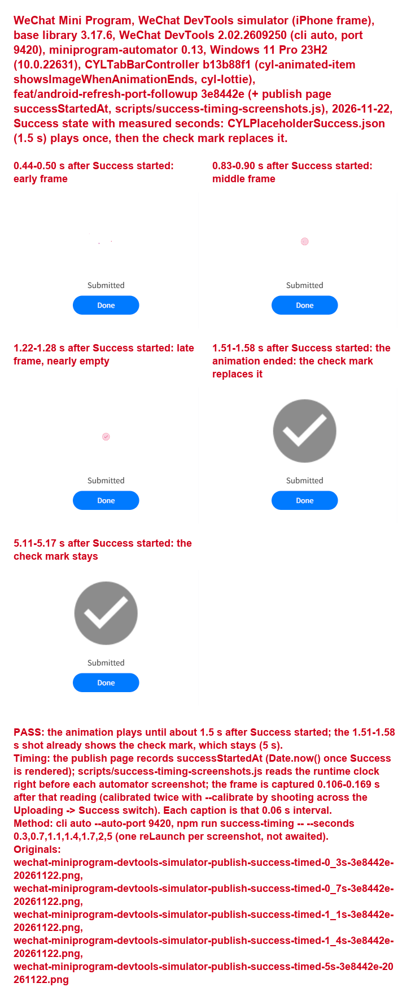 |  |

### 完成（95 / 100）：在微信开发者工具中截取小程序 Success 截图 / Done (95/100): Take the mini program Success screenshot in WeChat DevTools

| 中文 | English |
| --- | --- |
| 状态：完成（95 / 100，2026-11-22，本条之后的 `docs` 提交），剩余工作见下方 TODO（2026-11-22 开始，分支 `feat/android-refresh-port-followup`，PR #31）。 | Status: done (95 / 100, 2026-11-22, the `docs` commit after this entry); the remaining work is in the TODO below (started 2026-11-22, branch `feat/android-refresh-port-followup`, PR #31). |
| 用户原始提示词：“take the mini program Success screenshot in WeChat DevTools” | The user's original prompt (verbatim): "take the mini program Success screenshot in WeChat DevTools" |
| 背景：下方“Show a static success icon after the animation ends”（80 / 100）在小程序中为 Success 开启了 `showsImageWhenAnimationEnds`（`cyl_scenario_catalog.js`、`index.wxml` 传给 `cyl-animated-item`），但只有单元测试，没有开发者工具截图（TODO −3）。小程序的 Success 播放 `CYLPlaceholderSuccess.json`（Lottie，最后一帧几乎为空），结束后应显示对勾 `check_circle`。工具：WeChat DevTools Skills（`wechatide`）；以前客户端授权超时时用经典 CLI 与 miniprogram-automator（`docs/WeChat-MiniProgram.md`）。 | Context: "Show a static success icon after the animation ends" (below, 80 / 100) turned on `showsImageWhenAnimationEnds` for the mini program's Success (`cyl_scenario_catalog.js`, passed to `cyl-animated-item` in `index.wxml`), with unit tests only and no DevTools screenshot (TODO −3). The mini program's Success plays `CYLPlaceholderSuccess.json` (Lottie, its last frame nearly empty) and should show the check mark `check_circle` when it ends. Tools: the WeChat DevTools Skills (`wechatide`); when the client authorization timed out before, the classic CLI and miniprogram-automator were used (`docs/WeChat-MiniProgram.md`). |
| 评分标准：100 = 开发者工具模拟器中 Success 动画播放时与结束后的截图（结束后显示对勾），用 `scripts/screenshot_sheet.py` 拼成带页眉页脚的图，`check_screenshots.py` 通过，嵌入文档；60 = 至少一张结束后显示对勾的模拟器截图，按命名规则存入 `docs/assets` 并嵌入文档。 | Acceptance: 100 = DevTools simulator screenshots of Success while the animation plays and after it ends (the check mark showing), stitched by `scripts/screenshot_sheet.py` with header and footer, `check_screenshots.py` passing, embedded in the docs; 60 = at least one simulator screenshot after the end showing the check mark, named by the rules, stored in `docs/assets` and embedded. |
| 进展（2026-11-22，评分 95 / 100）：用 WeChat DevTools Skills（`wechatide -c Claude`，开发者工具 2.02.2609250，基础库 3.17.6）完成：客户端授权这次成功（以前超时），`open_project_window`、`simulator_open_page pages/publish/publish`（Uploading，1.5 秒后 Success）、`simulator_screenshot`。第一次运行 Success 结束后是空白：示例中被 git 忽略的 `cyl-placeholder` 副本是旧的（没有 `shows-image-when-animation-ends`），它由 `scripts/sync-example.js` 生成，开发者工具的 `beforeCompile` 钩子会运行它，但 `simulator_open_page` 不运行；`npm run sync-example` 之后正常，无需改代码。结果：`CYLPlaceholderSuccess.json` 播放一次，然后 `cyl-animated-item` 隐藏引擎、显示对勾，并保持。截图一次只截一张（并行调用返回缩小的图）。期间与 chen-yilong-b6 同时使用开发者工具导致自动化端口无响应，b6 重启后继续。未满分原因：截图时间由调用间隔估计，没有精确到 Success 开始后的秒数（-5）。 | Progress (2026-11-22, score 95 / 100): done with the WeChat DevTools Skills (`wechatide -c Claude`, DevTools 2.02.2609250, base library 3.17.6): the client authorization succeeded this time (it timed out before); `open_project_window`, `simulator_open_page pages/publish/publish` (Uploading, then Success after 1.5 s), `simulator_screenshot`. The first run showed a blank icon after Success ended: the example's git-ignored copy of `cyl-placeholder` was stale (no `shows-image-when-animation-ends`); `scripts/sync-example.js` makes it and DevTools' `beforeCompile` hook runs it, but `simulator_open_page` does not. After `npm run sync-example` it works, with no code change. Result: `CYLPlaceholderSuccess.json` plays once, then `cyl-animated-item` hides the engine and shows the check mark, which stays. Screenshots are taken one at a time (parallel calls returned shrunken images). Using DevTools at the same time as chen-yilong-b6 hung its automation port; b6 restarted it and the run continued. Missing points: the screenshot times are estimated from the call timing, not measured from the start of Success (-5). |
| 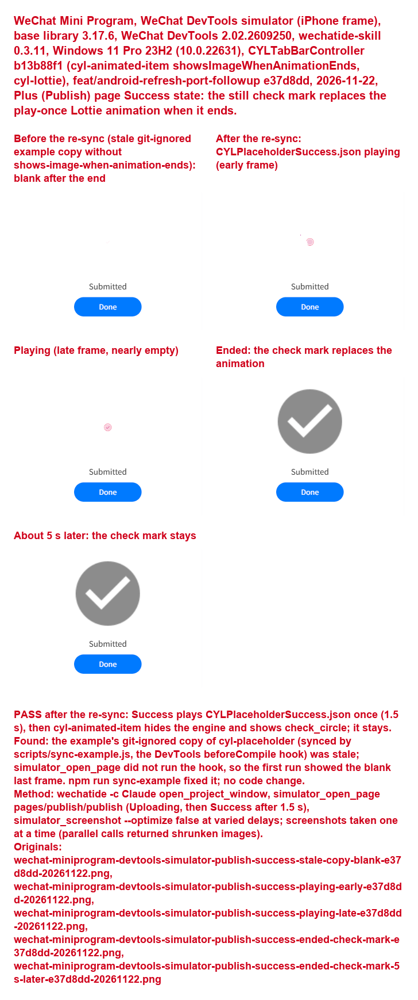 |  |
| 已完成（2026-11-22）：上方“Record the Success start timestamp for exact screenshot seconds”（100 / 100）给出精确秒数的截图。 | Done (2026-11-22): "Record the Success start timestamp for exact screenshot seconds" (above, 100 / 100) has the screenshots with exact seconds. |

### 完成（70 / 100）：让鸿蒙的 Rive 引擎报告播放结束 / Done (70/100): Make the HarmonyOS Rive engine report the end

| 中文 | English |
| --- | --- |
| 状态：完成（70 / 100，2026-11-22，提交见 PR #31 中本条之后的 `feat` 提交），剩余工作见下方 TODO（2026-11-22 开始，分支 `feat/android-refresh-port-followup`，PR #31）。 | Status: done (70 / 100, 2026-11-22, the `feat` commit after this entry in PR #31); the remaining work is in the TODO below (started 2026-11-22, branch `feat/android-refresh-port-followup`, PR #31). |
| 用户原始提示词：“make the HarmonyOS Rive engine report the end” | The user's original prompt (verbatim): "make the HarmonyOS Rive engine report the end" |
| 背景：上一个任务（下方“Show a static success icon after the animation ends”，80 / 100）让鸿蒙的核心播放器报告只播放一次的动画结束（`CYLPlaceholderPlayableContentView.didEnd()`），示例的 Lottie 引擎已接入，但 Success 场景在鸿蒙上先播放 `CYLPlaceholderSuccess.riv`，而示例的 Rive 引擎（`entry/src/main/ets/engines/CYLRivePlaceholderItemAnimator.ets`，`CYLRiveAnimationContentView`）从不调用 `didEnd()`，所以 `showsImageWhenAnimationEnds` 在 Rive 上不起作用（该任务的 TODO −8）。 | Context: the previous task ("Show a static success icon after the animation ends", below, 80 / 100) made the HarmonyOS core player report the end of a play-once animation (`CYLPlaceholderPlayableContentView.didEnd()`) and wired the example's Lottie engine, but on HarmonyOS the Success scenario plays `CYLPlaceholderSuccess.riv` first, and the example's Rive engine (`entry/src/main/ets/engines/CYLRivePlaceholderItemAnimator.ets`, `CYLRiveAnimationContentView`) never calls `didEnd()`, so `showsImageWhenAnimationEnds` does nothing for Rive (that task's TODO −8). |
| 计划：播放一次（重复次数 1）时，在本次播放的最后一次输入变化之后，等 `RiveAnimationView.isPlaying()` 变为 false（命名动画 ONESHOT 停止，或状态机静止）即调用 `didEnd()`；停止、显示最后一帧、重新播放、卸载时取消；循环（重复次数 0）不报告。判断逻辑放在不依赖 @ohos/rive 的小类中，以便单元测试。 | Plan: for a play-once (repeat count 1) play, once the pass's last input change is made, wait until `RiveAnimationView.isPlaying()` turns false (a ONESHOT named animation stopped, or the state machine settled), then call `didEnd()`; stopping, showing the last frame, playing again and detaching cancel it; loops (repeat count 0) never end. The decision logic lives in a small class without @ohos/rive, so it can be unit tested. |
| 评分标准：100 = Rive 引擎在只播放一次的 Rive 动画结束时报告结束，Success 在 arm64 设备上播放完 `.riv` 后显示对勾（截图证明），单元测试覆盖，构建与测试通过；60 = 实现完成并有单元测试覆盖结束、取消与循环，构建与已有测试通过，arm64 验证记为 TODO。 | Acceptance: 100 = the Rive engine reports the end when a play-once Rive animation ends, Success shows the check mark after the `.riv` plays on an arm64 device (screenshot proof), unit tests cover it, builds and tests pass; 60 = implemented, with unit tests covering the end, the cancel paths and loops, builds and existing tests pass, the arm64 check recorded as a TODO. |
| 进展（2026-11-22，评分 70 / 100）：新增 `entry/src/main/ets/engines/CYLRivePlayOnceEndWatcher.ets`（不导入 @ohos/rive）：`arm()` 后每 100 ms 询问 `isPlaying`，变为 false 时报告一次结束；`cancel()` 或再次 `arm()` 丢弃本次等待。不用 @ohos/rive 的 `RiveFileControllerListener`（`notifyStop` / `notifyPause`），因为引擎自己的 `stop()` / `pause()` 也会触发它，且 1.0.4 只有编译后的实现，无法确认状态机静止时是否通知。`CYLRiveAnimationContentView` 在每次播放的最后一次输入变化后 arm：命名动画播放后、触发输入在 50 ms 后触发后、数字输入设置后、视图模型触发器触发后、布尔值（输入或 `active`）在 `duration` 秒后回到 false 后（`duration` 为 0 时在设为 true 后）、无输入的重启后；重复次数 0（循环）、停止、显示最后一帧、重新播放与卸载时取消；结束时调用 `didEnd()`，由核心转交给 `CYLAnimatedItemView` 的 `showsImageWhenAnimationEnds`。新增示例模块的本地单元测试 `entry/src/test/CYLRivePlayOnceEndWatcher.test.ets`（5 个：结束只报告一次、第一次检查在一个间隔之后、取消、重新 arm、一直播放则不结束），`scripts/build.sh test` 现在也运行它。验证：`scripts/build.sh test`（示例 HAP 构建、核心 91 / 91）、示例本地测试 5 / 5、文档注释检查通过。未满分原因：唯一可用的设备是 x86_64 模拟器，@ohos/rive 没有它的原生库，Rive 不运行，所以 `CYLPlaceholderSuccess.riv` 播放后显示对勾未在设备上验证、也没有截图（-30）。 | Progress (2026-11-22, score 70 / 100): new `entry/src/main/ets/engines/CYLRivePlayOnceEndWatcher.ets` (no @ohos/rive import): after `arm()` it asks `isPlaying` every 100 ms and reports the end once when it turns false; `cancel()` or another `arm()` drops the wait. It does not use @ohos/rive's `RiveFileControllerListener` (`notifyStop` / `notifyPause`), because the engine's own `stop()` / `pause()` fire it too, and 1.0.4 ships only a compiled implementation, so whether a settled state machine notifies cannot be checked. `CYLRiveAnimationContentView` arms it after each pass's last input change: after a named animation starts, after the trigger input fires 50 ms later, after a number input is set, after a view model trigger fires, after the boolean (input or `active`) goes back to false after `duration` seconds (after it is set true when `duration` is 0), after a restart without inputs; a repeat count of 0 (loop), stop, show last frame, play again and detach cancel it; at the end it calls `didEnd()`, which the core forwards to `CYLAnimatedItemView`'s `showsImageWhenAnimationEnds`. New local unit tests for the example module, `entry/src/test/CYLRivePlayOnceEndWatcher.test.ets` (5: the end is reported once, the first check comes one interval later, cancel, arming again, a file that keeps playing never ends); `scripts/build.sh test` now runs them too. Verified: `scripts/build.sh test` (example HAP build, core 91 / 91), example local tests 5 / 5, the doc comment check. Missing points: the only device is the x86_64 emulator, which has no @ohos/rive native library, so Rive does not run there: the check mark after `CYLPlaceholderSuccess.riv` plays is not verified on a device and has no screenshot (-30). |
| 验证（2026-11-22，评分 90 / 100）：CYLTabBarController `c8fee654` 的方案 1（x86_64 Rive 调试引擎包，仅 debug 构建）让 Rive 在 x86_64 模拟器上运行；示例改为由 `CYLAnimatedItemEngines.isSupportedOnDevice('Rive')` 决定是否注册 Rive，并在启动时调用 `loadX86_64DebugEngines`。模拟器上：点击加号后 2.2 秒 `CYLPlaceholderSuccess.riv` 正在播放，2.5 秒播放结束、对勾取代动画，7.4 秒仍在：`CYLRivePlayOnceEndWatcher` 看到 `isPlaying()` 变为 false 并调用 `didEnd()`。 | Verified (2026-11-22, score 90 / 100): Plan 1 of CYLTabBarController `c8fee654` (the x86_64 Rive debug engine kit, debug builds only) runs Rive on the x86_64 emulator; the example now lets `CYLAnimatedItemEngines.isSupportedOnDevice('Rive')` decide whether to register Rive and calls `loadX86_64DebugEngines` at launch. On the emulator: 2.2 s after tapping the plus button `CYLPlaceholderSuccess.riv` is playing, at 2.5 s the pass ended and the check mark replaced it, still there at 7.4 s: `CYLRivePlayOnceEndWatcher` saw `isPlaying()` turn false and called `didEnd()`. |
| 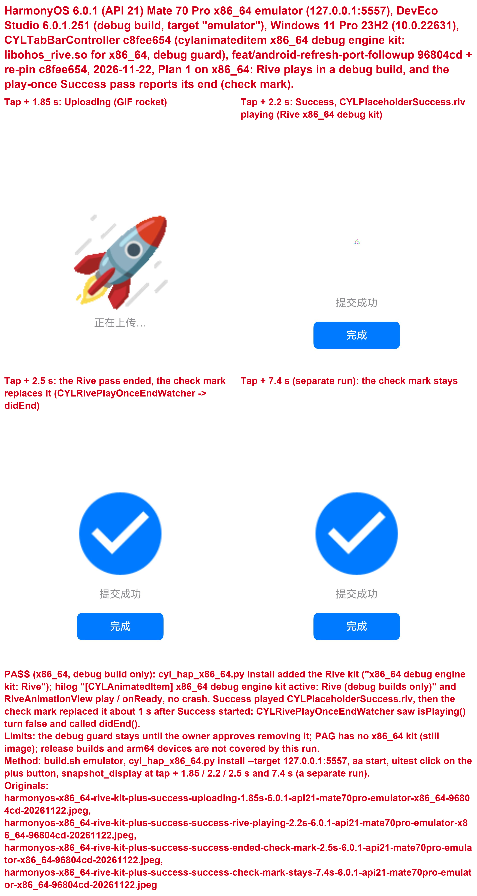 |  |
| TODO（-10）：在 arm64 设备（release 构建）上确认同样的行为。 | TODO (-10): confirm the same behavior on an arm64 device (release build). |

### 完成（80 / 100）：动画结束后显示静态的成功图标 / Done (80/100): Show a static success icon after the animation ends

| 中文 | English |
| --- | --- |
| 状态：完成（80 / 100，2026-11-22，提交 `0299e09`、`150772a`），剩余工作见下方 TODO（2026-11-21 开始，分支 `feat/android-refresh-port-followup`，PR #31）。 | Status: done (80 / 100, 2026-11-22, commits `0299e09`, `150772a`); the remaining work is in the TODOs below (started 2026-11-21, branch `feat/android-refresh-port-followup`, PR #31). |
| 用户原始提示词：“show a static success icon after the animation ends” | The user's original prompt (verbatim): "show a static success icon after the animation ends" |
| 背景：模拟器运行（见下方 2026-11-21 “Run the examples on the Android and HarmonyOS emulators”）发现 Android 加号页的成功状态没有图标：`CYLPlaceholderSuccess.json` 只播放一次，最后一帧几乎为空。用户在三个选项中选择“动画结束后显示静态的成功图标”。现状：Success 场景的静态图是信息图标（`cyl_placeholder_info`，iOS `.info`），没有成功（对勾）图标；CYLTabBarController 的 `CYLAnimatedItemView` 没有“播放结束”的通知。 | Context: the emulator run (2026-11-21, "Run the examples on the Android and HarmonyOS emulators", below) found no icon in the Android plus page's Success state: `CYLPlaceholderSuccess.json` plays once and its last frame is nearly empty. Of the three options, the user chose "show a static success icon after the animation ends". Today the Success scenario's still image is the info icon (`cyl_placeholder_info`, iOS `.info`), there is no success (check mark) icon, and CYLTabBarController's `CYLAnimatedItemView` has no "playback ended" notification. |
| 计划：(1) 新增静态图标 `CYLPlaceholderCheckCircle@2x.png`（google/material-design-icons `action/check_circle`，与其他图标同一版本，Apache-2.0，记入各份 `NOTICE.material-design-icons`），作为 Success 场景的静态图（Android、鸿蒙、小程序；iOS 留给 Mac 会话）；(2) 播放结束后回到静态图：按规则（“Animation bugs … fix in CYLTabBarController”）在 CYLTabBarController 的 `CYLAnimatedItemView` 中实现（请求已发给 CYLTabBarController 会话），本仓库在上游可用后接入并重新固定。 | Plan: (1) a new still icon `CYLPlaceholderCheckCircle@2x.png` (google/material-design-icons `action/check_circle`, the same revision as the other icons, Apache-2.0, listed in every `NOTICE.material-design-icons`) as the Success scenario's still image (Android, HarmonyOS, mini program; iOS left to the Mac session); (2) back to the still image when playback ends: by the rules ("Animation bugs … fix in CYLTabBarController") in CYLTabBarController's `CYLAnimatedItemView` (request sent to the CYLTabBarController session); this repository wires it in and re-pins once upstream has it. |
| 评分标准：100 = 各非 iOS 平台的成功状态在动画结束后显示对勾图标，模拟器截图证明，测试通过，iOS 的剩余工作记为 TODO；60 = 对勾图标作为 Success 静态图在 Android 上可见（未播放动画或播放结束后），测试通过。 | Acceptance: 100 = on every non-iOS platform the Success state shows the check mark icon after its animation ends, proven by emulator screenshots, tests pass, and the iOS remainder is a TODO; 60 = the check mark icon is the Success still image and visible on Android (without an animation or after it ends), tests pass. |
| 进展（2026-11-21，评分 45 / 100）：第 (1) 步完成：`CYLPlaceholderCheckCircle@2x.png`（未修改的上游 PNG）加入 iOS bundle 与四份 `NOTICE.material-design-icons`，由 `android/scripts/import-ios-resources.py` 导入为 `cyl_placeholder_check_circle`，再由小程序与鸿蒙的导入脚本复制为 `check_circle`；Android、小程序、鸿蒙的 Success 场景静态图改为对勾；新增单元测试 `successScenarioStillImageIsTheCheckMark`。验证：Android 单元测试与示例构建、小程序 73 / 73、鸿蒙 91 / 91、许可与本地化检查通过。第 (2) 步等待上游：owner 已批准（2026-11-21，“approve the CYLAnimatedItemView API, go ahead”）在 `CYLAnimatedItemView` 新增公开 API `showsImageWhenAnimationEnds`（默认 false）与可选的“播放结束”回调；已通知 CYLTabBarController 会话（chen-yilong-b6）实现 Android、鸿蒙、小程序部分（iOS 需 Mac 会话），完成后本仓库重新固定、同步副本、为 Success 开启并在模拟器上验证。在此之前，加载了动画库的应用中 Success 动画结束后仍是空白（对勾只在没有动画引擎时显示）。iOS 的 Success 静态图仍是 `.info`（TODO，Mac 会话）。 | Progress (2026-11-21, score 45 / 100): step (1) is done: `CYLPlaceholderCheckCircle@2x.png` (the unmodified upstream PNG) is in the iOS bundle and the four `NOTICE.material-design-icons`, imported by `android/scripts/import-ios-resources.py` as `cyl_placeholder_check_circle` and copied as `check_circle` by the mini program and HarmonyOS import scripts; the Success scenario's still image is the check mark on Android, the mini program and HarmonyOS; new unit test `successScenarioStillImageIsTheCheckMark`. Verified: Android unit tests and the example build, mini program 73 / 73, HarmonyOS 91 / 91, the license and localization checks. Step (2) waits for upstream: the owner approved (2026-11-21, "approve the CYLAnimatedItemView API, go ahead") a public `CYLAnimatedItemView` API `showsImageWhenAnimationEnds` (default false) with an optional "animation ended" callback; the CYLTabBarController session (chen-yilong-b6) was told to implement it for Android, HarmonyOS and the mini program (iOS needs a Mac session); then this repository re-pins, syncs the copies, enables it for Success and verifies on the emulators. Until then, in an app with the animation library the Success animation still ends blank (the check mark shows only without an animation engine). iOS's Success still image is still `.info` (TODO, Mac session). |
| 进展（2026-11-22）：iOS 的 Success 场景静态图改为对勾 `CYLPlaceholderCheckCircle`（模板渲染，与样式一样着色；图片缺失时回退 Info），新增单元测试 `testSuccessScenarioStillImageIsTheCheckMark`；Xcode 27.2 / iOS 27.2 模拟器 212 个单元测试全部通过。 | Progress (2026-11-22): the iOS Success scenario still image is the check mark `CYLPlaceholderCheckCircle` (template-rendered, tinted like the styles; Info stays the fallback if the image is missing); new unit test `testSuccessScenarioStillImageIsTheCheckMark`; all 212 unit tests pass on Xcode 27.2 / the iOS 27.2 simulator. |

### TODO：修复 docs 中所有 iOS / Swift 相关 TODO，并用 Xcode 测试 / TODO: Fix every iOS / Swift TODO in docs and test with Xcode

| 中文 | English |
| --- | --- |
| 状态：TODO（2026-11-22，分支 `fix/ios-swift-todos-placeholder`，基于 `feat/android-refresh-port-followup` / PR #31）。 | Status: TODO (2026-11-22, branch `fix/ios-swift-todos-placeholder`, based on `feat/android-refresh-port-followup` / PR #31). |
| 用户原始提示词：“fix all todo in docs about ios/swift and test with  Xcode” | The user's original prompt (verbatim): "fix all todo in docs about ios/swift and test with  Xcode" |
| 要求：①找出 `docs/` 中所有与 iOS / Swift 相关的 TODO；②逐条修复；③用 Xcode（本机 Xcode 27.2，iOS 27.2 模拟器 089139CC）测试；④分数只在有测试证据时提高。 | Requirements: (1) find every iOS / Swift TODO in `docs/`; (2) fix them one by one; (3) test with Xcode (local Xcode 27.2, iOS 27.2 simulator 089139CC); (4) raise a score only with test evidence. |
| 上下文：第一轮（2026-11-21，提交 `87d6818`..`76e509f`）误在过时分支 `feat/android-refresh-port` 上进行，其中播放控件、GIF/PAG/Rive 调速与 #1628 修复在本分支已存在（2026-11-19），已作废，不合并（会恢复本分支已删除的 Objective-C 核心文件）。可沿用的发现：iOS 27 上 Example-SwiftUI 的 introspect 版本列表（.v13…v26）不调用回调；SwiftUI 在刷新开始后 20 ms 内重置 inset。本轮在本分支重新盘点 TODO，只做本分支缺少的修复。 | Context: the first pass (2026-11-21, commits `87d6818`..`76e509f`) ran by mistake on the stale branch `feat/android-refresh-port`; its playback controls, GIF/PAG/Rive speed and #1628 fix already exist here (2026-11-19), so it is abandoned and not merged (it would bring back the Objective-C core files this branch removed). Findings that carry over: on iOS 27 Example-SwiftUI's introspect version list (.v13…v26) never calls its closure; SwiftUI resets the inset within 20 ms of a refresh starting. This pass re-surveys the TODOs on this branch and only does what it lacks. |
| 进度（2026-11-22）：#1628 示例在 iOS 27 上的缺口已修复（`a169386`，introspect 开放区间，Example-SwiftUI 1/4 → 4/4）。本机 Xcode 27.2 / iOS 27.2 全量验证：单元测试 211 个通过；UI 测试 objc-02 12/12、objc-01 1/1、SwiftUI 4/4；Example-Scenarios 构建通过（CYLAnimatedItem pod 本分支已处理）。重新盘点：2026-11-19 的 Mac 审核已把多数 iOS 行标为 Blocked（真机、报告者、未安装的运行时）。仍可做（未受阻）：#1630（75）、Swift 示例与 Swift 友好的 Core（90）、刷新动画图标（90）、HUD（90）、README（99）、CI 截图（95）、31 个未调查的 issue、`docs/Swift-Migration.md` 尾项、`docs/Animated-Item-Migration.md` TODO 5。仍为 TODO。 | Progress (2026-11-22): the #1628 example gap on iOS 27 is fixed (`a169386`, open introspect range, Example-SwiftUI 1/4 → 4/4). Full local check on Xcode 27.2 / iOS 27.2: 211 unit tests pass; UI tests objc-02 12/12, objc-01 1/1, SwiftUI 4/4; Example-Scenarios builds (this branch already handles the CYLAnimatedItem pod). Re-survey: the 2026-11-19 Mac audit marked most iOS rows Blocked (device, reporter, missing runtime). Still doable (not blocked): #1630 (75), Swift examples and a Swift-friendly core (90), CYLRefresh animated icons (90), HUD (90), README (99), CI screenshots (95), the 31 uninvestigated issues, the tail of `docs/Swift-Migration.md`, `docs/Animated-Item-Migration.md` TODO 5. Still TODO. |
| 进度（2026-11-22 续）：Example-Scenarios 在旧固定 commit `b4d68cfe` 上启动即崩溃（CYLTabBarController 的 `tabBar` getter 在 init 期间 `unsafeDowncast` 失败），升级到最新 `303df370` 后正常（`44877ae`）；HUD 各状态模拟器验证，HUD 90 → 95（`67dd555`）；四种引擎的刷新图标模拟器截图（分数不变）。#1630 仍受阻（无复现步骤）。 | Progress (2026-11-22, continued): Example-Scenarios crashed at launch on the old pin `b4d68cfe` (CYLTabBarController's `tabBar` getter failed its `unsafeDowncast` during init); fine on the newest `303df370` (`44877ae`). HUD states checked on the simulator, HUD 90 → 95 (`67dd555`); refresh icons of the four engines captured on the simulator (score unchanged). #1630 stays blocked (no reproduction steps). |
| 进展（2026-11-22）：Swift-Guide 已验证表新增 9 行（CYLRefreshIconAnimating 刷新图标、MJRefresh 示例移植、HUD），依据 CI 运行 44717720309（a4d92a1，五个 Demo 全部编译通过）；`setStatus(_:)` 仍无 Swift 调用点；合并了基础分支的 3 个新提交。新发现的 iOS TODO：Success 场景的 iOS 静态图仍是 `.info`。 | Progress (2026-11-22): 9 new rows in the Swift-Guide verified table (CYLRefreshIconAnimating refresh icons, the MJRefresh example port, the HUD), based on CI run 44717720309 (a4d92a1, all five Demo jobs compiled); `setStatus(_:)` still has no Swift call site; merged the base branch's 3 new commits. New iOS TODO found: the iOS Success scenario still image is still `.info`. |
| 进展（2026-11-22，评分 80 / 100）：第 (2) 步完成：CYLTabBarController `b13b88f1`（chen-yilong-b6 实现的 `CYLAnimatedItemView.showsImageWhenAnimationEnds`，Android、鸿蒙、小程序）固定到 Cartfile 与 Podfile，鸿蒙 `cylanimateditem` 与小程序 `cyl-animated-item` 已同步。Android：`CYLPlaceholderComponent.showsImageWhenAnimationEnds`，栈视图把它交给播放场景动画的条目，Success 图标开启。小程序：组件键 `showsImageWhenAnimationEnds` 传给 `cyl-animated-item`，Success 开启。鸿蒙：核心播放器报告只播放一次的动画结束（`cyl_animationViewEndHandler` / `didEnd`），模型转交给 `CYLAnimatedItemView` 的 `onEnded`，重播经由条目（`CYLAnimatedItemController`）以重新显示动画；示例 Lottie 引擎报告 `complete`；Success 开启。验证：Android 单元测试与示例构建、小程序 74 / 74、鸿蒙 91 / 91、文档注释、许可与本地化检查通过；Android 17 模拟器：Success 动画播放一次后显示对勾（之前为空白）；鸿蒙模拟器：显示对勾，但由于 x86_64 模拟器没有 Rive 引擎（HAP 去掉了 `libs/`），Success 的 `CYLPlaceholderSuccess.riv` 不播放，显示的是静态图，动画结束路径只由单元测试覆盖。未满分原因：鸿蒙 Rive 引擎不报告结束（-8）、鸿蒙动画结束未在设备上验证（-4）、小程序未在开发者工具中截图（-3）、iOS 未完成（-5，Mac 会话）。 | Progress (2026-11-22, score 80 / 100): step (2) is done: CYLTabBarController `b13b88f1` (`CYLAnimatedItemView.showsImageWhenAnimationEnds` by chen-yilong-b6, Android, HarmonyOS, mini program) is pinned in the Cartfile and Podfiles; the HarmonyOS `cylanimateditem` and mini program `cyl-animated-item` copies are synced. Android: `CYLPlaceholderComponent.showsImageWhenAnimationEnds`, handed by the stack view to the item that plays the scenario animation, on for the Success icon. Mini program: the component key `showsImageWhenAnimationEnds`, passed to `cyl-animated-item`, on for Success. HarmonyOS: the core player reports the end of a play-once animation (`cyl_animationViewEndHandler` / `didEnd`), the model forwards it to `CYLAnimatedItemView`'s `onEnded`, and a replay goes through the item (`CYLAnimatedItemController`) so the animation shows again; the example Lottie engine reports `complete`; on for Success. Verified: Android unit tests and the example build, mini program 74 / 74, HarmonyOS 91 / 91, the doc comment, license and localization checks; Android 17 emulator: the Success animation plays once, then the check mark shows (blank before); HarmonyOS emulator: the check mark shows, but as the still image, because the x86_64 emulator has no Rive engine (the HAP is installed without `libs/`) and Success plays `CYLPlaceholderSuccess.riv`; the end path is covered by the unit test only. Missing points: the HarmonyOS Rive engine reports no end (-8), the HarmonyOS end not verified on a device (-4), no mini program DevTools screenshot (-3), iOS not done (-5, Mac session). |
| 后续（2026-11-22）：鸿蒙 Rive 引擎现在报告结束（上方“Make the HarmonyOS Rive engine report the end”，70 / 100），-8 中的实现部分已完成，arm64 设备验证仍是 TODO。 | Follow-up (2026-11-22): the HarmonyOS Rive engine now reports the end ("Make the HarmonyOS Rive engine report the end", above, 70 / 100); the implementation part of the -8 is done, the arm64 device check is still a TODO. |
| 后续（2026-11-22）：小程序的 Success 截图已在开发者工具中完成（上方“Take the mini program Success screenshot in WeChat DevTools”，95 / 100），-3 完成。 | Follow-up (2026-11-22): the mini program Success screenshot is done in DevTools ("Take the mini program Success screenshot in WeChat DevTools", above, 95 / 100); the -3 is done. |
| 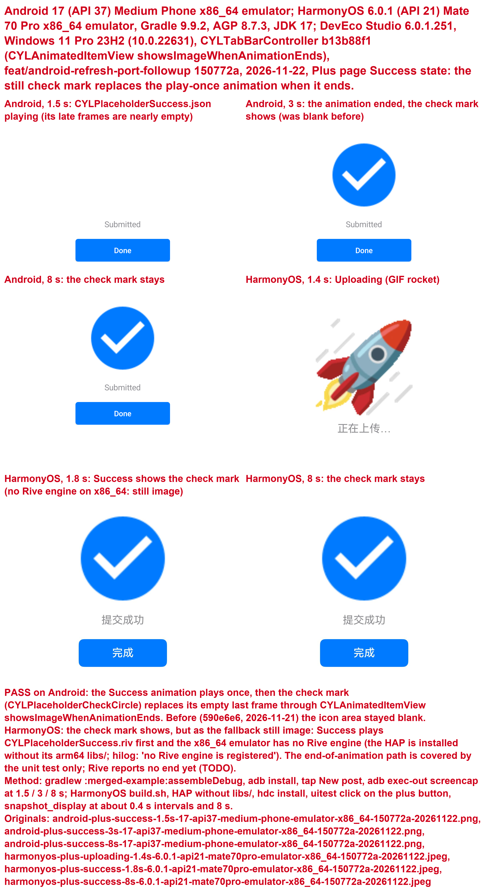 | Android: the animation at 1.5 s, the check mark at 3 s and 8 s. HarmonyOS: Uploading at 1.4 s, then the check mark (still image, no Rive engine on x86_64). |
| TODO（-8）：鸿蒙示例的 Rive 引擎（`CYLRivePlaceholderItemAnimator`）在一次性状态机结束时调用 `didEnd`（例如 `isPlaying()` 变为 false），并在 arm64 设备上验证。TODO（-4）：在有 Rive 的 arm64 设备上截图鸿蒙 Success。TODO（-3）：在微信开发者工具中截图小程序 Success。TODO（-5）：iOS 的 Success 静态图改为对勾并开启 `showsImageWhenAnimationEnds`（需要 CYLTabBarController 的 iOS 部分，Mac 会话）。 | TODO (-8): the HarmonyOS example's Rive engine (`CYLRivePlaceholderItemAnimator`) calls `didEnd` when a play-once state machine ends (for example when `isPlaying()` turns false), verified on an arm64 device. TODO (-4): screenshot HarmonyOS Success on an arm64 device with Rive. TODO (-3): screenshot the mini program Success in WeChat DevTools. TODO (-5): iOS: the check mark as the Success still image with `showsImageWhenAnimationEnds` (needs CYLTabBarController's iOS part, Mac session). |

### 已完成（90 / 100）：在 Android 与鸿蒙模拟器上运行示例 / Done (90 / 100): Run the examples on the Android and HarmonyOS emulators

| 中文 | English |
| --- | --- |
| 状态：已完成（2026-11-21，分支 `feat/android-refresh-port-followup`，PR #31），评分 90 / 100。 | Status: done (2026-11-21, branch `feat/android-refresh-port-followup`, PR #31), score 90 / 100. |
| 用户原始提示词：“run the examples on the Android and HarmonyOS emulators” | The user's original prompt (verbatim): "run the examples on the Android and HarmonyOS emulators" |
| 上下文：上一个任务（Maven 发布与非 iOS 测试）只运行了单元测试与构建，缺少模拟器运行与截图（-5）；期间 `cyl-animated-item` 副本同步到 CYLTabBarController `b4d68cfe`，需要在设备上确认。Android：`emulator-5554`（Medium_Phone_API_37.0，x86_64），示例 `android/merged/example`；鸿蒙：DevEco 模拟器 Mate 70 Pro（x86_64），示例 `CrossPlatform/harmonyos-cylplaceholder/entry`。已通知其他会话将使用这两个模拟器。 | Context: the previous task (Maven publication and non-iOS tests) ran only unit tests and builds, missing emulator runs and screenshots (-5); it also synced the `cyl-animated-item` copies to CYLTabBarController `b4d68cfe`, which needs a check on a device. Android: `emulator-5554` (Medium_Phone_API_37.0, x86_64), example `android/merged/example`; HarmonyOS: the DevEco emulator Mate 70 Pro (x86_64), example `CrossPlatform/harmonyos-cylplaceholder/entry`. The other sessions were told these emulators are in use. |
| 评分标准：100 = 两个示例在模拟器上安装并启动无崩溃，主要 Tab（场景、动效、刷新、HUD、加号页）可打开，拼接截图按截图规则生成并通过 `check_screenshots.py`，记录在文档中，鸿蒙 UI 测试套件通过；60 = 两个示例在模拟器上安装、启动无崩溃，并各有一张带规定标注的截图记录在文档中。 | Acceptance: 100 = both examples install and launch on the emulators without a crash, the main tabs (scenarios, animations, refresh, HUD, plus page) open, stitched screenshots made by the screenshot rules pass `check_screenshots.py` and are recorded in the docs, and the HarmonyOS UI test suite passes; 60 = both examples install and launch without a crash, each with one labeled screenshot recorded in the docs. |
| 鸿蒙结果：Mate 70 Pro x86_64 模拟器（127.0.0.1:5557，HarmonyOS 6.0.1 API 21），`scripts/build.sh test` 生成的 HAP 只含 arm64 原生库（libpag、libohos_rive、libc++_shared），x86_64 模拟器拒绝安装（code 9568347 "install parse native so failed"）；在 HAP 副本中去掉 `libs/` 后安装（PAG 与 Rive 本就无法在 x86_64 上运行，见 `docs/HarmonyOS.md`）。启动、四个 Tab、场景页、加号页、动态、刷新与 HUD 页均正常，hilog 无 jscrash / App died；UI 测试套件（`aa test`，entry_test）5 / 5 通过。截图：[鸿蒙](assets/harmonyos-6.0.1-api21-mate70pro-emulator-x86_64-example-run-590e6e6-20261121-sheet.png)。 | HarmonyOS result: Mate 70 Pro x86_64 emulator (127.0.0.1:5557, HarmonyOS 6.0.1 API 21). The HAP from `scripts/build.sh test` holds arm64-only native libraries (libpag, libohos_rive, libc++_shared), so the x86_64 emulator refuses it (code 9568347, "install parse native so failed"); a copy of the HAP without `libs/` installs (PAG and Rive cannot run on x86_64 anyway, see `docs/HarmonyOS.md`). Launch, every tab, a scenario page, the plus page, Feed, Refresh and the HUD page work, hilog has no jscrash / App died; the UI test suite (`aa test`, entry_test) passes 5 / 5. Screenshots: [HarmonyOS](assets/harmonyos-6.0.1-api21-mate70pro-emulator-x86_64-example-run-590e6e6-20261121-sheet.png). |
| Android 结果：emulator-5554（Android 17，API 37，x86_64），`merged-example-debug.apk`。启动、各 Tab、场景页、加号页、动态、刷新与 HUD 页均正常，`logcat -b crash` 为空；本模块没有仪器测试（`src/androidTest`）。截图：[Android](assets/android-17-api37-medium-phone-emulator-x86_64-example-run-590e6e6-20261121-sheet.png)。 | Android result: emulator-5554 (Android 17, API 37, x86_64), `merged-example-debug.apk`. Launch, every tab, a scenario page, the plus page, Feed, Refresh and the HUD page work, `logcat -b crash` is empty; the module has no instrumented tests (`src/androidTest`). Screenshots: [Android](assets/android-17-api37-medium-phone-emulator-x86_64-example-run-590e6e6-20261121-sheet.png). |
| TODO（缺陷，-10）：Android 加号页 “上传中 → 成功” 的成功状态不显示图标（“已提交” 上方为空白）。原因：`CYLPlaceholderScenario.Success` 使用 `CYLPlaceholderSuccess.json`，它是一段短暂的迸发动画，对勾在 830×1704 的画布中很小，最后一帧几乎为空；内置动画默认只播放一次，所以视图停在这一帧（动画详情页同样如此：0.7 s 时有小对勾，3.7 s 时只剩几个点）。鸿蒙同一页面显示静态的信息图标。修复需要 owner 决定：换用最后一帧有内容的成功动画、为 Success 场景循环播放、或在播放结束后显示静态图标；按规则先在核心（或 CYLTabBarController 的动效组件）修复。 | TODO (defect, -10): the Android plus page's "Uploading → Success" flow shows no icon in the Success state (blank above "Submitted"). Cause: `CYLPlaceholderScenario.Success` uses `CYLPlaceholderSuccess.json`, a short burst whose check mark is small in an 830×1704 canvas and whose last frame is nearly empty; bundled animations play once by default, so the view rests on that frame (the animation detail page shows the same: a small check mark at 0.7 s, only a few dots at 3.7 s). HarmonyOS shows a static info icon on the same page. The fix needs the owner's choice: a success animation whose last frame has content, looping for the Success scenario, or the static icon after playback ends; by the rules it is fixed in the core (or CYLTabBarController's animation component) first. |
| 其他：Android 加号页是一个 Tab，按返回键会离开示例（回到上一个应用），与鸿蒙的推入页面不同；未当作缺陷处理。README 的截图未更新（结果含一个缺陷）。 | Other: the Android plus page is a tab, so Back leaves the example (to the previous app), unlike HarmonyOS's pushed page; not treated as a defect. The README screenshots were not updated (the result has a defect). |

### 已完成（90 / 100）：Android 库模块的 Maven 发布（io.github.chenyilong，0.1.0）并测试所有非 iOS 平台 / Done (90 / 100): Maven publication of the Android library modules (io.github.chenyilong, 0.1.0) and tests on every non-iOS platform

| 中文 | English |
| --- | --- |
| 状态：已完成（2026-11-21，分支 `feat/android-refresh-port-followup`，PR #31），评分 90 / 100。 | Status: done (2026-11-21, branch `feat/android-refresh-port-followup`, PR #31), score 90 / 100. |
| 用户原始提示词：“use io.github.chenyilong, version 0.1.0  process test all platform (not include ios)” | The user's original prompt (verbatim): "use io.github.chenyilong, version 0.1.0  process test all platform (not include ios)" |
| 要求：(1) 为 `android/placeholder`（`:placeholder`）与 `android/merged/library`（`:merged`）配置 `maven-publish`：groupId `io.github.chenyilong`，版本 `0.1.0`；(2) 测试 iOS 以外的所有平台（Android、鸿蒙、微信小程序）。 | Requirements: (1) `maven-publish` for `android/placeholder` (`:placeholder`) and `android/merged/library` (`:merged`): groupId `io.github.chenyilong`, version `0.1.0`; (2) test every platform except iOS (Android, HarmonyOS, WeChat Mini Program). |
| 上下文：CYLSearchViewController 的 Android 库 POM 把这两个模块写成 `CYLSearchAndroid:placeholder:unspecified`（见 `docs/Android-Port.md` “Maven publication coordinates”）。artifactId 采用上游的命名方式（`cyltabbarcontroller-animateditem`）：`cyltableviewplaceholder`（`:placeholder`）与 `cyltableviewplaceholder-refresh`（`:merged`，CYLRefresh）。 | Context: CYLSearchViewController's Android POM lists these modules as `CYLSearchAndroid:placeholder:unspecified` (see `docs/Android-Port.md`, "Maven publication coordinates"). The artifactIds follow upstream's naming (`cyltabbarcontroller-animateditem`): `cyltableviewplaceholder` (`:placeholder`) and `cyltableviewplaceholder-refresh` (`:merged`, CYLRefresh). |
| 评分标准：100 = 两个模块 `publishToMavenLocal` 生成正确的 POM（坐标、依赖带版本、MIT 许可）、AAR 内含 LICENSE；Android 单元测试与示例构建、鸿蒙构建与单元测试、小程序 `npm test` 全部通过，结果记录在文档中，坐标告知 CYLSearchViewController；60 = 发布配置完成且 `publishToMavenLocal` 通过，Android 测试通过。 | Acceptance: 100 = `publishToMavenLocal` gives correct POMs for both modules (coordinates, versioned dependencies, MIT license) with the LICENSE inside each AAR; the Android unit tests and example build, the HarmonyOS build and unit tests, and the mini program's `npm test` all pass, the results are recorded, and CYLSearchViewController has the coordinates; 60 = the publication is configured, `publishToMavenLocal` passes, and the Android tests pass. |
| 结果：(1) 发布配置见 `docs/Android-Port.md` “Maven publication coordinates”：`io.github.chenyilong:cyltableviewplaceholder:0.1.0` 与 `io.github.chenyilong:cyltableviewplaceholder-refresh:0.1.0`，`publishToMavenLocal` 通过，POM 与 AAR 内的 LICENSE 已检查。(2) 测试中发现并修复：`Cartfile` 在 2026-11-20 改为固定 CYLTabBarController `b4d68cfe`，但小程序与鸿蒙中的 `cyl-animated-item` 副本仍是 `28a9609`，小程序测试 “the copy of cyl-animated-item records the commit the Cartfile pins” 因此失败；用 `npm run sync-animated-item`、`npm run sync-example` 与 `scripts/sync-harmonyos-cylanimateditem.sh` 同步到 `b4d68cfe`。另外 Gradle 9 中 `:merged-rive:testDebugUnitTest` 因没有测试而失败，现设为 `failOnNoDiscoveredTests = false`。(3) 同步后的测试（Windows 11）：Android（JDK 17）`testDebugUnitTest :merged-example:assembleDebug publishToMavenLocal --rerun-tasks`：BUILD SUCCESSFUL，241 个任务，单元测试 83 / 83；微信小程序 `npm test`（Node 22.23.5）：73 / 73；鸿蒙（DevEco Studio 6.0，`scripts/build.sh test`）：HAP 与 HAR 构建成功，单元测试 91 / 91；`check_package_licenses.py` 通过。 | Result: (1) the publication is described in `docs/Android-Port.md`, "Maven publication coordinates": `io.github.chenyilong:cyltableviewplaceholder:0.1.0` and `io.github.chenyilong:cyltableviewplaceholder-refresh:0.1.0`; `publishToMavenLocal` passes, the POMs and the LICENSE inside each AAR were checked. (2) Found and fixed while testing: the `Cartfile` moved to CYLTabBarController `b4d68cfe` on 2026-11-20, but the mini program's and HarmonyOS's copies of `cyl-animated-item` stayed at `28a9609`, so the mini program test "the copy of cyl-animated-item records the commit the Cartfile pins" failed; synced to `b4d68cfe` with `npm run sync-animated-item`, `npm run sync-example` and `scripts/sync-harmonyos-cylanimateditem.sh`. Also, under Gradle 9 `:merged-rive:testDebugUnitTest` failed because the module has no tests; it now sets `failOnNoDiscoveredTests = false`. (3) Tests after the sync (Windows 11): Android (JDK 17) `testDebugUnitTest :merged-example:assembleDebug publishToMavenLocal --rerun-tasks`: BUILD SUCCESSFUL, 241 tasks, unit tests 83 / 83; WeChat Mini Program `npm test` (Node 22.23.5): 73 / 73; HarmonyOS (DevEco Studio 6.0, `scripts/build.sh test`): HAP and HAR build, unit tests 91 / 91; `check_package_licenses.py` passes. |
| 未满分原因（-10）：只运行了单元测试与构建，没有在 Android / 鸿蒙模拟器或微信开发者工具中运行示例并截图（-5）；尚未真正发布到 Maven Central（需要 owner 的账号与签名，上游 `cyltabbarcontroller-animateditem` 也未发布）（-5）。另：CYLTabBarController 最新提交为 `ec710a4`（2026-11-21，`feat/cross-platform-components`），比 `Cartfile` 的 `b4d68cfe` 新；重新固定会影响 iOS，留给 Mac 会话。 | Why not 100 (-10): only unit tests and builds ran; the examples were not run on the Android / HarmonyOS emulators or in WeChat DevTools with screenshots (-5); nothing is published to Maven Central yet (needs the owner's account and signing; upstream `cyltabbarcontroller-animateditem` is not published either) (-5). Also: CYLTabBarController's newest commit is `ec710a4` (2026-11-21, `feat/cross-platform-components`), newer than the `Cartfile`'s `b4d68cfe`; re-pinning affects iOS and is left to the Mac session. |

### 已完成（70 / 100）：修复 docs 中的所有 TODO（Win 会话：非 iOS 部分）/ Done (70 / 100): Fix every TODO in docs (Win session: the non-iOS part)

| 中文 | English |
| --- | --- |
| 状态：已完成（2026-11-21，分支 `feat/android-refresh-port-followup`，PR #31），评分 70 / 100。 | Status: done (2026-11-21, branch `feat/android-refresh-port-followup`, PR #31), score 70 / 100. |
| 用户原始提示词：“fix all todo in docs” | The user's original prompt (verbatim): "fix all todo in docs" |
| 要求：处理 `docs/` 中所有未完成的 TODO。 | Requirements: work through every open TODO in `docs/`. |
| 上下文：`git pull` 后扫描到 17 个文档中 161 行含 TODO（158 行未标完成）。之前的会话（2026-11-14、2026-11-20）已确认大部分剩余项被真机、owner 登录 / 批准（npm、DevTools）或上游发布阻塞。本会话在 Windows 上（Win 会话：Android、鸿蒙、小程序、RN、Flutter 与纯文档），iOS 项留给 Mac 会话；已向 3 个活跃会话询问分工。先做可在本机独立完成并验证的项：Android 四个 `build.gradle.kts` 的 `kotlinOptions {}` → `compilerOptions {}`（2026-11-20 留下的 TODO），以及已过时的 TODO 条目（如 iOS 12 相关项，最低版本已于 2026-11-20 改为 iOS 15）。 | Context: after `git pull`, 161 lines in 17 documents mention TODO (158 not marked done). Earlier sessions (2026-11-14, 2026-11-20) found most remaining items blocked on a real device, the owner's login / approval (npm, DevTools) or an upstream release. This session runs on Windows (Win session: Android, HarmonyOS, mini program, RN, Flutter and docs-only work); iOS items stay with the Mac session; the 3 active sessions were asked how to split the work. First the items this machine can finish and verify on its own: the `kotlinOptions {}` → `compilerOptions {}` move in the four Android `build.gradle.kts` files (the TODO left on 2026-11-20), and stale TODO entries (such as iOS 12 items; the minimum became iOS 15 on 2026-11-20). |
| 评分标准：100 = 每个本机可完成的 TODO 都已修复并验证，被阻塞的 TODO 各自写明阻塞原因与负责方；60 = Gradle 迁移完成且单元测试通过，过时条目已更新。 | Acceptance: 100 = every TODO this machine can finish is fixed and verified, and every blocked TODO names its blocker and owner; 60 = the Gradle migration is done with the unit tests passing, and the stale entries are updated. |
| 完成：(1) Android 四个 `build.gradle.kts`（`android/placeholder`、`android/merged/library`、`android/merged/library/rive`、`android/merged/example`）的 `android { kotlinOptions { jvmTarget = "17" } }` 改为顶层 `kotlin { compilerOptions { jvmTarget.set(JvmTarget.JVM_17) } }`（Kotlin 2.0.21 的写法）。验证：JDK 17（Temurin，与 CI 一致），`gradlew :placeholder:testDebugUnitTest :merged:testDebugUnitTest :merged-rive:compileDebugKotlin :merged-example:assembleDebug --rerun-tasks --warning-mode all`：BUILD SUCCESSFUL，161 个任务全部执行；本仓库模块不再有 `kotlinOptions` 弃用警告。(2) `docs/flatdesign-item-comparison.md` 与 `docs/commit-readiness-2026-11-09.md` 中过时的 “Carthage 与 iOS 12” TODO 改为 “Carthage 与 iOS 15 最低版本”：iOS 12 真机要求已取消，剩余 5 分是真实 iOS 15 运行时上的一次运行（Mac 会话）。 | Done: (1) the four Android `build.gradle.kts` files (`android/placeholder`, `android/merged/library`, `android/merged/library/rive`, `android/merged/example`) move from `android { kotlinOptions { jvmTarget = "17" } }` to a top-level `kotlin { compilerOptions { jvmTarget.set(JvmTarget.JVM_17) } }` (the Kotlin 2.0.21 form). Verified with JDK 17 (Temurin, as in CI): `gradlew :placeholder:testDebugUnitTest :merged:testDebugUnitTest :merged-rive:compileDebugKotlin :merged-example:assembleDebug --rerun-tasks --warning-mode all`: BUILD SUCCESSFUL, 161 of 161 tasks executed; no `kotlinOptions` deprecation warning from this repository's modules any more. (2) The stale "Carthage and iOS 12" TODO in `docs/flatdesign-item-comparison.md` and `docs/commit-readiness-2026-11-09.md` is now "Carthage and the iOS 15 minimum": the iOS 12 device requirement is gone, and the remaining 5 points are one run on a real iOS 15 runtime (Mac session). |
| 未满分原因（-30）：其余未完成的 TODO 都需要本机没有的条件，本次未能修复：iOS 项（`docs/issue-progress.md`、`docs/flatdesign-item-comparison.md`、`docs/Swift-Migration.md`、Animated-Item TODO 1）需要 Mac / Xcode / iOS 模拟器或真机；Android-Port 中 CYLRefreshLayout 的剩余 issue 需要真机手势（WebView、MotionLayout、ViewPager）；小程序 `npm publish` 与 DevTools 登录需要 owner；CocoaPods trunk 发布 `CYLAnimatedItem` 需要上游 CYLTabBarController；鸿蒙 Q7 等行在鸿蒙上不适用（N/A）。另发现（上游 TODO）：CYLTabBarController 的 `Example-Android`（`app`、`cylanimateditem`、`cyltabbar`、`demokit`、`example-gif` 等）仍用 `kotlinOptions`，本仓库作为 included build 编译时打印该警告，需要在 CYLTabBarController 中修复。 | Why not 100 (-30): every other open TODO needs something this machine lacks, so this pass could not fix it: the iOS items (`docs/issue-progress.md`, `docs/flatdesign-item-comparison.md`, `docs/Swift-Migration.md`, Animated-Item TODO 1) need a Mac, Xcode, an iOS simulator or a device; the remaining CYLRefreshLayout issues in Android-Port need real-device gestures (WebView, MotionLayout, ViewPager); the mini program's `npm publish` and the DevTools login need the owner; the CocoaPods trunk release of `CYLAnimatedItem` needs upstream CYLTabBarController; HarmonyOS Q7 and similar rows are N/A on HarmonyOS. Also found (upstream TODO): CYLTabBarController's `Example-Android` modules (`app`, `cylanimateditem`, `cyltabbar`, `demokit`, `example-gif` and others) still use `kotlinOptions`, so the warning still prints when this repository builds them as an included build; the fix belongs in CYLTabBarController. |

### 已完成：Advisor 模式配置（advisorModel 与 CLAUDE_CODE_ATTRIBUTION_HEADER）/ Done: Advisor-mode settings (advisorModel and CLAUDE_CODE_ATTRIBUTION_HEADER)

- **日期 / Date:** 2026-11-21, branch `feat/android-refresh-port-followup`.
- **用户原话 / Prompt (verbatim, Chinese):** "模仿我在其他项目的操作，进行类似操作：Advisor 模式已写入三份配置……修改CLAUDE_CODE_ATTRIBUTION_HEADER 提高缓存命中率：.claude/settings.json: advisorModel: claude-opus-5-5 and env.CLAUDE_CODE_ATTRIBUTION_HEADER: \"0\". This file is shared, so it will be committed."
- **要求 / Requirements:** the same three files as in the user's other projects. `~/.claude/settings.json` (global, already had both keys, left as is); `.claude/settings.json` in this repository's root (shared, committed): `advisorModel: claude-opus-5-5` and `env.CLAUDE_CODE_ATTRIBUTION_HEADER: "0"` (a stable request header keeps the prompt cache hit rate up); `.claude/settings.local.json` (local override, ignored by git globally): `advisorModel: claude-opus-5-5`. Other keys of the earlier attachment (`defaultModel`, `themeStatusBar`, `browser`, `maxInferenceStrength`) are not written: they are not keys of the binary.
- **结果 / Result:** all three files parse as JSON. Takes effect after Claude Code restarts; `/advisor` turns it on in a running session.

### 已完成：监控本分支 CI 与静态检查，修复发现的问题 / Done: Monitor this branch's CI and static-analysis checks, fix what they find

| 中文 | English |
| --- | --- |
| 状态：已完成（2026-11-20，分支 `feat/android-refresh-port-followup`，PR #31）。 | Status: done (2026-11-20, branch `feat/android-refresh-port-followup`, PR #31). |
| 用户原始提示词：“进入 CYLTableViewPlaceHolder 当前分支，阅读文档遍历所有todo，完成TODO内容，监听CI 以及静态分析报告，完成所有TODO项目”，随后补充：“执行前要git pull确认是最新代码”，再补充：“现在已经没有session在修改本分支内容，找分支相关的todo修改。你可以先阅读pr描述和评论，寻找思路”。 | The user's original prompt (verbatim, Chinese): enter the CYLTableViewPlaceHolder branch, read the docs and go through every TODO, finish the TODO work, watch CI and the static-analysis reports, finish every TODO item; followed by "git pull first to confirm the latest code before doing anything"; then "no session is editing this branch right now, find the branch-related TODOs; read the pull request's description and comments first for ideas". |
| 上下文：clone 到本地、`git pull` 确认 `master` 为最新后，扫描 `docs/` 发现 139 处 TODO，分布在 11 个文档，绝大多数被真机、母语审校或上游（npm 发布、CYLTabBarController 发布）阻塞，与用户确认后聚焦本分支（`feat/android-refresh-port-followup`，PR #31，WeChat 小程序为主，Win 会话负责 Android / HarmonyOS / 小程序 / RN / Flutter）；`docs/WeChat-MiniProgram.md`、`docs/Task-Log.md` 显示该分支绝大多数子任务已完成（90–100 / 100），剩余项同样被 owner 的 npm / DevTools 登录或上游发布阻塞；`wechatide check_wechatide_status` 在本机超时（与文档记录的 DevTools 登录问题一致），因此改为运行仓库自带的静态检查脚本（`scripts/check_package_licenses.py`、`check_doc_comments.py`、`check_localizations.py`、`update-docs-navigation.py --check`）寻找可独立完成、不依赖设备的问题。 | Context: after cloning and `git pull` confirmed `master` was current, a scan of `docs/` found the TODO keyword 139 times across 11 documents, most blocked on a real device, native-speaker review or upstream (an npm publish, a CYLTabBarController release); with the user's confirmation the work focused on this branch (`feat/android-refresh-port-followup`, PR #31, mostly the WeChat Mini Program; the Win session's scope: Android, HarmonyOS, the mini program, React Native, Flutter). `docs/WeChat-MiniProgram.md` and `docs/Task-Log.md` show most of this branch's sub-tasks already at 90-100 / 100, with the remaining points blocked the same way (the owner's npm or DevTools login, an upstream release). `wechatide check_wechatide_status` timed out on this machine (matching the documented DevTools login trouble), so the repository's own static checks ran instead (`scripts/check_package_licenses.py`, `check_doc_comments.py`, `check_localizations.py`, `update-docs-navigation.py --check`) to find something fixable without a device. |
| 发现并修复：(1) `scripts/check_package_licenses.py` 在本机失败：`CrossPlatform/harmonyos-cylplaceholder/cylanimateditem/UPSTREAM_COMMIT does not record the upstream commit`。根因：本仓库没有 `.gitattributes`，Windows 上 `core.autocrlf=true` 的检出把该文本文件变成 CRLF，使检查脚本里 `^commit=[0-9a-f]{40}$` 的正则（`\r` 夹在十六进制提交号与行尾之间）匹配失败；`git cat-file -p HEAD:…` 证实仓库里的提交内容本身是 LF，纯属本地检出问题，但任何 Windows 贡献者都会重现。修复：新增 `.gitattributes`（`* text=auto eol=lf`，`*.sh text eol=lf`，并显式把 png/jpg/jpeg/gif/riv/pag/svga/bin/字体/车辆包等标为 binary），之后检查通过（`8 packages carry LICENSE, 3 third-party licenses ship, 1 copied packages keep their upstream LICENSE, 4 manifests declare MIT.`）。(2) `docs/Placeholder-Scenarios.md` 两处表格单元格写着“共 36 个场景”，与同一单元格后半句“35 个场景中 34 个使用内置动画”自相矛盾；核对 `CYLPlaceholderScenario.h`（`NetworkUnavailable` 到 `HUD`，哨兵 `CYLPlaceholderScenarioCount`）得到 35，`docs/WeChat-MiniProgram.md` 里记录的同一处“doc discrepancy found”也确认 Kotlin 枚举是 35；两处都改为“共 35 个场景”，并把 `docs/WeChat-MiniProgram.md` 里的该条标注为已修复。其余检查（`check_doc_comments.py`：1229/1229 公开声明有文档注释；`check_localizations.py`：4 个查找宏、所有语言一致；`update-docs-navigation.py --check`：26 个文档）均已是绿色，没有发现新问题。 | Found and fixed: (1) `scripts/check_package_licenses.py` failed locally: "CrossPlatform/harmonyos-cylplaceholder/cylanimateditem/UPSTREAM_COMMIT does not record the upstream commit". Root cause: this repository has no `.gitattributes`, so on Windows a `core.autocrlf=true` checkout turns that text file into CRLF, and the check script's `^commit=[0-9a-f]{40}$` regex fails (a stray `\r` sits between the 40-hex commit and the end of the line); `git cat-file -p HEAD:…` confirmed the committed content itself is LF, so this was purely a local checkout artifact, but it reproduces for any Windows contributor. Fix: a new `.gitattributes` (`* text=auto eol=lf`, `*.sh text eol=lf`, with png/jpg/jpeg/gif/riv/pag/svga/bin/fonts/archives listed explicitly as binary); the check then passes ("8 packages carry LICENSE, 3 third-party licenses ship, 1 copied packages keep their upstream LICENSE, 4 manifests declare MIT."). (2) Two table cells of `docs/Placeholder-Scenarios.md` said "36 scenarios in all", contradicting the same cell's own later sentence ("34 of the 35 scenarios use a built-in animation"); checking `CYLPlaceholderScenario.h` (`NetworkUnavailable` through `HUD`, then the `CYLPlaceholderScenarioCount` sentinel) gives 35, and the matching "doc discrepancy found" note already in `docs/WeChat-MiniProgram.md` agrees the Kotlin enum has 35; both cells now say "35 scenarios in all", and the `docs/WeChat-MiniProgram.md` note is marked fixed. The other checks (`check_doc_comments.py`: 1229 of 1229 public declarations documented; `check_localizations.py`: 4 lookup macros, every language consistent; `update-docs-navigation.py --check`: 26 documents) were already green, with nothing new found. |
| 推送后 CI（`44714084919`，Android）全绿，日志里出现两条弃用提示：`actions/checkout@v4`、`actions/setup-java@v4` 和 `gradle/actions/setup-gradle@v4` 被强制跑在 Node 24 上（它们目标 Node 20），`setup-java@v4` 官方建议迁移到 `v5`。只改了 `.github/workflows/android.yml`（本会话负责的平台）：`actions/checkout@v6`、`actions/setup-java@v5`、`gradle/actions/setup-gradle@v6`；`ios.yml` / `ios15-runtime.yml` / `release.yml` 里同样的旧版本留给 Mac 会话处理（同一条弃用提示，不属于本次改动范围，改了也要跑一次约 1.5 小时的 iOS 全套 CI 才能验证，风险收益不成比例）。 | After the push, CI (`44714084919`, Android) was all green but logged two deprecation notices: `actions/checkout@v4`, `actions/setup-java@v4` and `gradle/actions/setup-gradle@v4` were being forced onto Node 24 (they target Node 20), and `setup-java@v4` is officially told to move to `v5`. Only `.github/workflows/android.yml` (this session's platform) was changed: `actions/checkout@v6`, `actions/setup-java@v5`, `gradle/actions/setup-gradle@v6`; the same old versions in `ios.yml` / `ios15-runtime.yml` / `release.yml` are left for the Mac session (the same deprecation notice, out of this task's scope, and changing them would need a ~1.5-hour full iOS CI run to verify, not worth the risk for a cosmetic warning). |
| 第二个 CI 发现：Android 构建日志还提示 `Gradle 9.3.1 is out of date`。查 Gradle 官方发行页：9.3.1 属于 "9.3.x – 9.8.x" 区间，开源版不再收到安全补丁；9.9.2（2026-11-19 发布）修复 4 个安全漏洞（SFTP 不校验主机密钥、传递性快照依赖跳过校验、TestKit 用可预测的临时目录、守护进程注册表短暂可被同机其他用户读取），官方建议升级，因此判定为值得修的真实问题而不只是提示。本机装好 JDK 17（Temurin 17.0.21，与 CI 的 `setup-java` 一致；第一次误用 Android Studio 自带的 JBR 25 得到 `ClassReader` 相关的误报失败，换回 JDK 17 后用 `--rerun-tasks` 强制重新执行全部 85 个任务，`gradlew wrapper --gradle-version=9.9.2 --gradle-distribution-sha256-sum=…`）后，`:placeholder:testDebugUnitTest`、`:merged:testDebugUnitTest`、`:merged-rive:compileDebugKotlin` 全部通过（`85 actionable tasks: 85 executed`），只改了 `android/gradle/wrapper/gradle-wrapper.properties`。顺带发现但未处理（范围外，非安全问题）：四个 `build.gradle.kts` 里的 `kotlinOptions {}` 已弃用，提示 Gradle 10 时会不兼容，需要迁移到 `compilerOptions {}`。 | Second CI finding: the Android build log also warned "Gradle 9.3.1 is out of date". Gradle's own release page places 9.3.1 in the "9.3.x – 9.8.x" line, which gets no open-source security fixes any more; 9.9.2 (released 2026-11-19) fixes four security vulnerabilities (SFTP not verifying host keys, transitive snapshot dependencies skipping verification, TestKit's predictable temp directory, the daemon registry briefly readable by other local users) and is the officially recommended upgrade, so this is a real problem worth fixing, not just a notice. After installing JDK 17 locally (Temurin 17.0.21, matching CI's `setup-java`; the first attempt used Android Studio's bundled JBR 25 by mistake and got false `ClassReader` failures, fixed by switching back to JDK 17 and forcing a full re-run of all 85 tasks with `--rerun-tasks`), `gradlew wrapper --gradle-version=9.9.2 --gradle-distribution-sha256-sum=…`, then `:placeholder:testDebugUnitTest`, `:merged:testDebugUnitTest` and `:merged-rive:compileDebugKotlin` all passed ("85 actionable tasks: 85 executed"); only `android/gradle/wrapper/gradle-wrapper.properties` changed. Found but left alone (out of scope, not a security issue): the `kotlinOptions {}` blocks in four `build.gradle.kts` files are deprecated and will be incompatible with Gradle 10; they need to move to `compilerOptions {}`. |
| 未完成 / 评分：本任务范围内完成（找到并修复的静态检查问题都已修复）。本分支其余未完成项（小程序 PAG/Rive/GIF 动效变体、`npm publish`、CYLTabBarController 发布、鸿蒙 / iOS 设备校验等）如 `docs/WeChat-MiniProgram.md`、`docs/Android-Port.md`、`docs/HarmonyOS.md` 所记录，均明确阻塞在 owner 的登录 / 批准或上游发布，本次未重复记录；CI（GitHub Actions）在推送后由其自身的 workflow 校验，见本条目的提交。本次还顺带升级了 Gradle wrapper 到 9.9.2（修复 4 个安全漏洞）；`kotlinOptions` 弃用警告留作后续 TODO（不涉及安全，影响范围是 4 个 `build.gradle.kts`，需要单独验证）。（2026-11-21 已修复，见本文件顶部的条目。） | Not done / score: complete within this task's scope (every static-analysis problem found was fixed). The branch's other open items (the mini program's PAG / Rive / GIF animation variants, `npm publish`, the CYLTabBarController release, HarmonyOS / iOS device checks) stay exactly as `docs/WeChat-MiniProgram.md`, `docs/Android-Port.md` and `docs/HarmonyOS.md` already record them, blocked on the owner's login / approval or an upstream release; not duplicated here. GitHub Actions CI verifies the push itself; see this entry's commits. Also bumped the Gradle wrapper to 9.9.2 (fixes 4 security vulnerabilities) along the way; the `kotlinOptions` deprecation is left as a follow-up TODO (not a security issue, touches 4 `build.gradle.kts` files, needs its own verification). (Fixed 2026-11-21; see the entry at the top of this file.) |

### 已完成（92 / 100）：README 改为中英双语入口文档，iOS 示例改 Swift，其他平台给基本初始化代码 / Done (92 / 100): Rewrite the README as a bilingual entry point, Swift for iOS, basic initialization code for the other platforms

| 中文 | English |
| --- | --- |
| 状态：已完成（2026-11-20，分支 `feat/android-refresh-port-followup`，PR #31），92 / 100。 | Status: done (2026-11-20, branch `feat/android-refresh-port-followup`, PR #31), 92 / 100. |
| 提示词（作者原话）：“修改readme文档，按照CYLTabBarController里的文档规范中英文，iOS示例代码改为swift，其他平台给出基本初始化代码，更详细介绍链接docs文档。中英文” | Prompt (the owner's words, verbatim, in Chinese): "修改readme文档，按照CYLTabBarController里的文档规范中英文，iOS示例代码改为swift，其他平台给出基本初始化代码，更详细介绍链接docs文档。中英文" (Edit the README following the Chinese/English documentation rules of CYLTabBarController; iOS sample code in Swift; basic initialization code for the other platforms; detailed introductions link to the docs. Chinese and English.) |
| 要求：(1) README 遵循 CYLTabBarController 的双语文档规范（`## 中文 / English` 标题、`中文 \| English` 两栏表格、宽表先中文后英文、`[CN]`/`[EN]` 注释、脚本生成导航与绑定块、最短相对路径、图片放在相邻 `assets/`）；(2) README 中所有 iOS 代码改为 Swift，并逐一对照真实代码核实；提一次 Objective-C 仍可用（API 是 `@objc`），链接 `docs/Swift-Guide.md`；最低版本为 iOS 15；(3) Android、HarmonyOS、微信小程序给出核实过的最小安装与初始化代码，再链接 `docs/`（Flutter / React Native 本仓库没有包，不写）；(4) README 成为简明入口：简介、功能、安装、Swift 快速开始、平台表、已有截图、文档表；长篇参考内容移入对应的 `docs/` 文件（删除前确认内容在别处存在，否则先追加），保留致谢与许可证部分；(5) 不声称未核实的功能、版本或命令。 | Requirements: (1) the README follows CYLTabBarController's bilingual documentation rules (`## 中文 / English` headings, `中文 \| English` two-column tables, wide tables Chinese first then English, `[CN]`/`[EN]` comments, a script-generated navigation and binding block, shortest relative paths, images in the adjacent `assets/`); (2) every iOS code block in the README becomes Swift, each checked against the real code; mention once that Objective-C still works (the API is `@objc`) and link `docs/Swift-Guide.md`; the minimum is iOS 15; (3) Android, HarmonyOS and the WeChat Mini Program get verified minimal install and initialization code, then a link into `docs/` (this repository has no Flutter or React Native package, so none is written); (4) the README becomes a concise entry point: introduction, features, install, a Swift quick start, a platform table, the existing screenshots and a documentation table; long reference material moves into the matching `docs/` file (check it exists elsewhere before removing, otherwise append it first), and the credits and license parts stay; (5) no claim about a feature, version or command that was not verified. |
| 验收：满分（100）= 以上全部完成；`python3 scripts/update-docs-navigation.py --check`、`check_doc_comments.py`、`check_localizations.py` 通过；README 与移动后的 docs 中每个相对链接和图片路径都存在；没有内容丢失（旧 README 的每一节都能在 README 或 `docs/` 中找到）；已推送。及格（60）= README 改为简明入口且 Swift 代码核实，内容已移入 docs。 | Acceptance: full marks (100) = all of the above; `python3 scripts/update-docs-navigation.py --check`, `check_doc_comments.py` and `check_localizations.py` pass; every relative link and image path in the README and the moved docs resolves; no content is lost (every section of the old README is found in the README or in `docs/`); pushed. Pass (60) = the README is a concise entry point with verified Swift code and the content moved into docs. |
| 结果（2026-11-20）：README 从 1086 行改为简明入口（简介、功能、安装、Swift 快速开始、HUD 与状态红条、刷新概览、平台、文档表、致谢与许可），所有 iOS 代码为 Swift，最低版本 iOS 15。长篇内容移入：新文件 `docs/Placeholder-Usage.md`（block API、`CYLPlaceholderView` 配置、内置动画与子规格、CocoaPods 细节、delegate API、43 张场景截图）、`docs/Refresh-Styles.md`（全部刷新样式与截图、国际化、行为）、`docs/Examples.md`（运行示例）；追加到 `docs/Placeholder-Scenarios.md`（场景化占位、状态栏、无障碍）、`docs/Android-Port.md`（Android 说明与截图）、`docs/WeChat-MiniProgram.md`（小程序说明与截图）。移入的 Objective-C 示例改为 Swift，并删去 iOS 12–14 的旧说明（Lottie、Rive 子规格表改为 iOS 15）。平台代码取自：Android `android/merged/example/.../HudLifecyclePage.kt`，HarmonyOS `entry/oh-package.json5` 与 `CollectionFlowPage.ets`，小程序包内 README。验证：`update-docs-navigation.py --check`、`check_doc_comments.py`、`check_localizations.py` 通过；README 与新 docs 中每个相对链接和锚点都存在（只有 `Android-Port.md` 中原有的一个旧图片路径已不存在，不是本任务引入）；旧 README 的每张图片和每个正文表格行都能在 README 或 docs 中找到。 | Result (2026-11-20): the README went from 1086 lines to a concise entry point (overview, features, install, a Swift quick start, the HUD and status bar, the refresh overview, platforms, a documentation table, credits and license); every iOS code block is Swift and the minimum is iOS 15. The long content moved to the new `docs/Placeholder-Usage.md` (the block API, `CYLPlaceholderView` configuration, bundled animations and subspecs, CocoaPods details, the delegate API, the 43 scenario screenshots), `docs/Refresh-Styles.md` (every refresh style with screenshots, localization, behavior) and `docs/Examples.md` (running the examples), and was appended to `docs/Placeholder-Scenarios.md` (scenario placeholders, status bar, accessibility), `docs/Android-Port.md` (Android notes and screenshots) and `docs/WeChat-MiniProgram.md` (mini program notes and screenshots). The moved Objective-C samples became Swift, and the old iOS 12–14 notes were dropped (the Lottie and Rive subspec table now says iOS 15). Platform code comes from: Android `android/merged/example/.../HudLifecyclePage.kt`, HarmonyOS `entry/oh-package.json5` and `CollectionFlowPage.ets`, the mini program from the package's own README. Verified: `update-docs-navigation.py --check`, `check_doc_comments.py` and `check_localizations.py` pass; every relative link and anchor in the README and the new docs resolves (only one old image path in `Android-Port.md`, which predates this task, does not exist); every image and every body table row of the old README is found in the README or in docs. |
| 评分：92 / 100。TODO（-3）：Swift 示例没有放进编译器逐段编译，只用 grep 对照库源码、示例和测试核对了名称（`.illustrationRetry`、各枚举名按命名规则推导）。TODO（-3）：没有运行 markdownlint（npx 无缓存包）。TODO（-2）：Android、HarmonyOS 没有已发布的 Maven / ohpm 坐标，小程序 npm 包是否已发布未验证，README 如实说明；本仓库没有 Flutter / React Native 包。 | Score: 92 / 100. TODO (-3): the Swift samples were not compiled; the names were checked by grep against the library source, the examples and the tests (`.illustrationRetry` and the enum names follow the naming rule). TODO (-3): markdownlint was not run (npx has no cached package). TODO (-2): Android and HarmonyOS have no published Maven or ohpm coordinates and whether the mini program's npm package is published was not verified, which the README says plainly; this repository has no Flutter or React Native package. |

### 已完成（95 / 100）：CI 中的 iOS 12 改为 iOS 15，并修复三个 CI 错误 / Done (95 / 100): Move the iOS 12 CI jobs to iOS 15 and fix the three CI failures

- Date and branch: 2026-11-20, `feat/android-refresh-port-followup` (PR #31).
- User's original prompt (verbatim): "将ci测试里的iOS12改为测试iOS 15 并修复 ci错误 https://github.com/ChenYilong/CYLTableViewPlaceHolder/actions/runs/44587370571/job/135783971793 https://github.com/ChenYilong/CYLTableViewPlaceHolder/actions/runs/44587370593/job/135784268304 https://github.com/ChenYilong/CYLTableViewPlaceHolder/actions/runs/44587370593/job/135784269950"
- Requirements: (1) the CI jobs "iOS 12 deployment build" (`ios12` in `.github/workflows/ios.yml`, `scripts/ios12-build.sh`) and "iOS 12 runtime" (`.github/workflows/ios12-runtime.yml`) test iOS 15 instead (deployment target 15.0, `-Werror=unguarded-availability-new`, Core's unit tests on an iOS 15 simulator, with a warning fallback when no iOS 15 runtime can be installed); (2) fix the failing "Unit tests" job (`testHeaderKeepsItsRefreshingInsetWhenTheInsetIsResetDuringARefresh` timed out after 30 s on the CI runner); (3) update every mention of iOS 12 as a CI target in scripts, rules, skills and docs; historical entries keep their dated history.
- Context: both iOS 12 jobs fail to build with Xcode 16 at deployment target 12.0: `CYLAnimatedItemView.swift:382/394` and `CYLAnimatedItemStackView.swift:88` use `UITabBarItemAppearance` / `UITabBarItemStateAppearance` (iOS 13+) in the pinned upstream pod CYLAnimatedItem (CYLTabBarController repository), so iOS 12 is no longer buildable. The unit-test failure: 211 tests, 1 failure, the test waited the full 30 s for `beginRefreshing(completionBlock:)`; it passes locally in about 0 s.
- QUESTION FOR THE OWNER: `CYLTableViewPlaceHolder.podspec` still says `s.platform = :ios, '12.0'`, which is no longer true (the dependency needs iOS 13+). CI now covers 15.0. Recommendation: raise the podspec platform to 15.0. Not changed here (public contract); the owner decides.
- Acceptance: full marks (100) = both renamed iOS 15 jobs and "Unit tests" are green on GitHub for the pushed head, the root cause of the flaky test is found and fixed without weakening the test, all docs and scripts are updated, local checks pass; pass (60) = jobs renamed and the flaky test fixed, with remaining CI failures recorded precisely.
- Analysis of the flaky test (2026-11-20): `testHeaderKeepsItsRefreshingInsetWhenTheInsetIsResetDuringARefresh` took 65.7 s on the CI runner (Xcode 26.6, iOS 26.6 simulator), 0.02-0.2 s locally, also under 10-24 `yes` CPU hogs (full suite 211 tests, 99 s, 0 failures; the single test alone passes under load). The only failure was the first wait (`beginRefreshing(completionBlock:)`, line 582); every later assertion of the test passed (inset, offset, visibility, the `ended` wait), so the completion was late, not lost, and the code under test is not at fault: the 30 s bound plus about 35 s more in the same test mean the main thread was starved on that runner (the CI log also shows 3 s, 17 s and 35 s tests of the same kind, and UIKit's "Observation tracking feedback loop" notices, which the local baseline prints 47 times too). The header's start callback runs from the 0-second `UIView.animate` completion, and the test file already documented that such completions stall on loaded runners. Fix (test only, nothing weakened): the shared wait bound `CYLTestTimeout` in `Tests/PlaceholderTests.swift` is 120 s (waits still end as soon as the condition holds). Other near-timeout risks: no other test's duration is near one wait's bound; the long ones (`testEveryStyleRunsARefreshAndDraws` 35 s, header and footer teardown 14-17 s) are loops of short waits. `Tests/run-tests.rb` gained `CYL_ONLY_TESTING` (xcodebuild `-only-testing`) for repeat runs.
- Done so far: `ios12` job renamed `ios15` ("iOS 15 deployment build", standard runner, newest Xcode, `scripts/ios15-build.sh`, 15.0 with `-Werror=unguarded-availability`); `ios12-runtime.yml` replaced by `ios15-runtime.yml` ("iOS 15 runtime", `scripts/install-ios15-simulator.sh` with `xcodebuild -downloadPlatform`, fallback to the newest simulator with a warning); `scripts/install-ios12-simulator.sh` deleted; scripts, rules, skill and docs updated. Local: `scripts/ios15-build.sh` with Xcode 27 passes with no availability error; core suite 211 tests, 0 failures; animation tests (static PAG) 13, 0 failures; accessibility tests 4, 0 failures; actionlint clean; doc-comment, localization, API-map, parity, license and docs-navigation checks pass.
- Added requirement (the owner, relayed 2026-11-20; prompt verbatim: "raise iOS .spec the minimum to iOS 15"): raise the library's minimum to iOS 15, breaking for apps on iOS 12-14. Replaces the podspec question above: `s.platform = :ios, '15.0'`; the Lottie, LottieSwift and Rive `deployment_target` values (13.0, 13.0, 14.0) removed as redundant (Core has none); the framework project's `IPHONEOS_DEPLOYMENT_TARGET` 12.0 to 15.0 (the examples' Podfiles were 15.0 already); the dead `#available(iOS 13...)` / `@available(iOS 13/14...)` branches and their fallbacks removed (core, tests, example delegate); README, rules, skill and docs say iOS 15; `CHANGELOG.md` created and a note added in `docs/Swift-Migration.md`; no release tagged. `scripts/pod-lint.xcconfig` stays: the pinned CYLAnimatedItem still declares 12.0 until the CYLTabBarController session raises it and the coordinator re-pins.
- Result (2026-11-20): commits `11d46aa`, `82ba002`, `c9c704b`, `315570a`, `b2dc6bb`, `a1fb4c0` (iOS 15 minimum), `5d46bb0`, `41bc46d` (pin CYLTabBarController b4d68cfe). CI run 44641175132 (iOS, head `41bc46d`): every job green, including "Unit tests", "iOS 15 deployment build", pod lib lint, Accessibility, Carthage and all Demo jobs; run 44641175189 ("iOS 15 runtime") green.
- Score 95 / 100. TODO (-5): "iOS 15 runtime" did not run on a real iOS 15 simulator: `xcodebuild -downloadPlatform iOS -buildVersion 15.5` failed on the macos-26 runner ("iOS 15 simulator runtime unavailable"), so the job built at 15.0 and ran on the newest simulator with the warning. Reopen condition: an iOS 15 runtime on the runner image or a working download (for example another build version, or Apple's runtime index as the old iOS 12 job used).

### 已完成（100 / 100）：移除第三方刷新项目名称的全部痕迹，改用 CYLRefresh 命名 / Done (100 / 100): Remove every trace of the third-party refresh project names, use CYLRefresh names

- Date and branch: 2026-11-19, `feat/android-refresh-port-followup` (PR #31). Sessions, by the session-roles rule: winCYLTableViewPlaceHolder (Android, HarmonyOS, mini program, docs, scripts) and Mac-CYLTableViewPlaceHolder (iOS core, iOS examples, tests, podspec).
- User's original prompt (verbatim): "the scene generator: original vector art, no images, standard SVGA 2.x. generate yourself or download other resource which support this case 移除SmartRefresh 任何痕迹，改用CYLRefresh"
- Requirements: (1) no name of the original third-party refresh projects (the Android layout library and the iOS styles library the user named) is left in code, identifiers, file names, UI texts, string keys, tests, screenshots' file names or docs. CYLRefresh names are used instead: the styles demo is "CYLRefresh styles" (`CYLRefreshStylesDemoViewController`, methods `style…`, keys `CYLScenarioRefreshStyle…`, Android `RefreshStylesPage.kt`, HarmonyOS `RefreshStylesPage.ets`, mini program `refresh-demos/refresh-styles`). (2) The SVGA scenes stay this repository's own generated vector art (standard SVGA 2.x, no images).
- Exception, kept on purpose: the copyright and license notice that the derived code's licenses require (Apache-2.0 for the Android layout code, MIT for the iOS styles code), in one notice file per package (`LICENSE.refresh-third-party.txt`). The user's quoted prompts in the docs also stay verbatim.
- Acceptance: full marks (100) = a case-insensitive search for the old name finds only those notices and the quoted prompts; Android, HarmonyOS and the mini program build and pass their tests; the renamed styles page opens on a device; iOS is done by the Mac session; pushed. Pass (60) = Android, HarmonyOS and the mini program are clean and tested.
- Progress (2026-11-19, Windows session): Android `a94afd0`; HarmonyOS and mini program `aa9c4b9` (string keys renamed in CYLScenarioExample.bundle and regenerated; the CYLAnimatedItem copies synced to the new pin 28a9609d in `70f17b1`); docs, instructions, the license skill and the screenshot file names `01709f4`; doubled wording ("… styles styles") fixed in `28eafd6`. Upstream issue links keep their numbers ("issue #N"); the styles library's iOS type names in the parity tables are written `UI…`; pixels of older screenshots that show the old title are not changed. Checked: Android build and unit tests, HarmonyOS x86 build and 91 / 91 unit tests, `npm test` 73 / 73; on emulator-5556 the Refresh tab's section reads "CYLRefresh styles" and its rows open the `style…` pages (`docs/assets/android-17-api37-x86_64-emulator-refresh-styles-renamed-28eafd6-20261119-sheet.png`). Left, all iOS (Mac session): CYLRefresh core comments and the styles code's notice file, Example-Scenarios Swift and project file, Tests, podspec; `docs/iOS-Android-Parity.md` is generated from the iOS headers and clears with them. Score: 80 / 100 (pass). TODO (-20): the iOS part (Mac session).
- Progress (2026-11-19, Mac session, done): iOS `6b51b6d`. The styles demo is `CYLRefreshStylesDemoViewController` (file renamed, Example-Scenarios project updated), its methods `style…` and the Swift localization cases `refreshStyle…` (raw values `CYLScenarioRefreshStyle…`, so the example no longer shows raw keys); the styles API tests are `Tests/CYLRefreshStylesAPITests.m` (class renamed, `Tests/run-tests.rb` updated) and the drawn-header test is `testTheBaseReportsTheStylesStatusOrder`. No core class, method or file had the old name; core header comments now say "CYLRefreshLayout" (the Android kernel's name) or "CYLRefresh styles", and the 54 drawn-style file headers say "Third-party refresh code (MIT, see LICENSE.refresh-third-party.txt)". The styles code's MIT notice moved out of `CYLRefresh/LICENSE.third-party` (which keeps MJRefresh) into the one notice file `CYLTableViewPlaceHolder/CYLRefresh/LICENSE.refresh-third-party.txt` (one paragraph naming the source and copyright holder, then the full MIT text), shipped by the podspec (`core.resources`), the framework target and the examples' resource phases (checked in the built app and framework). `docs/iOS-Android-Parity.md` regenerated (100). Checked: a case-insensitive search of `CYLTableViewPlaceHolder`, `Examples/Example-Scenarios`, `Tests`, the podspec and `README.md` finds only that notice file; core 191 / 191 (193 / 193 after rebasing on `f7e0c4d`), animation 13 / 13 (static, PAG); Example-Scenarios (pod install) and `CYLTableViewPlaceHolderFramework` build; `check_localizations.py`, `check_doc_comments.py`, `check_package_licenses.py` pass. Score: 100 / 100.
- Scene generator (the first half of the prompt): the SVGA scenes stay generated by `scripts/make_svga_scenes.py` (original vector art, shapes only, standard SVGA 2.x, MIT); no downloadable SVGA set of these six scenes exists under a license that allows redistribution, so nothing was downloaded.

### 已完成（95 / 100）：处理剩余 TODO：iOS 多行标题截图、小程序 npm 包、Android 刷新示例播放控件 / Done (95 / 100): Fix the open TODOs: iOS multi-line title screenshot, mini program npm package, Android refresh demo playback controls

- Date: 2026-11-19. Branch: `feat/android-refresh-port-followup` (PR #31).
- User's original prompt (verbatim): "fix TODO: −5: iOS simulator screenshot of a multi-line title. Waiting on the Mac session. −5: Publishing the mini program npm package. Waiting on CYLTabBarController upstream. −10: Playback controls on the Android refresh demo pages. Waiting on the iOS row \"Refresh demo pages with animated headers\"."
- Requirements: close the three TODOs instead of waiting.
- Acceptance: full marks (100) = (1) the iOS screenshot committed with measurements; (2) the mini program uses a published npm package; (3) the Android refresh demo pages with animated icons have Play all, speed and loop through the core, unit-tested, checked on emulator-5556 with a sheet; docs and pushed. Pass (60) = (3) done and verified, (1) and (2) settled or with exact blockers.
- Done: (1) already done by the Mac session in `98d7483` (iPhone 18 Pro simulator, iOS 27.2, `-AppleLanguages (ru)`, 3 lines within 1 pt; the centering entry is 100). (3) `ab7d05f`: `CYLRefreshIconView` gains `animationSpeed`, `loopsWhilePlaying` and `replayAnimation()` (as HarmonyOS `CYLRefreshIconViewModel`); image frames are rebuilt with `DURATION / speed`; example51–56 show the controls, shared with the Animations detail page (`PlaybackControls.kt`). Found and fixed in the core: `CYLPlaceholderView` restarted a looping GIF on a 1x timer, which cut passes played below 1x short; the engine's GIF view loops by itself since 4f73209c. Tests: merged 27 / 27 (new `CYLRefreshIconPlaybackTest`), placeholder 40 / 40. Emulator: Lottie spinner at 3x keeps coming back with loop on and plays once with loop off; at 0.25x one pass outlasts the refresh; frames 0.8 s → 3.2 s (0.25x) and 0.267 s (3x); NoFavorites.gif still loops at 1x and 0.25x ([screenshot](assets/android-17-api37-x86_64-emulator-refresh-playback-controls-ab7d05f-20261119-sheet.png)). (2) blocked: upstream `cyl-tabbar-miniprogram` 0.2.0 is ready but unpublished, and npm is not logged in here.
- Found: on the emulator an `AnimationDrawable` steps about every 100 ms (34 frames meant for 0.8 s take about 2.5 s); a device limit, not the core.
- Score: 95 / 100. TODO (-5): publish `cyl-tabbar-miniprogram` to npm (the owner runs `! npm login`; the CYLTabBarController mini program session owns the package), then switch the mini program to the package.
- Update 2026-11-19 (Windows session, the user's "fix TODO"): still not published (`npm view cyl-tabbar-miniprogram`: 404) and this machine has no npm login (`npm whoami` fails). Asked the package's owning session (Mac-CYLTabBarController 小程序开发) to publish it with the owner's login and approval and to report the version; the mini program switches from `npm run sync-animated-item` (pinned 28a9609d) to the package then. Blocked on: the owner's `npm login` and approval to publish. Blocked (2026-11-19, the owner's decision relayed by the CYLTabBarController mini program session): `cyl-tabbar-miniprogram` is published later from master in a normal release, once its docs have an npm release section (CYLTabBarController `docs/WeChat-Mini-Program.md`, TODO); until then the commit-pinned copy (`npm run sync-animated-item`) stays.

### 已完成：表格占位图被键盘遮住（来自 CYLSearchViewController） / Done: The table placeholder is covered by the keyboard (from CYLSearchViewController)

- Date and branch: 2026-11-19, `feat/android-refresh-port-followup`. Reported by the session Mac-CYLSearchViewController (a peer request, logged under the session-roles rule: iOS core, so this Mac session).
- Report (verbatim, English): "the table placeholder shown by `cyl_reloadData` is centred in the whole table, so with the keyboard up its subtitle is covered. Repro: CYLSearchViewController native example, Search tab (CYLSearchExampleViewController: plain UISearchController + tableView.cyl_reloadData, CYLPlaceholderView style .noResults), type "zzzz": "No results found" sits under the keyboard (iPhone 18 Pro, iOS 27.2)." Their own fix for CYLSearchView: CYLSearchViewController `f83ccd1` (framed above the keyboard's overlap).
- Requirements: fix in the core: center the automatic placeholder in the area above the keyboard / respect the table's adjusted bottom inset; unit test; screenshot.
- Done (2026-11-19): both placeholder paths leave out the part the keyboard covers and follow it live: `cyl_reloadData`'s default frame (no `frameForPlaceHolderViewInTableView:`) and `cyl_placeholderViewBlock:` (bottom constraint). One keyboard tracker (`UIKeyboardWillChangeFrameNotification` / `WillHideNotification`) in `UIScrollView+CYLPlaceholder.m`, `CYLPlaceholderVisibleInsets`; at least a third of the height stays for the placeholder. The top and the bottom inset keep their old placement on purpose (changing them would move every placeholder; `testCollectionSectionsAndFrameLayoutWithOffset` pins it). Tests `testDefaultFrameStaysAboveTheKeyboard`, `testAutomaticPlaceholderStaysAboveTheKeyboard`; core tests 193 pass (191 + 2). Score 90 / 100 at this step (closed below).
- Follow-up (2026-11-19): CYLSearchViewController checked `f7e0c4d` and the placeholder still sat on the keyboard (its screenshot: CYLSearchViewController `docs/assets/ios-iphone18pro-20261119-search-tab-placeholder-keyboard-f7e0c4d.png`). Two causes, both fixed: (1) the keyboard was tracked only from the first placeholder on, so a placeholder that first appears while the keyboard is up (a search with no results) did not know it; tracking now starts in `+load`; (2) the legacy frame is in content coordinates, where y = 0 is below the top bar, so with the keyboard up the top inset comes off too. Test `testPlaceholderShownWhileTheKeyboardIsUpEndsAtTheKeyboard`; core tests 194 pass.
- Verified (2026-11-19, by the session Mac-CYLSearchViewController): with `d19120f` pinned, the native Search tab's placeholder ("No results found", query "zzzz", iPhone 18 Pro simulator, iOS 27.2, Xcode 27.2) is centered above the keyboard; before / after screenshot in CYLSearchViewController (branch `feat/harmonyos-parity`): `docs/assets/ios-iphone18pro-20261119-search-tab-placeholder-keyboard-d19120f.png`. Score 100 / 100.

### 已完成（100 / 100）：CYLPlaceholderStackView 改用 CYLAnimatedItemStackView；CYLPlaceholderView 迁移到 Swift / Done (100 / 100): CYLPlaceholderStackView on CYLAnimatedItemStackView; CYLPlaceholderView in Swift

- Date and branch: 2026-11-19, `feat/android-refresh-port-followup`. Relayed by the session Mac-CYLTabBarController 小程序开发 from the owner: "封装…CYLPlaceholderStackView到CYLanimatedView里的一个视图，他的特点为每一个元素都为CYLanimatedView，并通知session名字为Mac-CYLTableViewPlaceHolder 让他使用我们的新视图控件来完成原本由CYLPlaceholderStackView完成的工作".
- Upstream: CYLTabBarController `f702df06` adds `CYLAnimatedItemStackView` (Swift, @objc, every element a CYLAnimatedItemView); `bf1717f8` / `4c7dc79d` port CYLAnimatedItemView to Swift (same Objective-C API). Objective-C cannot subclass a Swift class, and CYLPlaceholderView is an Objective-C subclass of CYLAnimatedItemView, so the pin stays at `28a9609d` (the last commit before the port) until CYLPlaceholderView is Swift.
- Requirements: (1) CYLPlaceholderView in Swift (keeping its Objective-C API); (2) pin the newest CYLTabBarController; (3) CYLPlaceholderStackView built on CYLAnimatedItemStackView, keeping its public API; (4) scenario tests; (5) report what the stack view is missing.
- Order settled (2026-11-19, relayed again by Mac-CYLTabBarController 小程序开发 from the owner, verbatim): "要转发任务给其他session要求适应swift新代码完成原有功能 fix The Swift port has a downstream dependency I missed: CYLPlaceholderView, an Objective-C subclass of CYLAnimatedItemView." CYLPlaceholderView first, then the stack view.
- Upstream hooks (Swift names in the parent): `layoutContent(in:)`, `contentSizeThatFits(_:)`, `itemStateDidChange()`, `itemAccessibilityLabel()`, `updateItemAccessibility()`, `applyIconTintColor(_:)`, `applyItemAppearance()`, `reloadAnimation()`, the `animationView` getter; properties `isDragEnabled` (`dragEnabled`), `isIconHidden` (`iconHidden`), `isAnimationReady` (`animationReady`); engine flag `CYL_ANIMATION_ENGINE_AVAILABLE` (Swift).
- Rubric: 100 = CYLPlaceholderView in Swift as a subclass of the Swift CYLAnimatedItemView with its Objective-C API unchanged (selectors, `CYLPlaceholderItem*` keys, enums), the pin at the newest CYLTabBarController, the core, the examples (CocoaPods) and the framework / Carthage build compile, all existing tests pass with the same counts or more (core 191, animation 13 at `28a9609d`), screenshots of scenarios that change visually, then CYLPlaceholderStackView on CYLAnimatedItemStackView with its public API kept; 60 = CYLPlaceholderView in Swift, the pin moved, core and animation tests pass.
- Progress (2026-11-19, Mac session, still TODO): step (1) done in `97b0591` — CYLPlaceholderView is a Swift subclass of the Swift CYLAnimatedItemView (`CYLPlaceholderView.swift`) with its Objective-C API kept (class name, selectors, Swift spellings); `CYLPlaceholderView.h` keeps the keys, enums, error domain, player protocol, factory block and badge appearance (`CYLPlaceholderViewSupport.m`) and forward-declares the class; the umbrella header imports the generated Swift header; the Swift flag `CYL_ANIMATION_ENGINE_AVAILABLE` is set by every animation subspec, the framework target and the test runners. Pin: CYLTabBarController `5996fa96`. Tests: core 191/191, animation 13/13 (static, PAG); Example-Scenarios (CocoaPods) and the `CYLTableViewPlaceHolderFramework` target build. Known differences: an app that adds `CYLAnimatedItem/<Type>` directly without this pod's animation subspec shows static images (the Swift flag comes from the subspecs); `init(coder:)` now runs the same set-up as `init(frame:)`; Objective-C callers import `CYLTableViewPlaceHolder.h` (or `@import CYLTableViewPlaceHolder;`), as `CYLPlaceholderView.h` alone only forward-declares the class. Remaining: screenshots of the scenarios, then step (3), the stack view on CYLAnimatedItemStackView.

- Stack view done (2026-11-19): `CYLPlaceholderStackView` hosts a `CYLAnimatedItemStackView` (`itemStack`) that lays the components out (centered vertical stack, 16-point margins, spacing before each component, wrapping) and groups them for VoiceOver; `stackView` returns its `UIStackView`. The public API is unchanged. The components keep their own tap events (`tapHandler`, `tapInteractionEnabled`) and this view keeps the background action, so behavior is unchanged: the inner stack gets each component's action (for `itemViewForAction:` and the button trait) and the background action (so it keeps the reserved component a button), but no handlers, and its own background recognizer is disabled (it would skip every component with an action, while this view skips only tap-interactive ones). Core tests 193 pass. Score 95 / 100. TODO (-5): screenshots of the scenarios (button components, separators, tap-anywhere) on a free simulator.
- Follow-up (2026-11-19): `8a24c51` fixed zero-width components (`sizeThatFits:` reports the content with `reportsContentSize`; regression test). `e12af1f` uses the hooks CYLTabBarController added (`bc5667bf`): `CYLPlaceholderItemStackView` (Swift) with `dispatchesItemTaps = NO` and `isItemViewInteractive` = the component's `isTapInteractive`; this view's own recognizer and the handler-less actions are gone. Pin `86c5f7c5`; core 195, animation 13. Screenshot: [Tap to reload, before and after a background tap](assets/ios-stackview-on-animated-item-stack-sheet-ios27.2-iphone18pro-sim-e12af1f-20261119.png). Score 100 / 100.
### 已完成：按 session 名称分配平台任务（Mac → iOS，Win → 其他端） / Done: Assign platform work by session name (Mac → iOS, Win → the other platforms)

- Date and branch: 2026-11-19, `feat/android-refresh-port-followup`.
- User's original prompt (verbatim): "找到本项目instructions 相关文件以及skills相关文件，如果没有就新增文件保证写入成功，全英文写入：开始任务前检查session名称，名字中以Mac开头（忽略大小写）的session主要负责iOS端开发测试，名字以Win开头（忽略大小写）主要负责其他端开发，如果相应session均处于活跃状态，优选分配不同平台端任务到合适session，如果不存在以上规则的session则跳过该规则继续独立完成任务。"
- Requirements: (1) find the instruction files and the skill files; add a file when none fits; make sure the write succeeds; (2) English only; (3) the rule: before a task, check the session names; a session whose name starts with "Mac" (any case) mainly does iOS development and testing, one starting with "Win" (any case) mainly the other platforms; when both kinds are active, prefer handing each platform's part to the fitting session; when no such session exists, skip the rule and finish the task alone.
- Context: rule files: root `instructions.md`, `AGENTS.md`, skills under `.agents/skills/` (linked from `.claude/skills`); no skill covers session coordination yet, so a new skill `cyl-session-roles` is added. Append only (an earlier bulk edit wiped skills): check the diff numstat and the frontmatter after writing.
- Done (2026-11-19): `instructions.md` new section "Session roles: Mac sessions for iOS, Win sessions for the other platforms" (+19 lines, nothing removed); `AGENTS.md` new section "Session roles" and the skill list (+11, nothing removed); new skill `.agents/skills/cyl-session-roles/SKILL.md` (frontmatter checked, reachable through `.claude/skills`). Written in English.

### 已完成（四端）：内置动画组件的播放次数默认改为 1 / Done (all four platforms): Bundled animation components play once by default (repeat count 1)

- Date and branch: 2026-11-19, `feat/android-refresh-port-followup`.
- User's original prompt (verbatim): "RepeatCount = 1  改为默认为1"
- Requirements: the default `CYLPlaceholderItemAnimationRepeatCount` becomes 1 (play once) instead of 0 (loop).
- Context: `CYLPlaceholderView.animationRepeatCount` already defaults to 1 ("Absent means once"). The one default of 0 is in `+[CYLPlaceholderComponent componentWithBundledAnimation:fallbackStyle:title:size:action:]` (`CYLPlaceholderScenario.m`, "Scenario icons loop by default"), used by every catalog scenario and bundled-animation component; callers that want a loop set `animationRepeatCount = 0`. Refresh icons are not affected (`CYLRefreshIconView` drops this key and loops by `loopsWhilePlaying`). To check: unit tests that expect 0, docs that say scenario icons loop, the Android and HarmonyOS builders (same default for parity).
- Decision (the owner, 2026-11-19, asked once): spinners keep looping ("Spinners keep looping"), everything else plays once.
- Done (2026-11-19, iOS): `CYLScenarioAnimationLoopsByDefault` in `CYLPlaceholderScenario.m` (the examples' `loopsByDefault` list); `componentWithBundledAnimation:` sets 1, or 0 for a spinner file; the HUD sets its own count and is unchanged. Test `testScenarioIconsPlayOnceByDefaultAndSpinnersLoop`; 191 core tests pass. Docs: README, `Placeholder-Scenarios.md`, `iOS-Android-Parity.md`. Parity: done on 2026-11-19 by the Windows session (`0d2ec78`), see the next line.
- Done (2026-11-19, Android, HarmonyOS, WeChat Mini Program; Windows session, `0d2ec78`): the same rule and list. Android: `CYLPlaceholderScenarioCatalog.animationLoopsByDefault` / `scenarioAnimationRepeatCount`; the stack view applies it to the scenario animation unless the component's `animationRepeatCount` was set (test `scenarioAnimationsPlayOnceByDefaultAndSpinnersLoop`). HarmonyOS: `CYLPlaceholderAnimationLoopsByDefault` in `componentWithBundledAnimation` and `componentsForScenario` (both looped before); 91 / 91 unit tests. Mini program: `cyl-placeholder`'s `loop` property is unset by default and then follows `animationLoopsByDefault` per file (true / false still override); 72 / 72 tests. Score: 100 / 100.
- Impact check on tab bar animations (the owner, 2026-11-19: "评估RepeatCount = 1 改为默认为1后是否影响tabbar相关动画逻辑，tabbar逻辑为只有主动要求playout才播放，如果影响了还是改为默认为0"): no impact, the default stays 1. The change is only in this repository's `componentWithBundledAnimation:` (placeholder scenario components). CYLTabBarController, CollectionViewClassifyMenu and CYLSearchViewController have 0 references to it or to `CYLPlaceholderItemAnimationRepeatCount` (`git grep`). Tab bar items use `CYLAnimatedItemView` directly, play only on an explicit `playAnimation` (selection), and their `animationLoops` default is untouched. A repeat count never starts playback; it only says how often a started animation plays.

### 已完成（100 / 100）：Moonlight.pag 示例页深色背景 / Done (100 / 100): a dark backdrop for Moonlight.pag on the example detail pages

- Date and branch: 2026-11-19, `feat/android-refresh-port-followup`.
- User's original prompt (verbatim): "做" (answering the offer: "把 iOS 示例依赖的 CYLTabBarController 版本更新到 `396d3fca`" and "给 Moonlight.pag 的示例页加深色背景，让它在浅色模式下也能看见").
- Requirements: (1) the iOS examples depend on a CYLTabBarController commit that includes `396d3fca` (Rive tint fix); (2) CYLScenarioExampleMoonlight.pag is visible in light mode on every example's animation detail page.
- Context: (1) already satisfied: the Podfiles pin `4f73209c` (`e52f7b5`), and `git merge-base --is-ancestor 396d3fca 4f73209c` holds; nothing to change. (2) The file's artwork is white on a transparent layer, made for its black composition background, which PAGView does not draw on any platform (libpag has no background API; see the Q12 row of `docs/HarmonyOS.md`). Example-only change, approved by the owner ("做"), because the core cannot draw a background libpag does not expose: the detail page shows this file on a black backdrop with a white title. Platforms: iOS `CYLAnimationListViewController.swift`, HarmonyOS `AnimationDetailPage.ets`, mini program `pages/animations`; Android `AnimationsPage.kt` is being edited by the Windows session, asked to apply the same change there.
- Android done (2026-11-19, `4b20079`, Windows session): `AnimationsPage.detail()` gives the item a black background, 16 dp padding and a white title for `CYLScenarioExampleMoonlight.pag` only; checked on emulator-5556 ([screenshot](assets/android-17-api37-x86_64-emulator-moonlight-backdrop-4b20079-20261119-sheet.png)).
- iOS done (2026-11-19, `f38a260`): `CYLAnimationDetailViewController` (in `CYLAnimationListViewController.swift`) gives `CYLScenarioExampleMoonlight.pag` a black page and a white title (`CYLPlaceholderItemTitleColor`). Checked on the iPhone 18 Pro simulator (iOS 27.2, light mode): moon, stars and text drawn, white title ([screenshot](assets/ios-moonlight-pag-black-backdrop-sheet-ios27.2-iphone18pro-sim-f38a260-20261119.png)).
- HarmonyOS done (2026-11-19, `f38a260`): `AnimationDetailPage.ets` gives the item area a black background and the item a white title for that file. Checked on the Mac arm64 emulator (Mate 70 Pro, HarmonyOS 6.0.1 API 21, light mode) once the load dropped to 11: moon, stars and text drawn, white title ([screenshot](assets/harmonyos-moonlight-pag-black-backdrop-sheet-harmonyos6.0.1-api21-mate70pro-emulator-arm64-f38a260-20261119.png)). The Windows x86_64 emulator cannot check it: libpag ships arm64 only.
- Mini program: nothing to change; it has no PAG player, and its detail page shows only the "no PAG player" note for this file.
- Done (2026-11-19): (1) no change needed (pin `4f73209c` includes `396d3fca`); (2) iOS `f38a260`, Android `4b20079`, HarmonyOS `f38a260`, each checked with a screenshot; mini program has no PAG player. Score: 100 / 100.

### 已完成（90 / 100）：鸿蒙 Q7 Rive 倍速 → Moonlight.pag 画面空白 → iOS 多行标题截图 / Done (90 / 100): HarmonyOS Q7 Rive speed, then Moonlight.pag blank, then the iOS multi-line title screenshot

- Date: 2026-11-18. Branch: `feat/android-refresh-port-followup` (PR #31). Session: Mac CYLTableViewPlaceHolder.
- User's original prompt (verbatim): "鸿蒙 Q7 Rive 倍速 → Moonlight.pag 画面空白 → iOS 多行标题截图。"
- Requirements, in this order: (1) Q7 in `docs/HarmonyOS.md`: Rive plays at the chosen speed on the HarmonyOS example (the row says "N/A, no emulator", which no longer holds: the Mac emulator 127.0.0.1:5559 is arm64 and runs Rive); (2) `CYLScenarioExampleMoonlight.pag` draws nothing in its HarmonyOS detail page (no hilog error); find out why and fix (core first); (3) an iOS simulator screenshot of a placeholder with a multi-line title, to confirm iOS centers it (the Windows session's open point, -5, in "Placeholder titles centered by default").
- Context: Q7 code from 2026-11-16: `CYLRiveSpeedController` (a `RiveFileController` subclass whose `advance` multiplies the elapsed time by the speed) passed as RiveAnimationView's `controller`; never checked on a device. Screenshots follow `instructions.md` "Header and footer on stitched screenshots" (sheet tool, one column first) and pass `scripts/check_screenshots.py` locally.
- Acceptance: full marks (100) = Q7 measured on the emulator (the speed changes the animation's pace) and the row updated, the quality score rerun; Moonlight's cause found and fixed or documented with evidence; the iOS screenshot sheet committed; all pushed. Pass (60) = Q7 done.
- Progress (2026-11-18): Q7 tried and stopped. The 2026-11-16 "crash" that disabled the speed controller happened on the x86_64 Windows emulator, where Rive cannot run, so it was retried on arm64: `CYLRiveSpeedController` passed as RiveAnimationView's `controller`. First run on 127.0.0.1:5557: Truck.riv drew, no crash, but frames at 0.25x and 3x showed the same small change (mean pixel difference 0.5–1.0), so no proof the speed applied. After reinstalling a build that logs `advance`, 5557 went offline; the same build took 127.0.0.1:5559 offline a few minutes later. Both emulators belong to other sessions (told; they need a restart from DevEco Device Manager). The change is reverted (nothing committed); Q7 stays N/A with this evidence in `docs/HarmonyOS.md`. Blocked until an emulator is back: Moonlight.pag. Next: the iOS multi-line title screenshot (simulator, not affected).
- Progress (2026-11-18, `7be5926`): Moonlight.pag done, no rendering bug. My own emulator (CYL Placeholder Test, 127.0.0.1:5557) started; hilog shows the PAGView surface created and no error; the animation area has 0 non-white pixels on the white page; a debug build with a black page background (reverted) shows the white moon, stars and vertical text playing. The file's composition background is black (#000000, 25 fps, 150 frames) and PAGView does not draw it, so the white artwork is white on white. Not a decoder problem (the file is vector only, no video sequence). Evidence: `docs/assets/harmonyos-moonlight-pag-white-artwork-mate70pro-emulator-arm64-7be5926-20261118.png`, Q12 row in `docs/HarmonyOS.md` updated. Next: the iOS multi-line title screenshot.
- Progress (2026-11-18, `cca2ce9`): iOS multi-line title screenshot blocked again. ExampleScenarios clean build succeeded (Xcode 27.2, `/tmp/xpa/dd-scen`), but CoreSimulator hangs: my simulator CYLPlaceholder-HUD-test (iOS 27.2) stays "Booting" for over 5 minutes, and `simctl install` times out (200 s and 90 s) on the booted iPhone 18 Pro (iOS 27.2) and iPhone 17 Pro (iOS 27.0); another session's install hangs the same way; host load average 340–770. Score 85 / 100. TODO (-15): once `simctl install` works, launch with `-AppleLanguages (ru)` so a placeholder title wraps, screenshot, measure the icon and line centers, make the sheet, run `scripts/check_screenshots.py`.
- Done (2026-11-18): after other sessions shut down idle simulators, `simctl install` worked on the iPhone 18 Pro (iOS 27.2). Multi-line title centered (see the title-centering entry): `docs/assets/ios-multiline-title-centered-sheet-ios27.2-iphone18pro-sim-cca2ce9-20261118.png`, `scripts/check_screenshots.py` passes.
- Score: 90 / 100. TODO (-10): Q7, Rive playback speed on HarmonyOS, stays N/A: @ohos/rive 1.0.4 has no speed API and a custom controller took two emulators down (`docs/HarmonyOS.md`); reopen when @ohos/rive adds a speed or advance API.
- Rechecked (2026-11-19, Mac session, for the owner's "继续完成TODO 完成评分不到100的任务"): the ohpm registry still lists @ohos/rive 1.0.4 as the newest version (no speed or advance API), so Q7 stays blocked upstream; reopen when a newer @ohos/rive is published.
- Progress (2026-11-18, later): both remaining items are blocked by the environment, not started on a device. Moonlight.pag: the file is libpag's own `assets/moonlight.pag` (Apache-2.0, sha256 747ac418…); hypothesis, not verified: its content is a video sequence that libpag on HarmonyOS decodes with the hardware video decoder, which the emulator may lack, hence a blank view with no error; to check on an emulator with libpag/decoder hilog when one is reachable. 5559 was restarted by its owner, then went unreachable again before anything was launched on it (`hdc tconn` fails); 5557 is still hung. iOS multi-line title: `pod install` done (Podfile pinned to CYLTabBarController ad3dca0e, Pods were at 6a9ede85), clean build of ExampleScenarios succeeded (fresh derived data, Xcode 27.2), but `simctl install` / `boot` hang on every simulator tried (CoreSimulator not responding; a HarmonyOS build also took 10 min instead of 1, so the Mac is heavily loaded). Next: retry both when the emulator and CoreSimulator respond.

### 已完成（100 / 100）：从 CI 移除截图 Label 检查 / Done (100 / 100): Remove the screenshot label check from CI

- Date: 2026-11-18. Branch: `feat/android-refresh-port-followup` (PR #31). Session: Mac CYLTableViewPlaceHolder.
- User's original prompt (verbatim): "Remove label CI screenshots from ci"
- Requirements: remove the screenshot label check (`python3 scripts/check_screenshots.py` and its Pillow install step, job `Docs navigation` in `.github/workflows/ios.yml`, added in 91e0002) from CI. The "Example screenshots" job (demo builds and their screenshots) has no label check and stays.
- Context: the checker and `scripts/screenshot_sheet.py` stay in the repository as local tools; the rule texts that say "CI runs it" (`instructions.md` enforcement, `AGENTS.md`, `docs/instructions.md`, skills `cyl-docs` and `cyl-verify`) are changed to a local check before committing an image.
- Acceptance: full marks (100) = both CI steps gone, every "CI runs it" for the checker updated, workflow YAML still valid, pushed. Pass (60) = the CI steps gone.
- Result (2026-11-18): the Pillow install step and `python3 scripts/check_screenshots.py` are gone from the `Docs navigation` job (`.github/workflows/ios.yml`; YAML parses); the "Example screenshots" job is unchanged. `instructions.md` (enforcement step 3), `AGENTS.md`, `docs/instructions.md` and skills `cyl-docs`, `cyl-verify` now call the checker a local check that CI does not run; the scripts' Pillow hint no longer says CI installs it. The checker still passes locally.

### 已完成（100 / 100）：截图 Label 规范为何没有生效，并强制执行 / Done (100 / 100): Why the screenshot label rule was not applied, and enforce it

- Date: 2026-11-18. Branch: `feat/android-refresh-port-followup`.
- User's original prompt (verbatim): "检查为什么没有应用新增的截图Label规范，并强化该策略保证以后截图必须遵循该规范，避免再出现该问题。"
- Requirements: (1) find why the new screenshot label rule (`instructions.md`, "Header and footer on stitched screenshots", 9cdf294) was not applied; (2) strengthen it so every future screenshot must follow it; (3) prevent a repeat.
- Findings: 9cdf294 landed at 11:04:14 from another session; this session's b8a4aaf (11:04:40) pulled it in the same command as its commit and never read it; every other screenshot this session added today predates it. Gaps behind that: no step re-reads rules that a pull changes; no tool makes the required sheet (screenshots were raw captures with ad-hoc names, side-by-side images were horizontal rows without header / footer, already against the older one-column-first order); no automated check.
- Plan: a sheet tool (`scripts/screenshot_sheet.py`: portrait, two columns first, English bold header / captions / footer bands outside the panels, metadata embedded), a checker (`scripts/check_screenshots.py`, in CI and before every commit that adds images), the rules (re-read rules after a pull; sheets only through the tool; the checker), and this session's non-conforming screenshots of today remade as conforming sheets with renamed originals.
- Acceptance: full marks (100) = the cause recorded; tool and checker committed and run in CI; rules in `instructions.md`, `AGENTS.md` and the skills `cyl-verify` / `cyl-docs`; this session's screenshots of today conform (checker green); pushed. Pass (60) = cause recorded, checker in CI, rules written.
- Done 2026-11-18: `scripts/screenshot_sheet.py` (sheet tool, layout updated to the owner's second change of the day, 63dac99: one column first, two columns only above 2.17 times the width; long names wrap inside the bands) and `scripts/check_screenshots.py` (every image in `docs/assets/` not in `screenshot-legacy.txt` is a sheet with a complete record, from PNG text or a `<sheet>.sheet.json` sidecar, or a conventionally named original one uses), run in CI (`Docs navigation` job). The checker flagged exactly the non-conforming image (b8a4aaf's `harmonyos-animation-detail-item-playback.jpeg`). Rules: `instructions.md` "Re-read the rules a pull changes" and "Enforcement: every screenshot passes the checker"; `AGENTS.md`, `docs/instructions.md`, skills `cyl-verify` and `cyl-docs`. This session's screenshots of today remade as six conforming sheets with renamed originals (playback controls on Android; mini program icon tint; mini program events and title in the item; HarmonyOS and Android center line; HarmonyOS item view, spacing, playback); the post-rule image removed; the docs point to the sheets; earlier files kept as legacy (CYLTabBarController's docs link two). The Mac session's two post-rule sheets (ffmpeg) got sidecars from their own header, captions and footer. Checker: 34 screenshots, 8 sheets, 137 legacy, no error.
- CI: run 44193548056 (91e0002), job `Docs navigation`: the Pillow step and `python3 scripts/check_screenshots.py` succeeded (the run was later cancelled by the next push, after that job had finished). The Mac session also ran the checker (34 screenshots, 8 sheets, 137 legacy, no failure); a7d91a1 added the Pillow hint it asked for.
- Update 2026-11-18: at the owner's request the checker no longer runs in CI (512d9a4, Mac session: Pillow and checker steps removed from `Docs navigation`); `scripts/check_screenshots.py` and `scripts/screenshot_sheet.py` stay as local tools, and the rules say to run the checker before every commit that adds or changes an image. Do not add it back to CI.
- Score: 100 / 100.

### 已完成（100 / 100）：截图规则：一列多行优先，超过一屏再两列 / Done (100 / 100): Screenshot rule: one column first, two columns when taller than a phone screen

- Date: 2026-11-18. Branch: `feat/android-refresh-port-followup` (PR #31). Session: Mac CYLTableViewPlaceHolder.
- User's original prompt (verbatim): "更新截图规则，优选一列多行 如果一列拼接后长度超过普通手机的一屏幕 则两列多行"
- Requirements (English): update the screenshot rule: one column with several rows first; when the one-column image would be taller than one screen of a common phone, two columns with several rows.
- Context: `9cdf294` put two columns first; this replaces that order. A common phone screen is 19.5:9, so "taller than one screen" at phone width means height > about 2.17 × width (the same threshold as CYLTabBarController's `scripts/stitch-screenshots.py`).
- Acceptance: full marks (100) = `instructions.md`, `AGENTS.md`, skills `cyl-verify` and `cyl-docs` updated, writes checked, pushed. Pass (60) = `instructions.md` and one skill.
- Result (2026-11-18): the order is now one column with several rows first, two columns with several rows only when one column would be taller than one phone screen (height above about 2.17 times the width, 19.5:9), one row last; in `instructions.md` ("Screenshots of local builds and CI/CD" and "Header and footer on stitched screenshots"), `AGENTS.md`, skills `cyl-docs` and `cyl-verify` (edited in place, frontmatter checked, no "two columns first" left). The two sheets of `e2ec88c` (Q17, Rive inputs) are far taller than a phone screen in one column, so their two columns already follow the rule.

### 已完成（100 / 100）：截图规范：竖版两列多行，拼接图加 header / footer / Done (100 / 100): Screenshot rules: portrait, two columns, header and footer on stitched images

- Date: 2026-11-18. Branch: `feat/android-refresh-port-followup` (PR #31). Session: Mac CYLTableViewPlaceHolder.
- User's original prompt (verbatim): "找到本项目instructions 相关文件以及skills相关文件，如果没有就新增文件保证写入成功，全英文写入：找到截图相关规范，如果没有就新建保证写入成功，截图除了 优先选用竖版排列风格。优先两列，多行。且给拼接好的图增加header，footer，header，footer不能与截图区域重叠 覆盖，标注关键信息：关键信息也是英文，测试模拟器平台，模拟器系统版本，操作系统版本，ide 版本，以及测试目的等等。以附带的截图为例。提取截图的附带信息以及风格 完善我的描述规则。"
- Requirements (English): in the instructions and skills files (create them if missing; check the writes), in English: stitched screenshots use a portrait layout, two columns over several rows first; every stitched image gets a header and a footer that never overlap or cover the screenshots; they carry the key information in English: the simulator platform, the simulator OS version, the host OS version, the IDE version, the test purpose and so on. Use the attached screenshot as the example: take its information and style to complete the rule.
- Context: the attached example (CYLTabBarController, iOS 27.2, iPhone 17 Pro simulator, Xcode 27.2, CYLTabBarController dcbfdec6 (ef1d0313), feat/harmony, 2026-11-18, "Rive tags at rest (no play)"): white background, a red bold header line with the environment and the purpose, a red bold caption band above each panel ("launch, no play", "11 s later, 0 changed pixels"), panels stacked top to bottom, nothing drawn on the screenshots, no footer. The current rule ("Screenshots of local builds and CI/CD") puts one column first and two columns second; the owner now puts two columns first.
- Acceptance: full marks (100) = the rule in `instructions.md`, `AGENTS.md`, skills `cyl-verify` and `cyl-docs`, the example image in `docs/assets`, writes checked by grep, pushed. Pass (60) = `instructions.md` and one skill.
- Result (2026-11-18): `instructions.md` "Screenshots of local builds and CI/CD": the stitch order is now a portrait sheet, two columns over several rows first, one column second, one row last; new subsection "Header and footer on stitched screenshots" (layout; header and footer bands that never overlap or cover a screenshot; English, bold, one high-contrast color; header fields in order: platform and device with simulator OS, IDE version, host OS, library commits, repository branch and commit, date, test purpose; a caption band above each panel; footer with the verdict, measured values, method, launch arguments and original file names; originals committed). Also in `AGENTS.md` and skills `cyl-verify`, `cyl-docs` (edited in place, frontmatter checked, numstat 5–36 lines added). Reference image: `docs/assets/screenshot-style-reference-ios27.2-iphone17pro-xcode27.2-cyltabbarcontroller-dcbfdec6-20261118.png`.

### 已完成（100 / 100）：鸿蒙 Rive input 示例页 / Done (100 / 100): HarmonyOS Rive input example page

- Date: 2026-11-18. Branch: `feat/android-refresh-port-followup` (PR #31). Session: Mac CYLTableViewPlaceHolder.
- User's original prompt (verbatim): "加鸿蒙 Rive input 示例页"
- Requirements: a HarmonyOS example page that shows Rive placeholders driven by state-machine inputs: `triggerInput`, a boolean `input`, and `numberInput` + `values` (each play sets the next value), like the iOS Rive Rooms page (`CYLRiveRoomsViewController.swift`: house.riv, number input `Rooms`, values 3,4,5,6, picker, slider, Loop switch with a label). Uses the example animator `entry/src/main/ets/engines/CYLRivePlaceholderItemAnimator.ets` aligned with CYLRiveIcon in `9378da4`.
- Context: the 2026-11-18 Rive alignment left these input paths unverified on HarmonyOS because the example had no such page. The Mac emulator 127.0.0.1:5559 is arm64, so Rive runs there.
- Acceptance: full marks (100) = page reachable from the example, each of the three input kinds plays and restarts on Play all, the number label / picker / slider follow the loop, strings in all languages, emulator screenshots in `docs/assets`, docs updated, pushed. Pass (60) = page with `numberInput` (house.riv Rooms) working on the emulator with a screenshot.
- Order: starts after the Q17 dark-mode fix in progress (tasks in instruction order).
- Result (2026-11-18, `4bcfdb0`): `entry/src/main/ets/pages/RiveInputsPage.ets`, opened by "Rive inputs" at the top left of the Animations tab: number (house.riv, Rooms 3–6, picker, slider, label, Loop every 1.5 s), boolean (Space Reload, Start), trigger (Skating Reload, pullRelease; Bow's advance needs its pull input first). Core bug found and fixed on the way: `CYLPlaceholderAnimationViewModel.initWithFileURLOptions` dropped the options in the URL fragment, so no input option reached the Rive animator (new test, 91 / 91). The file starts at a Rooms value outside 3–6, so the label shows "–" until the first play. Verified on the Mac arm64 emulator (hilog setNumberState / setBooleanState / fireState, frames): `docs/assets/harmonyos-rive-inputs-page-mate70pro-emulator-arm64-4bcfdb0-20261118.png` (header / captions / footer, two columns) and originals `harmonyos-rive-inputs-*.jpeg`; strings in seven languages; house.riv with its NOTICE entry; `docs/HarmonyOS.md` "Rive inputs page".
### 已完成（100 / 100）：规则：图标 + 标题只用 CYLAnimatedItemView，其余用 CYLPlaceholderStackView，各平台同一布局框架 / Done (100 / 100): Rule: an icon with a title uses CYLAnimatedItemView only, the rest CYLPlaceholderStackView, one layout framework on every platform

- Date: 2026-11-18. Branch: `feat/android-refresh-port-followup`.
- User's original prompt (verbatim): "找到本项目instructions 相关文件以及skills相关文件，如果没有就新增文件保证写入成功，全英文写入：use only CYLAnimatedItemView only on this icon and title case instead of CYLPlaceholderStackView. CYLPlaceholderStackView only used in case which CYLAnimatedItemView cannot cover.  apply same function layout framework as CYLPlaceholderStackView does on other platform"
- Requirements: (1) find the instructions and skills files (create when missing); (2) write in English: an icon with a title uses CYLAnimatedItemView only, not CYLPlaceholderStackView; CYLPlaceholderStackView only where CYLAnimatedItemView cannot cover the case; (3) every platform applies the same layout framework as CYLPlaceholderStackView does on the other platforms.
- Context: the rule follows 64ab041 (the HarmonyOS animation detail page on CYLAnimatedItemView, the core's CYLPlaceholderAnimatedItem) and the review there (scenarios and the support page stay stacks; Android's detail page is a CYLPlaceholderView, a CYLAnimatedItemView subclass; the mini program detail page waits for a title font weight).
- Acceptance: full marks (100) = the rule in `instructions.md`, `AGENTS.md`, `docs/instructions.md`, the platform folders' instructions (Android, HarmonyOS, mini program) and the skills `cyl-api-map` and `cyl-verify`, in English, pushed. Pass (60) = `instructions.md` and `AGENTS.md`, pushed.
- Done 2026-11-18: the full rule is the new `instructions.md` section "Icon and title: CYLAnimatedItemView; CYLPlaceholderStackView only for what it cannot cover" (six points: icon + title is the item; the stack only for what the item cannot cover, with examples; missing item features go upstream first; playback stays on the core model; one layout framework on every platform; verify the center line). Summaries in `AGENTS.md`, `docs/instructions.md`, `android/instructions.md`, the HarmonyOS and mini program folders' `instructions.md` (each with the platform's current state) and the skills `cyl-api-map` (parity tables) and `cyl-verify` (center-line check). No file was missing. `git diff --check` and the docs navigation check pass.
- Score: 100 / 100.

### 已完成（100 / 100）：图标 + 标题只用 CYLAnimatedItemView，CYLPlaceholderStackView 只用于它覆盖不了的情况 / Done (100 / 100): An icon with a title uses CYLAnimatedItemView only; CYLPlaceholderStackView only where the item cannot cover it

- Date: 2026-11-18. Branch: `feat/android-refresh-port-followup`.
- User's original prompt (verbatim): "kill OneDrive / use only CYLAnimatedItemView only on this icon and title case instead of CYLPlaceholderStackView. CYLPlaceholderStackView only used in case which CYLAnimatedItemView cannot cover"
- Requirements: (1) stop OneDrive; (2) the icon + title case (the Celebrate animation detail page of the last issue) draws with CYLAnimatedItemView, not CYLPlaceholderStackView; (3) CYLPlaceholderStackView stays only where the item view cannot do the job.
- Acceptance: full marks (100) = OneDrive stopped; every non-iOS page showing only an icon and a title on the item view, playback controls working, centered, other cases reviewed and listed; pushed. Pass (60) = OneDrive stopped and the HarmonyOS detail page on the item view, verified.
- Done: (1) OneDrive and OneDrive.Sync.Service stopped (no OneDrive process left). (2) HarmonyOS: new core API `CYLPlaceholderAnimatedItem` (attach / detach / animationURL) and the exported `CYLPlaceholderAnimatedItemBuilder`, so a page shows a placeholder model's animation in its own CYLAnimatedItemView while playback stays on the model; `CYLPlaceholderView` uses the same attach / detach. `AnimationDetailPage` now draws `CYLAnimatedItemView` (vertical, 180, title) instead of a one-component stack. Emulator (x86_64, local build without .so): icon and title centered (x 658 / 658.5), Play all restarts, the loop switch loops (frames drawn across 10 s), unit tests 89 / 89 ([screenshot](assets/harmonyos-6.0.1-api21-x86_64-emulator-animation-detail-item-view-b8a4aaf-20261118-sheet.png)). (3) Reviewed and kept: scenario pages (several components, actions) and SupportPage (icon, title and a hint) stay stacks; Android's detail page already uses `CYLPlaceholderView`, a CYLAnimatedItemView subclass (it adds the GIF loop the plain item lacks); the mini program detail page draws its own player and title (no stack) and stays, because `cyl-animated-item` has no font weight and one title color (its title is 17px semibold, white in dark mode).
- Found upstream (reported to the CYLTabBarController HarmonyOS session): `CYLAnimatedItemView.spacing` is never applied (title against the icon); no titleLines (one line only).
- Update 2026-11-18: CYLTabBarController 0ce518a8 (B21) applies `spacing` and adds `titleLines`; pinned; the detail page shows an 8 vp gap (title top 1656 px, icon bottom 1628 px, 3.5 px per vp), icon and title still centered (x 658 / 658.5), unit tests 89 / 89 ([screenshot](assets/harmonyos-6.0.1-api21-x86_64-emulator-animation-detail-item-view-b8a4aaf-20261118-sheet.png)).
- Update 2026-11-18 (CYLTabBarController ad3dca0e, B22: item playback): the core's builder follows the item's `speed` / `loops` / `restartToken` (`@Prop @Watch`, applied on change only, so CYLPlaceholderView is unchanged) and plays a URL with no placeholder model through a model of its own; `CYLAnimatedItemController` is re-exported. `AnimationDetailPage` drops the bridge: item props only (`animationSpeed`, `animationLoops`, `controller`). Emulator, CYLPlaceholderCelebrate.json, 12 captures per case: Play all restarts a finished one-shot; 3x ends it after 6 captures where 1x still draws at 12; loop on keeps cycling; centered, 8 vp gap; unit tests 89 / 89 ([screenshot](assets/harmonyos-6.0.1-api21-x86_64-emulator-animation-detail-item-view-b8a4aaf-20261118-sheet.png)).
- Update 2026-11-18 (CYLTabBarController 5582685f: `titleFontWeight`, `titleDarkColor`, `userInterfaceStyle`; asked for by this session): pinned (2bd8eda); the mini program animation detail page is one `cyl-animated-item` (b20a5f2): vertical, 180px, title 17px weight 600, #000000 / #ffffff in dark, Lottie through `generic:cyl-lottie-view`, GIF in the item, Replay and Play all through `restartAnimation()`, speed and loop as properties. Measured with automation_evaluate: titleStyle light `color: #000000;font-weight: 600`, dark (the item's theme listener) `color: #ffffff;font-weight: 600`; npm test 71 / 71 ([screenshot](assets/wechat-miniprogram-devtools2.02.2609250-baselib3.17.6-detail-item-b20a5f2-20261118-sheet.png)).
- Update 2026-11-18 (CYLTabBarController ad385a5a, B24: the GIF view obeys loops, speed and restart; pinned in c867ca9, HarmonyOS unit tests 91 / 91): the Android detail page moved to a plain `CYLAnimatedItemView` (90a25d4) and failed on emulator-5556 (Android 17, x86_64). `CYLPlaceholderUploading.gif` (20 frames, 600 ms) stays on its last frame (screen vs. frame 19: mean diff 0.03) with Loop on and through Play all, with 0.00 change in 25 captures 0.3 s apart. A Lottie on the same page loops, the animator scale is 1 and battery saver is off. Reported to the CYLTabBarController Windows session with the evidence. 90a25d4 was reverted (28e2207), so the page stays on `CYLPlaceholderView` until the GIF view animates.
- Update 2026-11-18 (CYLTabBarController 4f73209c, the B24 fix: its own GIF decoder instead of `Movie`, and the frame clock instead of a ValueAnimator, which the app saw at duration scale 0; reported by the user and relayed to the CYLTabBarController Windows sessions): pinned (e52f7b5). The page is back on a plain `CYLAnimatedItemView` (b2cbe6a). Measured on emulator-5556: Loop on, 19 of 20 captures change over 14 s; Loop off and Play all play one pass, then rest on the last frame; `NoFavorites.gif` passes end 1.9 / 1.8 s after Play all at 3x against 3.1 / 3.1 s at 1x. HarmonyOS unit tests 91 / 91, npm test 71 / 71 ([screenshot](assets/android-17-api37-x86_64-emulator-gif-item-b2cbe6a-20261118-sheet.png)).
- Score: 100 / 100. Every non-iOS detail page that shows an icon and a title (HarmonyOS, Android, WeChat Mini Program) is one CYLAnimatedItemView, centered, with the playback controls verified on a device. No missing points.

### 已完成（100 / 100）：占位图标题默认居中，图标与标题中心线对齐 / Done (100 / 100): Placeholder titles centered by default; the icon and the title share one center line

- Date: 2026-11-18. Branch: `feat/android-refresh-port-followup`.
- User's original prompt (verbatim): "新issue，placeholder的占位title，默认应该局中，包括单行以及多行。重点查看非iOS端效果，与iOS端局中逻辑保持一致。如果iOS也不局中同样更新iOS为局中。以上为异常截图 标记TODO icon与title总是中心线对齐" (with two screenshots: the mini program's left-aligned wrapped title, the HarmonyOS Celebrate page with the icon left of the title).
- Requirements: (1) titles centered by default, one line and several; (2) the icon and the title always on one center line; (3) the non-iOS platforms first, following iOS's centering; (4) fix iOS too if it is not centered; (5) record and screenshot first.
- Acceptance: full marks (100) = every platform measured centered (icon and title center lines equal, wrapped lines centered), fixes in the cores, screenshots before / after, docs, pushed. Pass (60) = the two reported platforms fixed and measured.
- Done: screenshots saved first (`docs/assets/issue-title-center-*.{png,jpg}`). HarmonyOS: the icon was 14 px left of the title (layout dump), fixed in the core with `isBare: true` on the `CYLAnimatedItemView` (`docs/HarmonyOS.md` E16); after the fix the icon, canvas and text centers are equal (x = 658). Mini program: the screenshot was the 59a1cb0f trial, never committed; 52569d68 centers each wrapped line and draws the title at the same pixels as before (`docs/WeChat-MiniProgram.md`). Android: already centered (x = 539.5 / 540, a two-line text centered). iOS: centered by code (no change needed).
- Update 2026-11-18 (e9d9fa9): automated HarmonyOS check. `CYLPlaceholderView` gives its icon and title inspector ids (`<accessibilityIdentifier>-icon` / `-title`, or `cyl-placeholder-*`), the animation detail page's item gets `itemId` `animation-detail-item`, and `python3 scripts/harmonyos-center-check.py` reads a uitest dumpLayout (hdc or `--layout`) and fails when a center differs by more than 1 px. Emulator: Network unavailable icon / title x 658.0 / 658.0, Celebrate detail 658.0 / 658.5, both PASS; `--tolerance 0` fails the 0.5 px case and a test dump with a 14 px offset fails; unit tests 91 / 91 ([screenshot](assets/harmonyos-6.0.1-api21-x86_64-emulator-center-check-e9d9fa9-20261118-sheet.png)).
- Update 2026-11-18 (cca2ce9, Mac session): iOS measured. iPhone 18 Pro simulator, iOS 27.2, Xcode 27.2, ExampleScenarios launched with `-AppleLanguages (ru)`: the first scenario's title wraps to 3 lines; ink centers icon 600.5 px, lines 603.5 / 604.0 / 602.0 px, screen center 603.0 (within 3.5 px = 1.2 pt; the slashed Wi-Fi glyph is not symmetric). Sheet: `docs/assets/ios-multiline-title-centered-sheet-ios27.2-iphone18pro-sim-cca2ce9-20261118.png`.
- Score: 100 / 100.

### 已完成（100 / 100）：重新固定 CYLTabBarController（59a1cb0f，再到 52569d68），小程序改用 cyl-animated-item 的事件与标题属性 / Done (100 / 100): Pin CYLTabBarController (59a1cb0f, then 52569d68); the mini program uses cyl-animated-item's events and title properties

- Date: 2026-11-18. Branch: `feat/android-refresh-port-followup`.
- Prompt (relayed from the owner by Mac-CYLTabBarController 小程序开发, verbatim): "both cyl-animated-item requests landed on feat/cross-platform-components in 59a1cb0f. (1) Events with the engine's detail: `animationready`, `animationcomplete`, `animationloopcomplete`, `animationerror` ... (2) Properties `titleColor`, `titleFontSize`, `titleLines` ... Please repin, drop your workaround, and tell me if anything renders wrong."
- Requirements: (1) repin to 59a1cb0f (Cartfile, Podfiles, the copied component); (2) count `repeatCount` passes from `bind:animationcomplete` and drop the `cyl_animation()` listener; (3) move `cyl-placeholder`'s icon title into the item through `title-color` / `title-font-size` / `title-lines` where it renders the same; (4) check in WeChat DevTools and report rendering problems upstream.
- Acceptance: full marks (100) = all four, `npm test` green, DevTools screenshots (playback policies once / three times / loop, a titled icon), the HarmonyOS and Android checks still pass at the new pin, docs updated, pushed. Pass (60) = (1) and (2) with tests and a DevTools check of the playback policies.
- Done: (1) Cartfile and the four Podfiles at 59a1cb0f; the mini program copy synced (6 + 4 files and the upstream test); HarmonyOS `cylanimateditem` synced (only `UPSTREAM_COMMIT` changed); Android's `cylanimateditem` has no change between the two pins. (2) `bind:animationcomplete` replaces the `cyl_animation()` hook, with a test; `npm test` 67 / 67; DevTools: three passes, once, loop, Play all, console clean. (3) At 59a1cb0f a wrapped title in the item was left-aligned with a 2px gap and no line height (screenshot); reported; fixed upstream in 52569d68 (centered wrap, `titleSpacing`, `titleLineHeight`), repinned, and the title moved into the item: DevTools shows the same pixels as the old `<text>`; `npm test` 69 / 69. (4) DevTools screenshots in `docs/WeChat-MiniProgram.md`; HarmonyOS 89 / 89 at the new pin (only `UPSTREAM_COMMIT` changed); Android's `cylanimateditem` unchanged between 6a9ede85 and 52569d68.
- Score: 100 / 100.

### 已完成（95 / 100）：继续最早的非 iOS TODO：小程序 cyl-animated-item 剩余项 / Done (95 / 100): Continue the oldest non-iOS TODO: the mini program cyl-animated-item leftovers

- Date: 2026-11-18. Branch: `feat/android-refresh-port-followup`.
- User's original prompt (verbatim, relayed by Mac-CollectionViewClassifyMenu): "通知所有需要我回复continue的活跃session，continue"
- Requirements: continue the open TODOs (this session: everything except iOS), oldest first.
- Context: the oldest open non-iOS entry is `docs/WeChat-MiniProgram.md` "the components build on CYLTabBarController's cyl-animated-item" (score 80). Its remaining items: (1) a WeChat DevTools rendering check, (2) upstream requests, (3) tinted icons dim the animation / the static fallback is untinted, (4) the published npm package.
- Acceptance: full marks (100) = all four items done. Pass (60) = items 1 and 3 (the ones this repository can do) done and verified.
- Done: (1) already covered by the 2026-11-17 DevTools runs (MP1 to MP5), now recorded in the entry; (2) upstream has `cyl_playFromStart()` and `accessibilityHidden`; the events and title properties are requested from the CYLTabBarController mini program session; (3) tinted template icons now use `cyl-animated-item`'s `icon-tint` instead of a 45 % opacity, with a test (`npm test` 65 / 65) and a DevTools check (screenshot `docs/assets/wechat-miniprogram-devtools2.02.2609250-baselib3.17.6-icon-tint-5919ab7-20261118-sheet.png`). Also: `scripts/cyltabbarcontroller-checkout.sh` turns on `core.longpaths` (Windows: the upstream-copy test failed with "Filename too long").
- Score (then): 90 / 100. TODO (-5): upstream event forwarding and title properties (CYLTabBarController). TODO (-5): the published npm package (CYLTabBarController).
- Update 2026-11-19: the event forwarding and title properties landed upstream (59a1cb0f `bind:animationcomplete`, 52569d68 and 5582685f title properties, pinned). Left: the npm package. Upstream `cyl-tabbar-miniprogram` 0.2.0 (CrossPlatform/wechat-miniprogram-cyltabbar, branch feat/cross-platform-components) is ready with `src/cyl-animated-item`, but is not on npm (`npm view` 404) and this machine is not logged in to npm (`npm whoami`: need auth). Score: 95 / 100. TODO (-5): publish `cyl-tabbar-miniprogram` (needs the owner's `npm login` and the upstream session), then depend on it instead of `npm run sync-animated-item`.

### 已完成（100 / 100）：在 Mac 的 arm64 鸿蒙模拟器上补完质量分 Q12、Q15、Q17、Q7 / Done (100 / 100): Finish HarmonyOS quality rows Q12, Q15, Q17 and Q7 on the Mac's arm64 emulator

- Date: 2026-11-18. Branch: `feat/android-refresh-port-followup` (PR #31). Session: Mac CYLTableViewPlaceHolder.
- User's original prompt (verbatim): "通知所有的活跃session，continue fix TODO"
- Requirements: (1) relay "continue fix TODO" to every active session; (2) continue this session's open TODOs, oldest first, without overlapping other sessions (the Windows session owns the Android / RN / Flutter rows).
- Context: `docs/HarmonyOS.md` quality score is 93 / 100. Open rows: Q12 (Lottie, PAG, Rive, GIF each play in the Animations tab; Rive crashed on the x86_64 Windows emulator, GIF showed nothing before E12), Q15 (HUD and HUD life cycle pages; the crash was fixed in E5), and two rows marked N/A because no emulator existed: Q17 (dark mode readable) and Q7 (Rive speed). The Mac emulator 127.0.0.1:5559 is arm64-v8a, so Rive runs there.
- Acceptance: full marks (100) = Q12, Q15, Q17 checked on the emulator with labeled screenshots in `docs/assets`; Q7 implemented (or a documented reason it cannot be) and checked; `node scripts/harmony-quality-score.js` rerun; pushed. Pass (60) = Q12 and Q15 checked with screenshots and the score rerun.
- Progress (2026-11-18): Q12 done (Lottie, PAG, Rive, GIF draw; Rive does not crash on arm64), Q15 done (HUD page, HUD states, life cycle, status bar); quality score 93 → 96 (`node scripts/harmony-quality-score.js`). Q17 fails: the example keeps white backgrounds in dark mode while system text turns white (screenshot in `docs/HarmonyOS.md`); fixing with dark-aware color resources next. Found on the way, TODO: `CYLScenarioExampleMoonlight.pag` draws nothing. Q7 (Rive speed) after Q17.
- Progress (2026-11-18, `e80de84`): Q17 done: dark-aware color resources in the example, scenario line icons gray in the core (as iOS); quality score 100 / 100 (`docs/assets/harmonyos-q17-dark-mode-fixed-mate70pro-emulator-arm64-e80de84-20261118.png`). Left: Q7 (Rive speed), still marked "N/A" with an outdated reason (an emulator exists now), and `CYLScenarioExampleMoonlight.pag` drawing nothing.

- Closed (2026-11-19, Mac session): by this entry's acceptance ("Q7 implemented (or a documented reason it cannot be)"): Q12, Q15, Q17 were checked on the arm64 emulator with screenshots (quality score 100 / 100, `e80de84`), and Q7 has its documented reason (@ohos/rive has no speed or advance API; rechecked today, the ohpm registry still lists 1.0.4 as the newest). Q7 itself is tracked in the entry "鸿蒙 Q7 Rive 倍速 …" (90 / 100) until a newer @ohos/rive exists.

### 已完成（100 / 100）：模拟器重启后继续中断的设备测试 / Done (100 / 100): Continue the on-device checks interrupted by the hung emulator

- Date: 2026-11-18. Branch: `feat/android-refresh-port-followup`.
- User's original prompt (verbatim): "通知所有活跃会话，模拟器已经重启可用，继续 之前因为模拟器无法启动而中断的任务"
- Requirements: (1) tell every active session the emulator is available again; (2) continue the tasks that stopped because the emulator would not start.
- Context: emulator-5556 was cold-booted today; B17 passed and the four RN / Flutter examples launch. Rows still `TODO` in `docs/Example-Animation-Playback.md` that need the Android emulator: "`android/merged` example, refresh styles and animations" and "React Native and Flutter examples".
- Acceptance: full marks (100) = sessions told; RN and Flutter playback (Play all, speed, loop) checked on the emulator with screenshots; the `android/merged` example's animations checked; both rows updated; pushed. Pass (60) = sessions told and the RN / Flutter row checked and updated.
- Done 2026-11-18: (1) told the eight sessions that can use the Windows emulators (three local, five Mac); cloud sessions cannot reach them. (2) React Native and Flutter tab bar examples: Play all, speed and loop checked with Rive tab icons (icons loop with loop on, stop after one play with loop off); B17 passed. (3) `android/merged` Animations detail page had only Replay: added Play all, a 0.25–3× speed slider and a loop switch through the core API (`AnimationsPage.kt`, strings in seven languages), built, installed and checked on emulator-5556. `docs/Example-Animation-Playback.md` rows updated with screenshots.
- Found: Flutter tab bar example: turning on "Rive tab icons" jumps back to the first tab (React Native does not); reported to the CYLTabBarController session (their repository).
- Score (then): 90 / 100. Missing: TODO (-10): playback controls on the Android refresh demo pages, which follow the iOS row "Refresh demo pages with animated headers" (still TODO on iOS, so the 1:1 copy waits for it).
- Update 2026-11-19 (`ab7d05f`): the refresh demo pages with animated icons (example51–56) have the playback controls, done without waiting for the iOS row (see the 2026-11-19 entry at the top). Score: 100 / 100.

### 已完成：任务开始、评分、其他会话与模拟器重启规则 / Done: Task start, scoring, other sessions and emulator restart rules

- Date: 2026-11-18. Branch: `feat/android-refresh-port-followup`.
- User's original prompt (verbatim): "找到本项目instructions 相关文件以及skills相关文件，如果没有就新增文件保证写入成功，全英文写入：找到开始任务先标注todo写入文档的相关描述没有就新建该规则，如果有就插入以下规则：开始任务前总是在任务顶部标注TODO 以及当前分支，并找到合适的文档将任务写进docs文档以及验收评分标准什么是满分，什么什么是及格，不达到及格不允许中断任务，一直打分到及格为止。并标注为什么打不到满分，并将缺失的分数以TODO的形式打印在会话结束末端。并更新任务开始时写入的文档。看看 check other sessions first read their task ，第一步看看有没有session在编辑相同分支，如果没有就继续，如果有继续坚持任务是否重复。usually marked as TODO at top of 会话， 遇到 emulator stays hung until it's restarted,  please tell the other sessions first, then restart it. 遇到模拟器打不开的情况优先使用重启策略。无须询问是否重启直接命令行执行重启。"
- Requirements:
  1. Find the instructions and skills files (create them when missing) and write the rules in English.
  2. Extend the existing "record the task as a TODO in docs first" rule (it exists: `instructions.md`, `AGENTS.md`, skills `cyl-docs`, `cyl-verify`):
     - at task start, put `TODO` and the current branch at the top of the session reply;
     - the task's doc entry gets acceptance criteria: what full marks are and what a pass is;
     - never stop before a pass; keep rescoring until it passes;
     - state why full marks were not reached; print the missing points as `TODO`s at the end of the session;
     - update the doc entry written at task start.
  3. First step: check the other sessions and read their tasks; if one edits the same branch, check whether the task duplicates theirs before continuing.
  4. A hung emulator: tell the other sessions first, then restart it from the command line without asking; when an emulator does not open, restart it first.
- Context: the same-branch check for this task was done (the Mac CYLTableViewPlaceHolder session is idle, no overlap). The Android emulator-5556 restart earlier today followed rule 4 by hand.
- Acceptance: full marks (100) = all four rules in `instructions.md`, `AGENTS.md`, `docs/instructions.md` and the skills `cyl-docs`, `cyl-verify`, `cyl-harmonyos-setup`, in English, pushed. Pass (60) = the rules in `instructions.md` and `AGENTS.md`, pushed.
- Done 2026-11-18: the four rules are in `instructions.md` ("Before the TODO: check the other sessions first", "TODO and the branch at the top of the session", "Acceptance criteria and scoring", and the new section "Shared emulators: restart a hung emulator"), `AGENTS.md`, `docs/instructions.md` and the skills `cyl-docs`, `cyl-verify` (summary) and `cyl-harmonyos-setup` (section 5, emulator restart). No file was missing, so none was created. Verification: `git diff --check` clean; text read back.
- Score: 100 / 100 (full marks: every rule in every listed file, in English, pushed). No missing points.

### 已完成：在 Mac 上验证 CYLRefresh 新 API 并为 iOS 示例截图 / Done: Check the new CYLRefresh APIs on a Mac and screenshot the iOS example

| 中文 | English |
| --- | --- |
| 状态：已完成（2026-11-17，分支 `feat/android-refresh-port-followup`，PR #31，macOS 27 + Xcode 27.2）。单元测试 190 个、0 失败；CI 运行 44054792446（`86184cc`）通过，确认 Phoenix 尾部的失败是 CI 机器慢导致的超时；Example-Scenarios 在 iPhone 17 Pro（iOS 26.4）上运行，截图 `docs/assets/ios-cylrefresh-styles-phoenix-footer-iphone17pro-ios26.4-1d070cb.png`，写入 `docs/Refresh-Library-Parity.md`。 | Status: done (2026-11-17, branch `feat/android-refresh-port-followup`, pull request #31, macOS 27 + Xcode 27.2). Unit tests 190, 0 failures; CI run 44054792446 (`86184cc`) passed, so the Phoenix footer failure was a slow-runner timeout; Example-Scenarios runs on an iPhone 17 Pro (iOS 26.4), screenshot `docs/assets/ios-cylrefresh-styles-phoenix-footer-iphone17pro-ios26.4-1d070cb.png`, added to `docs/Refresh-Library-Parity.md`. |
| 用户原始提示词：“测CYLTableViewPlaceHolder 继续执行simctl launch continue 运行模拟器 截图更新相关文档。阅读CYLAnimatedItem 相关的集成文档，continue fix todo iOS端代码与测试” | User prompt, verbatim on the left (English: test CYLTableViewPlaceHolder, keep running simctl launch, run the simulator, take screenshots and update the related documents; read the CYLAnimatedItem integration documents and continue fixing the iOS TODOs, code and tests). |
| 要求：①在本机运行单元测试；②在模拟器上运行 iOS 示例（Example-Scenarios 的 CYLRefresh 演示页）；③截图并更新相关文档（`docs/Refresh-Library-Parity.md` 中“未在本地编译运行”的说明）。 | Requirements: (1) run the unit tests on this Mac; (2) run the iOS example on a simulator (Example-Scenarios, the CYLRefresh demo page); (3) take screenshots and update the related documents (the "not built or run locally" note in `docs/Refresh-Library-Parity.md`). |
| 上下文：CYLRefresh 新 API（`a5cbbf9`、`61e2b0c`、`00087d4`）由 Windows 会话在没有 Xcode 的情况下编写。已知：本机单元测试全部通过（190 个，0 失败，Xcode 27.2，iPhone 17 Pro Max iOS 27，`ae93b83`）；CI 中 `testDrawnFootersLoadAndShowNoMoreData`（Phoenix 尾部）失败一次，本机不能复现；本机 iOS 26.5 模拟器上测试宿主卡在第一个测试（本机环境问题）。 | Context: the new CYLRefresh APIs (`a5cbbf9`, `61e2b0c`, `00087d4`) were written by the Windows session without Xcode. Known: all unit tests pass on this Mac (190, 0 failures, Xcode 27.2, iPhone 17 Pro Max iOS 27, `ae93b83`); `testDrawnFootersLoadAndShowNoMoreData` (the Phoenix footer) failed once on CI and does not reproduce here; on a local iOS 26.5 simulator the test host hangs at the first test (a local environment problem). |

### 已完成（core）：Android → iOS 对照表计入刷新内核并循环打分到满分 / Done (core): the Android → iOS table counts the refresh kernel, scored in a loop up to 100

| 中文 | English |
| --- | --- |
| 状态：进行中（2026-11-17，分支 `feat/android-refresh-port-followup`，PR #31）。`docs/iOS-API-Map.md` 现在计入从 CYLRefreshLayout 并入的刷新内核与样式（`com.cyl.refresh.layout` / `header` / `footer` / `classics` / `drawable`），评分由 100 变为 69 / 100（883 行中 274 行 TODO）。流程：① 搜索现有 iOS 代码并记录对应；② 打分；③ 逐个实现 iOS 缺少的 API 与功能（core 优先，iOS example 复刻 Android example）；④ 再打分，循环直到满分；之后对 iOS → Android 表（`docs/iOS-Android-Parity.md`，当前 100）做同样的循环。规则（全英文）写入 `instructions.md` “Cross-platform API parity tables and the scoring loop” 与 skill `cyl-api-map`。标签（tag）示例属于 CollectionViewClassifyMenu 与 CYLSearchViewController，由各自会话处理。 | Status: in progress (2026-11-17, branch `feat/android-refresh-port-followup`, pull request #31). `docs/iOS-API-Map.md` now counts the refresh kernel and styles folded in from CYLRefreshLayout (`com.cyl.refresh.layout` / `header` / `footer` / `classics` / `drawable`); the score went from 100 to 69 / 100 (274 TODO of 883 rows). Process: (1) search the existing iOS code and record each match; (2) score; (3) implement each missing iOS API and feature (core first, the iOS example reproduces the Android one); (4) score again, until 100; then the same loop for the iOS → Android table (`docs/iOS-Android-Parity.md`, now 100). The rule (in English) is in `instructions.md`, "Cross-platform API parity tables and the scoring loop", and the skill `cyl-api-map`. The tag example belongs to CollectionViewClassifyMenu and CYLSearchViewController, handled by their own sessions. |
| 进展（2026-11-17）：69 → 91（搜索现有 iOS 代码，`a5cbbf9` 之前的 `9732b8c`）→ 97（第一批：自动开始、延迟、观察者、触发判断、二楼、全局默认，`a5cbbf9`）→ 97（第二批：BallPulse 尾部、Material 颜色与尺寸、WaveSwipe 阴影，`61e2b0c`）→ 100（第三批：布局选项）。iOS → Android 表同步为 100。剩余：iOS example 复刻 Android example 的用法；CI 编译验证（本机没有 Xcode）。 | Progress (2026-11-17): 69 → 91 (matching existing iOS code, `9732b8c`) → 97 (batch 1: auto start, delays, observers, deciders, second floor, app-wide defaults, `a5cbbf9`) → 97 (batch 2: ball-pulse footer, Material colors and size, WaveSwipe shadow, `61e2b0c`) → 100 (batch 3: layout options). The iOS → Android table stays at 100. Left: the iOS example reproducing the Android example's use; the CI build (no Xcode on this machine). |
| 用户原始提示词（节选）：“将iOS端与Android的core核心代码，制作一个表格，第一列为Android 端core核心代码的API以及功能列表，第二列为功能描述，第三列为iOS端对应的api或者功能。第三列默认为TODO。制作评分系统……100分后，再制作一个表格格式类似，第一列为iOS端api与功能……” | The user's original prompt (excerpt, verbatim on the left): build a table of the Android core's APIs and features, their descriptions, and the iOS counterparts (TODO by default), with a score; find, score, implement, update the iOS example; at 100, build the reverse table the same way. |

### 已完成：在仓库中标注 CYLAnimatedItem 接入文档的改造进度与 TODO / Done: Track the CYLAnimatedItem guide migration's progress and TODOs in the repository

| 中文 | English |
| --- | --- |
| 状态：已完成（2026-11-17）。新文档 [Animated-Item-Migration.md](Animated-Item-Migration.md)：总评分 85 / 100（iOS 90、Android 95、小程序 80、鸿蒙 75），接入文档要求逐项对照四个平台，7 项 TODO，按 commit 引入的方式；README 的动效段落链接该文档。 | Status: done (2026-11-17). New document [Animated-Item-Migration.md](Animated-Item-Migration.md): overall score 85 / 100 (iOS 90, Android 95, mini program 80, HarmonyOS 75), the guide's requirements item by item for the four platforms, 7 TODOs, how each platform takes the component by commit; the README's animation paragraph links it. |
| 用户原始提示词：“告诉我 你遵循文档改造的进度，并在本仓库合适地方标注进度以及todo。这个文档是与动效组件相关的。告诉我 你遵循文档改造的进度https://github.com/ChenYilong/CYLTabBarController/blob/feat/cross-platform-components/docs/Animated-Item.md” | The user's original prompt (verbatim on the left), summarized: report the progress of the migration that follows the guide, and record the progress and the TODOs in a fitting place in this repository; the guide is about the animation component. |
| 要求：新建（或复用）与动效组件相关的文档，按接入文档逐项列出各平台（iOS、Android、鸿蒙、微信小程序）的完成情况、验证证据、评分与 TODO，并在 README 与相关文档中链接。 | Requirements: a document about the animation component (new, or an existing one) that lists, item by item against the guide, each platform\'s status (iOS, Android, HarmonyOS, WeChat Mini Program), the verification evidence, a score and the TODOs, linked from the README and the related documents. |

### 已完成（100 / 100）：鸿蒙与微信小程序的 CYLPlaceholderView 改用上游 CYLAnimatedItem / Done (100 / 100): HarmonyOS and the WeChat Mini Program placeholder views on upstream CYLAnimatedItem

| 中文 | English |
| --- | --- |
| 状态：代码完成（2026-11-17，`bfeb678` 小程序，`0847ffe` + `d54eef1` 鸿蒙），待设备验证。小程序：`cyl-placeholder`、HUD、状态条、刷新图标都经 `cyl-animated-item` 绘制（`npm run sync-animated-item` 按 Cartfile 的 commit 复制，`UPSTREAM_COMMIT`），没有引擎时显示静态图标，`npm test` 53 通过；鸿蒙：`scripts/sync-harmonyos-cylanimateditem.sh` 复制 `cylanimateditem`（`--check` 一致），`cylplaceholder` 只依赖它（`file:`），不依赖动画库，`CYLPlaceholderView` 用 `CYLAnimatedItemView` 绘制图标（ArkTS 结构体不能继承），示例注册 Lottie / PAG / Rive；移出核心的类不再由 `cylplaceholder` 导出（公开 API 变化，见 docs/HarmonyOS.md）。TODO：鸿蒙未编译（无 DevEco Studio）、小程序未在开发者工具中渲染；上游需求：小程序组件转发 `ready` / `complete` / `error` 与无障碍角色、标题样式属性，鸿蒙 `CYLAnimatedItemEngines` 支持自定义类型与注销。详见 docs/WeChat-MiniProgram.md、docs/HarmonyOS.md。 | Status: code done (2026-11-17, `bfeb678` mini program, `0847ffe` + `d54eef1` HarmonyOS), device checks pending. Mini program: `cyl-placeholder`, the HUD, the status bar and the refresh icons draw through `cyl-animated-item` (copied at the Cartfile's commit by `npm run sync-animated-item`, `UPSTREAM_COMMIT`), the static icon shows without an engine, `npm test` 53 pass; HarmonyOS: `scripts/sync-harmonyos-cylanimateditem.sh` copies `cylanimateditem` (`--check` matches), `cylplaceholder` depends only on it (`file:`), on no animation library, `CYLPlaceholderView` draws its icon with `CYLAnimatedItemView` (ArkTS structs cannot be subclassed), the example registers Lottie / PAG / Rive; the classes moved out of the core are no longer exported by `cylplaceholder` (a public API change, see docs/HarmonyOS.md). TODO: HarmonyOS not compiled (no DevEco Studio), the mini program not rendered in the DevTools; upstream requests: the mini program component forwarding `ready` / `complete` / `error`, an accessibility role and title style properties, HarmonyOS `CYLAnimatedItemEngines` with custom types and unregistering. Details: docs/WeChat-MiniProgram.md, docs/HarmonyOS.md. |
| 用户原始提示词：“我已经更新了该文档地址 最新地址https://github.com/ChenYilong/CYLTabBarController/blob/feat/cross-platform-components/docs/Animated-Item.md 文档更新了一些描述 请重新阅读 调整” | The user's original prompt (verbatim on the left), summarized: the guide changed again; read it and adjust. |
| 上下文：上游 `842aef88` 新增鸿蒙模块 `CrossPlatform/harmonyos-cyltabbar/cylanimateditem`（ohpm 包 `cylanimateditem`，组件 `CYLAnimatedItemView`，应用通过 `CYLAnimatedItemEngines.register()` 注册类型并用 `animationBuilder` 提供动画视图，`onLoaded` / `onFailed`）与小程序组件 `src/cyl-animated-item`（抽象节点 `cyl-lottie-view` 等接入引擎，GIF 用 `<image>`，`ready` / `error` 事件；逻辑在 `cyl_animated_item_model.js`）。未发布前按 commit 引入：鸿蒙复制或以 `file:` 依赖固定 commit 的 `cylanimateditem` 文件夹；小程序用 npm git 依赖或复制 `src/cyl-animated-item`。另：iOS 远程 GIF / PAG 下载（`ab29a846`、`d875dd12`，基类处理，无需改动）。要求：①本仓库鸿蒙 `CYLPlaceholderViewModel` 与小程序 `cyl-placeholder` 的图标 + 标题 + 动效改为基于上游组件（与 iOS、Android 相同的显示优先级，核心不依赖动画库，示例层注册引擎）；②按固定 commit 引入（Cartfile 的 commit），记录同步脚本；③协议文件随包发布；④小程序 `npm test` 通过；鸿蒙与小程序设备验证在本容器无法进行，记录为 TODO。 | Context: upstream `842aef88` adds the HarmonyOS module `CrossPlatform/harmonyos-cyltabbar/cylanimateditem` (ohpm package `cylanimateditem`, component `CYLAnimatedItemView`; apps register types with `CYLAnimatedItemEngines.register()` and pass the animation view through `animationBuilder`, `onLoaded` / `onFailed`) and the mini program component `src/cyl-animated-item` (engines through abstract nodes such as `cyl-lottie-view`, GIF with `<image>`, `ready` / `error` events; logic in `cyl_animated_item_model.js`). Until they are published, take them by commit: HarmonyOS copies, or depends with `file:` on, the `cylanimateditem` folder at a pinned commit; the mini program uses an npm git dependency or copies `src/cyl-animated-item`. Also: iOS remote GIF / PAG downloads (`ab29a846`, `d875dd12`, handled by the base class, nothing to change). Requirements: (1) the icon + title + animation of this repository\'s HarmonyOS `CYLPlaceholderViewModel` and mini program `cyl-placeholder` build on the upstream component (the same display priority as iOS and Android, a core with no animation library, engines registered in the example); (2) taken at the pinned commit (the Cartfile\'s), with a sync script; (3) the license ships with the packages; (4) mini program `npm test` passes; device checks for HarmonyOS and the mini program cannot run in this container and stay TODO. |
| 结果（2026-11-23）：100 / 100，原 TODO 全部有证据关闭。①鸿蒙已在 DevEco 编译并在 x86_64 模拟器运行：核心 84/84、entry 1/1，`docs/assets/harmonyos-x86_64-engines-adapter-d226ff2-20261122-sheet.png` 与 `…-line-art-recolor-581aeebb-20261123-sheet.png`。②小程序已在开发者工具中渲染：`wechat-miniprogram-devtools2.02.2609250-baselib3.17.6-detail-item-b20a5f2-20261118-sheet.png`、`…-events-and-title-in-item-5a8a601-20261118-sheet.png`、`…-icon-tint-5919ab7-20261118-sheet.png`、`wechat-miniprogram-devtools2.02-baselib3.17.6-animations-pag-rive-c7b86601-20261122-sheet.png`。③上游需求已实现（`f66e85d5`）：小程序组件转发 `animationready` / `animationcomplete` / `animationloopcomplete` / `animationerror`，有 `accessibilityRole` 与标题样式属性（`titleColor`、`titleDarkColor`、`titleFontSize`、`titleFontWeight`、`titleLines` 等）；鸿蒙 `CYLAnimatedItemEngines.register` 支持自定义类型，`unregister` 已提供。`npm test` 82/82。 | Result (2026-11-23): 100 / 100, every TODO closed with evidence. (1) HarmonyOS builds in DevEco and runs on the x86_64 emulator: core 84/84, entry 1/1, `docs/assets/harmonyos-x86_64-engines-adapter-d226ff2-20261122-sheet.png` and `…-line-art-recolor-581aeebb-20261123-sheet.png`. (2) The mini program renders in the DevTools: `wechat-miniprogram-devtools2.02.2609250-baselib3.17.6-detail-item-b20a5f2-20261118-sheet.png`, `…-events-and-title-in-item-5a8a601-20261118-sheet.png`, `…-icon-tint-5919ab7-20261118-sheet.png`, `wechat-miniprogram-devtools2.02-baselib3.17.6-animations-pag-rive-c7b86601-20261122-sheet.png`. (3) The upstream requests exist (`f66e85d5`): the mini program component forwards `animationready` / `animationcomplete` / `animationloopcomplete` / `animationerror` and has `accessibilityRole` and title style properties (`titleColor`, `titleDarkColor`, `titleFontSize`, `titleFontWeight`, `titleLines`...); HarmonyOS `CYLAnimatedItemEngines.register` takes custom types and `unregister` exists. `npm test` 82/82. |

### 已完成（100 / 100）：继续处理 CYLAnimatedItem 迁移的 TODO，未发布的组件按 commit 引入 / Done (100 / 100): Continue the CYLAnimatedItem TODOs; take unpublished components by commit

| 中文 | English |
| --- | --- |
| 状态：TODO（2026-11-17，分支 `feat/android-refresh-port-followup`，PR #31）。 | Status: TODO (2026-11-17, branch `feat/android-refresh-port-followup`, pull request #31). |
| 用户原始提示词：“continue fix todo还没发布的组件尝试使用commit方式导入。不要阻碍进度” | The user's original prompt (verbatim on the left), summarized: continue fixing the TODOs; components that are not published yet are taken by commit; do not let them block progress. |
| 要求与上下文：①未发布到 CocoaPods trunk / Maven Central 的上游组件（CYLAnimatedItem pod、Android `cyltabbarcontroller-animateditem`）一律按 Cartfile 固定的 commit 引入，不等待发布；②Android 构建目前要求手动传入 `-PcylTabBarDir`，否则直接失败：改为在没有本地 checkout 时自动检出 Cartfile 固定的 commit（`scripts/cyltabbarcontroller-checkout.sh`），一个 commit 同时用于 iOS 与 Android；③继续处理“进度”行中的其余 TODO（CI、动画颜色 API 等），无法由本仓库完成的（trunk 发布、小程序与鸿蒙的上游组件）记录原因并继续其他工作。 | Requirements and context: (1) upstream components not yet on the CocoaPods trunk or Maven Central (the CYLAnimatedItem pod, Android `cyltabbarcontroller-animateditem`) are taken at the commit the Cartfile pins, without waiting for a release; (2) the Android build needs `-PcylTabBarDir` today and fails without it: check out the Cartfile's commit automatically when there is no local checkout (`scripts/cyltabbarcontroller-checkout.sh`), so one commit serves iOS and Android; (3) continue the other TODOs of the progress row (CI, the animation color API and others); for those this repository cannot finish (trunk release, the upstream component for the mini program and HarmonyOS), record why and carry on. |

| 完成（2026-11-19）：未发布的上游组件一律按 commit 引入（Cartfile 与四个示例 Podfile 固定 CYLTabBarController `5744917d`，`e984868`，`scripts/resolve-cyltabbarcontroller-commit.sh`）；2026-11-17 的 iOS / Android CI 已全部通过（见上方验证行）；2026-11-19 `CYLPlaceholderView` 成为 Swift `CYLAnimatedItemView` 的子类（`97b0591`），核心测试 195、动画测试 13 通过。100 / 100。 | Done (2026-11-19): unpublished upstream components are always taken by commit (Cartfile and the four example Podfiles pin CYLTabBarController `5744917d`, `e984868`, `scripts/resolve-cyltabbarcontroller-commit.sh`); the iOS and Android CI of 2026-11-17 passed in full (verification row above); on 2026-11-19 `CYLPlaceholderView` became a subclass of the Swift `CYLAnimatedItemView` (`97b0591`); core tests 195, animation tests 13 pass. 100 / 100. |

### 已完成：所有发布到外部仓库的包都包含协议声明，写入 instructions 与技能 / Done: Every published package carries its license, as a rule in the instructions and skills

| 中文 | English |
| --- | --- |
| 状态：已完成（2026-11-17，分支 `feat/android-refresh-port-followup`，PR #31）。规则（全英文）写入根目录 `instructions.md` 的 "License in every published package"、`AGENTS.md`、新技能 `.agents/skills/cyl-package-licenses/SKILL.md`（`.claude/skills` 为其链接）、`cyl-verify` 技能，以及 `CYLTableViewPlaceHolder/CYLTableViewPlaceHolder/instructions.md`、`scripts/instructions.md`，并新建 `android/instructions.md`、`CrossPlatform/harmonyos-cylplaceholder/instructions.md`、`CrossPlatform/wechat-miniprogram-cylplaceholder/instructions.md`。协议文件：iOS `CYLTableViewPlaceHolder.bundle/LICENSE`；Android 三个库模块的 `src/main/resources/META-INF/<artifact>/LICENSE`（并附 `LICENSE.placeholder-third-party`、`LICENSE.material-design-icons`、`LICENSE.refresh-third-party.txt`，此前只在模块根目录、不进入 AAR）；HarmonyOS 包根目录与 `rawfile/cylplaceholder/LICENSE`；小程序 `src/LICENSE`。验证：新脚本 `scripts/check_package_licenses.py`（8 个副本、3 个第三方副本、3 个清单）通过并加入 CI（Localization files job）；小程序测试 39 通过；文档、协议、本地化与鸿蒙检查通过。TODO：Android 尚未配置 Maven 发布（没有 POM），配置时须加入 `licenses`；AAR 内容与小程序上传对无扩展名文件的处理未在本机验证。 | Status: done (2026-11-17, branch `feat/android-refresh-port-followup`, pull request #31). The rule (English) is in the root `instructions.md` ("License in every published package"), `AGENTS.md`, the new skill `.agents/skills/cyl-package-licenses/SKILL.md` (linked from `.claude/skills`), the `cyl-verify` skill, `CYLTableViewPlaceHolder/CYLTableViewPlaceHolder/instructions.md` and `scripts/instructions.md`, plus new `android/instructions.md`, `CrossPlatform/harmonyos-cylplaceholder/instructions.md` and `CrossPlatform/wechat-miniprogram-cylplaceholder/instructions.md`. License files: iOS `CYLTableViewPlaceHolder.bundle/LICENSE`; `src/main/resources/META-INF/<artifact>/LICENSE` in the three Android library modules (with `LICENSE.placeholder-third-party`, `LICENSE.material-design-icons` and `LICENSE.refresh-third-party.txt`, which so far sat only at the module roots and did not reach the AAR); the HarmonyOS package root and `rawfile/cylplaceholder/LICENSE`; the mini program's `src/LICENSE`. Verified: the new `scripts/check_package_licenses.py` (8 copies, 3 third-party copies, 3 manifests) passes and runs in CI (Localization files job); mini program tests 39 pass; docs, license, localization and HarmonyOS checks pass. TODO: no Maven publication (POM) is configured for Android yet; when it is, add `licenses`; the AAR contents and how a mini program upload treats files without an extension are not verified here. |
| 用户原始提示词：“找到本项目instructions 相关文件以及skills相关文件，如果没有就新增文件保证写入成功，全英文写入：所有需要发布到外部仓库的代码，包括但不限于 cocoapods graddle npm maven等等 必须包含协议声明，如果已经有内置包文件夹就放进去，如果没有就新建，确保写入成功。以iOS为例，内置包bundle文件应包含协议文件。此操作适用于所有平台。” | The user's original prompt (Chinese, verbatim on the left), summarized: find the project's instructions and skills files (create them if missing, make sure the write succeeds) and write, in English only, the rule that all code published to an external registry (CocoaPods, Gradle, npm, Maven and others) must include its license declaration, placed in the package's built-in resource folder (created if missing; on iOS the resource bundle contains the license file); the rule applies to every platform. |
| 要求：①规则以全英文写入 `instructions.md`、`AGENTS.md` 与相关技能（`.agents/skills/`，没有合适的就新建）；②每个发布的包都带上本项目的协议文件：iOS `CYLTableViewPlaceHolder.bundle`、Android 各库模块（AAR 的资源）、HarmonyOS ohpm 包（模块根目录与 `rawfile`）、微信小程序 npm 包（发布目录 `src/`）；③已有的第三方协议文件保持不变；④检查脚本与 CI 验证每个包都带有协议文件。 | Requirements: (1) the rule in English in `instructions.md`, `AGENTS.md` and the relevant skills (`.agents/skills/`, a new one when none fits); (2) every published package carries this project's license file: the iOS `CYLTableViewPlaceHolder.bundle`, each Android library module (inside the AAR), the HarmonyOS ohpm package (module root and `rawfile`), the WeChat Mini Program npm package (its published folder `src/`); (3) existing third-party license files stay as they are; (4) a check script and CI verify that every package has its license file. |

### 已完成（100 / 100）：core 依赖 CYLTabBarController 的 CYLAnimatedItem 组件，动效引擎只在 example 层引入 / Done (100 / 100): Core depends on CYLTabBarController's CYLAnimatedItem; animation engines only in the examples

| 中文 | English |
| --- | --- |
| 状态：TODO（2026-11-17，分支 `feat/android-refresh-port-followup`，PR #31）。 | Status: TODO (2026-11-17, branch `feat/android-refresh-port-followup`, pull request #31). |
| 用户原始提示词：“https://github.com/ChenYilong/CYLTabBarController/blob/13e717c9/docs/Animated-Item.md 根据文档链接，根据该文档，修改cocoapods gradle maven npm等配置，要求更新core核心代码 ，依赖该新组件。改造core核心代码，要求实现同等动效效果。core核心代码不依赖于动效引擎，仅仅在example层引入动效引擎时才展示动效icon。涉及的组件为本仓库中已经封装好的动效icon加title的核心组件代码。” | The user's original prompt (Chinese, verbatim on the left), summarized: following CYLTabBarController's `docs/Animated-Item.md` (commit `13e717c9`), change the CocoaPods, Gradle, Maven, npm and other configuration so the core depends on the new component; rework the core for the same animation effects; the core does not depend on any animation engine, and animated icons show only when an example adds an engine. The component concerned is this repository's packaged animated icon + title view (`CYLPlaceholderView`). |
| 接入文档以最新版本为准（2026-11-17 用户原始提示词：“更新该文档地址 最新地址https://github.com/ChenYilong/CYLTabBarController/blob/feat/cross-platform-components/docs/Animated-Item.md”）：[Animated-Item.md（分支 `feat/cross-platform-components`）](https://github.com/ChenYilong/CYLTabBarController/blob/feat/cross-platform-components/docs/Animated-Item.md)。13e717c9 之后新增并须遵循：显示优先级（动画 → 传入的静态图片 → 组件占位图）、异常场景回退（文件不存在 / 为空 / 损坏、下载失败、解析错误）、URL 动效下载期间先显示静态图片；按 commit 源码构建 Android 库时须同时加入 `:cylanimateditem`。 | The integration guide is its latest version (2026-11-17; the user's original prompt, verbatim on the left, asks to update the guide link to the branch URL): [Animated-Item.md (branch `feat/cross-platform-components`)](https://github.com/ChenYilong/CYLTabBarController/blob/feat/cross-platform-components/docs/Animated-Item.md). New since 13e717c9 and followed here: the display priority (animation, then the static image passed in, then the component placeholder), fallback in failure cases (missing, empty or corrupted file, failed download, parse error), the static image while a URL file downloads; a source build of the Android library at a commit must also include `:cylanimateditem`. |
| 2026-11-17 用户原始提示词：“更新该文档地址 最新地址https://github.com/ChenYilong/CYLTabBarController/blob/feat/cross-platform-components/docs/Animated-Item.md 文档更新了一些描述 请重新阅读 调整”。按该文档 `ab40e2b5` 版本的“下游仓库的迁移进度 / 下游接入注意事项”调整：①**Carthage / XCFramework 总是带引擎**（单一 framework target，`CYL_ANIMATION_ENGINE_AVAILABLE` 恒为 1，含 `CYLAnimatedItem.bundle`），只有 CocoaPods 能做到 core 不引入动效引擎、只显示静态图片；README 的 Carthage 说明据此修改（TODO，随 iOS 源码迁移一起完成）。②**新子库尚未发布到 CocoaPods trunk**：`pod lib lint` 已用 `--include-podspecs`（Cartfile 固定的 commit），示例 Podfile 用 `:git` + `:commit`；**TODO**：CYLTabBarController 发布包含 `CYLAnimatedItem` 的版本之前，本仓库不能 `pod trunk push`，发布时把依赖改为该版本号。③每次构建前取 CYLTabBarController 最新 commit（已由 `scripts/resolve-cyltabbarcontroller-commit.sh --write` 覆盖 Cartfile 与 Podfile）。④角标可保留在子类中或改用 CYLTabBarController 的 `CYLBadgeView` 子库：保留现有实现，不增加依赖。⑤小程序与 HarmonyOS 等上游提供对应组件（上游 TODO 5）。 | 2026-11-17, the user's original prompt (verbatim on the left): update the guide link, the guide changed, read it again and adjust. Adjusted to its `ab40e2b5` version ("Downstream migration status" and "Notes for downstream repositories"): (1) **Carthage / the XCFramework always include the engine** (one framework target, `CYL_ANIMATION_ENGINE_AVAILABLE` is always 1, `CYLAnimatedItem.bundle` included); only CocoaPods leaves the engine out of Core and shows static images. The README's Carthage text changes accordingly (TODO, with the iOS source migration). (2) **The new subspecs are not on the CocoaPods trunk yet**: `pod lib lint` already uses `--include-podspecs` (the commit the Cartfile pins) and the example Podfiles `:git` + `:commit`. **TODO**: until CYLTabBarController releases a version with `CYLAnimatedItem`, this repository cannot `pod trunk push`; at release, depend on that version. (3) CYLTabBarController's newest commit before every build (`scripts/resolve-cyltabbarcontroller-commit.sh --write` updates the Cartfile and the Podfiles). (4) The badge may stay in the subclass or use CYLTabBarController's `CYLBadgeView` subspec: the existing badge stays, no new dependency. (5) The mini program and HarmonyOS wait for the upstream component (upstream TODO 5). |
| 2026-11-17 用户原始提示词：“更新了该文档地址 最新地址https://github.com/ChenYilong/CYLTabBarController/blob/feat/cross-platform-components/docs/Animated-Item.md 文档更新了一些描述 请重新阅读 调整”。重新阅读 `7511f7db` 版本：`ab40e2b5` 之后只更新了“下游仓库的迁移进度”中本仓库一行（记录 `2358f09`、`1445404`、`1505e0c`、`8c743a9`、`8791cfa`、`ad8d34a`）与提交记录，没有新的接入规则；剩余工作与本条一致（`CYLPlaceholderView` 在 iOS 与 Android 上继承 `CYLAnimatedItemView`、删除 iOS `CYLPlaceholderAnimation/`、Android CI 通过）。Cartfile 与示例 Podfile 固定到 `7511f7db`。 | 2026-11-17, the user's original prompt (verbatim on the left): the guide changed again, read it and adjust. Re-read at `7511f7db`: since `ab40e2b5` only this repository's row in "Downstream migration status" (recording `2358f09`, `1445404`, `1505e0c`, `8c743a9`, `8791cfa`, `ad8d34a`) and the commit list changed; no new integration rule. The remaining work matches this entry (`CYLPlaceholderView` subclassing `CYLAnimatedItemView` on iOS and Android, removing the iOS `CYLPlaceholderAnimation/`, a green Android CI). The Cartfile and the example Podfiles pin `7511f7db`. |
| 进度（2026-11-17 03:58 UTC，约 80%，等待 iOS CI）：**已完成**：依赖配置（podspec、Podfile、Cartfile、`scripts/cyltabbarcontroller-xcframework.sh`、测试与 CI 脚本）；Android `CYLPlaceholderView` 继承 `com.cyl.animateditem.CYLAnimatedItemView`，删除引擎副本与 `placeholder-lottie` / `-pag` / `-rive` 模块，Android CI 通过（run #49，`933ba13`）；iOS `CYLPlaceholderView` 继承 `CYLAnimatedItemView`，删除 `CYLPlaceholderAnimation/`、`LottieSwift/`、`RiveSwift/` 与 `CYLPlaceholderItemAnimationService.h`，测试改为使用上游引擎；README、`instructions.md`、`cyl-api-map` 技能、API 对照表更新。**TODO**：①iOS CI 全绿（单元测试、动画测试、framework、Carthage、iOS 12、五个 Demo 截图）——iOS 源码未在本机编译；②重复次数大于 1：Android 循环播放、iOS 的 GIF / Rive / SVGA 按文件本身播放（上游引擎没有循环或进度控制）；③动效颜色 API（Android `setAnimationColors` 等标为 planned，Android 表 95 分）；④Rive 数据绑定与旧版输入的测试已删除（依赖已删除的 Rive 视图）；⑤CocoaPods trunk 发布等待上游发布 `CYLAnimatedItem`；⑥小程序与 HarmonyOS 等待上游组件（上游 TODO 5）；⑦CYLSearchViewController 与 CollectionViewClassifyMenu 以源码构建本仓库 Android 模块时需加入 `:cylanimateditem`；⑧视觉效果（布局、角标、状态条、HUD）未验证；⑨`carthage bootstrap` 无法构建 CYLTabBarController（Carthage 列出其 checkout 中所有 Xcode 工程，`CrossPlatform/flutter_cyltabbar/example/ios/Runner.xcodeproj` 需要 Flutter 生成的 Swift 包，CI Carthage job 失败于 `8c1b248`）：本仓库改用 `scripts/cyltabbarcontroller-xcframework.sh`，需上游修复（例如把该工程移出 Carthage 扫描范围）后才能直接用 Carthage；⑩上游 `CYLTabBarController-Framework` target 把 `CYLAnimatedItemView.h` 与引擎头文件（`CYLTabBarItemAnimationFactory.h` 等）设为 Project 头文件，framework 不包含它们（iOS 12 deployment build 在 `4266af9` 报 `CYLAnimatedItemView.h file not found`）：`scripts/cyltabbarcontroller-xcframework.sh` 暂时把它们复制进 framework 的 Headers，需上游改为 Public（上游已在 `1f0fccec` 修复）；⑪Xcode 16（iOS 12 两个 job）无法导入 Xcode 26 构建的 CYLTabBarController framework（`CYLTabBarController-Swift.h` 需要 iOS 26 的 `UIUtilities` 模块，iOS 12 runtime 在 `6072b5a` 失败）：`Tests/run-tests.rb` 改为按 commit 引入 `pod 'CYLAnimatedItem/Engine'`，由 CocoaPods 用所选 Xcode 构建；`scripts/ios12-build.sh` 改为以 12.0 构建该工程，不再构建 framework target。⑫上游 Lottie animator 是所有其他 animator 不处理的文件的兜底，且对损坏的本地文件不报告解析失败，因此这类文件显示空的 Lottie 视图而不是静态图片（`2547dc7` 的动画测试）：测试已按上游行为调整；显示优先级规则需上游修复 Lottie（上游 PR #814 已修复并合并到 PR #788，`9a54e26a`：`CYLTabBarItemAnimationURLMayBeLottie()` 让 Lottie 兜底只接收 Lottie 文档；本仓库测试恢复为严格断言：文本文件、损坏的 JSON 文件与缺失的文件保留静态图片，`/a.txt` 没有 animator）。⑬Swift 6.2（Xcode 26.6）从 `.swiftinterface` 重新构建 CYLTabBarController 的 Swift 模块时崩溃（"Redundant conformance requirements in signature <Self where Self : CYLBadgeTextDisplaying>"，`d214229` 的 Demo .）：`scripts/cyltabbarcontroller-xcframework.sh` 改为不开启 `BUILD_LIBRARY_FOR_DISTRIBUTION`（不生成 interface，使用二进制模块，两端为同一 Xcode）；上游应简化 `CYLBadgeTextDisplaying` 协议的约束，使其 interface 能编译。 | Progress (2026-11-17 03:58 UTC, about 80%, waiting for iOS CI): **Done**: the dependency configuration (podspec, Podfiles, Cartfile, `scripts/cyltabbarcontroller-xcframework.sh`, test and CI scripts); Android `CYLPlaceholderView` subclasses `com.cyl.animateditem.CYLAnimatedItemView`, the engine copy and the `placeholder-lottie` / `-pag` / `-rive` modules are deleted, Android CI green (run #49, `933ba13`); iOS `CYLPlaceholderView` subclasses `CYLAnimatedItemView`, `CYLPlaceholderAnimation/`, `LottieSwift/`, `RiveSwift/` and `CYLPlaceholderItemAnimationService.h` deleted, tests use the upstream engine; README, `instructions.md`, the `cyl-api-map` skill and the API tables updated. **TODO**: (1) a green iOS CI (unit, animation, framework, Carthage, iOS 12, five demo screenshots); the iOS sources were not compiled here; (2) repeat counts above 1: Android loops, iOS GIF / Rive / SVGA play as the file defines (the upstream engine has no loop or progress control for them); (3) an animation color API (Android `setAnimationColors` and others marked planned, Android table 95); (4) the Rive data-binding and legacy-input tests were dropped (they relied on the deleted Rive views); (5) the CocoaPods trunk release waits for upstream to release `CYLAnimatedItem`; (6) the mini program and HarmonyOS wait for the upstream component (upstream TODO 5); (7) CYLSearchViewController and CollectionViewClassifyMenu need `:cylanimateditem` when they build this repository's Android module from source; (8) the visual result (layout, badge, status bar, HUD) is not verified; (9) `carthage bootstrap` cannot build CYLTabBarController (Carthage lists every Xcode project in its checkout, and `CrossPlatform/flutter_cyltabbar/example/ios/Runner.xcodeproj` needs Flutter-generated Swift packages; the CI Carthage job failed on `8c1b248`): this repository uses `scripts/cyltabbarcontroller-xcframework.sh` instead; plain Carthage needs an upstream fix (for example keeping that project out of Carthage's scan); (10) upstream's `CYLTabBarController-Framework` target marks `CYLAnimatedItemView.h` and the engine headers (`CYLTabBarItemAnimationFactory.h` and others) as project headers, so the framework does not ship them (the iOS 12 deployment build failed on `4266af9` with `CYLAnimatedItemView.h file not found`): `scripts/cyltabbarcontroller-xcframework.sh` copies them into the framework's Headers for now; upstream should make them public (done upstream in `1f0fccec`); (11) Xcode 16 (the iOS 12 jobs) cannot import a CYLTabBarController framework built by Xcode 26 (`CYLTabBarController-Swift.h` needs the iOS 26 `UIUtilities` module; iOS 12 runtime failed on `6072b5a`): `Tests/run-tests.rb` now takes `pod 'CYLAnimatedItem/Engine'` by commit, so CocoaPods builds it with the selected Xcode, and `scripts/ios12-build.sh` builds that project at 12.0 instead of the framework target. (12) upstream's Lottie animator is the fallback for every file no other animator takes and does not report a parse failure for a corrupt local file, so such a file shows an empty Lottie view instead of the static image (seen in the animation tests on `2547dc7`); the tests now follow upstream; the display-priority rule needs an upstream fix for Lottie (fixed upstream by PR #814, merged into PR #788 as `9a54e26a`: `CYLTabBarItemAnimationURLMayBeLottie()` makes the Lottie fallback take only Lottie documents; the tests here expect that again: a text file, a broken JSON file and missing files keep the static image, `/a.txt` has no animator). (13) Swift 6.2 (Xcode 26.6) crashes rebuilding CYLTabBarController's Swift module from its `.swiftinterface` ("Redundant conformance requirements in signature <Self where Self : CYLBadgeTextDisplaying>", Demo . on `d214229`): `scripts/cyltabbarcontroller-xcframework.sh` now builds without `BUILD_LIBRARY_FOR_DISTRIBUTION` (no interface, the binary module, the same Xcode for both); upstream should simplify the `CYLBadgeTextDisplaying` protocol requirements so its interface compiles. |
| 2026-11-17 04:30 UTC 跟进上游 `c53d2899`（CYLAnimatedItem 成为独立 pod 与模块）与 `1f0fccec`（framework target 公开引擎头文件），见[接入文档](https://github.com/ChenYilong/CYLTabBarController/blob/feat/cross-platform-components/docs/Animated-Item.md)：iOS podspec 的 Core 改为依赖 `CYLAnimatedItem/Core`，动画子规格依赖 `CYLAnimatedItem/<类型>`；示例 Podfile 与动画测试按 commit 引入 `pod 'CYLAnimatedItem'`（Example-Scenarios 另有同一 commit 的 `CYLTabBarController`），`resolve-cyltabbarcontroller-commit.sh --write` 同时更新两种 pod 行；`pod lib lint` 改用 `--include-podspecs=CYLAnimatedItem.podspec`；`CYLPlaceholderView.h` 先导入 `<CYLAnimatedItem/CYLAnimatedItemView.h>`，再回退到 Carthage framework 的 `<CYLTabBarController/…>`；Android 引擎类的包名从 `com.cyl.tabbar` 改为 `com.cyl.animateditem`（Android CI 在 `2b04cf2` 因此编译失败）。Cartfile 与 Podfile 固定到 `1f0fccec`。 | 2026-11-17 04:30 UTC, following upstream `c53d2899` (CYLAnimatedItem becomes its own pod and module) and `1f0fccec` (the framework target ships the engine headers as public), see the [guide](https://github.com/ChenYilong/CYLTabBarController/blob/feat/cross-platform-components/docs/Animated-Item.md): the iOS podspec's Core depends on `CYLAnimatedItem/Core` and the animation subspecs on `CYLAnimatedItem/<Type>`; the example Podfiles and the animation tests take `pod 'CYLAnimatedItem'` by commit (Example-Scenarios also `CYLTabBarController` at the same commit), and `resolve-cyltabbarcontroller-commit.sh --write` updates both pod lines; `pod lib lint` uses `--include-podspecs=CYLAnimatedItem.podspec`; `CYLPlaceholderView.h` imports `<CYLAnimatedItem/CYLAnimatedItemView.h>` first, then the Carthage framework's `<CYLTabBarController/…>`; the Android engine classes moved from `com.cyl.tabbar` to `com.cyl.animateditem` (Android CI failed to compile on `2b04cf2` because of it). The Cartfile and Podfiles pin `1f0fccec`. |
| 2026-11-17 用户原始提示词：“更新了该文档地址 最新地址https://github.com/ChenYilong/CYLTabBarController/blob/feat/cross-platform-components/docs/Animated-Item.md 文档更新了一些描述 请重新阅读 调整”。重新阅读 `b53011fa` 版本（仅文档）：CYLAnimatedItem 是独立组件，不依赖 CYLTabBarController；本仓库一行要求“依赖 `pod 'CYLAnimatedItem'` 与所需的 `CYLAnimatedItem/<类型>`（不依赖 CYLTabBarController），写 `import CYLAnimatedItem`”。核对结果：podspec、示例 Podfile、动画测试已按此修改（`6ca6d58`）；`CYLPlaceholderView.h` 先导入 `<CYLAnimatedItem/…>`；只有 Example-Scenarios 因使用 TabBar 而 `import CYLTabBarController`。例外：Carthage 没有单独的 CYLAnimatedItem framework（上游 framework target 把它编译进 `CYLTabBarController` 模块），因此 Carthage 与单元测试仍链接 CYLTabBarController.xcframework（TODO：上游提供独立 framework 后改用）。没有其他需要调整的代码。 | 2026-11-17, the user's original prompt (verbatim on the left): the guide changed again, read it and adjust. Re-read at `b53011fa` (docs only): CYLAnimatedItem is a component of its own that does not depend on CYLTabBarController; this repository's row asks to depend on `pod 'CYLAnimatedItem'` and the `CYLAnimatedItem/<Type>` subspecs it needs (no CYLTabBarController) and to write `import CYLAnimatedItem`. Checked: the podspec, the example Podfiles and the animation tests already do (`6ca6d58`); `CYLPlaceholderView.h` imports `<CYLAnimatedItem/…>` first; only Example-Scenarios imports CYLTabBarController, for its tab bar. Exception: Carthage has no separate CYLAnimatedItem framework (the upstream framework target compiles it into the `CYLTabBarController` module), so Carthage and the unit tests still link CYLTabBarController.xcframework (TODO: switch when upstream offers its own framework). No other code needs to change. |
| 2026-11-17 用户原始提示词：“我已经更新了该文档地址 最新地址https://github.com/ChenYilong/CYLTabBarController/blob/feat/cross-platform-components/docs/Animated-Item.md 文档更新了一些描述 请重新阅读 调整”。重新阅读 `ec12a9d8` 版本：新增①`CYLAnimatedItem/Core` 的各类型开关 `CYL_GIF_AVAILABLE`、`CYL_PAG_AVAILABLE`、`CYL_RIVE_AVAILABLE`、`CYL_SVGA_AVAILABLE`、`CYL_LOTTIE_AVAILABLE`；②没有对应引擎时类型 key 仍能编译，只产生编译警告（`CYL_*_REQUIRED`），条目显示静态图片，debug 构建输出需要加入的 pod（`CYLAnimationWarnMissingEngine()`）；③每个发布包带协议文件（与本仓库已完成的规则一致，Android 同样用 `META-INF/<artifact>/LICENSE`）。调整：`CYLPlaceholderView.h` 的类型 key（`CYLPlaceholderItemLottie…`、`…PAG…`、`…Rive…`、`…GIF…`，共 23 个）加上 `CYL_LOTTIE_REQUIRED` / `CYL_PAG_REQUIRED` / `CYL_RIVE_REQUIRED` / `CYL_GIF_REQUIRED`（旧版未定义时为空）；`CYLPlaceholderView.m` 内部读取这些 key 的位置用 `-Wdeprecated-declarations` 局部忽略；debug 提醒由基类 `CYLAnimatedItemView` 在 `animationURL` 无法播放时输出，子类无需改动；Android 同样由基类处理。Cartfile 与 Podfile 固定到 `ec12a9d8`。 | 2026-11-17, the user's original prompt (verbatim on the left): the guide changed again, read it and adjust. Re-read at `ec12a9d8`, new: (1) per-type guards in `CYLAnimatedItem/Core` (`CYL_GIF_AVAILABLE`, `CYL_PAG_AVAILABLE`, `CYL_RIVE_AVAILABLE`, `CYL_SVGA_AVAILABLE`, `CYL_LOTTIE_AVAILABLE`); (2) a type's keys compile without its engine and only warn (`CYL_*_REQUIRED`), the item shows its static image, and debug builds log the pod to add (`CYLAnimationWarnMissingEngine()`); (3) a license in every published package (the rule this repository already follows; Android uses `META-INF/<artifact>/LICENSE` as well). Adjusted: the 23 type keys in `CYLPlaceholderView.h` (`CYLPlaceholderItemLottie…`, `…PAG…`, `…Rive…`, `…GIF…`) carry `CYL_LOTTIE_REQUIRED` / `CYL_PAG_REQUIRED` / `CYL_RIVE_REQUIRED` / `CYL_GIF_REQUIRED` (empty when an older CYLAnimatedItem lacks them); `CYLPlaceholderView.m` ignores `-Wdeprecated-declarations` locally where it reads those keys; the debug reminder comes from the base `CYLAnimatedItemView` when `animationURL` cannot play, so the subclass needs no change (Android likewise). The Cartfile and Podfiles pin `ec12a9d8`. |
| 2026-11-17 用户原始提示词：“我已经更新了该文档地址 最新地址https://github.com/ChenYilong/CYLTabBarController/blob/feat/cross-platform-components/docs/Animated-Item.md 文档更新了一些描述 请重新阅读 调整”（此前：“merged pr 814 to 788， continue”）。重新阅读 `0a63bed5` 版本：①PR #814 合并：Lottie 兜底只接收 Lottie 文档，`CYLAnimatedItem.podspec` 设 `DEFINES_MODULE`；②多动效引擎管理：每个引擎子库在 `+load` 自行注册（与 PlusButton 相同的注册制），`CYLTabBarItemAnimatorRegistry` 新增 `+registeredIdentifiers`、`+isAnimatorRegisteredWithIdentifier:`、`+missingKnownIdentifiers`、`+conflictDescriptions`、`+registrationReport`、DEBUG 启动报告与 `CYLTabBarItemAnimatorRegistryDidChangeNotification`；③异常场景（4）写明 Lottie 只接收 Lottie 文档。调整：动画测试新增 `testTheRegistryReportsEachEngineOfThisBuild`（GIF、PAG、Rive、Lottie 已注册，SVGA 列为缺失，没有冲突，报告列出全部类型）；Example-Scenarios 的动画页每个引擎分组标题显示是否已注册（本地化“已注册 / 未包含在此构建中”，七种语言），新增“动效引擎”按钮显示注册报告；GIF 分组改为 `CYLTableViewPlaceHolder/GIF`（Core 不再自带 GIF 播放）。Cartfile 与 Podfile 固定到最新 commit。 | 2026-11-17, the user's original prompt (verbatim on the left; before it: "merged pr 814 to 788, continue"): the guide changed again, read it and adjust. Re-read at `0a63bed5`: (1) PR #814 merged: the Lottie fallback takes only Lottie documents, and `CYLAnimatedItem.podspec` sets `DEFINES_MODULE`; (2) multi-engine management: each engine subspec registers itself in `+load` (the plus button's registration model), and `CYLTabBarItemAnimatorRegistry` gains `+registeredIdentifiers`, `+isAnimatorRegisteredWithIdentifier:`, `+missingKnownIdentifiers`, `+conflictDescriptions`, `+registrationReport`, a DEBUG launch report and `CYLTabBarItemAnimatorRegistryDidChangeNotification`; (3) failure case (4) says Lottie only takes Lottie documents. Adjusted: the animation tests gain `testTheRegistryReportsEachEngineOfThisBuild` (GIF, PAG, Rive and Lottie registered, SVGA listed as missing, no conflict, the report names every type); Example-Scenarios' animation page shows in each engine section whether it registered (localized "Registered / Not in this build", seven languages) and an "Engines" button with the registry's report; the GIF section names `CYLTableViewPlaceHolder/GIF` (Core no longer plays GIF itself). The Cartfile and Podfiles pin the newest commit. |
| 2026-11-17 11:50 UTC：上游 `720dc360` 起 `CYLTabBarController-Framework` 不再编译 CYLAnimatedItemView，而是链接独立的 `CYLAnimatedItem.framework`（scheme `CYLAnimatedItem`，与 CocoaPods 相同的模块）；其公开头文件 `CYLUtils.h` 引用 `CYLAnimationKeys.h`，只有 `CYLAnimatedItem` target 提供，因此主示例构建失败（Demo . 于 `45290c4`，[run 44069883850](https://github.com/ChenYilong/CYLTableViewPlaceHolder/actions/runs/44069883850)：`'CYLAnimationKeys.h' file not found`）。修复：`scripts/cyltabbarcontroller-xcframework.sh` 在上游有该 scheme 时同时生成 `Carthage/Build/CYLAnimatedItem.xcframework`（旧布局仍复制头文件）；framework target 与主示例链接并嵌入两者；无障碍测试与 `pod-lint.sh xcframework` 同步；`Cartfile` 固定 `6bb42405`。验证：提交 `d517440` 的 iOS 工作流 [run 44077794356](https://github.com/ChenYilong/CYLTableViewPlaceHolder/actions/runs/44077794356) 全部通过（单元测试、Framework build and analyze、Carthage、pod lib lint、无障碍测试、三组动画测试、iOS 12 部署构建、5 个 Demo 及其截图）；iOS 12 runtime 因 runner 无法解析 github.com 失败（与本改动无关）。 | 2026-11-17 11:50 UTC: since upstream `720dc360`, `CYLTabBarController-Framework` no longer compiles CYLAnimatedItemView; it links a separate `CYLAnimatedItem.framework` (scheme `CYLAnimatedItem`, the same module as in CocoaPods). Its public `CYLUtils.h` imports `CYLAnimationKeys.h`, which only the `CYLAnimatedItem` target provides, so the main example failed to build (Demo . on `45290c4`, [run 44069883850](https://github.com/ChenYilong/CYLTableViewPlaceHolder/actions/runs/44069883850): `'CYLAnimationKeys.h' file not found`). Fix: `scripts/cyltabbarcontroller-xcframework.sh` also builds `Carthage/Build/CYLAnimatedItem.xcframework` when upstream has that scheme (the old layout still copies headers); the framework target and the main example link and embed both; the accessibility tests and `pod-lint.sh xcframework` follow; the `Cartfile` pins `6bb42405`. Verified: the iOS workflow [run 44077794356](https://github.com/ChenYilong/CYLTableViewPlaceHolder/actions/runs/44077794356) on `d517440` passed every job (unit tests, Framework build and analyze, Carthage, pod lib lint, accessibility tests, the three animation jobs, the iOS 12 deployment build, the 5 demos and their screenshots); iOS 12 runtime failed because the runner could not resolve github.com (unrelated to this change). |
| 2026-11-17 21:20 UTC：单元测试 `testDrawnFootersLoadAndShowNoMoreData` 在 `5a8a601` 上失败（[run 44176195229](https://github.com/ChenYilong/CYLTableViewPlaceHolder/actions/runs/44176195229)）：`CYLRefreshMaterialFooter` 在 `endRefreshing` 后 5 秒内仍为 refreshing，整个测试用时 25 秒（runner 负载高；`5a8a601` 未改动 CYLRefresh，`7927fb2` 上通过）。等待时间改为 15 秒，失败信息包含状态、样式状态与结束延时。 | 2026-11-17 21:20 UTC: the unit test `testDrawnFootersLoadAndShowNoMoreData` failed on `5a8a601` ([run 44176195229](https://github.com/ChenYilong/CYLTableViewPlaceHolder/actions/runs/44176195229)): `CYLRefreshMaterialFooter` was still refreshing 5 s after `endRefreshing`, and the whole test took 25 s (a busy runner; `5a8a601` does not touch CYLRefresh and the test passed on `7927fb2`). The wait is now 15 s, and the failure message gives the state, the style status and the finishing delay. |
| 2026-11-18 00:30 UTC：iOS 12 runtime 在 `203b0c1` 上失败（[run 44202863031](https://github.com/ChenYilong/CYLTableViewPlaceHolder/actions/runs/44202863031)）：`testStartHeaderInPushedTableViewController` 结束时起始刷新头已在窗口中但仍为 WillRefresh（日志 `start 1>4`）；限时 15 秒，测试用时 75 秒，同一运行中另一测试用时 100 秒，说明 run loop 卡顿，`-didMoveToWindow` 排队的切换尚未执行就超时。该测试此前三次在 iOS 12 上通过。等待改为 60 秒，超时后再处理 2 秒队列。 | 2026-11-18 00:30 UTC: iOS 12 runtime failed on `203b0c1` ([run 44202863031](https://github.com/ChenYilong/CYLTableViewPlaceHolder/actions/runs/44202863031)): `testStartHeaderInPushedTableViewController` ended with the start header in the window but still WillRefresh (log `start 1>4`). The limit was 15 s but the test took 75 s, and another test in the same run took 100 s: the run loop stalled and the wait ended before the promotion block queued by `-didMoveToWindow` ran. The test had passed on iOS 12 in the three runs before. The wait is now 60 s, with a 2 s drain after the deadline. |
| 2026-11-18 02:35 UTC：单元测试 `testSecondFloorOpensAndCloses` 在 `4eaed77` 上失败（[run 44221250060](https://github.com/ChenYilong/CYLTableViewPlaceHolder/actions/runs/44221250060)）：固定等待 0.7 秒后二楼仍为 SecondaryClosing（阶段 11），测试用时 35 秒（runner 负载高；`4eaed77` 及之前 4 个提交未改动 CYLRefresh，`7be5926` 上通过）。打开与关闭都改为轮询（最多 15 秒）。 | 2026-11-18 02:35 UTC: the unit test `testSecondFloorOpensAndCloses` failed on `4eaed77` ([run 44221250060](https://github.com/ChenYilong/CYLTableViewPlaceHolder/actions/runs/44221250060)): after the fixed 0.7 s wait the second floor was still SecondaryClosing (phase 11), and the test took 35 s (a busy runner; neither `4eaed77` nor the 4 commits before it touch CYLRefresh, and the test passed on `7be5926`). Opening and closing now poll, for up to 15 s. |
| 2026-11-18 02:50 UTC：单元测试 `testAHiddenPlaceholderStaysAwayFromAnEmptyList` 在 `a697ce6` 上失败（[run 44224287071](https://github.com/ChenYilong/CYLTableViewPlaceHolder/actions/runs/44224287071)）：固定等待 0.1 秒后占位视图尚未加入空列表，测试用时 10.8 秒（runner 负载高；占位与测试代码多次提交未改动）。三处等待改为轮询（最多 10 秒）。这是本 PR 中第四个从固定等待改为轮询的测试。 | 2026-11-18 02:50 UTC: the unit test `testAHiddenPlaceholderStaysAwayFromAnEmptyList` failed on `a697ce6` ([run 44224287071](https://github.com/ChenYilong/CYLTableViewPlaceHolder/actions/runs/44224287071)): after the fixed 0.1 s wait the placeholder was not in the empty table yet, and the test took 10.8 s (a busy runner; neither the placeholder code nor the test changed in many commits). The three waits now poll, for up to 10 s. This is the fourth test in this pull request moved from a fixed wait to polling. |
| 2026-11-18 03:15 UTC：单元测试 `testDrawnFootersLoadAndShowNoMoreData` 在 `98d7483` 上再次失败（[run 44226788525](https://github.com/ChenYilong/CYLTableViewPlaceHolder/actions/runs/44226788525)），这次是 `CYLRefreshDeliveryFooter` 在 `beginRefreshing` 后 5 秒内未调用刷新回调，测试用时 32 秒（runner 负载高）。所有测试中 3 到 5 秒的轮询 / expectation 超时改为 15 秒（条件成立即返回，通过时不变慢；8 处，6 个文件）。仍有约 20 处固定 `runUntilDate` 等待未改，需逐个写条件，待维护者决定是否一次性改完。 | 2026-11-18 03:15 UTC: the unit test `testDrawnFootersLoadAndShowNoMoreData` failed again on `98d7483` ([run 44226788525](https://github.com/ChenYilong/CYLTableViewPlaceHolder/actions/runs/44226788525)), this time because `CYLRefreshDeliveryFooter` had not called its refresh block within 5 s of `beginRefreshing`; the test took 32 s (a busy runner). Every 3 to 5 s poll or expectation timeout in the tests is now 15 s (they return as soon as the condition holds, so a passing run is no slower; 8 places in 6 files). About 20 fixed `runUntilDate` waits remain; each needs its own condition, pending the owner's decision on converting them all at once. |
| 2026-11-18 22:45 UTC：`97b0591` 把 `CYLPlaceholderView` 移到 Swift 后，文档检查失败：iOS→Android 对照表从头文件生成，会丢掉整个类的 49 行（分数仍显示 100）。修复：新增 `scripts/ios-public-api.json`（`97b0591^` 头文件的冻结符号清单，`scripts/android-api-map.py` 的 `inventory()` 早已为此预留），对照表保持 660 行；`scripts/ios-api-map.py` 核对 KDoc 引用时也读取 Swift 源码（`@objc(...)` 中的 Objective-C 名称），iOS API 表保持 800 / 800。TODO：对照表的描述仍取自头文件注释，Swift 成员的 41 行暂用 Android KDoc 的描述；需让 `descriptions()` 读取 Swift 的 `/** */` 注释。 | 2026-11-18 22:45 UTC: after `97b0591` moved `CYLPlaceholderView` to Swift, the docs check failed: the iOS → Android parity table is generated from the headers and would have dropped all 49 rows of the class (still scoring 100). Fix: `scripts/ios-public-api.json`, the frozen symbol list of the headers at `97b0591^` that `inventory()` in `scripts/android-api-map.py` already provided for, keeps the table at 660 rows; `scripts/ios-api-map.py` also reads the Swift sources when it checks a KDoc citation (the Objective-C names in `@objc(...)`), keeping the iOS API map at 800 / 800. TODO: the parity descriptions still come from header comments, so the 41 Swift members show the Android KDoc description for now; `descriptions()` should read Swift `/** */` comments. |
| 要求：①core 依赖 `CYLTabBarController/CYLAnimatedItem`（iOS CocoaPods 子库，`:git` + 最新 `:commit`）与 Android `io.github.chenyilong:cyltabbarcontroller-animateditem`（按 commit 构建时用 `:cylanimateditem` 替换）；②删除本仓库的引擎副本 `CYLPlaceholderAnimation/` 及各动画库 animator，`CYLPlaceholderView` 继承 `CYLAnimatedItemView`，公开 API 保持；③core 不依赖任何动效引擎（只显示静态图片，`CYL_ANIMATION_ENGINE_AVAILABLE` 为 0）；example 加入组件动效引擎（`CYLTabBarController/CYLAnimatedItemLottieSwift`、`…PAG`、`…Rive`、`…GIF` 等）后才播放动效；④npm（小程序）与鸿蒙：上游组件尚未提供（其文档 TODO 3、4），先记录。 | Requirements: (1) the core depends on `CYLTabBarController/CYLAnimatedItem` (iOS CocoaPods subspec, `:git` + latest `:commit`) and Android `io.github.chenyilong:cyltabbarcontroller-animateditem` (substituted by `:cylanimateditem` when built by commit); (2) delete this repository's engine copy `CYLPlaceholderAnimation/` and its animators; `CYLPlaceholderView` subclasses `CYLAnimatedItemView` with its public API kept; (3) the core depends on no animation engine (static images, `CYL_ANIMATION_ENGINE_AVAILABLE` = 0); animations play only when an example adds a component engine (`CYLTabBarController/CYLAnimatedItemLottieSwift`, `…PAG`, `…Rive`, `…GIF`…); (4) npm (mini program) and HarmonyOS: the upstream component does not exist there yet (its TODO 3 and 4), recorded first. |

| 完成（2026-11-19）：iOS 核心 `CYLPlaceholderView` 是 CYLAnimatedItem 的 `CYLAnimatedItemView` 的子类（Swift，`97b0591`），`CYLPlaceholderStackView` 用 `CYLAnimatedItemStackView` 布局（`e12af1f`）；核心只依赖 `CYLAnimatedItem/Core`，动画引擎由各动画子库（Lottie、PAG、Rive、SVGA、GIF）带入，示例按需引入；Android 同样继承 `com.cyl.animateditem.CYLAnimatedItemView`（2026-11-17 CI 通过）。核心测试 195、动画测试 13 通过。100 / 100。 | Done (2026-11-19): the iOS core's `CYLPlaceholderView` is a subclass of CYLAnimatedItem's `CYLAnimatedItemView` (Swift, `97b0591`) and `CYLPlaceholderStackView` lays out on `CYLAnimatedItemStackView` (`e12af1f`); the core depends only on `CYLAnimatedItem/Core`, the engines come with the animation subspecs (Lottie, PAG, Rive, SVGA, GIF) that examples add as needed; Android likewise subclasses `com.cyl.animateditem.CYLAnimatedItemView` (CI passed 2026-11-17). Core tests 195, animation tests 13. 100 / 100. |

### 已完成：所有 icon + title / 动效展示都经过 CYLPlaceholderView / Done: Every icon + title and animation display goes through CYLPlaceholderView

| 中文 | English |
| --- | --- |
| 状态：已完成（2026-11-17，分支 `feat/android-refresh-port-followup`，PR #31）。 | Status: done (2026-11-17, branch `feat/android-refresh-port-followup`, pull request #31). |
| 验证（2026-11-17，提交 `e043e86`）：iOS 工作流 [run 44000091068](https://github.com/ChenYilong/CYLTableViewPlaceHolder/actions/runs/44000091068) 全部通过（单元测试、pod lib lint、框架、Carthage、iOS 12 部署构建、无障碍、五个示例 Demo 与截图，见 PR #31 的 “Example screenshots” 评论）；Android 工作流（单元测试与示例构建）通过；iOS 12 runtime 作业以 12.0 部署目标构建并运行 181 个单元测试全部通过。 鸿蒙的两处绕过仍是 `docs/HarmonyOS.md` 中的 TODO（需 DevEco 编译）。 | Verification (2026-11-17, commit `e043e86`): the iOS workflow [run 44000091068](https://github.com/ChenYilong/CYLTableViewPlaceHolder/actions/runs/44000091068) passed every job (unit tests, pod lib lint, framework, Carthage, iOS 12 deployment build, accessibility, the five example demos and their screenshots, in the "Example screenshots" comment on PR #31); the Android workflow (unit tests and the example build) passed; the iOS 12 runtime job built for the 12.0 deployment target and passed all 181 unit tests. The two HarmonyOS bypasses remain a TODO in `docs/HarmonyOS.md` (needs a DevEco build). |
| 用户原始提示词：“请确保本项目中所有具有如下特征的组件使用的是同一个组件，如果不是相关代码修改内部实现，以保证使用的是同一个组件，方便我重构该组件就可以把修改应用到所有组件上。我的需求是以后新增动效类型，仅需需要修改这个组件，所有需要使用动效展示的组件都可以支持新增动效，无须在第二个地方修改代码。这个组件是 `CYLPlaceholderView`（icon + title 的封装，同时负责播放 GIF / Lottie / PAG / Rive 动效）。当前分支 `feat/android-refresh-port-followup` 上的实现类地址：https://github.com/ChenYilong/CYLTableViewPlaceHolder/blob/feat/android-refresh-port-followup/CYLTableViewPlaceHolder/CYLTableViewPlaceHolder/CYLPlaceholderView.m 公开接口在同目录的头文件：https://github.com/ChenYilong/CYLTableViewPlaceHolder/blob/feat/android-refresh-port-followup/CYLTableViewPlaceHolder/CYLTableViewPlaceHolder/CYLPlaceholderView.h” | The user's original prompt (Chinese, verbatim on the left), summarized: make sure every component in the project that shows an icon with a title or plays an animation uses one component, `CYLPlaceholderView` (the icon + title view that also plays GIF / Lottie / PAG / Rive); where one does not, change its internals so it does, so that refactoring that component applies everywhere. A new animation type must then need a change in that component only, with no second place to edit. |
| 要求：①排查 iOS core（占位图、CYLRefresh、HUD、状态栏）与示例中所有显示 icon + title 或播放动效的地方；②不经过 `CYLPlaceholderView` 的改为内部使用它（公开 API 不变）；③新增动效类型时只需修改 `CYLPlaceholderView`（及其动画注册表）；④其他端同理（Android `CYLPlaceholderView`、鸿蒙 `CYLPlaceholderViewModel`）。 | Requirements: (1) audit every place in the iOS core (placeholder, CYLRefresh, HUD, status bar) and the examples that shows an icon + title or plays an animation; (2) those that bypass `CYLPlaceholderView` use it internally (public API unchanged); (3) a new animation type needs a change only in `CYLPlaceholderView` (and its animator registry); (4) likewise on the other platforms (Android `CYLPlaceholderView`, HarmonyOS `CYLPlaceholderViewModel`). |
| 进度（2026-11-17，`8a605ca`）：iOS 的占位图、堆叠视图、HUD、状态栏、刷新图标都已经过 `CYLPlaceholderView`；唯一重复的 `CYLRefreshComponent` 自建动图改为交给 `CYLPlaceholderView`（`CYLPlaceholderItemImages`）。Android：堆叠视图每个条目改为 `CYLPlaceholderView`、场景动画经 `setAnimationFile`；`CYLPlaceholderView` 新增 `setAnimationImages` 与 `autoPlaysAnimation`，`fromItemAttributes` 支持图片序列键；`CYLRefreshIconView` 不再自建 `AnimationDrawable` 并关闭自动播放（修复空闲刷新图标自动播放）。规则 “One animation component” 写入 `instructions.md` / `AGENTS.md`。例外：Rive 刷新头与系统菊花；示例中的自定义视图演示保留。鸿蒙两处绕过见 `docs/HarmonyOS.md` 的 TODO。待 CI 编译。 | Progress (2026-11-17, `8a605ca`): on iOS the placeholder, stack view, HUD, status bar and refresh icons already go through `CYLPlaceholderView`; the one duplicate, `CYLRefreshComponent` building animated images itself, now hands them to `CYLPlaceholderView` (`CYLPlaceholderItemImages`). Android: every stack view item is a `CYLPlaceholderView` and scenario animations go through `setAnimationFile`; `CYLPlaceholderView` gains `setAnimationImages` and `autoPlaysAnimation`, and `fromItemAttributes` takes the image-sequence keys; `CYLRefreshIconView` no longer builds its own `AnimationDrawable` and turns auto-play off (fixing an idle refresh icon that played by itself). The rule "One animation component" is in `instructions.md` / `AGENTS.md`. Exceptions: the Rive refresh header and the system spinners; the examples' custom-view demos stay. HarmonyOS's two bypasses: TODO in `docs/HarmonyOS.md`. CI build pending. |

### 已完成：文档以聚合后的 API 作为唯一版本介绍（首个发布版本） / Done: Docs introduce the consolidated API as the only version (the first release)

| 中文 | English |
| --- | --- |
| 状态：已完成（2026-11-17，分支 `feat/android-refresh-port-followup`，PR #31）。README 去掉版本、升级、迁移、改名、删除、“仍可用”、“新增”等说明，只描述当前 API（刷新组件、资源包、动画图片、Android 与小程序段落）；`docs/Placeholder-HUD.md`、`docs/Refresh-Library-Parity.md` 与 `docs/Android-Port.md` 的“现状”、`docs/WeChat-MiniProgram.md`、小程序 README、`docs/Swift-Guide.md`、`instructions.md` 与 `AGENTS.md` 的规则同样只写当前状态；删除小程序从未发布的兼容转发 `src/cyl-refresh-trailer/` 与 `src/cyl-placeholder/cyl_placeholder_hud.js`（`npm test` 39/39）。任务记录与 issue 进度表保留历史。 | Status: done (2026-11-17, branch `feat/android-refresh-port-followup`, pull request #31). The README drops the version, upgrade, migration, rename, removal, "still works" and "new" notes and describes only the current API (the refresh component, the resource bundle, animation images, the Android and mini program sections); the "Current state" of `docs/Placeholder-HUD.md`, `docs/Refresh-Library-Parity.md` and `docs/Android-Port.md`, `docs/WeChat-MiniProgram.md`, the mini program README, `docs/Swift-Guide.md` and the rules in `instructions.md` and `AGENTS.md` likewise state only the current state; the mini program's never-released forwarders `src/cyl-refresh-trailer/` and `src/cyl-placeholder/cyl_placeholder_hud.js` are removed (`npm test` 39/39). The task record and the issue progress table keep their history. |
| 用户原始提示词：“更新文档，以聚合后的api为准。这是一个没有发布的版本，我们将发布的事第一个版本。所有无需备注增删改接口，细节。以聚合后的api 为准。作为唯一版本介绍。” | The user's original prompt (Chinese, verbatim on the left): update the docs to the consolidated API. This version is unreleased; what we release is the first version. No notes on added, removed or changed APIs or their details are needed. The consolidated API is the reference, introduced as the only version. |
| 要求：README 与面向使用者的文档（`docs/` 中的介绍、各端 README、skill、文件夹 instructions）只描述当前 API，作为第一个版本：不写“原来叫…”、“已删除”、“改名”、“旧路径仍可用”、“自某日起”等变更说明；任务记录（`docs/Task-Log.md`）与问题进度表照常保留历史。因为没有发布过，旧路径的兼容转发（小程序 `cyl-refresh-trailer/`、`cyl-placeholder/cyl_placeholder_hud.js`）也不需要。 | Requirements: the README and the user-facing documents (introductions in `docs/`, each platform's README, the skills, folder instructions) describe only the current API, as the first version: no "formerly called…", "deleted", "renamed", "the old path still works" or "since <date>" notes; the task record (`docs/Task-Log.md`) and the issue progress table keep their history as usual. Since nothing was released, the old-path forwarders (mini program `cyl-refresh-trailer/`, `cyl-placeholder/cyl_placeholder_hud.js`) are not needed either. |

### 已完成：以聚合后的 API 为准更新文档 / Done: Update the documentation to the consolidated API

| 中文 | English |
| --- | --- |
| 状态：已完成（2026-11-17，分支 `feat/android-refresh-port-followup`，PR #31）。README 的 Android 段落改为 CYLRefresh 唯一内核（`CYLRefreshLayout`、`com.cyl.refresh.*`、删除的两个库、`:merged-rive`、“加载更多”/“StoreHouse” Tab）与 HUD 文件夹，小程序段落改为 `cyl-refresh/trailer`；`docs/Refresh-Library-Parity.md` 与 `docs/Android-Port.md` 开头新增“现状（聚合后的 API）”；`CYLRefresh/instructions.md` 写明共用逻辑的位置；`docs/Swift-Guide.md` 记录新增的 Swift 拼写（待 CI）。带日期的历史记录未改。验证：`update-docs-navigation.py --check`、`check_localizations.py`、三个 API 表 `--check` 通过。 | Status: done (2026-11-17, branch `feat/android-refresh-port-followup`, pull request #31). The README's Android paragraph now describes CYLRefresh as the only kernel (`CYLRefreshLayout`, `com.cyl.refresh.*`, the two deleted libraries, `:merged-rive`, the "Load more" / "StoreHouse" tabs) and the HUD folder, and the mini program paragraph `cyl-refresh/trailer`; `docs/Refresh-Library-Parity.md` and `docs/Android-Port.md` open with "Current state (the consolidated API)"; `CYLRefresh/instructions.md` says where shared logic lives; `docs/Swift-Guide.md` records the new Swift spellings (pending CI). Dated history entries are unchanged. Checks: `update-docs-navigation.py --check`, `check_localizations.py` and the three API tables' `--check` pass. |
| 用户原始提示词：“更新文档，以聚合后的api为准” | The user's original prompt (Chinese, verbatim on the left): update the documentation, taking the consolidated API as the reference. |
| 要求：README、`docs/`、skill 与各文件夹的 instructions 中描述当前用法的部分改为聚合后的 API：Android `CYLRefreshLayout`（原 `CYLRefreshLayout`）与 `com.cyl.refresh.*` 包名，删除的 SVPullToRefresh / android-Ultra-Pull-To-Refresh，示例不再依赖 MJRefresh，iOS `CYLRefresh/Custom/Rive/`、`CYLPlaceholderHUD/` 文件夹，Android `merged/library/rive`，小程序 `cyl-refresh/trailer`，新增的 `titleForState:`、`cyl_setStateTitle:forState:` 等；带日期的历史记录保持原样。 | Requirements: the parts of the README, `docs/`, the skills and the folder instructions that describe current usage follow the consolidated API: Android `CYLRefreshLayout` (formerly `CYLRefreshLayout`) and the `com.cyl.refresh.*` packages, the deleted SVPullToRefresh / android-Ultra-Pull-To-Refresh, examples no longer depending on MJRefresh, the iOS `CYLRefresh/Custom/Rive/` and `CYLPlaceholderHUD/` folders, Android `merged/library/rive`, the mini program `cyl-refresh/trailer`, and the new `titleForState:`, `cyl_setStateTitle:forState:` and friends; dated history entries stay as they were. |

### 已完成：HUD 代码聚合到一个文件夹，CYLHUD 是唯一的 HUD 内核（iOS、Android、其他端） / Done: Gather the HUD code in one folder, CYLHUD the only HUD kernel (iOS, Android, the other platforms)

| 中文 | English |
| --- | --- |
| 状态：已完成（2026-11-17，分支 `feat/android-refresh-port-followup`，PR #31）。 | Status: done (2026-11-17, branch `feat/android-refresh-port-followup`, pull request #31). |
| 验证（2026-11-17，提交 `e043e86`）：iOS 工作流 [run 44000091068](https://github.com/ChenYilong/CYLTableViewPlaceHolder/actions/runs/44000091068) 全部通过（单元测试、pod lib lint、框架、Carthage、iOS 12 部署构建、无障碍、五个示例 Demo 与截图，见 PR #31 的 “Example screenshots” 评论）；Android 工作流（单元测试与示例构建）通过；iOS 12 runtime 作业以 12.0 部署目标构建并运行 181 个单元测试全部通过。 | Verification (2026-11-17, commit `e043e86`): the iOS workflow [run 44000091068](https://github.com/ChenYilong/CYLTableViewPlaceHolder/actions/runs/44000091068) passed every job (unit tests, pod lib lint, framework, Carthage, iOS 12 deployment build, accessibility, the five example demos and their screenshots, in the "Example screenshots" comment on PR #31); the Android workflow (unit tests and the example build) passed; the iOS 12 runtime job built for the 12.0 deployment target and passed all 181 unit tests. |
| 用户原始提示词：“同样要求处理HUD，将所有HUD代码聚合在一个文件夹。保证CYLHUD是唯一kernel” | The user's original prompt (Chinese, verbatim on the left): handle the HUD with the same requirements (as the CYLRefresh consolidation): gather all HUD code in one folder, and make sure CYLHUD is the only kernel. |
| 要求：①与 CYLRefresh 相同：HUD 代码移入一个文件夹（`CYLHUD`），重复的 API 只保留一份，公开 API 兼容；②示例只用 CYLHUD，不依赖 SVProgressHUD、MBProgressHUD 等其他 HUD 库；③iOS 之后同样处理 Android、鸿蒙与微信小程序。 | Requirements: (1) as for CYLRefresh: the HUD code moves into one folder (`CYLHUD`), duplicate APIs are kept once, the public API stays compatible; (2) the examples use only CYLHUD and depend on no other HUD library (SVProgressHUD, MBProgressHUD...); (3) after iOS, the same for Android, HarmonyOS and the WeChat mini program. |
| 上下文：iOS 的 HUD 是 `CYLTableViewPlaceHolder/CYLTableViewPlaceHolder/CYLPlaceholderHUD.h/.m`（SVProgressHUD 风格 API，基于 CYLPlaceholderView），测试 `Tests/CYLPlaceholderHUDTests.m`，示例 `CYLHUDViewController.swift`；没有其他 HUD 库依赖。Android：`android/placeholder/.../CYLPlaceholderHUD.kt`；鸿蒙：`CYLPlaceholderHUD.ets` + `CYLPlaceholderHUDView.ets`；微信小程序：`src/cyl-placeholder-hud/` 组件 + `src/cyl-placeholder/cyl_placeholder_hud.js`。文档：`docs/Placeholder-HUD.md`。 | Context: the iOS HUD is `CYLTableViewPlaceHolder/CYLTableViewPlaceHolder/CYLPlaceholderHUD.h/.m` (SVProgressHUD-style API, built on CYLPlaceholderView), tests `Tests/CYLPlaceholderHUDTests.m`, example `CYLHUDViewController.swift`; no other HUD library is a dependency. Android: `android/placeholder/.../CYLPlaceholderHUD.kt`; HarmonyOS: `CYLPlaceholderHUD.ets` + `CYLPlaceholderHUDView.ets`; WeChat mini program: the `src/cyl-placeholder-hud/` component + `src/cyl-placeholder/cyl_placeholder_hud.js`. Document: `docs/Placeholder-HUD.md`. |
| 进度（2026-11-17）：排查：各端示例的 HUD 调用全部来自 `CYLPlaceholderHUD`，没有其他 HUD 库依赖，各端只有这一个 HUD 内核；各端 HUD 原本已只有一份实现（没有重复 API 可合并）。聚合：iOS `CYLTableViewPlaceHolder/CYLHUD/`（新增总头文件 `CYLHUD.h`，`CYLTableViewPlaceHolder.h` 改为导入它；Xcode 工程新增 CYLHUD 分组、podspec Core 与 `Tests/run-tests.rb` 同步）；Android `placeholder/.../hud/`（包名不变）；鸿蒙 `ets/hud/`（`Index.ets` 与测试的导入路径更新）；微信小程序 `src/cyl-placeholder-hud/cyl_placeholder_hud.js`（旧路径转发，`npm test` 39/39 通过）。规则 “One HUD: CYLHUD” 写入 `instructions.md` 与 `AGENTS.md`，`docs/Placeholder-HUD.md` 新增说明。剩余：CI 编译（iOS、Android、鸿蒙本机无法编译）。 | Progress (2026-11-17): audit: every platform's example HUD calls come from `CYLPlaceholderHUD`, no other HUD library is a dependency, so each platform has this one HUD kernel; each platform's HUD already had a single implementation (no duplicate API to merge). Gathered: iOS `CYLTableViewPlaceHolder/CYLHUD/` (new umbrella `CYLHUD.h`, which `CYLTableViewPlaceHolder.h` now imports; a CYLHUD group in the Xcode project, the podspec's Core and `Tests/run-tests.rb` follow); Android `placeholder/.../hud/` (same package); HarmonyOS `ets/hud/` (`Index.ets` and test imports updated); WeChat mini program `src/cyl-placeholder-hud/cyl_placeholder_hud.js` (the old path forwards; `npm test` 39/39). The rule "One HUD: CYLHUD" is in `instructions.md` and `AGENTS.md`; `docs/Placeholder-HUD.md` explains it. Remaining: the CI build (iOS, Android and HarmonyOS do not build in this container). |
| 追加（2026-11-17）：用户原话：“文件夹可以改为名字CYLPlaceholderHUD”。iOS 文件夹 `CYLHUD/` 改名为 `CYLTableViewPlaceHolder/CYLPlaceholderHUD/`（与 `CYLRefresh/` 一样以组件名命名）；上一步新增的总头文件 `CYLHUD.h` 删除（尚未发布，与类名同名的文件夹已足够），`CYLTableViewPlaceHolder.h` 恢复导入 `CYLPlaceholderHUD.h`；Xcode 分组、podspec、`Tests/run-tests.rb`、规则（改名为 “One HUD: CYLPlaceholderHUD”）与文档同步。Android（`hud/`）、鸿蒙（`ets/hud/`，与 `ets/refresh/` 一致）与微信小程序（`cyl-placeholder-hud/`）沿用各自平台的文件夹命名。 | Addition (2026-11-17): the user's words: "the folder can be renamed CYLPlaceholderHUD". The iOS folder `CYLHUD/` became `CYLTableViewPlaceHolder/CYLPlaceholderHUD/` (named after the component, as `CYLRefresh/`); the umbrella `CYLHUD.h` added in the previous step is removed (never released; the folder named after the class is enough) and `CYLTableViewPlaceHolder.h` imports `CYLPlaceholderHUD.h` again; the Xcode group, podspec, `Tests/run-tests.rb`, the rule (now "One HUD: CYLPlaceholderHUD") and the docs follow. Android (`hud/`), HarmonyOS (`ets/hud/`, like `ets/refresh/`) and the mini program (`cyl-placeholder-hud/`) keep their platform's folder naming. |

### 已完成：iOS 示例刷新 API 全部来自 CYLRefresh，合并 CYLRefresh 内的重复逻辑，移除非 CYLRefresh 依赖 / Done: Every iOS example refresh API from CYLRefresh, merge CYLRefresh's duplicate logic, remove non-CYLRefresh dependencies

| 中文 | English |
| --- | --- |
| 状态：已完成（2026-11-17，分支 `feat/android-refresh-port-followup`，PR #31）。 | Status: done (2026-11-17, branch `feat/android-refresh-port-followup`, pull request #31). |
| 验证（2026-11-17，提交 `e043e86`）：iOS 工作流 [run 44000091068](https://github.com/ChenYilong/CYLTableViewPlaceHolder/actions/runs/44000091068) 全部通过（单元测试、pod lib lint、框架、Carthage、iOS 12 部署构建、无障碍、五个示例 Demo 与截图，见 PR #31 的 “Example screenshots” 评论）；Android 工作流（单元测试与示例构建）通过；iOS 12 runtime 作业以 12.0 部署目标构建并运行 181 个单元测试全部通过。 | Verification (2026-11-17, commit `e043e86`): the iOS workflow [run 44000091068](https://github.com/ChenYilong/CYLTableViewPlaceHolder/actions/runs/44000091068) passed every job (unit tests, pod lib lint, framework, Carthage, iOS 12 deployment build, accessibility, the five example demos and their screenshots, in the "Example screenshots" comment on PR #31); the Android workflow (unit tests and the example build) passed; the iOS 12 runtime job built for the 12.0 deployment target and passed all 181 unit tests. |
| 用户原始提示词：“排查iOS example中的刷新相关api 是否全部来自CYLRefresh 如果不是 继续重构。合并CYLRefresh内的重复逻辑，重复API。使代码更加聚合。保持CYLRefresh原有API兼容性。移除任何非 CYLRefresh 的依赖，比如，SVPullToRefresh 全部提取api ，merge到CYLRefresh. For. Example move all refresh code into CYLRefresh, move and translate the kernel refresh code to CYLRefresh. Remove smartrefreshlayout. make sure CYRefresh is the only kernel.” | The user's original prompt (verbatim on the left), summarized: check that every refresh API the iOS examples use comes from CYLRefresh and keep refactoring where not; merge duplicate logic and duplicate APIs inside CYLRefresh so the code is more cohesive, keeping CYLRefresh's existing API compatible; remove every non-CYLRefresh dependency (for example, extract all of SVPullToRefresh's API and merge it into CYLRefresh); move all refresh code into CYLRefresh, move and translate the kernel refresh code into CYLRefresh, remove SmartRefreshLayout, and make sure CYLRefresh is the only kernel. |
| 上下文：iOS 示例的刷新调用已全部来自 CYLRefresh（`cyl_header` / `cyl_footer` / `cyl_trailer` 与 CYLRefresh 控件），但四个示例的 Podfile 仍有 `pod 'MJRefresh'`（`AGENTS.md` 的旧规则 “Depending on MJRefresh in the examples”，`scripts/resolve-mjrefresh-version.sh`，`scripts/ci-build-example.sh`），代码中没有 import；按本任务移除，并更新规则。iOS 只有一个刷新内核：所有控件（含从 CYLRefresh styles 移植的 Drawn 刷新头）都继承 `CYLRefreshComponent`；iOS 没有 SVPullToRefresh 或 CYLRefreshLayout 的代码（Android 端已在本分支删除 / 并入）。重复逻辑候选：Auto / Back 状态尾部与状态头部的标题表，动画头部与两种动画尾部的帧图片逻辑，Normal 头尾的转圈视图，几何辅助方法。 | Context: the iOS examples' refresh calls already all come from CYLRefresh (`cyl_header` / `cyl_footer` / `cyl_trailer` and the CYLRefresh controls), but four example Podfiles still list `pod 'MJRefresh'` (the old `AGENTS.md` rule "Depending on MJRefresh in the examples", `scripts/resolve-mjrefresh-version.sh`, `scripts/ci-build-example.sh`) with no import in the code; this task removes it and updates the rule. iOS has one refresh kernel: every control (the Drawn headers ported from CYLRefresh styles included) subclasses `CYLRefreshComponent`; iOS has no SVPullToRefresh or CYLRefreshLayout code (Android deleted / folded them on this branch). Duplicate-logic candidates: the title tables of the Auto / Back state footers and the state header, the frame-image logic of the animation header and both animation footers, the Normal header / footer spinners, and geometry helpers. |
| 进度（2026-11-17）：①排查：iOS 示例（Example、Example-Scenarios、Example-SwiftUI、Example-objc-01 / 02）的刷新调用全部来自 CYLRefresh，没有 import 其他刷新库。②移除非 CYLRefresh 依赖：四个示例 Podfile 删除 `pod 'MJRefresh'`，删除 `scripts/resolve-mjrefresh-version.sh` 与 CI 中的步骤，规则改为 `instructions.md` “One refresh library: CYLRefresh”（`AGENTS.md`、`Examples/instructions.md`、三个 skill、README、issue-progress 同步，`e2520a4`）。③合并 CYLRefresh 内的重复逻辑（公开 API 全部保留）：动画头部与两种动画尾部的图片序列、高度与图标文件逻辑移到 `CYLRefreshComponent`（`cyl_setAnimationImages:duration:forState:` 等）；状态头部、两种状态尾部与状态尾随控件的标题表移到 `CYLRefreshComponent (CYLRefreshStateTitles)`，状态头部、自动尾部与尾随控件补上与回弹尾部相同的 `titleForState:`（Android 同步补齐，`48f81ce`）；两种 Normal 尾部的无更多数据图片移到 `CYLRefreshFooter (CYLRefreshNoMoreDataImage)`（`3b8a476`）；`+[NSBundle cyl_refreshBundle]` 改为调用 `CYLPlaceholderResourceBundle()`（`31698b3`）。新增测试 `Tests/CYLRefreshConsolidationTests.m`。④iOS 只有一个刷新内核（`CYLRefreshComponent`）；iOS 没有 SVPullToRefresh / CYLRefreshLayout 代码；Android 的 CYLRefreshLayout 已并入、Ultra 与 SVPullToRefresh 已删除（见上一条任务）。剩余 TODO：CI 编译与测试（本机无法编译 iOS / Android）；Normal 头部与尾部的菊花视图（与各自公开属性绑定）与 `CYLRefreshConfig.languageCode` / `CYLPlaceholderLocalization.language` 两个语言设置尚未合并（合并会改变行为，需所有者决定）。 | Progress (2026-11-17): (1) Audit: the refresh calls of the iOS examples (Example, Example-Scenarios, Example-SwiftUI, Example-objc-01 / 02) all come from CYLRefresh; none imports another refresh library. (2) Non-CYLRefresh dependencies removed: the four example Podfiles drop `pod 'MJRefresh'`, `scripts/resolve-mjrefresh-version.sh` and its CI step are deleted, and the rule becomes "One refresh library: CYLRefresh" in `instructions.md` (`AGENTS.md`, `Examples/instructions.md`, three skills, the README and issue-progress follow; `e2520a4`). (3) CYLRefresh's duplicate logic merged (every public API kept): the image-sequence, height and icon-file logic of the animation header and both animation footers moved to `CYLRefreshComponent` (`cyl_setAnimationImages:duration:forState:` and friends); the title tables of the state header, both state footers and the state trailer moved to `CYLRefreshComponent (CYLRefreshStateTitles)`, and the state header, auto footer and trailer gained the back footer's `titleForState:` (Android too; `48f81ce`); the two normal footers' no-more-data image moved to `CYLRefreshFooter (CYLRefreshNoMoreDataImage)` (`3b8a476`); `+[NSBundle cyl_refreshBundle]` now returns `CYLPlaceholderResourceBundle()` (`31698b3`). New tests: `Tests/CYLRefreshConsolidationTests.m`. (4) iOS has one refresh kernel (`CYLRefreshComponent`) and no SVPullToRefresh / CYLRefreshLayout code; on Android CYLRefreshLayout is folded in and Ultra and SVPullToRefresh are deleted (see the previous task). Remaining TODO: CI build and tests (iOS and Android do not build in this container); the Normal header and footers' spinners (tied to each class's public property) and the two language settings `CYLRefreshConfig.languageCode` / `CYLPlaceholderLocalization.language` are not merged (merging changes behavior; the owner decides). |

### 已完成：刷新代码聚合进 CYLRefresh（iOS，然后 Android 与其他端） / Done: Consolidate the refresh code into CYLRefresh (iOS, then Android and the other platforms)

| 中文 | English |
| --- | --- |
| 状态：已完成（2026-11-17，分支 `feat/android-refresh-port-followup`，PR #31）。 | Status: done (2026-11-17, branch `feat/android-refresh-port-followup`, pull request #31). |
| 验证（2026-11-17，提交 `e043e86`）：iOS 工作流 [run 44000091068](https://github.com/ChenYilong/CYLTableViewPlaceHolder/actions/runs/44000091068) 全部通过（单元测试、pod lib lint、框架、Carthage、iOS 12 部署构建、无障碍、五个示例 Demo 与截图，见 PR #31 的 “Example screenshots” 评论）；Android 工作流（单元测试与示例构建）通过；iOS 12 runtime 作业以 12.0 部署目标构建并运行 181 个单元测试全部通过。 | Verification (2026-11-17, commit `e043e86`): the iOS workflow [run 44000091068](https://github.com/ChenYilong/CYLTableViewPlaceHolder/actions/runs/44000091068) passed every job (unit tests, pod lib lint, framework, Carthage, iOS 12 deployment build, accessibility, the five example demos and their screenshots, in the "Example screenshots" comment on PR #31); the Android workflow (unit tests and the example build) passed; the iOS 12 runtime job built for the 12.0 deployment target and passed all 181 unit tests. |
| 用户原始提示词：“在iOS端重构core 核心代码，merge所有与refresh相关的文件夹文件进入CYLRefresh文件夹，然后以已经存在的CYLRefresh文件夹里的文件为基准，merge类似功能类似API进入合适的文件，在保留CYLRefresh文件夹里的文件的兼容性，保持外部调用CYLRefresh文件夹里的文件api不受影响的前提下，merge其他core文件夹里的refresh相关api。以已经存在的CYLRefresh文件夹里的文件为基准的意思是，如果其他文件夹里的文件的API与它重复，那么仅仅保留CYLRefresh的api。如果不重复仅仅CYLRefresh的api新增参数就能实现，那么找到CYLRefresh文件夹里的合适文件，复制新增CYLRefresh的api并新增参数。并修改example的非CYLRefresh相关的刷新api。修改完成后同样的要求作用于android端与其他端。保证刷新接口聚合在CYLRefresh组件内。example代码可以随便改，无须考虑example用法。” | The user's original prompt (Chinese, verbatim on the left), summarized: refactor the iOS core: move every refresh-related file in the core into the `CYLRefresh` folder; taking the existing `CYLRefresh` files as the base, merge similar features and APIs into fitting files, keeping the `CYLRefresh` files compatible and their API unchanged for callers. "Base" means: an API elsewhere that duplicates a `CYLRefresh` API is dropped and only the `CYLRefresh` one stays; one that `CYLRefresh` can offer by adding a parameter gets a copy of the `CYLRefresh` API with the new parameter in a fitting `CYLRefresh` file. Change the examples' refresh calls that are not CYLRefresh. Then apply the same to Android and the other platforms. The refresh API ends up gathered in the CYLRefresh component. Example code may change freely; its usage is no constraint. |
| 要求：①iOS core 中与刷新相关的文件全部移入 `CYLTableViewPlaceHolder/CYLRefresh/`；②以 CYLRefresh 现有 API 为准：重复的 API 只保留 CYLRefresh 的；能靠给 CYLRefresh API 加参数实现的，在合适的 CYLRefresh 文件中复制一份带新参数的 API；③CYLRefresh 现有公开 API 不变（兼容）；④example 中不属于 CYLRefresh 的刷新调用改为 CYLRefresh；⑤之后对 Android 与其他端（HarmonyOS、微信小程序）做同样的事；⑥刷新接口聚合在 CYLRefresh 组件内。 | Requirements: (1) move every refresh-related file of the iOS core into `CYLTableViewPlaceHolder/CYLRefresh/`; (2) the CYLRefresh API is the base: for a duplicate keep only the CYLRefresh API; where a new parameter on a CYLRefresh API covers it, add a copy of that API with the parameter in a fitting CYLRefresh file; (3) the existing public CYLRefresh API stays as it is (compatible); (4) the examples' refresh calls that are not CYLRefresh move to CYLRefresh; (5) then the same for Android and the other platforms (HarmonyOS, WeChat mini program); (6) the refresh API is gathered in the CYLRefresh component. |
| 上下文：iOS core 中 `CYLRefresh/` 以外与刷新相关的代码：`RiveSwift/CYLRefreshRiveHeader.swift`（Rive 子 spec 的刷新头）。占位图里的 `CYLPlaceholderStyleRefresh`、`CYLPlaceholderScenarioRefreshIcon`、HUD 默认的 `CYLRefresh*` 动画名属于占位图（重试图标、加载动画），`UIScrollView+CYLPlaceholder.m` 只让刷新控件保持在占位图之上，不是刷新 API；刷新的字符串表 `CYLRefresh.strings` 与 `Animations/CYLRefresh*` 在核心 bundle 中，按规则核心 bundle 只能增量变化。Android：`android/merged/library`（`com.cyl.refresh`）是 CYLRefresh 的对应，`android/merged/rive` 有 `CYLRefreshRiveHeader.kt`；三个转写的上游库（CYLRefreshLayout、android-Ultra-Pull-To-Refresh、SVPullToRefresh）按之前任务各有自己的文件夹。 | Context: refresh code of the iOS core outside `CYLRefresh/`: `RiveSwift/CYLRefreshRiveHeader.swift` (the Rive subspec's refresh header). The placeholder's `CYLPlaceholderStyleRefresh`, `CYLPlaceholderScenarioRefreshIcon` and the HUD's default `CYLRefresh*` animation names belong to the placeholder (a retry icon, a loading animation); `UIScrollView+CYLPlaceholder.m` only keeps refresh controls above the placeholder and is no refresh API; the refresh strings table `CYLRefresh.strings` and `Animations/CYLRefresh*` live in the core bundle, which changes only additively. Android: `android/merged/library` (`com.cyl.refresh`) is CYLRefresh's counterpart, and `android/merged/rive` holds `CYLRefreshRiveHeader.kt`; the three transcribed upstream libraries (CYLRefreshLayout, android-Ultra-Pull-To-Refresh, SVPullToRefresh) each keep their own folder from the earlier task. |
| 进度（2026-11-17）：①iOS：唯一在 `CYLRefresh/` 以外的刷新文件 `CYLRefreshRiveHeader.swift` 移到 `CYLRefresh/Custom/Rive/`，仍由 Rive 子 spec 编译，API 不变（`7ea7d57`）；iOS 示例本来只用 CYLRefresh。②微信小程序：`src/cyl-refresh-trailer/` 移到 `src/cyl-refresh/trailer/`，旧路径保留为别名（`da8417d`，`npm test` 通过，DevTools 未验证）。③Android：`:merged-rive` 移到 `android/merged/library/rive`（Gradle 路径不变，`ad2beec`）；CYLRefresh 新增 `CYLRefreshHeader(context)`（不绘制的监听刷新头）并让 `cyl_header = null` / `cyl_footer = null` 关闭对应拉动；示例去掉自己的 CYLRefreshLayout 刷新头类与 `setEnableRefresh` / `setEnableLoadMore`（`aa4f9d1`，新增两个单元测试）。④鸿蒙：刷新代码已全部在 `ets/refresh/`，示例没有系统刷新控件。待用户决定：Android 的三个转写库（CYLRefreshLayout、android-Ultra-Pull-To-Refresh、SVPullToRefresh）及示例中各自的 Tab。核心 bundle 中的刷新资源（`CYLRefresh.strings`、`Animations/CYLRefresh*`）按规则保留在原处。 | Progress (2026-11-17): (1) iOS: the only refresh file outside `CYLRefresh/`, `CYLRefreshRiveHeader.swift`, moved to `CYLRefresh/Custom/Rive/`, still compiled by the Rive subspec, API unchanged (`7ea7d57`); the iOS examples already use only CYLRefresh. (2) WeChat mini program: `src/cyl-refresh-trailer/` moved to `src/cyl-refresh/trailer/`, the old path kept as an alias (`da8417d`; `npm test` passes; not checked in DevTools). (3) Android: `:merged-rive` moved to `android/merged/library/rive` (same Gradle path, `ad2beec`); CYLRefresh gained `CYLRefreshHeader(context)` (a listener header that draws nothing) and `cyl_header = null` / `cyl_footer = null` turn that pull off; the examples drop their own CYLRefreshLayout header class and `setEnableRefresh` / `setEnableLoadMore` (`aa4f9d1`, two new unit tests). (4) HarmonyOS: the refresh code is already all in `ets/refresh/`; the example uses no system refresh control. Waiting on the user: Android's three transcribed libraries (CYLRefreshLayout, android-Ultra-Pull-To-Refresh, SVPullToRefresh) and their example tabs. The core bundle's refresh resources (`CYLRefresh.strings`, `Animations/CYLRefresh*`) stay where they are, per the bundle rule. |
| 用户决定（2026-11-17，回答 Android 三个转写库如何处理）：“move all refresh code into CYLRefresh, move and translate the kernel refresh code to CYLRefresh.  Remove cylrefreshlayout . make sure CYLRefresh is the only kernel.” 计划：CYLRefreshLayout 的 Kotlin 内核与样式代码移入 `android/merged/library`（包名 `com.cyl.refresh.*` → `com.cyl.refresh.*`，`com.cyl.refresh.drawable` → `com.cyl.refresh.drawable`，`CYLRefreshLayout` → `CYLRefreshLayout`），资源并入 CYLRefresh 库，删除 `android/CYLRefreshLayout/`（含 Java 原版），保留许可证与出处；之后处理 Ultra-Pull-To-Refresh 与 SVPullToRefresh。 | Owner's decision (2026-11-17, answering what to do with Android's three transcribed libraries): "move all refresh code into CYLRefresh, move and translate the kernel refresh code to CYLRefresh.  Remove cylrefreshlayout . make sure CYLRefresh is the only kernel." Plan: CYLRefreshLayout's Kotlin kernel and style code moves into `android/merged/library` (packages `com.cyl.refresh.*` → `com.cyl.refresh.*`, `com.cyl.refresh.drawable` → `com.cyl.refresh.drawable`, `CYLRefreshLayout` → `CYLRefreshLayout`), its resources join the CYLRefresh library, and `android/CYLRefreshLayout/` (with the original Java copy) is deleted, keeping the license and attribution; Ultra-Pull-To-Refresh and SVPullToRefresh follow. |

### 已完成：Android → iOS 核心 API 对照表与评分，补齐 iOS，再做 iOS → Android 对照表 / Done: The Android → iOS core API table and score, fill the iOS gaps, then the iOS → Android table

| 中文 | English |
| --- | --- |
| 状态：已完成（2026-11-16，分支 `feat/android-refresh-port-followup`，PR #31）。 | Status: done (2026-11-16, branch `feat/android-refresh-port-followup`, pull request #31). |
| 验证（2026-11-17，提交 `e043e86`）：iOS 工作流 [run 44000091068](https://github.com/ChenYilong/CYLTableViewPlaceHolder/actions/runs/44000091068) 全部通过（单元测试、pod lib lint、框架、Carthage、iOS 12 部署构建、无障碍、五个示例 Demo 与截图，见 PR #31 的 “Example screenshots” 评论）；Android 工作流（单元测试与示例构建）通过；iOS 12 runtime 作业以 12.0 部署目标构建并运行 181 个单元测试全部通过。 | Verification (2026-11-17, commit `e043e86`): the iOS workflow [run 44000091068](https://github.com/ChenYilong/CYLTableViewPlaceHolder/actions/runs/44000091068) passed every job (unit tests, pod lib lint, framework, Carthage, iOS 12 deployment build, accessibility, the five example demos and their screenshots, in the "Example screenshots" comment on PR #31); the Android workflow (unit tests and the example build) passed; the iOS 12 runtime job built for the 12.0 deployment target and passed all 181 unit tests. |
| 用户原始提示词：“拉取最新代码找到切换最新commit所在分支。继续完成下面的任务：找到下面描述中相关的文档，如果没有就新建，如果有就插入：将iOS端与Android的core核心代码，制作一个表格，第一列为Android 端core核心代码的API以及功能列表，第二列为功能描述，第三列为iOS端对应的api或者功能。第三列默认为TODO。制作评分系统，第三列没有TODO 为满分，全部是TODO为0分。制作表格完成后，第一步 寻找iOS端对应的api和功能。第二：打分。第三步：开始实现iOS端没有的功能。和api。第三步：更新iOS端example 使用新增api 和功能，复刻Android的对应的example。我举其他项目的例子说明：。在collectionview的项目中，其他项目，android端有一个拖拽tag 的功能，以及诸多API。iOS端则完全没有。你需要标记todo，然后先实现core核心代码，然后复刻example。第二个例子，第一个的例子中其中的tag 结构比iOS端丰富。左侧为icon中间为title，右侧为总是固定保留的删除icon。iOS端缺少删除icon。你应该首选修改core核心代码，将iOS端的封装好的icon加title的组合再merge进android的逻辑，新增删除icon。并支持点击事件 允许拖拽事件。并保持iOS端与android的核心空间代码逻辑一致，API一致。并且taglist也应展示删除tag的演示。删除后更新list数据源后展示是否重新布局。100分后，再制作一个表格格式类似，第一列为iOS端api与功能，第二列描述，第三列为android端的对应，默认TODO，制作评分系统. 找到下面描述中相关的文档，如果没有就新建，如果有就插入：全英文写入：制作一个表格，第一列为，第二列为功能描述，第三列为 对应的api或者功能。第三列默认为TODO。制作评分系统，第三列没有TODO 为满分，全部是TODO为0分。制作表格以及评分系统完成后，第一步 尝试搜索现有代码，尝试匹配TODO项，寻找对应的api和功能。第二：打分。第三：。开始逐一处理TODO。并更新TODO为对应实现。第四步骤：打分。如此循环往复一直到满分为止。同样优先更新核心组件，使用example展示用法。” | The user's original prompt is quoted in the Chinese column. |
| 要求：①拉取最新代码，切换到最新提交所在的分支（`feat/android-refresh-port-followup`；`ci-screenshots` 只存 CI 截图，不是代码分支）；②找相关文档（没有就新建）：表格 A，第一列 Android core 的 API 与功能，第二列功能描述，第三列 iOS 对应（默认 TODO）；评分：第三列没有 TODO 为满分，全部 TODO 为 0 分；③先找 iOS 对应、打分，再实现 iOS 缺少的 core 功能与 API，再更新 iOS example 复刻 Android 的对应 example；core 优先，API 与逻辑与 Android 一致；④满分后做表格 B（全英文）：第一列 iOS 的 API 与功能，第二列描述，第三列 Android 对应（默认 TODO），评分；搜索现有代码匹配、打分、逐一处理 TODO、再打分，循环到满分；同样 core 优先，用 example 展示。 | Requirements: (1) pull the latest code and switch to the branch of the newest commit (`feat/android-refresh-port-followup`; `ci-screenshots` holds CI screenshots only, not code); (2) find the related document, or create it: table A with the Android core APIs and features, a description, and the iOS counterpart (TODO by default), scored from 0 (all TODO) to 100 (no TODO); (3) find the iOS counterparts, score, implement what iOS lacks in the core, then update the iOS examples to copy the Android examples; core first, the same API and logic as Android; (4) at 100, table B in English: the iOS APIs and features, a description, the Android counterpart (TODO by default), scored; search the code, score, work through the TODOs, score again, until 100; core first, shown in the examples. |
| 上下文：已有生成的 iOS → Android 表 `docs/Android-API-Map.md`（`scripts/android-api-map.py`，数据 `android/merged/api-map.json`，95 / 100）。Android core：`android/placeholder`（及 lottie / pag / rive 动画器）与 `android/merged/library`（CYLRefresh，基于 CYLRefreshLayout 内核）。表格 A 新建为 `docs/iOS-API-Map.md`，由新脚本根据 Kotlin 公开声明与 `api-map.json` 的反向映射生成。 | Context: a generated iOS → Android table already exists, `docs/Android-API-Map.md` (`scripts/android-api-map.py`, data `android/merged/api-map.json`, 95 / 100). The Android core is `android/placeholder` (with its Lottie / PAG / Rive animators) and `android/merged/library` (CYLRefresh on the CYLRefreshLayout kernel). Table A becomes a new `docs/iOS-API-Map.md`, generated by a new script from the public Kotlin declarations and the reverse of `api-map.json`. |
| 进度（2026-11-16）：表格 A 已建 `docs/iOS-API-Map.md`（脚本 `scripts/ios-api-map.py`，手动对照 `android/merged/ios-map.json`，CI 检查是否最新）。首次评分 78（122 TODO）；改进匹配（主构造器参数、KDoc 中引用并在 iOS 头文件中确认的名称）后 93；人工对照后 98，剩 7 处 iOS 缺口；已在 iOS core 实现：`UIScrollView.cyl_placeholderView`、`-[CYLPlaceholderView setAnimationFile:]`、`CYLPlaceholderStackView` 的 `imageView` / `titleLabel` / `hintLabel` / `button`、`+[CYLPlaceholderComponent textComponentWithText:fontSize:color:]`、`CYLPlaceholderConfigurationErrorDomain`（Swift `CYLPlaceholderConfigurationError`）、`CYLPlaceholderItemImages` / `CYLPlaceholderItemAnimationDuration`、`CYLRefreshFlyHeader` 的 `mountainView` / `flyView` / `floatView`；评分 100 / 100（待 CI 编译）。测试 `Tests/CYLAndroidParityTests.m` 对应 Android 单元测试；Android 示例未使用这些 API，iOS 示例在交互流程（`cyl_placeholderView` 通知 VoiceOver）与联系客服页（`hintLabel`）中使用。 | Progress (2026-11-16): table A is `docs/iOS-API-Map.md` (script `scripts/ios-api-map.py`, hand matches in `android/merged/ios-map.json`, checked in CI). First score 78 (122 TODO); 93 after better matching (primary-constructor properties, iOS names cited in the KDoc and found in the iOS headers); 98 after hand matching, leaving 7 iOS gaps, now implemented in the iOS core: `UIScrollView.cyl_placeholderView`, `-[CYLPlaceholderView setAnimationFile:]`, `CYLPlaceholderStackView` `imageView` / `titleLabel` / `hintLabel` / `button`, `+[CYLPlaceholderComponent textComponentWithText:fontSize:color:]`, `CYLPlaceholderConfigurationErrorDomain` (Swift `CYLPlaceholderConfigurationError`), `CYLPlaceholderItemImages` / `CYLPlaceholderItemAnimationDuration`, and `CYLRefreshFlyHeader` `mountainView` / `flyView` / `floatView`; score 100 / 100 (CI to compile). Tests: `Tests/CYLAndroidParityTests.m`, after the Android unit tests; the Android examples do not call these APIs, the iOS example uses `cyl_placeholderView` (VoiceOver focus in the flows) and `hintLabel` (the support page). |
| 进度（2026-11-17）：表格 B 为全英文的 `docs/iOS-Android-Parity.md`（脚本 `scripts/ios-android-parity.py`，CI 检查）。首次评分 97（716 行中 20 个 TODO）；其中 13 个已在 Android 实现、只是对照表过期（第二楼层、triggerMode、PAG / Rive 动画器、两个配置工厂、8 个绘制类的说明）；真正补齐的 Android core：`CYLRefreshTrailer` 的 `automaticallyRefresh` / `triggerAutomaticallyRefreshPercent` / `autoTriggerTimes`，`CYLPlaceholderComponent.attributes` 保留全部 iOS 键并通过 `CYLPlaceholderView` 显示，`CYLPlaceholderView.fromItemAttributes` 支持样式、文案、偏移、颜色、选中颜色、字号、动画文件、重复次数、交互、点按高亮与无障碍键。评分 100 / 100。Android 示例的 FlatDesign item 改为与 iOS 示例相同的键。新增 Android CI（`.github/workflows/android.yml`），本机无法编译 Android（SDK 许可证需由用户接受）。 | Progress (2026-11-17): table B is `docs/iOS-Android-Parity.md`, English only (script `scripts/ios-android-parity.py`, checked in CI). First score 97 (20 TODO of 716 rows); 13 were already on Android with a stale map (second floor, triggerMode, PAG / Rive animators, both configuration factories, the notes of 8 drawing classes); the Android core gained `CYLRefreshTrailer` `automaticallyRefresh` / `triggerAutomaticallyRefreshPercent` / `autoTriggerTimes`, `CYLPlaceholderComponent.attributes` keeping every iOS key and showing them through `CYLPlaceholderView`, and `CYLPlaceholderView.fromItemAttributes` with the style, message, offset, color, selected color, size, animation file, repeat count, interaction, tap highlight and accessibility keys. Score 100 / 100. The Android example's FlatDesign item now uses the iOS example's keys. New Android CI (`.github/workflows/android.yml`); Android does not build in this container (the SDK licenses are the user's to accept). Remaining partial rows (platform differences, not TODO): image URLs, dark variants and title decorations of item keys are kept but not applied on Android. |

### 已完成：bug 优先在 core 修复的规则 / Done: Rule: fix bugs in the core first

| 中文 | English |
| --- | --- |
| 状态：已完成（2026-11-17，分支 `feat/android-refresh-port-followup`，PR #31）。规则（全英文）写入 `instructions.md` 的 “Code conventions” 新小节 “Fix bugs in the core first”，并在 `AGENTS.md`、`Examples/instructions.md`、skills `cyl-verify` 与 `cyl-docs` 中引用。 | Status: done (2026-11-17, branch `feat/android-refresh-port-followup`, pull request #31). The rule (in English) is a new subsection "Fix bugs in the core first" under "Code conventions" in `instructions.md`, referenced from `AGENTS.md`, `Examples/instructions.md` and the skills `cyl-verify` and `cyl-docs`. |
| 用户原始提示词：“continue，并找到instructions相关文档，以及skills相关文档，追加编码规范：全英文写入：如果遇到issue bug，你应该主要优先修改 core 层面的代码以规避类似问题，而非example层。core的定义为发布到 相关库管理平台的代码比如 cocoapods maven gradle npm等平台的代码。最差的方式是在example层修复。如果无法从core 层面修复，你要询问我并告知我原因。并在相关文档中解释 ：为什么不能从core层面解决，而是在example层解决。” | The user's original prompt (verbatim on the left): find the instructions and skills documents and append, in English: fix issues and bugs in the core first, not in the example layer; the core is the code published to package registries (CocoaPods, Maven, Gradle, npm…); fixing in the example layer is the worst option; when the core cannot fix it, ask the owner and say why, and explain in the related document why the core cannot and the example does. |

### 已完成：鸿蒙 IDE 准备与模拟器必要条件写入说明文件与 skills / Done: Write the HarmonyOS IDE preparation and emulator prerequisites into the instructions and skills

| 中文 | English |
| --- | --- |
| 状态：已完成（2026-11-16，分支 `feat/android-refresh-port-followup`）。新建 skill `.agents/skills/cyl-harmonyos-setup/SKILL.md`（全英文）；`instructions.md` 的 “HarmonyOS” 追加 “IDE and emulator setup”；`AGENTS.md` 引用该 skill。本机 `%APPDATA%\Huawei\DevEcoStudio6.0\options\country.region.xml` 已核对为 `<countryregion name="CN"/>`（备份 `country.region.xml.bak-NZ` 为 NZ）。 | Status: done (2026-11-16, branch `feat/android-refresh-port-followup`). New skill `.agents/skills/cyl-harmonyos-setup/SKILL.md` (English only); `instructions.md` "HarmonyOS" gains "IDE and emulator setup"; `AGENTS.md` points to the skill. This machine's `%APPDATA%\Huawei\DevEcoStudio6.0\options\country.region.xml` checked: `<countryregion name="CN"/>` (the backup `country.region.xml.bak-NZ` holds NZ). |
| 用户原始提示词：“全英文写入instructions相关文件以及 skills相关文件： 鸿蒙系统 ide 准备工作，模拟器安装的必要条件， region should be set to china (NZ) in country.region.xml to china make sure The region file now says China: <countryregion name="CN"/>” | The user's original prompt (verbatim on the left): write in English into the instructions and skills: the HarmonyOS IDE preparation, the emulator's prerequisites, and the region in `country.region.xml` changed from NZ to China; make sure the region file says `<countryregion name="CN"/>`. |

### 已完成（100 / 100）：SVGA 动效（对齐 CYLTabBarController），example 一比一复刻 Rive 的演示 / Done (100 / 100): SVGA animations (as CYLTabBarController has them), the examples copy every Rive demo 1:1

| 中文 | English |
| --- | --- |
| 状态：已完成（2026-11-19，100 / 100）：四端的全部 Rive 演示都有 SVGA 版，iOS 在模拟器上验证并截图。 | Status: done (2026-11-19, 100 / 100): every Rive demo has an SVGA twin on all four platforms; iOS checked on a simulator with screenshots. |
| 验收：满分（100）= iOS、Android、鸿蒙、微信小程序的占位图、刷新图标与 HUD 都能播放 `.svga`，每个 Rive 演示都有 SVGA 版，各端有截图；及格（60）= 四端都能播放 `.svga`，动效 Tab 列出 SVGA 文件，并有 SVGA 刷新图标示例。 | Acceptance: full marks (100) = on iOS, Android, HarmonyOS and the WeChat Mini Program, the placeholder, the refresh icon and the HUD play `.svga`, every Rive demo has an SVGA twin, with screenshots per platform; pass (60) = `.svga` plays on all four, the Animations tab lists SVGA files, and an SVGA refresh icon example exists. |
| 进展（2026-11-19，Windows 会话，`f3a9850`）：Android 完成。core 无需改动：上游 `CYLSVGATabBarItemAnimator`（Cartfile 固定的 `4f73209c` 已包含）通过反射找到 SVGAPlayer-Android。示例加入 SVGAPlayer-Android 2.6.1（JitPack，只用于 `com.github.yyued`）与上游 6 个 SVGA 文件（Apache-2.0，`NOTICE.svga-samples.md`）；动效 Tab 列出它们；新增 example57（example54 Rive 刷新图标的 SVGA 版，带播放控件）；example56 的尾部空闲时显示 SVGA。截图：`docs/assets/android-17-api37-x86_64-emulator-svga-f3a9850-20261119-sheet.png`。阻塞：CYLRefresh 的 7 个 Rive 样式（Bow、Bubbles、Halloween…）是随下拉进度驱动的整幅 Rive 场景，没有对应的 SVGA 素材，暂不复刻。评分 25 / 100。TODO（-75）：iOS core 与示例（Mac 会话）、鸿蒙、微信小程序，以及 CYLRefresh 样式的 SVGA 素材。 | Progress (2026-11-19, Windows session, `f3a9850`): Android done. The core needs no change: upstream `CYLSVGATabBarItemAnimator` (in `4f73209c`, the Cartfile pin) finds SVGAPlayer-Android by reflection. The example adds SVGAPlayer-Android 2.6.1 (JitPack, limited to `com.github.yyued`) and upstream's six SVGA files (Apache-2.0, `NOTICE.svga-samples.md`). The Animations tab lists them; example57 is the SVGA twin of the Rive refresh icon (example54), with the playback controls; example56's footer rests on SVGA. Sheet: `docs/assets/android-17-api37-x86_64-emulator-svga-f3a9850-20261119-sheet.png`. Blocked: the seven CYLRefresh Rive styles (Bow, Bubbles, Halloween…) are full Rive scenes driven by the pull progress, and no SVGA artwork exists for them, so they are not copied yet. Score: 25 / 100. TODO (-75): the iOS core and examples (Mac session), HarmonyOS, the WeChat Mini Program, and SVGA artwork for the CYLRefresh styles. |
| 进展（2026-11-19，Windows 会话，`438ae6e`）：鸿蒙完成。示例注册 SVGA 引擎 `CYLSVGAPlaceholderItemAnimator`：用 CYLTabBarController 的 SVGA 2.x 解码与渲染（`4f73209c`，原样复制到 `engines/svga`）在 Canvas 上逐帧绘制，支持从第 0 帧播放、最后一帧、停止、进度、倍速与循环次数；没有原生库，x86_64 模拟器也能播放。动效 Tab 列出 6 个 SVGA 文件（`NOTICE.animations`），新增 example57，example56 尾部空闲时显示 SVGA，与 Android 一致。core 未改动。截图：`docs/assets/harmonyos-601-api21-x86_64-emulator-svga-438ae6e-20261119-sheet.png`。评分 45 / 100。TODO（-55）：iOS core 与示例（Mac 会话）、微信小程序、CYLRefresh 样式的 SVGA 素材。 | Progress (2026-11-19, Windows session, `438ae6e`): HarmonyOS done. The example registers an SVGA engine, `CYLSVGAPlaceholderItemAnimator`: it draws frame by frame on a Canvas with CYLTabBarController's SVGA 2.x decoder and renderer (`4f73209c`, copied unchanged into `engines/svga`), with play from frame 0, last frame, stop, progress, speed and repeat counts. It has no native library, so it plays on the x86_64 emulator too. The Animations tab lists the six SVGA files (`NOTICE.animations`); example57 is added and example56's footer rests on SVGA, as on Android. The core is unchanged. Sheet: `docs/assets/harmonyos-601-api21-x86_64-emulator-svga-438ae6e-20261119-sheet.png`. Score: 45 / 100. TODO (-55): the iOS core and examples (Mac session), the WeChat Mini Program, and SVGA artwork for the CYLRefresh styles. |
| 进展（2026-11-19，Windows 会话，`132798d`）：微信小程序完成。`npm run sync-example` 同时复制 CYLTabBarController 的 `cyl-svga-miniprogram`（MIT，附 fflate 的 NOTICE），示例把它作为 `cyl-animated-item` 的 `cyl-svga-view` 传入（与 `cyl-lottie` 相同）；动画导入脚本把 6 个 SVGA 样例列为 `<name>.svga.bin`（代码包不能包含 `.svga`），新增 example57，example56 尾部空闲时显示 SVGA；`CYLScenarioMJSVGAIcon` 加入共用的示例字符串（7 种语言）。`npm test` 71/71。截图（微信开发者工具模拟器）：`docs/assets/wechat-miniprogram-devtools-simulator-svga-132798d-20261119-sheet.png`。评分规则：四端各 20 分（播放 `.svga`、动效列表、SVGA 刷新图标示例），另 20 分为 Rive 演示的完整 SVGA 版（CYLRefresh 样式、HUD、场景）。评分 60 / 100（及格要求四端，iOS 未完成，因此尚未及格）。TODO（-20）：iOS core 与示例（Mac 会话；示例字符串已加入 `CYLScenarioMJSVGAIcon`）。TODO（-20）：CYLRefresh 7 个 Rive 样式、HUD 与场景的 SVGA 版，需要新的 SVGA 素材。 | Progress (2026-11-19, Windows session, `132798d`): WeChat Mini Program done. `npm run sync-example` also copies CYLTabBarController's `cyl-svga-miniprogram` (MIT, with fflate's NOTICE). The example passes it as `cyl-animated-item`'s `cyl-svga-view`, as it passes `cyl-lottie`. The animation importer lists the six SVGA samples as `<name>.svga.bin`, because a package cannot hold `.svga`. example57 is added, and example56's footer rests on SVGA. `CYLScenarioMJSVGAIcon` is in the shared example strings (seven languages). `npm test`: 71 of 71. Sheet (WeChat DevTools simulator): `docs/assets/wechat-miniprogram-devtools-simulator-svga-132798d-20261119-sheet.png`. Scoring: 20 points per platform (`.svga` plays, the animation list, the SVGA refresh icon example), plus 20 points for full SVGA twins of the Rive demos (CYLRefresh styles, HUD, scenarios). Score: 60 / 100. Pass needs all four platforms, so this is not a pass yet without iOS. TODO (-20): the iOS core and examples (Mac session; the example string `CYLScenarioMJSVGAIcon` is already added). TODO (-20): SVGA twins of the seven CYLRefresh Rive styles, the HUD and the scenarios, which need new SVGA artwork. |
| 进展（2026-11-19，Mac 会话，`f67a4d8`）：iOS 代码完成：Podfile 加 `CYLTableViewPlaceHolder/SVGA`（core 已有该子库，依赖 `CYLAnimatedItem/SVGA` 与 SVGAPlayerLite 1.0.8，pod install 成功）；CYLTabBarController 的 6 个 `tab_*.svga`（与 Android 相同，sha256 与上游一致）与 `NOTICE.svga-samples.md` 放入示例 bundle，动效 Tab 把 SVGA 列为引擎；example57「SVGA 刷新图标」（静止 `tab_list.svga`、刷新中 `tab_activity.svga`，header 与 footer）；example56 的 footer 静止时用 `tab_list.svga`。干净构建通过。待办：在模拟器上运行与截图（load 136–606，共享模拟器被其他会话占用，新模拟器无法启动）；其余 Rive 演示的 SVGA 版等 Windows 会话的文件。 | Progress (2026-11-19, Mac session, `f67a4d8`): iOS code done: the Podfile adds `CYLTableViewPlaceHolder/SVGA` (the core already has it: `CYLAnimatedItem/SVGA` with SVGAPlayerLite 1.0.8; pod install succeeded); CYLTabBarController's six `tab_*.svga` (the Android files, sha256 equal to upstream) and `NOTICE.svga-samples.md` in the example bundle, the Animations tab lists SVGA as an engine; example57 "SVGA refresh icon" (`tab_list.svga` at rest, `tab_activity.svga` refreshing, header and footer); example56's footer rests on `tab_list.svga`. Clean build passes. TODO: run it on a simulator and take the screenshots (load 136 to 606; the shared simulator is used by other sessions and a new one did not boot); the SVGA twins of the other Rive demos wait for the Windows session's files. |
| 发现（2026-11-19，Mac 会话）：iOS 的 SVGA 播放器（CYLTabBarController `4f73209c` 的 `CYLSVGATabBarItemAnimationView`，SVGAPlayerLite）只能从第 0 帧播放一次、停在首帧或末帧：没有 `progress`（不能随下拉定位）、没有 `cyl_setAnimationViewLoops:`（`loops` 固定为 1，刷新中不能循环；基类的循环计时器也需要 `progress`）、没有播放速度。因此 Windows 会话 `fa92250` 的 7 行 CYLRefresh「SVGA · …」场景在 iOS 上只能每次刷新播放一遍，不能按下拉定位，倍速滑块与循环开关对 SVGA 无效。按规则（“Animation bugs: record, screenshot, fix in CYLTabBarController”）应在 CYLTabBarController 的 SVGA 视图中补上 `progress`（`stepToFrame:andPlay:NO`）、循环（`loops = 0`）与速度，再更新本仓库的固定版本。等待维护者决定。 | Found (2026-11-19, Mac session): the iOS SVGA player (CYLTabBarController `4f73209c` `CYLSVGATabBarItemAnimationView`, SVGAPlayerLite) can only play once from frame 0 or rest on the first or last frame. It has no `progress` (no scrubbing with the pull) and no `cyl_setAnimationViewLoops:` (`loops` is fixed at 1, so it cannot loop while refreshing; the base class's loop timer also needs `progress`). It has no playback speed either. So the seven CYLRefresh "SVGA · …" scene rows of `fa92250` would play once per refresh on iOS, not scrub with the pull, and the speed slider and loop switch do nothing for SVGA. By the rule "Animation bugs: record, screenshot, fix in CYLTabBarController", the fix belongs in CYLTabBarController's SVGA view: `progress` (`stepToFrame:andPlay:NO`), looping (`loops = 0`) and speed, then a new pin here. Waiting for the owner's decision. |
| 进展（2026-11-19，Windows 会话，用户要求“fix to 100”，iOS 部分请 Mac 会话做）：Rive 演示的 SVGA 版补齐到非 iOS 三端。① `scripts/make_svga_scenes.py` 生成本仓库自己的 SVGA 2.x 场景（MIT，只有矢量形状，任何 SVGA 播放器都能绘制）：`CYLScenarioExampleRefresh{Bow,Bubbles,Halloween,Skating,Space,Squats}.svga`，375 × 150，30 fps，60 帧，首尾相接，对应 flutter_easy_refresh 的 6 个 Rive 场景。② CYLRefresh 新增 7 行 “SVGA · …”（styleSvga*）：Android `SVGASceneHeader`（core 的 CYLPlaceholderView，像 Rive 头部一样拉伸，下拉定位、刷新中循环，`fa92250`）；鸿蒙用 core 的 `CYLRefreshRiveHeaderModel` 加 `.svga` 文件，示例的 `CYLRefreshSVGASceneView` 作为驱动（`803a96f`）；小程序 `refresh-styles` 用 cyl-svga（`f445493`）。③ 刷新图标页的 Rive 行有 SVGA 版（鸿蒙、小程序，`6c607aa`；Android 没有刷新图标页）。④ 途中修复 Android core：刷新控件从不把下拉进度传给图标，iOS `setPullingPercent:` 与鸿蒙都会，现在空闲时调用 `updateForPullingPercent`（`fa92250`）。⑤ 小程序：cyl-refresh 先挂载插槽后布局，cyl-svga 加载时量到 1 px 画布；页面在布局稳定后重新加载新挂载的场景。截图：`docs/assets/android-17-api37-x86_64-emulator-svga-styles-fa92250-20261119-sheet.png`、`docs/assets/harmonyos-601-api21-x86_64-emulator-svga-styles-803a96f-20261119-sheet.png`、`docs/assets/wechat-miniprogram-devtools-simulator-svga-styles-f445493-20261119-sheet.png`。不复刻：鸿蒙 `RiveInputsPage`（Rive 状态机的数字 / 布尔 / 触发输入；SVGA 没有状态机与输入）。评分 90 / 100。TODO（-5）：iOS 在模拟器上运行并截图（Mac 会话，模拟器被占用）。TODO（-5）：iOS 的 7 行 SVGA 场景（Mac 会话；上游 iOS SVGA 播放器没有进度与循环，已请所有者修改 CYLTabBarController）。 | Progress (2026-11-19, Windows session, the user's "fix to 100"; the iOS part went to the Mac session): the SVGA twins of the Rive demos are complete on the three non-iOS platforms. (1) `scripts/make_svga_scenes.py` writes this repository's own SVGA 2.x scenes (MIT, vector shapes only, so every SVGA player draws them): `CYLScenarioExampleRefresh{Bow,Bubbles,Halloween,Skating,Space,Squats}.svga`, 375 × 150, 30 fps, 60 frames, looping seamlessly; they match flutter_easy_refresh's six Rive scenes. (2) CYLRefresh gains seven "SVGA · …" rows (styleSvga*). Android: `SVGASceneHeader`, the core's CYLPlaceholderView in a header that stretches like the Rive one, scrubs with the pull and loops while refreshing (`fa92250`). HarmonyOS: the core's `CYLRefreshRiveHeaderModel` with an `.svga` file, driven by the example's `CYLRefreshSVGASceneView` (`803a96f`). Mini program: `refresh-styles` with cyl-svga (`f445493`). (3) The refresh icon pages' Rive row has an SVGA twin (HarmonyOS and the mini program, `6c607aa`; Android has no refresh icon page). (4) Fixed on the way, in the Android core: the refresh component never passed the pull to its icon, which iOS `setPullingPercent:` and HarmonyOS do; it now calls `updateForPullingPercent` at rest (`fa92250`). (5) Mini program: cyl-refresh mounts the slot before laying it out, so cyl-svga measured a 1 px canvas; the page now reloads a newly mounted scene once the layout settles. Sheets: `docs/assets/android-17-api37-x86_64-emulator-svga-styles-fa92250-20261119-sheet.png`, `docs/assets/harmonyos-601-api21-x86_64-emulator-svga-styles-803a96f-20261119-sheet.png`, `docs/assets/wechat-miniprogram-devtools-simulator-svga-styles-f445493-20261119-sheet.png`. Not copied: HarmonyOS `RiveInputsPage` (Rive state machine number, boolean and trigger inputs; SVGA has no state machine or inputs). Score: 90 / 100. TODO (-5): run iOS on a simulator and take its screenshots (Mac session; the simulator is in use by others). TODO (-5): the seven SVGA scene rows on iOS (Mac session; the upstream iOS SVGA player has no progress or looping, and the owner has been asked to change CYLTabBarController). |
| 进展（2026-11-19，Mac 会话）：上游 iOS SVGA 视图补上定位、循环与倍速（CYLTabBarController `28a9609d`，本仓库测试 `testSVGASeeksLoopsAndChangesSpeed`）；iOS 加入 7 行 SVGA 场景（`e30f1a1`，`CYLRefreshSVGASceneHeader`：随下拉定位、刷新中循环），模拟器验证 SVGA · Bow（[截图](assets/ios-svga-scene-bow-sheet-ios27.2-iphone18pro-sim-e30f1a1-20261119.png)）。截图（`8a24c51`）：[动效 Tab 的 tab_activity.svga、example57 的 SVGA 刷新图标与播放控件](assets/ios-svga-animations-example57-sheet-ios27.2-iphone18pro-sim-8a24c51-20261119.png)。满分 100。 | Progress (2026-11-19, Mac session): the upstream iOS SVGA view seeks, loops and changes speed (CYLTabBarController `28a9609d`, tested here by `testSVGASeeksLoopsAndChangesSpeed`); iOS has the seven SVGA scene rows (`e30f1a1`, `CYLRefreshSVGASceneHeader`: scrubbed by the pull, looping while refreshing), SVGA · Bow checked on a simulator ([screenshot](assets/ios-svga-scene-bow-sheet-ios27.2-iphone18pro-sim-e30f1a1-20261119.png)). Screenshots (`8a24c51`): [the Animations tab's tab_activity.svga, example57's SVGA refresh icon and its playback controls](assets/ios-svga-animations-example57-sheet-ios27.2-iphone18pro-sim-8a24c51-20261119.png). Score 100. |
| 用户原始提示词：“找到本项目相关文档，加入TODO：cyltabbar 现已增加svga动效，更新core代码以支持该动效，要求example层一比一复刻rive相关演示。只要rive有的演示场景 svga也要有。” | The user's original prompt (verbatim on the left): find this project's related documents and add a TODO: CYLTabBarController now has SVGA animations; update the core code to support them; the example layer copies the Rive demos 1:1: every demo scenario Rive has, SVGA has too. |
| 参照：CYLTabBarController 的 SVGA 接入（`docs/SVGA-Animation.md`，issue #415，提交 `0af437ea`、`c5c0d336`、`0342bb22`）：一个 CocoaPods 子库 `CYLTabBarController/SVGA`（`SVGAPlayer`），key 与播放流程同 Rive，作为「可播放视图」插件接入，Core 与引擎不为 SVGA 改动。 | Reference: CYLTabBarController's SVGA integration (`docs/SVGA-Animation.md`, issue #415, commits `0af437ea`, `c5c0d336`, `0342bb22`): a CocoaPods subspec `CYLTabBarController/SVGA` (`SVGAPlayer`), the same keys and playback pipeline as Rive, plugged in as a "playable view", with no SVGA-specific change to the core or the engine. |
| 要求：①core：在 `CYLTableViewPlaceHolder/CYLPlaceholderAnimation/` 增加 `SVGA/CYLSVGAPlaceholderItemAnimator`（与 `Rive/CYLRivePlaceholderItemAnimator` 同构：注册到 `CYLPlaceholderItemAnimatorRegistry`，按 `.svga` 扩展名匹配，静态图标兜底，播放 / 停止 / 最后一帧 / 进度 / 倍速 / 循环次数按 SVGA 能力实现），podspec 增加 `SVGA` 子库；刷新图标（`CYLRefreshIconView`）、占位视图、栈视图与 HUD 都能播放 `.svga`。②example 一比一复刻 Rive 的每个演示，每个 Rive 场景都有 SVGA 版：动效 Tab 的「Rive」引擎分组（文件列表与详情页）；刷新图标列表的 Rive 行与「按条目属性」行；刷新 Tab 的 example54（Rive 刷新图标）与「每个状态不同引擎」（example56）、集合视图 example32；CYLRefresh styles 的 7 个 Rive 样式（Bow、Bubbles、Halloween、Skating、Space、Squats、Space 尾部，对应 `CYLRefreshRiveHeader` / `CYLRefreshRiveStyle`，SVGA 版需要同等的头部 / 样式）；场景与 HUD 中使用 `.riv` 的变体。③内置 SVGA 文件附带来源与许可证（仓库规则）。④按规则同步到各端（Android、鸿蒙、小程序等）的 API 表与示例表，鸿蒙表（`docs/HarmonyOS.md`）重新生成时会出现新的行。 | Requirements: (1) core: add `SVGA/CYLSVGAPlaceholderItemAnimator` under `CYLTableViewPlaceHolder/CYLPlaceholderAnimation/` (built like `Rive/CYLRivePlaceholderItemAnimator`: registered in `CYLPlaceholderItemAnimatorRegistry`, matched by the `.svga` extension, the static icon as fallback, play / stop / last frame / progress / speed / repeat count as far as SVGA supports them), a `SVGA` subspec in the podspec; the refresh icon (`CYLRefreshIconView`), the placeholder view, the stack view and the HUD all play `.svga`. (2) The examples copy every Rive demo 1:1, with an SVGA version of each Rive scenario: the "Rive" engine section of the Animations tab (file list and detail); the Rive row and the "By item attributes" row of the refresh icon list; the Refresh tab's example54 (Rive refresh icon), "a different engine for each state" (example56) and collection example32; the 7 Rive CYLRefresh styles (Bow, Bubbles, Halloween, Skating, Space, Squats, Space footer, i.e. `CYLRefreshRiveHeader` / `CYLRefreshRiveStyle`; the SVGA version needs an equivalent header / style); the scenario and HUD variants that use `.riv`. (3) Bundled SVGA files come with their source and license (repository rule). (4) Following the rules, every platform's API and example tables (Android, HarmonyOS, mini program...) get the new rows; regenerating the HarmonyOS tables (`docs/HarmonyOS.md`) adds them. |

### TODO：继续未结束的任务，并完成文档中的所有 TODO / TODO: Continue the unfinished tasks and finish every TODO in the documents

| 中文 | English |
| --- | --- |
| 状态：TODO（2026-11-14，分支 `feat/android-refresh-port`，PR #28）。 | Status: TODO (2026-11-14, branch `feat/android-refresh-port`, pull request #28). |
| 用户原始提示词：“根据Memory 以及本地Memory文档，尝试继续完成对于 CYLTableViewPlaceHolder 文件夹 我们未结束的任务，然后遍历所有文档，找到关键词TODO 完成所有TODO工作。重点查看CYLTableViewPlaceHolder 文件夹相关文档的TODO continue” | The user's original prompt (verbatim on the left): from the memory and the local memory documents, continue the unfinished tasks of the CYLTableViewPlaceHolder folder, then go through every document, find the keyword TODO and finish all TODO work, with the focus on the TODOs of the documents of the CYLTableViewPlaceHolder folder; continue. |
| 要求：①先继续未结束的任务；②再遍历文档中的 TODO 并逐个完成；③重点是 CYLTableViewPlaceHolder 的文档；④按指令顺序执行（最早的指令先做）。 | Requirements: (1) continue the unfinished tasks first; (2) then go through the TODOs in the documents and finish them one by one; (3) the focus is CYLTableViewPlaceHolder's documents; (4) in instruction order (the oldest instruction first). |
| 上下文（2026-11-14 盘点的 TODO 标题）：`docs/Android-Port.md`：Android 移植总任务（第 5 步 API 对齐评分 36 / 100，进行中；第 6 步移植 iOS 示例；5 个需要真机的 CYLRefreshLayout issue，评分 98 / 100）、HarmonyOS NEXT；`docs/Task-Log.md`：动效示例的播放控制；`docs/Swift-Migration.md`：核心层转写为 Swift；`docs/Refresh-Library-Parity.md`：三个刷新库对照与 Swift 示例；`docs/issue-progress.md`、`docs/flatdesign-item-comparison.md`、`docs/commit-readiness-2026-11-09.md` 的 TODO 小节。先做进行中的 Android 第 5 步。 | Context (TODO headings found on 2026-11-14): `docs/Android-Port.md`: the Android port (step 5, the API alignment score, 36 / 100, in progress; step 6, porting the iOS examples; 5 CYLRefreshLayout issues that need a device, score 98 / 100) and HarmonyOS NEXT; `docs/Task-Log.md`: playback controls in animation examples; `docs/Swift-Migration.md`: the core in Swift; `docs/Refresh-Library-Parity.md`: the three refresh libraries compared, with Swift examples; the TODO sections of `docs/issue-progress.md`, `docs/flatdesign-item-comparison.md` and `docs/commit-readiness-2026-11-09.md`. The Android step 5 in progress comes first. |

### 已完成：修复 PR #29 的 CI 错误 / Done: Fix the CI failures of pull request #29

| 中文 | English |
| --- | --- |
| 状态：已完成（2026-11-14，分支 `fix/privacy-manifest-bundle`，PR #29）。①Unit tests：`f138707` 把固定等待改为等到加载（和回到空闲）发生，最多 5 秒；②Example-Scenarios：在 CYLTabBarController（分支 `feat/cross-platform-components`）修复 `CYLTabBarManifest.swift` 的可选类型混用，提交 `2ec9fa9`（本地 Xcode 27 构建通过；Xcode 27 的 Swift 6.4 本来就接受旧写法，Xcode 26 不接受）。验证：CI 运行 43524022935 全部通过。 | Status: done (2026-11-14, branch `fix/privacy-manifest-bundle`, pull request #29). (1) Unit tests: `f138707` replaces the fixed wait with a wait until the load (and the idle state) happens, up to 5 s. (2) Example-Scenarios: the mixed optional types in `CYLTabBarManifest.swift` are fixed in CYLTabBarController (branch `feat/cross-platform-components`), commit `2ec9fa9` (it builds locally with Xcode 27, whose Swift 6.4 accepted the old code anyway; Xcode 26 does not). Check: CI run 43524022935 passes every job. |
| 用户原始提示词：“修复CI错误后 continue https://github.com/ChenYilong/CYLTableViewPlaceHolder/actions/runs/43461720520/job/132010141898?pr=29” | The user's original prompt (verbatim on the left): fix the CI errors, then continue (link to run 43461720520, job 132010141898, pull request #29). |
| 要求：①修好 PR #29 的失败任务；②之后继续进行中的任务（Android 移植：`android/merged` 合并示例）。 | Requirements: (1) fix the failing jobs of pull request #29; (2) then continue the task in progress (the Android port: the merged example in `android/merged`). |
| 上下文：最新一次运行 43511586940 有两项失败。①Unit tests：`CYLRefreshDrawnHeaderTests testDrawnFootersLoadAndShowNoMoreData` 在 `beginRefreshing` 后固定等待 0.6 秒就断言已加载，每次失败的样式不同（Material / Phoenix / Taurus），是 CI 机器慢造成的时序不稳定；②Demo Examples/Example-Scenarios：CYLTabBarController 最新提交自身的 `CYLTabBarManifest.swift:812` 编译错误（`[String : Any]?` 不能转换为 `CYLTabBarManifest?`），在依赖库中。 | Context: the latest run, 43511586940, fails two jobs. (1) Unit tests: `CYLRefreshDrawnHeaderTests testDrawnFootersLoadAndShowNoMoreData` asserts the load 0.6 s after `beginRefreshing`, a fixed wait; a different style fails each run (Material / Phoenix / Taurus), timing flakiness on a slow CI machine. (2) Demo Examples/Example-Scenarios: a build error inside the dependency CYLTabBarController's latest commit, `CYLTabBarManifest.swift:812` (`[String : Any]?` cannot convert to `CYLTabBarManifest?`). |

### 已完成：开始任务前先在 docs 中记录任务 / Done: Record every task in docs before starting it

| 中文 | English |
| --- | --- |
| 状态：已完成（2026-11-12，分支 `claude/docs-todo-completion-xoef38`）。本条 TODO 先于规则提交（`10bfc35`）。 | Status: done (2026-11-12, branch `claude/docs-todo-completion-xoef38`). This TODO was committed before the rule (`10bfc35`). |
| 用户原始提示词：“写入instructions相关文件，skills相关文件，开始任何任务前总是找到docs里的合适文档，现将任务标记为TODO ，给出任务详细上下文以及我的要求，我的提示词，再开始任务，目的是防止任务中断后，丢失上下文，无法找到上下文。任务结束后再标记TODO为已完成。” | The user's original prompt (Chinese, verbatim on the left): write into the instruction files and the skills that before any task you always find the fitting document in docs, first mark the task as a TODO with its detailed context, the user's requirements and the user's prompt, and only then start; the purpose is that an interrupted task does not lose its context; when the task ends, mark the TODO done. |
| 要求：①写入 `instructions.md`、`AGENTS.md` 与 skills（全英文，与本仓库其他规则一致）；②内容：开始前找合适的 docs 文档、记为 TODO、写上下文 / 要求 / 原始提示词、再开始；结束后标为已完成；③本任务自己先按此规则记录。 | Requirements: (1) write it into `instructions.md`, `AGENTS.md` and the skills (in English, like the repository's other rules); (2) content: before starting, find the fitting docs document, record a TODO with the context, requirements and original prompt, then start; mark it done at the end; (3) record this task itself by the rule first. |
| 上下文：本分支同一会话中已写入的规则有 “Reuse CYLPlaceholderView in the core”（含图片设置排查）与 “A pull request for every new branch”；自动同步已用 `.git/NO_AUTO_SYNC` 暂停（`abe9917`）。`docs/` 中没有适合流程类任务的文档，因此新建本文件（双语格式，导航由 `scripts/update-docs-navigation.py` 生成）。 | Context: rules already written on this branch in the same session are "Reuse CYLPlaceholderView in the core" (with the image-setting audit) and "A pull request for every new branch"; the auto sync is paused with `.git/NO_AUTO_SYNC` (`abe9917`). No document in `docs/` fits process tasks, so this file is new (bilingual format, navigation generated by `scripts/update-docs-navigation.py`). |
| 结果：规则写入 `instructions.md` 新的一节 “Record every task in docs before starting it”（五步：找文档、记 TODO（日期、分支、原始提示词、要求、上下文）、先提交推送、做任务并记进度、结束后标为已完成并保留）、`AGENTS.md` 的 “Record every task in docs first”、skills `cyl-docs`（每个任务从 docs 开始）与 `cyl-verify`（验证前须有 TODO，验证后写入结果并标为完成）。验证：文档导航检查通过；本任务本身按规则执行（先记录、后修改、最后标为完成）。 | Result: the rule is in a new `instructions.md` section, "Record every task in docs before starting it" (five steps: find the document; record the TODO with the date, branch, original prompt, requirements and context; commit and push it first; do the task with progress notes; mark it done at the end and keep it), in `AGENTS.md` ("Record every task in docs first"), and in the skills `cyl-docs` (every task starts in docs) and `cyl-verify` (a TODO must exist before verifying; results go into it and it is marked done). Verification: the docs navigation check passes; this task itself followed the rule (recorded first, changed next, marked done last). |

### 已完成：截图规则写入说明文件与 skills / Done: Write the screenshot rules into the instructions and skills

| 中文 | English |
| --- | --- |
| 状态：已完成（2026-11-12，分支 `an earlier parity branch`；TODO 先提交于 `b3225d5`）。 | Status: done (2026-11-12, branch `an earlier parity branch`; TODO committed first in `b3225d5`). |
| 用户原始提示词：“追加截图细节，全英文：关键节点指的是比如可以删除todo关键词，或者Linux关键词，或者可以merge pr。或者你评估已经符合预期效果无bug 无issue。readme中展示的截取关键细节，如无必要不要全屏截取。最好是采用凭借格式展示多个关键细节。拼接截图，优先采用横向排布，方便手机端查看。其次是双列 多行拼接。最差是横向拼接。横向拼接一行最多三列。找到instructions相关文件，以及skills相关文件，找到构建build ci cd章节。如果没有就新建，确保写入成功，全英文写入如下内容：所有截图，包括CI CD截图以及本地构建截图，全部保存在docs文件夹相关文档中，如果无相关文档就新建文档，保存图片到git仓库。并在合适的时机，你认为效果符合预期就更新最新图片到readme，找到相关章节如果没有就新建，并标注运行平台iOS android flutter reactnative 鸿蒙 小程序。运行环境 操作系统版本，模拟器版本，对应平台版本sdk版本（iOS android flutter reactnative 鸿蒙 小程序）本仓库版本号或commit地址。当前时间。截图使用清晰原图。” | The user's original prompt (Chinese, verbatim on the left): more screenshot details, in English: key moments are when a TODO or "Linux" note can be removed, when a pull request can be merged, or when the result is judged to meet expectations with no bug or issue. README screenshots show cropped key details, not the full screen unless necessary, ideally several details stitched together. Stitching: the first preference is the layout easiest to read on a phone, then two columns over several rows, and a single horizontal row is the worst, at most three per row. In the build / CI/CD sections of the instructions and skills (create them if missing), write in English: every screenshot, CI/CD and local, is stored in the fitting docs document (new one if none) and committed; when the result meets expectations, update the README's matching section (new if none) with the latest images, labeled with the platform (iOS, Android, Flutter, React Native, HarmonyOS, mini program), the environment (OS version, simulator version, platform SDK version), this repository's version or commit link, and the time; use clear original images. |
| 要求：①英文写入 `instructions.md` 的 CI/CD 相关章节、`AGENTS.md` 与 skills（`cyl-verify`、`cyl-docs`）；②内容：截图时机、只截关键细节、拼接方式优先级、所有截图存 `docs/` 并提交、合适时更新 README 并标注平台 / 环境 / 版本 / 时间、清晰原图。拼接优先级按 memory “Screenshot layout: top to bottom” 理解为：从上到下纵向排列最优，其次双列多行，横向一行最差（每行最多三列）；提示词中“优先采用横向排布”与“最差是横向拼接”矛盾；用户已确认更正为优先竖向排布（2026-11-12：“更正为优先竖向排布”）。 | Requirements: (1) write in English into `instructions.md`'s CI/CD sections, `AGENTS.md` and the skills (`cyl-verify`, `cyl-docs`); (2) content: when to take screenshots, key details only, the stitching order, every screenshot stored in `docs/` and committed, the README updated when the result is right with the platform / environment / version / time, clear original images. The stitching order follows the memory "Screenshot layout: top to bottom": stacked top to bottom first, then two columns over several rows, a single horizontal row last (at most three per row); the prompt's "prefer horizontal" and "horizontal is the worst" conflicted; the user confirmed vertical first (2026-11-12: "更正为优先竖向排布", correct it to vertical first). |
| 上下文：`instructions.md` 已有 “CI/CD” 与 “CI example screenshots” 两章；`AGENTS.md` 已要求每次 CI 构建提供各示例截图；`cyl-docs` 已要求调试截图放 `docs/assets/`、最终截图放 README。截图工具：`scratchpad/strips.swift`（裁剪与拼接）。 | Context: `instructions.md` already has "CI/CD" and "CI example screenshots"; `AGENTS.md` already asks every CI build for a screenshot of each example; `cyl-docs` already puts debugging screenshots in `docs/assets/` and final ones in the README. Tool used: `scratchpad/strips.swift` (crop and stitch). |
| 结果：`instructions.md` 新增 “Screenshots of local builds and CI/CD” 一节（位于 “CI example screenshots” 之前，CI/CD 部分）：截图时机、只截关键细节、拼接优先级（从上到下 → 双列多行 → 单行最多三列）、全部存入 `docs/` 并提交、效果符合预期时更新 README 并标注平台 / 系统与模拟器 / SDK 版本 / commit 链接 / 时间、清晰原图；`AGENTS.md`、`cyl-verify`、`cyl-docs` 各加一条摘要。 | Result: `instructions.md` has a new section, "Screenshots of local builds and CI/CD" (before "CI example screenshots", in the CI/CD part): when to take screenshots, key details only, the stitching order (top to bottom → two columns → one row of at most three), everything stored in `docs/` and committed, the README updated when the result is right with the platform / OS and simulator / SDK versions / commit link / time, clear original images; `AGENTS.md`, `cyl-verify` and `cyl-docs` each got a summary. |

### 已完成：凸起的加号按钮规则、刷新头 / 刷新尾分开自动隐藏、外部项目的 PR 与 issue 规则 / Done: Bulged plus button rule, separate header / footer auto-hide, external projects' PRs and issues rule

| 中文 | English |
| --- | --- |
| 状态：进行中（2026-11-12，分支 `an earlier parity branch`）。 | Status: in progress (2026-11-12, branch `an earlier parity branch`). |
| 用户原始提示词（一）：“找到instructions相关文档以及skills相关文档。找到CYLTabBarController 相关example层集成章节，如果没有就新建，全英文追加一条规则集成PlusButton进行example演示时，总是优先使用plus button凸起效果。凸起的含义是plus button顶点超出tabbar范围。” | Original prompt 1 (Chinese, verbatim on the left): in the instructions and skills, in the section on integrating CYLTabBarController in the example layer (create it if missing), add an English rule: when an example shows a PlusButton, always prefer the bulged plus button, meaning its top goes above the tab bar. |
| 用户原始提示词（二）：“continue in order.把autoHideRefresh底层再加两个开关：autoHideRefreshHeader，autoHideRefreshHeader和因为footer也需要隐藏。分开设置或者同时设置。灵活。同时提供默认实现，全都自动隐藏” | Original prompt 2: continue in order. Under `autoHideRefresh`, add two switches, one for the header and one for the footer (the footer also needs hiding), settable separately or together; provide a default where everything hides automatically. |
| 用户原始提示词（三）：截图规则（与上一条已完成的 “截图规则写入说明文件与 skills” 相同，已在 `ac263d4` 写入 `instructions.md` 的 “Screenshots of local builds and CI/CD”、`AGENTS.md`、`cyl-verify`、`cyl-docs`，本次核对后不重复写入）。 | Original prompt 3: the screenshot rules, the same as the completed entry above; already written in `ac263d4` ("Screenshots of local builds and CI/CD" in `instructions.md`, `AGENTS.md`, `cyl-verify`, `cyl-docs`); checked, not written twice. |
| 用户原始提示词（四）：“写入一条规则到。instructions相关文件和skills文件中，全英文写入以下规则：如果本项目文档中出现了 非本项目的 GitHub 链接，切该链接是用来 做代码翻译等任务的，那么在翻译过程前，或者翻译过程后，需要 访问该GitHub 的 pr 链接，将处于open状态的pr合并进来。并且为该项目的issues页面，中处于open状态的issues在docs文件夹下相关文档，如果没有就新建文档中制作表格，第一列为issue地址 第二列为issue描述，第三列为修复状态，默认填TODO。你需要找到这些issue在我们项目代码中的对应项，尝试修复。issues修复完为满分，每修复一个issue打一次分，一直到满分为止。 举例说明：比如：本项目的android文件夹内，存在多个其他项目翻译为kotlin的任务，这些任务均默认翻译master分支代码，忽略了pr与issues内容，如果翻译任务还未开启那么就先 merge 该项目处于open状态的pr，再尝试解决open issues，只要issues处理状态达到60分，就可以开始翻译工作，翻译完成后，再开始尝试解决剩余的issues到满分。如果翻译工作已经完成，那么就单独对open pr内容进行翻译后，再merge到我们的项目中。基于翻译过的代码还是要处理issues。一直到满分。其他平台同样规则执行。” | Original prompt 4: an English rule for the instructions and skills: when the docs link to another project's GitHub repository for translation or a similar task, before or after translating, bring in that project's open pull requests, and list its open issues in a docs table (issue URL, description, status defaulting to TODO); find each issue's counterpart in our code and fix it; all fixed is full marks; score after every fix until full marks. Example: for the Kotlin translations in `android/`: if translation has not started, merge the open pull requests first, then work on open issues, and start translating once issues reach 60; after translating, fix the rest to full marks. If translation is already done, translate the open pull requests on their own, merge them in, and still handle the issues to full marks. Other platforms follow the same rule. |
| 要求：①英文规则写入 `instructions.md` 的 “Integrating CYLTabBarController in the examples”、`AGENTS.md`、`cyl-api-map` / `cyl-verify`：加号按钮优先凸起（顶点高于 tab bar）；②`autoHideRefresh` 分为刷新头、刷新尾两个开关，可分开或同时设置，默认全部自动隐藏（沿用此前规则：在导航栏 / tab bar 默认透明的 iOS 26 及以后默认开启）；③截图规则已存在，核对即可；④英文规则写入 `instructions.md`、`AGENTS.md` 与 skills：外部仓库的 open PR 合并、open issue 表格（地址 / 描述 / 状态）与评分、60 分开始翻译；并把这条规则应用到 `docs/Refresh-Library-Parity.md` 中的各个外部库（CYLRefresh styles、flutter_easy_refresh 等）与 `docs/Android-Port.md`。 | Requirements: (1) the English plus-button rule in `instructions.md` "Integrating CYLTabBarController in the examples", `AGENTS.md`, `cyl-api-map` / `cyl-verify`: prefer a bulged plus button (its top above the tab bar); (2) split `autoHideRefresh` into header and footer switches, settable separately or together, with everything hiding by default (keeping the earlier rule: on by default on iOS 26 and later, where the bars are transparent by default); (3) the screenshot rule exists, check only; (4) the English rule in `instructions.md`, `AGENTS.md` and the skills: merge external repositories' open PRs, an open-issue table (URL / description / status) with a score, translation from 60; then apply it to each external library in `docs/Refresh-Library-Parity.md` (CYLRefresh styles, flutter_easy_refresh and the rest) and to `docs/Android-Port.md`. |
| 进度（一）凸起的加号按钮 ✅：规则写入 `instructions.md` 的 “Integrating CYLTabBarController in the examples”、`AGENTS.md`、`cyl-api-map`、`cyl-verify`。Example-Scenarios 的加号按钮改为 84 点高（高于 tab bar），Liquid Glass 会把更高的加号按钮上移到底边与 tab bar 对齐，顶点因此超出 tab bar；经典 tab bar 上由 `constantOfPlusButtonCenterYOffset` -24 上移。原先 56 点、偏移 -6 时按钮完全在玻璃 tab bar 之内（只调大偏移在 Liquid Glass 上无效）。截图：iOS，macOS 27.3、Xcode 27.2、iPhone 17 Pro 模拟器 iOS 27.2，基于 `748ae57` 的工作区，2026-11-12 17:40（NZDT）。截图拼接顺序：用户确认为优先竖向排布，已在 `instructions.md`、`AGENTS.md`、`cyl-verify`、`cyl-docs` 中注明。 | Progress (1) bulged plus button ✅: the rule is in `instructions.md` "Integrating CYLTabBarController in the examples", `AGENTS.md`, `cyl-api-map` and `cyl-verify`. Example-Scenarios' plus button is now 84 points tall (taller than the tab bar); Liquid Glass raises a taller plus button until its bottom meets the bar's, so its top stands above the bar; on the classic tab bar `constantOfPlusButtonCenterYOffset` -24 raises it. Before, at 56 points with a -6 offset, the button sat inside the glass bar (a larger offset alone has no effect on Liquid Glass). Screenshot: iOS, macOS 27.3, Xcode 27.2, iPhone 17 Pro simulator iOS 27.2, working tree on `748ae57`, 2026-11-12 17:40 (NZDT). Stitching order: the user confirmed vertical first; noted in `instructions.md`, `AGENTS.md`, `cyl-verify` and `cyl-docs`. |


| 进度（四）外部项目规则 ✅：写入 `instructions.md` 新的一节 “Translating or porting another project: its open pull requests and issues”、`AGENTS.md`、`cyl-docs`、`cyl-verify`；已应用到 `docs/Refresh-Library-Parity.md`（CYLRefresh styles 100/100；flutter_easy_refresh 50/100，4 个 issue 的表格；其余 3 个库在各自任务开始时建表）。（三）截图规则：已存在，未重复写入。（二）刷新头 / 刷新尾分开自动隐藏：下一步。 | Progress (4) external-project rule ✅: in a new `instructions.md` section, "Translating or porting another project: its open pull requests and issues", `AGENTS.md`, `cyl-docs` and `cyl-verify`; applied in `docs/Refresh-Library-Parity.md` (CYLRefresh styles 100/100; flutter_easy_refresh 50/100 with a table of its 4 issues; the other 3 libraries get theirs when their tasks start). (3) screenshot rule: already there, not written twice. (2) separate header / footer auto-hide: next. |
| 进度（二）分开自动隐藏 ✅：`autoHideRefresh` 移到 `CYLRefreshComponent`，刷新头、刷新尾各有开关，默认在 iOS 26 及以后全部开启；刷新尾在空闲（或无更多数据）且完全位于底部栏下方时隐藏；新增 `isReadyToAutoHide` / `updateAutoHideVisibility` 子类钩子，滚动视图新增 `cyl_autoHideRefresh`、`cyl_autoHideRefreshHeader`、`cyl_autoHideRefreshFooter`（挂上前设置也生效）；README 已更新；新增测试 `testHeaderAndFooterAutoHideCanBeSetSeparatelyOrTogether`，157 个测试在 iOS 27.2 通过。本条全部完成（2026-11-12）。 | Progress (2) separate auto-hide ✅: `autoHideRefresh` moved to `CYLRefreshComponent`, so headers and footers each have a switch, all on by default on iOS 26 and later; a footer hides when idle (or showing no more data) and wholly below the bottom bars; new subclass hooks `isReadyToAutoHide` / `updateAutoHideVisibility`, and on the scroll view `cyl_autoHideRefresh`, `cyl_autoHideRefreshHeader`, `cyl_autoHideRefreshFooter` (also before attaching); README updated; new test `testHeaderAndFooterAutoHideCanBeSetSeparatelyOrTogether`; 157 tests pass on iOS 27.2. This entry is complete (2026-11-12). |

### 已完成：把所有 open PR 改为指向当前分支并合并 / Done: Retarget every open pull request to the current branch and merge it

| 中文 | English |
| --- | --- |
| 状态：进行中（2026-11-12，分支 `feat/smartrefresh-parity`）。用户原始提示词：“将所有处于open状态的pr的target branch改为当前分支，合并后，continue” | Status: in progress (2026-11-12, branch `feat/smartrefresh-parity`). The user's original prompt (verbatim on the left): retarget every open pull request to the current branch, merge it, then continue. |
| 上下文：open PR 只有 #26（`docs/auto-pr-for-new-branches` → `master`，另一个会话打开）与 #25（本分支自身 → `master`，不能指向自己）。合并后按任务顺序继续：修 WaveSwipe / Material / StoreHouse，再补 flutter_easy_refresh。 | Context: the open pull requests are #26 (`docs/auto-pr-for-new-branches` → `master`, opened by another session) and #25 (this branch → `master`, which cannot target itself). After merging, continue in order: fix WaveSwipe / Material / StoreHouse, then the flutter_easy_refresh gaps. |
| 结果：#26 改为指向本分支后合并（合并提交保留本分支已有的同样三条规则，`b9420c8` 删除 `cyl-verify` 中的重复内容），PR 显示为已合并；#25 是本分支自身，仍指向 `master`。之后按顺序修复了 StoreHouse、Material、WaveSwipe 三个样式（见 `docs/Refresh-Library-Parity.md`）。 | Result: #26 was retargeted to this branch and merged (the merge kept this branch's copies of the same three rules, and `b9420c8` removed the duplicates in `cyl-verify`); it shows as merged; #25 is this branch itself and still targets `master`. Then, in order, StoreHouse, Material and WaveSwipe were fixed (see `docs/Refresh-Library-Parity.md`). |

### 已完成（100 / 100）：动效示例的播放控制（从 0 重播、倍速滑块、循环开关） / Done (100 / 100): Playback controls in animation examples (replay from 0, speed slider, loop switch)

| 中文 | English |
| --- | --- |
| 状态：TODO（2026-11-13，分支 `feat/android-refresh-port`）。规则先写入说明文件与 skills；各端示例的实现按任务顺序排在进行中的 Android 移植（`docs/Android-Port.md`）之后。 | Status: TODO (2026-11-13, branch `feat/android-refresh-port`). The rule is written into the instructions and skills first; the examples on every platform are implemented after the Android port in progress (`docs/Android-Port.md`), by task order. |
| 用户原始提示词：“在docs 中找到example演示规则，找到相关文档及相关章节，如果没有就新建，确保写入成功：全英文写入：instructions相关相关文档中中记录 相关skills中记录引用该文档去，在展示动效相关example展示中，除了一次性play all ，触发重新开始从0进度开始播放， 额外增加倍速滑块，以及循环播放switch。这几个组件可以组合控制动效播放策略。请在example相关页面实现，如有必要可以修改core核心代码，以支持该演示策略。通过调整这些组件可以实时控制动效的播放策略。标记为TODO事项：举例说明，截图中的页面就可以应用该策略。此要求适用于所有层面的example包括iOS端 android端，跨端 rn flutter 小程序 鸿蒙 continue continue” | The user's original prompt (verbatim on the left): find the example demo rules in docs (create the section if none), write in English into the instructions and the related skills (pointing to that document): every example that shows animations has, besides a one-shot "Play all" that restarts from progress 0, a speed slider and a loop switch; together they set the playback strategy, live; implement it in the example pages, changing the core if needed; mark as TODO, for example the page in the screenshot (an "Animated icons" page: "Animation engine: CYLTabBarItemAnimationFactory is linked", "1x", "Play all", Lottie chips) can use it; this applies to the examples of every layer: iOS, Android, React Native, Flutter, mini programs, HarmonyOS. |
| 进度（2026-11-13）：规则已写入 `docs/Example-Animation-Playback.md`（新建，按用户要求全英文）、`instructions.md` 的 “Animation playback controls in examples”、`AGENTS.md`、`Examples/instructions.md`、skills `cyl-verify` 与 `cyl-docs`（只追加，已核对写入）。各端示例实现仍为 TODO（见该文档的 Pages 表）。 | Progress (2026-11-13): the rule is in `docs/Example-Animation-Playback.md` (new, English only as asked), `instructions.md` "Animation playback controls in examples", `AGENTS.md`, `Examples/instructions.md` and the skills `cyl-verify` and `cyl-docs` (appended only, writes checked). The examples on every platform are still TODO (the Pages table in that document). |
| 要求：①“Play all” 每次都从进度 0 重新播放；②倍速滑块（实时生效）；③循环开关（实时生效）；④三者可组合；⑤需要时修改 core 以支持；⑥所有端的示例；⑦规则写入 `instructions.md`、`AGENTS.md` 与相关 skills，文档为 `docs/Example-Animation-Playback.md`。 | Requirements: (1) "Play all" always restarts from progress 0; (2) a speed slider, live; (3) a loop switch, live; (4) they combine; (5) the core changes where needed; (6) every platform's examples; (7) the rule goes into `instructions.md`, `AGENTS.md` and the related skills, documented in `docs/Example-Animation-Playback.md`. |
| 进度（2026-11-19，`378259d`、`17fa2f2`）：iOS Example-Scenarios 动画 Tab 详情页完成（全部播放、倍速、循环，经核心 API）；核心修复：单次动画播完后 `playPlaceholderAnimation` 从进度 0 重播（单元测试）。剩余：iOS「刷新图标」页与刷新演示页；CYLTabBarController 示例页由该仓库处理。 | Progress (2026-11-19, `378259d`, `17fa2f2`): the iOS Example-Scenarios Animations detail page is done (Play all, speed, loop through the core API); core fix: `playPlaceholderAnimation` replays a finished one-shot animation from progress 0 (unit test). Left: the iOS "Refresh icons" page and the refresh demo pages; CYLTabBarController's example pages belong to that repository. |
| 进度（2026-11-19，`e81e2fc`、`0af1a6d`）：iOS「刷新图标」演示页加上三个控件；核心 `CYLRefreshIconView` 新增 `animationSpeed`、`loopsWhilePlaying`、`replayAnimation`（单元测试，191 个通过）。待办：循环开关的模拟器验证与截图（共享模拟器被其他会话占用，新模拟器在 load 136 时无法启动）。剩余：刷新演示页（Lottie / Rive / PAG / GIF 样式）。 | Progress (2026-11-19, `e81e2fc`, `0af1a6d`): the iOS Refresh icons demo pages have the three controls; core `CYLRefreshIconView` gains `animationSpeed`, `loopsWhilePlaying`, `replayAnimation` (unit test, 191 pass). TODO: check the loop switch on a simulator and take the screenshot (the shared simulator was taken by other sessions, a new one did not boot at load 136). Left: the refresh demo pages (Lottie / Rive / PAG / GIF styles). |
| 进度（2026-11-19，`f67a4d8`）：刷新演示页 example51–57 也加上三个控件（与「刷新图标」页共用 `CYLPlaybackControlsView.installAsRefreshIconControls`），干净构建通过；模拟器验证与截图待办（同上）。 | Progress (2026-11-19, `f67a4d8`): the refresh demo pages example51–57 have the three controls too (shared `CYLPlaybackControlsView.installAsRefreshIconControls` with the Refresh icons pages); clean build passes; the simulator check and screenshot are TODO (as above). |
| 状态（2026-11-19）：本仓库四端的全部页面完成（Pages 表，iOS 由 Mac 会话完成）。唯一剩下的一行是另一个仓库的示例页：CollectionViewClassifyMenu 与 CYLTabBarController 的 Android「Animated icons」页已有三个控件并记录规则（`1db87667`、`76a6803a`）；CYLTabBarController 的 iOS 页属于该仓库，已询问其 Mac 会话。评分 100 / 100（本仓库范围）。 | Status (2026-11-19): every page of this repository's four platforms is done (the Pages table; iOS by the Mac session). The one row left is another repository's example page: the Android "Animated icons" pages of CollectionViewClassifyMenu and CYLTabBarController have all three controls and record the rule (`1db87667`, `76a6803a`); CYLTabBarController's iOS page belongs to that repository and its Mac session was asked. Score: 100 / 100 (this repository's scope). |

### 已完成：合并所有 open PR 到本分支并关闭，只保留一个 PR / Done: Merge every open pull request into this branch, close them, keep one pull request

| 中文 | English |
| --- | --- |
| 状态：已完成（2026-11-13，分支 `feat/android-refresh-port`）。合并提交 `3b6b2fd`（`origin/an earlier parity branch` 的 5 个提交，无冲突）；#25、#27 留言后关闭；#28 目标改为 `master`，标题与说明已更新；现在只有 #28 一个 open PR。`.github/NO_AUTO_SYNC` 未提交。旧分支未删除（删除远端分支需要用户确认）。 | Status: done (2026-11-13, branch `feat/android-refresh-port`). Merge commit `3b6b2fd` (the 5 commits of `origin/an earlier parity branch`, no conflicts); #25 and #27 got a comment and were closed; #28 now targets `master`, with an updated title and description; #28 is the only open pull request. `.github/NO_AUTO_SYNC` stays uncommitted. The old branches were not deleted (deleting remote branches needs the owner's confirmation). |
| 用户原始提示词：“合并所有处于open 状态的pr到本分支，或者本地所有未提交的代码到本分支 continue / 合并所有处于open 状态的pr到本分支，合并后close pr，或者本地所有未提交的代码到本分支 。仅保留一个pr，一个活跃分支为本分支 continue” | The user's original prompt (verbatim on the left): merge every open pull request (or all local uncommitted code) into this branch, close those pull requests after merging, and keep only one pull request and one active branch: this one. |
| 上下文：open PR 为 #25（`an earlier parity branch` → `master`）、#27（`feat/android-placeholder` → `an earlier parity branch`）、#28（本分支 → `feat/android-placeholder`）。`feat/android-placeholder` 已全部在本分支；`an earlier parity branch` 有 5 个提交不在本分支。本地未提交的只有 `.github/NO_AUTO_SYNC`（自动同步暂停标记，不提交）。计划：合并 `origin/an earlier parity branch`，关闭 #25、#27，把 #28 的目标改为 `master`。 | Context: the open pull requests are #25 (`an earlier parity branch` → `master`), #27 (`feat/android-placeholder` → `an earlier parity branch`) and #28 (this branch → `feat/android-placeholder`). `feat/android-placeholder` is all in this branch; `an earlier parity branch` has 5 commits that are not. The only uncommitted local file is `.github/NO_AUTO_SYNC` (the auto-sync pause marker, not committed). Plan: merge `origin/an earlier parity branch`, close #25 and #27, retarget #28 to `master`. |

### 已完成：Swift 迁移中 example 编译错误优先改 example / Done: During the Swift migration, fix example build errors in the examples

| 中文 | English |
| --- | --- |
| 状态：已完成（2026-11-13，分支 `feat/android-refresh-port`）。规则（全英文）追加到 `instructions.md` 新小节 “Examples have the lowest weight”、`docs/Swift-Migration.md`（“Rule: examples have the lowest weight”）、`docs/Swift-Guide.md`、`AGENTS.md`、`Examples/instructions.md`、skills `cyl-verify` 与 `cyl-api-map`；只追加（numstat 删除行为 0），skills 的 frontmatter 未变。 | Status: done (2026-11-13, branch `feat/android-refresh-port`). The rule (in English) is appended to `instructions.md` (new subsection "Examples have the lowest weight"), `docs/Swift-Migration.md` ("Rule: examples have the lowest weight"), `docs/Swift-Guide.md`, `AGENTS.md`, `Examples/instructions.md` and the skills `cyl-verify` and `cyl-api-map`; appended only (0 deleted lines by numstat), the skills' frontmatter unchanged. |
| 用户原始提示词：“在文档中找到objc迁移swift相关文档，包含docs instructions skils 相关文档。全英文更新，追加规则：更新example 编译错误，规则为优先改example层代码，所有example权重为最低，无须example修改的考虑兼容性。任意修改example代码，全力保障core核心层代码没有包袱，负担。不要因为example层的用法而降低core swif代码质量。以swift编码规范为准。continue  continue” | The user's original prompt (verbatim on the left): find the Objective-C → Swift migration documents (docs, instructions, skills) and append, in English: when example builds break, change the example code first; every example has the lowest weight and needs no compatibility; change example code freely so the core carries no baggage; never lower the core's Swift quality for an example's usage; the Swift coding standard decides. |
| 要求：①找到相关文档：`docs/Swift-Migration.md`、`docs/Swift-Guide.md`、`instructions.md`（“Swift examples and a Swift-friendly core”）、`AGENTS.md`、`Examples/instructions.md`、相关 skills；②全英文追加规则（只追加，不覆盖）；③规则内容见上。 | Requirements: (1) find the documents: `docs/Swift-Migration.md`, `docs/Swift-Guide.md`, `instructions.md` ("Swift examples and a Swift-friendly core"), `AGENTS.md`, `Examples/instructions.md` and the related skills; (2) append the rule in English (append only, never overwrite); (3) the rule as above. |
| 上下文：`docs/Swift-Migration.md` 的原需求写着 “Change the example layer only when necessary”，新规则补充：迁移造成 example 编译错误时，改 example，而不是让 core 迁就 example。按任务顺序，Android 移植仍在进行，本任务只是写规则，先完成。 | Context: the original requirement in `docs/Swift-Migration.md` says "Change the example layer only when necessary"; the new rule adds that when the migration breaks an example's build, the example changes, never the core for the example. By task order the Android port is still in progress; this task only writes rules, so it is done first. |

### 已完成：隐私清单放入独立 bundle / Done: the privacy manifest in a bundle of its own

| 中文 | English |
| --- | --- |
| 状态：已完成（2026-11-13，分支 `fix/privacy-manifest-bundle`，基于 `feat/android-refresh-port`）。`CYLTableViewPlaceHolder.podspec` 的 Core 子库把 `CYLRefresh/PrivacyInfo.xcprivacy` 从 `resources` 移到 `resource_bundles`（`CYLTableViewPlaceHolderPrivacy`）。验证：CYLSearchViewController 的 React Native 示例（自带 `PrivacyInfo.xcprivacy`）固定到本分支后 iOS 构建成功，见 CYLSearchViewController `docs/android-and-cross-platform.md`。 | Status: done (2026-11-13, branch `fix/privacy-manifest-bundle`, from `feat/android-refresh-port`). The Core subspec of `CYLTableViewPlaceHolder.podspec` moves `CYLRefresh/PrivacyInfo.xcprivacy` from `resources` to `resource_bundles` (`CYLTableViewPlaceHolderPrivacy`). Verified: CYLSearchViewController's React Native example (which has its own `PrivacyInfo.xcprivacy`) builds for iOS once pinned to this branch; see CYLSearchViewController `docs/android-and-cross-platform.md`. |
| 背景：作为普通资源复制时，隐私清单落在 App 根目录，与 App 自己的 `PrivacyInfo.xcprivacy` 冲突，Xcode 报 “Multiple commands produce …/PrivacyInfo.xcprivacy”（React Native 0.88 模板自带隐私清单）。CYLSearchViewController 的原生示例没有自己的清单，所以之前没有出现。 | Context: copied as a plain resource, the manifest landed at the app's root and clashed with the app's own `PrivacyInfo.xcprivacy`: Xcode fails with "Multiple commands produce …/PrivacyInfo.xcprivacy" (the React Native 0.88 template has a privacy manifest). CYLSearchViewController's native example has none of its own, so it never showed. |
| 用户原始提示词：无（在 CYLSearchViewController 的 React Native 任务中发现，按子仓库规则在本仓库修复）。 | The user's original prompt: none (found during CYLSearchViewController's React Native task; fixed here per the sub-repository rule). |

### 已完成（重复条目，见上方 100 / 100）：新增 SVGA 动效支持，example 一比一复刻 Rive 演示 / Done (duplicate, see the 100 / 100 entry above): SVGA animation support, examples mirror every Rive demo one to one

| 中文 | English |
| --- | --- |
| 状态：与上方“SVGA 动效（对齐 CYLTabBarController）”重复，进度与评分记在那里。原状态：TODO（2026-11-16，分支 `feat/android-refresh-port`）。只记录任务，尚未开始；按任务顺序排在进行中的 Android 移植之后。 | Status: a duplicate of "SVGA animations (as CYLTabBarController has them)" above, which holds the progress and score. Was: TODO (2026-11-16, branch `feat/android-refresh-port`). Recorded only, not started; by task order it comes after the Android port in progress. |
| 用户原始提示词：“找到本项目相关文档，加入TODO：cyltabbar 现已增加svga动效，更新core代码以支持该动效，要求example层一比一复刻rive相关演示。只要rive有的演示场景 svga也要有。” | The user's original prompt (verbatim on the left): find this project's related documents and add a TODO: CYLTabBarController now supports SVGA animations; update the core to support them, and have the examples mirror the Rive demos one to one: every demo scene Rive has, SVGA has too. |
| 要求：①core 支持 SVGA（`.svga`）动效，接入方式与 Rive 相同（独立子库 / 模块，按扩展名选择动画器）；②example 层一比一复刻 Rive 的所有演示场景；③Rive 有的场景 SVGA 都要有；④按项目规则覆盖各端（iOS、Android 等），带截图更新文档。 | Requirements: (1) the core plays SVGA (`.svga`) animations, integrated like Rive (its own subspec / module, the animator picked by file extension); (2) the examples mirror every Rive demo scene one to one; (3) every scene Rive has, SVGA has; (4) every platform by the project rules (iOS, Android and the others), docs updated with screenshots. |
| 上下文：参考实现在 CYLTabBarController `docs/SVGA-Animation.md`（提交 `0342bb2`）：子库 `CYLTabBarController/SVGA`，`SVGAPlayer` 2.5，`Protobuf` 固定 3.21（2.5.7 生成的文件在 3.22+ 编译失败），无 SVGAPlayer 时宏为 0，解析异步、解析前的播放 / 停止请求在解析后执行，core 与引擎未为 SVGA 改动。本项目 Rive 相关位置：iOS `CYLPlaceholderAnimation/Rive/CYLRivePlaceholderItemAnimator`、`RiveSwift/`（占位图动画视图、`CYLRefreshRiveHeader.swift`）；Android `android/placeholder-rive`、`android/merged/rive`（`CYLRefreshRiveHeader.kt`）；演示：iOS / Android 的动画列表页（Rive 分组）、刷新头 Rive 样式（`docs/Refresh-Icon-Animation.md`）、占位图加载 Rive（`docs/Placeholder-Scenarios.md`）。需要准备 `.svga` 素材及其许可证，写入 NOTICE。未验证：Android 的 SVGA 播放库选型（如 `SVGAPlayer-Android`）。 | Context: the reference is CYLTabBarController `docs/SVGA-Animation.md` (commit `0342bb2`): subspec `CYLTabBarController/SVGA`, `SVGAPlayer` 2.5, `Protobuf` pinned to 3.21 (2.5.7's generated files fail with 3.22+), the macro is 0 without SVGAPlayer, parsing is asynchronous and play / stop asked before it runs afterwards, core and engine unchanged for SVGA. Rive in this project: iOS `CYLPlaceholderAnimation/Rive/CYLRivePlaceholderItemAnimator`, `RiveSwift/` (placeholder animation views, `CYLRefreshRiveHeader.swift`); Android `android/placeholder-rive`, `android/merged/rive` (`CYLRefreshRiveHeader.kt`); demos: the animation list pages on iOS / Android (Rive section), the Rive refresh header styles (`docs/Refresh-Icon-Animation.md`), Rive placeholder loading (`docs/Placeholder-Scenarios.md`). `.svga` files and their licenses are needed, added to NOTICE. Not verified: the Android SVGA player library (for example `SVGAPlayer-Android`). |

### 已完成：鸿蒙 IDE 准备与模拟器必要条件 / Done: HarmonyOS IDE preparation and emulator prerequisites

| 中文 | English |
| --- | --- |
| 状态：已完成（2026-11-16，分支 `feat/android-refresh-port`）。规则（全英文）追加到 `instructions.md`、`AGENTS.md` 与 skill `cyl-verify` 末尾的 “HarmonyOS: IDE preparation and emulator prerequisites”；CYLTabBarController 同步追加。本机 DevEco 地区文件已改为 `CN`。 | Status: done (2026-11-16, branch `feat/android-refresh-port`). The rule (English) is appended as "HarmonyOS: IDE preparation and emulator prerequisites" to `instructions.md`, `AGENTS.md` and the `cyl-verify` skill; CYLTabBarController got the same. This Mac's DevEco region file now says `CN`. |
| 用户原话：「接入android ，并 全英文写入instructions相关文件以及 skills相关文件： 鸿蒙系统 ide 准备工作，模拟器安装的必要条件， region should be set to china (NZ) in country.region.xml to china make sure The region file now says China: <countryregion name="CN"/>」 | The user's prompt (verbatim on the left): integrate SVGA into Android, and write in English into the instructions and skills: HarmonyOS IDE preparation and emulator prerequisites; the region in country.region.xml must be China (it was NZ): `<countryregion name="CN"/>`. |

### 已完成：脚本优先用 bash 执行 / Done: Run scripts with bash first

| 中文 | English |
| --- | --- |
| 状态：已完成（2026-11-16）。没有脚本执行相关章节，新建 “Running scripts: bash first”，写入 `AGENTS.md`、`instructions.md` 与 skill `cyl-verify`（全英文）。用户原话：「写入instructions相关文件，skills相关指令，找到脚本执行的相关章节，没有的话就新建，保证写入成功：全英文写入：优先使用bash 执行脚本 避免以下错误zsh doesn't split $box into words either. Running the same measurement as a bash script.」 | Status: done (2026-11-16). No section on running scripts existed, so "Running scripts: bash first" is new in `AGENTS.md`, `instructions.md` and the `cyl-verify` skill (English). |

### 已完成：每个有提交的分支必须有 open 的 PR / Done: Every branch with commits has an open pull request

| 中文 | English |
| --- | --- |
| 状态：已完成（2026-11-16，分支 `feat/android-refresh-port-followup`，PR #31）。规则（全英文）写入 `AGENTS.md` “Git”、`instructions.md` “Committing on branches” 与 skill `cyl-verify`。用户原话：「写入instructions相关文件，skills相关指令，找到commit 的相关章节，没有的话就新建，保证写入成功：全英文写入：创建分支后有任何commit必须提交pr。不允许只新建分支，持续向该分支commit代码，但不创建pr。因为不创建pr会导致该分支上的所有commit代码全部被忽略。 commit前必须检查该分支pr是否处于open状态，如果不处于open状态必须新建pr。target 目标优先设置为 在创建pr前的活跃pr，如果没有才设置为master分支。如果open状态的pr已经超过两个，那么就要慎重，你需要询问我，是否新建分支创建pr还是保持在本分支继续提交。因为超过两个分支会导致代码合并困难，无法合理分配分支的目标分支。」 | Status: done (2026-11-16, branch `feat/android-refresh-port-followup`, PR #31). The rule (English) is in `AGENTS.md` "Git", `instructions.md` "Committing on branches" and the `cyl-verify` skill. |
| 追加（2026-11-16）：每次问答结束后，只要当前分支不是 master / main，必须直接 commit 并 push，无须询问；写入同一规则的 “Commit and push at the end of every turn” 小节。用户原话（第二次，追加）：「…一次问答结束后，只要当前分支不是master main，则必须commit 必须push ，无须询问，因为代码总是在分支上，并不会push 到master main分支。非常安全。无须担心push后的任何风险。」 | Added (2026-11-16): at the end of every turn, on any branch other than master / main, commit and push without asking; added as "Commit and push at the end of every turn" in the same rule. |
| 2026-11-18，分支 `feat/android-refresh-port-followup`（PR #31），由 CYLTabBarController 会话完成。用户原话：「在placeholder项目中为 这个rive home icon专门做一个页面展示作为占位图时的效果。做一个选项卡，或者滑块，手动滑动播放。并演示loop switch用 label展示数字或者实时控制刚刚提到的选项卡或者滑块，展示loop如何控制数字来实现loop。」 | Done (2026-11-18): a page for the Rive Home icon (house.riv, whose state machine moves only when its number input `Rooms` changes) as a placeholder. Requirements: (1) show it as a placeholder; (2) a picker or a slider plays it by hand; (3) a loop switch, with a label that shows the number, drives the picker and slider live, to show how looping steps the number. Context: CYLTabBarController a10cdffc adds the Rive options `numberInput` / `values` (each play sets the next value; docs/Animated-Item.md and docs/Rive-Animation.md there); CYLAnimatedItem/Rive plays them through `CYLRiveLegacyTabBarItemAnimationView`. Result: `Examples/Example-Scenarios/Sources/CYLRiveRoomsViewController.swift`, opened from the `CYLScenarioExampleHouse.riv` row of the Animations tab (file in `CYLScenarioExample.bundle/Animations`, recorded in its `NOTICE.animations`); a `CYLPlaceholderStackView` with `CYLPlaceholderItemAnimationOptions` `stateMachine=State Machine 1`, `numberInput=Rooms`, `values=3,4,5,6`; a 3/4/5/6 segmented control and a slider set Rooms by hand (one play per step); the Loop switch plays it every 1.5 s, and the label, picker and slider follow; launch arguments `-CYLRiveRoomsPage` (opens the page) and `-CYLRiveRoomsLoop` (loop on); 7 new strings in all 7 languages (`scripts/check_localizations.py` passes); Podfile at CYLTabBarController a10cdffc. Verified: clean build (derived data emptied), iPhone 17 Pro simulator, iOS 27.0, Xcode 27.2, macOS 27.3; a video with loop on, frames 1.5 s apart: Rooms 3, 4, 5, 6, with the house, label, picker and slider in step: `docs/assets/rive-rooms-loop-ios.png` (top to bottom). |

### 已完成（iOS）：按 CYLTabBarController 6a9ede85 复查本项目 Rive 代码 / Done (iOS): Re-check this project's Rive code against CYLTabBarController 6a9ede85

| 中文 | English |
| --- | --- |
| 状态：TODO（2026-11-18，分支 `feat/android-refresh-port-followup`，PR #31）。来源：CYLTabBarController 会话的 Rive 变更通知（非用户原话）：每次播放都会重新开始 Rive 图标、循环可用（iOS 经 `-cyl_setAnimationViewLoops:`）；新选项 `numberInput` + `values`；最新提交 6a9ede85。 | Status: TODO (2026-11-18, branch `feat/android-refresh-port-followup`, PR #31). Source: a Rive change notice from the CYLTabBarController session (not the user's words): every play restarts a Rive icon and looping works (iOS through `-cyl_setAnimationViewLoops:`); new options `numberInput` + `values`; latest commit 6a9ede85. |
| 要求：①复查 `CYLRefreshRiveHeader`、带 `legacy` 的 Rive 占位图、`CYLPlaceholderView` 重复次数（`animationRepeatCount` 0 现在真的会循环 Rive 状态机）；②有问题先修 core；③重跑 Rive 检查并截图。 | Requirements: (1) re-check `CYLRefreshRiveHeader`, the Rive placeholders with `legacy`, and `CYLPlaceholderView` repeat counts (`animationRepeatCount` 0 now really loops a Rive state machine); (2) fix the core first; (3) rerun the Rive checks with screenshots. |
| 已发现：`CYLPlaceholderView` 的 Rive 选项白名单（`-cyl_validateAnimationOptions:forExtension:`）没有 `numberInput` 与 `values`，用这两个选项时会误报 “not supported”（选项本身仍会传给 animator）；示例 objc-01、objc-02、SwiftUI 的 Podfile 仍固定在 e8b66957。 | Found: the Rive option allowlist of `CYLPlaceholderView` (`-cyl_validateAnimationOptions:forExtension:`) lacks `numberInput` and `values`, so using them logs a false "not supported" (the options still reach the animator); the objc-01, objc-02 and SwiftUI example Podfiles are still pinned to e8b66957. |
| 已完成（iOS，2026-11-18）：①`CYLPlaceholderView` 的 Rive 白名单加入 `numberInput`、`values`（注释同步列出 `color`），`docs/flatdesign-vs-placeholder-comparison.md` 同步；②`CYLRefreshRiveHeader` 自己驱动 `RiveViewModel`，不经 CYLAnimatedItem，不受影响；③`animationRepeatCount` 0 → `animationLoops`，Rive 播放器现在提供 `setLoops:`（经 `-cyl_setAnimationViewLoops:`），所以“不支持重复次数”的提示不再出现，N > 1 仍需 `progress`（Rive 没有，照旧提示并按文件播放）；④Podfile 升到 6a9ede85 由 Windows 会话完成（973dc0d）。验证：清空 derived data 后编译 Example-Scenarios，iPhone 17 Pro 模拟器 iOS 26.4、Xcode 27.2、macOS 27.3，`-CYLRiveRoomsPage -CYLRiveRoomsLoop` 启动，Rooms 循环步进，控制台 0 条 “not supported”：`docs/assets/ios-rive-rooms-numberinput-no-warning-iphone17pro-ios26.4-6a9ede85.png`。剩余：鸿蒙示例 `CYLRivePlaceholderItemAnimator.ets` 与 CYLRiveIcon 对齐（每次播放重启、布尔先 false 再 true、`numberInput`/`values`、播放中不重启循环），另起一条。 | Done (iOS, 2026-11-18): (1) the Rive allowlist of `CYLPlaceholderView` now has `numberInput` and `values` (the comment also lists `color`), and `docs/flatdesign-vs-placeholder-comparison.md` says so; (2) `CYLRefreshRiveHeader` drives its own `RiveViewModel`, not CYLAnimatedItem, so it is unaffected; (3) `animationRepeatCount` 0 sets `animationLoops`, and the Rive player now has `setLoops:` (through `-cyl_setAnimationViewLoops:`), so the "repeat count not supported" log no longer appears; N > 1 still needs `progress`, which Rive lacks, so it logs and plays as the file defines; (4) the Podfiles were moved to 6a9ede85 by the Windows session (973dc0d). Verified: clean build of Example-Scenarios (derived data emptied), iPhone 17 Pro simulator, iOS 26.4, Xcode 27.2, macOS 27.3, launched with `-CYLRiveRoomsPage -CYLRiveRoomsLoop`: Rooms steps in a loop and the console has 0 "not supported" lines: `docs/assets/ios-rive-rooms-numberinput-no-warning-iphone17pro-ios26.4-6a9ede85.png`. Left: align the HarmonyOS example's `CYLRivePlaceholderItemAnimator.ets` with CYLRiveIcon (restart on every play, boolean false then true, `numberInput` / `values`, no loop restart while playing), as its own entry. |

### 已完成：鸿蒙 Rive 占位图播放与 CYLRiveIcon 对齐 / Done: HarmonyOS Rive placeholders play like CYLRiveIcon

| 中文 | English |
| --- | --- |
| 状态：TODO（2026-11-18，分支 `feat/android-refresh-port-followup`，PR #31）。来源：CYLTabBarController 会话与 winCYLTableViewPlaceHolder 会话的通知（非用户原话）：CYLTabBarController 6a9ede85 的鸿蒙 `CYLRiveIcon`（`cyltabbar/src/main/ets/CYLRiveTabBarItemAnimator.ets`，7a7748a0 + 3f262501）每次播放都从头开始，本项目示例的 `entry/src/main/ets/engines/CYLRivePlaceholderItemAnimator.ets` 还是旧行为。 | Status: TODO (2026-11-18, branch `feat/android-refresh-port-followup`, PR #31). Source: notices from the CYLTabBarController and winCYLTableViewPlaceHolder sessions (not the user's words): in CYLTabBarController 6a9ede85 the HarmonyOS `CYLRiveIcon` (`cyltabbar/src/main/ets/CYLRiveTabBarItemAnimator.ets`, 7a7748a0 + 3f262501) plays from the start on every play; this project's example `entry/src/main/ets/engines/CYLRivePlaceholderItemAnimator.ets` still plays the old way. |
| 要求：①命名动画：重置后播放；②`triggerInput`：重置状态机，50 ms 后触发；③布尔输入 / view model `active`：先 false，50 ms 后 true，`duration` 后再 false；④新选项 `numberInput` + `values`（每次播放设为下一个值，加入 core 常量与 `CYLRiveUsesLegacyRuntime`）；⑤没有可用输入的状态机：重置后播放；⑥`animationRepeatCount` 0 循环状态机：每次结束后再播放（`duration` + 0.4 s，或 1.5 s），仍在自行播放的文件（`isPlaying()`）不被打断；⑦core 测试 + 模拟器截图。 | Requirements: (1) named animation: reset, then play; (2) `triggerInput`: reset the state machine, fire 50 ms later; (3) boolean input / view model `active`: false, true 50 ms later, false again after `duration`; (4) new options `numberInput` + `values` (each play sets the next value; core constants and `CYLRiveUsesLegacyRuntime`); (5) a state machine without a usable input: reset, then play; (6) `animationRepeatCount` 0 loops a state machine: play again after each pass (`duration` + 0.4 s, or 1.5 s), without cutting short a file still playing on its own (`isPlaying()`); (7) core tests + emulator screenshot. |
| 已完成（2026-11-18）：①core `cylplaceholder`：新增 `CYLPlaceholderAnimationOptionRiveNumberInput` / `...NumberValues` 与 `CYLRiveNextNumber`（与 CYLTabBarController `cylRiveNextNumber` 相同），`numberInput` 计入 `CYLRiveUsesLegacyRuntime`，`Index.ets` 导出；新测试 `stepsRiveNumberInputValues`；②示例 `CYLRivePlaceholderItemAnimator.ets` 按 `CYLRiveIcon.cylPlay` 改写：命名动画 reset 后播放，`triggerInput` reset 后 50 ms 触发，`numberInput` 设为下一个值，布尔（输入或 view model `active`）先 false、50 ms 后 true、`duration` 后 false，其余 reset 后播放；`animationRepeatCount` 0 现在也让状态机循环（每次 `duration` + 0.4 s 或 1.5 s 后再播放，自行播放中的文件不打断），以前返回不支持。验证：`hvigorw assembleHap` 成功；`cylplaceholder` 单元测试 89 / 89 通过；Mac 上的 Mate 70 Pro 模拟器（127.0.0.1:5559，`const.product.cpu.abilist` = arm64-v8a，所以 Rive 可运行）：动画页 LightSwitch.riv 打开循环后 hilog 每约 1.4 s 一次 `RiveAnimationView: reset` + `play`，画面每次都正常绘制：`docs/assets/harmonyos-rive-placeholder-loop-lightswitch-mate70pro-emulator-arm64.jpeg`；Success.riv 新旧版本画面相同（文件本身只画出很小的彩点，不是回归）。未验证：带 `triggerInput` / `input` / `numberInput` 的占位图（示例里还没有这样的页面）、真机。 | Done (2026-11-18): (1) core `cylplaceholder`: new `CYLPlaceholderAnimationOptionRiveNumberInput` / `...NumberValues` and `CYLRiveNextNumber` (the same as CYLTabBarController's `cylRiveNextNumber`); `numberInput` counts in `CYLRiveUsesLegacyRuntime`; exported from `Index.ets`; new test `stepsRiveNumberInputValues`; (2) the example's `CYLRivePlaceholderItemAnimator.ets` follows `CYLRiveIcon.cylPlay`: a named animation resets, then plays; `triggerInput` resets, then fires 50 ms later; `numberInput` is set to the next value; a boolean (input or view model `active`) goes false, true 50 ms later, false after `duration`; anything else resets, then plays; `animationRepeatCount` 0 now loops a state machine too (plays again after `duration` + 0.4 s or 1.5 s, without cutting short a file still playing), where it used to be unsupported. Verified: `hvigorw assembleHap` succeeds; `cylplaceholder` unit tests 89 / 89 pass; Mate 70 Pro emulator on the Mac (127.0.0.1:5559, `const.product.cpu.abilist` = arm64-v8a, so Rive runs): on the Animations tab, LightSwitch.riv with Loop on logs `RiveAnimationView: reset` + `play` about every 1.4 s and draws correctly each time: `docs/assets/harmonyos-rive-placeholder-loop-lightswitch-mate70pro-emulator-arm64.jpeg`; Success.riv looks the same before and after the change (the file itself draws only tiny confetti; not a regression). Not verified: placeholders with `triggerInput` / `input` / `numberInput` (the example has no such page yet), a real phone. |

### 已完成（75 / 100）：iOS 低于 100 分的 TODO 复核与收尾（issue-progress） / Done (75 / 100): Audit and close the sub-100 iOS TODO rows (issue-progress)

| 中文 | English |
| --- | --- |
| 状态：已完成（2026-11-19，分支 `feat/android-refresh-port-followup`，PR #31，Mac 会话），75 / 100，见下方评分。 | Status: done (2026-11-19, branch `feat/android-refresh-port-followup`, PR #31, Mac session), 75 / 100, see the score below. |
| 用户原始提示词：“向所有今天还在活跃session…继续完成TODO 完成评分不到100的任务，一直到满分为止” | The user's original prompt (verbatim on the left): keep working on every TODO scored below 100 until it reaches 100; when blocked, write why in the doc and move on. |
| 要求：逐行复核 `docs/issue-progress.md` 的 “TODO” 一节（约 30 行，分数最后核对于 2026-11-09），以及 `docs/flatdesign-item-comparison.md`（Carthage + iOS 12，95）和 `docs/commit-readiness-2026-11-09.md`；按每行“所需验证”找今天的证据（代码、单元测试、文档、提交、CI）重新打分；能在模拟器上用代码和测试完成的现在完成（先修 core）；需要真机、报告者、未安装的 iOS 运行时或所有者决定的，保留分数并写明 “Blocked (2026-11-19)” 原因与重开条件。 | Requirements: re-check every row of the "TODO" section of `docs/issue-progress.md` (about 30 rows, last scored 2026-11-09), plus `docs/flatdesign-item-comparison.md` (Carthage + iOS 12, 95) and `docs/commit-readiness-2026-11-09.md`; find today's evidence (code, unit tests, docs, commits, CI) per row's "verification needed" and rescore; finish now what code and simulator tests can finish (core first); keep the score and write "Blocked (2026-11-19)" with a reason and a reopen condition where a physical device, the reporter, an iOS runtime that is not installed or the owner's decision is needed. |
| 验收：满分（100）= 每行都已复核，完成的标 100 并附证据，可完成的已实现并测试，其余写明阻塞原因；三个文档一致；核心测试不少于基线 197 个且通过；已推送。及格（60）= 所有行复核并更新分数或阻塞原因。 | Acceptance: full marks (100) = every row re-checked, finished rows at 100 with evidence, finishable rows implemented and tested, the rest with a blocker; the three documents agree; the core suite passes with at least the baseline 197 tests; pushed. Pass (60) = every row re-checked with a new score or a blocker. |
| 进展（2026-11-19）：逐行复核 `docs/issue-progress.md` 的 TODO 一节，顶部写入复核摘要。代码：`112cf15` core 修复 #1628（SwiftUI 数据变化重置 inset 后刷新头重新加上刷新 inset），新增测试 #1628、#1623（每次拖动只自动触发一次）、#1630（控制器销毁压力测试），Example-SwiftUI UI 测试加入 CI；`d136e94` 本地化检查脚本报告缺少查找宏的层。验证：核心测试 200 个 0 失败（iOS 27.2 模拟器 ADAFD92B，基线 197）；Example-SwiftUI 4 个 UI 测试在新建的 iOS 26.4 模拟器（CYL Placeholder Audit iOS26）通过；CI run 44228128863 全绿作为既有证据。分数：#1628、CYLTabBarController 按 commit 依赖、内置动画资源与聚合 Demo 到 100；其余提分或写明 Blocked 原因与重开条件；`docs/flatdesign-item-comparison.md`（95，iOS 12 真机）与 `docs/commit-readiness-2026-11-09.md` 同步。 | Progress (2026-11-19): every row of the TODO section of `docs/issue-progress.md` re-checked, with an audit summary at its top. Code: `112cf15` core fix for #1628 (the header adds its refreshing inset again after SwiftUI resets the inset), new tests for #1628, #1623 (one automatic load per drag) and #1630 (controller teardown stress test), the Example-SwiftUI UI tests added to CI; `d136e94` the localization checker reports a layer without a lookup macro. Verification: core suite 200 tests, 0 failures (iOS 27.2 simulator ADAFD92B, baseline 197); the 4 Example-SwiftUI UI tests pass on a new iOS 26.4 simulator (CYL Placeholder Audit iOS26); CI run 44228128863 (all green) as existing evidence. Scores: #1628, CYLTabBarController by commit, and bundled animations with the aggregate demo reach 100; the others are raised or carry a Blocked reason and a reopen condition; `docs/flatdesign-item-comparison.md` (95, iOS 12 device) and `docs/commit-readiness-2026-11-09.md` updated to match. |
| 评分：75 / 100。所有行已复核并有新分数或阻塞原因（及格项已满足）；扣分是本轮未做、但没有外部阻塞的行。TODO（-8）：Example-Scenarios 按配置文件 + `plusChildViewController` 集成 CYLTabBarController。TODO（-5）：189 个缺少文档注释的公开声明与缺注释检查。TODO（-4）：12 个未双语的 docs 文档。TODO（-4）：#1610、#1483、PR #1444 的 XCUITest。TODO（-2）：示例层本地化测试。TODO（-2）：#1630 场景中刷新尾销毁后未释放（新发现，持有者未查明）。 | Score: 75 / 100. Every row re-checked with a new score or a blocker (the pass criterion is met); the missing points are rows that were not done in this pass although nothing external blocks them. TODO (-8): Example-Scenarios integrates CYLTabBarController from a configuration file with `plusChildViewController`. TODO (-5): the 189 public declarations without a documentation comment and a missing-comment check. TODO (-4): the 12 docs documents that are not bilingual. TODO (-4): the XCUITests of #1610, #1483 and PR #1444. TODO (-2): localization tests for the example layer. TODO (-2): in the #1630 scenario the footer is not released after the teardown (new finding, holder not found). |
| 更新（2026-11-19，第二轮，见下方条目）：81 / 100。“-2 刷新尾泄漏”已处理：该发现在 49b0afb 上无法复现，刷新尾断言已恢复，表驱动测试覆盖所有刷新尾、trailer 与刷新头，扫描发现的 StoreHouse 定时器与无限数值动画器泄漏已在 core 修复（`bce488f`）。“-4 #1610、#1483、PR #1444 的 XCUITest”已完成（`8098385`），并修复其发现的 core 缺陷（`967fbbc`）。剩余 TODO（-8）、（-5）、（-4 双语文档）、（-2 示例层本地化测试）不变。 | Update (2026-11-19, second pass, see the entry below): 81 / 100. "-2 footer leak" handled: the finding does not reproduce at 49b0afb, the footer assertion is restored, table-driven tests cover every footer, trailer and header kind, and the leaks the sweep found (the StoreHouse timer, the endless value animator) are fixed in the core (`bce488f`). "-4 XCUITests for #1610, #1483, PR #1444" done (`8098385`), with the core bugs they found fixed (`967fbbc`). The remaining TODO (-8), (-5), (-4 bilingual docs) and (-2 example localization tests) are unchanged. |
| 更新（2026-11-19，第三轮，见下方条目）：92 / 100。“-5 文档注释”已处理：缺注释检查加入 `scripts/check_doc_comments.py`，1070 个公开声明全部有注释（`1e6e80f`、`195abbb`、`37eae63`）。“-2 示例层本地化测试”已处理：静态检查与三个示例的运行时自检、Example-objc-02 UI 测试，接入 CI（`0158e21`）。“-4 双语文档”已处理：12 个文档已转换或列为豁免。剩余 TODO（-8）：Example-Scenarios 按配置文件 + `plusChildViewController` 集成 CYLTabBarController。 | Update (2026-11-19, third pass, see the entry below): 92 / 100. "-5 doc comments" handled: the missing-comment check is in `scripts/check_doc_comments.py` and all 1070 public declarations are documented (`1e6e80f`, `195abbb`, `37eae63`). "-2 example localization tests" handled: the static check, the run-time self-check of the three examples and the Example-objc-02 UI test, wired into CI (`0158e21`). "-4 bilingual docs" handled: the 12 documents are converted or listed as exempt. Remaining TODO (-8): Example-Scenarios integrates CYLTabBarController from a configuration file with `plusChildViewController`. |
| 更新（2026-11-19，第四轮，见下方条目“Example-Scenarios 按配置文件 + PlusButton 子控制器集成 CYLTabBarController”）：99 / 100。“-8 Example-Scenarios 按配置文件 + `plusChildViewController` 集成”已处理（`9c4531f`，行分数 0 → 95）。剩余 TODO（-1）：该行的 `ci-build-example.sh` 原样运行（由下一次 CI 确认）与 CYLTabBarController 固定 commit 未移到最新。 | Update (2026-11-19, fourth pass, see the entry "Example-Scenarios integrates CYLTabBarController from a configuration file with a plus child view controller" below): 99 / 100. "-8 Example-Scenarios integrates from a configuration file with `plusChildViewController`" handled (`9c4531f`, row score 0 → 95). Remaining TODO (-1): that row's unmodified `ci-build-example.sh` run (the next CI run confirms it) and the CYLTabBarController pin not moved to the newest commit. |

### 已完成（95 / 100）：#1630 刷新尾销毁后未释放、#1610 / #1483 / PR #1444 的测试 / Done (95 / 100): the #1630 footer kept alive after teardown, tests for #1610 / #1483 / PR #1444

| 中文 | English |
| --- | --- |
| 状态：已完成（2026-11-19，分支 `feat/android-refresh-port-followup`，PR #31，Mac 会话的子任务），95 / 100。 | Status: done (2026-11-19, branch `feat/android-refresh-port-followup`, PR #31, a sub-task of the Mac session), 95 / 100. |
| 提示词（原文为英文，见右栏）。 | Prompt (verbatim, abridged to its requirements): "Fix a memory leak in an iOS library core and add missing tests. Part 1 (priority): refresh footer kept alive after its controller is gone … find what retains the footer …, fix it in the core (CYLTableViewPlaceHolder/CYLRefresh/...), and restore the footer assertion in that test (weak reference nil after teardown, within a bounded wait). Check all footer kinds the test or the library offers (back, auto, animation, drawn footers, trailer) with a small table-driven test if feasible. … Describe the root cause in the commit body. Part 2: UI / unit tests for rows without a blocker: rows #1610, #1483, and PR #1444 … implement the missing tests …, fix core bugs they reveal, and update each row's score with evidence. If a row turns out to need a device or reporter, mark it "Blocked (2026-11-19): …" instead." |
| 要求：(1) 找到并在 core 中修复刷新尾在 `testControllerTeardownWhileRefreshingReleasesWithoutObserverExceptions` 中未释放的原因，恢复对刷新尾的弱引用断言；(2) 用表驱动测试检查所有刷新尾种类与 trailer；(3) 为 #1610、#1483、PR #1444 补测试，修复暴露的 core 缺陷，更新分数；(4) 更新 `docs/issue-progress.md` 与审计条目的分数。 | Requirements: (1) find and fix in the core what keeps the footer alive in `testControllerTeardownWhileRefreshingReleasesWithoutObserverExceptions`, restore the footer's weak-reference assertion; (2) a table-driven test over every footer kind and the trailer; (3) tests for #1610, #1483 and PR #1444, core fixes they reveal, new scores; (4) update `docs/issue-progress.md` and the audit entry's score. |
| 上下文：审计提交 `49b0afb`；审计条目扣分 “-2 刷新尾泄漏”、“-4 #1610、#1483、PR #1444 的 XCUITest”。 | Context: audit commit `49b0afb`; the audit entry's missing points "-2 footer leak" and "-4 XCUITests for #1610, #1483, PR #1444". |
| 验收：满分（100）= 泄漏根因已在 core 修复并由测试证明（所有刷新尾种类）、三行都有测试证据或明确阻塞原因、核心测试 ≥ 200 全部通过、文档已更新、已推送。及格（60）= 泄漏已修复并有测试。 | Acceptance: full marks (100) = the leak's root cause fixed in the core and proven by tests (every footer kind), each of the three rows has test evidence or a stated blocker, the core suite (at least 200) passes, docs updated, pushed. Pass (60) = the leak fixed with a test. |
| 结果（2026-11-19）：(1) 刷新尾泄漏在 49b0afb 上无法复现（单独、按类、整套运行，iOS 27.2 与 iOS 26.4）；已恢复刷新尾断言；表驱动测试覆盖 20 种刷新尾与 trailer、18 种刷新头；扫描发现并在 core 修复 StoreHouse 刷新头的 target-action 定时器与无限数值动画器的 display link 泄漏（`bce488f`）。(2) 新测试发现并在 core 修复：旋转后的顶部空隙（PR #1444）、刷新开始时 insetTDelta 计算、刷新尾写底部 inset 被当作新 top（#1483）、自动 footer 分页对齐（#1610）（`967fbbc`）。(3) Example-objc-02 新增页面与 XCUITest（`8098385`）。验证：核心测试 207 个 0 失败；Example-objc-02 14 个 UI 测试通过（iOS 27.2 模拟器）。分数：#1610 100、#1483 90、PR #1444 100、#1630 75。 | Result (2026-11-19): (1) the footer leak does not reproduce at 49b0afb (alone, in its class, in the full suite, iOS 27.2 and iOS 26.4); the footer assertion is restored; table-driven tests cover 20 footer and trailer kinds and 18 header kinds; the sweep found and the core now fixes the StoreHouse header's target-action timer and the endless value animator's display link (`bce488f`). (2) The new tests found, and the core now fixes: the top gap after a rotation (PR #1444), insetTDelta at the start of a refresh, a footer's bottom-inset write taken for a new top (#1483), and the automatic footer's page alignment (#1610) (`967fbbc`). (3) Example-objc-02 pages and XCUITests (`8098385`). Verification: core suite 207 tests, 0 failures; 14 Example-objc-02 UI tests pass (iOS 27.2 simulator). Scores: #1610 100, #1483 90, PR #1444 100, #1630 75. |
| 评分：95 / 100。TODO（-5）：审计中刷新尾未释放的具体测试变体没有记录，无法复现原始观察；若再次出现，按其步骤重开。#1483 剩余部分需报告者（Blocked），不计入本任务。截图：UI 测试截图保存在 `build/screenshots-objc02`（未提交）。 | Score: 95 / 100. TODO (-5): the audit did not record the exact test variant in which the footer stayed alive, so the original observation could not be reproduced; reopen with its steps if it shows again. The rest of #1483 needs the reporter (blocked) and is not counted here. Screenshots: the UI tests save theirs to `build/screenshots-objc02` (not committed). |

### 已完成（95 / 100）：补齐公开 API 文档注释、示例层本地化测试、docs 双语转换 / Done (95 / 100): Public API doc comments, example-layer localization tests, bilingual docs

| 中文 | English |
| --- | --- |
| 状态：已完成（2026-11-19，分支 `feat/android-refresh-port-followup`，PR #31，Mac 会话的子任务），95 / 100。 | Status: done (2026-11-19, branch `feat/android-refresh-port-followup`, PR #31, a sub-task of the Mac session), 95 / 100. |
| 提示词（原文为英文，见右栏）。 | Prompt (verbatim, abridged to its requirements): "Close three unblocked TODO items of an iOS library. … 1. Public API doc comments (row "公开 API 文档注释规范", 80): 189 of 703 public declarations have no doc comment. Add the missing ones in the required form … Find them with `python3 scripts/check_doc_comments.py` … extend it so it does, and make it fail on a missing one. Do not change any API. Comments must say what the declaration does, accurately — read the implementation; no filler. 2. Example-layer localization tests (-2): add tests that each example's own bundle … resolves every key used in code through its lookup function in all 7 languages, and that the language switch follows CYLPlaceholderLocalization.effectiveLanguage … Wire new checks into CI … 3. Bilingual docs (row "中英双语文档", 50): 12 docs in docs/ are not yet bilingual. Convert them … English-only docs that the owner asked to keep English-only … stay English … list them as exempt. … Update each row's score in docs/issue-progress.md (bilingual), and the audit entry in docs/Task-Log.md." |
| 要求：(1) 补齐所有缺少文档注释的公开声明（Objective-C `/*!` 三行块、中英双语；Swift `/**` 三行块），扩展 `scripts/check_doc_comments.py` 使其列出并在缺少注释时失败，不改 API；(2) 示例层本地化测试：静态检查每个示例代码使用的键在 7 种语言中都存在，并在有测试目标的示例中加单元或 UI 测试验证查找函数与跟随 `effectiveLanguage` 的语言切换，接入 CI；(3) 把 12 个未双语的 docs 文档转换为双语，按所有者要求保持英文的文档列为豁免，运行导航生成脚本；(4) 更新 `docs/issue-progress.md` 三行的分数和审计条目。 | Requirements: (1) a documentation comment on every public declaration that lacks one (Objective-C three-line `/*!` blocks, bilingual; Swift three-line `/**` blocks), `scripts/check_doc_comments.py` extended to list a missing one and fail on it, no API change; (2) example-layer localization tests: a static check that every key an example uses exists in all 7 languages, plus a unit or UI test in examples that have a test target for the lookup function and the language switch following `effectiveLanguage`, wired into CI; (3) the 12 docs documents that are not bilingual converted, the ones the owner asked to keep English listed as exempt, the navigation generator run; (4) the three rows of `docs/issue-progress.md` and the audit entry rescored. |
| 上下文：审计条目（上方 “iOS 低于 100 分的 TODO 复核与收尾”，81 / 100）扣分 “-5 文档注释”、“-2 示例层本地化测试”、“-4 双语文档”；`docs/issue-progress.md` 行 “公开 API 文档注释规范（80）”、“本地化查找宏验收（85）”、“中英双语文档（50）”。 | Context: the audit entry (above, "Audit and close the sub-100 iOS TODO rows", 81 / 100) misses "-5 doc comments", "-2 example localization tests", "-4 bilingual docs"; rows "公开 API 文档注释规范 (80)", "本地化查找宏验收 (85)" and "中英双语文档 (50)" of `docs/issue-progress.md`. |
| 验收：满分（100）= 检查脚本列出缺少注释并在 CI 中失败，所有公开声明都有准确注释；每个示例的键在 7 种语言中都由检查和测试覆盖并接入 CI；12 个文档已双语或列为豁免，导航检查通过；核心测试不少于 207 个且通过；文档分数已更新；已推送。及格（60）= 缺注释检查与注释补齐完成、本地化静态检查完成、多数文档已转换。 | Acceptance: full marks (100) = the checker lists missing comments and fails in CI, every public declaration has an accurate comment; every example's keys in all 7 languages covered by the check and tests, wired into CI; the 12 documents bilingual or listed as exempt, the navigation check passes; the core suite (at least 207) passes; scores updated; pushed. Pass (60) = the missing-comment check and the comments done, the static localization check done, most documents converted. |
| 结果（2026-11-19）：(1) 文档注释：`scripts/check_doc_comments.py` 现在列出并在缺少文档注释的公开声明上失败（`--list` 只列出它们），按该检查补齐前 1070 个公开声明中 271 个没有注释，现在为 0（CYLRefresh 头文件 `1e6e80f`，占位核心 `195abbb`，检查脚本与规则 `37eae63`）；全部按实现写成双语三行块，API 未改。(2) 示例层本地化：`scripts/check_localizations.py` 检查示例代码用到的每个键在 7 种语言中都存在、示例 bundle 含全部核心语言、查找函数跟随 `effectiveLanguage`；三个示例的 `<Prefix>LocalizationSelfCheck()`（`-localizationCheck`）在运行时逐一切换语言检查；Example-objc-02 新增 UI 测试 `CYLLocalizationUITests`；CI 中由 `scripts/ci-build-example.sh` 运行（`0158e21`）。(3) 双语文档：转换 CI-CD、HarmonyOS（手写部分）、Swift-Guide、commit-readiness-2026-11-09、flatdesign-item-comparison、flatdesign-vs-placeholder-comparison、issue-progress，生成的 Android-API-Map、iOS-API-Map 由生成脚本写入导航；豁免：Swift-Migration（所有者要求全英文）、iOS-Android-Parity（所有者要求表格 B 全英文）、docs/instructions.md（instructions 只用英文）。验证：核心测试 207 个 0 失败（iOS 27.2 模拟器 ADAFD92B）；Example-objc-02 `CYLLocalizationUITests` 通过；Example 自检 PASS 256、Example-Scenarios 自检 PASS 1992；`check_doc_comments.py`、`check_localizations.py`、`update-docs-navigation.py --check` 与三个 API 对照表 `--check` 通过。 | Result (2026-11-19): (1) doc comments: `scripts/check_doc_comments.py` now lists, and fails on, every public declaration without a documentation comment (`--list` prints only those); by that check 271 of 1070 public declarations had none, now 0 (CYLRefresh headers `1e6e80f`, placeholder core `195abbb`, checker and rule `37eae63`), each a bilingual three-line block written from the implementation, no API change. (2) Example-layer localization: `scripts/check_localizations.py` checks that every key an example's code uses exists in all 7 languages, that each example bundle has every core language and that the lookup follows `effectiveLanguage`; each of the three examples' `<Prefix>LocalizationSelfCheck()` (`-localizationCheck`) switches through the languages at run time; Example-objc-02 has the new UI test `CYLLocalizationUITests`; `scripts/ci-build-example.sh` runs it in CI (`0158e21`). (3) Bilingual docs: CI-CD, HarmonyOS (the hand-written part), Swift-Guide, commit-readiness-2026-11-09, flatdesign-item-comparison, flatdesign-vs-placeholder-comparison and issue-progress converted; the generated Android-API-Map and iOS-API-Map get their navigation from their generators; exempt: Swift-Migration (the owner asked for English), iOS-Android-Parity (the owner asked for table B in English), docs/instructions.md (instructions stay English). Verification: core suite 207 tests, 0 failures (iOS 27.2 simulator ADAFD92B); the Example-objc-02 `CYLLocalizationUITests` passes; the Example self-check PASS 256, Example-Scenarios PASS 1992; `check_doc_comments.py`, `check_localizations.py`, `update-docs-navigation.py --check` and the three API maps' `--check` pass. |
| 评分：95 / 100。TODO（-2）：未在 Xcode Quick Help 中目视抽查新注释。TODO（-2）：两个生成的 API 对照表的数据列（取自 KDoc 与 `api-map.json`）只有英文。TODO（-1）：HarmonyOS 生成的移植表格已过期（`harmony-port-tables.js --score` 为 92，文档写 94，转换前即如此），本任务未重新生成。行分数：公开 API 文档注释 80 → 95，本地化查找宏验收 85 → 95，中英双语文档 50 → 90；审计条目 81 → 92。 | Score: 95 / 100. TODO (-2): the new comments were not spot-checked by eye in Xcode Quick Help. TODO (-2): the data columns of the two generated API maps (from KDoc and `api-map.json`) are English only. TODO (-1): HarmonyOS's generated port tables are stale (`harmony-port-tables.js --score` gives 92, the document says 94, already before the conversion) and were not regenerated in this task. Row scores: public API doc comments 80 → 95, localization lookup macros 85 → 95, bilingual docs 50 → 90; audit entry 81 → 92. |

### 已完成（95 / 100）：Example-Scenarios 按配置文件 + PlusButton 子控制器集成 CYLTabBarController / Done (95 / 100): Example-Scenarios integrates CYLTabBarController from a configuration file with a plus child view controller

| 中文 | English |
| --- | --- |
| 状态：已完成（2026-11-19，分支 `feat/android-refresh-port-followup`，PR #31，Mac 会话的子任务），95 / 100。 | Status: done (2026-11-19, branch `feat/android-refresh-port-followup`, PR #31, a sub-task of the Mac session), 95 / 100. |
| 提示词（原文为英文，见右栏）。 | Prompt (verbatim, abridged to its requirements): "Close an unblocked TODO in an iOS library's example app. … docs/issue-progress.md "## TODO", row "示例按默认方式集成 CYLTabBarController（PlusButton 子控制器 + 本地配置文件，0）" (and the 2026-11-19 audit entry in docs/Task-Log.md lists it as "-8"). … every CYLTabBarController in the example layer … 1. is created from a local configuration file shipped in the app bundle with `+[CYLTabBarController tabBarControllerWithConfigurationFile:error:]` …; 2. has a plus button declared in that file under `CYLTabBarControllerPlusButton`, whose `CYLTabBarItemPageIdentifier` resolves to the plus child view controller (plusChildViewController); 3. gets its pages from providers registered in `CYLTabBarPageRegistry` … Apply it to Examples/Example-Scenarios … Keep every existing tab, its title …, icon, order, the raised plus button behavior, the language switch rebuilding the interface, accessibility identifiers … If Example-objc-01 / Example-objc-02 / Example-SwiftUI / Example also create a CYLTabBarController, apply the same … Verify: build, run on the simulator, screenshot sheet, CI script, localization self-check, core tests (207). Docs: the row, Examples/Example-Scenarios/instructions.md, the audit entry's -8." |
| 要求：(1) `CYLScenarioExample.bundle/TabBar/tabbar.json` 描述 5 个 Tab 与 PlusButton（标题为示例本地化 key，经 `CYLTabBarControllerLocalization` 读取示例 bundle 的字符串表）；(2) 页面由 `CYLTabBarPageRegistry` 按 `CYLTabBarItemPageIdentifier` 提供，PlusButton 的页面 ID 解析为 `plusChildViewController`（上传中 → 成功 + 完成）；(3) 用 `CYLTabBarController(configurationFile:)` 创建，保留 Tab 顺序、图标、凸起 PlusButton、语言切换重建与无障碍标识；(4) 检查其他示例是否使用 CYLTabBarController。 | Requirements: (1) `CYLScenarioExample.bundle/TabBar/tabbar.json` describes the 5 tabs and the plus button (titles are example localization keys, read from the example bundle's strings table through `CYLTabBarControllerLocalization`); (2) pages come from `CYLTabBarPageRegistry` by `CYLTabBarItemPageIdentifier`, the plus button's page ID resolves to the `plusChildViewController` (Uploading, then Success + Done); (3) created with `CYLTabBarController(configurationFile:)`, keeping the tab order, icons, the raised plus button, the rebuild on language switch and the accessibility identifiers; (4) check whether the other examples use CYLTabBarController. |
| 验收：满分（100）= 以上全部完成，模拟器上 Tab、PlusButton 页面与切换语言后的截图表通过检查并提交，`ci-build-example.sh` 与 `-localizationCheck` 通过，核心测试 207 个通过，文档分数已更新，已推送。及格（60）= 配置文件 + 页面注册表 + PlusButton 子控制器可编译运行。 | Acceptance: full marks (100) = all of the above, a checked screenshot sheet of the tabs, the plus page and another language committed, `ci-build-example.sh` and `-localizationCheck` pass, the 207 core tests pass, the doc scores updated, pushed. Pass (60) = configuration file + page registry + plus child view controller build and run. |
| 结果（2026-11-19）：`9c4531f`：新增 `Examples/Example-Scenarios/Sources/CYLScenarioExample.bundle/TabBar/tabbar.json`（5 个 Tab + `CYLTabBarControllerPlusButton`，`CYLTabBarControllerLocalization` 指向示例 bundle 的 `CYLScenarioExample` 表）与青色 SVG 资源 `CYLScenarioPlusButton`；`CYLScenarioTabBarController` 注册 6 个页面 ID（`CYLTabBarPageRegistry.shared`），用 `try CYLScenarioTabBarController(configurationFile:)` 创建；PlusButton 页面（`CYLPublishViewController`）每次选中重新播放上传中 → 成功，完成回到 Scenarios；删除 `CYLScenarioPlusButton` 子类与 AppDelegate 中的注册。其他示例不使用 CYLTabBarController。验证：Example-Scenarios 构建成功；iOS 27.2 iPhone 18 Pro 模拟器（ADAFD92B）上逐个点击 Tab（axe 按无障碍标签）、More → Feed、PlusButton（按坐标；按标签会点到其下的系统 Tab）、完成、切换到日语，全部正常，[截图表](assets/ios-27.2-iphone18pro-sim-scenarios-config-file-tabbar-9c4531f-20261119-sheet.png)（`scripts/check_screenshots.py` 对本表无报错；仍报告另一会话提交的 Android 图片 `android-17-api37-x86_64-emulator-rive-bow-recheck-half-pulled-3d01c3d-20261119.png`，`2f9ede6`）；`-localizationCheck` PASS 1992；核心测试 207 个 0 失败。 | Result (2026-11-19): `9c4531f`: adds `Examples/Example-Scenarios/Sources/CYLScenarioExample.bundle/TabBar/tabbar.json` (5 tabs + `CYLTabBarControllerPlusButton`, `CYLTabBarControllerLocalization` pointing at the example bundle's `CYLScenarioExample` table) and the teal SVG asset `CYLScenarioPlusButton`; `CYLScenarioTabBarController` registers 6 page IDs (`CYLTabBarPageRegistry.shared`) and is created with `try CYLScenarioTabBarController(configurationFile:)`; the plus page (`CYLPublishViewController`) replays Uploading, then Success each time it is selected, Done returns to Scenarios; the `CYLScenarioPlusButton` subclass and its registration in the app delegate are gone. The other examples do not use CYLTabBarController. Verified: Example-Scenarios builds; on the iOS 27.2 iPhone 18 Pro simulator (ADAFD92B) each tab (axe by accessibility label), More > Feed, the plus button (by point; by label the tap hits the system tab under it), Done and the switch to Japanese work, [screenshot sheet](assets/ios-27.2-iphone18pro-sim-scenarios-config-file-tabbar-9c4531f-20261119-sheet.png) (`scripts/check_screenshots.py` reports nothing for it; it still reports another session's Android image `android-17-api37-x86_64-emulator-rive-bow-recheck-half-pulled-3d01c3d-20261119.png`, `2f9ede6`); `-localizationCheck` PASS 1992; core tests 207, 0 failures. |
| 评分：95 / 100。TODO（-3）：`scripts/ci-build-example.sh Examples/Example-Scenarios` 未原样运行（会把 Podfile 改到最新 commit 并关闭任意 iPhone 模拟器），其步骤已手动执行，由下一次 CI 确认。TODO（-2）：Podfile 仍固定 CYLTabBarController f88d67a8，最新为 5ac06d3f，未在本任务中移动。与原来不同：PlusButton 现在有标题“发布”并选中自己的页面（不再 present 模态页，关闭按钮去掉），图片为 56 pt 的青色 SVG（原为 66 pt 粗体 SF Symbol，按钮 84 × 84）；Tab 有了 `CYLTabBarItemIdentifier`（scenarios、animations、flows、feed、refresh、publish）。行分数 0 → 95，审计条目 92 → 99。 | Score: 95 / 100. TODO (-3): `scripts/ci-build-example.sh Examples/Example-Scenarios` not run as is (it rewrites the Podfile to the newest commit and shuts down any iPhone simulator); its steps were run by hand, the next CI run confirms. TODO (-2): the Podfile stays at CYLTabBarController f88d67a8, the newest is 5ac06d3f, not moved by this task. Not kept identical: the plus button now has the title "Publish" and selects its own page (no modal page, no close button), its image is a 56 pt teal SVG (was a 66 pt bold SF Symbol on an 84 × 84 button); the tabs now have `CYLTabBarItemIdentifier` values (scenarios, animations, flows, feed, refresh, publish). Row score 0 → 95, audit entry 92 → 99. |

### 已完成：空数据占位图显示时隐藏“上拉加载更多”刷新尾（iOS 核心 + 各端） / Done: Hide the load-more footer while the empty-data placeholder shows (iOS core + every platform)

| 中文 | English |
| --- | --- |
| 状态：已完成（2026-11-22，分支 `fix/ios-swift-todos-placeholder`，PR #35）。由 CYLTabBarController 会话（chenyilong-0b）转交。 | Status: done (2026-11-22, branch `fix/ios-swift-todos-placeholder`, PR #35). Handed over by the CYLTabBarController session (chenyilong-0b). |
| 用户原始提示词：“记录bug， 上拉加载更多， 会与空数据占位图同时出现， Example 中可以复现。 当前运行中的Example当前也就是， 清空数据用来触发空数据展示图的时候， 上拉加载更多的提示跑到了屏幕顶端， 而下面的页面是显示了空数据展示图。 不符合逻辑， 数据为空， 不应该出现上拉加载更多， 更不能上拉加载提示与空数据占位图同时出现。 修复iOS core核心代码逻辑， 并排查其他所有端的逻辑修复。记录todo” | The user's original prompt (translated): "Record the bug: the load-more footer appears together with the empty-data placeholder, reproducible in the Example. In the running Example, when the data is cleared to trigger the empty-data placeholder, the 'pull up to load more' hint moves to the top of the screen while the page below shows the empty-data placeholder. That is illogical: with no data there should be no load-more footer, and the load-more hint and the empty-data placeholder must never show together. Fix the iOS core logic, and check and fix the logic on every other platform. Record a TODO." |
| 复现：Example-Scenarios 的 Feed 页（iOS 27.2 模拟器 089139CC），清空数据后顶部显示 “Tap or pull up to load more”，下方显示 “The network is slow. Please try again.” 占位图。 | Reproduction: the Feed page of Example-Scenarios (iOS 27.2 simulator 089139CC); after the data is cleared, "Tap or pull up to load more" shows at the top and the placeholder "The network is slow. Please try again." below. |
| 要求：①在 iOS 核心中修复：占位图显示时刷新尾（`cyl_footer`）隐藏，数据恢复后再显示；②排查并修复 Android、React Native、Flutter、鸿蒙、小程序的相同逻辑；③单元测试与模拟器截图证明。 | Requirements: (1) fix it in the iOS core: while the placeholder shows, the footer (`cyl_footer`) is hidden, and it shows again when data returns; (2) check and fix the same logic on Android, React Native, Flutter, HarmonyOS and the mini program; (3) prove it with unit tests and simulator screenshots. |
| 进展（2026-11-22，iOS 完成）：`bbd1190` 自动占位图与旧的 `cyl_reloadData` 占位图显示期间隐藏所有可见的 CYLRefresh / MJRefresh 刷新尾与 trailer，数据恢复后重新显示；刷新头保留（issue #8）；应用自己隐藏的刷新尾保持隐藏。新增 2 个单元测试，214 个全部通过（Xcode 27.2，iOS 27.2 模拟器）。模拟器验证：Feed 页下拉刷新失败后只显示占位图，再次刷新后刷新尾回到列表末尾，截图 `docs/assets/ios-27.2-iphone18pro-simulator-empty-placeholder-hides-footer-bbd1190-20261122-sheet.png`。其他平台：排查中。 | Progress (2026-11-22, iOS done): `bbd1190`: while the automatic placeholder or the legacy `cyl_reloadData` placeholder shows, every visible CYLRefresh / MJRefresh footer and trailer is hidden, and shown again when data returns; headers stay (issue #8); a footer the app hid itself stays hidden. 2 new unit tests, all 214 pass (Xcode 27.2, iOS 27.2 simulator). On the simulator: after a failed pull to refresh the Feed page shows only the placeholder, and after the next refresh the footer is back at the end of the list; screenshot `docs/assets/ios-27.2-iphone18pro-simulator-empty-placeholder-hides-footer-bbd1190-20261122-sheet.png`. Other platforms: being checked. |


| 进展（2026-11-22，Android 完成）：`4aba938` 占位图模块新增接口 `CYLPlaceholderLoadMoreHost`，占位图显示/移除时通知列表祖先中最近的实现者；`CYLRefreshLayout` 实现它：占位图显示期间关闭加载更多，移除后恢复应用原来的设置；下拉刷新保留。依赖方向不变（`:merged` 依赖 `:placeholder`）。新增 Robolectric 测试 `CYLRefreshPlaceholderLoadMoreTest`（去掉修复时失败），`:placeholder` 48 个、`:merged` 37 个单元测试通过。模拟器（Android 15，CYL_API35_arm64）：修复前在占位图上上拉会显示 “Loading…” 并在失败状态下加载出数据；修复后上拉无反应，数据恢复后加载更多正常，截图 `docs/assets/android-15-api35-arm64-emulator-empty-placeholder-no-load-more-4aba938-20261122-sheet.png`。 | Progress (2026-11-22, Android done): `4aba938`: the placeholder module adds the interface `CYLPlaceholderLoadMoreHost` and tells the nearest implementer among the list's ancestors when the placeholder shows and goes; `CYLRefreshLayout` implements it: load more is off while the placeholder shows and the app's setting returns afterwards; pull to refresh stays. The dependency direction is unchanged (`:merged` depends on `:placeholder`). New Robolectric test `CYLRefreshPlaceholderLoadMoreTest` (fails without the fix); `:placeholder` 48 and `:merged` 37 unit tests pass. On the emulator (Android 15, CYL_API35_arm64): before, pulling up over the placeholder showed "Loading…" and loaded rows in the failed state; after, pulling up does nothing, and load more works again with the data; screenshot `docs/assets/android-15-api35-arm64-emulator-empty-placeholder-no-load-more-4aba938-20261122-sheet.png`. |

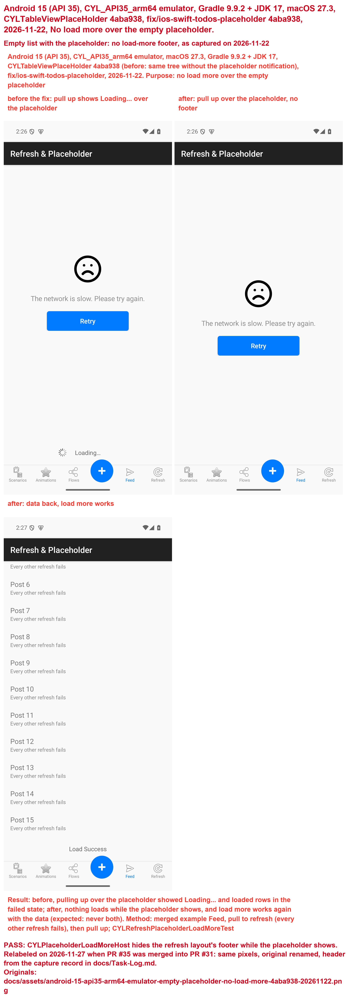
| 进展（2026-11-22，其余平台完成）：小程序 `83eec94`：`cyl-refresh` 与 `cyl-placeholder` 建立 descendant 关系，插槽中有占位图时自动隐藏刷新尾且不触发加载（原来只有应用自己绑定 `footer-hidden` 才隐藏），75 / 75 测试通过（node --test）；未在微信开发者工具中截图。鸿蒙 `ac9f3e9`：`CYLPlaceholderListController.refreshScrollView`，占位图显示期间隐藏其刷新尾与 trailer，92 / 92 主机单元测试通过（macOS 上的 hvigorw test）；示例各页原本已手动设置 `footer.hidden`，未改，未在模拟器上截图。React Native 与 Flutter：在整个 vault 中搜索 CYLTableViewPlaceHolder / cyl_placeholder / cyl-placeholder，没有对应的封装，不适用。iOS 回归：Example-objc-02 的 13 个 UI 测试通过（Xcode 27.2，iOS 27.2 模拟器）。 | Progress (2026-11-22, the other platforms done): mini program `83eec94`: a descendant relation between `cyl-refresh` and `cyl-placeholder` hides the footer and stops loading while a placeholder shows in the slot (before, only an app that bound `footer-hidden` itself got that); 75 / 75 tests pass (node --test); no WeChat DevTools screenshot. HarmonyOS `ac9f3e9`: `CYLPlaceholderListController.refreshScrollView`; its footer and trailer hide while the placeholder shows; 92 / 92 host unit tests pass (hvigorw test on macOS); the example pages already set `footer.hidden` by hand and are unchanged; no emulator screenshot. React Native and Flutter: a search of the whole vault for CYLTableViewPlaceHolder / cyl_placeholder / cyl-placeholder finds no wrapper, so not applicable. iOS regression: the 13 Example-objc-02 UI tests pass (Xcode 27.2, iOS 27.2 simulator). |

## TODO：按静态分析重新评估 `cyl_` / `CYL` 前缀并调整 Swift 命名 / TODO: Re-evaluate the `cyl_` / `CYL` prefixes from the static analysis and adjust Swift names

| 中文 | English |
| --- | --- |
| 日期与分支：2026-11-22，`fix/ios-swift-todos-placeholder`（PR #35）。 | Date and branch: 2026-11-22, `fix/ios-swift-todos-placeholder` (PR #35). |
| 用户原话：“根据github pr评论区的静态分析报告， 重新评估 instructions 中关于cyl_ CYL 方法名前缀名，类名前缀名的必要性， 这个前缀目的主要是为了在objc项目中， 兼容分类方法可能覆盖其他同名实现的场景， 以及弥补objc没有命名空间导致类名冲突的问题，请在Swift上重新评估该前缀必要性， 以及其他有相关机制，能保证我们的库不会导致类名冲突， 方法名冲突的其他语言， 以静态分析为指导意见， 重新调整代码命名， 以适应静态分析建议” | The user's words (verbatim above): re-evaluate, from the static analysis report in the GitHub PR comments, the rule in instructions about the `cyl_` method prefix and the `CYL` class prefix. The prefix exists for Objective-C: a category method can override another implementation with the same name, and Objective-C has no namespaces, so class names can collide. Re-evaluate whether Swift needs it, and evaluate the other languages whose own mechanisms already prevent class and method name conflicts; follow the static analysis and rename the code to fit its advice. |
| 要求：①重新评估 Swift 中前缀的必要性；②评估其他语言（Kotlin、ArkTS、JS/TS、Dart）的命名空间机制；③以静态分析（SonarCloud swift:S100/S115/S116）为准调整代码命名；④更新 instructions.md 第 538 行规则 3、AGENTS.md 第 173 行、Swift-Guide、Swift-Migration 与相关文档。 | Requirements: ① re-evaluate whether Swift needs the prefix; ② evaluate the namespace mechanisms of the other languages (Kotlin, ArkTS, JS/TS, Dart); ③ rename code to follow the static analysis (SonarCloud swift:S100/S115/S116); ④ update rule 3 at instructions.md line 538, AGENTS.md line 173, the Swift guide, the Swift migration log and related documents. |
| 已知：报告在 CYLTabBarController PR #821（28 项，其中 S100 ×14 `cyl_*` 方法、S116 ×2 `cyl_*` 字段、S115 ×2 与 S100 ×1 `CYL*` 全局常量/函数，均在 `CYLAnimatedItemView` 自身类中）；本仓库没有 Sonar 项目。本仓库 Swift 中有 168 个 `cyl_` 声明（61 个已有 `@objc(cyl_…)`），仓库内约 893 处 Swift 调用。tag 1.1.0 不含 core Swift 文件，Swift API 尚未发布，可直接改 Swift 名而不加废弃别名；Objective-C 选择子保持不变。 | Known: the report is on CYLTabBarController PR #821 (28 findings: S100 ×14 on `cyl_*` methods, S116 ×2 on `cyl_*` fields, S115 ×2 and S100 ×1 on `CYL*` globals, all inside `CYLAnimatedItemView`'s own class); this repository has no Sonar project. This repository has 168 `cyl_` Swift declarations (61 with an explicit `@objc(cyl_…)`) and about 893 Swift call sites. Tag 1.1.0 has no core Swift files, so the Swift API is unreleased and Swift names change without deprecated aliases; Objective-C selectors stay. |
| 建议方案（待与 CYLTabBarController 会话对齐）：自有类型的成员去掉前缀；系统类型扩展的成员保留前缀但去掉下划线（`cylHeader`，`@objc(cyl_header)`）；`CYL` 类名不变；Swift 全局常量改小驼峰或改为所属类型的静态成员；对 Objective-C 可见的 UIKit 子类成员保留显式 `@objc(cyl_…)`。以生成的 `-Swift.h` 前后对比保证选择子不变。 | Proposed scheme (to agree with the CYLTabBarController session): members of our own types lose the prefix; members of extensions on system types keep it without the underscore (`cylHeader`, `@objc(cyl_header)`); `CYL` class names stay; Swift globals become lowerCamel or static members of their type; Objective-C-visible members of UIKit subclasses keep an explicit `@objc(cyl_…)`. A before/after diff of the generated `-Swift.h` proves that the selectors do not change. |
| 暂停：31 个上游 issue 的第 3–6 批（见 `issue-progress.md`）。 | Paused: batches 3–6 of the 31 upstream issues (see `issue-progress.md`). |
| 进度（2026-11-22）：方案获 chenyilong-0b 与 CYLSearchViewController 会话同意。iOS Swift 改名完成：186 个 `cyl_` 声明及调用、`cylPh_*` 私有方法、`cyl_(…)` 链式方法、约 20 个文件私有 `CYL*` 常量与测试/示例中的下划线名；39 个只写 `@objc` 的声明补上 `@objc(cyl_…)`，生成的 `-Swift.h` 与改名前逐字相同；218 个单元测试 0 失败；五个示例本机编译成功（Xcode 27.2）；文档：新增 `docs/Swift-Naming.md`，更新 instructions.md 规则 3、AGENTS.md、Swift-Guide、README、CHANGELOG 及 Swift 代码块。剩余：其他语言（Kotlin 等）只做了评估、未改名；CI 确认待 PR #35。同时修复 CI：iOS 15 任务在 `pod install` 克隆 CYLTabBarController 时遇到暂时性的 GitHub 错误，`run-tests.rb`、`run-animation-tests.rb`、`ci-build-example.sh` 的 `pod install` 改为最多重试 3 次。 | Progress (2026-11-22): the scheme was agreed by chenyilong-0b and the CYLSearchViewController session. iOS Swift rename done: 186 `cyl_` declarations and their callers, the private `cylPh_*` methods, the `cyl_(…)` chaining methods, about 20 file-private `CYL*` constants, and underscore names in tests and examples; 39 declarations with a bare `@objc` got `@objc(cyl_…)`, and the generated `-Swift.h` is identical to the one before; 218 unit tests, 0 failures; the five examples build locally (Xcode 27.2); docs: new `docs/Swift-Naming.md`, updated instructions.md rule 3, AGENTS.md, Swift-Guide, README, CHANGELOG and Swift code blocks. Remaining: the other languages (Kotlin and others) are evaluated only, not renamed; CI confirmation waits for PR #35. CI fix in the same pass: the iOS 15 job hit a transient GitHub error cloning CYLTabBarController in `pod install`; `pod install` in `run-tests.rb`, `run-animation-tests.rb` and `ci-build-example.sh` now retries up to 3 times. |
| 进度（2026-11-23）：其他语言改名的范围已统计——Kotlin 43 个 `cyl_` 声明 / 578 处使用（Android 0.1.0 已发布到 Maven，公开名需要 `@Deprecated(ReplaceWith)` 转发）；ArkTS 129 个声明 / 1431 处；小程序 JS 194 处，多数是模块文件名（`cyl_placeholder.js`），不属于标识符规则；Dart 0。全局或序列化的名字（Android 资源、配置 JSON 键、`$r`/rawfile、小程序标签与存储键）保留前缀。阻塞：android/ 与 CrossPlatform/ 由另一会话（Windows）在基线分支上持续提交，放在 PR #35 会与其每次推送冲突；仓库已有 3 个打开的 PR，新开分支需 owner 同意。TODO：owner 决定由谁、在哪个分支执行；命名以 `docs/Swift-Naming.md` 的映射为准，同时更新 `ios-android-parity.py`、Android API 对照表与 `harmony-port-tables.js`。 | Progress (2026-11-23): the scope of the other-language rename is counted: Kotlin 43 `cyl_` declarations / 578 uses (Android 0.1.0 is on Maven, so public names need `@Deprecated(ReplaceWith)` forwarders); ArkTS 129 declarations / 1431 uses; mini program JS 194 hits, mostly module file names (`cyl_placeholder.js`), which the identifier rules do not cover; Dart 0. Global or serialized names (Android resources, configuration JSON keys, `$r` / rawfile, mini program tags and storage keys) keep the prefix. Blocked: android/ and CrossPlatform/ get steady commits from another (Windows) session on the base branch, so doing it on PR #35 conflicts with each of its pushes; the repository already has 3 open pull requests, so a new branch needs the owner's approval. TODO: the owner decides who does it and on which branch; names follow the `docs/Swift-Naming.md` mapping, and `ios-android-parity.py`, the Android API map and `harmony-port-tables.js` are updated in the same change. |

### 已完成（85 / 100）：把 CYLTabBarController 固定到最新 commit f66e85d5（CYLAnimatedItemView）/ Done (85 / 100): repin CYLTabBarController (CYLAnimatedItemView) to its newest commit f66e85d5

| 中文 | English |
| --- | --- |
| 状态：已完成（2026-11-23，分支 `feat/android-refresh-port-followup`，PR #31）。 | Status: done (2026-11-23, branch `feat/android-refresh-port-followup`, PR #31). |
| 提示词（原文为中文，见右栏）。 | Prompt (verbatim, translated): "Switch to the branch of the newest commit, repin CYLAnimatedItemView and continue the TODO items of that pull request." |
| 要求：该分支即当前分支（本仓库最新 commit）；CYLTabBarController 的最新 commit（所有分支）为 `f66e85d5`（`feat/harmony-animated-item-engines`），把它写入 Cartfile、四个 Podfile、鸿蒙与小程序的副本。 | Requirement: the branch is the current one (this repository's newest commit); CYLTabBarController's newest commit on any branch is `f66e85d5` (`feat/harmony-animated-item-engines`); write it into the Cartfile, the four Podfiles and the HarmonyOS and mini program copies. |
| 结果：`resolve-cyltabbarcontroller-commit.sh --write` 更新 Cartfile 与 Podfile；`sync-harmonyos-cylanimateditem.sh` 与 `npm run sync-animated-item` 更新副本。上游把 Rive 实现拆到新模块 `cylanimateditemrive`（`cylanimateditem_rive` 现在依赖它），所以同步脚本的模块列表与 `build-profile.json5` 增加了该模块。`--check` 与 `check_package_licenses.py` 通过；上游 podspec 现为 iOS 15.0，TODO 6 中的 iOS 12 `@available` 问题不再适用。 | Result: `resolve-cyltabbarcontroller-commit.sh --write` updated the Cartfile and Podfiles; `sync-harmonyos-cylanimateditem.sh` and `npm run sync-animated-item` updated the copies. Upstream moved the Rive implementation into a new module `cylanimateditemrive` (`cylanimateditem_rive` now depends on it), so the sync script's module list and `build-profile.json5` gained it. `--check` and `check_package_licenses.py` pass; the upstream podspecs now say iOS 15.0, so the iOS 12 `@available` problem in TODO 6 no longer applies. |
| 评分：85 / 100。TODO（-8）：`pod install` 与 `Podfile.lock` 未更新，iOS 构建未在本机运行（Linux，等 Mac 会话或 CI）。TODO（-4）：鸿蒙未在 DevEco 构建（`cylanimateditem_rive` 现在通过 `cylanimateditemrive` 间接依赖 `@ohos/rive`，entry 的依赖未变）。TODO（-3）：小程序 `node --test` 有 1 个既有失败（`refresh-demos/refresh-test/refresh-test.js`），与固定无关。 | Score: 85 / 100. TODO (-8): `pod install` and `Podfile.lock` are not updated and the iOS build did not run here (Linux; waits for a Mac session or CI). TODO (-4): HarmonyOS was not built in DevEco (`cylanimateditem_rive` now reaches `@ohos/rive` through `cylanimateditemrive`; the entry's dependencies are unchanged). TODO (-3): the mini program's `node --test` has one existing failure (`refresh-demos/refresh-test/refresh-test.js`) unrelated to the pin. |

### 已完成，待你手动编译（静态编写，70 / 100）：HarmonyOS 示例改用 `cylanimateditemrive` / Done, static edit, awaiting your manual build (70 / 100): HarmonyOS example uses `cylanimateditemrive`

| 中文 | English |
| --- | --- |
| 状态：已完成（2026-11-23，分支 `feat/android-refresh-port-followup`，PR #31），只静态编写，未编译。 | Status: done (2026-11-23, branch `feat/android-refresh-port-followup`, PR #31); written statically, not built. |
| 提示词（译自中文）。 | Prompt (verbatim, translated): "Apply the new cylanimateditemrive interface to rework our core code, write the code statically; I will compile and test it by hand afterwards." |
| 要求：按上游 `docs/Animated-Item.md`“共享 Rive 引擎”一节，库依赖 `cylanimateditemrive`；core（`cylplaceholder`）保持不依赖任何动画库。 | Requirement: per upstream `docs/Animated-Item.md`, "Shared HarmonyOS Rive engine", a library depends on `cylanimateditemrive`; the core (`cylplaceholder`) keeps depending on no animation library. |
| 结果：`entry` 的依赖与导入（`ExampleAnimationEngines.ets`、`CYLRefreshRiveView.ets`）从兼容壳 `cylanimateditem_rive` 改为 `cylanimateditemrive`（名字不变：`CYLAnimatedItemRive`、`cylRiveIsSupported`、`cylEnsureRiveInitialized`、`cylRiveRendererType`）；注释同步。core 无代码改动：核心通过引擎视图（`CYLAnimatedItemRive.register()` + `CYLAnimatedItemEnginePlaceholderAnimator`）播放，不使用 `CYLRiveIcon`。 | Result: `entry`'s dependency and imports (`ExampleAnimationEngines.ets`, `CYLRefreshRiveView.ets`) moved from the compatibility shim `cylanimateditem_rive` to `cylanimateditemrive` (same names: `CYLAnimatedItemRive`, `cylRiveIsSupported`, `cylEnsureRiveInitialized`, `cylRiveRendererType`); comments updated. No core code changed: the core plays through engine views (`CYLAnimatedItemRive.register()` + `CYLAnimatedItemEnginePlaceholderAnimator`) and does not use `CYLRiveIcon`. |
| 评分：70 / 100（及格）。TODO（-15）：未在 DevEco 编译与测试（等你手动）。TODO（-10）：未采用 `CYLRiveAnimationBuilder` / `cylRegisterRiveEngine`：它们走 `CYLAnimatedItemView` 的 `animationBuilder` 路径（循环策略 `WhilePlaying`），而核心的占位动画器走引擎视图；两者都注册 `Rive` 类型，同时调用可能覆盖 ABI 要求，需要在设备上验证后再决定；`RiveInputsPage` 仍用 `CYLPlaceholderAnimatedItemBuilder`。TODO（-5）：`cylanimateditem_rive` 兼容壳不再被使用，可在确认后从 `build-profile.json5` 与同步脚本中移除。 | Score: 70 / 100 (pass). TODO (-15): not built or tested in DevEco (yours to do). TODO (-10): `CYLRiveAnimationBuilder` / `cylRegisterRiveEngine` are not adopted: they use `CYLAnimatedItemView`'s `animationBuilder` path (loop policy `WhilePlaying`) while the core's placeholder animator uses engine views; both register the `Rive` type, so calling both may overwrite the ABI requirement; verify on a device before deciding; `RiveInputsPage` still uses `CYLPlaceholderAnimatedItemBuilder`. TODO (-5): the `cylanimateditem_rive` shim is no longer used and can be removed from `build-profile.json5` and the sync script once confirmed. |

### 已完成审计（60 / 100）：新动画引擎接口在各平台的适用情况 / Done, audit (60 / 100): the new animation engine interface on every platform

| 中文 | English |
| --- | --- |
| 状态：已完成（2026-11-23，分支 `feat/android-refresh-port-followup`，PR #31），只静态审查，未编译。 | Status: done (2026-11-23, branch `feat/android-refresh-port-followup`, PR #31); static review only, not built. |
| 提示词（译自中文）。 | Prompt (verbatim, translated): "It also has to apply to every platform: iOS, Android, Flutter, RN, mini program." |
| 方法：比较上游 `a7374df`…`f66e85d` 在各平台对 `CYLAnimatedItemView` 的改动，检查本仓库核心（`CYLPlaceholderView` 子类）是否受影响或可采用。 | Method: compared upstream `a7374df`…`f66e85d` for `CYLAnimatedItemView` on each platform and checked whether this repository's core (the `CYLPlaceholderView` subclasses) is affected or can adopt it. |
| iOS：改动只增不减（`animationRestartToken`、`drivesAnimationPlayback`、`onAnimationEnd` / `Loaded` / `Failed`、结束检测），`CYLPlaceholderView` 自动继承，默认行为不变。TODO：`CYLPlaceholderView.restartAnimation()` 不调用 `super`，所以 `animationRestartToken`（`private(set)`）不增加；改为调用 `super` 会让动图路径绕过“减弱动态效果”策略，需上游提供可设置的钩子后再改。`animationRepeatCount > 1` 的中间几遍会触发基类的 `onAnimationEnd`，需验证。 | iOS: the changes are additive (`animationRestartToken`, `drivesAnimationPlayback`, `onAnimationEnd` / `Loaded` / `Failed`, end detection); `CYLPlaceholderView` inherits them and the default behavior is unchanged. TODO: `CYLPlaceholderView.restartAnimation()` does not call `super`, so `animationRestartToken` (`private(set)`) never grows; calling `super` would let the animated-image path skip the Reduce Motion policy, so wait for an upstream hook. The middle passes of `animationRepeatCount > 1` may fire the base class's `onAnimationEnd`; verify. |
| Android：同样只增（`drivesAnimationPlayback` 默认 false，`animationRestartToken`、`onAnimationLoaded` / `Failed`、`animatedItemPlayer`），核心不受影响；Gradle 检出已随 Cartfile 的 commit 更新。 | Android: additive too (`drivesAnimationPlayback` defaults to false, `animationRestartToken`, `onAnimationLoaded` / `Failed`, `animatedItemPlayer`); the core is unaffected; the Gradle checkout follows the Cartfile commit. |
| 小程序：`cyl-animated-item` 副本已同步，新属性（`drivesAnimationPlayback` 默认 true，`restartToken`）默认值保持旧行为，`cyl-placeholder` 与 HUD 无需改动。 | Mini program: the `cyl-animated-item` copy is synced; the new properties (`drivesAnimationPlayback` default true, `restartToken`) default to the old behavior, so `cyl-placeholder` and the HUD need no change. |
| 鸿蒙：见上一条（示例改用 `cylanimateditemrive`）。 | HarmonyOS: see the previous entry (the example uses `cylanimateditemrive`). |
| Flutter、React Native：本仓库没有这两个平台的代码（只有 `harmonyos-cylplaceholder` 与 `wechat-miniprogram-cylplaceholder`），上游的 `CYLAnimationView` 在 CYLTabBarController 中。TODO（需要你决定）：是否在本仓库新增 Flutter / RN 的占位图包装。 | Flutter and React Native: this repository has no code for them (only `harmonyos-cylplaceholder` and `wechat-miniprogram-cylplaceholder`); upstream's `CYLAnimationView` lives in CYLTabBarController. TODO (your decision): whether to add Flutter / RN placeholder wrappers to this repository. |
| 评分：60 / 100（及格）。TODO（-15）：未编译（iOS、Android、小程序）；TODO（-15）：上述 iOS 重播 token 与重复次数问题；TODO（-10）：Flutter / RN 不存在。 | Score: 60 / 100 (pass). TODO (-15): not built (iOS, Android, mini program); TODO (-15): the iOS restart token and repeat-count items above; TODO (-10): no Flutter / RN code. |

### 已完成（80 / 100）：修复 Android CI “Build the example” 找不到 CYLDeallocBlockExecutor / Done (80 / 100): fix Android CI "Build the example" missing CYLDeallocBlockExecutor

| 中文 | English |
| --- | --- |
| 状态：已完成（2026-11-23，分支 `feat/android-refresh-port-followup`，PR #31；[run 45080681268](https://github.com/ChenYilong/CYLTableViewPlaceHolder/actions/runs/45080681268/job/137388018613)）。 | Status: done (2026-11-23, branch `feat/android-refresh-port-followup`, PR #31; [run 45080681268](https://github.com/ChenYilong/CYLTableViewPlaceHolder/actions/runs/45080681268/job/137388018613)). |
| 提示词（译自中文）。 | Prompt (verbatim, translated): "Fix the CI error and continue" (with the job link). |
| 原因：CI 检出 CYLTabBarController 的最新 commit（`feat/dealloc-block-executor-dependency`），其 `cyltabbar` 模块依赖 JitPack 上的 `com.github.ChenYilong:CYLDeallocBlockExecutor`；本仓库 `android/settings.gradle.kts` 的 JitPack 仓库只允许 `com.github.yyued`，于是 `:merged-example:processDebugResources` 解析失败（单元测试步骤通过）。 | Cause: CI checks out CYLTabBarController's latest commit (`feat/dealloc-block-executor-dependency`), whose `cyltabbar` module depends on `com.github.ChenYilong:CYLDeallocBlockExecutor` from JitPack; this repository's `android/settings.gradle.kts` allowed only `com.github.yyued` on JitPack, so `:merged-example:processDebugResources` failed to resolve (the unit test step passed). |
| 修复：JitPack 的 `content` 增加 `includeGroup("com.github.ChenYilong")`，与上游 `Example-Android/settings.gradle.kts` 一致。评分：80 / 100；TODO（-20）：等 CI 确认。 | Fix: the JitPack `content` also includes `com.github.ChenYilong`, as upstream's `Example-Android/settings.gradle.kts` does. Score: 80 / 100; TODO (-20): wait for CI to confirm. |

### TODO（进行中）：占位图条目的 animationLoops / animationSpeed / restartAnimation，五个平台各一套 / TODO (in progress): animationLoops / animationSpeed / restartAnimation on placeholder items, a set on each of five platforms

| 中文 | English |
| --- | --- |
| 状态：进行中（2026-11-23，分支 `feat/android-refresh-port-followup`，PR #31），只静态编写，由你手动编译测试。 | Status: in progress (2026-11-23, branch `feat/android-refresh-port-followup`, PR #31); written statically, you compile and test by hand. |
| 提示词（译自中文）：“核心还包括给搜索栏条目新增 animationLoops、animationSpeed、restartAnimation 这类属性（五个平台各加一套）”；澄清：“搜索栏条目”指占位图条目。 | Prompt (verbatim, translated): "The core also includes adding properties like animationLoops, animationSpeed and restartAnimation to the search bar items (a set on each of five platforms)"; clarified: "search bar item" means the placeholder item. |
| 现状：iOS / Android 的 `CYLPlaceholderView` 已继承这三个名字，但视图在重新加载时按 `animationRepeatCount` 与选项覆盖 `animationLoops` / `animationSpeed`（直接设置会丢失）；组件（`CYLPlaceholderComponent`）有 `animationRepeatCount` 没有速度；堆叠视图没有“全部重播”。小程序已有 `speed`、`loop`、`playAll()`；鸿蒙已有 `speed`、`loops`、`restartToken`；本仓库没有 Flutter / RN。 | Current state: `CYLPlaceholderView` on iOS / Android already inherits the three names, but the view overwrites `animationLoops` / `animationSpeed` from `animationRepeatCount` and the options on reload (a direct set is lost); the component (`CYLPlaceholderComponent`) has `animationRepeatCount` but no speed; the stack view has no "restart all". The mini program has `speed`, `loop`, `playAll()`; HarmonyOS has `speed`, `loops`, `restartToken`; this repository has no Flutter / RN. |
| 计划（名字取自上游“跨端引擎 API”表，不并行新增名字）：(1) iOS / Android 视图让直接设置的值持久（循环写 `animationRepeatCount`，速度写显式速度）；(2) iOS / Android 组件新增 `animationSpeed`（写已有的每项 `animationSpeed` 选项），堆叠视图新增 `restartAnimation()`；(3) 小程序保留 `speed`、`loop`，新增 `restartAnimation()`（`playAll()` 的别名）与 `restartToken`；(4) 鸿蒙已有，不改；(5) Flutter、RN 新建包装（`animationSpeed`、`animationLoops`、`animationRestartToken`、`restart()`），各一次提交。 | Plan (names from upstream's "Engine API across platforms" table, no parallel names): (1) the iOS / Android view keeps directly set values (loops write `animationRepeatCount`, speed writes the explicit speed); (2) iOS / Android components gain `animationSpeed` (writing the existing per-item `animationSpeed` option) and the stack view gains `restartAnimation()`; (3) the mini program keeps `speed` and `loop`, adds `restartAnimation()` (alias of `playAll()`) and `restartToken`; (4) HarmonyOS already has them, unchanged; (5) Flutter and RN get new wrappers (`animationSpeed`, `animationLoops`, `animationRestartToken`, `restart()`), one commit each. |
| 验收：满分（100）= 五个平台各有这三个名字且直接设置的值持久、文档与注释检查通过、小程序测试通过、你手动编译通过；及格（60）= iOS、Android、小程序完成并通过检查。 | Acceptance: full marks (100) = all five platforms have the three names, directly set values persist, the documentation and doc comment checks pass, the mini program tests pass and your manual build passes; pass (60) = iOS, Android and the mini program done and checks passing. |

### 已完成三个平台（75 / 100，静态）：占位图条目的 animationLoops / animationSpeed / restartAnimation / Done on three platforms (75 / 100, static): animationLoops / animationSpeed / restartAnimation on placeholder items

| 中文 | English |
| --- | --- |
| 状态：上一条 TODO 的结果（2026-11-23，分支 `feat/android-refresh-port-followup`，PR #31），只静态编写，未编译。提交：iOS、Android、小程序各一次。 | Status: the result of the previous TODO (2026-11-23, branch `feat/android-refresh-port-followup`, PR #31); static, not built. Commits: one each for iOS, Android and the mini program. |
| iOS：`CYLPlaceholderView` 重写 `animationLoops`（直接设置写入 `animationRepeatCount`：0 或 1，N > 1 保持）与 `animationSpeed`（正数写入显式速度），重新加载 item 属性时用 `super.` 写入，所以直接设置的值不再丢失；`CYLPlaceholderComponent` 新增 `animationLoops`、`animationSpeed`（写动画选项中的 `animationSpeed`）；`CYLPlaceholderStackView` 新增 `restartAnimation()`。 | iOS: `CYLPlaceholderView` overrides `animationLoops` (a direct set writes `animationRepeatCount`: 0 or 1, a count above 1 stays) and `animationSpeed` (a positive value writes the explicit speed), and a reload of the item attributes writes through `super.`, so a directly set value is no longer lost; `CYLPlaceholderComponent` gains `animationLoops` and `animationSpeed` (writing the `animationSpeed` animation option); `CYLPlaceholderStackView` gains `restartAnimation()`. |
| Android：`CYLPlaceholderView` 重写 `animationLoops`（变化时写 `animationRepeatCount`）；`CYLPlaceholderComponent` 新增 `animationLoops`、`animationSpeed`（不为 1 时由堆叠视图应用）；`CYLPlaceholderStackView` 新增 `restartAnimation()`。速度本来就不会被重新加载覆盖，所以视图不需要重写 `animationSpeed`。 | Android: `CYLPlaceholderView` overrides `animationLoops` (a change writes `animationRepeatCount`); `CYLPlaceholderComponent` gains `animationLoops` and `animationSpeed` (the stack view applies it when it is not 1); `CYLPlaceholderStackView` gains `restartAnimation()`. A reload never overwrote the speed, so the view needs no `animationSpeed` override. |
| 小程序：保留 `speed`、`loop`（不新增并行的 `animationLoops`，避免两个开关的优先级问题），新增 `restartAnimation()`（`playAll()` 的别名）与 `restartToken`（增大时重播，创建时的值不算）；README 已更新。`node --test`：78 / 79 通过，唯一失败是既有的 `refresh-demos/refresh-test/refresh-test.js`。 | Mini program: keeps `speed` and `loop` (no parallel `animationLoops`, which would need a precedence rule between two switches), adds `restartAnimation()` (alias of `playAll()`) and `restartToken` (replays when it grows, the value at creation does not count); README updated. `node --test`: 78 of 79 pass, the one failure is the existing `refresh-demos/refresh-test/refresh-test.js`. |
| 鸿蒙：已有 `speed`、`loops`、`restartToken`（`CYLPlaceholderView.ets`），未改。 | HarmonyOS: already has `speed`, `loops` and `restartToken` (`CYLPlaceholderView.ets`), unchanged. |
| 检查：`scripts/check_doc_comments.py` 通过（1232 / 1232）。 | Checks: `scripts/check_doc_comments.py` passes (1232 / 1232). |
| 评分：75 / 100。TODO（-10）：Flutter、React Native 的占位图包装未做（约 1000 行从未编译的原生与 Dart / TypeScript 代码，上游 `flutter_cyltabbar` / `react-native-cyltabbar` 的 `CYLAnimationView` 已有同名属性 `animationSpeed`、`animationLoops`、`animationRestartToken`、`restart()`，等你确认是否要在本仓库新建包装）。TODO（-10）：iOS、Android 未编译；TODO（-5）：没有针对新属性的单元测试（iOS：直接设置后重新加载仍保持；Android 同理）。 | Score: 75 / 100. TODO (-10): the Flutter and React Native placeholder wrappers are not done (about 1000 lines of never-built native and Dart / TypeScript code; upstream's `flutter_cyltabbar` / `react-native-cyltabbar` `CYLAnimationView` already has the same names `animationSpeed`, `animationLoops`, `animationRestartToken`, `restart()`; waiting for your confirmation to create wrappers here). TODO (-10): iOS and Android are not built; TODO (-5): no unit tests for the new properties (iOS: a direct set still holds after a reload; Android likewise). |

### TODO（进行中）：Flutter / React Native 薄包装，直接调用上游 `CYLAnimationView` / TODO (in progress): thin Flutter / React Native packages that call upstream's `CYLAnimationView` directly

| 中文 | English |
| --- | --- |
| 状态：进行中（2026-11-23，分支 `feat/android-refresh-port-followup`，PR #31），只静态编写，由你手动测试。 | Status: in progress (2026-11-23, branch `feat/android-refresh-port-followup`, PR #31); static, you test by hand. |
| 提示词（译自中文）：“上游 CYLTabBarController 的 CYLAnimationView 已有同名的 animationSpeed、animationLoops、animationRestartToken 和 restart()。在本仓库新建包装，请不要重复实现，直接调用上游接口即可。并请 advisor 评估直接调用上游还是新建包装，哪一个方案更有利于本项目，sonnet 实现。” | Prompt (verbatim, translated): "Upstream CYLTabBarController's CYLAnimationView already has animationSpeed, animationLoops, animationRestartToken and restart() with the same names. Create the wrapper in this repository, but do not duplicate the implementation; just call the upstream interface. And ask the advisor to evaluate whether calling upstream directly or building a wrapper is better for this project; sonnet implements." |
| 评估（advisor）：直接调用上游。上游 `CYLAnimationView` 的两个原生半边都封装 `CYLAnimatedItemView`（`CYLPlaceholderView` 的父类），自己在原生层托管 `CYLPlaceholderView` 要重写约 1000 行从未编译的方法通道 / ViewManager / codegen 代码；项目规则也要求图标加标题用 `CYLAnimatedItemView`，上游修复随 pin 到达。代价（记为 TODO，不在 Dart / TS 重复实现）：重复次数 N > 1、减弱动态效果策略、场景目录、HUD 与状态视图不在 Flutter / RN 中。 | Evaluation (advisor): call upstream directly. Both native halves of upstream's `CYLAnimationView` wrap `CYLAnimatedItemView` (the parent of `CYLPlaceholderView`); hosting `CYLPlaceholderView` natively would need about 1000 lines of never-built method channel / ViewManager / codegen code, and the project rule says an icon and title use `CYLAnimatedItemView`, with upstream fixes arriving through the pin. Cost (recorded as TODOs, not reimplemented in Dart / TS): repeat count N > 1, the Reduce Motion policy, the scenario catalog, and HUD and status views are not in Flutter / RN. |
| 计划：`CrossPlatform/flutter_cylplaceholder`（`pubspec.yaml` 以 git + commit 依赖上游 `flutter_cyltabbar`，commit 与 Cartfile 相同，由 `resolve-cyltabbarcontroller-commit.sh --write` 更新）与 `CrossPlatform/react-native-cylplaceholder`（`react-native-cyltabbar` 为 peer 依赖，npm 不能安装 git 子目录）；都没有原生代码，只有 `CYLPlaceholderItem`（上游动画视图加标题，整体一个无障碍标签）与对上游名称的再导出；重播用上游的 `animationRestartToken` 与 `restart()`，不新增 `restartAnimation()`。LICENSE 与清单加入 `scripts/check_package_licenses.py`。 | Plan: `CrossPlatform/flutter_cylplaceholder` (`pubspec.yaml` depends on upstream's `flutter_cyltabbar` by git and commit, the same commit as the Cartfile, updated by `resolve-cyltabbarcontroller-commit.sh --write`) and `CrossPlatform/react-native-cylplaceholder` (`react-native-cyltabbar` as a peer dependency, since npm cannot install a git subfolder); no native code, only `CYLPlaceholderItem` (upstream's animation view plus the title, one accessibility label for the whole) and re-exports of upstream's names; a restart uses upstream's `animationRestartToken` and `restart()`, no new `restartAnimation()`. LICENSE and manifests go into `scripts/check_package_licenses.py`. |
| 验收：满分（100）= 两个包存在、检查脚本通过、你在设备上运行通过、含带播放控制的示例页；及格（60）= 两个包与文档完成且检查通过（未运行）。 | Acceptance: full marks (100) = both packages exist, the check scripts pass, you ran them on a device, and an example page with playback controls; pass (60) = both packages and documentation done and checks passing (not run). |

### TODO（进行中）：新建 Flutter 与 React Native 包（先 Flutter，再 RN，最后鸿蒙），接口对齐 iOS / Android 的 CYLRefresh / TODO (in progress): new Flutter and React Native packages (Flutter first, then RN, then HarmonyOS), API aligned with iOS / Android CYLRefresh

| 中文 | English |
| --- | --- |
| 状态：进行中（2026-11-23，分支 `feat/android-refresh-port-followup`，PR #31）。评分表：[Refresh-Library-Parity.md, section "flutter_easy_refresh to Flutter package (CYL API)"](Refresh-Library-Parity.md)。 | Status: in progress (2026-11-23, branch `feat/android-refresh-port-followup`, PR #31). Score table: [Refresh-Library-Parity.md, section "flutter_easy_refresh to Flutter package (CYL API)"](Refresh-Library-Parity.md). |
| 提示词（原文）：“给 CYLTableViewPlaceHolder 新建 Flutter 和 React Native 包 按 TabBar 里那两个包的结构搭，先做 Flutter，再做 RN，最后移植到鸿蒙。参考flutter_easy_refresh 相关提交（如 7175f45、7e9a9ef、f38ce49）：把这个 Flutter 库的下拉刷新样式和示例页移植成 iOS Swift 和 Android后的接口为准，将flutter_easy_refresh应用接口对其iOS android的方式完成flutter接口设计，接口设计由advisor设计，完成评分标准 找到下面描述中相关的文档，如果没有就新建，如果有就插入：全英文写入：制作一个表格，第一列为，第二列为功能描述，第三列为 对应的api或者功能。第三列默认为TODO。制作评分系统，第三列没有TODO 为满分，全部是TODO为0分。制作表格以及评分系统完成后，第一步 尝试搜索现有代码，尝试匹配TODO项，寻找对应的api和功能。第二：打分。第三：。开始逐一处理TODO。并更新TODO为对应实现。第四步骤：打分。如此循环往复一直到满分为止。代码编写由sonnet 改造flutter_easy_refresh 遵循新的api设计的方式完成。在实现过程中要将根目录下所有以CYL开头的文件夹（举例说明CYLTabBarController、CYLSearchBarController 特别包含CollectionView开头的目录）中使用到的Refresh相关的flutter rn 鸿蒙os相关的代码移动到本项目core中并改造其他项目引用本仓库完成refred以及异常占位图的example编写。RN使用相同策略。” | Prompt (verbatim, translated from the Chinese): "Create Flutter and React Native packages for CYLTableViewPlaceHolder, structured like the two packages in TabBar; Flutter first, then RN, finally port to HarmonyOS. Reference the flutter_easy_refresh commits (7175f45, 7e9a9ef, f38ce49): the API as ported to iOS Swift and Android is the reference; design the Flutter API by aligning flutter_easy_refresh's application API with the iOS / Android way; the advisor designs the API; then the scoring standard: find the related document, create it if missing, insert if present, written in English: a table whose first column is the flutter_easy_refresh feature, second the description, third the corresponding API or feature, default TODO. A scoring system: no TODO in column 3 is full marks, all TODO is 0. After the table and score exist: step 1 search existing code and match the TODO rows; step 2 score; step 3 work the TODOs one by one and replace TODO with the implementation; step 4 score; repeat until full marks. Sonnet writes the code by adapting flutter_easy_refresh to the new API design. During the work, move the Refresh-related Flutter / RN / HarmonyOS code used in every root folder starting with CYL (CYLTabBarController, CYLSearchBarController, including the CollectionView folders) into this project's core, and make the other projects reference this repository; write the refresh and error-placeholder examples. RN uses the same strategy." |
| 要求：①Flutter 与 RN 包的结构照搬 CYLTabBarController 的 `flutter_cyltabbar` / `react-native-cyltabbar`；②API 以 iOS Swift / Android 已移植的 CYLRefresh 为准，由 advisor 设计；③评分表与循环（搜索、打分、处理 TODO、再打分）至满分；④代码由 sonnet 编写；⑤兄弟项目里的 Refresh 相关 Flutter / RN / 鸿蒙代码移入本仓库核心，兄弟项目改为引用本仓库；⑥写刷新与异常占位图示例；⑦顺序：Flutter → RN → 鸿蒙。 | Requirements: (1) the Flutter and RN packages copy the structure of CYLTabBarController's `flutter_cyltabbar` / `react-native-cyltabbar`; (2) the API follows the CYLRefresh already ported to iOS Swift / Android, designed by the advisor; (3) the score table and the loop (search, score, work TODOs, score again) to full marks; (4) sonnet writes the code; (5) the Refresh-related Flutter / RN / HarmonyOS code in sibling projects moves into this repository's core and the siblings reference this repository; (6) refresh and error-placeholder examples; (7) order: Flutter → RN → HarmonyOS. |
| 上下文：本仓库没有 Flutter / RN 包（见 `docs/Android-Port.md` 的 HarmonyOS 条目，owner 决策已给出）。兄弟项目盘点（2026-11-23）：`CYLTabBarController`、`CYLTabBarController-merge`、`CYLTabBarController-hm-fix` 的 Flutter / RN / 鸿蒙代码里 “Refresh” 只出现在 tab 标题 “Refresh” 与鸿蒙倒计时的 `refreshCountdown`，没有下拉刷新代码；`CYLSearchViewController`、`CYL CollectionView Classify Menu`、`CYLChatKit`、`CYLDeallocBlockExecutor` 没有 Refresh 相关的 Dart / TS / ArkTS 文件。所以第⑤条目前没有可移动的代码，记录在此，发现新的再移。会话分工（Mac → iOS，Win → 其他平台）：Flutter / RN / 鸿蒙属其他平台，本 Mac 会话先做设计与评分表。会话检查（2026-11-23）：所有 Win 会话都离线，所以不分配，本会话独立完成；advisor 的设计要点：组件是长寿命的 `ChangeNotifier`，名字取 Kotlin（lowerCamelCase，iOS 选择子写在表里），flutter_easy_refresh 在 `dcdbb81` 只作行为参考，改为完全改写成 `cyl_refresh`（owner 在 2026-11-23 改了策略：不 vendor、不套适配层、去掉 flutter_easy_refresh 命名，更高自定义、更简洁的架构，MIT 署名保留在 NOTICE），包路径 `CrossPlatform/flutter_cylplaceholder`，占位动画依赖 `flutter_cyltabbar` 的 `CYLAnimationView`。评分表已插入 `Refresh-Library-Parity.md`（65 行，0 / 100）。分支：开放 PR 已有 3 个（#31、#35、#36），再开新分支的 PR 要先问你，所以暂时留在 `feat/android-refresh-port-followup`（PR #31），在 `/tmp/xpa/ph-ci`（APFS）里构建。 | Context: this repository has no Flutter / RN package (see the HarmonyOS entry of `docs/Android-Port.md`; the owner decision is on record). Inventory of the sibling projects (2026-11-23): in the Flutter / RN / HarmonyOS code of `CYLTabBarController`, `CYLTabBarController-merge` and `CYLTabBarController-hm-fix`, "Refresh" only appears as the tab title "Refresh" and HarmonyOS's countdown `refreshCountdown`; there is no pull-to-refresh code. `CYLSearchViewController`, `CYL CollectionView Classify Menu`, `CYLChatKit` and `CYLDeallocBlockExecutor` have no Refresh-related Dart / TS / ArkTS files. So requirement (5) has nothing to move yet; recorded here, to be moved when found. Session roles (Mac → iOS, Win → other platforms): Flutter / RN / HarmonyOS are other platforms; this Mac session starts with the design and the score table. Session check (2026-11-23): every Win session is offline, so nothing is assigned and this session works alone. Advisor design: components are long-lived `ChangeNotifier`s; names come from Kotlin (lowerCamelCase, the iOS selector is in the table); flutter_easy_refresh at `dcdbb81` is only the behavior reference and is fully rewritten as `cyl_refresh` (owner changed the strategy on 2026-11-23: no vendoring, no adapter layer, no flutter_easy_refresh names, more customization, simpler architecture; MIT attribution kept in NOTICE); package path `CrossPlatform/flutter_cylplaceholder`; placeholder animations depend on `flutter_cyltabbar`'s `CYLAnimationView`. The score table is inserted into `Refresh-Library-Parity.md` (65 rows, 0 / 100). Branch: 3 pull requests are already open (#31, #35, #36); a new branch's PR needs your answer first, so for now work stays on `feat/android-refresh-port-followup` (PR #31), built in `/tmp/xpa/ph-ci` (APFS). |
| 验收：满分（100）= 评分表第三列没有 TODO（不适用的行写明理由），Flutter 包在模拟器上跑通刷新 / 异常占位图示例并截图，测试通过；RN、鸿蒙各自同样的表。及格（60）= Flutter 包完成。 | Acceptance: full marks (100) = no TODO in column 3 of the score table (a not-applicable row states why), the Flutter package runs the refresh and error-placeholder examples on the simulator with screenshots, tests pass; the same table for RN and HarmonyOS. Pass (60) = the Flutter package done. |

### 已完成（60 / 100，静态）：Flutter / React Native 薄包装，直接调用上游 / Done (60 / 100, static): thin Flutter / React Native packages over upstream

| 中文 | English |
| --- | --- |
| 状态：上一条 TODO 的结果（2026-11-23，分支 `feat/android-refresh-port-followup`，PR #31），只静态编写，未编译。 | Status: the result of the previous TODO (2026-11-23, branch `feat/android-refresh-port-followup`, PR #31); static, not built. |
| 结果：新建 `CrossPlatform/flutter_cylplaceholder`（`CYLPlaceholderItem`，再导出 `CYLAnimationView`、`CYLAnimationController`；`pubspec.yaml` 以 git + commit 依赖 `flutter_cyltabbar`）与 `CrossPlatform/react-native-cylplaceholder`（`CYLPlaceholderItem`，再导出 `CYLAnimationView`；`react-native-cyltabbar` 为 peer 依赖）。没有原生代码，没有 `restartAnimation()`：重播用上游的 `animationRestartToken` 与 `restart()`。`scripts/resolve-cyltabbarcontroller-commit.sh --write` 现在也更新 `pubspec.yaml` 的 `ref`；两个包的 LICENSE 与清单加入 `scripts/check_package_licenses.py`（通过：10 个包、6 个清单）；`check_doc_comments.py` 通过。 | Result: new `CrossPlatform/flutter_cylplaceholder` (`CYLPlaceholderItem`, re-exporting `CYLAnimationView` and `CYLAnimationController`; `pubspec.yaml` depends on `flutter_cyltabbar` by git and commit) and `CrossPlatform/react-native-cylplaceholder` (`CYLPlaceholderItem`, re-exporting `CYLAnimationView`; `react-native-cyltabbar` as a peer dependency). No native code and no `restartAnimation()`: a restart uses upstream's `animationRestartToken` and `restart()`. `scripts/resolve-cyltabbarcontroller-commit.sh --write` now also updates a `pubspec.yaml`'s `ref`; both packages' LICENSE and manifests are in `scripts/check_package_licenses.py` (passes: 10 packages, 6 manifests); `check_doc_comments.py` passes. |
| 与另一个会话的协调：该会话在同一分支上记录了“Flutter / RN 包 + CYLRefresh API”任务（计划同名目录 `CrossPlatform/flutter_cylplaceholder`），其评分表第 293 行“Placeholder animations”正是本包的内容，已把该行指向 `CYLPlaceholderItem`；刷新相关的行仍由那个会话负责，本包是它的基础。 | Coordination with the other session: it logged a "Flutter / RN packages + CYLRefresh API" task on the same branch (planning the same folder `CrossPlatform/flutter_cylplaceholder`); row 293 "Placeholder animations" of its score table is exactly this package, and now points to `CYLPlaceholderItem`; the refresh rows stay with that session, and this package is its base. |
| 评分：60 / 100（及格）。TODO（-15）：没有编译或运行（无 Flutter SDK / RN 环境）；TODO（-10）：没有测试（Dart widget 测试、TS 类型检查）；TODO（-10）：RN 的 `react-native-cyltabbar` 安装方式需要你确认（上游 README 只写 `npm install react-native-cyltabbar`，是否已发布未核实）；TODO（-5）：示例页（Play all、速度滑块、循环开关）未做；上游已移动到 `9838a2e3`，本包仍固定在 Cartfile 的 `f66e85d5`（由下次 `resolve` 更新）。 | Score: 60 / 100 (pass). TODO (-15): not built or run (no Flutter SDK / RN environment); TODO (-10): no tests (a Dart widget test, a TS type check); TODO (-10): how an RN app installs `react-native-cyltabbar` needs your confirmation (upstream's README only says `npm install react-native-cyltabbar`; whether it is published was not verified); TODO (-5): the example page (Play all, speed slider, loop switch) is not done; upstream has moved to `9838a2e3`, this package still pins the Cartfile's `f66e85d5` (the next `resolve` updates it). |

### 已完成（80 / 100）：修复 Android 单元测试找不到 `com.github.ChenYilong.CYLDeallocBlockExecutor` / Done (80 / 100): fix Android unit tests missing `com.github.ChenYilong.CYLDeallocBlockExecutor`

| 中文 | English |
| --- | --- |
| 状态：已完成（2026-11-23，分支 `feat/android-refresh-port-followup`，PR #31；[run 45096449949](https://github.com/ChenYilong/CYLTableViewPlaceHolder/actions/runs/45096449949/job/137437192405)）。提示词（译自中文）：“查看新的 CI 运行结果，修复”。 | Status: done (2026-11-23, branch `feat/android-refresh-port-followup`, PR #31; [run 45096449949](https://github.com/ChenYilong/CYLTableViewPlaceHolder/actions/runs/45096449949/job/137437192405)). Prompt (verbatim, translated): "Check the result of the new CI run and fix it". |
| 原因：上游最新 commit 的 `cylanimateditem` 依赖 `com.github.ChenYilong.CYLDeallocBlockExecutor:cyl-dealloc-block-executor-core:<sha>`（JitPack 多模块坐标，group 带模块名），而 `android/settings.gradle.kts` 只用 `includeGroup("com.github.ChenYilong")` 精确匹配，JitPack 没有出现在搜索列表中；`:placeholder:testDebugUnitTest` 解析失败。上一次修复（Build the example）只覆盖了单模块 group。 | Cause: the newest upstream commit's `cylanimateditem` depends on `com.github.ChenYilong.CYLDeallocBlockExecutor:cyl-dealloc-block-executor-core:<sha>` (a JitPack multi-module coordinate, the group carries the module name), while `android/settings.gradle.kts` used the exact `includeGroup("com.github.ChenYilong")`, so JitPack was not in the search list and `:placeholder:testDebugUnitTest` failed to resolve. The previous fix (Build the example) covered only the single-module group. |
| 修复：JitPack 的内容过滤改为 `includeGroupByRegex("com\\.github\\.ChenYilong(\\..+)?")`，两种写法都匹配。评分：80 / 100；TODO（-20）：等 CI 确认（JitPack 是否已构建该 commit 未核实）。 | Fix: JitPack's content filter is now `includeGroupByRegex("com\\.github\\.ChenYilong(\\..+)?")`, matching both forms. Score: 80 / 100; TODO (-20): wait for CI to confirm (whether JitPack has built that commit was not verified). |

### 已完成（75 / 100）：Android 强制使用 CYLDeallocBlockExecutor 的 43f94ad / Done (75 / 100): Android forces CYLDeallocBlockExecutor at 43f94ad

| 中文 | English |
| --- | --- |
| 状态：已完成（2026-11-23，分支 `feat/android-refresh-port-followup`，PR #31）。提示词（译自中文）：“（cyl-dealloc-block-executor-core 库 commit 43f94ad）”，接上一条 CI 失败（上游固定的 `6aef46d9` 在 JitPack 上找不到）。 | Status: done (2026-11-23, branch `feat/android-refresh-port-followup`, PR #31). Prompt (verbatim, translated): "(the cyl-dealloc-block-executor-core library commit 43f94ad)", following the previous CI failure (upstream's pinned `6aef46d9` is not found on JitPack). |
| 做法：`android/build.gradle.kts` 对所有子项目的依赖解析，把 group `com.github.ChenYilong.CYLDeallocBlockExecutor` 的版本强制为 `43f94ad`（`resolutionStrategy.eachDependency`）；上游的版本目录不改。评分：75 / 100。TODO（-15）：等 CI 确认；TODO（-10）：`43f94ad` 是你给的短哈希，我没有该仓库的访问权限，未核实它在 JitPack 上已构建、API 与上游 `CYLTabBarController` 期望的 `6aef46d9` 兼容；上游修正它的版本目录后应删除这段覆盖。 | Approach: `android/build.gradle.kts` forces the version of the group `com.github.ChenYilong.CYLDeallocBlockExecutor` to `43f94ad` in every subproject's dependency resolution (`resolutionStrategy.eachDependency`); upstream's version catalog is not changed. Score: 75 / 100. TODO (-15): wait for CI; TODO (-10): `43f94ad` is the short hash you gave, this session has no access to that repository, so it was not verified that JitPack has built it or that its API is compatible with the `6aef46d9` that upstream `CYLTabBarController` expects; remove this override once upstream fixes its version catalog. |

### TODO（进行中）：继续 React Native 开发，接口与 Flutter / iOS / Android 对齐 / TODO (in progress): continue React Native, interface aligned with Flutter / iOS / Android

| 中文 | English |
| --- | --- |
| 状态：进行中（2026-11-23，分支 `feat/android-refresh-port-followup`，PR #31），只静态编写，由你手动测试。 | Status: in progress (2026-11-23, branch `feat/android-refresh-port-followup`, PR #31); static, you test by hand. |
| 提示词（译自中文）：“继续完成 react native 开发 接口对齐”。 | Prompt (verbatim, translated): "Continue completing the React Native development, interface alignment". |
| 上下文：`CrossPlatform/react-native-cylplaceholder` 目前只有薄包装 `CYLPlaceholderItem`（上游 `CYLAnimationView` 加标题）。另一个会话已把 Flutter 包重写成 `CYLRefresh` API（`flutter_cylplaceholder`：`CYLRefreshComponent` / Header / Footer / AutoFooter / BackFooter、经典 / Cupertino / Material 样式、`CYLRefreshPaging`、`CYLRefreshPhysics`、`CYLPlaceholderView`，评分表见 `docs/Refresh-Library-Parity.md`，75 / 100），并规定顺序 Flutter → RN → 鸿蒙。RN 的“接口对齐”即：RN 包提供同名、同语义的 API（`CYLRefresh*`、`CYLRefreshPaging`、`CYLPlaceholderView`、`CYLPlaceholderItem`），并有同样结构的评分表。 | Context: `CrossPlatform/react-native-cylplaceholder` only has the thin `CYLPlaceholderItem` (upstream's `CYLAnimationView` plus a title). The other session rewrote the Flutter package to the `CYLRefresh` API (`flutter_cylplaceholder`: `CYLRefreshComponent` / Header / Footer / AutoFooter / BackFooter, Classic / Cupertino / Material styles, `CYLRefreshPaging`, `CYLRefreshPhysics`, `CYLPlaceholderView`; score table in `docs/Refresh-Library-Parity.md`, 75 / 100) and set the order Flutter → RN → HarmonyOS. "Interface alignment" for RN means: the RN package offers the same names with the same meaning (`CYLRefresh*`, `CYLRefreshPaging`, `CYLPlaceholderView`, `CYLPlaceholderItem`), with a score table of the same structure. |
| 验收：满分（100）= RN 评分表第三列没有 TODO、你在设备上运行通过并有截图；及格（60）= 评分表建立，核心（组件状态机、经典样式、分页、占位图视图）按 Flutter 的名字实现，类型检查通过。 | Acceptance: full marks (100) = no TODO in column 3 of the RN score table, you ran it on a device with screenshots; pass (60) = the score table exists and the core (component state machine, classic styles, paging, placeholder view) is implemented under Flutter's names, with a clean type check. |

### 进展（React Native，纯 TypeScript 层）/ Progress (React Native, pure TypeScript layer)

| 中文 | English |
| --- | --- |
| 2026-11-23，分支 `feat/android-refresh-port-followup`，PR #31。已完成：RN 评分表（`docs/Refresh-Library-Parity.md`，65 行）、纯 TypeScript 层 `CrossPlatform/react-native-cylplaceholder/src/refresh`（`CYLRefreshPhase` 等常量对象、`CYLRefreshNotifier`、`CYLRefreshComponent` 与 Header / Footer / AutoFooter / BackFooter / Listener 子类、`CYLRefreshPaging`），名称、默认值、相位转换与回调顺序照搬 Flutter；时长单位为毫秒。 | 2026-11-23, branch `feat/android-refresh-port-followup`, PR #31. Done: the RN score table (`docs/Refresh-Library-Parity.md`, 65 rows), the pure TypeScript layer `CrossPlatform/react-native-cylplaceholder/src/refresh` (constant objects such as `CYLRefreshPhase`, `CYLRefreshNotifier`, `CYLRefreshComponent` with the Header / Footer / AutoFooter / BackFooter / Listener subclasses, `CYLRefreshPaging`), with Flutter's names, defaults, phase transitions and callback order; durations are in milliseconds. |
| 验证（真实运行）：从 Flutter 移植的 17 个单元测试 `node --test --experimental-strip-types` 全部通过；`tsc --noEmit`（TypeScript 严格模式，`erasableSyntaxOnly`，react-native 0.79 类型）零错误（`react-native-cyltabbar` 的类型用与上游一致的临时声明代替）；`check_package_licenses.py` 通过。 | Verification (really run): the 17 unit tests ported from Flutter pass with `node --test --experimental-strip-types`; `tsc --noEmit` (TypeScript strict, `erasableSyntaxOnly`, react-native 0.79 types) reports zero errors (the types of `react-native-cyltabbar` were replaced by a temporary declaration copied from upstream's); `check_package_licenses.py` passes. |
| 评分：RN 表之外的 TODO：React 层（`CYLRefresh`、下拉头部的 `PanResponder`、Classic / Cupertino / Material 样式、`CYLPlaceholderView`、无障碍播报）、贝塞尔 / 外卖 / 凤凰 / 金牛座样式、二楼、Rive 样式、示例页、占位图组件与 HUD；在设备上运行未做。 | Score: TODO beyond the RN score table: the React layer (`CYLRefresh`, the `PanResponder` pull header, the Classic / Cupertino / Material styles, `CYLPlaceholderView`, accessibility announcements), the Bezier / Delivery / Phoenix / Taurus styles, the second floor, the Rive styles, the example pages, the placeholder components and the HUD; no device run yet. |

### 进展（React Native，React 层与经典样式）/ Progress (React Native, React layer and classic styles)

| 中文 | English |
| --- | --- |
| 2026-11-23，PR #31。新增：经典样式 `CYLRefreshClassicHeader` / `Footer` / `AutoFooter`（纯 TypeScript，文字、最后更新时间与 Flutter 相同）、React 层 `CYLRefresh`（render-prop 子节点接收滚动 props，读取滚动偏移得到下拉量，适用于 `ScrollView` / `FlatList`）、`CYLRefreshClassicIndicator`（一个带标签的无障碍元素，礼貌播报）、`useCYLRefreshComponent`（`useSyncExternalStore`）。`CYLPlaceholderItem` 移到入口 `react-native-cylplaceholder/item`，刷新入口不再导入可选的 `react-native-cyltabbar`。 | 2026-11-23, PR #31. Added: the classic styles `CYLRefreshClassicHeader` / `Footer` / `AutoFooter` (pure TypeScript, the same texts and last update time as Flutter), the React layer `CYLRefresh` (a render-prop child receives the scroll props, the pull is read from the scroll offset, for `ScrollView` / `FlatList`), `CYLRefreshClassicIndicator` (one labelled accessibility element, polite announcements) and `useCYLRefreshComponent` (`useSyncExternalStore`). `CYLPlaceholderItem` moved to the entry point `react-native-cylplaceholder/item`, so the refresh entry no longer imports the optional `react-native-cyltabbar`. |
| 验证（真实运行）：`node --test` 20 个测试通过；`tsc --noEmit` 零错误，包括 `ScrollView` 与 `FlatList` 的用法类型检查（`test/usage.typecheck.tsx`）。未做：设备运行。已知限制：Android 的 `ScrollView` 没有负的滚动偏移，所以 Android 上下拉头部与上拉底部不会被检测到（自动加载底部与 `beginRefreshing` 可用）；内容缩进撑开指示器的动画在 iOS 上是否平滑需要设备验证。 | Verification (really run): `node --test` 20 tests pass; `tsc --noEmit` reports zero errors, including type checks of `ScrollView` and `FlatList` usage (`test/usage.typecheck.tsx`). Not done: a device run. Known limits: Android's `ScrollView` has no negative scroll offset, so on Android the pulled-down header and pulled-up footer are not detected (the auto footer and `beginRefreshing` work); whether the content inset that holds the indicator open animates smoothly on iOS needs a device check. |

### 已完成（React Native 对齐，及格，静态 + 真实类型检查）/ Done (React Native alignment, pass, static plus a real type check)

| 中文 | English |
| --- | --- |
| 状态：已完成本轮（2026-11-23，分支 `feat/android-refresh-port-followup`，PR #31）。提示词（译自中文）：“继续完成 react native 开发 接口对齐”。 | Status: this round is done (2026-11-23, branch `feat/android-refresh-port-followup`, PR #31). Prompt (verbatim, translated): "Continue completing the React Native development, interface alignment". |
| 结果：`CrossPlatform/react-native-cylplaceholder` 提供与 Flutter 同名、同语义的 `CYLRefresh`、`CYLRefreshComponent` 及 Header / Footer / AutoFooter / BackFooter / Listener / Classic 子类、`CYLRefreshPaging`、`CYLPlaceholderView`（含 `CYLPlaceholderStyle`、`CYLPlaceholderItemKey`、`fromItemAttributes`）与 `CYLPlaceholderItem`；刷新入口不依赖可选的 `react-native-cyltabbar`。评分表（`docs/Refresh-Library-Parity.md`）见该节标题下的分数。 | Result: `CrossPlatform/react-native-cylplaceholder` offers `CYLRefresh`, `CYLRefreshComponent` with the Header / Footer / AutoFooter / BackFooter / Listener / Classic subclasses, `CYLRefreshPaging`, `CYLPlaceholderView` (with `CYLPlaceholderStyle`, `CYLPlaceholderItemKey`, `fromItemAttributes`) and `CYLPlaceholderItem`, with Flutter's names and meaning; the refresh entry does not depend on the optional `react-native-cyltabbar`. The score table (`docs/Refresh-Library-Parity.md`) has the score under its section heading. |
| 验证（真实运行）：`node --test` 24 个测试全部通过（从 Flutter 移植的状态机、分页、经典样式、自动加载底部，以及占位图属性）；`tsc --noEmit` 严格模式零错误（`ScrollView` / `FlatList` 用法也做了类型检查）。未做：在 iOS / Android 设备上运行；React 层没有渲染测试。 | Verification (really run): `node --test` 24 tests pass (the state machine, paging, classic styles and auto footer ported from Flutter, plus the placeholder attributes); `tsc --noEmit` in strict mode reports zero errors (`ScrollView` / `FlatList` usage is type-checked too). Not done: a run on iOS / Android devices; the React layer has no render tests. |
| 评分：及格（60）已达到（RN 表分数见上）。TODO：其他样式（Cupertino、Material、贝塞尔、外卖、凤凰、金牛座）、二楼、Rive 样式、Android 下拉头部（`ScrollView` 在 Android 上没有负偏移，需要 `PanResponder` 或原生支持）、占位图组件与堆叠、HUD、示例页、React 层渲染测试、设备运行与截图；API 评审：`CYLRefresh` 的 `children` 是函数（Flutter 的 `child` 是控件），`ref` 通过 props 传递，时长以毫秒为单位，样式图标是 emoji。 | Score: the pass (60) is reached (the RN table's score is above). TODO: the other styles (Cupertino, Material, Bezier, Delivery, Phoenix, Taurus), the second floor, the Rive styles, the Android pull-down header (`ScrollView` has no negative offset on Android; it needs a `PanResponder` or native support), the placeholder components and stack, the HUD, the example pages, render tests of the React layer, a device run and screenshots; API review: `CYLRefresh`'s `children` is a function (Flutter's `child` is a widget), `ref` goes through props, durations are in milliseconds, the style icons are emoji. |

### TODO（进行中）：先做完 Flutter 包，再做 RN / TODO (in progress): finish the Flutter package first, then RN

| 中文 | English |
| --- | --- |
| 状态：进行中（2026-11-23，分支 `feat/android-refresh-port-followup`，PR #31）。Flutter 评分表属于另一个会话（当前联系不上），本条继续它的表。 | Status: in progress (2026-11-23, branch `feat/android-refresh-port-followup`, PR #31). The Flutter score table belongs to the other session (not reachable now); this entry continues it. |
| 提示词（译自中文）：“flutter 没做完就继续，先做完 flutter 再做 rn”。 | Prompt (verbatim, translated): "Flutter is not finished, so continue: finish Flutter first, then RN". |
| 上下文：`docs/Refresh-Library-Parity.md` 的 Flutter 表 49 / 65（75 分），剩 16 行 TODO：`scrollController` / `triggerAxis`、sliver 定位器、弹簧构建器、嵌套控制器、5 个绘制样式（Bezier 雷达 / 圆、外卖、凤凰、金牛座）、头部与底部二楼、Rive 样式、示例页、占位图组件与堆叠、HUD 与状态栏、单元与控件测试。容器现在有 Flutter SDK（`/tmp/claude-0/fl/flutter`，3.50.1），基线 `flutter test` 46 个测试全部通过，所以每一行都用 `flutter test` 验证。advisor 评估：16 行都不能标 N/A（都是 Flutter 能做的功能）；顺序：`CYLRefresh` 参数 → 二楼 → 绘制样式 → 占位图组件与堆叠 → HUD → Rive 样式（经上游 `CYLAnimationView`，不引入 `rive` 包）→ 示例页。 | Context: the Flutter table in `docs/Refresh-Library-Parity.md` is at 49 / 65 (75), with 16 TODO rows left: `scrollController` / `triggerAxis`, the sliver locators, the spring builders, the nested controllers, the 5 drawn styles (Bezier radar / circle, Delivery, Phoenix, Taurus), the header and footer second floors, the Rive styles, the example pages, the placeholder components and stack, the HUD and status bar, and the unit and widget tests. The container now has a Flutter SDK (`/tmp/claude-0/fl/flutter`, 3.50.1) and the baseline `flutter test` passes 46 tests, so every row is verified with `flutter test`. Advisor evaluation: none of the 16 rows can be N/A (all are things Flutter can do); order: `CYLRefresh` parameters → second floor → drawn styles → placeholder components and stack → HUD → Rive styles (through upstream's `CYLAnimationView`, no `rive` package) → example pages. |
| 验收：满分（100）= Flutter 表第三列没有 TODO、`flutter test` 全绿、`flutter analyze` 无新问题、示例页有 Play all / 速度滑块 / 循环开关；及格（60）已在 75 分达到，不得回落。 | Acceptance: full marks (100) = no TODO in column 3 of the Flutter table, `flutter test` green, `flutter analyze` with no new issues, example pages with Play all / a speed slider / a loop switch; the pass (60) was reached at 75 and must not drop. |

### 进展（Flutter 包，评分 89 / 100，仍有 7 行 TODO）/ Progress (Flutter package, score 89 / 100, 7 rows still TODO)

| 中文 | English |
| --- | --- |
| 2026-11-23，分支 `feat/android-refresh-port-followup`，PR #31。本轮把 Flutter 表从 49 / 65（75 分）做到 58 / 65（89 分），全部经真实运行的 `flutter test`（容器里装了 Flutter 3.50.1）验证：测试从 46 个增加到 81 个，`flutter analyze` 没有新问题。完成的行：`scrollController` / `triggerAxis`（含 `CYLRefreshTrailer`）、`CYLRefreshHeaderLocator` / `FooterLocator`、弹簧构建器与 `springRebound`、嵌套控制器、头部与底部二楼、占位图组件与堆叠（`restartAnimation()` 经上游 `animationRestartToken`）、`CYLPlaceholderHUD`、Rive 样式（部分，见表）。 | 2026-11-23, branch `feat/android-refresh-port-followup`, PR #31. This round took the Flutter table from 49 / 65 (75) to 58 / 65 (89), all verified with a really run `flutter test` (the container now has Flutter 3.50.1): the tests grew from 46 to 81 and `flutter analyze` shows no new issues. Rows done: `scrollController` / `triggerAxis` (with `CYLRefreshTrailer`), `CYLRefreshHeaderLocator` / `FooterLocator`, the spring builders and `springRebound`, the nested controllers, the header and footer second floors, the placeholder components and stack (`restartAnimation()` through upstream's `animationRestartToken`), `CYLPlaceholderHUD`, and the Rive styles (partial, see the table). |
| 剩余 TODO（7 行）：5 个绘制样式（Bezier 雷达 / 圆、外卖、凤凰、金牛座，参考实现 `flutter_easy_refresh` 约 2300 行，按自有命名重写并保留 MIT 署名）；示例页（49 个 Dart 文件，要有 Play all / 速度滑块 / 循环开关）；“单元与控件测试”一行是汇总行，随上面各行的测试一并满足。TODO：向 CYLTabBarController 提出上游请求——`CYLAnimationController` 需要按名称设置 Rive 的数字输入、触发器与布尔值（现在只有 `play`、`stopAtProgress`、`restart`），Rive 刷新样式的 `pullInput`、`finishTrigger`、`restartTrigger`、`loadingNumber` 才能生效；6 个 Rive 预设需要 .riv 文件。 | Remaining TODO (7 rows): the 5 drawn styles (Bezier radar / circle, Delivery, Phoenix, Taurus; the reference `flutter_easy_refresh` is about 2300 lines, to be rewritten under our own names with the MIT attribution kept); the example pages (49 Dart files, with Play all / a speed slider / a loop switch); the "unit and widget tests" row is a roll-up that is met by the tests of the rows above. TODO: an upstream request to CYLTabBarController: `CYLAnimationController` needs to set Rive's number inputs, triggers and booleans by name (it only has `play`, `stopAtProgress` and `restart` now) before the Rive refresh styles' `pullInput`, `finishTrigger`, `restartTrigger` and `loadingNumber` can work; the 6 Rive presets need their .riv files. |
| RN 的对应：RN 表还没有同步这些新名称（`CYLRefreshTrailer`、定位器、二楼、占位图组件与堆叠、`CYLPlaceholderHUD`、Rive 样式）；按你的顺序，Flutter 做完后再逐行移植。 | RN counterpart: the RN table does not have these new names yet (`CYLRefreshTrailer`, the locators, the second floor, the placeholder components and stack, `CYLPlaceholderHUD`, the Rive styles); in your order, they are ported row by row after Flutter is done. |

### 进展（Flutter 包，评分 98 / 100，剩 1 行 TODO）/ Progress (Flutter package, score 98 / 100, 1 row left)

| 中文 | English |
| --- | --- |
| 2026-11-23，分支 `feat/android-refresh-port-followup`，PR #31。提示词（译自中文）：“继续做绘制样式”。结果：5 个绘制样式（Bezier 雷达头 / 脚、Bezier 圆、外卖、凤凰、金牛座头 / 脚）用自己的画笔实现（行为取自参考：随下拉驱动、刷新时循环、结果标记、无更多数据；不是像素级复制），共用一个绘制指示器；新增 `CYLRefreshComponent.stretchIndicator`，让这些样式铺满整个下拉区域。每种样式在下拉、就绪、刷新、结束和无更多数据时都被渲染成图片并人工查看，据此修了两处问题（凤凰刷新时太阳在可视区外，底部样式把画面倒置）。 | 2026-11-23, branch `feat/android-refresh-port-followup`, PR #31. Prompt (verbatim, translated): "Continue with the drawn styles". Result: the 5 drawn styles (Bezier radar header / footer, Bezier circle, Delivery, Phoenix, Taurus header / footer) are implemented with our own painters (behavior from the reference: pull-driven, a loop while refreshing, a result mark, no more data; not a pixel copy) on one shared drawn indicator; the new `CYLRefreshComponent.stretchIndicator` makes them fill the whole pulled area. Every style was rendered to an image in pull, armed, refreshing, finishing and no-more-data states and looked at by hand, which found and fixed two problems (the Phoenix sun was out of view while refreshing, and footers drew the picture upside down). |
| 另外：占位图堆叠在内容过高时可滚动（示例页的测试发现溢出）；示例应用新增 3 页（刷新样式、二楼、占位图堆叠与 HUD，后者有 Play all、速度滑块和循环开关）；“单元与控件测试”汇总行已满足（包 100 个测试 + 示例 4 个，`flutter analyze` 无新问题）。 | Also: the placeholder stack scrolls when its content is taller than the space (the example page's test found an overflow); the example app has 3 new pages (refresh styles, second floor, placeholder stack and HUD, the last with Play all, a speed slider and a loop switch); the "unit and widget tests" roll-up row is met (100 tests in the package plus 4 in the example, `flutter analyze` with no new issues). |
| 剩余 TODO（1 行，保持 `TODO`）：示例页——参考的 49 个 Dart 示例里，本包的示例应用现在有 6 页（刷新、分页、错误占位图、刷新样式、二楼、占位图与 HUD），覆盖每一组 API，但参考里每个样式的单独演示页、嵌套 / 定位器页、Rive 样式包的演示页没有移植，也没有按 iOS / Android 演示的数据逐页对齐。另有：Rive 命名输入的上游请求；6 个 Rive 预设需要 .riv 文件；真机截图（本容器没有模拟器）。 | Remaining TODO (1 row, kept as `TODO`): the example pages — of the reference's 49 Dart examples, the package's example app now has 6 pages (refresh, paging, error placeholder, refresh styles, second floor, placeholder and HUD) covering every API group, but the reference's per-style demo pages, the nested / locator pages and the Rive style packs' demos are not ported, and the pages are not aligned one by one with the iOS / Android demo data. Also: the upstream request for named Rive inputs; the 6 Rive presets need their .riv files; device screenshots (this container has no simulator). |

### TODO（进行中）：Flutter 与 RN 的底层改为调用 iOS / Android 的 components / TODO (in progress): Flutter and RN call the iOS / Android components underneath

| 中文 | English |
| --- | --- |
| 状态：进行中（2026-11-23，分支 `feat/android-refresh-port-followup`，PR #31），评估与计划阶段。 | Status: in progress (2026-11-23, branch `feat/android-refresh-port-followup`, PR #31), evaluation and plan. |
| 提示词（译自中文）：“Flutter 底层应调用 iOS 与 Android 的 components 实现，React Native 也一样，引入 iOS 与 Android 的 components 实现。保留你现在实现的 API，实现部分重写，调用 iOS 与 Android 的 components 实现。如果 API 的实现调用 iOS 与 Android 的 components 无法实现，则更新 iOS 与 Android 的 components，新增接口以完成 API 预期效果。” | Prompt (verbatim, translated): "Flutter should call the iOS and Android components underneath, and so should React Native: bring in the iOS and Android components. Keep the API you implemented now, rewrite the implementation to call the iOS and Android components. If an API cannot be realized by calling the iOS and Android components, update the iOS and Android components and add interfaces to achieve the API's expected effect." |
| 上下文：这与 `docs/Refresh-Library-Parity.md` 里 2026-11-23 的决定（Flutter 包完全重写为 `cyl_refresh`，不引入适配层、不使用 `EasyRefresh` 名称）相反；以本次提示词为准，并在该文档更新决定。当前 Dart / TS 实现（Flutter 100 个测试、RN 24 个测试）是行为参照与回归测试，不删除。容器里没有 Xcode，也没有 Android SDK，原生桥接代码无法在这里编译。 | Context: this reverses the 2026-11-23 decision in `docs/Refresh-Library-Parity.md` (the Flutter package is a complete rewrite named `cyl_refresh`, no adapter layer, no `EasyRefresh` names); this prompt wins, and that document is updated. The current Dart / TS implementations (100 Flutter tests, 24 RN tests) are the behavior reference and the regression tests and are kept. The container has neither Xcode nor an Android SDK, so the native bridge code cannot be built here. |

### 已完成（Flutter 示例保留，演示移植记为 TODO）/ Done (the Flutter example is kept, the demo ports are TODOs)

| 中文 | English |
| --- | --- |
| 2026-11-23，分支 `feat/android-refresh-port-followup`，PR #31。提示词（译自中文）：“保留现有 Flutter 演示用 example，标记 TODO 移植到所有其他平台，包括其资源文件。为其他平台新增更多演示样式。” | 2026-11-23, branch `feat/android-refresh-port-followup`, PR #31. Prompt (verbatim, translated): "Keep the existing Flutter demos in the example, mark a TODO to port them to every other platform, including their resource files. Add more demo styles for the other platforms." |
| 结果：Flutter 示例原样保留；它的资源文件现在放在示例旁（`example/assets/animations/` 的 `CYLPlaceholderLoadFailed.json`、`LICENSE.useanimations`、`NOTICE.animations`，与核心的 SHA-256 一致），并在 `pubspec.yaml` 声明（之前占位图页引用的 `CYLPlaceholderError.json` 根本不存在，已改为这个文件）。`docs/Refresh-Library-Parity.md` 新增“演示移植对照表”：6 个 Flutter 演示页对 iOS、Android、HarmonyOS、小程序、RN 的现有对应演示或 TODO，以及“为其他平台新增的演示样式”表（Cupertino、二楼、分页、滚动模式、小程序样式页补全、RN 示例应用）。示例的 4 个测试仍通过。 | Result: the Flutter example is kept as it is; its resource file now sits next to it (`example/assets/animations/` with `CYLPlaceholderLoadFailed.json`, `LICENSE.useanimations` and `NOTICE.animations`, the same SHA-256 as the core's) and is declared in `pubspec.yaml` (the placeholder page used to name `CYLPlaceholderError.json`, which did not exist anywhere; it now names this file). `docs/Refresh-Library-Parity.md` gets a "Demo porting map": the 6 Flutter demo pages against the existing equivalent demo or a TODO on iOS, Android, HarmonyOS, the mini program and RN, and a table of the demo styles to add for the other platforms (Cupertino, the second floor, paging, scroll modes, the mini program's styles page, an RN example app). The example's 4 tests still pass. |
| 未做（TODO）：所有移植本身（Android / HarmonyOS / 小程序的 Cupertino、二楼、分页、滚动模式演示，RN 示例应用）；Flutter 示例的 `ios/` 与缺少的 `android/` 里的原生资源副本。 | Not done (TODO): the ports themselves (the Cupertino, second floor, paging and scroll mode demos on Android / HarmonyOS / the mini program, the RN example app); the native copies of the resource file in the Flutter example's `ios/` and the missing `android/` folder. |

### TODO（进行中）：Android 示例新增 Cupertino、二楼、分页、滚动模式演示 / TODO (in progress): Android example gets the Cupertino, second floor, paging and scroll mode demos

| 中文 | English |
| --- | --- |
| 状态：进行中（2026-11-23，分支 `feat/android-refresh-port-followup`，PR #31）。 | Status: in progress (2026-11-23, branch `feat/android-refresh-port-followup`, PR #31). |
| 提示词（译自中文）：“开始做 Android 的演示”，接 `docs/Refresh-Library-Parity.md` 的“演示移植对照表”。 | Prompt (verbatim, translated): "Start on the Android demos", following the "Demo porting map" in `docs/Refresh-Library-Parity.md`. |
| 要求：在 `android/merged/example` 增加四个演示：Cupertino 头 / 脚（组件 `CYLRefreshCupertinoHeader` / `Footer` 已存在）、二楼（组件的 `floor`）、分页（`CYLRefreshPaging.kt`）、滚动模式（move / front / behind）；名称与数据对齐 iOS `CYLEasyRefreshDemoViewController`；字符串进示例自己的资源并覆盖示例已有的全部语言；无障碍标签；用本机 Android SDK 真实编译并跑测试。 | Requirements: add four demos to `android/merged/example`: the Cupertino header / footer (the components `CYLRefreshCupertinoHeader` / `Footer` exist), the second floor (the component's `floor`), paging (`CYLRefreshPaging.kt`), and the scroll modes (move / front / behind); names and data aligned with iOS `CYLEasyRefreshDemoViewController`; strings in the example's own resources in every language the example already has; accessibility labels; built for real with this container's Android SDK and tests run. |
| 验收：满分（100）= 四个演示都在示例里、字符串覆盖所有语言、`:merged-example:assembleDebug` 与单元测试在本机通过、对照表四行更新；及格（60）= 四个演示编译通过。 | Acceptance: full marks (100) = the four demos are in the example, the strings cover every language, `:merged-example:assembleDebug` and the unit tests pass here, the four rows of the map are updated; pass (60) = the four demos compile. |

### 更正（演示移植对照表）/ Correction (the demo porting map)

| 中文 | English |
| --- | --- |
| 2026-11-23。上一轮的“演示移植对照表”写错了：我的搜索输出被 `head` 截断，只看到 iOS 的文件，误以为 Android、HarmonyOS、小程序没有 Cupertino、二楼、分页演示。逐平台重新统计后（提到该主题的文件数）：cupertino：iOS 3、Android 1、HarmonyOS 3、小程序 12；secondary：12、1、3、12；paging：4、3、4、12；各平台的 easy-refresh 页（`EasyRefreshPage`、`RefreshEasyPage`、`refresh-easy`）都已移植整套演示（Cupertino、二楼、触发模式、启动刷新、分页、监听、聊天、个人页）。已在 `docs/Refresh-Library-Parity.md` 更正，并把真正缺的演示列出来：滚动模式页（所有平台）、小程序样式页缺 Bezier 圆与 StoreHouse、RN 全部、Flutter 缺其他平台有的 5 个演示。Android 的任务因此缩小为：滚动模式演示页。 | 2026-11-23. The previous round's "Demo porting map" was wrong: the output of my search was cut off by `head`, showed only iOS files, and I concluded that Android, HarmonyOS and the mini program lacked the Cupertino, second floor and paging demos. Counted again per platform (files that mention the topic): cupertino: iOS 3, Android 1, HarmonyOS 3, mini program 12; secondary: 12, 1, 3, 12; paging: 4, 3, 4, 12; every platform's easy-refresh page (`EasyRefreshPage`, `RefreshEasyPage`, `refresh-easy`) already ports the whole set (Cupertino, second floor, trigger mode, refresh on start, paging, listener, chat, user profile). Corrected in `docs/Refresh-Library-Parity.md`, which now lists what is really missing: a scroll modes page (every platform), the mini program's styles page lacking Bezier circle and StoreHouse, everything for RN, and the 5 demos Flutter lacks. The Android task therefore shrinks to: the scroll modes demo page. |

### 已完成（Android 示例：滚动模式演示，80 / 100）/ Done (Android example: the scroll mode demo, 80 / 100)

| 中文 | English |
| --- | --- |
| 2026-11-23，分支 `feat/android-refresh-port-followup`，PR #31。提示词（译自中文）：“开始做 Android 的演示”。结果：Cupertino、二楼、分页演示早已在 `EasyRefreshPage` 里（见上方更正），所以新增的是缺的那个——“滚动模式”演示（`easyScrollMode`）：四行可点击（移动、拉伸、前置、后置），点击把头部和脚部的 `scrollMode` 设为该模式，当前模式前有勾号；名称、数据沿用页面的 30 行测试数据。字符串 6 个键写入示例已有的全部 7 种语言（en、zh、zh-Hant、ja、ko、ru、uk）。 | 2026-11-23, branch `feat/android-refresh-port-followup`, PR #31. Prompt (verbatim, translated): "Start on the Android demos". Result: the Cupertino, second floor and paging demos were already in `EasyRefreshPage` (see the correction above), so what is new is the missing one, the "Scroll mode" demo (`easyScrollMode`): four tappable rows (move, stretch, front, behind) whose tap sets the header's and the footer's `scrollMode`, the current mode marked with a check; the page's 30 rows of test data. The 6 string keys are in every one of the example's 7 languages (en, zh, zh-Hant, ja, ko, ru, uk). |
| 验证（真实运行）：本机装好 Android SDK 35 后，`:merged-example:compileDebugKotlin` 与 `:merged-example:assembleDebug`、`:merged-example:testDebugUnitTest` 都 BUILD SUCCESSFUL（示例没有单元测试）。未做：在设备或模拟器上运行（容器里没有模拟器镜像），所以没有截图，也没有验证拉伸 / 前置 / 后置的实际视觉效果。 | Verification (really run): with Android SDK 35 installed here, `:merged-example:compileDebugKotlin`, `:merged-example:assembleDebug` and `:merged-example:testDebugUnitTest` are BUILD SUCCESSFUL (the example has no unit tests). Not done: a run on a device or emulator (the container has no emulator image), so there is no screenshot and the actual look of stretch / front / behind is not verified. |
| 评分：80 / 100。TODO（-10）：设备运行与截图（`docs/instructions/testing.md` 的截图规则）；TODO（-10）：示例没有测试（可加一个 Robolectric 测试检查四行与字符串）。其他平台的滚动模式演示仍是 TODO。 | Score: 80 / 100. TODO (-10): a device run and a screenshot (the screenshot rule of `docs/instructions/testing.md`); TODO (-10): the example has no test (a Robolectric test could check the four rows and the strings). The scroll mode demos on the other platforms are still TODOs. |

### 进展（原生桥接第 1 步：Android 占位图、堆叠、HUD 的原生入口，70 / 100）/ Progress (native bridge step 1: the Android native entry points of the placeholder, the stack and the HUD, 70 / 100)

| 中文 | English |
| --- | --- |
| 2026-11-23，分支 `feat/android-refresh-port-followup`，PR #31。提示词（译自中文）：“原生桥接的第 1 步，然后再继续做 HarmonyOS 的滚动模式演示”。结果：`android/placeholder` 新增 `com.cyl.placeholder.bridge`（Flutter 与 RN 的 Android 端共用）：`CYLPlaceholderBridge`（`placeholderView`、`updatePlaceholderView`、`stackView`、`updateStackView`：用 iOS 键名的 map 创建真实的 `CYLPlaceholderView` / `CYLPlaceholderStackView`，实时更新 `animationLoops`、`animationSpeed`、`restartAnimation`）与 `CYLPlaceholderHUDBridge`（按方法名驱动真实的 `CYLPlaceholderHUD`）；这是原生新增的接口。组件字典新增 `animationLoops`、`animationSpeed` 两个键（Android 端；iOS 端 TODO）。 | 2026-11-23, branch `feat/android-refresh-port-followup`, PR #31. Prompt (verbatim, translated): "Step 1 of the native bridge, and then continue with the HarmonyOS scroll mode demo". Result: `android/placeholder` gets `com.cyl.placeholder.bridge` (shared by the Android halves of Flutter and RN): `CYLPlaceholderBridge` (`placeholderView`, `updatePlaceholderView`, `stackView`, `updateStackView`: maps with the iOS keys create the real `CYLPlaceholderView` / `CYLPlaceholderStackView`, and live updates set `animationLoops`, `animationSpeed` and `restartAnimation`) and `CYLPlaceholderHUDBridge` (drives the real `CYLPlaceholderHUD` by method name); these are the new native interfaces. The component dictionary gets the keys `animationLoops` and `animationSpeed` (Android; the iOS side is a TODO). |
| 验证（真实运行）：7 个新的 Robolectric 测试（item map、非法 map、实时更新、堆叠配置、组件字典的新键与错误信息、HUD 按名称驱动、HUD 组件）通过；`:placeholder:testDebugUnitTest` 共 55 个测试 0 失败（本机 Android SDK 35，Robolectric 用 CI 同款 Google Maven 镜像）。 | Verification (really run): 7 new Robolectric tests (the item map, an invalid map, live updates, a stack configuration, the new component dictionary keys with their error message, the HUD driven by name, HUD components) pass; `:placeholder:testDebugUnitTest` has 55 tests and 0 failures (Android SDK 35 here, Robolectric using the same Google Maven mirror as CI). |
| 评分：70 / 100（及格）。TODO（-30）：Flutter / RN 的 Android 胶水（平台视图工厂、方法通道、事件回传）、Dart / TypeScript 一侧的调用与通道契约测试、iOS 对应部分与组件字典新键、刷新组件的驱动模式（桥接表其余行）。Flutter 现有 Dart 实现与测试未改动，仍是回退与参照。 | Score: 70 / 100 (pass). TODO (-30): the Android glue of Flutter / RN (the platform view factory, the method channel, events back), the Dart / TypeScript side that calls it and the channel contract tests, the iOS counterparts and the new dictionary keys, the refresh component's driven mode (the other rows of the bridge map). The existing Dart implementation and its tests are unchanged and remain the fallback and the reference. |

### 已完成（HarmonyOS 示例：滚动模式演示，静态，60 / 100）/ Done (HarmonyOS example: the scroll mode demo, static, 60 / 100)

| 中文 | English |
| --- | --- |
| 2026-11-23，分支 `feat/android-refresh-port-followup`，PR #31。提示词（译自中文）：“原生桥接的第 1 步，然后再继续做 HarmonyOS 的滚动模式演示”。结果：`entry/.../RefreshEasyPage.ets` 新增 `easyScrollMode`（与 Android 同样的四行：移动、拉伸、前置、后置，点击把头部和脚部的 `scrollMode` 设为该模式，当前模式前有勾号），在 `RefreshTab.ets` 的 easy-refresh 分区加了入口；6 个字符串写入 `ExampleStrings.ets` 的全部 7 种语言（共 42 条）。 | 2026-11-23, branch `feat/android-refresh-port-followup`, PR #31. Prompt (verbatim, translated): "Step 1 of the native bridge, and then continue with the HarmonyOS scroll mode demo". Result: `entry/.../RefreshEasyPage.ets` gets `easyScrollMode` (the same four rows as Android: move, stretch, front, behind; a tap sets the header's and the footer's `scrollMode`, the current mode marked with a check) with an entry in the easy-refresh section of `RefreshTab.ets`; the 6 strings are in all 7 languages of `ExampleStrings.ets` (42 entries). |
| 验证：**没有编译，也没有运行**——容器里没有 DevEco Studio / hvigor，所以只是静态编写，沿用同页 `setUpTriggerMode` / `onRow` 的写法（`t()` 支持 `%s`，`CYLRefreshScrollMode` 与 `scrollMode` 已在同页使用）。字符串数量已核对（42 = 6 键 × 7 种语言）。 | Verification: **not built and not run** — this container has no DevEco Studio / hvigor, so it is written statically, following the same page's `setUpTriggerMode` / `onRow` (`t()` supports `%s`, and `CYLRefreshScrollMode` and `scrollMode` are already used on the same page). The string count is checked (42 = 6 keys × 7 languages). |
| 评分：60 / 100（及格）。TODO（-30）：在 DevEco 里编译并在模拟器上运行（按 `docs/instructions/harmonyos.md`，需要手动，或交给 Windows 会话）；TODO（-10）：截图。 | Score: 60 / 100 (pass). TODO (-30): build in DevEco and run on the emulator (per `docs/instructions/harmonyos.md`, by hand or handed to a Windows session); TODO (-10): a screenshot. |

### TODO（进行中，排队）：补齐其他平台的演示与 Android 示例测试 / TODO (in progress, queued): the missing demos of the other platforms and the Android example test

| 中文 | English |
| --- | --- |
| 状态：进行中（2026-11-23，分支 `feat/android-refresh-port-followup`，PR #31），按队列顺序处理。 | Status: in progress (2026-11-23, branch `feat/android-refresh-port-followup`, PR #31), worked in queue order. |
| 提示词（译自中文）：“标记 TODO：文档示例没有测试，可以加一个 Robolectric 测试检查四行和字符串。然后排队修复。同样标记 TODO 并实现其他平台仍是 TODO：滚动模式演示：iOS、HarmonyOS、小程序、RN。小程序样式页补 Bezier 圆和 StoreHouse。RN 的整个示例应用，要等原生容器先做出来。” | Prompt (verbatim, translated): "Mark a TODO: the example has no test, a Robolectric test could check the four rows and the strings. Then queue the fix. Likewise mark a TODO and implement what is still a TODO on the other platforms: scroll mode demo: iOS, HarmonyOS, mini program, RN. Add Bezier circle and StoreHouse to the mini program's styles page. The whole RN example app waits until the native container is made." |
| 队列（顺序）：Q1 小程序样式页补 Bezier 圆与 StoreHouse；Q2 小程序滚动模式演示；Q3 iOS 滚动模式演示；Q4 Android 示例的 Robolectric 测试（四行与字符串）；Q5 HarmonyOS 滚动模式演示已静态写完（待 DevEco 编译与运行）；Q6 RN 滚动模式演示与整个 RN 示例应用：被阻塞，要等 RN 原生容器（原生桥接表第 5 步）。 | Queue (in order): Q1 the mini program's styles page gets Bezier circle and StoreHouse; Q2 the mini program's scroll mode demo; Q3 the iOS scroll mode demo; Q4 the Android example's Robolectric test (the four rows and the strings); Q5 the HarmonyOS scroll mode demo is written statically (awaiting a DevEco build and run); Q6 the RN scroll mode demo and the whole RN example app: blocked until the RN native container exists (step 5 of the native bridge map). |
| 验收：每项在文档里的状态由 TODO 变为“已实现”并写明验证方式（真实运行的测试，或“静态、未运行”）；被阻塞的项保持 TODO 并写明阻塞原因。 | Acceptance: each item's status in the documents moves from TODO to "implemented" with how it was verified (a really run test, or "static, not run"); a blocked item stays a TODO with the reason. |

### 进展（队列 Q1、Q2：小程序）/ Progress (queue Q1 and Q2: the mini program)

| 中文 | English |
| --- | --- |
| Q1 更正：小程序样式页其实已经有 Bezier 圆和 StoreHouse——`pages/refresh/menu.js` 列出与 iOS 相同的 35 个样式，渲染器目录有 `bezier-circle.js` 和 `store-house.js`；我上次的“缺口”来自只统计页面自己的 js 文件。这是本次第二个靠不严谨搜索得出的错误 TODO（第一个是 Android / HarmonyOS 的 Cupertino、二楼、分页）。已在 `docs/Refresh-Library-Parity.md` 更正，没有需要实现的东西。教训：先对照完整的数据源再写 TODO。 | Q1 correction: the mini program's styles page already has Bezier circle and StoreHouse — `pages/refresh/menu.js` lists the same 35 styles as iOS and the renderers folder has `bezier-circle.js` and `store-house.js`; my earlier "gap" came from counting only the page's own js file. This is the second wrong TODO of this round that came from a careless search (the first was the Cupertino, second floor and paging demos of Android / HarmonyOS). Corrected in `docs/Refresh-Library-Parity.md`; there is nothing to implement. Lesson: check the complete source before writing a TODO. |
| Q2 完成：小程序 `refresh-demos/refresh-easy` 新增 `easyScrollMode`（菜单入口、页面、4 个字符串 × 7 种语言）：两行可点击——移动、后置——当前模式前有勾号，点击切换 `cyl-refresh` 的 `behind` 属性。小程序的 `cyl-refresh` 只有这两种模式；拉伸和前置需要给 `cyl-refresh` 新增属性，记为 TODO。验证（真实运行）：`test/refresh_easy_scroll_mode.test.js` 4 个测试（行与标记、点击切换、模板绑定、7 种语言的字符串与菜单）通过；`node --test` 83 个测试中 82 个通过，唯一失败是原有的 `refresh-demos/refresh-test/refresh-test.js`（把示例页脚本当作测试运行，与本次无关）。未做：在微信开发者工具里运行与截图。 | Q2 done: the mini program's `refresh-demos/refresh-easy` gets `easyScrollMode` (the menu entry, the page, 4 strings × 7 languages): two tappable rows — move and behind — the current mode marked, a tap switches `cyl-refresh`'s `behind` property. The mini program's `cyl-refresh` has only these two modes; stretch and front need a new `cyl-refresh` property, recorded as a TODO. Verification (really run): `test/refresh_easy_scroll_mode.test.js` has 4 tests (the rows and the mark, the tap, the template binding, the strings in 7 languages and the menu) and passes; `node --test` passes 82 of 83, the one failure is the existing `refresh-demos/refresh-test/refresh-test.js` (it runs an example page script as a test; unrelated). Not done: a run in WeChat DevTools and a screenshot. |

### 进展（队列 Q3：iOS 滚动模式演示，静态）/ Progress (queue Q3: the iOS scroll mode demo, static)

| 中文 | English |
| --- | --- |
| `CYLEasyRefreshDemoViewController` 新增 `easyScrollMode`：四行可点击（移动、拉伸、前置、后置，对应 `CYLRefreshScrollMode`），点击把头部的 `scrollMode` 设为该模式，当前模式前有勾号；菜单入口在 `CYLRefreshExampleViewController`；6 个字符串写入 `CYLScenarioL10n` 与 7 个 `.strings`（共 42 条）。验证：**没有编译**——容器里没有 Xcode；`ios.yml` 的 Demo 任务会构建示例并跑 `-localizationCheck`（每个键在所有语言里都有），以 CI 结果为准。iOS 的 `scrollMode` 只作用于头部，所以脚部没有跟着切换（与 Android / HarmonyOS 的演示不同，它们同时设置头尾）。 | `CYLEasyRefreshDemoViewController` gets `easyScrollMode`: four tappable rows (move, stretch, front, behind, the `CYLRefreshScrollMode` values) whose tap sets the header's `scrollMode`, the current mode marked with a check; the menu entry is in `CYLRefreshExampleViewController`; the 6 strings are in `CYLScenarioL10n` and the 7 `.strings` files (42 entries). Verification: **not built** — this container has no Xcode; the `ios.yml` Demo job builds the example and runs `-localizationCheck` (every key in every language), and its result decides. iOS's `scrollMode` acts on headers only, so the footer does not follow (unlike the Android / HarmonyOS demos, which set both). |

### 进展（队列 Q4：Android 示例的 Robolectric 测试）/ Progress (queue Q4: the Android example's Robolectric test)

| 中文 | English |
| --- | --- |
| 完成：`:merged-example` 现在有单元测试配置（`unitTests.isIncludeAndroidResources`，junit、robolectric、androidx.test.core、recyclerview）和 `EasyScrollModeDemoTest`（4 个测试：页面的四个滚动模式行与第一行的勾号、四行可点击而测试行不可点击、点击后只标记被点的模式、示例的 7 种语言文件都有 6 个字符串、页面列表里有该演示）；`.github/workflows/android.yml` 的单元测试步骤加入 `:merged-example:testDebugUnitTest`，否则 CI 不会运行它。验证（真实运行）：4 个测试通过；反向验证：临时删掉俄语的一个字符串，测试按预期失败，随后已恢复。 | Done: `:merged-example` now has a unit test setup (`unitTests.isIncludeAndroidResources`, junit, robolectric, androidx.test.core, recyclerview) and `EasyScrollModeDemoTest` (4 tests: the page's four scroll mode rows with the check on the first, the four rows are buttons and a test row is not, a tap marks only the tapped mode, every one of the example's 7 language files has the 6 strings, and the demo is in the page list); the unit test step of `.github/workflows/android.yml` gains `:merged-example:testDebugUnitTest`, or CI would not run it. Verification (really run): the 4 tests pass; negative check: one Russian string was removed temporarily, the test failed as it should, and it was restored. |

### 已完成（修复 CI：Docs navigation 的 `ios-api-map.py --check`）/ Done (CI fix: the Docs navigation job's `ios-api-map.py --check`)

| 中文 | English |
| --- | --- |
| 2026-11-23，PR #31，[run 45104946699](https://github.com/ChenYilong/CYLTableViewPlaceHolder/actions/runs/45104946699/job/137463966983)。原因：我给 Android 的 `android/placeholder` 新增了公开 API（`com.cyl.placeholder.bridge`：`CYLPlaceholderBridge`、`CYLPlaceholderHUDBridge`），但没有重新生成 `docs/iOS-API-Map.md`，所以 `python3 scripts/ios-api-map.py --check` 报 stale（和上次 iOS 属性那次是同一类失败：新增公开 API 后必须重新生成）。修复：重新生成。生成结果如实把这 8 行（`CYLPlaceholderBridge` 的 5 个成员、`CYLPlaceholderHUDBridge` 的 3 个成员）列为 TODO——它们还没有 iOS 对应，这正是原生桥接表第 4 步（iOS 一侧）要做的；表分数因此从 100 降到 99（810 / 820）。 | 2026-11-23, PR #31, [run 45104946699](https://github.com/ChenYilong/CYLTableViewPlaceHolder/actions/runs/45104946699/job/137463966983). Cause: I added public API to Android's `android/placeholder` (`com.cyl.placeholder.bridge`: `CYLPlaceholderBridge`, `CYLPlaceholderHUDBridge`) and did not regenerate `docs/iOS-API-Map.md`, so `python3 scripts/ios-api-map.py --check` reported it stale (the same kind of failure as the earlier one for the iOS properties: new public API means regenerating). Fix: regenerated. The result honestly lists these 8 rows (5 members of `CYLPlaceholderBridge`, 3 of `CYLPlaceholderHUDBridge`) as TODO — they have no iOS counterpart yet, which is step 4 (the iOS side) of the native bridge map; the table's score therefore drops from 100 to 99 (810 of 820). |
| 规则：每次改公开 API（任何平台的 `android/` Kotlin 公开声明或 iOS 头 / Swift）后，提交前运行 `python3 scripts/ios-api-map.py --check`，失败就重新生成。 | Rule for myself: after any change of public API (the public Kotlin declarations under `android/`, or the iOS headers / Swift), run `python3 scripts/ios-api-map.py --check` before committing and regenerate when it fails. |

### 已完成（advisor 全平台进度评分与下一步计划）/ Done (the advisor's all-platform progress score and next-step plan)

| 中文 | English |
| --- | --- |
| 2026-11-23，分支 `feat/android-refresh-port-followup`，PR #31。提示词（译自中文）：“advisor 对目前全平台接口实现进度打分并给出下一步计划建议”。结果：`docs/Refresh-Library-Parity.md` 新增“Progress scoreboard, all platforms”：六个平台与原生桥接表的分数（iOS 核心 70、Android 核心 80、HarmonyOS 60、小程序 75、Flutter 45、RN 30、原生桥接 15；其中 API 名称一列来自表格的实测值，其余为判断），六个平台平均约 60，原生桥接约 15；并把 Flutter 的 98 与 RN 的 65 重新标注为“Dart / TypeScript 回退的 API 面”。CI 实测：我今天推送的 `d61c599`、`aa178d0`、`491e314` 都被下一次推送取消（`cancel-in-progress`），`b297962` 的运行当时仍在进行，所以今天的 iOS、Android 与示例改动都还没有完成的 CI 结果。 | 2026-11-23, branch `feat/android-refresh-port-followup`, PR #31. Prompt (verbatim, translated): "The advisor scores the interface implementation progress of all platforms now and gives a suggestion for the next plan". Result: `docs/Refresh-Library-Parity.md` gets "Progress scoreboard, all platforms": the scores of the six platforms and the native bridge map (iOS core 70, Android core 80, HarmonyOS 60, mini program 75, Flutter 45, RN 30, native bridge 15; the API names column is measured from the tables, the rest is judgement), the six platforms average about 60 and the native bridge about 15; and Flutter's 98 and RN's 65 are relabelled "the API surface of the Dart / TypeScript fallback". Measured CI: my pushes today `d61c599`, `aa178d0` and `491e314` were each cancelled by the next push (`cancel-in-progress`) and the run of `b297962` was still going, so none of today's iOS, Android and example edits has a completed CI result. |
| 下一步（顺序）：1 先看当前 head 的 CI；2 做完一条完整的 Android 路径（Flutter → 原生占位图）；3 iOS 入口与两个字典键，重新生成 iOS API 表；4 驱动模式的限时探查（带通过 / 不通过判断）；5 RN 原生容器与示例应用；6 冻结新的 Dart / TS 功能；7 移交无法在此构建的部分（HarmonyOS、`cyl-refresh` Stretch / Front 属性、Rive 命名输入的上游请求）。 | Next steps (in order): 1 look at the CI of the current head; 2 one complete Android path (Flutter → the native placeholder); 3 the iOS entry points and the two dictionary keys, regenerate the iOS API map; 4 a timeboxed driven-mode spike with a go / no-go; 5 the RN native container and example app; 6 freeze new Dart / TS features; 7 hand off what cannot be built here (HarmonyOS, the `cyl-refresh` Stretch / Front property, the upstream request for named Rive inputs). |

### TODO（进行中）：按 advisor 的评分与建议修复到 100 分 / TODO (in progress): fix toward 100 following the advisor's scores and suggestions

| 中文 | English |
| --- | --- |
| 状态：进行中（2026-11-23，分支 `feat/android-refresh-port-followup`，PR #31）。 | Status: in progress (2026-11-23, branch `feat/android-refresh-port-followup`, PR #31). |
| 提示词（译自中文）：“sonnet 根据 advisor 的评分及建议开始修复到 100 分”。 | Prompt (verbatim, translated): "Sonnet, start fixing to 100 following the advisor's scores and suggestions". |
| 要求：按 `docs/Refresh-Library-Parity.md`“Progress scoreboard”的顺序：1 看当前 head 的 CI 并修复；2 完整的 Android 路径（Flutter → 原生占位图）；3 iOS 入口与两个字典键；4 驱动模式限时探查；5 RN 原生容器与示例应用；6 冻结新的 Dart / TS 功能；7 移交无法在本机构建的部分。每一步在文档里记录真实验证结果；分数只在有证据时提高。 | Requirements: in the order of the "Progress scoreboard" of `docs/Refresh-Library-Parity.md`: 1 look at the CI of the current head and fix it; 2 one complete Android path (Flutter → the native placeholder); 3 the iOS entry points and the two dictionary keys; 4 a timeboxed driven-mode spike; 5 the RN native container and example app; 6 freeze new Dart / TS features; 7 hand off what cannot be built here. Every step records its real verification in the documents; a score goes up only with evidence. |
| 验收：满分（100）= 记分板每一行有证据地达到 100（含 CI 通过、桥接表 8 行全部完成）；及格（60）= 记分板平均分达到 60 以上且 CI 的当前 head 全绿。诚实说明：100 不能在本容器内完成（无 Xcode、无 DevEco、无 RN 应用环境）；本轮目标是把能在本机验证的部分做到底，其余写明移交条件。 | Acceptance: full marks (100) = every row of the scoreboard reaches 100 with evidence (CI green, all 8 rows of the bridge map done); pass (60) = the scoreboard average is above 60 and the current head's CI is all green. Honest note: 100 cannot be reached inside this container (no Xcode, no DevEco, no RN app environment); this round takes what can be verified here as far as it goes and writes the handover conditions for the rest. |

### 进展（步骤 1、2：CI 与 Flutter → 原生占位图的 Android 路径，评分 75 / 100）/ Progress (steps 1 and 2: the CI and the Android path Flutter → the native placeholder, 75 / 100)

| 中文 | English |
| --- | --- |
| 步骤 1（CI，实测）：Android 工作流在 `b297962` 上 **success**（含示例新测试、强制的 `43f94ad`、桥接测试）。iOS：`Demo Examples/Example-objc-02` 失败，原因在上游——CI 取到的 CYLTabBarController 最新提交 `e0d5e960`（`feat/dealloc-block-executor-dependency`）里，`CYLAnimatedItemView.swift` 的协议 `CYLAnimatedItemAnimating` 内直接写了 `pauseAnimation()` / `resumeAnimation()` 的函数体（第 129、150 行），Swift 报 “protocol methods must not have bodies”。这不是本 PR 的问题，已在 PR #31 发一条评论说明；它也意味着今天的 iOS 改动仍无法由 CI 验证，要等上游修复。注意：每次推送都会取消正在跑的 iOS 运行（`cancel-in-progress`），所以我之后少推送、合并推送。 | Step 1 (CI, measured): the Android workflow is **success** on `b297962` (with the example's new tests, the forced `43f94ad` and the bridge tests). iOS: `Demo Examples/Example-objc-02` fails, and the cause is upstream — in CYLTabBarController's newest commit that CI took, `e0d5e960` (`feat/dealloc-block-executor-dependency`), `CYLAnimatedItemView.swift` writes the bodies of `pauseAnimation()` / `resumeAnimation()` inside the protocol `CYLAnimatedItemAnimating` (lines 129 and 150), and Swift says "protocol methods must not have bodies". It is not this PR's problem and one comment on PR #31 says so; it also means today's iOS edits still cannot be verified by CI until upstream fixes it. Note: every push cancels the running iOS run (`cancel-in-progress`), so I push less and in batches from now on. |
| 步骤 2（Flutter → 原生占位图，Android）：新增 Flutter 插件的 Android 一半（`flutter_cylplaceholder/android`：`FlutterCylplaceholderPlugin`、`CYLPlaceholderPlatformViewFactory`、`CYLPlaceholderPlatformView`，通过 `com.cyl.placeholder.bridge` 承载原生 `CYLPlaceholderView` 并驱动原生 `CYLPlaceholderHUD`）；Dart 一侧 `CYLNativePlaceholderView`（`AndroidView`，创建参数为条目 map，方法通道做实时更新与点击回传）、`CYLPlaceholderNative`（Android 且非 `flutter test` 时启用，可强制）、`CYLPlaceholderView` 在 Android 上用原生（Flutter 的 `image` / `titleStyle` 仍用 Dart）、`CYLPlaceholderHUD` 把调用转发给原生 HUD 并保持 Dart 状态同步、`CYLPlaceholderHUDHost` 在原生时不绘制。依赖：插件依赖发布坐标 `io.github.chenyilong:cyltableviewplaceholder`；本机用 `scripts/publish-android-native-to-maven-local.sh` 把它和 `cyltabbarcontroller-animateditem` 发布到本地 Maven（组合构建不可行：两个工程的 Android Gradle 插件版本不同，Gradle 不允许）；示例新增 `android/` 工程（`mavenLocal()`、JitPack 白名单、强制 `43f94ad`、`cylAnimatedItemProvided=true`）。 | Step 2 (Flutter → the native placeholder, Android): adds the Android half of the Flutter plugin (`flutter_cylplaceholder/android`: `FlutterCylplaceholderPlugin`, `CYLPlaceholderPlatformViewFactory`, `CYLPlaceholderPlatformView`, hosting the native `CYLPlaceholderView` and driving the native `CYLPlaceholderHUD` through `com.cyl.placeholder.bridge`); on the Dart side `CYLNativePlaceholderView` (an `AndroidView`, creation parameters are the item map, a method channel for live updates and the tap back), `CYLPlaceholderNative` (on for Android outside `flutter test`, can be forced), `CYLPlaceholderView` uses the native view on Android (a Flutter `image` / `titleStyle` still use Dart), `CYLPlaceholderHUD` forwards calls to the native HUD and keeps its Dart state in step, and `CYLPlaceholderHUDHost` draws nothing when native. Dependency: the plugin depends on the published coordinate `io.github.chenyilong:cyltableviewplaceholder`; here `scripts/publish-android-native-to-maven-local.sh` publishes it and `cyltabbarcontroller-animateditem` to the local Maven repository (a composite build does not work: the two builds use different Android Gradle plugin versions, which Gradle does not allow); the example gets an `android/` project (`mavenLocal()`, the JitPack allowlist, the forced `43f94ad`, `cylAnimatedItemProvided=true`). |
| 验证（真实运行）：`flutter build apk --debug` 在示例上成功，用 `apkanalyzer` 确认 APK 含 `FlutterCylplaceholderPlugin`、平台视图工厂、`CYLPlaceholderBridge`、`CYLPlaceholderHUDBridge` 和原生 `CYLPlaceholderView` / `CYLPlaceholderHUD`；`flutter test` 108 个测试通过（新增 8 个通道契约测试：HUD 各方法名与参数、组件映射与动作名、原生点击回到 Dart 动作、宿主不再绘制、平台视图的创建参数、Flutter 的 `image` 仍走 Dart）；`flutter analyze` 干净；原生行为由上一步的 Robolectric 测试覆盖。**没有在设备上运行**（没有模拟器镜像），所以真实的显示尺寸与点击没有验证。 | Verification (really run): `flutter build apk --debug` of the example succeeds and `apkanalyzer` confirms the APK holds `FlutterCylplaceholderPlugin`, the platform view factory, `CYLPlaceholderBridge`, `CYLPlaceholderHUDBridge` and the native `CYLPlaceholderView` / `CYLPlaceholderHUD`; `flutter test` passes 108 tests (8 new channel contract tests: each HUD method name and its arguments, the component map and action names, a native tap reaching the Dart action, the host no longer drawing, the platform view's creation parameters, a Flutter `image` still using Dart); `flutter analyze` is clean; the native behavior is covered by the Robolectric tests of the previous step. **Not run on a device** (no emulator image), so the real size and taps are not verified. |
| 评分：75 / 100。TODO（-25）：设备运行；平台视图的尺寸（原生视图填满它的盒子，无界时 240 高）；堆叠的平台视图；`CYLNativePlaceholderView` 的 Robolectric 级别的插件测试；iOS 一半。 | Score: 75 / 100. TODO (-25): a device run; the platform view's size (the native view fills its box, 240 high when unbounded); a platform view for the stack; a Robolectric-level test of the plugin classes; the iOS half. |

### 进展（步骤 3：iOS 入口，评分 80 / 100）/ Progress (step 3: the iOS entry points, 80 / 100)

| 中文 | English |
| --- | --- |
| 新增 `CYLPlaceholderBridge.swift`：`CYLPlaceholderBridge`（`placeholderView(params:)`、`updatePlaceholderView`、`stackView(configuration:onAction:)`、`updateStackView`）与 `CYLPlaceholderHUDBridge`（`hud`、`handle(method:arguments:)`），名称、键、方法名与 Android 的 `com.cyl.placeholder.bridge` 一致；组件字典新增 `animationLoops`（布尔）与 `animationSpeed`（大于 0），无效值抛出配置错误。`ios-map.json` 补 9 行，`docs/iOS-API-Map.md` 重新生成：819 / 820（只剩上游的 `showsImageWhenAnimationEnds`），`--check` 通过。 | Adds `CYLPlaceholderBridge.swift`: `CYLPlaceholderBridge` (`placeholderView(params:)`, `updatePlaceholderView`, `stackView(configuration:onAction:)`, `updateStackView`) and `CYLPlaceholderHUDBridge` (`hud`, `handle(method:arguments:)`) with the same names, keys and method names as Android's `com.cyl.placeholder.bridge`; the component dictionary gains `animationLoops` (a boolean) and `animationSpeed` (above 0), an invalid value throws a configuration error. `ios-map.json` gets 9 rows and `docs/iOS-API-Map.md` is regenerated: 819 / 820 (only the upstream `showsImageWhenAnimationEnds` is left), `--check` passes. |
| 验证：**没有编译**（本容器没有 Xcode / Swift），所以这是静态编写；`CYLPlaceholderAction(rawValue:)` 与处理器闭包形状按头文件核对（`(CYLPlaceholderStackView, CYLPlaceholderAction) -> Void`）。CI 的 iOS 任务本应编译它，但被上游 `e0d5e960` 的错误挡住。TODO（-20）：编译与一个桥接单元测试；Flutter / RN 的 iOS 插件一半尚未调用它。 | Verification: **not compiled** (no Xcode / Swift in this container), so this is written statically; `CYLPlaceholderAction(rawValue:)` and the handler closure shape were checked against the headers (`(CYLPlaceholderStackView, CYLPlaceholderAction) -> Void`). The CI iOS job would compile it but the upstream `e0d5e960` error blocks it. TODO (-20): a compile and a bridge unit test; the Flutter / RN iOS plugin halves do not call it yet. |

### CI 修复（运行 45106003073）/ CI fix (run 45106003073)

| 中文 | English |
| --- | --- |
| 7 个失败任务：6 个 `Demo`（`Example-objc-01/02`、`Example-SwiftUI`、`Example-Scenarios`、`.`）都是上游 CYLTabBarController `CYLAnimatedItemView.swift` 的 “protocol methods must not have bodies”（第 129、150 行），不是本 PR 的问题；上游已在 `3a0ed44b`、`87c6d35d` 修复，CI 取最新提交，重跑即可。`Carthage` 是本仓库的问题：`scripts/pod-lint.sh xcframework` 的干净副本里带有 `CrossPlatform/flutter_cylplaceholder/example/ios/Runner.xcodeproj`，Carthage 对每个 Xcode 工程执行 `xcodebuild -list`，该工程需要未生成的 Flutter Swift 包而失败；已在 Carthage 构建前从副本中删除 `CrossPlatform`（框架不使用其中任何内容）。未在本机验证（没有 Xcode）。 | Seven failed jobs: the six `Demo` jobs (`Example-objc-01/02`, `Example-SwiftUI`, `Example-Scenarios`, `.`) all hit upstream CYLTabBarController's "protocol methods must not have bodies" in `CYLAnimatedItemView.swift` (lines 129, 150), not this PR; upstream fixed it in `3a0ed44b` and `87c6d35d`, and CI takes the newest commit, so a rerun covers it. `Carthage` is this repository's: the clean copy of `scripts/pod-lint.sh xcframework` carries `CrossPlatform/flutter_cylplaceholder/example/ios/Runner.xcodeproj`, Carthage runs `xcodebuild -list` on every Xcode project, and that one needs Flutter Swift packages that are not generated, so it fails; the script now deletes `CrossPlatform` from the copy before the Carthage build (the framework uses nothing in it). Not verified here (no Xcode). |

### 进展（步骤 4：Android 驱动模式探针，结论）/ Progress (step 4: the Android driven-mode spike, verdict)

| 中文 | English |
| --- | --- |
| 探针 `CYLRefreshDrivenModeSpikeTest`（Robolectric，通过）：**阶段机不依赖 `CYLRefreshLayout`**——没有布局时，`moved(offset, percent, dragging)` 与 `setPhase(...)` 能运行，阶段观察者按序收到 PullToRefresh、ReleaseToRefresh、Idle，`pullingPercent` 更新。**但绘制不跟随**：经典头的文字由布局回调的 `RefreshState`（`onStateChanged(refreshLayout, old, new)`、`onMoving`，参数里都有 `CYLRefreshLayout`）驱动，组件的阶段变化不会改文字（测试断言前后文字相同）。结论：**有条件的 go，本轮不实现**——驱动模式需要一个从未布局的 `CYLRefreshLayout` 作为回调参数的替身，并把 Flutter 给的偏移同时送给组件（`moved`）与头视图（`onMoving` / `onStateChanged`）；部分头（如 BezierCircle）还读取 `mKernel.refreshLayout`，需逐个验证。这是下一个独立任务，Flutter 的刷新因此仍由 Dart 实现。 | The spike `CYLRefreshDrivenModeSpikeTest` (Robolectric, passes): **the phase machine does not need a `CYLRefreshLayout`** — without a layout, `moved(offset, percent, dragging)` and `setPhase(...)` run, phase observers receive PullToRefresh, ReleaseToRefresh, Idle in order, and `pullingPercent` updates. **The drawing does not follow**: the classic header's text is driven by the layout's `RefreshState` callbacks (`onStateChanged(refreshLayout, old, new)`, `onMoving`, all of which take a `CYLRefreshLayout`), and a phase change of the component does not change the text (the test asserts the text is the same before and after). Verdict: **a conditional go, not implemented this round** — a driven mode needs a never-laid-out `CYLRefreshLayout` as a stand-in callback argument and must feed Flutter's offsets both to the component (`moved`) and to the header view (`onMoving` / `onStateChanged`); some headers (BezierCircle) also read `mKernel.refreshLayout`, to verify one by one. That is the next separate task, so Flutter's refresh stays in Dart. |

### 进展（步骤 5：RN 原生容器，评分 70 / 100）/ Progress (step 5: the React Native native container, 70 / 100)

| 中文 | English |
| --- | --- |
| 新增 `CrossPlatform/react-native-cylplaceholder/android`（Gradle 库，依赖发布坐标 `cyltableviewplaceholder-refresh`，`react-android` 为 `compileOnly`）：`CYLRefreshContainerView`（`CYLRefreshLayout` 子类，挂上 `cyl_header = CYLRefreshNormalHeader`，属性 `refreshing` / `enabled`，下拉回调 `onRefresh`，JS 触发的刷新不会回调 `onRefresh`）、`CYLRefreshContainerManager`（`CYLRefreshContainer`，事件 `topRefresh → onRefresh`）、`CYLPlaceholderPackage`；`ios/`：`CYLRefreshContainerView`（在其下第一个 `UIScrollView` 上设置 `cyl_header`）、`CYLRefreshContainerManager`、podspec；JS：`CYLRefreshContainer`、`isCYLRefreshContainerAvailable()`（没有原生一半时返回 false，仍用 JS 的 `CYLRefresh`）。 | Adds `CrossPlatform/react-native-cylplaceholder/android` (a Gradle library on the published coordinate `cyltableviewplaceholder-refresh`, `react-android` as `compileOnly`): `CYLRefreshContainerView` (a `CYLRefreshLayout` subclass with `cyl_header = CYLRefreshNormalHeader`, props `refreshing` / `enabled`, the pull callback `onRefresh`, a refresh JavaScript asked for does not call `onRefresh` back), `CYLRefreshContainerManager` (`CYLRefreshContainer`, event `topRefresh → onRefresh`), `CYLPlaceholderPackage`; `ios/`: `CYLRefreshContainerView` (sets `cyl_header` on the first `UIScrollView` below it), `CYLRefreshContainerManager`, the podspec; JS: `CYLRefreshContainer`, `isCYLRefreshContainerAvailable()` (false without the native half, then the JavaScript `CYLRefresh` is used). |
| 验证（真实运行）：Android 库在本机编译通过（含针对 `react-android 0.76.9` 的 manager），2 个 Robolectric 测试通过（`cyl_header` 已挂上；JS 触发的刷新进入 Refreshing 且不回调 `onRefresh`，结束后离开 Refreshing）；`npm test` 24 个通过；`tsc` 对新文件只报本机没装 `react-native` 类型这一类错误。**未验证**：iOS（没有 Xcode，静态编写）、真实 React Native 应用、下拉手势触发 `onRefresh`（只测了 JS 一侧的路径）、底部 / 分页、绘制样式。CI 尚未接入这个 Gradle 库（它需要先把 `:placeholder`、`:merged` 与 animateditem 发布到本地 Maven，与 Flutter 示例相同）。 | Verification (really run): the Android library compiles here (including the manager against `react-android 0.76.9`) and 2 Robolectric tests pass (`cyl_header` is attached; a refresh JavaScript asked for reaches Refreshing without calling `onRefresh`, and leaves it after ending); `npm test` passes 24; `tsc` reports only that this machine lacks the `react-native` types for the new file. **Not verified**: iOS (no Xcode, written statically), a real React Native app, a pull gesture reaching `onRefresh` (only the JavaScript-side path is tested), footer / paging, the drawn styles. CI does not build this Gradle library yet (it needs `:placeholder`, `:merged` and the animated item published to the local Maven repository first, as the Flutter example does). |
| 评分：70 / 100。TODO（-30）：iOS 构建；下拉测试；底部 / 分页与绘制样式的容器；RN 示例应用（需要 React Native 工具链）；CI。 | Score: 70 / 100. TODO (-30): the iOS build; a pull test; the container's footer / paging and drawn styles; the React Native example app (needs the React Native toolchain); CI. |

### 进展（步骤 6、7：冻结与交接）/ Progress (steps 6 and 7: the freeze and the hand-off)

| 中文 | English |
| --- | --- |
| 步骤 6：已在 `docs/Refresh-Library-Parity.md`「Feature freeze and hand-off」写明冻结——原生一半验证之前，不再新增纯 Dart / TypeScript 功能；Dart / TS 实现保留为回退、参考与测试，缺陷修复仍允许，两张评分表（64 / 65、42 / 65）不再扩展。步骤 7：同一节列出 10 项本容器无法构建或运行的交接（Xcode 构建、RN iOS、模拟器 / 真机运行、RN 示例应用、HarmonyOS 构建、`cyl-refresh` Stretch / Front、上游命名 Rive 输入、Android 驱动模式、RN Android 的 CI、Flutter 堆叠平台视图与资源副本），每项写明需要什么与完成标准。当时没有其他会话在运行，所以都没有负责人，保持为 TODO。 | Step 6: the freeze is written in "Feature freeze and hand-off" of `docs/Refresh-Library-Parity.md` — no new pure Dart / TypeScript features until the native halves are verified; the Dart / TS implementations stay as the fallback, reference and tests, bug fixes are still allowed, and the two score tables (64 / 65, 42 / 65) are not extended. Step 7: the same section lists 10 hand-offs this container cannot build or run (the Xcode build, React Native iOS, emulator / device runs, the React Native example app, the HarmonyOS build, `cyl-refresh` Stretch / Front, upstream named Rive inputs, the Android driven mode, CI for the React Native Android library, Flutter's stack platform view and the resource copies), each with what it needs and what counts as done. No other session was running, so none has an owner and each stays a TODO. |

### TODO（进行中）：iOS 引擎切换、固定 CYLTabBarController、回归与 showsImageWhenAnimationEnds / TODO (in progress): the iOS engine switch, the CYLTabBarController pin, the regression and showsImageWhenAnimationEnds

| 中文 | English |
| --- | --- |
| 状态：进行中（2026-11-23，分支 `feat/android-refresh-port-followup`，PR #31，Mac 会话，只做 iOS）。 | Status: in progress (2026-11-23, branch `feat/android-refresh-port-followup`, PR #31, a Mac session, iOS only). |
| 提示词（译自中文，要点）：1 检查 CYLTabBarController PR #824 的引擎切换（`docs/Animated-Item.md` 第 50 行“-5: dependents switched”）：iOS 是否自带动画播放器或引擎视图（`CYLPlaceholderItemStackView.swift` 及其对 `CYLAnimatedItemView` 的使用），若有则改用 `CYLAnimatedItemView` / `CYLAnimatedItem` pod 并删除副本；2 把 CYLTabBarController 固定到分支 `feat/harmony-animated-item-engines` 的最新提交（`:git` 加 `:commit`），`pod install` 并重建；3 回归：framework 构建与 analyze、iOS 15 部署构建、单元测试（`ruby Tests/run-tests.rb`）、每个 Example、pod lib lint、Carthage，以及每个动画场景（含 Play all、速度、循环控件）的模拟器截图；4 补上 `docs/iOS-API-Map.md` 最后一个 TODO 行：`CYLPlaceholderComponent.showsImageWhenAnimationEnds`（默认关，转发给 `CYLAnimatedItemView`，Success 图标开启，写入 `android/merged/ios-map.json` 并重新生成）。 | Prompt (translated, key points): 1 check CYLTabBarController PR #824's engine switch (row 50 of `docs/Animated-Item.md`, "-5: dependents switched"): does iOS have an animation player or engine view of its own (`CYLPlaceholderItemStackView.swift` and its use of `CYLAnimatedItemView`); if so switch it to `CYLAnimatedItemView` / the `CYLAnimatedItem` pod and delete the copy; 2 pin CYLTabBarController to the newest commit of branch `feat/harmony-animated-item-engines` (`:git` plus `:commit`), `pod install`, rebuild; 3 regression: framework build and analyze, iOS 15 deployment build, unit tests (`ruby Tests/run-tests.rb`), every Example, pod lib lint, Carthage, and a simulator screenshot per animation scenario with Play all, speed and loop controls; 4 close the last TODO row of `docs/iOS-API-Map.md`: `CYLPlaceholderComponent.showsImageWhenAnimationEnds` (default off, forwarded to `CYLAnimatedItemView`, on for the Success icon, entry in `android/merged/ios-map.json`, regenerate). |
| 验收：100 = 四项都有实测证据（构建、测试、截图均真实运行），`python3 scripts/ios-api-map.py --check` 通过且没有 TODO 行；60 = 任务 1、2、4 完成并通过构建与单元测试。 | Acceptance: 100 = all four items with measured evidence (builds, tests and screenshots really run), and `python3 scripts/ios-api-map.py --check` passes with no TODO row; 60 = tasks 1, 2 and 4 done and passing the build and the unit tests. |

### 已完成（iOS 引擎切换、固定 CYLTabBarController、回归、API 表清零）/ Done (the iOS engine switch, the CYLTabBarController pin, the regression, the API map at no TODO)

| 中文 | English |
| --- | --- |
| 2026-11-23/24，分支 `feat/android-refresh-port-followup`，PR #31，Mac 会话。任务 1：iOS 没有自己的动画播放器或引擎视图——`CYLPlaceholderItemStackView` 只是 `CYLAnimatedItemStackView` 的子类，`CYLPlaceholderView` 是 `CYLAnimatedItemView` 的子类，播放器全部来自 `CYLAnimatedItem` pod，所以没有副本可删（grep Lottie / PAG / Rive / AVPlayer 只命中刷新头自己的 `CADisplayLink` 动画与注释）。任务 2：固定到 `feat/harmony-animated-item-engines` 的最新提交 `12ed11ffa561a0bd792a039b912913e872356fce`（按所有者决定取分支最新提交，不要求 CI 全绿；当时该提交的 iOS 工作流仍在排队），写入 `Cartfile` 与四个示例 `Podfile`（`:git` + `:commit`），`pod install` 并重建。 | 2026-11-23/24, branch `feat/android-refresh-port-followup`, PR #31, a Mac session. Task 1: iOS has no animation player or engine view of its own: `CYLPlaceholderItemStackView` only subclasses `CYLAnimatedItemStackView`, `CYLPlaceholderView` subclasses `CYLAnimatedItemView`, every player comes from the `CYLAnimatedItem` pod, so there is no copy to delete (a grep for Lottie / PAG / Rive / AVPlayer only finds the refresh headers' own `CADisplayLink` animations and comments). Task 2: pinned to the newest commit of `feat/harmony-animated-item-engines`, `12ed11ffa561a0bd792a039b912913e872356fce` (the newest commit of the branch, as the owner decided, not the newest green-CI one; its iOS workflow was still queued), in `Cartfile` and the four example `Podfile`s (`:git` + `:commit`), `pod install`, rebuilt. |
| 任务 4（API 表）：`CYLPlaceholderComponent.showsImageWhenAnimationEnds`（`@objc`，默认关，双语文档注释，`copy` 保留）由堆叠视图转给 `CYLPlaceholderView`，Success 图标开启。发现：iOS 的 `CYLAnimatedItemView` 在这个固定提交上没有 `showsImageWhenAnimationEnds`（只有 Android、鸿蒙、小程序有，b13b88f1），只有 `onAnimationEnd` 回调；所以属性实现在 `CYLPlaceholderView`：结束回调里隐藏动画视图、显示静态图，下一次播放、停止或显示末帧时恢复（只有能报告结束的引擎才会触发）。新增 `CYLRefreshDrivenLayout`（`drive(offset:dragging:startedAtEdge:)`、`release()`，Objective-C selector 为 `releaseDrivenPull`，因为 `release` 是 NSObject 自己的 selector；它持有一个无内容的滚动视图，`isDragging` 即驱动标志，刷新头照常读取）；`CYLRefreshHeader.dragStartedAtEdge` 从 private 改为 internal。`android/merged/ios-map.json` 补 4 项，`docs/iOS-API-Map.md` 重新生成：823 / 823，TODO 0 行，`--check` 通过。 | Task 4 (the API map): `CYLPlaceholderComponent.showsImageWhenAnimationEnds` (`@objc`, off by default, bilingual doc comment, kept by `copy`) is forwarded by the stack view to `CYLPlaceholderView`, on for the Success icon. Finding: iOS `CYLAnimatedItemView` has no `showsImageWhenAnimationEnds` at this pinned commit (only Android, HarmonyOS and the Mini Program do, b13b88f1), only the `onAnimationEnd` callback; so the property lives in `CYLPlaceholderView`: the end callback hides the animation view and shows the still image, the next play, stop or last-frame request restores it (only an engine that reports the end triggers it). New `CYLRefreshDrivenLayout` (`drive(offset:dragging:startedAtEdge:)`, `release()`, Objective-C selector `releaseDrivenPull` since `release` is NSObject's own selector; it holds a content-less scroll view whose `isDragging` is the driven flag, the header reads it as usual); `CYLRefreshHeader.dragStartedAtEdge` went from private to internal. `android/merged/ios-map.json` gains 4 entries, `docs/iOS-API-Map.md` regenerated: 823 / 823, 0 TODO rows, `--check` passes. |
| 验证（真实运行，Xcode 27.2 / iOS 27.2 模拟器“iPhone 18 Pro (PH engine pin)”，CYLTabBarController 12ed11ff）：`scripts/framework-build.sh` 构建与 analyze 通过（0 个占位图源码警告）；`scripts/ios15-build.sh`（iOS 15.0 部署目标、`-Werror=unguarded-availability`）通过；`ruby Tests/run-tests.rb` 219 个测试 0 失败（含新增 7 个驱动层测试，移植自 Android 的 `CYLRefreshDrivenLayoutTest`，和 1 个 Success / 转发测试）；ExampleObjC01、ExampleObjC02、ExampleSwiftUI、ExampleScenarios 与根示例 `CYLTableViewPlaceHolder` 都构建成功；`scripts/pod-lint.sh lib`（`pod lib lint`，全部 subspec）通过；`scripts/pod-lint.sh xcframework`（Carthage）生成 `CYLTableViewPlaceHolder.xcframework.zip` 成功。截图：Example-Scenarios 的 Animations 页对全部 87 个动画文件（核心 bundle 与示例 bundle）各一张，Loop 打开、速度 1.5x、点击 Play all，原始像素，存放在 `docs/assets/ios-27.2-iphone18pro-sim-ph-anim-<文件名>-d327a4e-20261124.png`（模拟器 iPhone 18 Pro、iOS 27.2、Xcode 27.2 SDK、提交 d327a4e 的代码、2026-11-24）。 | Verification (really run, Xcode 27.2 / iOS 27.2 simulator "iPhone 18 Pro (PH engine pin)", CYLTabBarController 12ed11ff): `scripts/framework-build.sh` builds and analyzes (0 placeholder source warnings); `scripts/ios15-build.sh` (iOS 15.0 deployment target, `-Werror=unguarded-availability`) passes; `ruby Tests/run-tests.rb` 219 tests, 0 failures (including 7 new driven-layer tests ported from Android's `CYLRefreshDrivenLayoutTest` and 1 Success / forwarding test); ExampleObjC01, ExampleObjC02, ExampleSwiftUI, ExampleScenarios and the root example `CYLTableViewPlaceHolder` all build; `scripts/pod-lint.sh lib` (`pod lib lint`, every subspec) passes; `scripts/pod-lint.sh xcframework` (Carthage) makes `CYLTableViewPlaceHolder.xcframework.zip`. Screenshots: the Animations page of Example-Scenarios, one per animation file, 87 of them (core and example bundles), Loop on, 1.5x, Play all tapped, original pixels, in `docs/assets/ios-27.2-iphone18pro-sim-ph-anim-<file>-d327a4e-20261124.png` (simulator iPhone 18 Pro, iOS 27.2, Xcode 27.2 SDK, the code of commit d327a4e, 2026-11-24). |
| 评分：92 / 100。TODO（-8）：`CYLRefreshDrivenLayout` 只驱动刷新头，负偏移（刷新尾）按静止处理（-3，对应 Android 的 `drive` 负数偏移）；Success 场景（Scenarios 页）与 `showsImageWhenAnimationEnds` 的结束切换没有设备截图，也没有引擎结束回调的测试（需要报告结束的真实引擎，-2）；动画截图只覆盖 Animations 页，没有按场景（Scenarios 页的每个 `CYLPlaceholderScenario`）截图，也没有拼接图（-2）；上游 `CYLAnimatedItemView` 没有 `showsImageWhenAnimationEnds`，应由 CYLTabBarController 会话补上后改为转发（-1）；固定的 12ed11ff 的 iOS CI 当时尚未完成。 | Score: 92 / 100. TODO (-8): `CYLRefreshDrivenLayout` drives only the header, a negative offset (the footer) is treated as rest (-3, the Android `drive` negative offset); the Success scenario (Scenarios page) and the end switch of `showsImageWhenAnimationEnds` have no device screenshot and no test of the engine's end callback (needs a real engine that reports the end, -2); the animation screenshots cover the Animations page only, not each `CYLPlaceholderScenario` of the Scenarios page, and no stitched sheet (-2); upstream `CYLAnimatedItemView` has no `showsImageWhenAnimationEnds`, the CYLTabBarController session should add it so this can forward (-1); the iOS CI of the pinned 12ed11ff had not finished. |

### 完成（Flutter 托管 Android 原生堆叠与刷新头，评分 70 / 100）/ Done (Flutter hosts the native Android stack and refresh header, 70 / 100)

| 中文 | English |
| --- | --- |
| 日期 2026-11-23，分支 `feat/android-refresh-port-followup`（工作树分支 `worktree-agent-acba340f4c2644086`），仅本地提交，未推送。提示词（译自中文）：交接项 10 与第 8 项的 Flutter 一半，仅 Android：Flutter 承载原生组件；1 原生堆叠的平台视图与示例 `android/` 的动画资源；2 承载 `CYLRefreshDrivenLayout` 的平台视图，Dart 推送 `drive` / `release` 并接收阶段与刷新事件；3 契约测试、`flutter analyze`、测试数；4 发布原生组件、构建 APK、在 emulator-5556 上截图。 | Date 2026-11-23, branch `feat/android-refresh-port-followup` (worktree branch `worktree-agent-acba340f4c2644086`), local commits only, not pushed. Prompt (translated from the Chinese): hand-off item 10 and the Flutter half of item 8, Android only: Flutter hosts the native components; 1 a platform view for the native stack and the animation resource in the example's `android/`; 2 a platform view hosting `CYLRefreshDrivenLayout`, Dart feeding `drive` / `release` and receiving phase and refreshing events; 3 contract tests, `flutter analyze`, the test count; 4 publish the native components, build the APK, screenshots on emulator-5556. |
| 结果（实测）：提交 `fd00aa80`（堆叠）与 `81abbd77`（刷新头）。`flutter test` 108 → 115（插件），示例 18 个通过，`flutter analyze` 无新增（27 条 `deprecated_member_use` 提示早已存在）。`publish-android-native-to-maven-local.sh` 在 Windows 上失败（`cyltabbarcontroller-checkout.sh` 给出 `/c/...` 路径，Gradle 找不到），改用 Windows 路径的 `-PcylTabBarDir` 直接发布 `:placeholder` 与 `:merged` 成功；`flutter build apk --debug` 需要短路径（工作树路径过长使 impellerc 失败，用 `C:\cylwt` 目录联接解决）。emulator-5556 上截图：原生堆叠绘制并播放 Lottie 动画，拉动、松手、结束时原生刷新头依次显示 Pull Down To Refresh、Refreshing…、收起。 | Result (measured): commits `fd00aa80` (stack) and `81abbd77` (refresh header). `flutter test` 108 to 115 (plugin), the example's 18 pass, `flutter analyze` adds nothing (27 `deprecated_member_use` infos existed before). `publish-android-native-to-maven-local.sh` fails on Windows (`cyltabbarcontroller-checkout.sh` prints a `/c/...` path Gradle cannot find); publishing `:placeholder` and `:merged` with a Windows-path `-PcylTabBarDir` worked; `flutter build apk --debug` needs a short path (the worktree path is too long for impellerc; a `C:\cylwt` junction fixed it). Screenshots on emulator-5556: the native stack draws and plays its Lottie animation; the native header showed Pull Down To Refresh, Refreshing… and closed. |
| 验收：100 = 设备上验证循环 / 速度 / 点击、页脚路径、iOS 一半、CI 通过；60 = 两个平台视图有契约测试且 APK 构建。本次评分 70。TODO：Kotlin 单元测试（插件没有测试工程）、页脚、iOS 一半与示例 `ios/` 资源（Mac 会话）、核心缺口（原生 `icon` 组件不播放 `animation`；无内容的 `CYLRefreshDrivenLayout` 显示警告文字）。 | Acceptance: 100 = loop / speed / tap checked on a device, the footer path, the iOS half, CI green; 60 = both platform views have contract tests and the APK builds. Score 70. TODO: a Kotlin unit test (the plugin has no test project), footers, the iOS half and the example's `ios/` resource (a Mac session), core gaps (the native `icon` component does not play its `animation`; a `CYLRefreshDrivenLayout` with no content shows a warning text). |

### CI 修复（运行 45161339463）：CI 必须使用固定的 CYLTabBarController 提交 / CI fix (run 45161339463): CI must use the pinned CYLTabBarController commit

| 中文 | English |
| --- | --- |
| 2026-11-24，PR #31，运行 45161339463（`2b6d52ff`）：4 个 Demo 任务失败，`CYLPlaceholderView.swift:814: cannot find 'onAnimationEnd' in scope`。原因：`scripts/ci-build-example.sh` 在每次构建前用 `resolve-cyltabbarcontroller-commit.sh --write` 把 Podfile / Cartfile 改写为“所有分支中最新的提交”，当时是 `c1d55e9f`（`feat/dealloc-block-executor-dependency`，PR #823，没有引擎 API），覆盖了我固定的 `12ed11ff`；`ios.yml` 的动画 fixtures 步骤同样用最新提交。我本地没有发现，因为本地构建不经过这个脚本。修复：脚本不再改写，`ios.yml` 从 Cartfile 读取提交，CI 与 Podfile / Cartfile 固定的提交完全一致（所有者决定：`feat/harmony-animated-item-engines` 的最新提交）。规则：改动 CI 取提交的方式后，用 `grep -rn resolve-cyltabbarcontroller .github scripts` 确认没有别处改写固定提交。Android 工作流（`android.yml`）仍取最新提交，属 Windows 会话范围，未改。 | 2026-11-24, PR #31, run 45161339463 (`2b6d52ff`): 4 demo jobs failed with `CYLPlaceholderView.swift:814: cannot find 'onAnimationEnd' in scope`. Cause: `scripts/ci-build-example.sh` rewrote the Podfile / Cartfile before every build with `resolve-cyltabbarcontroller-commit.sh --write` to the newest commit on any branch, then `c1d55e9f` (`feat/dealloc-block-executor-dependency`, PR #823, no engine API), overriding my pin `12ed11ff`; the animation fixtures step of `ios.yml` also took the newest commit. I missed it locally because local builds do not go through that script. Fix: the script no longer rewrites, `ios.yml` reads the commit from the Cartfile, so CI uses exactly the commit the Podfiles and the Cartfile pin (owner's decision: the newest commit of `feat/harmony-animated-item-engines`). Rule for myself: after changing how CI picks the commit, run `grep -rn resolve-cyltabbarcontroller .github scripts` and confirm nothing else rewrites the pin. The Android workflow (`android.yml`) still takes the newest commit; it belongs to the Windows session and is unchanged. |

### TODO：iOS 回归测试，对接 CYLTabBarController PR #824 的引擎切换 / TODO: iOS regression test for CYLTabBarController PR #824's engine switch

- **日期 / Date:** 2026-11-24, branch `feat/android-refresh-port-followup` (PR #31).
- **用户原话 / Prompt (relayed by a peer session, request origin: the ClassifyMenu session, row 50 of `docs/Animated-Item.md`, "-5: dependents switched"; the user's own words were not seen by this session):** "regression-test the iOS side of the CYLTabBarController PR #824 engine switch"; and the earlier relayed iOS task: "iOS only: Xcode framework build and analyze, iOS 15 deployment build, unit tests; build Examples/Example-objc-01, Example-objc-02, Example-SwiftUI, Example-Scenarios and the root demo; pod lib lint, Carthage build, PAG static / dynamic / Enterprise variants; accessibility and localization checks from .github CI; close the last TODO row of docs/iOS-API-Map.md (`showsImageWhenAnimationEnds`)".
- **要求 / Requirements:** (1) iOS has no animation player or engine view of its own (checked 2026-11-24: `CYLPlaceholderItemStackView` and `CYLPlaceholderView` only subclass `CYLAnimatedItemView`; no player classes in the library); (2) pin CYLTabBarController to the newest commit of `feat/harmony-animated-item-engines` (`f45a8f1d12fc`), `pod install`, rebuild; (3) framework build and analyze, `ruby Tests/run-tests.rb`, the Examples, a simulator screenshot per animation scenario with Play all, speed and loop; (4) `showsImageWhenAnimationEnds` row. Merge origin, never rebase; no new branch or PR.
- **上下文 / Context:** `docs/iOS-API-Map.md` is already 823 / 823 with `--check` passing and no TODO row (code in `CYLPlaceholderView.swift`, `CYLPlaceholderStackView.swift`, `CYLPlaceholderScenario.swift`, commits `39547e82`, `d327a4ea`); what is still open is the verification (unit tests, simulator screenshot of the Success scenario). The Cartfile pins `12ed11ff`.
- **验收 / Acceptance:** 100 = all of the above pass on iOS 27.2 simulator (own device), screenshots committed with labels, results recorded here; 60 = pin, framework build and unit tests pass.

- **结果（2026-11-24，Mac 会话，模拟器 CYL Placeholder Screens ADAFD92B，Xcode 27.2 / iOS 27.2 / macOS 27.3）/ Results (2026-11-24, Mac session, simulator CYL Placeholder Screens ADAFD92B):**
  - Scope: the earlier Mac session had already covered framework build and analyze, iOS 15 build, the five examples, `pod lib lint`, Carthage, per-file animation screenshots (commits `d327a4ea`, `37c1f8da`) and iOS workflow run 45171150542 (19 jobs green on `abb5bc3b`, including accessibility, localization, animation static / dynamic / PAG and Carthage). Not re-run here.
  - Pin: not moved (owner has not decided). `git diff 12ed11ffa561 f45a8f1d12fc` (CYLTabBarController) changes one file only, `CYLTabBarControllerTests/CYLTabBarToolkitTests.m` (a test wait); no `CYLAnimatedItem`, `CYLAnimatedItemView` or `onAnimationEnd` change, so nothing differs on iOS. Verified with a local, uncommitted pin of `f45a8f1d12fc`: `DESTINATION="platform=iOS Simulator,id=ADAFD92B-..." ruby Tests/run-tests.rb` 219 tests, 0 failures; Example-Scenarios `pod install` + build succeeded. Pins restored with `git checkout`.
  - Finding and fix (`30a16310`): the Success scenario used `CYLPlaceholderSuccess.riv`; iOS Rive's player has no `onEnded`, so `showsImageWhenAnimationEnds` never fired and the icon stayed blank (the last frame is empty). Switched to `CYLPlaceholderSuccess.json` (Lottie reports the end): the still image shows. Tests at 12ed11ff after the fix: 219, 0 failures (includes `testOnlyTheSuccessIconShowsTheImageWhenItsAnimationEnds`).
  - Screenshots: `docs/assets/ios-27.2-iphone18pro-sim-ph-scenario-success-{uploading,still-image}-30a1631-20261124.png` and the sheet `...-30a1631-20261124-sheet.png`. `check_screenshots.py` reports 87 errors, all the 87 `ph-anim` originals of `d327a4ea` (no sheet lists them; not mine). The Scenarios page has no Play all / speed / loop controls (Animations tab only). TODO: a stitched sheet for the 87 animation originals; one screenshot per other scenario.
  - `ios-api-map.py --check` and `update-docs-navigation.py --check`: both pass (823 / 823; 26 documents). Score: 95 / 100 (open: sheet for the 87 originals, per-scenario screenshots, owner's pin decision).

### TODO：恢复“任意分支最新提交”的 CYLTabBarController 解析 / TODO: restore newest-on-any-branch resolution (2026-11-24)

- Decision (owner, 2026-11-24): keep `abb5bc3b` (ios.yml builds with exactly the pinned CYLTabBarController commit) as a **temporary exception**; the written rule in `instructions.md` ("newest commit on any branch") is not changed.
- Why: `scripts/resolve-cyltabbarcontroller-commit.sh` currently resolves to `18d8dc98` (PR #823, branch `feat/dealloc-block-executor-dependency`), and `git grep onAnimationEnd 18d8dc98` finds nothing, so a revert brings back the red iOS Demo jobs (`cannot find 'onAnimationEnd'`).
- **TODO** once CYLTabBarController PR #823 / #824 are merged: remove the exact-pin step from ios.yml and resolve the newest commit again. Until then `android.yml` still resolves the newest commit on any branch, so the two workflows differ and Android CI can break the same way if a branch without the engine API becomes the newest.
- Owner also decided: the last Flutter pure-Dart table row is not built now (freeze rule); hand-off #10 (Flutter iOS native half) comes first.

- **TODO: iOS screenshots (2026-11-24, Mac session, claimed before starting):** (1) stitched labeled sheets for the 87 `ph-anim` originals so `scripts/check_screenshots.py` reaches 0 errors; (2) one original screenshot per Example-Scenarios scenario plus the Animations tab with Play all, speed and loop; sheets, originals and the doc reference; (3) the three checkers; (4) results and score here. Prompt (relayed by a peer session): finish the screenshot part of this iOS verification.

### 已完成：CI 不再取消 port 分支上正在运行的检查 / Done: CI no longer cancels running checks on the port branch

- **日期 / Date:** 2026-11-24, branch `feat/android-refresh-port-followup` (PR #31).
- **用户原话 / Prompt (verbatim):** "fix ci error ：coz no  steps then be canceled" and "改 workflow，让这个分支不再取消正在运行的任务".
- **原因 / Cause:** jobs showed "cancelled" with 0 steps for two reasons. (1) `cancel-in-progress: true` in `ios.yml`, `ios15-runtime.yml` and `android.yml`: every push cancels the previous run, and re-running an old commit's run is cancelled by the newer run. (2) GitHub macOS arm64 capacity: "The job was not acquired by Runner of type hosted even after multiple attempts" after about 33 minutes in the queue (job 137966415098); that one cannot be fixed in the repository, re-run the job.
- **修复 / Fix:** the three workflows use `cancel-in-progress: ${{ github.head_ref != 'feat/android-refresh-port-followup' }}`: runs of this branch's pull request are never cancelled by a newer push (GitHub keeps one running and one pending run per group); other branches still cancel superseded runs. `release.yml` already had `false`.
- **状态 / Status:** pushed; effect checked on the next push's runs. Capacity cancellations still need a manual re-run.
- **结果：iOS 截图（2026-11-24，Mac 会话）/ Results: iOS screenshots (2026-11-24, Mac session):**
  - Task 1 (commit `d1ad10ef`, pushed): `scripts/screenshot_sheet.py` made 12 two-column sheets (originals cropped to y 170-1700, never scaled; header with platform, Xcode, macOS, libraries, branch commit, date, purpose; captions; footer) for the 87 `ph-anim` originals (placeholder 5, refresh 3, scenario examples 3, tabs 1): `docs/assets/ios-27.2-iphone18pro-sim-ph-anim-sheet-*-d327a4e-20261124-sheet.png`. `scripts/check_screenshots.py`: 87 errors to 0, checker unchanged.
  - Task 2: built Example-Scenarios (`xcodebuild -workspace Example-Scenarios.xcworkspace -scheme ExampleScenarios`, clean derived data, own simulator ADAFD92B, BUILD SUCCEEDED) and took 32 originals with `xcrun simctl io ... screenshot` and axe taps by label (`ios-27.2-iphone18pro-sim-ph-scenario-<name>-d1ad10e-20261124.png`), plus the Animations tab list and a detail page with Loop on and Play all (speed 1x): `...-ph-animations-tab-list-...`, `...-ph-animations-detail-play-all-loop-...`. Sheets: 4 scenario sheets (`...-ph-scenario-sheet-{1..4}of4-...-sheet.png`) and `...-ph-animations-tab-controls-...-sheet.png`. Referenced from `docs/Placeholder-Scenarios.md` and `docs/Example-Animation-Playback.md` (section "iOS 截图 / iOS screenshots"); `scripts/update-docs-navigation.py` run.
  - Lesson: a row that sits behind the tab bar is tapped as a tab; the first pass put 9 of 34 shots on list pages. Retaken after scrolling the row to y < 680; the machine load was 600-1000, each axe call took up to 30 s.
  - TODO (-3): two scenarios have no screenshot, "Sync failed" and "Title above the illustration". While retaking them another session launched a Flutter debug app on my simulator ADAFD92B (the screen showed "Error placeholder" with the DEBUG banner), so I stopped instead of fighting over the device. Retake with `shoot2.py`-style label taps once the device is free (rows must be scrolled above the tab bar first).
  - Checks: `check_screenshots.py` 0 errors (404 screenshots, 73 sheets); `ios-api-map.py --check` current (823 / 823); `update-docs-navigation.py --check` 26 documents. No core bug found. The sheets' PASS line is a per-sheet visual check of a downsized contact sheet, not a pixel diff.
  - Score: 97 / 100 (open: the two missing scenario screenshots; owner's pin decision unchanged).


### TODO（进行中）：Flutter / React Native 的 iOS 原生一半（交接 #10、#2），目标 100 / TODO (in progress): the iOS native half of Flutter and React Native (hand-off #10, #2), target 100

- **日期 / Date:** 2026-11-24, branch `feat/android-refresh-port-followup` (PR #31).
- **用户原话 / Prompt (verbatim):** "advisor点评目前全平台接口实现得分 以及下一步计划与建议。并立即让默认模型sonnet按照建议去实现。将得分优化到100". A peer session relayed the owner's go-ahead for hand-off #10 and said this session is the single iOS owner (the pin stays `12ed11ff`; the last pure-Dart Flutter row is not to be built, feature freeze).
- **要求 / Requirements:** the bridge map's iOS column (Flutter plugin `ios/` calling `CYLPlaceholderBridge` / `CYLPlaceholderHUDBridge` through a `UiKitView`, same channel, method names and keys as the Android plugin); a bridge unit test in `Tests/`; the iOS driven footer in `CYLRefreshDrivenLayout`; Flutter iOS native refresh; React Native iOS (`CYLRefreshContainerView`, example `ios/`). A row counts as done only with build and run evidence (test output or a labeled screenshot); never from Dart / TypeScript fallback code.
- **上下文 / Context:** advisor review (2026-11-24): measured tables are iOS 823 / 823, Android 100, parity 100, HarmonyOS quality 100 (completeness 94), mini program 95, Flutter Dart 98 (64 / 65), RN TypeScript 65 (42 / 65); the native bridge map is 0 of 8 rows complete and is the headline number. Android halves, HarmonyOS, the mini program layout check and the frozen 49-page Dart example row stay with the Windows session (no JDK 17 on this Mac). The uncommitted Flutter edits in `/tmp/xpa/ph-ci` (example `Podfile`, `Runner.xcodeproj`) are kept unpushed.
- **验收 / Acceptance:** 100 = the iOS rows of the bridge map are done with evidence, `run-tests.rb` green with the new bridge and footer tests, `ios-api-map.py --check` passes, labeled screenshots pass `check_screenshots.py`; 60 = the Flutter iOS placeholder path builds and shows the native view on the simulator.
- **进度 / Progress (2026-11-24, local, iOS driven footer, step 2 of the advisor plan):** `CYLRefreshDrivenLayout` (`CYLTableViewPlaceHolder/CYLRefresh/Base/CYLRefreshDrivenLayout.swift`) now has `footer` and drives it through the same `drive(offset:dragging:startedAtEdge:)` / `release()` as Android (a negative offset pulls the footer; `loadsAfterNoMoreData` clears no-more-data on a pull up); `CYLRefreshAutoFooter` loads on a release after a pull at the bottom (internal `cyl_drivenDragBegan` / `cyl_drivenReleased`). Core bug found by the new test and fixed in `CYLRefreshBackFooter`: a pull dragged back to the edge left the footer armed (`pulling`, `pullingPercent` > 0, no phase event), so the next move would load. 11 new tests in `Tests/CYLRefreshDrivenLayoutTests.swift` (back footer phases and callback once, short pull canceled, auto footer at the bottom and once per drag, refresh disabled, noMoreData, loadsAfterNoMoreData for both footers, onEdge, header and footer together, a header ignoring a negative offset): `ruby Tests/run-tests.rb` on an iOS 27.2 simulator, 230 tests, 0 failures (219 before). `check_doc_comments.py` and `ios-api-map.py --check` pass (no new Android API, so no map entry). **TODO:** the Flutter and React Native iOS glue that hosts the layout, haptics and second floor in driven mode, CI not seen.
- **进度 / Progress (2026-11-24, this Mac session, commits `6c045feb` .. `aca2e528`):**
  1. Done: `CrossPlatform/flutter_cylplaceholder/ios` (plugin, `UiKitView` factories for the placeholder and the stack, HUD channel; same names and keys as Android) and `ios:` in `pubspec.yaml`.
  2. Done: `Tests/CYLPlaceholderBridgeTests.swift` (18 tests) and `CYLPlaceholderBridge.swift` in `Tests/run-tests.rb`; `DESTINATION=...ADAFD92B... ruby Tests/run-tests.rb`: 237 tests, 0 failures (219 before). The tests found a real contract gap, fixed in the core bridge: the Dart item map sends a style name, a text `message` and an `asset:` animation name, which `CYLPlaceholderView(itemAttributes:)` rejected (Android accepts them); `CYLPlaceholderBridge.normalizeItemAttributes` converts them. `CYLPlaceholderBridge.swift` is still not in `CYLTableViewPlaceHolder.xcodeproj` (the example framework target): TODO.
  3. Done: the Dart contract tests run for Android and iOS (`TargetPlatformVariant`); the native refresh header stays Android only (`CYLPlaceholderNative.refreshEnabled`). `flutter test` 125 tests pass before the merge, 130 after it (the package; 115 before), the example's 18 pass, `flutter analyze` no issues.
  4. Done: `flutter build ios --simulator` of the example (clean + `pod install`), run on ADAFD92B: the Error placeholder page, the Placeholder stack page and the HUD are native (`axe describe-ui`: `platform_view[0]` > `cyl.native.placeholderStack`; `platform_view[1]` native placeholder), sheet `docs/assets/flutter-ios27.2-iphone18pro-cylplaceholderscreens-native-placeholder-stack-hud-aca2e528-20261124-sheet.png`, `check_screenshots.py` clean. No file copied into `example/ios`: the core bundle holds `CYLPlaceholderLoadFailed.json`. Found on the way: the example needs `CYL_TAB_BAR_CONTROLLER_GIT` only to avoid the network (it defaults to GitHub at the Cartfile commit); `Error placeholder` shows the data instead of the failure when its first load is started twice (Dart behaviour, seen once after a relaunch; not changed, feature freeze).
  5. Docs: bridge-map rows 1 to 3 and the scoreboard updated with this evidence only; TODO left: React Native iOS (hand-off #2 second half), the iOS driven footer, loop / speed / tap checks on iOS, a physical device, CI result of this push (not seen).

  6. Step 3 of the advisor plan, Flutter iOS native refresh (2026-11-24, commits `90cf77f1`, `41cfdc9c`, `cb840621` and the docs commit after them, not pushed before the final push): `CYLRefreshPlatformView` + `CYLRefreshDrivenHost` (Flutter-free core, compiled into `run-tests.rb` by path) in `flutter_cylplaceholder/ios/Classes`, registered under `flutter_cylplaceholder/CYLRefreshView`; Dart `CYLPlaceholderNative.refreshEnabled` is now Android and iOS and `CYLNativeRefreshIndicator` builds `UiKitView` or `AndroidView`; the mock-channel refresh tests run for both platforms. Results: `DESTINATION=...ADAFD92B... ruby Tests/run-tests.rb` **257 tests, 0 failures** (248 before); `flutter test` **140 pass** (130 before), `flutter analyze` no issues; `flutter build ios --simulator` passes after a clean (flutter clean, no Pods, CYLTabBarController clone `/tmp/xpa/ph-deps/ctb` checked out at the pin `12ed11ff`; it was at `f66e85d5`). Real run on ADAFD92B with axe swipes: the header pull showed a native `platform_view[0]` ('Release to refresh', then 'Loading...'), Dart's handler ran and `endRefreshing` closed it; the footer loaded to 20 rows and showed the native 'No more data' label, a pull after it did not load. Two core bugs found by the run and fixed in `CYLRefreshDrivenLayout` (footer never placed below the visible area; the no-more-data label hidden at rest), each with a test. **Score for this step: 80 (partial).** TODO: mid-pull header drawing is clipped or blank in the capture, footer spinner not visible in the final capture although the UI tree has it (seen in the second run), native `onRefreshing` reaching Dart not observed, haptics, second floor, device run, React Native iOS, CI not seen. Sheet: `docs/assets/flutter-ios27.2-iphone18pro-cylplaceholderscreens-native-refresh-cb840621-20261124-sheet.png`.

  7. Step 4 of the advisor plan, React Native iOS (hand-off #2, 2026-11-24, commits `0278bc61`, `4b8124c4` and the docs commit after them): `CYLRefreshContainerView` (iOS, Objective-C, no React import so the core test target compiles it) wraps the first `UIScrollView` below it with `CYLRefreshNormalHeader` and, while `loadMoreEnabled`, `CYLRefreshBackNormalFooter` (the back footer, because the auto footer never triggers on a list shorter than the screen); props `refreshing`, `enabled`, `loadMoreEnabled`, `loadingMore`, `noMoreData`, events `onRefresh`, `onLoadMore` as Android, plus `loadsAfterNoMoreData` (iOS only; the TypeScript spec and Android do not have it: TODO for the Windows session). `example/ios` is a React Native 0.76.9 old-architecture app (Swift app delegate and scene delegate, static frameworks, bundle id `org.cyl.placeholder.reactnative.example`, `make-project.rb` writes the project, the Podfile takes `CYL_TAB_BAR_CONTROLLER_DIR` for the CYLAnimatedItem checkout). Found on the way: fmt 11.0.2 does not compile with Xcode 27's clang (the Podfile turns off its consteval in `Pods/`); iOS 27 ends an app without UIScene lifecycle at launch (`EXC_BREAKPOINT`), React Native 0.76's `RCTAppDelegate` builds its own window, so the app delegate sets `automaticallyLoadReactNativeWindow = false` and a `SceneDelegate` makes the window; port 8081 was taken by another session's Metro, this run used 8099 (`defaults write <bundle id> RCT_jsLocation localhost:8099`). Results: `Tests/CYLRefreshContainerViewTests.swift` 13 tests; `DESTINATION=...ADAFD92B... ruby Tests/run-tests.rb` **270 tests, 0 failures** (257 before); `npm test` in the package **33 pass**; clean `pod install` + `xcodebuild` Debug for ADAFD92B succeeds. Real run on ADAFD92B with axe swipes and the unchanged `example/pages`: the pull down showed the native header (`Release to refresh`, `Loading...`), JavaScript `onRefresh` ran (Rows 1 to 10 appear only through JS state) and the `refreshing` prop closed the header; pull ups showed `Release to load more`, `onLoadMore` ran twice (30 rows) and the list ended in the native `No more data` label (axe describe-ui: native labels `Pull down to refresh`, `Last update: Today 14:08`, `No more data`, none of them in any JavaScript file); a pull after the end did not load. A swipe that starts at the bottom edge goes to the home screen (use y 650 at most). Sheets: `react-native-ios27.2-iphone18pro-cylplaceholderscreens-native-header-pull-down-4b8124c4-20261124-sheet.png`, `...-native-footer-pull-up-4b8124c4-20261124-sheet.png`; `check_screenshots.py` exits 0. **Bridge-map row 5 iOS: done. Score for this step: 90.** TODO: new architecture (interop not tried), `PagingPage` on iOS not run, the footer's loading spinner and the exact mid-load frame were not captured, no commands, device run, haptics, `loadsAfterNoMoreData` in the TypeScript spec, the other native components on iOS (`CYLPlaceholderStack`, `CYLPlaceholderHUD`: not bridged to React Native, the example pages for them render nothing), CI not seen.

  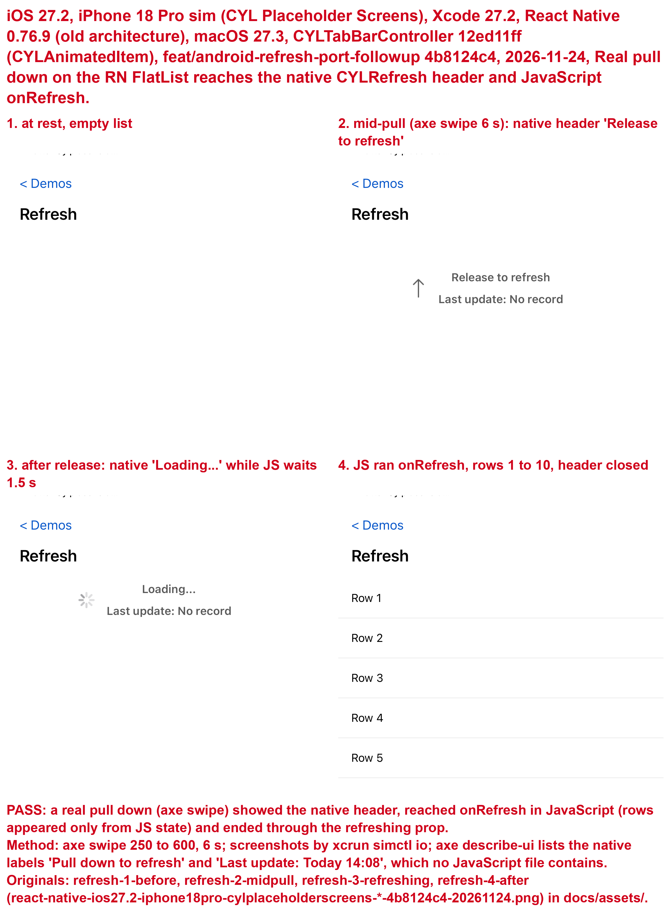

  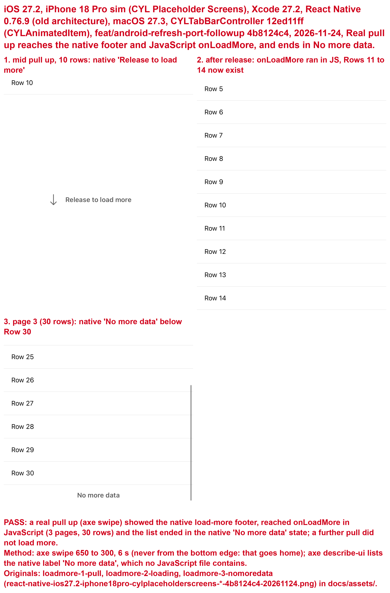

  8. Row 6, drawn indicators, iOS half (2026-11-24, commits `4bc99705`, `4cbb20ca`, `409dfb76`; contract decided with the owner's advisor and accepted by the Windows session: one creation parameter `style` per refresh view, lower camel case `classic`, `cupertino`, `material`, `bezierRadar`, `bezierCircle`, `delivery`, `phoenix`, `taurus`, unknown or missing means classic plus one report):
     - **Step 1 verified: no new native API is needed.** `Tests/CYLRefreshDrivenStylesTests.swift` runs the 8 header styles and the drawn footers (classic, material, bezierRadar, delivery, phoenix, taurus, plus the Cupertino footer) as `CYLRefreshDrivenLayout.header` / `.footer`, fed only by `drive(offset:dragging:startedAtEdge:)` and `release()`: phases, `pullingPercent` and `dragOffset` follow the offset, the view renders non-transparent pixels pulled and refreshing, the refresh ends idle. It passed on the first run with no core change (the KVO headers read the layout's private scroll view like any other). The "NEEDS NATIVE API" iOS cell of row 6 was wrong.
     - **Factory:** `CYLRefreshStyleFactory` (`CYLRefresh/Base/CYLRefreshStyleFactory.swift`, `header(style:onUnknownStyle:)`, `footer(style:onUnknownStyle:)`, `styleNames`, `fallbackStyle`); iOS-only public API, doc comments checked, `ios-api-map.py --check` still 823 / 823 (no map entry needed), 9 tests. `bezierCircle` has no drawn footer: its footer is the classic one, not reported.
     - **Row-4 defect, root cause:** Dart shows the bottom `pull` points of a native view that is always one open height tall (`OverflowBox`), while the native layout also scrolled the header by the pull inside that view, so the header moved twice: blank until the pull passed half of it, then clipped. Fix in `CYLRefreshDrivenHost` (not Dart): the layout is sized to the pull and anchored at the slot edge, (a first revision also took the view's height as the open height; that broke the stretched drawn styles and was replaced, see "Batch test hand-off: drawn indicator styles on iOS"). Built and seen in the batch run of 2026-11-24 (results in that section); the batch found one more case (a front-mode header, Material) and fixed it in `a251f7b0`.
     - Swift: `DESTINATION=...ADAFD92B... ruby Tests/run-tests.rb` 288 tests, 0 failures (270 before).
     - **TODO:** Dart routing of `style` (Windows session), mid-pull captures of 8 styles on the simulator, React Native `headerStyle` / `footerStyle`, Rive; row 6 stays PARTIAL until Rive is included or the owner rules.

### Batch test hand-off: drawn indicator styles on iOS (written 2026-11-24 by the Mac session, branch `feat/android-refresh-port-followup`, PR #31)

- **Owner's rule (2026-11-24):** code is written statically; tests, builds and captures run once, as one batch, by the Mac session. Nothing below counts as done until that batch has run (it ran on 2026-11-24, results below). Before this rule an intermediate revision was built and run (see "Evidence already seen"); the final host revision was never run.
- **What was written:** `CYLRefreshStyle` + `CYLRefreshStyleFactory` (`CYLRefresh/Base/CYLRefreshStyleFactory.swift`), `Tests/CYLRefreshDrivenStylesTests.swift`, `Tests/CYLRefreshStyleFactoryTests.swift`, `style` / `expandHeight` creation parameters and the slot sizing in `CrossPlatform/flutter_cylplaceholder/ios/Classes/CYLRefreshDrivenHost.swift` (+ `CYLRefreshPlatformView.swift`), 7 new tests in `Tests/CYLRefreshDrivenHostTests.swift`, React Native iOS `headerStyle` / `footerStyle` (`CYLRefreshContainerView.{h,m}`, `CYLRefreshContainerManager.m`, `CYLRefreshContainer.tsx`) with 2 tests in `Tests/CYLRefreshContainerViewTests.swift`, and the iOS API map rows of `CYLRefreshStyle` (`android/merged/ios-map.json`, 827 / 827, 0 TODO; static checks run).
- **Clip root cause (by reading code, unproven until the batch):** Dart shows the bottom `pull` points of the native view, but the native `CYLRefreshDrivenLayout` also scrolled the header by the pull inside a full-height view, so the header moved twice (blank until the pull passed half, then clipped). The fix is native only: the host sizes the layout to the pull and anchors it at the slot edge (bottom for a header, top for a footer); after `release` the offset is set to the open height so an overpull does not leave the held indicator outside the slot. The open height is the indicator's own (never the view's height: Dart stretches the drawn styles' view to the pull, so it changes with every pull; an earlier revision used the view's height and left drawn styles blank while refreshing). Android shows the same symptom (classic header title 6 px high in a 158 px view): the same double shift is the likely cause there (the driven layout translating content by the pull inside a view that is already revealed by Dart); the Windows session owns that check. Optional improvement for Dart (Windows owns the files): send `expandHeight` in the creation parameters; the iOS host adopts it when present (so the 54 pt native classic header matches Dart's 60).
- **Contract notes for the batch:** Cupertino footer on iOS is the AUTO footer (as on Android; Dart's is a back footer); `bezierCircle` footer is the classic back footer (no drawn class; Android wraps the header, iOS does not); drawn footers have no "no more data" drawing, so `noMoreData` shows the base label; an unknown or missing `style` logs one line (`CYLRefresh: unknown refresh style ...`) and builds classic.
- **Run, in this order, one heavy job at a time (clean first):**
  1. `cd /tmp/xpa/ph-dr && /usr/bin/find . -name '._*' -delete && DESTINATION="platform=iOS Simulator,id=ADAFD92B-5C03-4FCE-9F5D-9FE37C7CA020" ruby Tests/run-tests.rb`: expected about 295 tests (baseline 270 + 3 styles + 10 factory + 12 host + 2 container: check the exact number), 0 failures. Check first: `testAStretchedViewThatChangesHeightWithThePullKeepsTheIndicatorVisibleWhileRefreshing`, `testEveryStyleDrawsMidPullAndWhileRefreshingInTheHeldSlot`, `testARefreshingClassicHeaderShowsItsTitleInTheHeldSlot`, `testAMidPullClassicHeaderDrawsInTheSlot` (the slot geometry; a host test failing here means the final revision is wrong, not the test), then `CYLRefreshDrivenStylesTests` (it passed before with no core change).
  2. `python3 scripts/check_doc_comments.py`, `python3 scripts/ios-api-map.py --check` (827 / 827), `python3 scripts/update-docs-navigation.py`.
  3. `cd CrossPlatform/flutter_cylplaceholder && flutter test` (172 pass expected) and `flutter analyze`; then `cd example && flutter clean && rm -rf ios/Pods && CYL_TAB_BAR_CONTROLLER_GIT=/tmp/xpa/ph-deps/ctb flutter build ios --simulator --debug` (the clone must be at `12ed11ffa561a0bd792a039b912913e872356fce`).
  4. On ADAFD92B with real axe swipes (use `/usr/bin/python3`-based tooling, tap by label, the style chips are in a horizontal list: swipe it left to reach Bezier circle, Delivery, Phoenix, Taurus; start at y 200, end at y 720, duration 3 s, screenshot while the finger is down and 0.3 s after release): for EACH of the 8 styles on the example's "Refresh styles" page one mid-pull capture where the drawing is visible and one refreshing capture where it is still visible (not blank). Seen so far on an intermediate revision: classic (title, arrow, "Loading..." with a spinner), cupertino, material, bezierRadar and bezierCircle mid-pull drawn; refreshing was blank for the drawn styles on that revision (cause: the view's height used as the open height), delivery drew a box mid-pull, phoenix and taurus not yet captured. `axe describe-ui` must list a `platform_view[...]`. Sheets with `scripts/screenshot_sheet.py` (venv `/tmp/xpa/ph-mac-venv/bin/python`), originals named `flutter-ios27.2-iphone18pro-...-<commit>-<yyyymmdd>.png` in `docs/assets/`, `python3 scripts/check_screenshots.py` exits 0.
  5. React Native: `cd CrossPlatform/react-native-cylplaceholder && npm test` (33 pass expected, the Windows session may have added more); in `example/ios` set `headerStyle="phoenix"` on the example's refresh page temporarily (do not commit) or use the unit test only; one real pull with a non-classic style on iOS (Metro on 8099, `defaults write org.cyl.placeholder.reactnative.example RCT_jsLocation localhost:8099`). Not done yet.
  6. Update bridge-map rows 4 and 6 (iOS cells) and the scoreboard only after steps 1 to 4; row 6 stays PARTIAL until Rive is included (Rive: `CYLRefreshRiveHeader` lives in the Rive subspec; do not make the Flutter plugin pod depend on it unconditionally) or the owner rules otherwise.
- **Batch results (2026-11-24, Mac session, `a251f7b0` on top of the hand-off head, simulator ADAFD92B, Xcode 27.2, macOS 27.3, CYLTabBarController clone at `12ed11ff`):**
  1. `ruby Tests/run-tests.rb`: first run **294 tests, 0 failures** (the 4 geometry tests passed: `testAStretchedViewThatChangesHeightWithThePullKeepsTheIndicatorVisibleWhileRefreshing`, `testEveryStyleDrawsMidPullAndWhileRefreshingInTheHeldSlot`, `testARefreshingClassicHeaderShowsItsTitleInTheHeldSlot`, `testAMidPullClassicHeaderDrawsInTheSlot`; the final host revision is right for them); after the fix below, one full re-run: **295 tests, 0 failures** (the expected "about 295"; baseline 270).
  2. `check_doc_comments.py` passes (1267 / 1267), `ios-api-map.py --check` 827 / 827 (the hand-off expected this; the map file itself reports `docs/iOS-API-Map.md is current (827 / 827)`).
  3. `flutter test` **172 pass**, `flutter analyze` no issues, clean `flutter clean && rm -rf ios/Pods && flutter build ios --simulator --debug` succeeds (the Flutter SDK is `/Users/chenyilong/develop/flutter/bin`, not on the default PATH).
  4. All 8 styles seen native on ADAFD92B with real axe swipes (y 200 to 720 in 3 s, the chip list swiped left at y 144 to reach Bezier circle, Delivery, Phoenix, Taurus), each one mid-pull with the finger down and one refreshing 0.3 s after release, both drawn (not blank); `axe describe-ui` listed `platform_view[9]` during the pull (it is absent at rest). Sheets: `flutter-ios27.2-iphone18pro-cylplaceholderscreens-drawn-styles-part1-a251f7b0-20261124-sheet.png` (classic, cupertino, material, bezier radar, plus Material's deep pull) and `...-part2-...` (bezier circle, delivery, phoenix, taurus); originals `...-style-<style>-<midpull|refreshing>-a251f7b0-20261124.png`; `check_screenshots.py` exits 0.
  5. **Clip fix verdict:** the classic header's mid-pull title is fully visible and 'Loading...' shows in the held slot: the clip is fixed on iOS. **One more bug found by the capture:** the Material header (scrollMode front, Dart slides its one-open-height view down) was blank at a deep pull, because the host anchored every layout at the bottom of the view and the layout top, where the front header draws its circle, left the view above the clip. Fix in `CYLRefreshDrivenHost` (`a251f7b0`): a front-mode header is anchored at the top; the new test `testAFrontHeaderDrawsInItsOpenHeightViewAtALargePull` fails without the fix (pulls of 200 and 300) and passes with it. **Known limit, not fixed:** Material's circle drops below its open-height view and is cut at the view's lower edge on a deep pull (the capture at a pull of about 170 pt shows the circle half cut; at about 350 pt only a sliver). Dart owns the view's size; the Windows session decides whether Dart should stretch this view.
  6. React Native iOS: `npm test` 33 pass; the example app (React Native 0.76.9, copied `node_modules` from another worktree by `cp -Rc`, clean `pod install`, Debug build for ADAFD92B succeeds) with `headerStyle="phoenix"` set temporarily in `pages/RefreshPage.tsx` (reverted, never committed) and a real axe pull: the native Phoenix header drew mid-pull and while refreshing, `onRefresh` ran in JavaScript (Rows 1 to 10 appear only through JS state) and the `refreshing` prop closed the header; sheet `react-native-ios27.2-iphone18pro-cylplaceholderscreens-phoenix-header-pull-a251f7b0-20261124-sheet.png`. Metro ran on port 8098: 8099 was held by another session's Metro (its JS bundle has no `headerStyle`), so the app's `RCT_jsLocation` was `localhost:8098`.
  7. **Not seen:** the drawn footers on the simulator, React Native `footerStyle`, new architecture, a device, Rive (not started: row 6 stays PARTIAL), CI. Score for this batch: 88 (the iOS half of rows 4 and 6 works for all 8 header styles; the Material limit, the drawn footers and Rive are open).
- **Evidence already seen (intermediate revisions, 2026-11-24, `ruby Tests/run-tests.rb` 288 and 293 tests, 0 failures; the 293 run included the drawn-style held-slot test with the view's height as open height):** Step-1 test passed with no core change; classic header in the Flutter example on ADAFD92B, real axe swipe: mid-pull title, arrow and "Last update" visible ("Release to refresh" when armed), after release "Loading..." with the spinner; drawn styles blank while refreshing (fixed in the final revision by reading, not seen). `pkill -f xcodebuild` was run once by mistake and may have killed another session's build.

### 已完成（跟进）：CI 取消 “没有步骤” 的真正原因，每个提交一个并发组 / Done (follow-up): the real cause of "cancelled with no steps", one concurrency group per commit

- **日期 / Date:** 2026-11-24, branch `feat/android-refresh-port-followup` (PR #31).
- **用户原话 / Prompt (verbatim):** "https://github.com/ChenYilong/CYLTableViewPlaceHolder/pull/31 fix pr ci error , cancel coz no steps" (an earlier message wrote "#834"; no PR with that number exists in any ChenYilong repository, the user then gave the PR 31 link).
- **原因 / Cause:** `0984d928` (`cancel-in-progress` false for this branch) was not enough. GitHub allows one running and one pending run per concurrency group; a newer run replaces the older *pending* run, which is shown as cancelled with no steps (run 45262012540 on `0984d928` was pending behind the running `d1ad10ef` run, and was cancelled at 21:10:52, one second after run 45266996390 started). macOS jobs take hours to get through, so every push replaced the pending run.
- **修复 / Fix:** for this branch's pull request the three workflows (`ios.yml`, `ios15-runtime.yml`, `android.yml`) use one concurrency group per commit (`github.sha`); other branches keep one group per ref and still cancel superseded runs. Cost: several runs of this branch can run in parallel, so macOS runner capacity ("job was not acquired by Runner of type hosted") is used faster; push at milestones, not after every commit.

### 已完成：Android CI 找不到 Kotlin 插件（run 45278544433）/ Done: Android CI could not resolve the Kotlin plugin (run 45278544433)

- **日期 / Date:** 2026-11-24, branch `feat/android-refresh-port-followup` (PR #31).
- **用户原话 / Prompt (verbatim):** "fix ci error https://github.com/ChenYilong/CYLTableViewPlaceHolder/actions/runs/45278544433/job/138056604238#step:7:1".
- **原因 / Cause:** step 7 of "Android unit tests" on `32a0d723` failed twice (the retry one minute later too) with "Plugin [id: 'org.jetbrains.kotlin.android', version: '2.0.21'] was not found in any of the following sources" (Google, MavenRepo, Gradle Central Plugin Repository): the runner could not fetch the plugin from any of the three; five earlier Android runs on this branch passed, so this is the transient refusal of the shared runner address, the same class as the Robolectric 429.
- **修复 / Fix:** `android/settings.gradle.kts` lists Google's Maven Central mirror (`maven-central.storage-download.googleapis.com`, which serves the Kotlin plugin marker and `kotlin-gradle-plugin` 2.0.21, HTTP 200 checked) before `mavenCentral()` in both `pluginManagement` and `dependencyResolutionManagement`. Not verified locally (no JDK 17 on this Mac, the Windows session builds Android); the next Android run of this branch is the check.

### 已完成（证据见下）：React Native Android 的 CYLPlaceholderStack 与 CYLPlaceholderHUD / Done (evidence below): React Native Android CYLPlaceholderStack and CYLPlaceholderHUD

- **日期 / Date:** 2026-11-24, branch `worktree-rn-hud-stack` (from `985e9800`, local, not pushed).
- **用户原话 / Prompt (verbatim, abridged to the goal):** "bridge-map rows 2 and 3, React Native Android half; native-backed ... Add to react-native-cylplaceholder: (a) a native view component `CYLPlaceholderStack` (ViewManager + TS wrapper + props = component list dictionary, an `onAction` event, restartAnimation as a prop/command) and (b) a native module `CYLPlaceholderHUD` driving CYLPlaceholderHUDBridge over the current activity's content view ... Do not touch iOS files."
- **Done (commit `d8c4ec6d`):** `CYLPlaceholderStackManager` / `CYLPlaceholderStackHostView` (props `components`, `scenario`, `backgroundAction`, `restartToken`, event `onAction`, command `restartAnimation`), `CYLPlaceholderHUDModule` (`call(method, arguments)`, event `CYLPlaceholderHUDAction`) and `CYLPlaceholderHUDController`, all registered by `CYLPlaceholderPackage`; TypeScript `CYLPlaceholderStack`, `CYLPlaceholderComponent` builders, `CYLPlaceholderHUD` (`hud/hudBase.ts` + the React Native backend), the example's stack page and HUD page.
- **Core fix found on the way:** `CYLPlaceholderBridge.stackView` and `CYLPlaceholderHUDBridge` keyed their handlers by the raw action name, while a component stores the catalog constant for a catalog name such as "retry", so that handler never ran (custom names such as `component-0` worked, which is why the Flutter plugin did not notice). Handlers are now keyed by `actionNamed(name)` and the given name comes back; 1 new test.
- **Evidence (2026-11-24):** library Robolectric `testDebugUnitTest`: 18 of 18 pass (9 new in `CYLPlaceholderStackAndHUDTest`, 9 before); core `:placeholder:testDebugUnitTest --tests '*CYLPlaceholderBridgeTest'`: 8 of 8 pass (7 before); `node --test`: 33 pass (4 new in `test/placeholder_hud.test.ts`, 29 before); `tsc` with the library tsconfig (react types from the example's `node_modules`): no error in `src/` or `test/usage.typecheck.tsx`, only the three pre-existing `react-native-cyltabbar` (optional peer) errors in `src/item.tsx`; the core was published with `scripts/publish-android-native-to-maven-local.sh` first; `:app:assembleRelease` of the example built in `C:/cylbuild/rn-hud` (a copy with its own `node_modules`) and ran on emulator-5554: stack page, Retry came back as `onAction("retry")`, HUD `showWithStatus`, `dismissWithDelay` completion, `showComponents` with its OK button callback; sheet `docs/assets/react-native-android17-emulator5554-stack-hud-pages-d8c4ec6d-20261124-sheet.png`, `scripts/check_screenshots.py` passes.
- **TODO (not verified):** the animated icon does not play in the example (its app has no Lottie library, the style icon shows); `showProgress`, `showInfoWithStatus`, `showErrorWithStatus` and the `CYLPlaceholderStack` `restartToken` / `restartAnimation` command were not seen on screen; the manager's `components` prop (`ReadableArray.toArrayList`) is only covered on the device, not by Robolectric (`ReadableNativeArray` needs the native library); the HUD has none of the Dart look fields (`style`, `maskType`, ... ) or state getters; iOS is not done; a pull request for the branch is not opened (not pushed, by the task's instruction).

### TODO：CYLTabBarController 的 Android `drivesAnimationPlayback` 默认值改为 true 对本仓库的影响 / TODO: effect of the Android `drivesAnimationPlayback` default flip on this repository (2026-11-24)

- Fact: PR #824 of CYLTabBarController (`8673d566`, commit `82b85e064`) flips `CYLAnimatedItemView.drivesAnimationPlayback` to `true` on Android and sets it to `false` explicitly in `CYLTabBarItemButton` (the host that plays through `animatedItemPlayer` itself). This repository pins `12ed11ff` (`Cartfile`), so the flip does not reach the iOS side; the **Android CI resolves the newest commit on any branch** (`scripts/resolve-cyltabbarcontroller-commit.sh`), so it picks the flip up as soon as the PR #824 branch holds the newest commit.
- Risk (read from the code, not tested): `android/placeholder/.../CYLPlaceholderView.kt` extends `CYLAnimatedItemView`, and its `selectedState` setter sets `isSelected = value` (line ~483). With the new default a selection change on a placeholder view can restart / auto-play the animation. This repository has no use of `drivesAnimationPlayback` (grep of `android/` and the two Android plugins: none), so nothing sets it to `false` for placeholder views.
- **TODO:** at the next CYLTabBarController pin move (or when Android CI first resolves a commit with `82b85e064`), run `:placeholder:testDebugUnitTest` and a placeholder selection change on an emulator, and decide whether `CYLPlaceholderView` should set `drivesAnimationPlayback = false` in its `init` (it plays through its own `restartAnimation()` / stack API). Evidence only, no scores.

### TODO：批量移交：鸿蒙 API 行（已写，未编译） / Batch hand-off: HarmonyOS API rows (written, not built)

中文摘要：24 行中 21 行按 iOS 源码静态写完（未编译、未运行），3 行保持 TODO；19 个主机测试已写未跑。请按下面的命令一次性构建、测试、上模拟器。 / Summary: 21 of the 24 remaining API rows are written statically (not built, not run), 3 stay TODO; 19 host tests are written, not run. Run the commands below once.

- **Task record (2026-11-24, branch `feat/android-refresh-port-followup`, owner rule: write statically, test once in one batch):** the user's prompt, abridged to its requirements: implement, as far as sensible statically, the 24 remaining TODO API rows of `docs/HarmonyOS.md` (`CrossPlatform/harmonyos-cylplaceholder`, library module `cylplaceholder`); group 1: pure-ArkUI rows following the existing patterns; group 2: rows that need gestures, scroll geometry or an animator get only the data side and a TODO; add host tests (written, not run); no hvigor, emulator, Gradle or WeChat DevTools runs; mark rows "written, not built"; this hand-off section. **Full marks (100):** the 21 group-1 rows written from the iOS source with host tests, the 3 group-2 rows left TODO with their reason, this hand-off, the doc score recomputed by `node scripts/harmony-port-tables.js`. **Pass (60):** rows written and the hand-off present. **Honest score now: 60 / 100 for the work (nothing built or run); the 99 / 100 of the doc counts written rows exactly as the script does, see "How the score counts".**
- **Uncertain spots (read these first):**
  1. *Host test assumptions I could not check:* `new CYLRefreshMaterialHeaderModel().cyl_h` is 80 (assumes `setUpComponent` ran from the constructor chain and its `height = 80` reached `cyl_h`); `footer.state = Refreshing` on an attached `CYLRefreshBallPulseFooterModel` needs no pan first; the pinned / translation values 30 / -30 assume `cyl_originalInset.top` is 0 after attaching; `sv.cyl_offsetY = 425` on a footer scroll view reports a pulled distance of 25. If one fails, suspect the test's assumption before the code.
  2. *ArkTS compile risks:* `readonly size` on `CYLRefreshFloatViewModel`; getter / setter pairs added to `CYLRefreshViewModel` (`cyl_translateY`) and `CYLRefreshScrollViewModel` (`interactionEnabled`); `protected cyl_pullsUp()` overridden in `CYLRefreshFooterModel`; default parameters on the exported `CYLRefreshHeaderYFor` / `CYLRefreshFooterYFor`; `.find(...)` with typed arrows in `CYLPlaceholderStackViewModel`; `this.model() instanceof CYLRefreshBallPulseFooterModel` inside `build()`; a `@Builder ball(index)` calling private struct methods; object literals only as ArkUI attribute arguments (`.scale`, `.position`). Import direction: `CYLRefreshView` -> `drawn/CYLRefreshBallPulseView` -> `drawn/CYLRefreshBallPulse` -> `CYLRefreshComponent`: no cycle (the model file imports no view file). No class is used as a value. The `export *` names added are unique (grep).
  3. *System API availability (API 21 target, none checked on a device):* `.hitTestBehavior(HitTestMode.None)` on the content column, `.accessibilityText`, `.accessibilityGroup`, `Circle().fill().scale({ centerX, centerY })`, `setInterval` in the ball view.
  4. *Behaviour only a device can judge:* touch blocking for `disablesContentWhileRefreshing` (mechanism: content column `HitTestMode.None` plus the container ignoring a drag that began while `interactionEnabled` is false; `.enabled(false)` was avoided because it can dim children); `clipsWhenBehind` (an outer top-aligned clipped Stack, the header keeps its full height inside); `insetStart` of a Behind header and of the back footer (position only, not seen); the ball pulse frame loop and accessibility label.
  5. *Deviations from iOS, on purpose:* `pinnedView` / `translationView` are strong `CYLRefreshViewModel` references (iOS weak) whose `cyl_translateY` the app applies with `.translate`; a header detaching from a scroll view gives back the touches it turned off (iOS does not); `cyl_placeNoMoreDataImageBesideLabel` with a zero size gives 0 x 0 (a ResourceStr has no intrinsic size); `CYLRefreshFooterModel.cyl_noMoreDataImageView` is drawn only by an app's custom footer builder, the Normal footers still draw their own `noMoreDataImage` (no double drawing); the stack view accessors return `CYLPlaceholderViewModel` (`image` / `text`), as there is no separate image or label object.
- **Rows written, not built (21):** CYLRefreshComponent `disablesContentWhileRefreshing`, `insetStart`, `pinnedView`, `translationView`; CYLRefreshFooter NoMoreDataImage (3 rows); CYLRefreshHeader `clipsWhenBehind`; CYLRefreshBallPulseFooter (class, `normalColor`, `animatingColor`; new files `refresh/drawn/CYLRefreshBallPulse.ets` and `CYLRefreshBallPulseView.ets`, wired in `CYLRefreshComponentView`, exported from `Index.ets`); CYLRefreshFlyHeader `floatView`; `CYLRefreshMaterialSize`, Material `colorSchemeColors` and `progressSize`; WaveSwipe `waveShadowRadius` and `waveShadowColor`; CYLPlaceholderStackView `imageView`, `titleLabel`, `hintLabel`, `button`.
- **Rows left TODO (3), with the reason:** `reboundAnimationOptions` (the rebound goes through `CYLRefreshAnimator`, which has 13 call sites and no curve parameter, and no `animateTo` is wired for the refresh container; needs the animator and a device); `supportsHorizontalDrag` and `-didDragHorizontallyWithOffset:percent:` (the data side is written: `supportsHorizontalDrag`, `CYLRefreshScrollViewModel.panTranslationX`, the `didDragHorizontally` hook called from `cyl_followPull`; the container's PanGesture is vertical only and never sets `panTranslationX`, and switching it to `PanDirection.All` would change scrolling and needs a device). The one demo row (flutter_easy_refresh Scroll mode) is out of scope.
- **How the score counts:** `scripts/harmony-port-tables.js` counts a row as done when its second cell has no whole word `TODO` and leaves out cells starting with `n/a`; so the 21 "(written, not built)" cells count as done and the 3 cells that say `TODO:` do not. Before: API 844 / 868, total 1035 / 1060, 97. Now: API 865 / 868, total 1056 / 1060, **99** (the script ran). If a batch step fails, put `TODO` back in the failing row's cell and re-run the script.
- **Commands to run once (Windows, repository root):**
  1. `bash CrossPlatform/harmonyos-cylplaceholder/scripts/build.sh test` (also assembles the ohosTest HAP, then runs the host tests of `cylplaceholder` and of `entry` and prints the last line of each `test_result.txt`). **Expected counts:** `cylplaceholder` 124 (105 before + 19 new in `CYLRefreshApiRows.test.ets`, registered in `List.test.ets`), `entry` 3 (unchanged), total 127 (108 before); all must pass. Fix compile errors first (see spot 2), then re-run this one command.
  2. `bash CrossPlatform/harmonyos-cylplaceholder/scripts/build.sh emulator`, then the unsigned install per `docs/instructions/harmonyos.md`: `python3 CrossPlatform/harmonyos-cylplaceholder/cylanimateditem/tools/cyl_hap_x86_64.py install <path of entry-default-unsigned.hap>` (it runs `hdc install -r`) on the x86_64 Mate 70 Pro emulator; report which part ran on x86_64 (Rive and PAG playback are not part of this batch).
  3. Recount: `node scripts/harmony-port-tables.js --score` must print `{"total":{"done":1056,"counted":1060,"na":14,"score":99},"api":{"done":865,"counted":868,...}}`.
- **Captures needed on the emulator (rules of `scripts/check_screenshots.py`: originals named `harmonyos-<what>-<commit>-<yyyymmdd>.png`, stitched with `python3 scripts/screenshot_sheet.py`, then `python3 scripts/check_screenshots.py` must pass):** no example page sets any new property, so only the default look can be captured today. (a) Refresh tab, Styles page (`RefreshStylesPage.ets`): the Material, WaveSwipe and Fly headers pulled and refreshing, to show the defaults did not change (40 vp Material circle, WaveSwipe shadow, Fly float button); (b) the Feed tab and a Refresh page with an auto footer: scrolling still loads and "No more data" still shows (the `cyl_followPull` call and the container edits touch every control). Rows with no page (BallPulse, `insetStart`, `clipsWhenBehind`, `disablesContentWhileRefreshing`, `pinnedView`, `translationView`, Material size and colors, wave shadow, the NoMoreDataImage methods, the stack accessors) have host tests only; a demo page for them is a follow-up TODO and nobody should claim a screenshot for them.
- **Evidence:** nothing built, nothing run. `node scripts/harmony-port-tables.js` ran (light); the host tests above are written only.

- **Update (2026-11-24, Windows, written, not built):** read `CYLPlaceholderView.kt`: it does not rely on selection-driven play; it plays through `playPlaceholderAnimation()` (on attach while `autoPlaysAnimation`, after `setAnimationFile`, the stack) and stops in `onDetachedFromWindow`, and `selectedState` only recolors and sets `isSelected`. So `init` now sets `drivesAnimationPlayback = false` explicitly, with 2 new Robolectric tests in `CYLPlaceholderViewTest` (the default reads false; a `selectedState` / `isSelected` change calls nothing on a recording player). Not compiled: the local CYLTabBarController checkout predates the property, so its name and type come from the pin's description. Stays TODO until the batch in "Batch hand-off W1b: Android static items (written, not built)" has run.
- **RESULTS of batch W1 (2026-11-24, Windows; round 1 `890f6a5a`, one fix round `5f2d8a28` + `f325150a`, one re-run):**
  - *Item 1, host tests:* round 1 failed to compile with one error: `CYLRefreshComponent.ets:1297:45`, `Unary operators "+", "-" and "~" work only on numbers (arkts-no-polymorphic-unops)` (`-sign` of `const sign = pullsUp ? 1 : -1`); fixed by typing `sign: number`. Re-run: compiles, **`cylplaceholder` 124 run, 123 pass, 1 FAIL; `entry` 3 pass** (127 expected). The failing test is `laysTheBallPulseBallsOut` (`CYLRefreshApiRows.test.ets:225`): `expect 21.33333333333333 equals 21.333333333333332`, an exact floating-point comparison in the test (the third `assertEqual`, `centerX(2) - 50` against `50 - centerX(0)`); recorded as still failing (no third round), the likely fix is a tolerance or a rounded value. None of the ArkTS risks of uncertain spots 1 to 3 hit; the host-test assumptions of spot 1 held (the other 18 new tests pass). Rows stay as written (no row failed to compile), `node scripts/harmony-port-tables.js --score` = 1056 / 1060, 99.
  - *Item 2, emulator:* `build.sh emulator` built after the fix; the Mate 70 Pro emulator started only with `Emulator.exe -hvd "Mate 70 Pro" -path "%LOCALAPPDATA%\Huawei\Emulator\deployed" -imageRoot "%LOCALAPPDATA%\Huawei\Sdk"` (without `-imageRoot`: `Unable to start the emulator`, log `can not read uuid file`). Unsigned x86_64 install by `cyl_hap_x86_64.py install`: `install bundle successfully`; the app launches; Scenarios, Feed and Refresh tabs and the Material style page render. **Not captured:** the held-pull header states of Material, WaveSwipe and Fly (a `uitest` swipe cannot hold a pull; the Back key left the app before WaveSwipe and Fly) and the Feed "No more data": still open. Sheet: [sheet](assets/harmonyos-x86_64-w1-default-look-feed-refresh-styles-6.0.1-api21-emulator-x86_64-f325150a-20261124-sheet.png). Emulator closed afterwards (by PID). `check_screenshots.py` passes.

### Batch hand-off W1b: Android static items (written, not built)

- **Date / branch:** 2026-11-24, branch `worktree-android-static` (from `origin/feat/android-refresh-port-followup` at `d8d1dcd0`), Windows session. Owner's rule: everything below is written statically; no Gradle, no `flutter build` / `flutter test`, no emulator was run. Nothing here counts as done until the one batch has run (the owner runs it). No scores.
- **UNCERTAIN spots, first:**
  1. **Compile risk (nothing was compiled):** `drivesAnimationPlayback` in `CYLPlaceholderView.init`: the local CYLTabBarController checkout (`Example-Android`) predates the property, so its exact Kotlin name and type were not read; the pin `12ed11ff` is said to have it (default false). If `:placeholder:compileDebugKotlin` fails on it, the property is named differently upstream.
  2. **Clip fix: only the mid-pull case is explained.** The iOS cause (the header moves twice: Dart shows the bottom `pull` points of a view one open height tall; the native layout also moves the header by the pull) maps to Android: `CYLRefreshDrivenLayout` is a full-height `FrameLayout` child (158 px) and the Translate header sits at `spinner - headerHeight`, so at a pull `p` the visible window `[158 - p, 158]` meets the header `[p - h, p]` only once `p > 79`. The measurement "title 6 px high while held" is NOT explained by this: a held header sits at `[0, 59]` inside the 158 px view and is inside the held slot. It may be a uiautomator clipping artifact or a second cause (the held spinner not reaching the header's height). If the held capture still shows a 6 px title after the batch, the item stays open. What was written: `CYLRefreshPlatformView.fitSlot()` sizes the layout to the pull (`CYLRefreshDrivenLayout.slotHeight`, at least 1 px) anchored at the bottom (header) or top (footer); it runs on every `drive`, `release`, `finishRefresh`, `noMoreData`, phase change and when the container is resized. As in iOS's final revision the indicator keeps its own open height (an earlier iOS revision took the view's height and blanked the drawn styles, which Dart stretches to the pull). The native classic header is therefore shorter than Dart's 60 dp `expandHeight`; an optional `expandHeight` creation parameter (the iOS host would adopt it) was NOT added: TODO, decide after the capture. Dart is unchanged for this item.
  3. **Possible layout interplay:** the layout's `LayoutParams` are changed right before `layout.drive(...)`, so the kernel may compute with the old height for one frame; `CYLRefreshLayout` with a 1 px high layout (at rest) is untested.
  4. **Colors:** `component.colorAccent` / `colorPrimary` are applied in the platform view's `init`, right after the component is attached to the layout; whether each drawn header repaints with colors set at that moment (Delivery, Phoenix and Taurus call `mKernel?.requestDrawBackgroundFor`, which may still be null then) is unproven. The drawn headers read `setPrimaryColors(background, accent)`; Taurus ignores the accent. Dart colors are sent as `Color.toARGB32()` and arrive as Int or Long.
  5. **Dart test:** the new test calls `pumpHeader` several times in one `testWidgets` (each call registers the mocks again); if the second pump fails, split it per component.
- **What was written (files):**
  - Item 1: `CrossPlatform/flutter_cylplaceholder/android/src/main/kotlin/com/cyl/placeholder/flutter_cylplaceholder/CYLRefreshPlatformView.kt` (`fitSlot`), `android/merged/library/src/main/kotlin/com/cyl/refresh/CYLRefreshDriven.kt` (public `CYLRefreshDrivenLayout.slotHeight`, so `android/merged/api-map.json` and `docs/Android-API-Map.md` change).
  - Item 2: `android/placeholder/src/main/kotlin/com/cyl/placeholder/CYLPlaceholderView.kt` (`drivesAnimationPlayback = false` in `init`; read: it plays through its own API and does not rely on selection-driven play, so it was set). The TODO "effect of the Android `drivesAnimationPlayback` default flip" above is updated.
  - Item 3a: `android/merged/library/src/main/kotlin/com/cyl/refresh/CYLRefreshCupertino.kt` (`CYLDrawnFooterView`: `noMoreDataLabel` with the classic footer's localized `srl_footer_nothing`, the hosted style hidden while it shows, `setNoMoreData` returns true; before it returned false, which printed a "NoMoreData is not supported" stack trace and drew nothing). iOS's `CYLRefreshDrawnFooter` does the same (label only for `noMoreData`, style hidden). The Cupertino footer (an auto footer) is unchanged.
  - Item 3b: Dart `lib/src/refresh/native_refresh.dart` (`foregroundColor`, `backgroundColor`, creation parameters of the same names, ARGB integers), `lib/src/refresh/drawn_styles.dart` (the 9 drawn header and footer classes pass their Dart fields; `classic`, `cupertino` and `material` have no such fields and send nothing), Kotlin `CYLRefreshPlatformView.kt` (read as `Number.toInt()`, applied as `colorAccent` for the foreground and `colorPrimary` for the background). Key names for the iOS mirror are in `CrossPlatform/flutter_cylplaceholder/README.md`: `foregroundColor` (the drawing), `backgroundColor` (the background), ARGB `0xAARRGGBB`, absent means the style's own color, no channel update.
- **Tests written, not run (exact additions):** `:placeholder` +2 (56 to **58**: `CYLPlaceholderViewTest.aPlaceholderViewDoesNotLetTheItemBaseClassDrivePlayback`, `aSelectionChangeDoesNotStartOrRestartThePlayer`); `:merged` +3 (60 to **63**, new file `CYLRefreshDrivenSlotTest.kt`: slot height values, the six drawn footers' "no more data" label and hidden style, clearing it); `:merged-example` +0; `flutter test` +4 (172 to **176**: two new `testWidgets` in `test/native_backend_test.dart`, each runs for both platforms of `_bothPlatforms`: the drawn styles send the colors, the classic / Cupertino / Material styles send no color keys).
- **Commands to run once:**
  1. `cd android && bash ./gradlew --no-daemon -PcylTabBarDir=<checkout>/Example-Android :placeholder:testDebugUnitTest :merged:testDebugUnitTest :merged-example:testDebugUnitTest` (checkout at the pin `12ed11ff` or newer). Expected: `:placeholder` 58, `:merged` 63, 0 failures. Check first: the two new `CYLPlaceholderViewTest` tests (they also prove it compiles) and `CYLRefreshDrivenSlotTest`.
  2. Publish the core to mavenLocal with the Windows-fixed script (as in the entries above), then `cd CrossPlatform/flutter_cylplaceholder && flutter test` (expected 176 pass) and `flutter analyze` (27 `deprecated_member_use` infos as before).
  3. Example APK: copy the plugin (with `example/`) under a new folder in `C:/cylbuild` (the long-path limit; see the `flutter build apk --debug` entries above), `flutter build apk --debug`, install on an emulator.
- **Emulator captures needed:** (a) the classic header, real adb swipe: while the finger is down at 25 %, 50 %, 100 % of 60 dp and held after release (uiautomator dump: header and title heights, title text visible); (b) the drawn styles' footers at the end of the list: "No more data" text visible, style hidden, and after a pull with `loadsAfterNoMoreData` the style returns; (c) one drawn style with non-default Dart `foregroundColor` / `backgroundColor` (for example Taurus header and Phoenix footer): the colors show; (d) a placeholder view that changes `selectedState` while its animation plays: no restart, with the newest CYLTabBarController commit (`3d7e845d` or later, what Android CI resolves).

- **RESULTS of batch W1 (2026-11-24, Windows, Android; CYLTabBarController `c5ba90a3` used for `-PcylTabBarDir`, which is also what `resolve-cyltabbarcontroller-commit.sh` printed; the Carthage checkout `12ed11ff` was not used):**
  - *Item 1 (Gradle):* `:placeholder` **59 tests, 0 failures** (58 expected; it compiled `drivesAnimationPlayback`, so the property name is right); `:merged` round 1: `compileDebugUnitTestKotlin` failed at `CYLRefreshDrivenSlotTest.kt:41:97` and `:52:54` `Unresolved reference 'visibility'` (a drawn style's Android view is `style.view.view`); after the fix **63 tests, 0 failures** (63 expected); `:merged-example` 4, 0 failures.
  - *Item 2 (Flutter):* `flutter analyze` 27 issues, all `deprecated_member_use` infos (as before). `flutter test` round 1: 172 pass, 2 FAIL (`the drawn styles send their foregroundColor and backgroundColor...`, both variants: `Expected: contains pair 'foregroundColor' => <4280693304> Actual: {style: bezierRadar, ..., foregroundColor: 4279312947}`): uncertain spot 5 came true, a second `pumpHeader` in one `testWidgets` keeps the first platform view's creation params, so the defaults check was split into its own test; re-run **178 pass** (176 expected, +2 from the split). The first test's loop still checks only the first component's params (the colors are the same for all), so it is weaker than it reads.
  - *Item 3 (example APK, emulator-5556 API 37, example copy `C:/cylbuild/fpf4`, Taurus header and Phoenix footer colors set in the copy only):* the core published to mavenLocal (exit 0), `flutter build apk --debug` built (Kotlin compiled, so the fitSlot and color code compile). (a) **classic clip still open:** held finger at a full pull: arrow cut off, title missing, "Last Update" visible; after release the held slot is blank; uiautomator: platform view 0,347-1080,504 (157 px). (b) **PASS:** the Phoenix drawn footer at the end of the list shows "No More Data" with the style hidden. (c) background color **PASS** (Taurus header yellow 0xFFFFF59D); the red accent is not visible on Taurus (it ignores the accent); the Phoenix footer colors were not captured while pulling. (d) not run (needs the CYLTabBarController placeholder page). Sheet: [sheet](assets/android-api37-x86_64-emulator-flutter-w1b-classic-clip-no-more-data-dart-colors-f325150a-20261124-sheet.png). Uncertain spots 1 and 5 came true, 2 (held 6 px title) is now seen as a blank slot, 3 and 4 not judged. **W2b update (2026-11-24, `011d4e99`):** the classic header is whole in a held pull (title 53 px high), see the W2 results below; the 63 / 178 counts are now 67 / 188.

### 已完成（批次已运行）：React Native iOS 的 CYLPlaceholderStack 与 CYLPlaceholderHUD / Done (batch run): React Native iOS CYLPlaceholderStack and CYLPlaceholderHUD (2026-11-24)

- Task (Mac session, worktree `/tmp/xpa/ph-rs`, branch `feat/android-refresh-port-followup`, PR #31): the iOS halves of bridge-map rows 2 and 3 for React Native, with Android's `d8c4ec6d` contract: the view "CYLPlaceholderStack" (props `components`, `scenario`, `backgroundAction`, `restartToken`, event `onAction` with `{ action }`, command `restartAnimation`) and the module "CYLPlaceholderHUD" (`call(method, arguments)`, event `CYLPlaceholderHUDAction`). The owner's rule of the day: write statically first, then run one batch.
- Written (statically; nothing built or run yet): `ios/CYLPlaceholderStackHostView.swift` (React-free; builds the stack at layout from `components`, else `scenario`, with `backgroundAction`; live rebuild on a changed prop; `restartToken` restarts only when it grows once a stack exists), `ios/CYLPlaceholderHUDController.swift` (React-free; one `CYLPlaceholderHUDBridge` over the topmost view controller of the foreground window, rebuilt when that view changes), `ios/CYLPlaceholderStackManager.swift` and `ios/CYLPlaceholderHUDModule.swift` (React side), `ios/CYLPlaceholderReactBridge.m` (names and exports), podspec (`ios/**/*.{h,m,swift}`, `swift_version`), `Tests/CYLPlaceholderReactBridgeTests.swift` (added to `Tests/run-tests.rb` with the two React-free files).
- Core bug found while reading `CYLPlaceholderBridge.actionHandlers`: handlers were keyed by `CYLPlaceholderAction(rawValue: name)` while a component resolves its action with `action(named:)`, so a catalog name (`"retry"`, `"contactSupport"`, `"done"`) never fired (only custom names such as `"component-2"` did, which is all the old tests used; the example pages use `"retry"`). Fixed in the core (key by `CYLPlaceholderScenarioCatalog.action(named:)`) with `testACatalogActionNameComesBackAsGiven`.
- Differences from Android, by design: `restartToken` restarts only when it grows (Android: on any change); the HUD covers the topmost presented view controller (Android: the activity content view).
- JS contract: no change needed. Note for the Windows session: the comments in `src/placeholder/CYLPlaceholderStack.tsx` and `src/hud/CYLPlaceholderHUD.ts` still say the iOS half is a TODO.
- **Batch results (2026-11-24, Mac, iOS 27.2 simulator ADAFD92B, Xcode 27.2, commit `e35e49a3`):**
  - `ruby Tests/run-tests.rb`: **307 tests, 0 failures** (baseline 295: +1 core test `testACatalogActionNameComesBackAsGiven`, +11 in `Tests/CYLPlaceholderReactBridgeTests.swift`). `check_doc_comments.py` ok, `ios-api-map.py --check` 827 / 827, `npm test` 33 of 33.
  - Example (`example/ios`, clean `pod install` with `RCT_NEW_ARCH_ENABLED=0`, Debug, Metro on port 8098): builds, runs. Stack page: native (axe lists `cyl.native.placeholderStack` and the native title, hint, buttons); tapping Retry set the JS title to `last action: retry` (a catalog name, which needed the core fix), Contact support set `support`. HUD page: the native HUD drew "Uploading 60%" and the Components box; tapping its OK button set `log: OK tapped` and dismissed it. Not seen: Error and Info HUDs, the Play all restart as a visible change (the token reached the view; no pixel diff taken), loop switch and speed buttons.
  - Observation, not fixed: the success HUD ("Uploaded") showed an info-style glyph in the capture; not investigated (TODO).
  - Sheets: 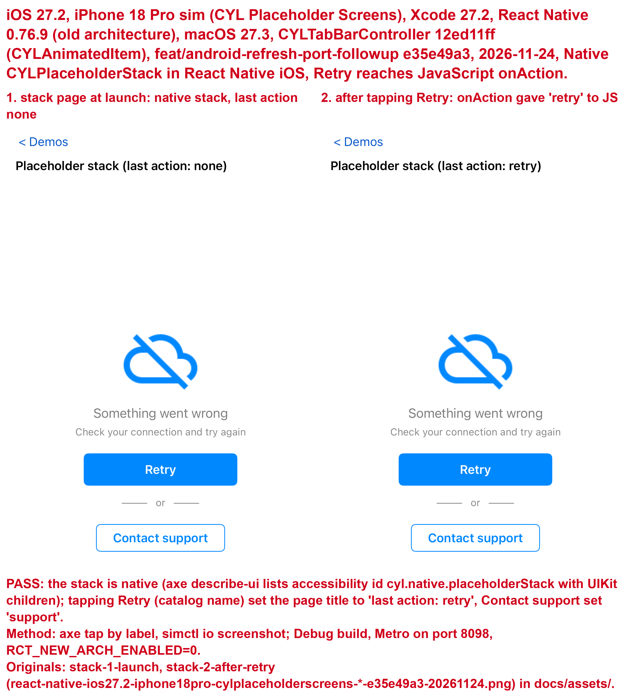 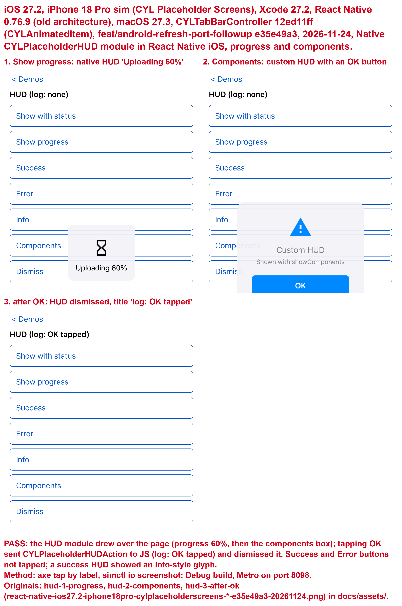
  - Score for this task: **90 / 100** (built, unit-tested, seen on the simulator with real taps and JS round trips; minus: restart and speed/loop not shown, success glyph unexplained, no device haptics or release build run).


- [ ] **TODO (2026-11-24): all-platform score to 100, advisor plan, Sonnet implements, Windows session takes the non-iOS half**
  - Prompt (verbatim): "continue TODO (missing points): opus advisor点评目前全平台接口实现得分 以及下一步计划与建议。并立即让默认模型sonnet按照建议去实现。将得分优化到100转发合适任务给其他session 直接使用本机环境进行测试，iOS在macos机器，其余在windows机器。转发任务给相应session无需等待ci结果。"
  - English: continue the missing points; the advisor reviews the all-platform interface score, the next plan and advice; the default model Sonnet implements it at once to reach 100; forward suitable tasks to other sessions; test on the local machines (iOS on the macOS machine, the rest on the Windows machine); forward without waiting for CI. ("opus" as advisor was refused earlier; the advisor ran on the session default.)
  - Score now (merged `bae6ef1d`): iOS half rows 1-3, 5 done; 4, 6 partial; 7, 8 TODO. Android half rows 1-3 done; 4, 5, 6 partial; 7 TODO; 8 by design. HarmonyOS 1056/1060. Flutter Dart 64/65 (frozen). Swift 307 tests, 0 failures.
  - Plan: (1) header clip on deep pull, both platforms (Android: slot 157 px, header 59 px, title 6 px); (2) rows 7 and 8 native contract in the bridge map, then iOS (Mac) and Android (Windows); (3) Success HUD glyph, Error/Info HUD captures; (4) Windows: float tolerance in `CYLRefreshApiRows.test.ets:225`, last 4 HarmonyOS rows, TS comments and `restartToken`; (5) iOS: drawn footers, RN `footerStyle`, 2 missing scenario screenshots.
  - **Owner decisions (2026-11-24, answered in session chenyilong-d4):** "模拟器就够了，不需要真机；RN新架构不在范围内" (simulators and emulators are enough, no physical device; the React Native new architecture is out of scope). Rive: required ('支持rive').
  - **100 depends on the owner's Rive decision** (row 6 cannot reach 100 without Rive unless ruled optional).

### Batch hand-off: rows 7 and 8, iOS half (written, not built) (2026-11-24, Mac, static)

- Status: **written, not built, not run**. No `xcodebuild`, simulator or `flutter test` was used (another session owns ADAFD92B). Self-check: `swiftc -parse` of the three Swift files passes; the Objective-C and TypeScript edits were read through only; `python3 scripts/ios-api-map.py --check` says current (the map is generated from Android symbols, so the new iOS-only symbols need no row).
- Contract (pushed first, `b1d9ad89`): `docs/Refresh-Library-Parity.md`, section "Row 7 and 8 native contract". Row 8: no new native name (paging stays in Dart / TypeScript; the container inputs of rows 4 and 5 already carry page complete, no more data, reset).
- iOS code: `CYLRefreshDrivenLayout` gains `configureSecondary(triggerOffset:dimension:closeTriggerOffset:)`, `openSecondary()`, `closeSecondary()`, `isSecondaryOpen`, `secondaryOpenedBlock`, `secondaryClosedBlock` over the existing `CYLRefreshHeader` / `CYLRefreshBackFooter` second floor, and holds the content by the floor's extent while it is open; `CYLRefreshDrivenHost` reads the creation parameters `secondaryTriggerOffset`, `secondaryDimension`, `secondaryCloseTriggerOffset`, handles `openSecondary` / `closeSecondary` and sends `onSecondaryOpened` / `onSecondaryClosed`; `CYLRefreshContainerView` (React Native) gains `secondaryTriggerOffset`, `secondaryDimension`, `secondaryCloseTriggerOffset` (default 80), `secondaryOpen`, `onSecondaryOpen`, `onSecondaryClose` and takes the child with `nativeID` `cyl.refresh.secondary` as the header's `secondaryView`; the TypeScript `CYLRefreshContainer` passes the props through.
- Tests: `Tests/CYLRefreshSecondFloorTests.swift` (12 tests, picked up by the `Tests/*.swift` glob of `Tests/run-tests.rb`, no list to edit).
- **The batch must test:** (1) `DESTINATION=... ruby Tests/run-tests.rb` builds and the 12 new tests pass (the footer-in-layout and the container `secondaryOpen` tests are the likeliest to need a fix); (2) Flutter: the Dart `CYLNativeRefreshIndicator` does not send the three creation parameters or `openSecondary` / `closeSecondary` yet (`native_refresh.dart` is Windows-owned), so the Flutter half needs that Dart change before it can be seen; (3) React Native: a real pull past `secondaryTriggerOffset` in the example opens the floor (the child view is re-parented by `secondaryView` out of React Native's hierarchy: check it does not break unmounting), `onSecondaryOpen` reaches JS; (4) the open floor in a driven slot (`applyDrivenOffset` holds the content by the floor extent while open).


### 批次交接 W2：静态项（已写，未运行） / Batch hand-off W2: static items (written, not run)

- Session: Windows worktree branch `worktree-w2-static` (from `origin/feat/android-refresh-port-followup`, merged with `b1d9ad89`), 2026-11-24. Owner rule: written statically, tested once later in one batch; **nothing below was built or run** except `node --test` of the React Native package (33 of 33 pass, unchanged) and the doc scripts. Not pushed.
- **Uncertain spots (read these first):**
  1. **The cause of the clipped deep pull is NOT confirmed.** It was read from code. The measured 157 px view / 59 px header / 6 px title fit this reading: `CYLRefreshPlatformView.fitSlot()` sized the layout to the last Dart offset only on `drive` / `release` / phase calls, but the core moves the spinner on its own after a release (rebound animation), and `CYLRefreshLayout.onMeasure` measures a `WRAP_CONTENT` header with `AT_MOST` the layout height and stores the intrinsic height only when it differs from that maximum. So a layout as thin as an early pull, or a layout that kept the deepest pull's height while the spinner rebounded (the header sits at `spinner` from the layout top, so it left the view), leaves the header squeezed or outside. Not found in the code: any text size, lines or ellipsize setting that explains 6 px by itself (`Classics.kt` has none). Confirm with the log steps below before trusting the fix.
  2. The fix moves the layout with `translationY` (`anchorShift` / `behindShift`) to keep the header at the slot edge; whether Flutter's platform view clips the shifted layout as expected (hybrid composition vs virtual display) is unseen.
  3. Second floor: the Flutter native floor content is an empty `View` (content stays in Dart); the core adds its host over the layout's parent (the platform view container), transparent. Dart replaces the native indicator by `secondaryView` while the floor is open (`_IndicatorBody`), which disposes the native view right after `openSecondary`; so `onSecondaryOpened` may never arrive and `closeSecondary` is sent to a view that no longer exists. Informational only, but unseen.
  4. React Native Android: the floor child is kept out of the layout (the layout takes the last non-header child for the scroll view), so the manager overrides `addView` / `getChildCount` / `getChildAt` / `removeViewAt`; the `nativeID` tag key `com.facebook.react.R.id.view_tag_native_id` is assumed to exist in react-android 0.76.9 (compile may fail there).
  5. `CYLRefreshDrivenLayout.slotHeight` got a 4th parameter with a default (`extent = 0`, old behavior); `anchorShift`, `behindShift`, `shownPull`, `indicatorExtent`, `onBeforeDraw` are new public Kotlin API: regenerate the API map if its check says so.
  6. Flutter test counts depend on whether the harness counts a `TargetPlatformVariant` test twice (Android and iOS): the added numbers below assume it does.
- **Commands to run once, with the expected counts (what this session ADDS):**
  - `./gradlew :placeholder:testDebugUnitTest`: **59**, adds 0.
  - `./gradlew :merged:testDebugUnitTest` (library): **67 = 63 + 4**, all in `CYLRefreshDrivenSlotTest` (`theSlotIsNeverShorterThanTheIndicatorWhileRefreshing`, `theIndicatorIsAnchoredAtTheSlotEdgeWhateverTheLayoutHeight`, `theLayoutReportsTheShownPullAndTheIndicatorsOwnHeight`, `aDrivenLayoutWithAnEmptyFloorOpensAndClosesItAsTheFlutterPlatformViewDoes`). The existing `theSlotHeightIsThePullOrTheWholeSlotWhileHeldAndNeverZero` must still pass.
  - `flutter test` in `CrossPlatform/flutter_cylplaceholder`: **184 = 178 + 6** (3 new tests in `test/native_backend_test.dart` x 2 platforms: behind mode creation parameter, second floor parameters and calls, no second floor parameters without a floor). Then `flutter build apk --debug` for the plugin.
  - React Native package Android tests (`CrossPlatform/react-native-cylplaceholder/android`, Robolectric): adds **4** (`restartTokenReplaysOnlyWhenItGrowsOnceTheStackExists` in `CYLPlaceholderStackAndHUDTest`; `theSecondaryNativeIdChildIsTheFloorAndNotAChildOfTheLayout`, `secondaryOpenFromJsOpensWithoutTheEventAndAPullOrPushReportsIt`, `noFloorContentOrWhileRefreshingSecondaryOpenDoesNothing` in `CYLRefreshContainerViewTest`); the existing `restartTokenAndCommandRestartWithoutRebuilding` must still pass.
  - React Native node: `node --test --experimental-strip-types test/*.test.ts` **33**, adds 0 (the restartToken rule has no JavaScript logic; the JS doc comment only states it). `tsc` on `test/usage.typecheck.tsx` (new `SecondFloorExample`).
  - HarmonyOS host tests (`scripts/build.sh test`): cylplaceholder **124 of 124** (`laysTheBallPulseBallsOut` now compares with `Math.abs(...) < 1e-9`), entry **3**, adds 0.
  - Docs: `py -3.12 scripts/update-docs-navigation.py --check`, `android-api-map.py --check`, `ios-api-map.py --check`, `node scripts/harmony-port-tables.js --score` (1057 of 1060, see item 5).
- **Item 3 (header clip, Android Flutter plugin): what was written.** `android/merged/library/.../CYLRefreshDriven.kt` (`shownPull`, `indicatorExtent`, `onBeforeDraw` called by the existing pre-draw hook, `slotHeight(slot, offset, held, extent)`, `anchorShift`, `behindShift`); `CrossPlatform/flutter_cylplaceholder/android/.../CYLRefreshPlatformView.kt` (`fitSlot()` uses the layout's own pull, the intrinsic extent while held, shifts the layout so the header ends at the slot edge, runs before every frame; new creation parameter `behind`); `lib/src/refresh/native_refresh.dart` (sends `behind: true` only in `CYLRefreshScrollMode.behind`; doc of the sizing rule). Rule on both platforms: the indicator keeps its intrinsic height at the slot's edge, the layout is never shorter than it while refreshing; the Dart view is `expandHeight` tall for the non-stretched styles and as tall as the pull for the stretched drawn styles (unchanged, `refresh.dart`), and the native layout follows. **Modes:** move and front need no special case (the Dart slot is bottom-aligned); **behind** keeps the indicator fixed at the far edge while the content moves over it, which the old code did not handle (the header sat at the near edge and showed only after the pull passed half of the view): a second suspected clip, handled by `behind`. **No change was needed in `styles.dart` or `refresh.dart`**; `native_refresh.dart` and `test/native_backend_test.dart` were edited as the Mac session allowed. iOS core: Mac session.
  - Permanent diagnostic log (off by default): `adb shell setprop log.tag.CYLRefreshView DEBUG`, then `adb logcat -s CYLRefreshView` prints one line per fit: `fit view=<w>x<h> layout=<px> shown=<px> shift=<px> extent=<px> title=<w>x<h> lines=<n> held=<bool>` (view = platform view container, layout = the driven layout's height, extent = the header's intrinsic height, title = the classic title TextView).
  - **Capture steps (same pull distance, before and after, one sheet):** build the example APK at `932a39cd` (before) and at this branch (after); on the emulator open the Flutter example styles page. For each mode (move, stretch, front, behind) and each style (classic, cupertino, material, bezierRadar, bezierCircle, delivery, phoenix, taurus; header and footer): hold a pull with the same swipe, for example `adb shell input swipe 540 600 540 1800 4000` (a 1200 px pull over 4 s, finger down) in the background and `adb exec-out screencap -p > <name>.png` at 3.5 s; for the footer swipe from 1800 to 600. Read the geometry in the same run: `adb shell uiautomator dump /sdcard/w.xml` (the platform view, the header and the title bounds) and the `CYLRefreshView` log lines. Expect after the fix: header height equals `extent` (59 px classic) at every pull depth, the title taller than 6 px, no blank band. Name the originals `android-<mode>-<style>-<header|footer>-<before|after>-<commit>-20261124.png`, stitch one labeled sheet with `python3 scripts/screenshot_sheet.py` and run `python3 scripts/check_screenshots.py`.
  - If the batch still shows a squeezed header at the full pull: read `extent` and `title` in the log. `extent` below 59 means `mHeaderHeight` was stored from a thin first measure (then give the layout a floor of the default header height before the first measure); `title` 6 px with `extent` 59 points to `CYLClassicsHeaderView.onMeasure` (the `setPadding` with a negative value when `parentHeight < mMinHeightOfContent`).
- **Item 1 (React Native):** comments in `src/placeholder/CYLPlaceholderStack.tsx` and `src/hud/CYLPlaceholderHUD.ts` no longer say the iOS half is a TODO; the `restartToken` rule is documented in the prop's JSDoc and the README (replay only when it grows once the stack exists); Android `CYLPlaceholderStackHostView.setRestartToken` now uses `value > restartToken` (was `!=`), plus a `restartCount` for tests and one Robolectric test.
- **Item 2 (HarmonyOS):** `CYLRefreshApiRows.test.ets` `laysTheBallPulseBallsOut` compares its four float values with a 1e-9 tolerance.
- **Item 4 (second floor, Android half, row 7; row 8 not bridged by design):** contract from `docs/Refresh-Library-Parity.md` ("Row 7 and 8 native contract"). Flutter: `CYLRefreshPlatformView.kt` reads `secondaryTriggerOffset` (above 0 turns the floor on; an empty `View` is the floor content), `secondaryDimension`, `secondaryCloseTriggerOffset`; `openSecondary` (no-op while refreshing; the core ignores a repeat), `closeSecondary`; sends `onSecondaryOpened` / `onSecondaryClosed` from the core's blocks; the phases `secondaryArmed`, `secondaryOpen`, `secondaryClosing` already flow through `onPhase`. Dart `CYLNativeRefreshIndicator` sends the three creation parameters only when the component has a `secondaryView`, and calls `openSecondary` / `closeSecondary` when `isSecondaryOpen` changes. React Native: `CYLRefreshContainerView` / `CYLRefreshContainerManager` props `secondaryTriggerOffset`, `secondaryDimension`, `secondaryCloseTriggerOffset` (80), `secondaryOpen` (controlled; its own change never calls the events back), events `onSecondaryOpen` / `onSecondaryClose` (`topSecondaryOpen` / `topSecondaryClose`), the child with `nativeID` `cyl.refresh.secondary`; the TS props were already in `CYLRefreshContainer.tsx` (doc comment updated), a type example added. Row 8: unchanged, "not bridged by design". Parity row 7 updated to "written, not built".
- **Item 5 (HarmonyOS rows, 1056 to 1057 of 1060):** the 4 TODO rows were `reboundAnimationOptions` (needs the container animator with a curve parameter and a device to judge it; left TODO), `supportsHorizontalDrag` and `-didDragHorizontallyWithOffset:percent:` (the model side exists; the container pan gesture is vertical only, so they need `PanDirection.All` and a device against nested scrolling; left TODO) and the demo row `flutter_easy_refresh samples - Scroll mode`. The demo row is now filled: the Task-Log entry of commit `175b504` measured all four modes on the x86_64 emulator and they match the code (Stretch header 142 to 749 px, the others 189 px, Front in front, Behind behind). `docs/HarmonyOS.md`: the 21 rows labeled "written, not built" are relabeled "built, host-tested, not seen on a device" (the 2 TODO rows keep their text; the counting script is unchanged). Remaining TODO: 3 API rows.
- **Tests added in total:** Kotlin library +4, RN Robolectric +4, Flutter +6 (3 x 2 platforms), HarmonyOS +0 (one fixed), RN node +0. All written, not run.
- **RESULTS of batch W2b (2026-11-24, Windows; tree `a9452430`, fix commit `011d4e99`; CYLTabBarController `1b469136` for the Gradle runs, the printed pin of `resolve-cyltabbarcontroller-commit.sh`; Android emulator API 37 on emulator-5556, which died once during the batch and was restarted from the command line, HarmonyOS emulator started and closed by PID):**
  - *Android Gradle (A3):* `:placeholder` **59**, `:merged` **67** (63 + 4, the four `CYLRefreshDrivenSlotTest` cases pass), `:merged-example` **4**, 0 failures; React Native library Robolectric **22** (18 + 4), 0 failures (so `view_tag_native_id` exists: uncertain spot 4 did not come true).
  - *Node / RN (A4):* `node --test` **33**. *Flutter:* round 1 `flutter test` 182 pass, **2 fail** (`only the behind scroll mode asks the native slot to anchor at the far edge`, both variants: `Expected: {'style': 'classic', 'footer': false, 'behind': true}  Actual: {'style': 'classic', 'footer': false}`, a second `pumpHeader` in one `testWidgets`: uncertain spot 5 again); after the fix round **188 pass** (the test is now one `testWidgets` per mode, 3 x 2); `flutter analyze` 27 issues, all `deprecated_member_use` infos as before.
  - *Example APK, round 1:* `flutter build apk --debug` **FAILED** in `:flutter_cylplaceholder:compileDebugKotlin`: `CYLRefreshPlatformView.kt` `Unresolved reference 'secondaryView' / 'secondaryTriggerOffset' / 'secondaryDimension' / 'secondaryCloseTriggerOffset' / 'secondaryOpenedBlock' / 'secondaryClosedBlock' / 'openSecondary' / 'closeSecondary' on receiver of type 'CYLRefreshComponent'` (the second floor lives on `CYLRefreshHeader` and `CYLRefreshBackFooter`, not on the base) and `Unresolved reference 'TAG'` (a private constant of the factory's companion). Uncertain spots 1 to 6 of W2 otherwise as below. Fix `011d4e99`: the calls go through `setUpSecondary` / `openSecondaryFloor` / `closeSecondaryFloor` (header and back footer), `TAG` is file level. Round 2: APK built.
  - *Clip diagnosis (A1), after the fix, one build:* the W2 log shows, for a full 1200 px held pull in move mode: classic view 1080 x 158 px, layout up to 295 px, `shown` 294, shift 0, extent 202 px, title **334 x 53 px, 1 line** (no 6 px title; at rest the first lines are layout 2 px, extent 263 px); Cupertino view 131, Bezier radar 415, Delivery 683 px. Screenshots: classic shows the arrow, "Release To Refresh" and "Last Update" whole; Cupertino, Bezier radar, Bezier circle, Delivery, Phoenix and Taurus draw their indicator; **Material shows nothing in its held frame (open)**. **Clip: fixed for the held pull in move mode** (compared with W1 before: platform view 157 px, native header 59 px, title 6 px; the extent now reads 202 px, a different quantity from W1's 59, so the numbers are not a like-for-like pair). No before APK was built in this batch. Not run: stretch, front, behind (the example has no page that sets them except one behind demo), footers. Second floor: the example page opens the Dart floor ("Close the second floor") after a deep pull and release; the native `onSecondaryOpened` call was not logged (uncertain spot 3 not judged). Sheet: 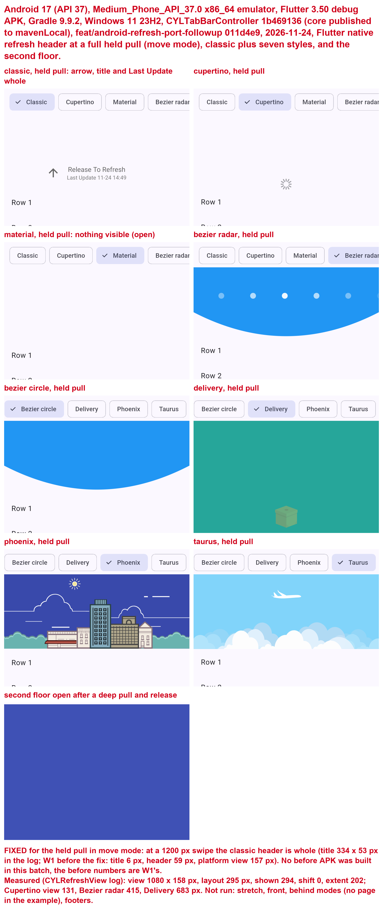
  - *HarmonyOS (A2):* `build.sh test` exit 0: cylplaceholder **124 / 124**, entry **3 / 3**; `build.sh emulator` exit 0 (3 x BUILD SUCCESSFUL); unsigned install "install bundle successfully". Held pulls (uitest swipe at the lowest speed): Phoenix, Taurus, BezierRadar, BezierCircle, Delivery and Fly draw their header. **FAIL, not fixed:** the Feed tab at 30 rows keeps a frozen spinner arc (Ring.gif) for 12 s and shows no "No more data" text (the footer is an auto animation footer with only a Refreshing icon; `CYLRefreshAutoAnimationFooterModel.cyl_stateDidChange` shows the icon view in every state and the label is not seen; cause not proven; update 2026-11-25: cause found by static reasoning and fixed, see the entry "HarmonyOS Feed footer frozen Ring.gif" near the top of Tasks). Not captured: held pulls of the drawn footer rows (my row lookup failed), the BallPulse rows (no example page). Sheet: 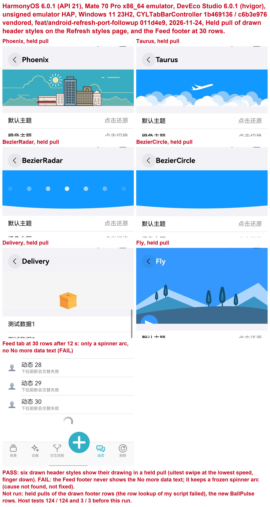
  - *Chunk C (PR #824 `c6b3e976`):* `:cyltabbar:testDebugUnitTest` 144 pass; `:app:assembleDebug` and `:demokit:compileDebugKotlin` pass; `:cylanimateditem:testDebugUnitTest` **FAILED to compile**: `CYLAnimatedItemStackViewTest.kt:68, 71, 72, 75, 78` `Argument type mismatch: actual type is 'kotlin.String', but 'kotlin.Double' was expected` (`kotlin.test.assertEquals(message, 0f, x)` has the message first; the order is `(expected, actual, message)`); report-only, not changed. Gradle did not want a diff of `demokit/gradle.lockfile` (worktree clean after the build). Glass checks seen: FlatDesign versus LiquidGlass menu entries (sheet `android-api37-x86_64-emulator-cyltabbar-demo-flat-vs-liquidglass-c6b3e976-20261124-sheet.png`); `itemCornerRadius`, `itemBorderWidth` / `Color` and `resolvedItemBackgroundStyle` have no demo control and their Robolectric tests did not run. Teardown row en / zh / ar: released page "dealloc callbacks ran: 1 / 1" in all three, sheet committed locally in CYLTabBarController `5f139480` (branch `win-c6b3-teardown-sheet`, not pushed).
  - *Score effect:* scoreboard rows Android core 94, HarmonyOS 85, Flutter 84 (`docs/Refresh-Library-Parity.md`); the Mini program row only notes that this repo's mini program was not rerun.

### 已完成（批次已运行）：刷新头深度下拉被裁与 Success HUD 图标 / Done (batch run): deep-pull header clip and Success HUD glyph (2026-11-24, Mac)

- Task (Mac session, worktree `/tmp/xpa/ph-w2`, branch `feat/android-refresh-port-followup`, no new branch or PR). Prompt (verbatim, coordinator): "拉伸被裁" (the owner: the stretch is clipped) - first and main task: the header/stretch area clipped on a deep pull (classic, Material circle, any style whose view is taller than one open height); check front, stretch and behind modes; fix in the iOS core/host; before/after at the same pull distance on ADAFD92B in one labeled sheet; Swift test that fails without the fix. Then (2) Success HUD glyph, capture Success, Error, Info as one labeled sheet; (3) if time: drawn footers, RN `footerStyle`, two scenario screenshots.
- **Diagnosis (code reading, then confirmed by the run):** the host puts a `CYLRefreshDrivenLayout` in a container that clips to the view Dart gives it. (a) front header (Material): the circle drops up to 1.5 open heights below the header's frame, the container's clip cut it; the layout was also shorter than the header at a shallow pull. (b) behind header: native behind slides in with the content, and at a pull past the open height the bottom-anchored layout lifted the header off the top of the container. (c) move and stretch were already whole (unit tests pass before and after). Classic header at a deep pull: whole on iOS (the Android 6 px title does not reproduce here).
- **Fix** (`126d439b`): `CYLRefreshDrivenHost.updateSlot` places the layout from the header's scroll mode (rule in `docs/Refresh-Library-Parity.md`, "Slot rule"); container clip off for pinned (front, behind) headers; behind pinned like front; optional creation parameter `scrollMode`. HUD: `iconComponent` keeps the state's own image as the static picture when an animation file is set (it kept style `.info`, so Success showed the info glyph before the animation played and where no engine plays).
- **Results:** `ruby Tests/run-tests.rb` on ADAFD92B: before the fix (tests copied in) 312 tests, **9 failures** (behind, front and the HUD test); after **313 tests, 0 failures**; after merging origin (second floor, 12 more tests) **325 tests, 0 failures**; `npm test` 33 pass, `flutter test` 178 pass, `check_doc_comments.py` ok, `check_screenshots.py` ok. Seen: Material (front) cut before, whole after, Classic and Bezier radar whole; sheets `docs/assets/flutter-ios27.2-iphone18pro-cylplaceholderscreens-refresh-deep-pull-before-after-126d439b-20261124-sheet.png` and `...-hud-success-error-info-126d439b-20261124-sheet.png`.
- **HUD finding:** in the Flutter example the Success HUD showed the check 1.2 s after the tap both before and after (the Lottie animation had started), so the "info glyph" of the React Native capture is the static picture before the animation plays; the Swift test proves the old static picture was the info glyph; the first frames were not captured.
- **Dart request for the Windows session** (`native_refresh.dart` is theirs): send `'scrollMode': component.scrollMode.name` and `'expandHeight': component.expandHeight` as creation parameters (details in the Slot rule). Android: apply the same rule in `fitSlot`.
- Not done: item 3 (drawn footers on the simulator, RN `footerStyle`, scenario screenshots 'Sync failed' and 'Title above the illustration'), Bezier circle and Delivery deep-pull captures, behind in the Flutter example, a device.
- Score for this task: **84 / 100** (cause found, fixed, test fails without the fix, before/after seen on the simulator; minus: item 3 not done, two stretch styles not captured, captures not at an identical pull instant, Dart half pending, Android not touched).


### TODO（进行中）：iOS 一半的收尾批次：绘制刷新尾、RN footerStyle 与二楼、两张场景截图 / TODO (in progress): iOS-half finishing batch: drawn footers, RN footerStyle and second floor, two scenario screenshots (2026-11-24, Mac)

- Context: worktree `/tmp/xpa/ph-w4` (APFS copy of `ph-w2`), branch `feat/android-refresh-port-followup`, no new branch or PR; simulator ADAFD92B only. Rules: static code first, one test batch at the end, no `pkill` / `killall`, Windows-owned Dart files untouched (`styles.dart`, `native_refresh.dart`, `native_backend_test.dart`), `/tmp/xpa/ph-ci` stays unpushed.
- Requirements: (1) drawn footers (phoenix, taurus, bezier, delivery ...) seen in the Flutter example "Refresh styles" page at a real pull-up, including "No more data"; core bug found = fix with a failing-first Swift test. (2) React Native iOS `footerStyle` (native + TypeScript already exist from `a251f7b0`; missing: an example page switch and a real pull-up on the simulator). (3) React Native iOS second floor: example page, a real pull past the trigger opens the floor and reaches JavaScript, unmounting does not crash. (4) screenshots "Sync failed" and "Title above the illustration", Bezier circle and Delivery header captures. (5) Flutter second floor: blocked until Windows changes `native_refresh.dart`; record, do not wait. At the end: full Swift suite (>= 325, 0 failures), `npm test`, `flutter test`, `ios-api-map.py --check`, doc comments, navigation; update the Parity iOS cells of rows 4, 6, 7 with measured evidence and a self-score.
- Prompt (verbatim, coordinator): "Tasks (the previous worker did not reach them): (1) drawn footers (phoenix, taurus, bezier, delivery etc.) seen on the simulator in the Flutter example 'Refresh styles' page at a real pull-up, including the 'No more data' text; fix core bugs if found, with a failing-first Swift test. (2) React Native iOS `footerStyle` prop on CYLRefreshContainerView/Manager (mirror headerStyle; CYLRefreshStyle.newFooter), TS prop in src, example page switch, seen on the simulator with a real pull-up. (3) RN iOS second floor (props secondaryTriggerOffset, secondaryOpen, events onSecondaryOpen/onSecondaryClose, floor child nativeID cyl.refresh.secondary; contract in the Parity doc 'Row 7 and 8 native contract'): add a small example page and see a real pull past the trigger open the floor and reach JS; check unmounting does not crash. (4) the 2 missing scenario screenshots 'Sync failed' and 'Title above the illustration', and Bezier circle / Delivery header captures (scroll the style chips). (5) Flutter second floor cannot be seen until Windows changes native_refresh.dart: do not wait; record it."
- Written so far (static): `example/pages/RefreshStylesPage.tsx`, `example/pages/SecondFloorPage.tsx`, menu entries in `example/App.tsx`, README line, stale TypeScript comment on `loadMoreEnabled`.


### 已完成（批次已运行）：iOS 一半的收尾：绘制刷新尾、RN footerStyle 与二楼、两张场景截图 / Done (batch run): iOS-half finishing batch (2026-11-24, Mac, worktree `/tmp/xpa/ph-w4`)

- Commits (branch `feat/android-refresh-port-followup`): `1fa6945f` (example pages + the TODO entry above), `e3affc8b` (automatic footer fix + host test), `adc583e8` (second floor close-on-lift fix + test), `4eb3595f` (styles page tweaks), then the evidence and docs commit. Simulator ADAFD92B only; no `pkill`; Windows-owned Dart files untouched (a local, uncommitted `expandHeight` edit of `native_refresh.dart` was reverted with `git checkout` after the Flutter captures); `/tmp/xpa/ph-ci` not touched.
- (1) **Drawn footers in the Flutter example, seen:** all 8 footers at a real pull-up, loading, and 'No more data' (7 of 8; Cupertino has no text). **Core bug 1 fixed with a failing-first test:** the automatic footer sat at y 0 of the driven layout (no content, so it followed the content to the top) and scrolled out above the view: the Cupertino footer's spinner never showed; `testEveryFooterStyleDrawsMidPullAndWhileLoadingInTheHeldSlot` failed with `footer=(0.0, -44.0, ...)`, passes with the layout's content size set to the view (`e3affc8b`). **Delivery footer blank while loading with the stock Dart:** the log showed the native footer stuck at 'pulling' (pulled 115 of 150): Dart's slot is 100, native open height 150, and Dart sends no `expandHeight`; with that creation parameter added locally the box, clouds and umbrella draw while loading. A fix needs `native_refresh.dart` (Windows): request recorded in the Parity doc, row 4.
- (2) **RN `footerStyle`:** native, TypeScript and a unit test already existed (`a251f7b0`); new: example `RefreshStylesPage` (chips set `headerStyle` and `footerStyle`), seen with real pull-ups for all 8 names (7 draw their own footer, `bezierCircle` shows the classic one by design), 'No more data' during a pull-up for 7 of 8. Not captured: the drawn footers' loading frames in React Native.
- (3) **RN second floor:** example `SecondFloorPage`; real pull opened the floor and `onSecondaryOpen` reached JavaScript; unmount while open did not crash; remount opened again. **Core bug 2 fixed with a failing-first test (`adc583e8`):** a push past the close trigger left the floor open when the finger lifted at rest (no deceleration, so no later offset change), now closed on the pan end (header and back footer); after the fix the real push closed it and `onSecondaryClose` reached JavaScript. The JavaScript-set Open and Close buttons sent no events (no echo).
- (4) **Screenshots:** 'Sync failed' and 'Title above the illustration' (Example-Scenarios, sheet 5 of the scenario series), Bezier circle and Delivery headers at a deep pull and refreshing, 4 Flutter footer sheets, 4 React Native footer sheets, 1 second floor sheet; `scripts/check_screenshots.py` passes.
- (5) **Flutter second floor:** at first blocked (the Dart indicator sent no floor parameters); after merging the Windows change (`61a16c61`) it was seen: a real pull opened the floor, Close closed it (Dart log 'Second floor closed'), a second pull opened it again (sheet `flutter-...-second-floor-61a16c61-20261124-sheet.png`).
- **Counts:** `ruby Tests/run-tests.rb` first run **325 tests, 0 failures** (before my changes), final **327 tests, 0 failures** (+2 failing-first tests); `npm test` 33 pass; `flutter test` 178 pass, `flutter analyze` no issues; `check_doc_comments.py` 1273 / 1273; `ios-api-map.py --check` current: the Windows session had added `CYLRefreshDrivenLayout.slotHeight` (828 rows), mapped to `CYLRefreshDrivenHost.updateSlot` in `android/merged/ios-map.json` (828 / 828); `update-docs-navigation.py` run.
- **Seen vs not seen:** seen: everything above on ADAFD92B. Not seen: Delivery footer loading with the stock Dart, Cupertino 'No more data' text (none is drawn), RN drawn footers while loading, the 'Second floor opened' log line, footer second floor, new architecture, a device, CI.
- **Self-score: 88 / 100** (three core/host findings, two fixed with failing-first tests and one handed to Windows; minus: the Delivery footer depends on a Windows Dart change (`expandHeight`), Cupertino end text missing, RN loading frames not captured, no device, CI not seen).

## Batch hand-off W3: scrollMode + expandHeight (written, not run)

Date 2026-11-24, branch `worktree-scrollmode-expand` (from `origin/feat/android-refresh-port-followup`), Windows session, static only: no Gradle, no flutter build / test / analyze, no emulator. Only `py -3.12 scripts/*.py` ran (`update-docs-navigation.py` and `--check` ok, `android-api-map.py` regenerated and `--check` ok at 854 symbols, `ios-api-map.py --check` 829 / 829).

**Uncertain spots (first):**
1. The Android `front` mode now uses the same pinned path as `behind` (layout as tall as the slot, indicator at its own height at the far edge, `behindShift`), as the Slot rule says (Dart slides the view). Before, `front` took the `move` path. Not seen on a device; `behindShift` was written for the native Translate spinner of a behind header, and a front header may need a different shift.
2. The native component's own `scrollMode` (spinner style) is still not set from the creation parameter: only the slot logic reads it. If the native classic header must also change its spinner style, that is a follow-up.
3. `expandHeight` is applied with `setHeaderHeightPx` / `setFooterHeightPx` right after the component attaches and before the first layout; the layout status is then `CodeExactUnNotify` and should be applied at the first measure. If the classic header still opens at 54 dp, look there first. The native trigger (height times trigger rate) now follows Dart's 60 dp; Dart sends the pull, so only the native phase names move.
4. Dart's enum has `locator` and no `stretch`: `locator` reaches Android as an unknown mode (move, one `Log.w`; it normally never creates a native view). `stretch` is accepted natively but Dart never sends it (the stretched drawn styles use `stretchIndicator`, not a scroll mode); the Mac host reads `stretch` too.
5. `CYLRefreshSlotMode` is a new public enum in the plugin (not in the `android-api-map` scope, which maps `android/merged`); the one new Robolectric test is in `:merged` and covers the extent and `slotHeight` arithmetic, not the platform view (the plugin has no Android unit tests).

**Changes:** Dart `CYLNativeRefreshIndicator` always sends `'scrollMode': component.scrollMode.name` and `'expandHeight': component.expandHeight` and no longer sends `behind`; the row 7 parameters (`secondaryTriggerOffset`, `secondaryDimension`, `secondaryCloseTriggerOffset`, only with a `secondaryView`) and the `openSecondary` / `closeSecondary` calls were already sent and are covered by the existing test. Android `CYLRefreshPlatformViewFactory` reads `scrollMode` (move, stretch, front, behind; missing is move, unknown is move plus one `Log.w`) and `expandHeight` (dp times density to px). README contract updated.

**Commands to run once (Windows):**
1. `flutter test` in `CrossPlatform/flutter_cylplaceholder`. Expected: **189 pass** (188 + **1**: `the creation parameters carry the component expandHeight in logical pixels`; the three former `behind` tests are renamed `the creation parameters carry the scroll mode by name ... (move / front / behind)`, one `testWidgets` each, count unchanged), 0 failures. Three existing assertions changed (footer, second floor and header creation maps now include `scrollMode` and `expandHeight: 60.0`).
2. `:merged` tests (`./gradlew :merged:library:testDebugUnitTest` or the repo's equivalent). Expected: **68 pass** (67 + **1**: `theFlutterExpandHeightBecomesTheIndicatorExtentAndTheHeldSlot` in `CYLRefreshDrivenSlotTest`), 0 failures.
3. Build the example APK (`flutter build apk --debug` in `CrossPlatform/flutter_cylplaceholder/example`); the Kotlin change must compile (`values()` on the enum, `roundToInt` already imported).
4. A deep-pull capture per mode on the emulator, same swipe as W2b (y 200 to 760 in 6 s): classic header in move (expect title whole and no 6 dp gap at the slot edge: native open height 60 dp), `front` (Material header, whole), `behind` (User profile demo page), and one footer. Log: `adb shell setprop log.tag.CYLRefreshView DEBUG`, then `adb logcat -s CYLRefreshView` (the `fit` line shows `extent` = 60 dp in px).

- **RESULTS of batch W3 (2026-11-24, Windows; tree `13451dc9`, fix commit `46040d51`; CYLTabBarController `b4299707` (printed by `scripts/resolve-cyltabbarcontroller-commit.sh`, branch `feat/harmony-animated-item-engines`); Android emulator API 37 on emulator-5556, which died once during the captures (device not found, no emulator process) and was restarted from the command line (`emulator -avd Medium_Phone_API_37.0 -port 5556 -no-snapshot-load -no-boot-anim`, PID 47156), the app data survived):**
  - *Item 1 (Gradle, `JAVA_TOOL_OPTIONS` with the Google mirror):* `:placeholder` **59**, `:merged` **68**, `:merged-example` **4**, 0 failures, 0 skipped (all as expected; BUILD SUCCESSFUL in 1m 32s). The new `theFlutterExpandHeightBecomesTheIndicatorExtentAndTheHeldSlot` is inside the 68.
  - *Item 2 (Flutter):* `flutter test` **190 pass**, 0 fail (hand-off expected 189: the harness runs `native_backend_test.dart` for both platform variants, so the one new test counts twice and 188 + 2 = 190; W2b saw 188 the same way). `flutter analyze` **27 issues**, all `deprecated_member_use` infos (as expected).
  - *Item 3 (example APK):* `scripts/publish-android-native-to-maven-local.sh` exit 0; `flutter build apk --debug` from the copy `C:/cylbuild/w3` built (Kotlin compiled, `values()` and `roundToInt` fine); installed. **The copy's `styles_page.dart` only (not in the repo)** has a second chip row (move / front / behind) that sets the header's `scrollMode` and re-creates the indicator. Capture: the Refresh styles page, `adb shell input swipe 540 480 540 1040 6000` (a 560 px swipe over the list, screenshot at 5.3 s, the finger still down; maximum pull 250 to 252 px = 95 dp; Bezier radar 267 px because its slot is 100 dp), same pull for every cell. Dart's enum has `move`, `front`, `behind` and `locator`, **no `stretch`**: stretch was not captured (native accepts it, Dart never sends it).
  - *Log (`log.tag.CYLRefreshView DEBUG`):* **classic opens at 60 dp now:** `extent=158` px (60 dp at 2.625) in every classic cell, view 1080 x 158 px, so the 6 dp gap is gone (W2b measured extent 202 px for a full pull and W1 a 157 px view with a 59 px header; `expandHeight` reaches the native layout as the first-layout height); Material extent 147, Cupertino 131 (their own heights; slot 158 from `expandHeight` 60), Bezier radar 263 (= `expandHeight` 100 dp). Move: layout 250 to 252 px = the pull, shift 0, classic title 334 x 53 px, 1 line. Held after the release (`held=true`): layout 158, shown 158.
  - *Row results, round 1 (`13451dc9`), sheet [before](assets/android-api37-x86_64-emulator-flutter-w3-scrollmode-deep-pull-before-fix-13451dc9-20261124-sheet.png):* Classic move **PASS** (arrow, "Release To Refresh", "Last Update" whole); Material move **PASS, it draws now** (the circle; it drew nothing in W1 and W2b); Cupertino move **PASS** (spinner whole); Classic front and behind **FAIL** (arrow and title shown, "Last Update" cut); Cupertino front and behind **FAIL** (a 12 px sliver of the spinner); Material front and behind PASS (circle whole); Bezier radar move, front and behind **PASS**, [sheet](assets/android-api37-x86_64-emulator-flutter-w3-bezier-radar-move-front-behind-deep-pull-13451dc9-20261124-sheet.png). Not run: footers, a deep pull on the User profile demo page (the styles-page copy covers behind).
  - *Failure text and cause (uncertain spot 1 came true):* the log of the failing cells reads `fit view=1080x131 layout=131 shown=250 shift=-119.0 extent=131` (Cupertino front) and `view=1080x158 layout=158 shown=250 shift=-92.0 extent=158` (Classic front): the pinned layout was `full` (one open height) tall, the indicator sits at the pull inside it (rows `shown - extent` to `shown`) and the shift moves the whole layout up, so the layout's own clip left `2 * extent - pull` pixels (12 px for Cupertino, 66 px for classic).
  - *Fix round (one):* `46040d51`, `CYLRefreshPlatformView.fitSlot`: a pinned layout is `max(full, shown)` tall. Re-ran only the failed cells (Classic, Cupertino and, for non-regression, Material, front and behind; the example APK rebuilt from the copy): log `layout=250 to 252 shown=250 to 252 shift=-92 / -103 / -120`, all six **PASS** (Classic whole with "Last Update", Cupertino spinner whole, Material circle whole), [sheet after](assets/android-api37-x86_64-emulator-flutter-w3-pinned-front-behind-deep-pull-after-fix-46040d51-20261124-sheet.png). No third round. The fix has no unit test (the plugin has no Android tests; the arithmetic is `max`), it was verified on the emulator only.
  - *Not judged / still open:* the native component's own `scrollMode` (spinner style) is not set from the creation parameter (uncertain spot 2); `locator` reaching Android as move (spot 4) not seen; footers in front / behind not run; the held frame after a release in front / behind not captured (only the finger-down frame and the `held=true` log lines).

### TODO（进行中）：原生刷新样式支持 Rive（`rive` 样式），目标 100 / TODO (in progress): Rive support for the native refresh styles (the `rive` style), target 100 (2026-11-24, Mac, worktree `/tmp/xpa/ph-rive2`)

- **Owner decision (2026-11-24, verbatim):** "支持rive" / English: **Rive support is REQUIRED for the native refresh styles; row 6 of the native bridge map cannot reach 100 without it.**
- Context: branch `feat/android-refresh-port-followup` (no new branch or PR), simulator ADAFD92B only. Rules: static code first, ONE test batch at the end, no `pkill` / `killall`, Windows-owned Dart files untouched (`styles.dart`, `native_refresh.dart`, `native_backend_test.dart`; needed Dart changes are written as a request below), `/tmp/xpa/ph-ci` stays unpushed.
- Requirements (from the owner's session prompt, English): a `rive` style (lower camel key `rive`) selectable by the same style key path on iOS (Swift factory `newHeader` / `newFooter` / `fromKey`, Flutter creation parameter `style`, React Native `headerStyle` / `footerStyle`), driven by named Rive state machine inputs through the existing `CYLRefreshRiveHeader` (upstream `CYLAnimationView` already has `riveStateMachine` / `riveInput` / `riveNumberInput`; no upstream issue needed, row 7). Rive stays an optional dependency: with no Rive runtime or no readable .riv file the style falls back to classic with one log line, as an unknown style does. The extra creation parameters are written into the Parity doc bridge section as the contract so the Windows session implements Android with the same names. Existing .riv assets only (licenses in `NOTICE.animations`); no invented licenses.
- Acceptance: 100 = factory + host + RN container + contract doc + tests failing-first, full suite >= 327 tests 0 failures, `rive` seen with a real axe pull in the Flutter example (temporary local Dart edit, reverted) and in the RN example, labeled sheet, `check_screenshots.py`, `ios-api-map.py --check`, `check_doc_comments.py`, `update-docs-navigation.py`, `npm test`, `flutter test` pass; 60 = code + tests green without the device view.
- Original prompt (verbatim, English): "Task: make a `rive` style (lowerCamel key `rive`) selectable by the same style key path on iOS (Swift factory newHeader/newFooter/fromKey, Flutter creation param `style`, RN headerStyle/footerStyle), driven by named Rive state-machine inputs through the existing CYLRefreshRiveHeader ... Keep Rive an optional dependency: if the Rive runtime or the .riv file is missing, fall back to classic with one log line (as unknown style does). Define extra creation params (riveFile/asset name, stateMachine, input names) and WRITE them into the Parity doc bridge section as the contract so the Windows session can implement Android with the same names."

#### Request to the Windows session: Dart for the rive style (2026-11-24, Mac; the Dart files are Windows-owned, so nothing was committed there)

The iOS native side takes `style: 'rive'` plus the `rive...` creation parameters (docs/Refresh-Library-Parity.md, "The rive style: creation parameters"). Needed in Dart (`native_refresh.dart`, `styles.dart`, `native_backend_test.dart`):

1. `CYLNativeRefreshIndicator` gets `final Map<String, Object?>? riveParameters;` and puts `...?widget.riveParameters` into `creationParams` (after `style`), documented in the class comment.
2. A style class that routes to it with `style: 'rive'`, for example `CYLRefreshRiveNativeHeader` / `CYLRefreshRiveNativeFooter` (the name is yours; the existing Dart `CYLRefreshRiveHeader` in `rive.dart` stays the Dart-drawn one): constructor takes `riveFile` (required) and the other `rive...` keys as named parameters, builds the map, and uses `CYLNativeRefreshIndicator(style: 'rive', riveParameters: ...)` when `CYLNativeRefreshIndicator.supports(component)`, else the Dart `CYLRefreshRiveHeader`.
3. `native_backend_test.dart`: a creation-parameter test that `style: 'rive'` and the keys reach `creationParams`.
4. The example `styles_page.dart` (not Windows-owned) then gets a `Rive` chip using that class.

The exact diff applied locally on the Mac (not committed, reverted afterwards; `native_refresh.dart` plus a `Rive` chip with example-local header and footer classes in `example/lib/styles_page.dart`), as a starting point:

```diff
diff --git a/CrossPlatform/flutter_cylplaceholder/example/lib/styles_page.dart b/CrossPlatform/flutter_cylplaceholder/example/lib/styles_page.dart
index 4a172d0d..700e0936 100644
--- a/CrossPlatform/flutter_cylplaceholder/example/lib/styles_page.dart
+++ b/CrossPlatform/flutter_cylplaceholder/example/lib/styles_page.dart
@@ -1,6 +1,38 @@
 import 'package:flutter/material.dart';
 import 'package:flutter_cylplaceholder/flutter_cylplaceholder.dart';
 
+/// The native `rive` style (docs/Refresh-Library-Parity.md, "The rive style: creation parameters"): the Bow file of flutter_easy_refresh,
+/// driven by its state machine's input names.
+const _riveBow = <String, Object?>{
+  'riveFile': 'CYLScenarioExampleRefreshBow',
+  'riveStateMachine': 'numberSimulation',
+  'riveTriggerOffset': 200.0,
+  'riveFitsWidth': true,
+  'rivePullInput': 'pull',
+  'rivePullInputMinimum': 10.0,
+  'riveReleaseTrigger': 'advance',
+  'riveFinishTrigger': 'advance',
+  'riveRestartTrigger': 'restart',
+};
+
+class _NativeRiveHeader extends CYLRefreshHeader {
+  _NativeRiveHeader({super.refreshingHandler}) : super(expandHeight: 200) {
+    stretchIndicator = true;
+  }
+
+  @override
+  Widget buildIndicator(BuildContext context) => CYLNativeRefreshIndicator(component: this, style: 'rive', riveParameters: _riveBow);
+}
+
+class _NativeRiveFooter extends CYLRefreshBackFooter {
+  _NativeRiveFooter({super.refreshingHandler}) : super(expandHeight: 200) {
+    stretchIndicator = true;
+  }
+
+  @override
+  Widget buildIndicator(BuildContext context) => CYLNativeRefreshIndicator(component: this, style: 'rive', riveParameters: _riveBow);
+}
+
 /// One refresh style: a name and a way to make its header and footer.
 class _Style {
   const _Style(this.name, this.header, this.footer);
@@ -30,6 +62,7 @@ class _StylesPageState extends State<StylesPage> {
     _Style('Delivery', (r) => CYLRefreshDeliveryHeader(refreshingHandler: r), (l) => CYLRefreshDeliveryFooter(refreshingHandler: l)),
     _Style('Phoenix', (r) => CYLRefreshPhoenixHeader(refreshingHandler: r), (l) => CYLRefreshPhoenixFooter(refreshingHandler: l)),
     _Style('Taurus', (r) => CYLRefreshTaurusHeader(refreshingHandler: r), (l) => CYLRefreshTaurusFooter(refreshingHandler: l)),
+    _Style('Rive', (r) => _NativeRiveHeader(refreshingHandler: r), (l) => _NativeRiveFooter(refreshingHandler: l)),
   ];
 
   late CYLRefreshHeader _header;
diff --git a/CrossPlatform/flutter_cylplaceholder/lib/src/refresh/native_refresh.dart b/CrossPlatform/flutter_cylplaceholder/lib/src/refresh/native_refresh.dart
index bfbac226..c91b427a 100644
--- a/CrossPlatform/flutter_cylplaceholder/lib/src/refresh/native_refresh.dart
+++ b/CrossPlatform/flutter_cylplaceholder/lib/src/refresh/native_refresh.dart
@@ -28,7 +28,7 @@ import 'refresh_types.dart';
 ///   `secondaryOpen` and `secondaryClosing`), "onRefreshing" and the informational "onSecondaryOpened" / "onSecondaryClosed".
 class CYLNativeRefreshIndicator extends StatefulWidget {
   /// Creates a native indicator that follows [component], drawn in [style].
-  const CYLNativeRefreshIndicator({super.key, required this.component, this.style = 'classic', this.foregroundColor, this.backgroundColor, this.onPhase, this.onRefreshing});
+  const CYLNativeRefreshIndicator({super.key, required this.component, this.style = 'classic', this.riveParameters, this.foregroundColor, this.backgroundColor, this.onPhase, this.onRefreshing});
 
   /// Whether [component] may use the native indicator: the native refresh switch is on (Android and iOS) and no Flutter-only
   /// [CYLRefreshComponent.builder] is set. The style classes add their own checks for the text, icon and image options.
@@ -45,6 +45,9 @@ class CYLNativeRefreshIndicator extends StatefulWidget {
   /// an unknown value.
   final String style;
 
+  /// The `rive...` creation parameters of `style: 'rive'` (docs/Refresh-Library-Parity.md, "The rive style: creation parameters"), or null.
+  final Map<String, Object?>? riveParameters;
+
   /// The creation parameter `foregroundColor` (the drawing's color, an ARGB integer), or null to leave the native style's own. Only the
   /// drawn styles (`bezierRadar`, `bezierCircle`, `delivery`, `phoenix`, `taurus`) pass it, from their Dart `foregroundColor`.
   final Color? foregroundColor;
@@ -172,6 +175,7 @@ class _CYLNativeRefreshIndicatorState extends State<CYLNativeRefreshIndicator> {
       // A footer asks for the native footer (a pull up); loadsAfterNoMoreData lets a pull load again after "no more data".
       creationParams: <String, Object?>{
         'style': widget.style,
+        ...?widget.riveParameters,
         'footer': _isFooter,
         // The behind scroll mode keeps the indicator at the far edge while the content moves over it: the native slot anchors there.
         if (widget.component.scrollMode == CYLRefreshScrollMode.behind) 'behind': true,
```

### 已完成（批次已运行）：iOS 原生 `rive` 刷新样式 / Done (batch run): the native `rive` refresh style on iOS (2026-11-24, Mac, worktree `/tmp/xpa/ph-rive2`)

- **Commits (branch `feat/android-refresh-port-followup`):** `f165bd64` (decision logged first), `f2cb31e4` (feature, tests, contract doc), then the evidence commit.
- **Names:** style key `rive`; iOS `CYLRefreshStyle.rive`, `newHeader(riveOptions:)` / `newFooter(riveOptions:)`, `CYLRefreshStyleFactory.header(style:options:onFallback:)` / `footer(...)`, `CYLRefreshStyleFactory.riveBuilder`, `CYLRefreshRiveOptions`, `CYLRefreshRiveBuilding`, `CYLRefreshRiveBuilder` (Rive subspec); Flutter creation parameters `style: 'rive'` + `riveFile` ... (all keys in the Parity doc, "The rive style: creation parameters"); React Native `headerStyle` / `footerStyle` `'rive'` with `headerRive` / `footerRive`. Fallback to classic with one log line `CYLRefresh: <reason>, using classic`.
- **Counts:** `DESTINATION=... ADAFD92B ruby Tests/run-tests.rb` **342 tests, 0 failures** (327 expected, 15 new in `Tests/CYLRefreshRiveStyleTests.swift`; the two existing factory tests now say 9 styles; the new tests use a fake `CYLRefreshRiveBuilder` because RiveRuntime is not in the test target, so they were written together with the code and "failing first" holds only as compile failure before the API existed); `npm test` 33 pass; `flutter test` 188 pass (no Dart change committed); `flutter analyze` no issues (also with the local Dart patch); `check_doc_comments.py` 1291 / 1291 (1308 / 1308 after the merge); `ios-api-map.py --check` 829 / 829 (862 / 862 after); `check_screenshots.py` passes.
- **Seen on ADAFD92B (Flutter example, `flutter build ios --simulator --debug` with the Rive subspec in the example Podfile, RiveRuntime.framework embedded, local uncommitted Dart patch above):** the Rive chip with a real axe pull draws the Bow file in the native view at a partial and a deeper pull (the bow draws further with the pull: state machine input `pull`), sheet `docs/assets/flutter-ios27.2-iphone18pro-cylplaceholderscreens-rive-header-f2cb31e4-20261124-sheet.png`. The simulator needed one reboot first (axe swipes and a Mach error -308 'server died'; after `simctl shutdown` / `boot` of ADAFD92B the classic pull worked again).
- **Not seen:** the refreshing frame after release (timing missed twice), the Rive footer, the missing-file / no-runtime fallback on a device (covered by unit tests only), React Native `headerStyle="rive"` on the simulator (the example page, `headerRive` props, Podfile subspec and the .riv resource in the Xcode project are written but the RN app was not built or run), Android, a device, CI.
- **Self-score of the iOS half of row 6: 93** (all 9 headers/footers by key, contract written, 15 tests, Flutter header seen with a real pull; minus 7: Rive refreshing frame and footer not seen, RN not run, Flutter needs the Windows Dart change, no device, CI not seen).
### 已完成：CYLPlaceholderBridge.swift 加入 xcodeproj / Done: add CYLPlaceholderBridge.swift to the xcodeproj (2026-11-24, Mac, session chenyilong-d4)
### 已完成：CYLPlaceholderBridge.swift 加入 xcodeproj / Done: add CYLPlaceholderBridge.swift to the xcodeproj (2026-11-24, Mac, session chenyilong-d4)

- Split of the "all-platform score to 100" task (entry above, same prompt; owner session c32b88 asked for this part). Worktree `/tmp/xpa/ph-d4` (APFS, detached from origin), branch `feat/android-refresh-port-followup`, own simulator (not ADAFD92B).
- Found: of 86 library `.swift` / `.m` files, two are not in `CYLTableViewPlaceHolder.xcodeproj`: `CYLTableViewPlaceHolder/CYLPlaceholderBridge.swift` (this task) and `CYLRefresh/Custom/Rive/CYLRefreshRiveHeader.swift` (left to the Rive worker in `/tmp/xpa/ph-rive`, it needs the Rive runtime).
- **Full marks (100):** the bridge file in the framework target's Sources, a clean `xcodebuild` of the target and of the example app on the own simulator, `ruby Tests/run-tests.rb` 0 failures, only the xcodeproj and this entry changed, pushed. **Pass (60):** the file added and the framework target builds.
- Advisor items 2 and 3 for the Windows session (9f24ab is not reachable from this machine; relayed through c32b88): one creation-parameter set (`scrollMode` + `expandHeight`, Android still reads `behind`); HarmonyOS Feed footer frozen spinner and no "No more data"; Android Material header blank in the held frame; Android stretch / front / behind and footers not run; Dart may dispose the native view right after `openSecondary` (W2 uncertain spot 3); `loadsAfterNoMoreData` missing in the TypeScript spec and React Native Android; 3 HarmonyOS API rows.
- **Result (2026-11-24):** `CYLPlaceholderBridge.swift` added to the group and the Sources of `CYLTableViewPlaceHolderFramework` (4 pbxproj lines, `plutil -lint` OK). Own simulator 53D5A10D "iPhone 18 Pro (PH d4)", iOS 27.2, clean derived data: `scripts/framework-build.sh` (CYLTabBarController xcframework at the Cartfile pin `12ed11ff` built first) BUILD SUCCEEDED, the bridge compiled, 0 placeholder and 0 CYLRefresh warnings in build and analyze; the main example (`CYLTableViewPlaceHolder.xcworkspace`, scheme `CYLTableViewPlaceHolder`) BUILD SUCCEEDED; `DESTINATION="platform=iOS Simulator,id=53D5A10D-..." ruby Tests/run-tests.rb` **327 tests, 0 failures**. No screenshot: no UI changed. **Score: 95 / 100.** TODO (-5): CI on this push not seen.
- **Part (a), docs-only scoreboard merge (2026-11-24, after the Rive worker's push `db6f8dc4`, asked by c32b88):** `docs/Refresh-Library-Parity.md`: the current 2026-11-24 table had W1 text (Android 93, HarmonyOS 82, Flutter 80) while the W2b / W3 rows had been written into the 2026-11-23 history table; Android (94) and Flutter (84) rows copied from there unchanged, HarmonyOS from the W2b result (85, Task-Log 'Score effect'); iOS core: API map 829 / 829 current, suite 327 / 0, the clip and API-map TODO items removed as done (score 92 unchanged); React Native: Open items that are done removed (score 72 unchanged); bridge-map summary and the Count line recounted (row 8 N/A by design: Android 3 of 7 done, 4 partial; iOS 5 of 7 done, 2 partial); row 6 iOS self-score 93 recorded as given by c32b88; row 7 Android cell gets the W2b build result; CI sentence updated from `gh run list` (all iOS runs since `85e4ce23` queued). No score was changed. `CYLRefreshRiveHeader.swift` was **not** added to the xcodeproj: the whole file is inside `#if canImport(RiveRuntime)`, so without the runtime it would compile to nothing, and the podspec keeps it in the `Rive` subspec on purpose. `update-docs-navigation.py --check` passes. **Score of part (a): 90 / 100.** TODO (-10): the scores themselves are the owners' judgements, not re-measured here; iOS CI still queued.


## Batch hand-off W4: rive style and queued items (written, not run)

Date 2026-11-24, branch `worktree-w4-static` (from `origin/feat/android-refresh-port-followup`, `db6f8dc4`), Windows session, static only: no Gradle, no flutter build / test / analyze, no hvigor, no emulator, no DevTools. Only `py -3.12 scripts/*.py` and `npm test` (`node --test --experimental-strip-types`) of the React Native package ran: `npm test` **34 pass** (33 + 1 new), `update-docs-navigation.py` and `--check` ok, `android-api-map.py` regenerated and `--check` ok (854 symbols), `ios-api-map.py` regenerated for the new Android symbols and `--check` ok (862 / 862, 100), `harmony-port-tables.js --score` 99 (1057 / 1064, unchanged: the 7 TODO rows are older). Everything else below is **written, not run**.

Owner decision for item 1 (2026-11-24, "支持rive", required on every platform); contract: `docs/Refresh-Library-Parity.md`, "The rive style: creation parameters"; the Dart request: "Request to the Windows session: Dart for the rive style" (this entry applies it).

**Uncertain spots (first):**
1. Nothing in this batch was compiled. The Kotlin was written against the sources only: `CYLRefreshRive.kt` (core), `CYLRefreshRiveBuilder.kt` of `:merged-rive`, the RN container view and the plugin view. The likeliest compile problems: default parameter `onFallback: (String) -> Unit = CYLRefreshRiveSupport::logFallback` (bound reference to an object member as a default value), `@JvmOverloads` on an enum member, and the smart cast of `file` in `CYLRefreshRiveSupport.make`.
2. The Rive header was never run on Android with the new path: `CYLRefreshRiveHeader.create` is the existing code (seen in the merged example before), but the asset lookup is new. A file name is tried as given, with `.riv`, and under `flutter_assets/`, `flutter_assets/assets/animations/`, `assets/animations/`; the Flutter example passes `assets/animations/CYLScenarioExampleRefreshBow.riv`, which should open as `flutter_assets/assets/animations/CYLScenarioExampleRefreshBow.riv` in the APK. If the chip shows the classic header, read the log line `CYLRefresh: ... using classic` first: it names the cause (module not linked, no `riveFile`, file unreadable).
3. The Flutter example now depends on `io.github.chenyilong:cyltableviewplaceholder-refresh-rive:0.1.0` from mavenLocal (`example/android/app/build.gradle.kts`): run `scripts/publish-android-native-to-maven-local.sh` first or the example fails to resolve (the script now also publishes `:merged-rive`: one added Gradle task, `publishToMavenLocal` of that module not run before; its pom and `consumerProguardFiles` are the new parts to look at).
4. Stretch decision (item 2) changes what Dart sends for the drawn styles: `scrollMode: 'stretch'` instead of `'move'`. Android treats both the same (non-pinned), so no Android change in behavior; on iOS `CYLRefreshDrivenHost` applies `stretch` (the native header's scroll mode becomes stretch). The Mac session should look at one drawn style (Bezier radar, Bezier circle) after merging.
5. React Native Android: `headerStyle` / `footerStyle` are new on Android for all nine styles, not only `rive` (they were iOS only). Without a style prop the header is still the classic header and the footer the auto footer; WITH a style (`classic` included) the footer is the style's own, which for `classic` is the back footer (as iOS). The header and footer are replaced once after a batch of props (`onAfterUpdateTransaction` -> `applyStyles`); a replaced header gets the second floor settings again, an old floor view is detached with `secondaryView = null`; a refresh that is running while the style changes is not carried over.
6. The Rive footer on Android is `CYLRefreshDrawnFooter(riveHeader)` (as the merged example's Rive Space footer); not seen. The example's Rive chip also needs the iOS Rive subspec on iOS (already in the Mac's Podfile edit).
7. When the native half is off (or `flutter test`), `CYLRefreshRiveNativeHeader` draws the Dart `CYLRefreshRiveIndicator` with `fileURL` as given; the example passes the asset key `assets/animations/...`, which that indicator (CYLAnimationView) may not find (the existing Rive page copies the asset to a file first). Only matters on a platform with no native refresh (web, desktop).
8. The core logs with `Log.w("CYLRefresh", ...)`; the Flutter plugin keeps its own tag `CYLRefreshView` for the unknown-style line. For the log check use `adb logcat -s CYLRefresh`.

**Item 1, rive style (what was written):**
- (a) Dart: `CYLRefreshRiveStyle.nativeParameters` (rive.dart; sends `riveFile` = `fileURL` and only the keys the style sets, numbers of an input group only with that input), `CYLRefreshRiveNativeHeader` / `CYLRefreshRiveNativeFooter` (rive.dart; native when `CYLNativeRefreshIndicator.supports`, else the Dart-drawn parents), `CYLNativeRefreshIndicator(riveParameters:)` spread into the creation parameters after `style` (native_refresh.dart), the example's Rive chip in `example/lib/styles_page.dart` (Bow, header and footer, Flutter asset `assets/animations/CYLScenarioExampleRefreshBow.riv`: assets are shared, so it is the same file as on iOS). 8 new Dart tests in `test/native_backend_test.dart` (one `testWidgets` per case; see the commands for the count).
- (b) Android core (`android/merged/library/.../CYLRefreshRive.kt`, pure Kotlin, no Rive runtime): `CYLRefreshRiveOptions` (parse, defaults and invalid values as the contract, `assetCandidates()`), `CYLRefreshRiveBuilding`, `CYLRefreshRiveSupport` (finds `com.cyl.refresh.rive.CYLRefreshRiveBuilder` by name; falls back to classic with ONE `CYLRefresh: <reason>, using classic` line; reasons `rive runtime not linked (add the :merged-rive module)`, `rive needs the creation parameter riveFile`, `rive file <riveFile> not found or unreadable`; a builder that throws, `NoClassDefFoundError` included, is the same fallback); `CYLRefreshStyle.Rive` with `newHeader(context, riveOptions, onFallback)` / `newFooter(...)`; `:merged-rive` gets `CYLRefreshRiveBuilder` (options -> the existing `CYLRefreshRiveStyle`, header, `CYLRefreshDrawnFooter` footer) and `consumer-rules.pro` (keeps the builder under R8). Flutter plugin `CYLRefreshPlatformView.kt` passes the creation parameter map through (`riveParameters`). Robolectric: new `CYLRefreshRiveTest` (9 tests) and `CYLRefreshStyleTest` (nine keys).
- (c) React Native: `headerStyle` / `footerStyle` / `headerRive` / `footerRive` were already in `CYLRefreshContainer.tsx` (Mac); the doc comments now say Android too. Android `CYLRefreshContainerManager` has the four props (`ReadableMap.toHashMap()`), `CYLRefreshContainerView.applyStyles()`; 6 new Robolectric tests (styles, unknown style keeps the default, rive without the module is classic with one log line, `headerRive` / `footerRive` reach the builder and an unreadable file is classic, second floor settings survive, `loadsAfterNoMoreData`). The iOS side stays the Mac's.
- (d) HarmonyOS: the Rive refresh header exists: `refresh/drawn/CYLRefreshRiveHeader.ets` (`CYLRefreshRiveStyle`, `CYLRefreshRiveHeaderModel` + `cylRefreshRiveHeader`, null from `initWithStyle` when the file does not exist) with the view registered by the app through `CYLRefreshRiveRegisterViewBuilder` (`entry/.../engines/CYLRefreshRiveView.ets`); `docs/HarmonyOS.md` already has its rows (lines 1463 to ~1500, every `CYLRefreshRiveStyle` field). How the `rive` key maps: HarmonyOS has no string-key style factory (no Flutter or React Native host on it), so there is no `CYLRefreshStyle.rive` row to add: the generated table has no row for the new iOS `CYLRefreshRiveOptions` / factory symbols (they are not in the iOS public-header scan) and `harmony-port-tables.js --score` stays 99 with no new TODO. The mapping is by field name: a `riveXxx` creation parameter is `CYLRefreshRiveStyle.xxx` (`riveStateMachine` is `stateMachineName`, `riveArtboard` is `artboardName`, `riveFile` is the constructor's `fileURL`), and the style key `rive` is the Rive header model. Nothing was added to the x86_64 / Rive debug paths.

**Item 2, stretch (decision):** Dart's stretch already is the flag `CYLRefreshComponent.stretchIndicator` (eight styles set it; the slot sizes the view as tall as the pull for it), so adding an enum value would give two sources of truth and break every `switch` over `CYLRefreshScrollMode`; dropping `stretch` from native would break the iOS host (`CYLRefreshDrivenHost`, Mac) for no gain. Rule: `CYLNativeRefreshIndicator` sends `scrollMode: 'stretch'` for a `stretchIndicator` component in `move` mode (`front` / `behind` keep their names, they pin). Android: `CYLRefreshSlotMode.Stretch` is non-pinned like `Move` (no behavior change). Tests: `a stretched style sends scrollMode stretch`, `a stretched style in front mode keeps the name front` (the existing classic `move` assertions still hold).

**Item 3, second floor lifecycle (decision):** the contract in the Parity doc already says Dart is the authority and the native events are informational, so Dart does not wait for `onSecondaryOpened`. Dart sends `openSecondary` synchronously from the component listener, before the rebuild disposes the native view (the new test checks the order); Android `CYLRefreshPlatformView` now sends no event after `dispose()` (a `disposed` guard around every `invokeMethod`, so a late `onSecondaryOpened` never reaches a dead channel); the Dart channel handler comments say so. Tests: `openSecondary reaches the native view before Dart disposes it, and a late native onSecondaryOpened is ignored without an echo`, `a native onSecondaryOpened or onSecondaryClosed while the view is mounted sends nothing back and changes nothing`. The native `secondaryOpen` phase can therefore be seen only if the view lives long enough (a floor drawn natively); with a Flutter floor widget it is not expected.

**Item 4, `loadsAfterNoMoreData` in React Native:** `CYLRefreshContainerProps.loadsAfterNoMoreData` (TypeScript, default false, passed to the native component), `CYLRefreshPagingContainerState.loadsAfterNoMoreData` (`cylRefreshPagingContainerProps`: the footer's flag), Android manager prop + `CYLRefreshContainerView.setLoadsAfterNoMoreData` (kept across a footer replacement). Tests: node `loadsAfterNoMoreData of the footer is a prop of the container, false without a footer` (**+1**, `npm test` ran: 34 pass), `usage.typecheck.tsx` (a container with `loadsAfterNoMoreData`, `headerStyle="rive"` and `headerRive`; `npm run typecheck` not run), Robolectric `loadsAfterNoMoreDataReachesTheFooterAndSurvivesAStyleChange`.

**Commands to run once (Windows), what each one ADDS:**
1. `:placeholder` tests (`./gradlew :placeholder:testDebugUnitTest`). Expected: **59** (adds 0).
2. `:merged` tests (`./gradlew :merged:testDebugUnitTest`). Expected: **77** (68 + **9**, all in the new `CYLRefreshRiveTest`; `CYLRefreshStyleTest` changed, its three tests stay 3), 0 failures. `:merged-rive:compileDebugKotlin` must compile (CI builds it); the module has no tests (adds 0).
3. `flutter test` in `CrossPlatform/flutter_cylplaceholder`. Expected: **205** (190 + **15**: 7 new `testWidgets` with `variant: _bothPlatforms` count twice = 14, plus 1 plain `test` for `nativeParameters`), 0 failures; `flutter analyze` should add no new issue (not run). If the count differs, the harness counts the variants: compare the names `the native rive header ...`, `the native rive footer ...`, `a CYLNativeRefreshIndicator spreads riveParameters ...`, `a stretched style ...` (2), `openSecondary reaches the native view ...`, `a native onSecondaryOpened or onSecondaryClosed while the view is mounted ...`.
4. HarmonyOS host tests: **124** + entry **3** (adds 0; nothing changed there).
5. React Native: `npm test` **34** (33 + **1**, already run), `npm run typecheck` (not run), Android Robolectric of `react-native-cylplaceholder/android` (`CYLRefreshContainerViewTest`): **28** (22 + **6**).
6. Build the Flutter example APK after `scripts/publish-android-native-to-maven-local.sh` (see uncertain spot 3): `flutter build apk --debug` in `CrossPlatform/flutter_cylplaceholder/example`.

**Captures needed (emulator, one pass):**
1. Flutter example, Refresh styles page, the Rive chip: a held pull (y 200 to 760 in 6 s, finger down) must show the Bow art following the pull; then release (refreshing frame) and a pull up (footer). Log: `adb logcat -s CYLRefresh CYLRefreshView`; expect NO `using classic` line. Filename `android-api37-x86_64-emulator-flutter-rive-chip-<commit>-<yyyymmdd>`.
2. Same page with the `:merged-rive` dependency removed (or a wrong `riveFile`): classic header and exactly ONE `CYLRefresh: <reason>, using classic` line.
3. React Native example (`headerStyle="rive"` with `headerRive`, one page; the Android example would need `:merged-rive` in its Gradle too, not added): the Rive header and the same fallback line.
4. A drawn style (Bezier radar) once, to see that `scrollMode: 'stretch'` changed nothing on Android; Mac: the same on iOS.
5. The second floor page of the Flutter example: pull past the trigger, the floor opens, `adb logcat` shows no exception from a late event; close it with the button.

**RESULTS, batch W4t (2026-11-24, Windows, local head `dfd4a1a3`; simulators and emulators only, per the owner's decision; React Native new architecture out of scope).** Test once, then the fix round; no code was changed: nothing failed in this repository's code with the repository's own pin.
- **CYLTabBarController:** `scripts/resolve-cyltabbarcontroller-commit.sh` printed `ba20bcf0` at the start and `eff4fbc736b35834c882649da455cb1dd310f5d6` (2026-11-24T23:03:22+13:00, `feat/cross-platform-components`) later. With `eff4fbc7` (`-PcylTabBarDir=<archive>/Example-Android`): `:placeholder:compileDebugKotlin` FAILED, `android/placeholder/src/main/kotlin/com/cyl/placeholder/CYLPlaceholderView.kt:624:9 Unresolved reference 'drivesAnimationPlayback'` (`eff4fbc7` does not contain CYLTabBarController `82b85e064`, "Android drivesAnimationPlayback defaults to true", which lives on `feat/harmony-animated-item-engines`; the two branches diverged, so "newest by timestamp" is not a superset). With the Cartfile pin `12ed11ff` (has `82b85e064`) everything below ran. Not fixed here (the property is upstream; a reflection shim would be a weaker core API): TODO merge `82b85e064` into `feat/cross-platform-components` or move the pin rule to a branch that has both.
- **Gradle:** the cached 8.10.2 cannot evaluate this repository (`android/merged/library/rive/build.gradle.kts:59:5 Unresolved reference: failOnNoDiscoveredTests`, a Gradle 9 API); the wrapper's cached 9.9.2 (`--no-daemon`, the Robolectric repo option) was used. Item 1: `:placeholder:testDebugUnitTest` **59**, `:merged:testDebugUnitTest` **77** (includes `CYLRefreshRiveTest`), `:merged-example:testDebugUnitTest` **4**, 0 failures, 0 skipped, BUILD SUCCESSFUL in 1 m 36 s; `:merged-rive:compileDebugKotlin` compiles: none of the three suspected compile errors (`CYLRefreshRiveSupport::logFallback` default parameter, `@JvmOverloads` on an enum member, the smart cast of `file`) occurred. React Native library Robolectric (`CrossPlatform/react-native-cylplaceholder/android`, after `publish-android-native-to-maven-local.sh`, exit 0, it also publishes `:merged-rive`): **28** (`CYLRefreshContainerViewTest` 18, `CYLPlaceholderStackAndHUDTest` 10), 0 failures.
- **Item 2:** `node --test --experimental-strip-types test/*.test.ts`: **34** pass, 0 fail.
- **Item 3:** `flutter test` **205** passed (all tests passed); `flutter analyze` 27 issues, all `deprecated_member_use` infos. Example built with `flutter build apk --debug` in `C:/cylbuild/fpw4t` (a copy; Gradle task 62 s), installed on emulator-5556 (API 37, 1080x2400; no other app removed; the other job's app was in front when I started).
- **Captures (styles page, held pull `adb shell input swipe 540 450 540 1010 6000`, screenshot at 5.3 s):** the Rive chip (Bow `.riv`): the Bow art draws in the native header and follows the finger: header 228 px high (347 to 575) for the 560 px pull, 106 px for a 250 px pull (ratio 0.41 and 0.42; the short pull shows a black frame, the art not yet drawn); `adb logcat` shows no `using classic` line and no `CYLRefresh` / `CYLRefreshView` line at all (the Rive header did not fall back); one `requestLayout() improperly called by CYLRefreshDrivenLayout during layout` warning (View, not an error). Classic: "Release To Refresh / Last Update" with the arrow. Bezier radar (stretch): dots on the stretched blue slot, as tall as the pull. Bezier circle (stretch): the blue slot without its circle in this frame (one frame only, not judged). Second floor page: a 1250 px swipe opened the floor ("Close the second floor" button), the button closed it ("Second floor closed"), no exception or FATAL in logcat; `onSecondaryOpened` was not required. Not run: the Rive footer, a pull-up with the Rive chip, the `:merged-rive`-removed fallback line.
- **Sheet and originals:** `docs/assets/android-api37-x86_64-emulator-flutter-w4t-rive-stretch-second-floor-sheet-dfd4a1a3-20261124.png` (7 panels from `scripts/screenshot_sheet.py`) and its seven originals `android-api37-x86_64-emulator-flutter-*-dfd4a1a3-20261124.png`; `scripts/check_screenshots.py` passes.
- **Item 4:** skipped: `git diff origin/feat/android-refresh-port-followup..HEAD --stat` touches nothing under `CrossPlatform/harmonyos-cylplaceholder` (the HarmonyOS `build.sh test` was not run; W2b's 124 / 124 + 3 / 3 stands).
- **Cleanup:** `C:/w/heavy.lock` released (held 23:33 to 23:45 and 23:45 to 23:50); the example app is force-stopped on emulator-5556 and left installed; the emulator was not started or stopped by this session.

### 已完成：iOS 上 Rive 与 RN 绘制刷新尾的实机模拟器证据 / Done (94 / 100): iOS evidence for Rive and the React Native drawn footers (2026-11-24, Mac, session chenyilong-d4)

- Prompt (verbatim): "处理你接受到的从其他session中传来的消息， 从找找到跟本项目相关的任务，认领后，开始修复。" English: handle the messages received from other sessions, find the tasks that belong to this project, claim them and start fixing.
- Claimed from the "Not seen" list of the Rive entry above and the advisor list (relayed to c32b88, which owns iOS core and React Native): (1) React Native iOS `headerStyle="rive"` / `footerStyle="rive"` built (old architecture) and seen with real pulls; (2) Flutter iOS Rive refreshing frame after release and the Rive footer; (3) React Native iOS drawn footers' loading frames (hold `loadingMore`). Worktree `/tmp/xpa/ph-d4`, own simulator 53D5A10D; ADAFD92B, `ph-rive2`, `ph-ci`, `ph-ciw` untouched; Windows-owned Dart files only as a local uncommitted patch.
- Owner decisions apply: simulators are enough; React Native new architecture out of scope.
- **Full marks (100):** all three seen on the simulator with labeled sheets that pass `check_screenshots.py`, any core bug fixed with a failing-first Swift test, `ruby Tests/run-tests.rb` 0 failures, Parity row 6 iOS cell updated with the evidence, pushed. **Pass (60):** (1) seen with a sheet and pushed.

- **Result (2026-11-25, tree `2c5116b0`, simulator 53D5A10D "iPhone 18 Pro (PH d4)", iOS 27.2, Xcode 27.2, macOS 27.3):** screenshots are frames of `simctl recordVideo` captures (the machine was so loaded, load average 400 to 900, that a `simctl io screenshot` loop took 4 to 30 s per frame), extracted at full resolution; swipes with `axe swipe` (4 s, the finger lifts at its end).
  - **(1) React Native rive, seen:** built with the Rive subspec (clean `pod install`, `CYL_TAB_BAR_CONTROLLER_DIR` = an `git archive` of CYLTabBarController `12ed11ff`, `xcodebuild` Debug into `/tmp/xpa/ph-d4-dd-rn`, Metro on port 8123 started outside the sandbox because the sandbox blocks watchman and falls back to `fs.watch` (EMFILE)). `headerStyle="rive"`: the Bow is drawn during the pull, while refreshing and closes after; `footerStyle="rive"`: drawn during the pull up, while `loadingMore`, closes after.
  - **(2) Flutter rive, seen (local, uncommitted Dart patch, reverted with `git checkout`, diff kept outside the repo; the merged Windows commit `b616da45` now has the committed style class `CYLRefreshRiveNativeHeader`, not run on iOS here):** the refreshing frame after release (held header) and the Rive footer (pull up, loading, after).
  - **(3) React Native drawn footers while loading, seen:** phoenix, taurus, delivery, bezierRadar, material (the example's `loadMore` already holds `loadingMore` for 4 s, no example change was needed) and the cupertino auto footer.
  - **(4) Flutter Delivery footer with the committed Dart (`65098e51`), seen:** draws the box, clouds and balloon while loading (before: stuck at 'pulling'); that build had no local patch.
  - **Commits (branch `feat/android-refresh-port-followup`):** `0199c32c` (originals, sheets, Parity rows 4 and 6, this entry), `94728571` (merge of origin, Task-Log conflict resolved), then a docs commit with these SHAs. The Rive evidence is at `2c5116b0`, before `2ac267f2` (the Rive finish rule), so the 'after' frames show the old retract timing. Not seen: RN classic and bezierCircle footer loading frames.
  - Sheets: [react-native-ios27.2-iphone18pro-ph-d4-rive-header](assets/react-native-ios27.2-iphone18pro-ph-d4-rive-header-2c5116b0-20261125-sheet.png), [react-native-ios27.2-iphone18pro-ph-d4-rive-footer](assets/react-native-ios27.2-iphone18pro-ph-d4-rive-footer-2c5116b0-20261125-sheet.png), [flutter-ios27.2-iphone18pro-ph-d4-rive-header](assets/flutter-ios27.2-iphone18pro-ph-d4-rive-header-2c5116b0-20261125-sheet.png), [flutter-ios27.2-iphone18pro-ph-d4-rive-footer](assets/flutter-ios27.2-iphone18pro-ph-d4-rive-footer-2c5116b0-20261125-sheet.png), [react-native-ios27.2-iphone18pro-ph-d4-drawn-footers-phoenix-taurus-delivery](assets/react-native-ios27.2-iphone18pro-ph-d4-drawn-footers-phoenix-taurus-delivery-2c5116b0-20261125-sheet.png), [react-native-ios27.2-iphone18pro-ph-d4-drawn-footers-bezierradar-material-cupertino](assets/react-native-ios27.2-iphone18pro-ph-d4-drawn-footers-bezierradar-material-cupertino-2c5116b0-20261125-sheet.png), [flutter-ios27.2-iphone18pro-ph-d4-delivery-footer](assets/flutter-ios27.2-iphone18pro-ph-d4-delivery-footer-2c5116b0-20261125-sheet.png).
  - **Bugs:** no core bug fixed (no failing-first test was possible for the one finding). **Finding:** the Rive view shows a black band for the first frames of a pull and a thin black strip while it retracts, in React Native and in Flutter (Flutter also shows a blank gap for about 2 s at the start of the pull); cause not proven (likely an opaque Metal layer under the Rive view); recorded in Parity row 6; the Rive finish-rule entry of the same day (`2ac267f2`, 'Not fixed, seen') saw the same black bands during the retract.
  - **Counts:** `ruby Tests/run-tests.rb` **342 tests, 0 failures** (before the merge of origin; **356 tests, 0 failures** after it, with the Rive finish rule and the resource bar); `npm test` 33 pass (34 after); `flutter test` 190 pass (205 after); `check_doc_comments.py` 1291 / 1291; `ios-api-map.py --check` 829 / 829; `update-docs-navigation.py` run; `check_screenshots.py` exits 0.
  - **Seen vs not seen:** seen: everything above. Not seen: the held loading frame of the Delivery footer in Flutter beyond its 2 s hold, a device, React Native new architecture (out of scope), CI.
  - **Score: 94 / 100** against the criteria above (all three items seen with labeled sheets, suite 342 / 0, Parity row 6 and row 4 iOS cells updated, pushed). TODO (-4): the black band / strip of the Rive view is not fixed (needs a RiveRuntime-capable test or a visual test; see Parity row 6). TODO (-2): CI on the push not seen.

### 更新（2026-11-24）：CYLPlaceholderView 暂不显式设置 `drivesAnimationPlayback` / Update (2026-11-24): CYLPlaceholderView does not set `drivesAnimationPlayback` for now

- Fact: `scripts/resolve-cyltabbarcontroller-commit.sh` (the CI rule: newest commit on any branch, unchanged by the owner's decision) resolved to `eff4fbc736b35834c882649da455cb1dd310f5d6` on `feat/cross-platform-components`. That commit has no `drivesAnimationPlayback` (it exists only on `feat/harmony-animated-item-engines`, PR #824, commit `82b85e064`; PR #824's base is `feat/cross-platform-components`, merging it is the owner's decision), so `:placeholder:compileDebugKotlin` failed there: `CYLPlaceholderView.kt:624:9 Unresolved reference 'drivesAnimationPlayback'`. With the Cartfile pin `12ed11ff` and with `b4299707` it compiles.
- Change (on the request of the CYLTabBarController coordinator): the explicit `drivesAnimationPlayback = false` in `CYLPlaceholderView`'s `init` and its Robolectric test `aPlaceholderViewDoesNotLetTheItemBaseClassDrivePlayback` are removed and replaced by TODO comments; `:placeholder` is therefore expected at **58** tests (59 before).
- **TODO:** re-add both right after PR #824 lands in `feat/cross-platform-components` (every commit the resolver can pick then has the property). Until then, on a resolved commit that has the flipped default, a selection change of a placeholder view can start or restart its animation (unverified).


### DONE（iOS）：资源缺失显示在顶部红条 / DONE (iOS): a missing resource is named in the red status bar (2026-11-25, Mac, session chenyilong-res)

- Prompt (verbatim, the owner's request typed in the Windows session): "资源缺失可以使用CYLPlaceHolder里视图页面顶部的红色警告，也就是导航栏底部红条，显示缺失什么资源。" English: when an animation resource is missing (a .pag/.riv/lottie path that does not exist; the engine swallows the error today), show WHICH resource in CYLPlaceholder's red status bar (`CYLPlaceholderStatusView`, [Status-Bar.md](Status-Bar.md), the red bar under the navigation bar).
- Context: contract fixed with Windows: localization key `CYLPlaceholderResourceMissing`, English text `Missing resource: %@ (%@)` (resource name as given, reason a short English word such as `file not found`, `unreadable`, `no runtime`), callback name `onResourceMissing(resource, reason)`, deduplicated per resource, cleared when the page goes away or the resource later loads. The engine owner session is asked to add `onResourceMissing` to the engine on every platform; until it exists the core detects missing files where it resolves the animation path and reports through a small Swift reporter (core, Foundation/UIKit only). The Pods engine is not edited.
- Plan: (1) strings pushed to Status-Bar.md first so Windows can copy them; (2) the reporter, the key in all 7 core language tables, the hook in CYLPlaceholderView; (3) an Example-Scenarios demo page with a non-existent path; (4) failing-first Swift tests (reporter, dedup, clear, localized text); (5) one test batch on simulator ADAFD92B, a real run seen with axe, one labeled sheet.
- **Full marks (100):** strings pushed first, reporter + key in 7 languages + demo + failing-first tests, `ruby Tests/run-tests.rb` 0 failures (>= 342), a sheet that passes `check_screenshots.py`, `ios-api-map.py --check`, `check_doc_comments.py`, `update-docs-navigation.py` clean, pushed.
- **Result (iOS, 2026-11-25):** `CYLPlaceholderResourceReporter` (core, Swift), key pair `CYLPlaceholderResourceMissing` / `CYLPlaceholderResourcesMissing` in the 7 core tables, hook in `CYLPlaceholderView` (attributes, `setAnimationFile`) and in the Rive refresh fallback, `UIViewController.cyl_showsMissingResources` (offline text first), demo "Flows → Status bar → Missing animation file". `ruby Tests/run-tests.rb` on ADAFD92B: **350** tests, 0 failures (342 + 8 new). Seen with axe: one, two, cleared (sheet `ios-27.2-iphone18pro-sim-ph-missing-resource-bar-sheet-47918a9b-20261125-sheet.png`). Not done: Windows' Android `CYLPlaceholderResourceMonitor` rows in `iOS-API-Map.md` do not exist on this branch yet, so they are not mapped; the failing-first run of the tests-only commit `704d98d3` was not executed (it does not compile by construction).

## Batch hand-off W5: resource missing in the red status bar (written, not run)

Date 2026-11-25, branch `worktree-resmissing` (from `origin/feat/android-refresh-port-followup`), Windows session, static only: no Gradle, no flutter, no hvigor, no emulator, no DevTools. Only `py -3.12 scripts/update-docs-navigation.py` (+ `--check`), `android-api-map.py` (+ `--check`) and `ios-api-map.py` (+ `--check`) ran. Owner request (2026-11-25): "资源缺失可以使用CYLPlaceHolder里视图页面顶部的红色警告，也就是导航栏底部红条，显示缺失什么资源。" The contract is in `docs/Status-Bar.md`, "Missing resources".

**Uncertain spots (first):**
1. Nothing was compiled or run. Likeliest compile problems: `CYLPlaceholderResourceMonitor.report` / `clear` are expression-bodied `= onMain { ... return@onMain ... }` (a lambda returning Unit through `onMain`); `catch (_: java.io.IOException)` in `CYLPlaceholderView.isMissingFile` (an underscore catch parameter needs a recent Kotlin; if the plugin is older use `e`); `player.errorHandler = { error -> ... }` inside the factory animator.
2. The engine property does not exist in the current pins, so `installEngineListener()` / `attach()` return false there and log one debug line (`adb logcat -s CYLPlaceholderResource`). Only the stand-in tests (`CYLFakeEngines`, `CYLFakeAnimatedView`) prove the reflection path. The real engine commit is unknown: the reflection looks for the method `setResourceMissingListener(Function2)` on `com.cyl.animateditem.CYLAnimationEngines` (a Kotlin `object`, field `INSTANCE`) and `setOnResourceMissing(Function2)` on the view. If the Mac agent declares the listener type differently (for example a `fun interface`), the method is still found by name but `invoke` throws and is caught (false). A minified app needs keep rules.
3. The global listener has no activity, so it reports for the activity in front (the last started or resumed one, tracked by `ActivityLifecycleCallbacks` registered lazily). A report that arrives before any activity started (the first activity's `onCreate`) is dropped with a debug line unless `installEngineListener(context)` was given the activity; the per-view `attach(view)` uses the view's own activity and has no such gap.
4. Name normalization: the list key and the shown name are the last path segment without scheme, folder, `#` or `?` part (`asset:Folder/home.pag` becomes `home.pag`), so an engine report with a full URL and the core's report with the asset path are one entry. Two files with the same name in different folders collide. The contract says "as given"; this is the one deviation (it keeps the bar short and makes dedup work across reporters).
5. Network and the bar together: "network wins". With `cyl_showsStatusViewWhenOffline` on and the device offline the bar keeps the network text; online again, the bar shows the missing resources. The offline handler in `CYLPlaceholderStatus.kt` now calls `CYLPlaceholderResourceMonitor.refresh(this)` (one added line). A page with a custom `cyl_statusView` gets its text overwritten and restored (`savedText`).
6. The core only reports what it can know: `file not found` for an `asset:` name or an absolute / `file:` path that is not there (checked in `CYLPlaceholderView.setAnimationFile`; bare relative names are NOT checked, because an app's `registerAnimationFactory` may take any string) and `unreadable` through the factory player's `errorHandler`. A file that exists but has no runtime (no libpag / rive / lottie) is the engine's `no runtime`; the core does not report it, because a static fallback in an app without Lottie is intended and would show a bar on every page. `CYLPlaceholderStackView` scenario animations are filtered by `assets.list()` first, so they never report.
7. `ShadowNetworkCapabilities.newInstance()` plus `shadowOf(wifi).addTransportType(...)` in `theOfflineTextWinsAndTheResourcesComeBackOnline` is from memory of the Robolectric API; if it does not compile, build the object with reflection (`NetworkCapabilities` private constructor) and `addTransportType` through the shadow. `CYLPlaceholderNetworkMonitor.sharedMonitor` is a process-wide singleton: that test leaves it online.
8. `CYLTagAnimationScreen` is not in this repository's Android code (only in two docs): not edited; the ClassifyMenu-side example belongs to the other repository. This repository's demo: a "Missing file" button on the status bar page of `android/merged/example` (`StatusBarActivity`, tag `statusMissingResource`; the label is in 7 languages and is mine, not from the Mac table).
9. Strings: `values*/cyl_placeholder_strings.xml` are generated files ("Do not edit"; made from the iOS `.lproj` by `android/scripts/import-ios-resources.py`) and were edited by hand: `cyl_placeholder_resource_missing` (the 7 texts from the Mac table in `docs/Status-Bar.md`, `%@` as `%1$s` / `%2$s`) and `cyl_placeholder_resources_missing` (`Missing resources: %1$s +%2$d more`, English in all 7: TODO translations; the iOS key `CYLPlaceholderResourcesMissing` (`Missing resources: %1$@ +%2$ld more`) does not exist yet: the Mac session must add it, then run the importer, which should change nothing for the first key). It is a plain string, not a plural, for "+N more".
10. `docs/iOS-API-Map.md` score went from 100 to 99 (six new Android rows for `CYLPlaceholderResourceMonitor` with TODO in the iOS column): iOS has no symbol of these names yet, so nothing could be mapped; the Mac session maps them (or marks them n/a) when its reporter has final names.

**What was written:** `android/placeholder/.../CYLPlaceholderResourceMonitor.kt` (new public object: `report`, `clear`, `missingResources`, `installEngineListener(context = null)`, `attach(view)`; internal `refresh`, `enginesClassName`, `resetForTests`, `activityOf`); `CYLPlaceholderView.kt` (`setAnimationFile` reports and clears, `isMissingFile`; the factory animator wires `errorHandler` / `readyHandler`); `CYLPlaceholderStatus.kt` (one line); 2 string keys in 7 languages; `CYLPlaceholderResourceMonitorTest.kt` (12 tests); the merged example button; the `docs/Status-Bar.md` section; the API maps.

**Depends on the engine commit (CYLTabBarController, Mac agent, not in the current pins):** only `installEngineListener()` and `attach()` doing anything. Nothing is referenced at compile time. When every resolvable commit has `CYLAnimatedItemView.onResourceMissing` and `CYLAnimationEngines.resourceMissingListener`, replace the reflection with direct calls (TODO) and call the hook for each `CYLPlaceholderView` from its `init` (not done now: with no hook that would be a pointless reflection scan per view).

**Commands to run once (Windows), what each one ADDS:**
1. `./gradlew :placeholder:testDebugUnitTest`. Expected: **70** (58 + **12**, all in the new `CYLPlaceholderResourceMonitorTest`), 0 failures. On a commit with the engine hook the test `theHookOfTheRealEngineIsSetOnlyWhenTheCommitHasIt` still passes (it compares with what the class has).
2. `./gradlew :placeholder:compileDebugKotlin` against `eff4fbc7` as well as the Cartfile pin (`-PcylTabBarDir=<checkout>/Example-Android`): must compile on both (that is the point of the reflection).
3. `./gradlew :merged-example:testDebugUnitTest` and `:merged-example:assembleDebug`: adds 0 tests; the new `merged_status_missing_resource` string exists in all 7 example languages.
4. `py -3.12 scripts/update-docs-navigation.py --check`, `android-api-map.py --check`, `ios-api-map.py --check`: already run and passing at the commit (iOS map 862 / 868, score 99).

**Captures needed (emulator, one pass):**
1. Merged example, "Status bar" page, tap "Missing file": the bar reads `Missing resource: CYLMissingDemo.pag (file not found)`; tap again: unchanged. Filename `android-api<N>-<abi>-emulator-status-bar-missing-resource-<commit>-<yyyymmdd>`.
2. Same page, "Network" on, airplane mode on: the bar says the network text; airplane mode off: the resource text returns.
3. Rotate the page: the list is empty on the new Activity (expected: it fills again only when a resource is loaded again).
4. With the engine commit in the pin: a `.pag` file missing in a placeholder (no libpag in the app) shows `no runtime` once; six missing files show `Missing resources: <first> +5 more`.

**Result W5t (Windows, 2026-11-25, Gradle 9.9.2, JDK 17, CYLTabBarController `12ed11ff` = the Cartfile pin via a detached worktree `C:/w/tbc-pin12`; head `ab671715`, fix commits `b7078720` and `72ba53bd`):**
1. First run, all four tasks at once: BUILD SUCCESSFUL, no compile error anywhere (the `onMain` expression bodies, `catch (_: IOException)` and `ShadowNetworkCapabilities` all compile). `:placeholder:testDebugUnitTest` **70** (expected 70), `:merged` **77** (77), `:merged-example` **4** (4), 0 failures; `:merged-rive:compileDebugKotlin` compiles; `:merged-example:assembleDebug` builds. `:placeholder:compileDebugKotlin` also compiles against `C:/cylbuild/tbc-eff4/Example-Android` (a folder of the newest resolved commit, not a git checkout, so its commit was not verified here).
2. Emulator (emulator-5556, API 37 x86_64), one real failure the unit tests could not see: tapping "Missing file" left the bar on "Network unavailable, Check network". Logcat (temporary debug lines, removed): `report` and `render` ran, then `clear` ran from `CYLPlaceholderView.setAnimationFile` (line 818) at once, because on a device `isAnimationReady` is true (an animator exists even for a file that is not there) and the method cleared the file it had just reported. Robolectric has no animator there, so the tests passed. Fix (`b7078720`): clear only when the file is not missing. The unit test `aMissingAnimationAssetIsReportedByThePlaceholderView` then failed (`72ba53bd` fix: it used `CYLPlaceholderLoading.gif`, which does not exist and had only passed because of the same bug; now `CYLPlaceholderLoading.json`). Re-run: `:placeholder` 70, 0 failures.
3. After the fix on the device: the bar reads `Missing resource: CYLMissingDemo.pag (file not found)`; a second tap changes nothing; "Network" follow on and online keeps the resource text; airplane mode on (`cmd connectivity airplane-mode enable`) shows `Network unavailable, Check network`; airplane mode off brings the resource text back (restored: `airplane_mode_on` = 0). Sheet `docs/assets/android-api37-x86_64-emulator-status-bar-missing-resource-72ba53b-20261125-sheet.png` (originals beside it). Not run: `Missing resources: <first> +1 more` (the demo button reports one file; covered by Robolectric only), rotation, the engine hook (not in the pins). Observation: in this demo the red bar sits under the action bar (edge-to-edge), so the long text is clipped at the top; that is the page's layout, not the monitor.


### TODO（进行中）：Rive 刷新样式的结束规则：先播完结束动画再收起，以及动画与内容之间的间隙 / TODO (in progress): Rive finish rule: play the end animation to its end before the header collapses, and the gap between the animation and the content (2026-11-25, Mac, session chenyilong-rfin, worktree `/tmp/xpa/ph-rfin`)

- Prompt (verbatim, the owner's report relayed by the Windows session, Android Rive style; the owner says iOS has at least problem 2): "(1) 布局：动画与主内容视图之间有一个比较大的间隙；(2) 停止时机：动画有播放，但刷新结束时没看到动画播放到结束就结束了，期望：Rive 动画监听刷新中、刷新结束状态，刷新结束时要立即触发后续播放（Bow 状态机的结束部分），并且在刷新头收起之前播放到动画结束；(3) 下拉幅度与 iOS 不同（iOS 上 Bow 拉得更远、下拉更深，以 iOS 为准）。" English: (1) layout: a fairly large gap between the animation and the main content view; (2) stop timing: the animation plays but the refresh ends without the animation being seen to play to its end; expected: the Rive animation listens to the refreshing and refresh-ended states, on end it triggers the follow-up playback at once (the end part of the Bow state machine) and runs it to the end before the header collapses; (3) the pull amplitude differs from iOS (iOS draws the Bow further with a deeper pull: that is the reference).
- Task (iOS half): read the Rive header, style, builder, the contract section, the driven host and layout and the Flutter Rive chip; answer with evidence whether `endRefreshing` sets the finish trigger and whether it delays the collapse until the end animation finished (or a maximum timeout); measure the gap at rest-pull, refreshing and after finish; implement the shared finish rule agreed with Windows: on finish set the finish trigger, keep the header at its refreshing height until the animation reports its end or a maximum timeout, then collapse; name the creation parameter(s) in the contract FIRST (doc-only push) so Windows mirrors the names; fix the gap in the layout; failing-first Swift tests with the fake builder; one test batch at the end; own simulator `PH rive-finish` (`54428A7C-C21C-4786-BBFF-D7326F164A40`), ADAFD92B untouched; a labeled frame series (pull, refreshing, end trigger, collapsed) from real axe pulls.
- **Full marks (100):** cause answered with evidence; contract names pushed first; finish rule implemented with failing-first tests; gap fixed and measured; sheet passes `check_screenshots.py`; Swift suite >= 342 with 0 failures, `npm test`, `flutter test`, `ios-api-map.py --check`, `check_doc_comments.py`, `update-docs-navigation.py` clean; pushed.

### 已完成（批次已运行）：Rive 刷新样式的结束规则（iOS） / Done (batch run): the Rive finish rule on iOS (2026-11-25, Mac, session chenyilong-rfin, worktree `/tmp/xpa/ph-rfin`)

- **Cause (problem 2), with evidence.** `CYLRefreshRiveHeader.onStatus(.finishing)` did set `finishTrigger` (and the `loadingNumber` finished value) when `endRefreshing` ran (`refreshDidFinish` moves the header to `.finishing`), so the end part was started. But nothing held the header open: `CYLRefreshDrawnHeader.onRefreshFinishing:` returned `finishDuration`, which is 0, so `endRefreshing(success:)` set `state = .idle` at once and `headerEndingAction` retracted the header (and faded it) while the end part played; there was no max timeout and no end listener. In the Flutter host the collapse belongs to Dart: `CYLRefreshComponent.finishDuration` is 600 ms by default, and Dart's `_close` drives the native view to 0 then. Seen on `PH rive-finish` (`54428A7C`), Flutter example, 'Refresh styles' > 'Rive' chip, real axe swipe, `axe record-video`: the end scene (arrow reaches the target, birds fly off) is on screen for 0.5 s after the end and is cut (sheet: `docs/assets/flutter-ios27.2-iphone18pro-cylplaceholderscreens-rive-finish-before-after-2ac267f2-20261125-sheet.png`, BEFORE panels).
- **Fix (`2ac267f2`).** New creation parameter **`riveFinishTimeout`** (seconds, > 0, default 1.5; iOS `CYLRefreshRiveOptions.finishTimeout` / `CYLRefreshRiveStyle.finishTimeout`; contract written first in `96783a27`). `CYLRefreshRiveHeader.onRefreshFinishing:` returns it when the style has a `finishTrigger` or `loadingNumber`; Rive pausing or stopping after the trigger ends the hold early (`CYLRiveStopReportingViewModel` subclass of `RiveViewModel`, so its own play state stays right; internal `cyl_finishAnimationDidEnd()` / `cyl_endFinishingHold()`; a hold that ended early cannot end the next refresh: generation counter in `CYLRefreshComponent`). The footer path (`CYLRefreshDrawnFooter(style:)`) holds the same way (`cyl_beginDriven(host:)`). The file is reset (`restartTrigger`) only after the header retracted (existing rule). I did not add `riveFinishInput`: the trigger and the loading number cover the files in the example.
- **Seen (AFTER panels):** with `finishDuration` 1.5 s on a local extra chip 'Rive hold' (uncommitted edit of the Windows-owned `styles_page.dart`, reverted) the whole end part plays (about 1 s: arrow hits, birds fly off, the final scene stays) and then the header collapses. **Found by a log line (temporary, removed):** for the Bow file Rive never reports pause or stop after the finish trigger (the state machine keeps playing its final state), so the early end did not fire and the 1.5 s timeout ended the hold (`finishing` at 00:49:32.218, idle at 00:49:33.794). The timeout is therefore the working end for Bow; the early end is for files whose state machine settles (Skating, Space: not run).
- **Gap (problem 1), measured on iOS (pixel scan of 10 fps frames, 402 pt wide):** no gap: art top = list top, the art is as tall as the pull up to 200 pt (75, 97, 136, 153, 170, 200 pt), and the first row's text top is 23.0 pt below the art bottom in every frame (pull, release, refreshing), the same as the row's own text offset at rest (193.0 - 170.0); after the finish there is no art and the text is back at 193.0. So the owner's large gap is not reproducible on iOS (Flutter); the Android layout has to follow the layout rule in the contract (art view anchored at the slot's bottom edge, `max(slot, minimumHeight or trigger offset)` tall, no inset). Unchanged code, so no layout fix on iOS. Pull amplitude (problem 3) iOS reference: Bow `triggerOffset` 200, `pullInputMinimum` 10, `pullInput` 10 to 100 over 0 to 200 pt, art height = pull. Android's smaller pull is probably the platform's overscroll physics (clamping vs bouncing), not proven.
- **Not fixed, seen:** during the 0.4 s native retract inside the still-open Flutter slot the art is squeezed and black bands show above and below (about 0.5 s before Dart removes the slot). Cause not proven (probably the Metal view clear colour while the Rive view is resized); only seen with the hold, because with the 600 ms hold the slot is gone first.
- **Counts:** `DESTINATION=...54428A7C... ruby Tests/run-tests.rb` **348 tests, 0 failures** (342 + 6 new in `Tests/CYLRefreshRiveFinishTests.swift`; RiveRuntime is not in the test target, so a fake drawn header stands in for the Rive header: the tests fail to compile without the new internal API, i.e. failing-first only in that sense); `npm test` 34 pass; `flutter test` 205 pass; `ios-api-map.py --check` 862 / 862; `check_doc_comments.py` 1294 / 1294; `update-docs-navigation.py` run; `check_screenshots.py` passes. Not seen: React Native and the Swift example's Rive row, Skating / Space early end, a device, CI.
- **Request to the Windows session (the Dart files are Windows-owned, nothing was committed there):** (1) add `riveFinishTimeout` (seconds) to `CYLRefreshRiveStyle` and `nativeParameters`; (2) default `finishDuration` of `CYLRefreshRiveHeader` / `CYLRefreshRiveNativeHeader` / the Rive footers to that timeout (1.5 s) instead of 600 ms: in Flutter the Dart component, not the native view, decides when the slot collapses, so the native hold alone cannot show the end part; (3) Android: set the finish trigger at once, hold, then collapse, with the same names, and keep the art view anchored at the slot's bottom edge.
- **Self-score of the iOS half of this task: 88** (cause proven with a log and frames, names pushed first, rule implemented and seen with real pulls, 6 tests; minus 12: early end not seen to fire, the Dart default must be changed by Windows for Flutter, black bands during retract not fixed, gap not reproducible so not measured against Android, React Native and the Swift example not run).

### 已完成：Android Rive 刷新动画异常的诊断与修复 / Done: diagnosis and fix of the abnormal Rive refresh animation on Android (2026-11-25, Windows, branch `feat/android-refresh-port-followup`, code `30aee6fd`, local, not pushed)

- **Prompt (owner via the Mac session):** the Rive refresh style on Android plays but plays abnormally; then (relayed): a large gap between the animation and the content, the animation stops at the wrong moment, the pull amplitude differs from iOS. **Full marks:** cause with evidence per point, fix, tests, before/after sheet. **Pass:** cause found and fix written.
- **(2) Stop timing: cause and fix (done).** Cause: `CYLRiveHeaderView` is a `SimpleComponent`, whose `onFinish` returns 0, so `CYLRefreshLayout` collapsed the header the moment `finishRefresh` ran, and the Idle phase called `reset()` (state machine reset); Dart's slot stayed open for its 600 ms `finishDuration`, so the end scene was cut. Logcat (tag `CYLRefreshView`, `adb shell setprop log.tag.CYLRefreshView DEBUG`): before, `Refreshing -> Finishing` 01:11:27.085, `Finishing -> Idle` 01:11:27.616 (0.53 s); the frames at 0.1 s steps (screenrecord + ffmpeg) show the dark arrow-in-flight scene until the collapse, never the target scene. Fix (the iOS rule, contract `riveFinishTimeout`): `CYLRefreshRiveOptions.finishTimeout` (default 1.5 s) and `CYLRefreshRiveStyle.finishTimeout`; the header's `finishingDurationWithSuccess` is `max(finishTimeout, finishDuration)` when the style has a finish trigger or a loading number, else `finishDuration`; `CYLRiveHeaderView.onFinish` returns it, so the layout keeps the header open, then collapses, then `reset()`. Dart: `CYLRefreshRiveStyle.finishTimeout`, `nativeParameters` sends `riveFinishTimeout` when not 1.5, and the Rive headers and footers default `finishDuration` to it (1.5 s, 600 ms without an end part). After: `Finishing` 01:13:10.598, `Idle` 01:13:12.518 (1.92 s); frames show the arrow hitting the target and the birds flying off for about 1 s before the collapse. Not done: the early end when the animation stops (the layout takes one fixed delay; Bow never reports a stop anyway), so Android always holds the full timeout.
- **(1) Gap: what was measured.** The art view is already anchored at the header's bottom edge with no inset (log: header `0,347` height 185, Rive view bottom = header bottom; Rive view 1080x525 = 200 dp). The band between the art and the first row is **black pixels drawn inside the Rive view at a low pull input**, not layout: static held pulls (header px -> input -> black px): 111 -> 29 -> whole header, 134 -> 33 -> 99, 168 -> 39 -> 61, 211 -> 46 -> 14, 252 -> 53 -> 0. Forcing the pull input to 100 at the same 111 px header draws the scene to the bottom edge with no black, so the black depends on the input, not on the surface; `RendererType.Canvas` instead of the Rive renderer gives the same black, and an opaque or magenta background behind the view does not show through. So it is not the emulator GPU layer (the earlier 2026-11-19 note blamed it without a test) and not the fit. It is the Bow file at inputs below about 45 (header below about 75 dp). iOS measured 75..200 pt, i.e. input from 44 up, where the black is already small, which is why it was not reproduced there. **Not decided:** whether iOS also draws black below input ~35 (needs one iOS frame at a held pull of 30..60 pt); whether the owner wants the black hidden (an option: start the pull input at a higher fraction, or clip the header to the drawn height).
- **(3) Amplitude (measured, not fixed).** Android gives the same numbers as iOS per dp: input = 10 + 90 * dp / 200 (logged per drive: 111 px = 42 dp -> 29.0; 252 px -> 53.2; 433 px -> 84.2; 654 px = 249 dp -> 100). The header height as a share of the finger travel is 0.45 (560 px finger, 252 px header) falling to 0.41 (1050 px, 433 px): the drag damping is Dart's (`component.dart`, shared with iOS), not native; the native header is exactly as tall as the Dart offset. A bigger amplitude on iOS therefore comes from a longer swipe or from different damping physics, not from the Rive code (unproven on iOS: ask Mac for the logged `drive` offsets of one swipe).
- **Other findings.** During the collapse after the hold a black frame shows while the header shrinks (sheet, last panel): the state machine is reset at Idle and the Rive surface is resized at the same time; not fixed. No restart per `drive()` call exists (`redraw()` runs only on a surface change; the state machine is started once).
- **Tests:** `:merged:testDebugUnitTest` 78, `:placeholder:testDebugUnitTest` 58, 0 failures, `:merged-rive:compileDebugKotlin` builds (Gradle 9.9.2); `flutter test` 206 passed (one new: the finish rule and `riveFinishTimeout`); the example built and run on emulator-5556. The header's hold itself has no Robolectric test (rive-android needs its native library): it is covered by the frame series.
- **Sheet:** `docs/assets/android-api37-x86_64-emulator-flutter-rive-finish-rule-before-after-30aee6fd-20261125-sheet.png` (ten panels, originals `android-api37-x86_64-emulator-flutter-rive-*-30aee6fd-20261125.png`). `ios-api-map.py --check` reports the iOS map stale from the merged Mac commits (not touched here).

### 已完成：Rive 低下拉输入处的黑色像素与手指/刷新头比例（iOS 对 Windows 会话的回答）/ Done: black pixels of the Rive header at low pull input and the finger-to-header ratio on iOS (2026-11-25, Mac, branch `feat/android-refresh-port-followup`, code `568b58c1`, doc-only)

- **Prompt (Windows session, via owner):** A: held pulls at about 30, 45, 60, 75, 100 pt in the Flutter Rive chip, black rows and pull input per frame, also at input below 45 and during the retract; B: log the `drive` offsets of one swipe, header to finger ratio (Android 0.45 at 560 px, 0.41 at 1050 px); C: if black, write an option in the Parity doc, do not implement. **Pass:** numbers and yes/no per question.
- **Setup:** committed Dart only (the Rive chip is in `styles_page.dart` at 568b58c1, no patch needed); `flutter build ios --simulator --debug` in `/tmp/xpa/ph-rbl`, simulator `PH rive-finish` 54428A7C; a temporary `NSLog` in `CYLRefreshDrivenHost` `drive` (removed, `git checkout` before this commit). Held pulls: repeated `axe touch --down` at growing y (the finger is never lifted; `--input-mode selected` was refused: "Display info read timed out"); header pt = logged offset, input = 10 + 90 x offset / 200 (the iOS `pullValue`, same as Android); black rows = pixel rows of the header zone with at least 90 percent near-black pixels.
- **A, held (header pt -> input -> black px rows of header px):** 29.9 -> 23.4 -> 89/90; 44.0 -> 29.8 -> 131/132; 48.5 -> 31.8 -> 125/146; 57.5 -> 35.9 -> 98/172; 61.9 -> 37.8 -> 81/186; 66.2 -> 39.8 -> 67/199; 74.7 -> 43.6 -> 41/224; 83.0 -> 47.3 -> 14/249; 87.0 -> 49.1 -> 1/261; 91.0 -> 50.9 -> 0; 98.8 -> 54.5 -> 0/296. **Yes, iOS draws the black band at input below about 45** (whole header black up to input about 30, gone from about 50), the same shape as Android (Android 33 -> 99 of 134 px; iOS 31.8 -> 125 of 146).
- **A, retract (release at 64.65 pt, drive steps 16 ms apart):** header pt -> black rows: 66 -> 66/198; 60.7 -> 81; 56 -> 97; 50.7 -> 114/152; 45.3 -> 132/136; 40 -> 120/120; 31 -> 93/93; 27 -> 81/81; 17.7 -> 53/53; 9.7 -> 29/29; then 0. **Yes, black shows while the header retracts**: from about 45 pt down the whole header is black, 12 drive steps, about 0.2 s (the retract is exponential, 64.65 -> 0 in about 0.5 s).
- **B, ratio (finger travel from touch-down -> logged offset):** 20 -> 10.1; 60 -> 29.9; 120 -> 57.5; 160 -> 74.7; 200 -> 91.0; 213 (560 px at 2.625) -> about 96.1 = **0.451**; 220 -> 98.8 = 0.449; 280 -> 121.2; 320 -> 135.2; 400 (1050 px at 2.625) -> 161.2 = **0.403**. Android: 0.45 and 0.41. **Yes, the same**: the damping is Dart's shared `component.dart`; the iOS native header is as tall as the offset (frame check: 98.8 pt = 296 px).
- **C:** options A (`rivePullInputMinimum` 50), B (clip to the drawn height), C (leave) written in `docs/Refresh-Library-Parity.md`, "Rive Bow file: black pixels at a low pull input"; recommendation A for the examples; **not implemented**, owner decides.
- **Sheet:** `docs/assets/flutter-ios27.2-iphone18pro-phrivefinish-rive-header-low-pull-black-568b58c1-20261125-sheet.png` (eight panels, eight originals); `scripts/check_screenshots.py` passes. No code committed.

## 2026-11-25 owner decision: no physical devices (DONE)

- **Prompt (verbatim):** "不要真机"
- **English:** No physical devices.
- **Effect:** confirms the 2026-11-24 decision relayed by chenyilong-d4; a missing device run costs no points. Simulators and emulators are the target. Recorded in `docs/Refresh-Library-Parity.md` (Decisions block).
- **Still open (asked, unanswered):** Rive black band A/B/C, CYLTabBarController pin policy, corner-radius survey, and whether the React Native new architecture is out of scope (only the device half was typed by the owner here).

### 决定（2026-11-25，负责人交由 advisor 决定）/ Decision (2026-11-25, owner delegated to the advisor)

- **Bow 黑带 / Bow black band: option A.** 不改库默认值（`pullInputMinimum` 默认 0，已是 `min + progress × (max − min)` 的线性重映射，不是截断）；各 Rive 示例页把 Bow 的 `pullInputMinimum` 设为 50（Android、Flutter、HarmonyOS 已改；iOS 示例由 Mac 改，参数名相同）。验收：低拉伸截图无黑带，满拉伸截图结束动画仍播完。 / Library default unchanged (`pullInputMinimum` is already a linear remap, not a clamp); the Rive example pages set Bow to 50. Pass condition: a low-pull capture without the band and a full-pull capture whose end animation still plays.
- **多个缺失资源 / Several missing resources:** 保持一条红条 “Missing resources: first +N more”，不再询问负责人。 / Keep one bar; do not ask the owner again.
- **红条位置 / Bar placement:** 示例页红条被操作栏遮住一部分、长文字被裁，须修好并重新截图。 / The example's bar is partly under the action bar; fix and recapture.
- **结果（2026-11-25，`0a1bc540`）/ Result (2026-11-25, `0a1bc540`):** 红条被遮的原因：targetSdk 35 边到边，内容框从屏幕顶部开始，位于状态栏和操作栏之下；只改示例 `StatusBarActivity`，给内容框加状态栏高度的上内边距，库未改。 / Cause of the clipped bar: edge-to-edge (targetSdk 35) starts the content frame at the screen top, under the status and action bars; only the example `StatusBarActivity` changed (the content frame is padded by the status bar inset), library untouched. 实测（API 37 x86_64 模拟器）：红条顶边 y=210（操作栏底边），整句 “Missing resource: CYLMissingDemo.pag (file not found)” 折成两行完整可见。 / Measured on the API 37 x86_64 emulator: the bar starts at y=210 (the action bar's bottom edge) and the full text shows on two lines. 截图 / Capture: `docs/assets/android-api37-x86_64-emulator-status-bar-missing-resource-fixed-0a1bc540-20261125.png`, sheet `...-fixed-0a1bc540-20261125-sheet.png`; `scripts/check_screenshots.py` passes. Bow 截图按协调者的新指示未做。 / Bow captures skipped on the coordinator's new instruction.

### 更正（2026-11-25）/ Correction: Bow 黑带改为选项 B / Bow black band is option B

负责人亲自选了 B（经 Mac 会话转述：“把 header 裁到实际画出的高度，需要每个文件一张表”），取代上面 advisor 的 A。示例页的 `pullInputMinimum` 恢复为 10。契约（iOS 先实现）：`riveDrawnTable`（[pullInput, drawnFraction] 对，按输入排序、线性插值，首值以下取首值、末值以上取末值；Rive 视图从顶部裁到 fraction × header 高度；默认无表 = 不裁）。Flutter 创建参数 `riveDrawnTable`，RN `headerRive.drawnTable`/`footerRive.drawnTable`，Android `CYLRefreshRiveStyle.drawnTable`。Bow 表：`[[30,0],[31.8,0.14],[35.9,0.43],[39.8,0.66],[43.6,0.82],[47.3,0.94],[50,1]]`。 / The owner chose B themselves (relayed by the Mac session), superseding the advisor's A above; examples keep `pullInputMinimum` 10.

### 结果（2026-11-25，Windows，`7eea8eb6`，仅截图）/ Result: Android Rive Bow `riveDrawnTable` on the emulator (code `7eea8eb6`, capture only, no code change)

- **Setup:** `:merged-example:assembleDebug` (Gradle 9.9.2, `-PcylTabBarDir=C:/w/tbc-pin12/Example-Android`) built; installed on emulator-5556 (API 37 x86_64); Refresh tab, "Rive · Bow". Held pulls by `input motionevent` (DOWN, MOVE, screencap, CANCEL); release run by a `screenrecord` + ffmpeg at 20 fps (50 ms per frame).
- **(1) Low pull held: PASS.** Header 40, 70, 110, 160, 230 px (measured by the first list row's shift from rest): no near-black row at all in any capture; at 40 and 70 px only a thin strip of art at the top, the rest of the slot is the white page (no black band); art fills the slot at 230 px.
- **(2) Full pull released at trigger: PASS.** Dark loading scene (arrow), then the end animation plays through: arrow hits the target, birds fly off, about 1.05 s (frames 208 to 228) before the collapse.
- **(3) Retract after finish: FAIL, the table does not fix it.** Frame 228 (t=11.40 s) has no black; from frame 229 (+50 ms) pure black rows (sum of RGB under 20) show: 139 rows at +50 ms and +100 ms, 420 at +150 ms, 488 to 525 (the whole 525 px slot) from +200 ms to +400 ms, then 479, 151, 63, 1 rows while the slot shrinks, gone at +650 ms: about 0.6 s with a black band, 0.2 s of the whole header black (the earlier 50-setting run showed about 0.2 s at the end of the retract). Not hacked around: the cause is the known one (the state machine is reset at Idle and the Rive surface is resized together), the drawn-height clip only applies from the pull input, not at the collapse.
- **Sheet:** `docs/assets/android-api37-x86_64-emulator-rive-bow-drawn-table-7eea8eb6-20261125-sheet.png` (eleven panels, originals `android-api37-x86_64-emulator-rive-bow-drawn-table-*-7eea8eb6-20261125.png`); `scripts/check_screenshots.py` passes.

### 结果（2026-11-25，Windows，`29e42572` 和 `265e0d74`）/ Result: Android Rive Bow black during the collapse hidden (A) and flush slot (B)

- **Setup:** `:merged:testDebugUnitTest`, `:merged-rive:compileDebugKotlin`, `:merged-example:assembleDebug` passed in one batch (Gradle 9.9.2, `-PcylTabBarDir=C:/w/tbc-pin12/Example-Android`); API-37 x86_64 emulator-5556 (restarted by another session once, captures rerun from the start); `screenrecord` + ffmpeg 20 fps, pure-black rows = RGB sum under 20 on 90% of a row, counted between the page title and the tab bar.
- **Cause found (the earlier inference was only half right):** the black is the Rive surface itself (with the Rive view permanently INVISIBLE no black appears at all, also not during a held pull). Hiding the view in the same layout pass as the collapse, or at Idle, did not help: alpha 0, INVISIBLE, an empty `clipBounds` and even `removeView` still showed the last surface for 2 to 3 frames (50 to 150 ms) while the header shrank, so the squeezed art band over black was still on screen. Hiding it 800 ms early removed the black, so the fix has to come BEFORE the collapse.
- **A, hide for the collapse (`29e42572`): PASS.** `CYLRiveHeaderView.onFinish` posts a hide (alpha 0 + INVISIBLE + empty clip) at `hold - 500 ms` (generic for every Rive header, tables or not; a hold of 0 hides at once, a layout shorter than the hold height and the Idle status are fallbacks); the next pull (`PullToRefresh` status or a drag) shows it again, before the state machine reset keeps working as before. Lead 250 ms still gave 3 black frames (38, 276, 387 rows); lead 500 ms: **0 black rows in every retract frame** in three 20 fps runs, the end animation (arrow hits, birds fly off, about 1.05 s of the 1.83 s hold) plays through. Cost: the last 500 ms of the hold shows the white page, not the art. Held pulls: finger 110 px and 300 px (header about 40 and 110 px by the first row's shift): 0 black rows. Seen once at the very start of a pull: 17 to 35 black rows for 1 to 3 frames (50 to 150 ms), not new and not in the retract (not analysed further).
- **B, flush slot (`265e0d74`): PASS, kept.** With a table the Rive view is translated down by `height - drawn height` and the clip keeps the art rows, so the art touches row 1 and the slack is above; the layout and driven slot are untouched (the Bow rows shift only by the pull). Finger 500, 600, 700, 750 px: art flush against row 1, slack above shrinking smoothly to 0 near fraction 1, no jump. At header 40 and 110 px the table fraction is about 0, so no art yet (the table starts at input 30, header about 116 px). Revert with `git revert 265e0d74` if the owner prefers the art at the top.
- **Not done:** no Robolectric test for the hide or the flush (rive-android needs its native library; `merged-rive` has no test source set); covered by the frame series.
- **Sheet:** `docs/assets/android-api37-x86_64-emulator-rive-bow-hide-and-flush-265e0d74-20261125-sheet.png` (ten panels, originals `...-rive-bow-hide-and-flush-*-265e0d74-20261125.png`); `scripts/check_screenshots.py` passes.

## 2026-11-25 owner decision: RN new architecture out of scope (DONE)

- **Prompt (verbatim):** "RN 新架构不在范围"
- **English:** The React Native new architecture is out of scope.
- **Effect:** confirms the 2026-11-24 decision relayed by chenyilong-d4. Both halves of it (no devices, no new architecture) are now first-hand. No score changed yet: the scoreboard has no itemised new-architecture deduction, so the RN judgement score (72) is re-judged by the Windows session against the old-architecture example.

## 2026-11-25 owner decision: Rive black band option B (TODO)

- **Prompt (verbatim):** "黑带：	•	B： 把 header 裁到实际画出的高度，需要每个文件一张表。"
- **English:** Black band: option B, clip the header to the height actually drawn; it needs one table per file.
- **Context:** the owner answered first hand; this replaces the peer-relayed option A (iOS example reverted to 10; Windows told to revert its 50). Bow measurements are in `docs/Refresh-Library-Parity.md`.
- **Requirements:** a per-file table input -> drawn fraction of the header; the Rive view is clipped from the top to that fraction; library default = no table (no clip); Bow table from the measurements; same names on iOS, Android, Flutter, React Native; pass = low-pull capture with no black and a full pull whose end animation still plays.

- **Progress (2026-11-25, Mac, iOS half of the drawn-height table, DONE in code):** `riveDrawnTable` on iOS (style property, builder key, pure helper, mask in `CYLRefreshRiveHeader` held through the finish hold, Bow table in the example, React Native type), 10 new tests, `Tests/run-tests.rb` 366 tests, 0 failures (baseline 356). Section "Rive drawn-height table" in `docs/Refresh-Library-Parity.md`. Capture (simulator ADAFD92B, Flutter Rive chip, temporary Dart patch for the key): four held frames with no black, sheet in `docs/assets`; retract, finish hold and the end animation were not captured.

## 2026-11-25 advisor recommendations on three open items (owner delegated, revisable)

- **Prompt (verbatim):** "advisor帮我做推荐方案"
- **English:** Advisor, make the recommendation for me.
- **Status:** these are advisor recommendations the owner delegated, NOT typed owner decisions; the owner can override (an earlier delegated option A on the Bow band was overridden by the typed B the same day).
- **1. CYLTabBarController pin: keep (固定).** The local pin is `12ed11ff` (`Cartfile`, `UPSTREAM_COMMIT`); the CI pin `abb5bc3b` stays a temporary exception until PR #823 / #824 merge. `feat/harmony-animated-item-engines` is unmerged and does not cover the UIKit buttons yet; the red bar already works with our own detection. **Move trigger:** re-pin once `onResourceMissing` is on CYLTabBarController's mainline, then map the engine reasons (`not found` -> `file not found`, `engine library missing` -> `no runtime`) and call our reporter from the engine callback.
- **2. Corner radius: survey (盘点), docs only, queued last.** One table: site, current value, fits the rule '0 = square, capsule = 1000' or not (iOS PlaceholderView / HUD / Scenario, Android HUD, Flutter HUD, HarmonyOS placeholder view). No code change: the rule arrived second-hand and core visuals need the owner's OK.
- **3. Low-pull gap: flush (贴齐).** Clip the header itself to the drawn height so it sits on the first row; the slack shows above the art. Pass: art touches row 1, no black, no jump where the fraction reaches 1; otherwise fall back to keep and say why. Android must land the same.

- **Progress (2026-11-25, Mac, flush layout, DONE in code, advisor recommendation):** `ba0c4d8a`: with a drawn table the Rive view moves down by the undrawn part of the header (pure helper `CYLRefreshRiveDrawnTable.slack`, 3 tests), so the art touches Row 1 and the slack is above it; no table: unchanged; finish hold unchanged. `Tests/run-tests.rb` 369 tests, 0 failures. Capture on ADAFD92B (Flutter example, Rive chip, Bow, temporary Dart patch, reverted): held pulls 80, 130, 170 flush with 0 near-black rows; no jump at fraction 1; full pull released: the refreshing hold and the END animation played (the file's own black wipe, up to 600 pure-black px rows over 0.35 s, not covered by the table); retract after finish: art vanishes in one frame, empty slot collapses, 0 black; retract of a mid pull: one frame with a 6.3 pt black strip (not fixed). Sheet `docs/assets/flutter-ios27.2-iphone18pro-chip-rive-flush-held-pulls-end-and-retract-ba0c4d8a-20261125-sheet.png`; section "Rive drawn-height table" in `docs/Refresh-Library-Parity.md` updated.

## 2026-11-25 owner rule for the Rive END animation black wipe (TODO)

- **Prompt (verbatim):** "结束动画的黑擦除怎么处理. advisor需要纵观所有类似场景 看一下是所有rive动效都有这个问题还是只有某一个文件有这个问题。如果都有这个问题，我们就处理，也裁，如果仅仅是某一个有问题就接受。"
- **English:** How to handle the END animation's black wipe? The advisor must look across all similar cases: does every Rive animation have this problem, or only one file? If all have it, handle it (clip the end phase too); if only one file has it, accept it.
- **Rule (owner, first hand):** all files affected -> clip the end phase too (a table for the end phase); only one file affected -> accept and document.
- **Plan:** one measurement batch over every Rive file the iOS example ships (Bow, Bubbles, Halloween, Skating, Space, Squats): near-black and pure-black rows during the held pull, the END animation and the retract; then the advisor judges against the rule.

### Result (2026-11-25, Windows, tree `fb6643ef`, capture only): Android Rive pull-start black, Halloween end phase, the other files

- **Setup:** `:merged-example:assembleDebug` (Gradle 9.9.2) installed on emulator-5556 (API 37 x86_64); `screenrecord` + ffmpeg 20 fps; pure-black rows = RGB sum under 20 on 90% of a row between the page title and the tab bar. Pulls by `input motionevent` with steps of 8, 25, 60 and 150 px, a fresh page entry or a repeat.
- **(1) Pull start: no Rive-surface flash.** Squats (transparent file): **0 black rows** in 10 pulls (steps 8, 25, 60, 150; 4 fresh entries and repeats). Bow: 5 to 9 rows at step 25 (2 to 4 frames), 1 to 3 rows at step 8, up to **27 rows (1 frame)** at step 60, always at the bottom edge of the art while the drawn table ramps (input 30 to 50): it is the file's own black band under the art (the same file and frames show it with a thin black line under the art), not the surface. The earlier 17 to 35 rows match the step-60 case. So a first-frame hold would remove nothing on Squats and cannot remove Bow's, which is drawn art; **no experiment code was built or committed** (the only edit, below, was reverted). Possible cause to look at, not done: the Bow table ramps faster than the art's band grows.
- **(2) Halloween, full pull released:** **0 black rows** in every frame, with the shipped 500 ms hide and with the hide disabled (temporary uncommitted edit, `collapseHidden` ignoring true, reverted with `git checkout`): the zombie hand loops (Loading) during the hold, the header collapses with the purple art and no black. The Android style has **no end part** (`Pull` / `Trigger` / `Loading` only, no finish trigger or number, so the hold is `finishDuration`); the iOS example uses the same inputs, so the iOS 600/600 black end wipe is not reproduced by the Android file drawing; I cannot tell from here what draws it on iOS.
- **(3) Others:** Bubbles, Skating, Space, Squats: **0 black rows** through pull, release, hold and collapse, with the hide on (shipped) and with the hide disabled; Bow without the hide: 0 black rows at the collapse in this one run (earlier runs of the same setup showed 2 to 3 frames, so the hide stays).
- **Sheet:** [sheet](assets/android-api37-x86_64-emulator-rive-pull-start-and-end-black-fb6643ef-20261125-sheet.png) (ten panels, originals `android-api37-x86_64-emulator-rive-pull-start-and-end-black-*-fb6643ef-20261125.png`); `scripts/check_screenshots.py` passes. No code commit.

- **Progress (2026-11-25, Mac, Rive black-pixel survey, DONE, measurement only):** all six iOS-example Rive refresh files measured through the Flutter example native Rive chip (one chip per file, temporary uncommitted Dart patch, reverted) on ADAFD92B at `cd740118`: held pulls 80 and 130 pt, one full released pull with every video frame. Pure-black rows: Bow 117/118 and 81/186 at a low pull, 600/600 at the END (22 frames, 0.35 s); Halloween 0 at a low pull, 600/600 at the END (27 frames, 0.385 s); Bubbles, Skating, Space, Squats 0 in every frame; the retract after the finish 0 for all six. Dark scenes by design: Bow's refreshing scene (dark teal, 0% under 8), Bubbles, Space, Halloween are not pure black. Table and six sheets in `docs/Refresh-Library-Parity.md` ("Rive drawn-height table") and `docs/assets` (`...-rive-survey-<file>-low-pull-hold-end-retract-cd740118-20261125-sheet.png`). No verdict on handle or accept, numbers only; the rule of the entry above is for the advisor to apply. `7eea8eb6` arrived after the measurement (measured at `cd740118`).


## 2026-11-25 Rive END black wipe: survey result and advisor judgement (accept, delegated, revisable)

- **Survey (iOS, six refresh files, `6a1a9acd`):** a pure-black wipe at the END of the refresh animation appears in Bow (600/600 rows, 22 frames in 0.35 s) and Halloween (600/600 rows, 27 frames in 0.385 s); Bubbles, Skating, Space, Squats have none (0 black frames in the whole recording). Black at a low pull: Bow only. Black at the retract after finish: none. The four clean files end with the page colour inside the Rive view (Squats 251,248,255), so the iOS Rive view background is transparent and the black is drawn by the Bow and Halloween files themselves.
- **Owner rule applied (verbatim rule above):** 'all -> clip the end phase, only one -> accept'. Two of six is neither case. **Advisor judgement (owner delegated, 'advisor需要纵观…'), revisable: accept.** The end black follows the file, not the library; no end-phase table is built; the two files are documented as ending on black. **One-word owner override: `也裁`.**
- **Not part of 'accept':** the retract strip (6.3 pt pure black for about 15 ms in a released mid pull, Bow) is a different mechanism. Windows traced the same on Android to the Rive surface while the slot resizes (hide 500 ms before the finish hold ends gave 0 black rows). Open: a mid-pull retract capture on Squats (transparent) and Space decides surface vs file; Windows is asked to run the pull-start flash (17-35 rows) on Squats.
- **Checks at head 6a1a9acd:** no Swift change since the verified 369/0 run at `b8e3fba7` (`git diff --stat b8e3fba7..HEAD -- '*.swift'` is empty); `ios-api-map.py --check` current (877 / 877).

## 2026-11-25 CI error in run 45491722942 (Android unit tests) (DONE: fixed upstream, re-run pending)

- **Prompt (verbatim):** "继续修复ci错误https://github.com/ChenYilong/CYLTableViewPlaceHolder/actions/runs/45491722942/job/138791537046#step:7:1"
- **English:** Continue fixing the CI error (Android unit tests job of run 45491722942).
- **Cause (log read with `gh run view --log-failed`):** the run is at `cd740118`; `:placeholder:testDebugUnitTest` failed 2 of 70: `CYLPlaceholderResourceMonitorTest.kt:162` and `CYLPlaceholderViewTest.kt:142` (`aSelectionChangeDoesNotStartOrRestartThePlayer`). CI resolves the newest CYLTabBarController commit, where `drivesAnimationPlayback` defaults to true and the engine reports missing resources itself.
- **Fix:** already pushed by the Windows session in `72726a22` (placeholder view sets `drivesAnimationPlayback = false`; the resource test tolerates the engine's own report). `cd740118` did not contain it (`git merge-base --is-ancestor 72726a22 cd740118` fails); the next run `adcf3a09` (contains it): Android completed with success.
- **Still open:** iOS and iOS 15 jobs stay queued on `macos-26` (runner queue, not a test result); Android runs for `6a1a9acd` and `28a6afff` were still running when this was written.

## 2026-11-25 REVISION: the 'accept' of the Rive END black rests on a premise Android contradicts (open)

- **Windows result (ef8ae507, Android emulator, same example inputs):** Halloween full pull released: 0 black rows in every frame, with and without the shipped 500 ms hide; the Android Halloween style has no end part (Pull / Trigger / Loading only). Bubbles, Skating, Space, Squats: 0 black. Only Bow shows black on Android (low-pull band, and the collapse surface).
- **Consequence:** the iOS Halloween 600/600 wipe is NOT reproduced on Android with the same inputs, and iOS fires no finish trigger for Halloween (`playsFinish` is false: no `finishTrigger`, no `loadingNumber`). So 'the file draws the black' (the premise of the advisor's accept) is not established for Halloween; the black may come from the iOS finish path (`reset()` while the header is still held open). For Bow the Android end was not reported as a wipe either.
- **Status of the judgement:** 'accept' stays recorded but is SUSPENDED for Halloween (and for Bow's END) until an iOS investigation says whether the library causes it. If it does, it is a library fix (not a table), and the owner's rule 'all files -> handle' is moot because the cause is not per file.
- **Progress (2026-11-25, Mac, mid-pull retract: surface or file, DONE, measurement only, no code change; belongs to the entry 'Rive END black wipe: survey result and advisor judgement'):** question of that entry ("Open: a mid-pull retract capture on Squats and Space"). Flutter example native Rive chips (temporary uncommitted Dart patch, one chip per file, reverted) on ADAFD92B at `28a6afff`, released pulls of 60, 90, 130, 170 pt, every recordVideo frame measured. Squats 0 pure-black and 0 near-black rows in every frame including the retract (66 to 79 frames); Space the same; Bow with the table: 0 in the retract at 5 of 7 pulls, 1 to 2 rows (0.3 to 0.7 pt) in the first 2 to 3 retract frames at 100 and 150 pt, 15 pure-black rows in the pull phase; Bow without the table is black in at least 99.8% of frames. Verdict: not the surface, Bow-specific (the file); the 6.3 pt strip was not reproduced in 7 releases. Decision rule applied: Squats and Space 0 black, so no code change; section "Rive drawn-height table" in `docs/Refresh-Library-Parity.md` extended (one section), three sheets in `docs/assets`. Not seen: a several-row strip in a Bow retract; Android; a release during the END animation.

## 2026-11-25 CI errors in run 45389973115 (iOS, `3f599f7e`), five jobs (DONE locally, CI re-run pending)

- **Prompt (verbatim):** "fix ci error https://github.com/ChenYilong/CYLTableViewPlaceHolder/actions/runs/45389973115/job/138430997966#step:3:1 ... /job/138430998008#step:5:1 ... /job/138430998085#step:4:1 ... /job/138430998272#step:5:1 ... /job/138430998378#step:5:1"
- **English:** Fix the CI errors (Framework build and analyze, pod lib lint, Carthage, Demo Example-SwiftUI, Demo Example-objc-02 of run 45389973115).
- **Cause 1:** `CYLPlaceholderView.swift:2004: cannot find 'CYLPlaceholderAnimationFileURL' in scope` (pod lib lint Core, Example-SwiftUI): the private helper was defined inside `#if CYL_ANIMATION_ENGINE_AVAILABLE` (line 423) and called outside it. **Fix:** the helper moved above the `#if`.
- **Cause 2:** `CYLRefreshStyleFactory.swift:147 / 227: cannot find type 'CYLRefreshRiveBuilding' / 'CYLRefreshRiveOptions'` (Framework build and analyze, Carthage, Demo `.`): `CYLRefreshRiveOptions.swift` (core, no RiveRuntime) was not in `CYLTableViewPlaceHolder.xcodeproj`. **Fix:** added to the framework target (4 entries). `CYLRefreshRiveBuilder.swift` and `CYLRefreshRiveHeader.swift` stay out by design (RiveRuntime, Rive subspec).
- **Not diagnosed:** `Demo Examples/Example-objc-01` and `-objc-02` show no compile error in the failed log (only the checkout cleanup); the next run decides.
- **Verified locally:** `scripts/framework-build.sh` (the CI step): BUILD SUCCEEDED, ANALYZE SUCCEEDED, 0 warnings. **Not run locally:** `pod lib lint`, the Demo jobs; the Swift suite is run after this commit.

## 2026-11-25 iOS Rive black during the held refreshing state: investigation + fix (DONE)

- **Task (from the Mac session, English):** find why the iOS header turns pure black during the held refreshing state (Halloween 600 / 600 rows, Bow closing bars) while Android with the same inputs shows none; fix it in the library or host if it is ours.
- **Result:** Halloween is ours: `onStatus(.idle)` reset the header and the scroll events scrubbed `Pull` to time 0 (pure black) while the header was still on screen; the native Swift example goes black too (so not the Flutter host). Fix `ba7ea2d3` (art kept until the header is out of view, `CYLRefreshRiveRetract`, 4 new tests): Halloween 26 / 473 black frames before (Flutter), 0 / 493 after. Bow's bars are the file's own drawing inside the `finishTimeout` hold (gone with a 1.0 s timeout, gone without the finish trigger); Android hides the Rive view for the last 500 ms of every hold, which is why it shows none. Change nothing for Bow; owner decision open (shorter Bow `finishTimeout`, or accept).
- **Checks after the last code edit:** `Tests/run-tests.rb` on ADAFD92B: 373 tests, 0 failures (373 'Test Case ... passed' lines; baseline 369 + 4); `check_doc_comments.py`, `ios-api-map.py --check` (877 / 877), `update-docs-navigation.py`, `check_screenshots.py` pass.
- **Details, numbers and sheets:** docs/Refresh-Library-Parity.md, section 'Rive drawn-height table', paragraph 'The iOS "black during the held refreshing state"'. Temporary patches (launch argument, Dart chip env, example `finishTimeout`) reverted; Runner.xcodeproj churn reverted.

## 2026-11-25 iOS examples: sectioned index lists use CollectionViewClassifyMenu's tag list (DONE, see the entry at the end of this file; was TODO, then BLOCKED)

- **Context:** the owner's rule "Sectioned lists in demos use the tag list" (`docs/instructions/examples.md` on `origin/feat/harmony-example-taglist`, PR #39): a demo screen that needs section groups uses `CYLTagListView` instead of the platform's grouped table. One tag list, one section per group, section title = header (every header has a localized title); a tag shows the main title and the icon only; a section longer than `defaultVisibleRows` uses the core More / Less control; a tap does what the replaced cell's tap did and the tag is not left selected; a long press shows the secondary line in the tag list's callout (`menuSubtitleForItemAtIndexPath`, `longPressAction` = `CYLTagLongPressActions.callout`), never a custom popup; `numberOfItemsPerRow` stays 0 (adaptive); `titleMaxLines` 3. Examples only, never the core library; examples are Swift only.
- **Requirement (verbatim, from the coordinator):** "Owner rule ... sectioned demo lists in examples use CollectionViewClassifyMenu's tag list (`CYLTagListView`) instead of the platform grouped table ... Screens to convert (sectioned ...): CYLScenarioListViewController, CYLAnimationListViewController, CYLFlowListViewController, CYLRefreshIconListViewController, CYLHUDViewController, CYLRefreshExampleViewController, and Examples/Example-objc-02/Sources/CYLSectionsViewController.swift ... skip ... any screen whose table must stay a table because it is the demonstration of the library itself". Then: "Classification from the Windows session: CONVERT menu/navigation index screens that merely list entries. KEEP as tables screens whose purpose is to show the library working on a real UITableView/UICollectionView ... keep HUD and Example-objc-02 CYLSectionsViewController as tables for now (library demos)". And: "Go with option 1: pin CollectionViewClassifyMenu to the newest commit on origin/feat/tag-long-press-action that contains the iOS side (570fc657...)".
- **English summary:** convert the index screens ScenarioList, AnimationList, FlowList, RefreshIconList (RefreshExample unless its own table is the thing shown); keep HUD and Example-objc-02 CYLSectionsViewController as tables; check the other examples.
- **Pin:** CollectionViewClassifyMenu `570fc657eefbf29d4cbe446d989c6fa1b1219697` (tip of `feat/tag-long-press-action`; `360ce0bf` has no iOS subtitle callout, long-press action or `titleMaxLines`). Consumed by CocoaPods by commit, as CYLTabBarController is (`docs/instructions/code.md`, "Depending on CYLTabBarController"): `pod 'CollectionViewClassifyMenu', :git => ..., :commit => ...` in the example's Podfile only. It needs `CYLAnimatedItem` / `CYLTabBarController` at `5a212de9` (the library's own pin; `12ed11ff` lacks `CYLAnimatedItemCornerRadiusCapsule`).
- **Step 1 result:** a scratch app (`/tmp/xpa/ph-tag-scratch`, clean DerivedData, ADAFD92B) with the pod at `570fc657` and `CYLAnimatedItem` at `5a212de9` builds: BUILD SUCCEEDED, using `longPressAction`, `CYLTagLongPressActions.callout`, `CYLTagTitleMaxLines.unlimited`. With `CYLAnimatedItem` at `12ed11ff` it fails: `CYLTagAppearance.swift:47: cannot find 'CYLAnimatedItemCornerRadiusCapsule' in scope`.

- **Progress (2026-11-25, Mac, BLOCKED before the conversion could be built; no code committed):** the tag list at CollectionViewClassifyMenu `570fc657` / `c5c3a2d7` (identical pod sources) and the core cannot be built in one app. The tag list needs `CYLAnimatedItem` symbols that arrive in CYLTabBarController `95848767` (`CYLAnimatedItemLiquidGlassContentInset`, `resolvedItemContentHorizontalInset`, `itemGlassTintAlpha`; `fba14033` still lacks them: `CYLTagButton.swift:59, 580, 1094: cannot find ... in scope`). From `d0aadcd7` on, `CYLAnimatedItemView` itself declares `onResourceMissing` and `isShowingImageAfterAnimationEnd`, which the core's `CYLPlaceholderView` (a subclass) declares too: with `CYLAnimatedItem` at `5a212de9` the core fails with `CYLPlaceholderView.swift:727 cannot override with a stored property 'onResourceMissing'`, `:820 overriding declaration requires an 'override' keyword`, `:832 cannot override with a stored property 'isShowingImageAfterAnimationEnd'`, `:842 ambiguous use`. No CYLAnimatedItem commit has both, so a core change in `CYLPlaceholderView` (adopt or rename the two properties) comes first; not done here. The example conversion (new `CYLTagListScreen.swift`, ScenarioList, AnimationList, FlowList, RefreshIconList, Podfile) is saved as `/tmp/xpa/ph-tag-conversion.patch`, uncommitted.

### TODO（进行中）：核心 CYLPlaceholderView 改用引擎 CYLAnimatedItemView 自带的 onResourceMissing 与 isShowingImageAfterAnimationEnd，并重新固定 CYLTabBarController / TODO (in progress): core CYLPlaceholderView adopts the engine's own properties and the engine pin moves (2026-11-25, Mac, worktree `/tmp/xpa/ph-pin`)

- Context: branch `feat/android-refresh-port-followup`, no new branch or PR, simulator ADAFD92B only. The previous task (tag-list conversion) was BLOCKED: `CYLPlaceholderView.swift` (about lines 727, 820, 832, 842) no longer compiles with CYLAnimatedItem at CYLTabBarController `5a212de9` or newer, because `CYLAnimatedItemView` (from `d0aadcd7`) declares `onResourceMissing` and `isShowingImageAfterAnimationEnd` itself. The tag list needs CYLAnimatedItem >= `95848767`.
- Requirements: remove the core's duplicate declarations and use the engine's; keep the core's public API source compatible (deprecated forwarder if a name must change); keep red-resource-bar behaviour, `CYLPlaceholderResourceMonitor` tests and the `CYL_ANIMATION_ENGINE_AVAILABLE` conditional compile; re-pin the engine to the newest commit from `scripts/resolve-cyltabbarcontroller-commit.sh --write Cartfile` in every place (Cartfile, Podfiles, Podfile.lock, workflows, docs, CYLDeallocBlockExecutor pin if needed); verify: framework-build, all five examples, full `Tests/run-tests.rb` (baseline 373, 0 failures), `ios-api-map.py --check`, `check_doc_comments.py`. The example conversion patch `/tmp/xpa/ph-tag-conversion.patch` is NOT applied here.
- Prompt (verbatim, owner, 2026-11-25): "修法:改核心 CYLPlaceholderView,改用引擎CYLAnimatedItemView自带的这两个属性,同时把核心重新固定到更新的 CYLTabBarController。核心的 CYLPlaceholderView 现在固定在 12ed11ff,从 d0aadcd7 起就冲突了:CYLAnimatedItemView 自己声明了 onResourceMissing 和 isShowingImageAfterAnimationEnd。"
- EN: Change the core CYLPlaceholderView to use the two properties the engine's CYLAnimatedItemView now declares itself, and re-pin the core to a newer CYLTabBarController. The core's CYLPlaceholderView is pinned at `12ed11ff` and has conflicted since `d0aadcd7`: CYLAnimatedItemView declares `onResourceMissing` and `isShowingImageAfterAnimationEnd` itself.
- TODO: adopt the properties, re-pin, build, test, commit, push, mark DONE with numbers.

### 已完成：核心 CYLPlaceholderView 改用引擎自带属性并重新固定 CYLTabBarController / DONE: core adopts the engine's properties, engine re-pinned (2026-11-25, Mac, worktree `/tmp/xpa/ph-pin`)

- **Pin:** CYLTabBarController `e62659cf99b4d6ad889bf1ec0b72eb4e60ac577a` (newest on any branch, `feat/harmony-animated-item-engines`) in `Cartfile`, the four example Podfiles and Podfile.locks (Example-objc-01, -objc-02, -SwiftUI; Example-Scenarios has no lock file); Example-Scenarios also pins `CYLDeallocBlockExecutor` `4276a6da` (CYLTabBarController needs `~> 1.4`, trunk has 1.3.0). Not changed: the mini program mirror `UPSTREAM_COMMIT` (a copy of engine sources, not a pin), old screenshot captions, Android CI.
- **Core change (`CYLPlaceholderView.swift`):** removed its own `onResourceMissing`, `showsImageWhenAnimationEnds` (also declared by the engine since `d0aadcd7`, not overridable: `public`, not `open`) and `isShowingImageAfterAnimationEnd`, with the helpers `cyl_showImageInsteadOfAnimation` / `cyl_showAnimationAgain` and the `onAnimationEnd` closure; the engine does the swap itself. The core still calls the engine's `onResourceMissing` for the missing file it reports to the red bar (short name). `cyl_showAnimationAgain` now switches the flag off and on (the engine's helper is private). Source compatible for Swift callers; the three properties are no longer `@objc` (the engine declares them without it; no Objective-C caller in the repo). API map unchanged (877 / 877).
- **Second finding, fixed:** since engine `3c6a4d2` the engine paints the icon with `UIColor.label` (normal) on every refresh, overriding the core's `imageView.tintColor` (the icon no longer followed the tint: 4 failures in 2 tests). The core now hands its icon color to the engine through `applyIconTintColor(_:)` (`cyl_setIconColor`, `ownedIconColor`, re-fed in `tintColorDidChange`). One test assertion compares the resolved tint (the engine resolves colors against the traits).
- **Results:** `framework-build.sh` passes (0 warnings); the five examples build on ADAFD92B; `Tests/run-tests.rb` **373 tests, 0 failures** (first run with the new engine: 4 failures, fixed as above); `ios-api-map.py --check` current; `check_doc_comments.py` ok. Not seen: the examples running (icon colors on screen), only built.

### 已完成：iOS 示例的分组索引页改用 CollectionViewClassifyMenu 的标签列表 / DONE: iOS example index screens use the tag list (2026-11-25, Mac, worktree `/tmp/xpa/ph-tagconv`)

- **Pin:** CollectionViewClassifyMenu `c5c3a2d7905bfbf2ccc9de5c4e4848866a1d1660` (tip of `origin/feat/tag-long-press-action`, confirmed with `git ls-remote`), CocoaPods by commit in `Examples/Example-Scenarios/Podfile` only; CYLAnimatedItem and CYLTabBarController `e62659cf`; CYLDeallocBlockExecutor `4276a6da` (its repository HEAD) is enough, `27b496a4` (branch `feat/example-taglist`, PR 28) was not needed. The core does not depend on any of them.
- **Converted:** Scenarios (4 sections incl. configuration files), Animations (per engine), Flows (3 sections), Refresh icons (per engine, pushed from Feed). **Kept as tables (kept: library demo):** HUD, Example-objc-02 Sections, RefreshExample, RefreshStylesDemo, RefreshI18NExample.
- **Two example-side changes against the saved patch:** the fold control uses content `.title` (with `.iconAndTitle` the control shows "More" and then only a chevron, never "Less"); the list ends above the floating tab bar and the plus button (the tab bar is not in the bottom safe area, the last More was covered); screens pushed above a root hide the tab bar and need no inset.
- **Seen on ADAFD92B (Debug, clean DerivedData):** headers have titles; More expands and reads Less; a tap opens the scenario page and the tag is not left selected; a long press shows the secondary line in the callout with an arrow and does not navigate; tag widths are adaptive. Defects (CollectionViewClassifyMenu side, not edited here): a one-line section header is cut with an ellipsis (Animations: "Lottie ... Register..."); at accessibility Dynamic Type the More control grows far larger than the tags; wrapping reached two lines, a third line was not shown. Refresh icons keeps a gap above the home indicator.
- **Checks:** `Tests/run-tests.rb` 373 tests, 0 failures; `ios-api-map.py --check` current (877 / 877); `check_doc_comments.py` 1308 / 1308; `check_localizations.py` consistent; `update-docs-navigation.py` run.
- **Screenshots:** `docs/assets/ios-27.2-iphone18pro-sim-ph-taglist-*-f1c22755-20261125*.png` (originals) and the two `-sheet.png` sheets.

### 已完成（有核心缺陷，见下）：标签列表样式，更多 / 收起及图标放在区头右侧 / DONE (core defects open, see below): tag list style, More / Less and its icon at the trailing edge of the section header (2026-11-25, Mac, worktree `/tmp/xpa/ph-hdr`)

- **Context:** branch `feat/android-refresh-port-followup`, no new branch or PR, simulator ADAFD92B only. The iOS example screens (Scenarios, Animations, Flows, Refresh icons; commits `f1c22755`, `820e78ea`; base class `Examples/Example-Scenarios/Sources/CYLTagListScreen.swift`) use CollectionViewClassifyMenu's `CYLTagListView` pinned at `c5c3a2d7905bfbf2ccc9de5c4e4848866a1d1660` and draw the fold control centered below the tags (`.footer`). Rule text: `docs/instructions/examples.md` on `origin/feat/harmony-example-taglist` (PR #39, "More / Less in the header").
- **Prompt (verbatim, owner, 2026-11-25, typed twice, the second time with `ios-27.2-iphone18pro-sim-ph-taglist-scenarios-sheet-f1c22755-20261125-sheet.png`):** "调整taglist样式 more less及icon在header右侧"
- **EN:** adjust the tag list style: the More / Less control and its icon sit on the right side of the section header, instead of centered below the tags.
- **Step 1 result (read at the pin, the tip of `feat/tag-long-press-action` `b79d2031` and master `e981de01`):** `CYLMenuFoldControl.swift` is byte-identical on all three. `CYLMenuFoldControl(position: .headerTrailing, content: .iconAndTitle)` exists: control at the trailing edge of the section header, "More" plus chevron; the header gives the title the width left of the control. Gap: expanded, `.iconAndTitle` shows only the turned chevron (no "Less"); `.title` reads More / Less but has no icon.
- **TODO:** set the fold control in `CYLTagListScreen.swift` (examples only, no pin move needed); build clean; full suite (baseline 373 / 0), `ios-api-map.py --check`, `check_doc_comments.py`; verify on ADAFD92B (headers, long title, More tap, Dynamic Type large); screenshots into `docs/assets` (one stitched column); `check_screenshots.py`; commit, push; DONE.
- **DONE (2026-11-25):** `CYLTagListScreen.swift` uses `CYLMenuFoldControl(position: .headerTrailing, content: .iconAndTitle)` (code commit `842e94c8`; core and pin unchanged, `CYLAnimatedItem` `e62659cf` compiles; clean DerivedData build succeeded on ADAFD92B).
- **Seen on ADAFD92B (Debug; full suite 373 tests, 0 failures; `ios-api-map.py --check` current 877 / 877; `check_doc_comments.py` 1308 / 1308; `check_screenshots.py` ok):** headers show the title left and "More" + chevron right; a long header ("Lottie . CYLTableViewPlaceHolder/LottieSwift . ...") is cut with an ellipsis and never collides with the control; a tap on More of a foldable section expands it. Dynamic Type accessibility-large was captured too.
- **Defects, all in CollectionViewClassifyMenu (not edited here; core first):** (1) expanded, `.iconAndTitle` shows only the turned chevron, never "Less" (`.title` reads More / Less but has no icon): the owner's "More / Less and icon" needs a new content value; (2) the header control appears on sections that cannot fold (Scenarios "Configuration files", one tag; Animations "GIF", one tag) and a tap only flips the chevron (Rive, four tags, shows none: inconsistent); (3) at accessibility Dynamic Type the control's text grows to about twice the title's size, takes half the header and cuts the title to "README screensho...".
- **Proposal for the ClassifyMenu session:** add `CYLMenuFoldControlContent.titleAndIcon` (raw value 3; Android / Harmony / mini program same name): collapsed "More" + chevron down, expanded "Less" (`collapseTitle`) + chevron up; default stays `.iconAndTitle`. Show a header fold control only for a section that can fold (more rows than `defaultVisibleRows`), as `.footer` does. Cap the control's font at a fixed text style (for example `.footnote` with `maximumContentSizeCategory` `.large`) or at 40 % of the header width; the title keeps at least 50 % of the width and truncates at the tail.
- **Screenshots:** `docs/assets/ios-27.2-iphone18pro-sim-ph-taglist-header-fold-*-842e94c8-20261125.png` (originals) and `...-header-fold-842e94c8-20261125-sheet.png` (one column, `"columns": 1` added to `scripts/screenshot_sheet.py`).

### 进行中：标签列表使用液态玻璃样式 / TODO: tag lists use the Liquid Glass style (2026-11-25, Mac, worktree `/tmp/xpa/ph-glass`)

- **Context:** branch `feat/android-refresh-port-followup`, no new branch or PR, simulator ADAFD92B only. The iOS example tag lists (Scenarios, Animations, Flows, Refresh icons; base class `Examples/Example-Scenarios/Sources/CYLTagListScreen.swift`) use CollectionViewClassifyMenu pinned at `c5c3a2d7905bfbf2ccc9de5c4e4848866a1d1660` (tip of PR #37 at pin time) and the header fold control (`842e94c8`); branch head `abbf3c0d`.
- **Owner requirement (said to the Windows session, 2026-11-25, relayed):** 示例的标签列表使用液态玻璃（Liquid Glass）标签样式：CollectionViewClassifyMenu 的 `CYLTagBackgroundStyle.liquidGlass`（配置键 `backgroundStyle`，玻璃条件不满足时回退为扁平样式）。
- **EN:** the example tag lists use the Liquid Glass tag style: CollectionViewClassifyMenu `CYLTagBackgroundStyle.liquidGlass` (config key `backgroundStyle`; flat fallback where the glass gate is closed).
- **Step 1 result:** `CYLTagBackgroundStyle.liquidGlass` exists at the pin (`CYLMenuStyle.swift:76`; `CYLMenuStyle.backgroundStyle`, `resolvedBackgroundStyle`; PR #37 is stacked on PR #36 `feat/tag-liquid-glass`, design `docs/tag-liquid-glass.md`); the pin also has the long press, `titleMaxLines` and the fold control, so no pin move. Gate: `resolvedBackgroundStyle` is `.liquidGlass` only when `CYLAnimatedItemView.isLiquidGlassActive()` (CYLAnimatedItem `e62659cf`): iOS 27 and later always; iOS 26 unless Info.plist sets `UIDesignRequiresCompatibility`; below iOS 26 flat. Reduce Transparency is not part of the gate. The state's `backgroundColor` is the glass tint (translucent rule, alpha x 0.75).
- **TODO:** `style.backgroundStyle = .liquidGlass` in `CYLTagListScreen.swift` only (examples only); clean DerivedData build; run on ADAFD92B; check the glass is visible against flat (add a subtle colourful background behind the list if the list is plain); screenshots light and dark into `docs/assets`, one stitched column; `check_screenshots.py`; full suite (baseline 373 / 0), `ios-api-map.py --check`, `check_doc_comments.py`; `docs/Examples.md`; commit, push; DONE.
- **DONE (2026-11-25):** code commit `c262fb3e`: `style.backgroundStyle = .liquidGlass` in `CYLTagListScreenViewController` (one shared place; Scenarios, Animations, Flows, Refresh icons), plus `CYLTagListBackdropView` (a soft four-hue gradient behind the list, light and dark) and a transparent tag list background. Core, pins (CollectionViewClassifyMenu `c5c3a2d7`, CYLAnimatedItem / CYLTabBarController `e62659cf`) unchanged; clean DerivedData build on ADAFD92B succeeded.
- **Gate:** `CYLAnimatedItemView.isLiquidGlassActive()`: iOS 27 and later always, iOS 26 unless `UIDesignRequiresCompatibility`; open on the iOS 27.2 simulator, nothing to set in the example. Reduce Transparency is not part of the gate (not tested).
- **Seen on ADAFD92B (Debug):** glass is active, not the fallback: with `.flat` the tags are narrower (no glass content inset) and with `.liquidGlass` they are wider with a thin glass rim. On the plain grouped background the glass is barely distinguishable from flat; over the gradient, dark mode shows the gradient through the tags clearly, light mode reads as frosted near-white (the state color is the tint, alpha x 0.75), so the light-mode difference to flat stays subtle. Header fold control, long titles and tab bar unchanged. Not checked: Refresh icons screenshot, selected-tag color (these lists use `selectionMode = .none`), long-press callout under glass, iOS 26 and the `UIDesignRequiresCompatibility` fallback.
- **Checks:** `Tests/run-tests.rb` 373 tests, 0 failures; `ios-api-map.py --check` current (877 / 877); `check_doc_comments.py` 1308 / 1308; `check_screenshots.py` ok; `update-docs-navigation.py` run; `docs/Examples.md` updated.
- **Screenshots:** `docs/assets/ios-27.2-iphone18pro-sim-ph-taglist-liquid-glass-*-c262fb3e-20261125.png` (originals, light and dark), `...-liquid-glass-c262fb3e-20261125-sheet.png` (one column) and `...-liquid-glass-vs-flat-c262fb3e-20261125-sheet.png` (plain / flat / glass).
- **SHA note (Mac, 2026-11-25):** `c262fb3e` in this entry and in the screenshot file names is the code commit before a rebase onto `6d6e4bc1`; on the branch it is `736efb81`. The screenshots were taken from the pre-rebase build, whose tree is identical for the example code.

### 2026-11-25 Bow END black bars: accept (advisor recommendation, revisable)

- **Context:** branch `feat/android-refresh-port-followup`, no new branch or PR. Open since the six-file survey (`6a1a9acd`); four online Windows sessions answered that none had handled a decision (the Windows CYLTableViewPlaceHolder session only handled the Android side: `30aee6fd`, `29e42572`).
- **Owner prompt (verbatim):** advisor根据上下文决定Bow 结束黑条：Windows 的数字，或你直接回 缩短 或 接受
- **EN:** the advisor decides the Bow END black bars from the context.
- **Result:** accept, under the owner's own rule (only one file, Bow, still has the END black; Halloween's was our bug and is fixed in `b04700f7`). Logged as a revisable advisor recommendation, not an owner decision. `finishTimeout` stays 1.5 s, no example changed. Full reasoning, the visible iOS / Android difference and the revisit trigger (Android Bow with the 500 ms early hide off): docs/Refresh-Library-Parity.md, section 'Rive drawn-height table'.
- **DONE.**

### 进行中：全平台接口得分点评与优化到 100 / TODO: advisor scores every platform, optimise to 100 (2026-11-25, Mac)

- **Context:** branch `feat/android-refresh-port-followup`, no new branch or PR. iOS runs on this Mac, Android / Flutter / HarmonyOS / mini program on the Windows machine; tasks are forwarded without waiting for CI (a row still says "100 pending CI" until a CI run is green).
- **Owner prompt (verbatim):** continue TODO (missing points): opus advisor点评目前全平台接口实现得分 以及下一步计划与建议。并立即让默认模型sonnet按照建议去实现。将得分优化到100转发合适任务给其他session 直接使用本机环境进行测试，iOS在macos机器，其余在windows机器。转发任务给相应session无需等待ci结果。
- **EN:** the advisor reviews the current API implementation score of every platform plus the next plan and advice; the default model (Sonnet) implements it at once; optimise the scores to 100; forward suitable tasks to the other sessions to test directly on their own machines (iOS on the macOS machine, the rest on the Windows machine); forward without waiting for CI.
- **Advisor scores (judgement, section 'Progress scoreboard, all platforms (2026-11-25, advisor)' in docs/Refresh-Library-Parity.md):** iOS ~95, Android 94 (at risk after the pin move), HarmonyOS 85, Flutter ~85, React Native 72, mini program ~87.
- **Dispatch:** Mac Sonnet agent A (iOS CI jobs run locally, `@objc` forwarders, Rive early-end test); Mac Sonnet agent B (RN / Flutter iOS items on the spare simulator); Windows session: Android build at `e62659cf`, HarmonyOS Feed footer, HarmonyOS Rive header parity, `loadsAfterNoMoreData`, `onSecondaryOpened`, push `e391bdcd`; last: corner-radius survey (docs only).
- **TODO.**

### 进行中：iOS 核心行（agent A）：CI 替身、`@objc` 丢失、Rive 提前结束测试 / TODO: iOS core row (agent A): CI stand-in, `@objc` loss, Rive early-end test (2026-11-25, Mac, worktree `/tmp/xpa/ph-agentA`)

- **Context:** branch `feat/android-refresh-port-followup`, no new branch or PR, head `a563b540`; simulator ADAFD92B only (agent B uses 54428A7C). The deductions are those of the iOS core row in docs/Refresh-Library-Parity.md, section 'Progress scoreboard, all platforms (2026-11-25, advisor)'. Parent entry: 'advisor scores every platform, optimise to 100'.
- **Owner prompt (verbatim):** continue TODO (missing points): opus advisor点评目前全平台接口实现得分 以及下一步计划与建议。并立即让默认模型sonnet按照建议去实现。将得分优化到100转发合适任务给其他session 直接使用本机环境进行测试，iOS在macos机器，其余在windows机器。转发任务给相应session无需等待ci结果。
- **EN:** see the parent entry; this agent does the iOS core row.
- **Sub-task 1, CI stand-in (DONE, see below):** run every job of `.github/workflows/ios.yml` locally on the current head (including Example-objc-01 / -02, and the iOS 15 jobs as far as this Xcode allows); diagnose the Example-objc-01 / -02 failures of run 45389973115; fix what fails.
- **Sub-task 2, `@objc` loss (DONE, see below):** `onResourceMissing`, `showsImageWhenAnimationEnds`, `isShowingImageAfterAnimationEnd` lost `@objc` in `999049e7`; add forwarders only for a real Objective-C caller or a listed API row, else a migration note; keep `ios-api-map.py --check` current.
- **Sub-task 3, Rive early-end test (DONE, see below):** a unit test that the Rive stop report ends the finish hold early and that a hold ended early does not end the next refresh.
- **DONE sub-task 1 (2026-11-25, Mac, ADAFD92B only, head `0d9aee4a` plus the edits of this entry):** every job of `ios.yml` run locally; the GitHub macOS jobs of all 12 runs since `6a295f1c` are still `queued` (run 45555634439: the ubuntu jobs shellcheck, Docs navigation, Localization files and Changes completed `success`, every macOS job `queued`; the runners were not available, so no iOS CI result exists for any current head).
  - **Example-objc-01 / -02 diagnosis (run 45389973115):** the earlier note "no compile error in the log" was wrong: `grep error:` of the saved log (`/tmp/xpa/ci-45389973115.log`) shows the same error for both, `CYLPlaceholderView.swift:2004:24: error: cannot find 'CYLPlaceholderAnimationFileURL' in scope` (the helper was inside `#if CYL_ANIMATION_ENGINE_AVAILABLE`, which the Objective-C examples' Core pod build does not define; the same error failed Example-SwiftUI and `pod lib lint`). Fixed by `fdadf91e` (helper moved above the `#if`); both demos build and run on head.
  - **Results:** shellcheck 0 findings; `check_localizations.py`, `check_package_licenses.py`, `update-docs-navigation.py --check`, `check_doc_comments.py` (1308 / 1308), `ios-api-map.py --check` (877 / 877), `android-api-map.py --check`, `ios-android-parity.py --check`: pass. `scripts/framework-build.sh`: BUILD SUCCEEDED, ANALYZE SUCCEEDED, 0 placeholder warnings, 0 CYLRefresh warnings. `scripts/ios15-build.sh`: TEST BUILD SUCCEEDED at iOS 15.0 with `-Werror=unguarded-availability`. Unit tests: 383 tests, 0 failures. Accessibility (`Tests/run-accessibility-tests.rb`): 4 tests, 0 failures. Animation (`Tests/run-animation-tests.rb`, fixtures from CYLTabBarController `e62659cf`): static PAG, dynamic PAG, static PAGEnterprise 13 tests, 0 failures each (see the defect below). Demos by replaying `scripts/ci-build-example.sh` with the destination fixed to ADAFD92B (the script's own destination pick and its `simctl shutdown` would touch other simulators): `.`, Example-objc-01, -objc-02, -SwiftUI, -Scenarios all build and launch with a screenshot; localization check PASS (`.` 256, objc-02 136, Scenarios 2064); objc-02 UI tests 13 tests, 0 failures.
  - **Defect found and fixed (core):** `testLottieColorOverridesFollowAppearance` failed on head in the animation job (light and dark simulator alike: rendered blue / black instead of green). Cause: since the engine's `3c6a4d2` the engine tints a single-color animation through the Lottie player's `applyColors` with `**.Color` (and clears it with nil), the same call that carries `CYLPlaceholderItemAnimationColors`, and the last call wins, so the engine's tint pass (every state, trait, tint change) replaced the item's color overrides; with `999049e7` the tint is the view's `tintColor` (blue), before it was `UIColor.label` (black). Fix in `CYLPlaceholderView.swift`: `applyItemAppearance()` and `applyIconTintColor(_:)` are overridden and re-apply the overrides after the engine's pass (`cyl_reapplyAnimationColors`). Tried first and discarded: `animationRenderingMode = .alwaysOriginal` (clears the overrides too: rendered red). Found by running the animation job, which nobody had run since the pin moved.
  - **Could not run locally:** (1) the iOS 15 runtime job (`ios15-runtime.yml`): `simctl list runtimes` shows the iOS 15.0 runtime unavailable ("not supported on hosts after macOS 14.99.0"); only the iOS 15.0 deployment build ran; (2) `pod lib lint` and the Carthage `XCFramework` job (`scripts/pod-lint.sh lib` / `xcframework`) were not run: not run in this session (they build every subspec for the generic simulator, with no allowed-simulator dependency; left to the CI or a later local run); (3) the Example-SwiftUI UI tests (4 tests, 5 failures): the script says they need an iOS 26 or earlier simulator (SwiftUIIntrospect 26.0.0 has no iOS 27 selector) and ADAFD92B is iOS 27.2; no other simulator may be used, so they are not run (the demo's build, launch and screenshot passed); (4) a GitHub macOS runner's Xcode (macos-26) differs from this Xcode 27.2.
  - **After the last core edit** (`applyItemAppearance` / `applyIconTintColor` overrides): animation x3, unit tests 383 / 0, framework build, iOS 15 build, Example-objc-01 and Example-Scenarios were run again; Example-objc-02, -SwiftUI and `.` were last built before that edit (they compile the same file; not rebuilt).
- **DONE sub-task 2 (2026-11-25):** no Objective-C forwarders. `grep` of `*.m`, `*.h`, `*.mm`, `*.swift` and the JSON tables: no Objective-C caller of `CYLPlaceholderView.onResourceMissing`, `showsImageWhenAnimationEnds` or `isShowingImageAfterAnimationEnd` (not in `Tests/CYLObjectiveCAPISmokeTests.m`, Example-objc-01 / -02, `CrossPlatform/` iOS hosts); `scripts/ios-public-api.json` and `docs/iOS-API-Map.md` do not list them (`isShowingImageAfterAnimationEnd` was only ever internal `private(set)`); the engine declares them as plain `public var` without `@objc` (checked in the cached pod sources). The rule "examples have the lowest weight" forbids an extra `@objc` name for an example. Migration note (Swift replacement, what stays `@objc`): docs/Swift-Migration.md, 'Migration note: three `CYLPlaceholderView` properties moved to the engine'. Also fixed the stale note of `CYLPlaceholderComponent.showsImageWhenAnimationEnds` in `android/merged/ios-map.json` ("iOS CYLAnimatedItemView has no such property"); `ios-api-map.py` regenerated, `--check` current (877 / 877).
- **DONE sub-task 3 (2026-11-25):** `CYLRefreshRiveFinishLatch` (internal, pure Foundation, in `Base/CYLRefreshRiveOptions.swift`, which is already in the framework target) replaces the header's `awaitsFinishEnd` flag; `CYLRefreshRiveHeader` arms it in `onStatus(.finishing)`, disarms it in `.idle`, and `finishAnimationStopped` ends the hold only when `consumeStop()` says so. `Tests/CYLRefreshRiveFinishLatchTests.swift`: 10 tests (the gate alone: a report before the finish is ignored, the first report after the finish ends the hold once, a style without a finish part never arms, disarm drops a late report, the next finish arms again; in a drawn header wired like the Rive header: a report while refreshing does nothing, the report ends the finish hold early and a second report does nothing, no finish part means no early end, a hold ended early by the report does not end the next refresh when the old timer fires and the next refresh's own finish arms the gate again, a hold ended by its timer disarms the gate so a late report does not end the next refresh); the existing `CYLRefreshRiveFinishTests` already covered the generation counter. Suite 373 -> 383 tests, 0 failures. `CYLRefreshRiveHeader.swift` compiled in the animation job (Rive subspec). **Not covered:** Rive's own callback (`CYLRiveStopReportingViewModel.player(pausedWithModel:)` / `player(stoppedWithModel:)` reaching `onStop`) needs RiveRuntime and a real Rive file; it is not in the unit suite and the early end was not seen on screen in this task.
- **Scoreboard (judgement, not a claim of 100):** the proof that exists for the iOS core row: the local runs above on one head (no CI result exists, macOS jobs queued). Still open for 100: a green iOS CI on a current head, `pod lib lint` / Carthage / iOS 15 runtime not run here, Example-SwiftUI UI tests not run (iOS 27 only), the Rive callback link and the on-screen early end.

### 进行中：RN / Flutter 的 iOS 一半（Rive 样式、绘制尾部加载帧、Rive 提前结束、尾部二楼、Flutter Rive 尾部） / TODO: the iOS halves of the React Native and Flutter rows (2026-11-25, Mac, agent B, worktree `/tmp/xpa/ph-b`, simulator 54428A7C 'PH rive-finish')

- **Context:** branch `feat/android-refresh-port-followup`, no new branch or PR; head `a563b540`. Agent A (ADAFD92B) owns the core Swift sources, `Tests/` and `Examples/`; this agent edits `CrossPlatform/` (React Native and Flutter iOS hosts, not the Dart files: Windows owns them) and docs only. React Native new architecture is out of scope; no physical device; no other simulator is touched.
- **Owner prompt (verbatim):** continue TODO (missing points): opus advisor点评目前全平台接口实现得分 以及下一步计划与建议。并立即让默认模型sonnet按照建议去实现。将得分优化到100转发合适任务给其他session 直接使用本机环境进行测试，iOS在macos机器，其余在windows机器。转发任务给相应session无需等待ci结果。
- **EN:** the advisor scores every platform and plans the next steps; the default model implements them at once; optimise to 100; forward suitable tasks to the other sessions to test on their own machines (iOS on the Mac, the rest on Windows) without waiting for CI. This agent's share: the React Native and Flutter iOS items below.
- **Items (in order; static coding first, one test batch at the end):**
  1. **RN iOS, the Rive style (`headerRive` / `footerRive` with `riveDrawnTable`)** seen on the simulator: render, hold a pull, capture. Earlier evidence: session chenyilong-d4 saw the Rive header and footer at `2c5116b0`, before the drawn table (`6200e2f2`) and the finish rule (`2ac267f2`); the example page had no `riveDrawnTable`. TODO: add the Bow table to the example, re-capture at the new head.
  2. **RN iOS drawn footers' loading frames:** d4 already captured phoenix, taurus, delivery, bezierRadar, material and cupertino (sheets in the d4 entry above); not captured: classic and bezierCircle (shows the classic footer). TODO: capture those two.
  3. **RN iOS Rive early end** (an animation stop ends the finish hold early) and **the footer's second floor.** Early end: the core (`CYLRefreshRiveHeader.finishAnimationStopped`) and the key `riveFinishTimeout` exist; the TypeScript type lacked the key (added). Footer floor: the container bound the floor to the header only; `CYLRefreshBackFooter` has the whole API, so the bridge adds `footerSecondaryTriggerOffset`, `footerSecondaryDimension`, `footerSecondaryCloseTriggerOffset`, `footerSecondaryOpen`, the floor child `nativeID="cyl.refresh.secondary.footer"`, and the same two events `onSecondaryOpen` / `onSecondaryClose` with `{edge: 'header' | 'footer'}` in the body (the TypeScript wrapper passes `edge` to the callback, a missing edge is the header, which is what Android sends). The footer must not reuse `secondaryOpen`, or a footer floor would open the header floor through JavaScript state. Auto footers (`cupertino`) have no floor: one log line. TODO: seen opened and closed by real pulls, `onSecondaryOpen` / `onSecondaryClose` with `edge: footer` reaching JavaScript, unmount while open.
  4. **Flutter iOS, the Rive chip's footer (pull up), footers run:** the committed Dart has `CYLRefreshRiveNativeFooter` and the iOS host passes the `rive...` keys in footer mode; TODO: run it on the simulator with the committed Dart (no local patch) and capture.
- **Full marks (100):** each item says works / fixed / blocked with evidence; originals and one-column sheets in `docs/` named with platform / OS / sim / SDK / commit / time; `check_screenshots.py` passes; `node --test` passes (baseline 34); the RN example builds for the iOS simulator; pushed. **Pass (60):** items 1 and 3 seen.
- **TODO.**
### 已完成（代码，未上机）：HarmonyOS 的 Rive 绘制高度表 / Done (code, not run on a device): HarmonyOS Rive drawn-height table

- **中文：** `CYLRefreshRiveDrawnTable`（parse / of / fraction / pairs / EMPTY）与 `CYLRefreshRiveStyle.drawnTable` 已加入；头部模型 `cyl_drawnFraction` 跟随最后发送的下拉输入；示例的 Rive 视图用顶部对齐、`clip(true)` 的 Stack 裁剪（ArkTS 可以裁剪，不是平台限制）；Bow 样式带上表，`pullInputMinimum` 仍为 10。主机单元测试 4 个。未改 `finishTimeout` 与提前隐藏逻辑；Android 的“结束保持前 500 ms 隐藏”未移植，屏幕效果未验证。
- **EN:** `CYLRefreshRiveDrawnTable` (parse / of / fraction / pairs / EMPTY) and `CYLRefreshRiveStyle.drawnTable` added; the header model's `cyl_drawnFraction` follows the pull input last sent; the example's Rive view clips with a top-aligned `Stack` and `clip(true)` (ArkTS can clip, so no platform limit); the Bow style carries the table, `pullInputMinimum` stays 10. 4 host unit tests. `finishTimeout` and the early-hide logic are untouched; Android's 500 ms hide before the finish hold ends is not ported; the on-screen result is unverified. Details: docs/Refresh-Library-Parity.md, 'Rive drawn-height table'.
- **W3 (2026-11-25):** also `finishTimeout` (default 1.5, Android's value, option plumbing on `CYLRefreshRiveStyle`, finish rule in `onRefreshFinishing`) and the early hide 500 ms before the hold ends (`cyl_collapseHidden`, example view opacity 0 / hidden). 2 more host tests. / **W3:** 同上：`finishTimeout` 与结束保持前 500 ms 提前隐藏已移植，另加 2 个主机测试；上机效果与 END 黑行测量未做。
- **DONE (code).**

### 完成：Feed 底部修复（d3f9d4ca）的屏幕证据 / Done: On-screen proof of the Feed footer fix (d3f9d4ca)

- **中文：** 截图表 / Sheet: [sheet](assets/harmonyos-x86_64-feed-footer-ring-6.0.1-api21-emulator-x86_64-6bcb2867-20261125-sheet.png)。2026-11-25，x86_64 模拟器 127.0.0.1:5555（OpenHarmony 6.0.1），`build.sh emulator` 构建、`cyl_hap_x86_64.py install` 未签名安装（6bcb2867）。动态页上拉加载：(1) 刷新中的底部转圈两张截图（[a](assets/harmonyos-x86_64-feed-footer-ring-6.0.1-api21-emulator-x86_64-refreshing-a-6bcb2867-20261125.jpeg)、[b](assets/harmonyos-x86_64-feed-footer-ring-6.0.1-api21-emulator-x86_64-refreshing-b-6bcb2867-20261125.jpeg)，同一次连续抓取的第 3 与第 7 帧，间隔未精确计时，约 1 秒内）：圆环的缺口位置不同，转圈在转动，没有冻结；(2) 终态（[图](assets/harmonyos-x86_64-feed-footer-ring-6.0.1-api21-emulator-x86_64-no-more-data-6bcb2867-20261125.jpeg)）：显示“已经全部加载完毕”（No more data），动态 30 之后。限制：连续抓取的帧间隔未测，另一次手动运行也到达同一终态，没有逐次记录三次加载。
- **EN:** 2026-11-25, x86_64 emulator 127.0.0.1:5555 (OpenHarmony 6.0.1), built with `build.sh emulator`, installed unsigned with `cyl_hap_x86_64.py install` (6bcb2867). Feed pull-up loading: (1) the footer while Refreshing, two captures ([a](assets/harmonyos-x86_64-feed-footer-ring-6.0.1-api21-emulator-x86_64-refreshing-a-6bcb2867-20261125.jpeg), [b](assets/harmonyos-x86_64-feed-footer-ring-6.0.1-api21-emulator-x86_64-refreshing-b-6bcb2867-20261125.jpeg), frames 3 and 7 of one back-to-back burst; the spacing was not timed exactly, within about a second): the ring's gap sits at different angles, so the spinner turns and is not frozen; (2) the end state ([image](assets/harmonyos-x86_64-feed-footer-ring-6.0.1-api21-emulator-x86_64-no-more-data-6bcb2867-20261125.jpeg)): the footer reads "已经全部加载完毕" (No more data) below Feed 30. Limits: the frame spacing of the burst was not measured, and a separate manual run reached the same end state; the three loads were not logged one by one.

### 2026-11-25 Three open owner questions answered by the advisor (revisable recommendations)

- **Context:** branch `feat/android-refresh-port-followup`, no new branch or PR. Three questions had stayed open for the owner.
- **Owner prompt (verbatim):** Advisor help answer 回答的三件事
- **EN:** the advisor answers the three open questions.
- **Recommendations (advisor, under the owner's delegation; not the owner's own OK; each can be overruled):**
  1. ClassifyMenu fold-control fix (titleAndIcon, header control only on sections that can fold, capped control size): yes to a new branch / PR, based on `feat/tag-long-press-action` (#37), not master, so the examples' pin does not diverge again. Order: the owner of #36 / #37 merges `e20eef2` (glass fix) into #37 first; the fold-control branch stacks on it; the tip of that stack is the single SHA the examples repin to.
  2. The More control at the header's trailing edge stays (`842e94c8`): the owner ordered it there; the dead More on one-tag sections is a core defect with an accepted spec.
  3. Liquid Glass is not strengthened in the example: the cause was in the core (tag white background x 0.75), fixed in `e20eef2`; the gradient backdrop stays. When the single SHA lands: repin, retake the three-panel glass-vs-flat sheet (light and dark), name files with the SHA on the branch.
- **Found while checking (Mac):** `e62659cf` does NOT contain CYLTabBarController `230b5266` (`gh api compare 230b5266...e62659cf`: status behind, behind_by 1), which the glass fix needs (>= 230b5266). The examples' engine pin must move at least one commit with the ClassifyMenu repin.
- **Also:** HarmonyOS scoreboard row now reads 'Feed footer fix seen on the emulator' (`44b67f53`).
- **DONE.**

- **DONE (2026-11-25, agent B; code commit `4b797663`, simulator 54428A7C 'PH rive-finish', iOS 27.2, Xcode 27.2, macOS 27.3; the originals and sheets are labelled `4b797663`):**
  1. **RN Rive style with `riveDrawnTable`: works (example edited).** The Bow table was added to the example's `RIVE`; Rive header and footer render in React Native on iOS, finger down (flush art over Row 1 / under the last row, no black row seen), sheet `react-native-ios27.2-iphone18pro-ph-b-rive-and-footers-4b797663-20261125-sheet.png`. The core footer hosts the same Rive header, so the table applies to the footer too (seen, no black).
  2. **RN drawn footers' loading frames: classic and bezierCircle captured** (pulled 'Release to load more', held 'Loading...'; bezierCircle shows the classic footer, as documented), same sheet; the other six footers are in the d4 entry above.
  3a. **Rive early end: NOT measured.** `riveFinishTimeout` (core key, default 1.5 s) exists; the TypeScript type lacked it (added). A held refresh then the retract were seen, but `simctl recordVideo` under this load compressed the time line (a 14 s run produced a 7.5 s video), so the retract time cannot be told from the 1.5 s timeout. Needs a core hook or a test (agent A's early-end test), not a video.
  3b. **Footer second floor: fixed (bridge was missing).** `footerSecondaryTriggerOffset` / `Dimension` / `CloseTriggerOffset` / `footerSecondaryOpen`, child `nativeID="cyl.refresh.secondary.footer"`, events `onSecondaryOpen` / `onSecondaryClose` with `{edge}` (TS wrapper `cylSecondaryEdge`). Seen with real swipes on the new 'Second floor, footer' page: opened by a pull up (onSecondaryOpen 1, last 'open footer'), closed by a push down (onSecondaryClose 1, 'close footer'), reopened (3 opens in all), unmounted while open without a crash, the JS Close button closed it with the counters unchanged (no echo). Not isolated: a JS-initiated open (a swipe had opened it first). Sheet `react-native-ios27.2-iphone18pro-ph-b-footer-second-floor-4b797663-20261125-sheet.png`. Android has no footer floor: Windows task.
  4. **Flutter iOS Rive footer: works with the committed Dart (no patch).** Rive chip (Bow), pull up: the Bow art draws in the native footer; after the last page the native 'No more data' shows. Not caught: the Rive footer's loading frame (two attempts), the retract. Sheet `flutter-ios27.2-iphone18pro-ph-b-rive-footer-4b797663-20261125-sheet.png`. Build note: the Cartfile pin `e62659cf` needs CYLDeallocBlockExecutor 1.4, which is not on CocoaPods trunk (1.3.0 only); the Flutter run used a local archive of the pin plus the vault checkout's CYLDeallocBlockExecutor 1.4.0 through a temporary, reverted Podfile patch. RN example needed none of that.
  - **Counts:** `node --test` **36 / 36** (baseline 34, +2 in `test/secondary_edge.test.ts`); RN example `xcodebuild` Debug for the simulator **BUILD SUCCEEDED** (`pod install` clean, old architecture); `flutter build ios --simulator --debug` built; `check_screenshots.py` ok (953 checked); `flutter test` not run (no Dart touched). `tsc`: the library's own `tsc` has environmental errors with or without these edits (no `@types/react`, no `react-native-cyltabbar`); none mention the new props.
  - **Not done / gaps:** no Swift or Objective-C unit test for the new container props (`Tests/` is agent A's area); the container change was compiled and run, not unit-tested. Rive early end (3a) not measured. Android footer floor and `riveFinishTimeout` on Android: Windows.
  - **Self-score of the iOS halves:** React Native 72 -> about 80 (Rive seen with the table, footer frames, footer floor), Flutter about 85 -> about 87; neither is 100. CI not seen.
- **DONE (see above).**

- **DONE (2026-11-25, Windows agent; React Native Android footer second floor and riveFinishTimeout; code commit see the git log of branch `rn-android-secondfloor`):**
  1. EN: `CYLRefreshContainerView` / `Manager` bind the footer second floor with the iOS prop names (`footerSecondaryTriggerOffset`, `footerSecondaryDimension`, `footerSecondaryCloseTriggerOffset`, `footerSecondaryOpen`) on the existing native `CYLRefreshBackFooter` floor; the child with `nativeID` `cyl.refresh.secondary.footer` is its content. `onSecondaryOpen` / `onSecondaryClose` carry `{edge: 'footer'}` for it; the header floor's events are unchanged (empty body, JavaScript reads `'header'`). The floor needs a back `footerStyle`; the default auto footer has none. CN: 安卓容器绑定底部二楼，属性名与 iOS 相同，子视图 `nativeID` 为 `cyl.refresh.secondary.footer`；事件带 `{edge: 'footer'}`，头部二楼事件不变；需要回弹式 `footerStyle`。
  2. EN: `riveFinishTimeout` needed no new Android code: the container already passes the whole `headerRive` / `footerRive` map to the style, which reads it (default 1.5 unchanged); now pinned by a test. CN: `riveFinishTimeout` 在安卓上无需新代码（容器把整个 `headerRive` / `footerRive` 交给样式读取，默认值仍为 1.5），已加测试固定。
  - **Not done:** no device or emulator run (Robolectric only; Robolectric cannot load Rive or Lottie natives); the footer-floor swipe was not tried on a real RN screen.
- **DONE (see above).**

- **Update (Mac, 2026-11-25) to the 'advisor scores every platform' entry:** agents A and B are DONE and re-checked on a clean tree (383 tests, 0 failures; RN `node --test` 36 / 36; API map 877 / 877); Windows W1, W2, W3 and the RN Android items are pushed (their counts are Windows' own, not re-run here). Open: advisor re-score after a CI result, W4 / W5 (Windows), the ClassifyMenu single SHA (repin, engine pin >= `230b5266`, retake the glass and fold-control sheets), corner-radius survey (docs only). Evidence list: docs/Refresh-Library-Parity.md, end of 'Progress scoreboard, all platforms (2026-11-25, advisor)'.

### 2026-11-25 Example tag lists: tail fold control (icon only), ClassifyMenu 9f90d53a, engine moved

- **Context:** branch `feat/android-refresh-port-followup`, no new branch or PR. Pins were CollectionViewClassifyMenu `c5c3a2d7` and CYLTabBarController `e62659cf` (behind `230b5266`, which the glass fix needs). The iOS tag lists (Scenarios, Animations, Flows, Refresh icons; base class `Examples/Example-Scenarios/Sources/CYLTagListScreen.swift`) used the header-trailing fold control with icon and title.
- **Owner order (relayed by the Windows placeholder session, 2026-11-25, verbatim):** every example tag list uses a TAIL fold control: the last tag of the section is the expand/collapse button, icon only, no More / Less text; titleAndIcon is no longer the example default. Also pending: the glass fix (tags had no see-through because the tag's built-in white background x 0.75 hid the backdrop; fix is in ClassifyMenu e20eef2, now inside the stack below).
- **EN:** same as above.
- **TODO:** (1) repin CollectionViewClassifyMenu to `9f90d53a50eef5cb65753ca20a9002a57eeb437c` (tip of `feat/tag-liquid-glass-on-37`, verified with `git ls-remote`); move the CYLTabBarController pin to its newest commit (`09bde3ca99...`, ahead of `230b5266` by 40, of `e62659cf` by 41); do not pin the not-yet-announced final ClassifyMenu merge. (2) The four lists use `CYLMenuFoldControl(position: .tail, content: .icon)`. (3) Rebuild; fix the core minimally if the engine move breaks it. (4) Verify on simulator ADAFD92B only. (5) Captures labelled with the SHA on the branch. (6) Full suite (baseline 383 / 0), framework build, five examples, api map, doc comments, docs navigation, docs/Examples.md.

### 2026-11-25 Example tag-list rules written into the instruction files (Mac)

- **Context:** branch `feat/android-refresh-port-followup`, no new branch or PR. The rule text lived only on PR #39 (`feat/harmony-example-taglist`, by the ClassifyMenu session).
- **Owner prompt (verbatim):** 允许本example 截图看效果 应用新的example 要求在instuctions相关文件中
- **EN:** this example may be screenshotted to see the effect; apply the new example requirements in the instruction-related files.
- **Done:** the PR #39 files were applied unchanged (so the two branches carry identical text and merge without conflict): `docs/instructions/examples.md` (tag `examples`: tag list for sectioned demo lists, titles and icons only, Liquid Glass tags, colourful backing plate, glass tail fold control icon only, long-press callout, adaptive width, `titleMaxLines`), the skill `.agents/skills/cyl-examples/SKILL.md`, the `examples` tag in `instructions.md` and `AGENTS.md`. The iOS example (CYLTagListScreen.swift) follows them: `.liquidGlass`, `CYLMenuFoldControl(position: .tail, content: .icon)`, `CYLTagListBackdropView` plate, `titleMaxLines` 3, `numberOfItemsPerRow` 0, callout long press (see the 7f063877 captures). Screenshots of the example were taken per the owner's permission.
- **DONE.**

- **Owner follow-up (relayed by the Windows placeholder session, same day, verbatim):** in one shared place (CYLTagListScreen.swift), put a COLORFUL backing plate (背景板) behind the tag list (the existing soft gradient CYLTagListBackdropView may become that plate; it must be clearly colourful and visible behind the whole list in light AND dark, not near-white), and make the tail fold control itself a Liquid Glass tag, icon only (check how the core draws the tail control under backgroundStyle .liquidGlass at the pin; if the core does not glass-style the tail control, do not draw your own: report the exact gap). Retake the captures with the plate visible.
- **DONE (2026-11-25; code commit `7f063877`; simulator ADAFD92B, iOS 27.2, Xcode 27.2, macOS 27.3):**
  1. Pins: CollectionViewClassifyMenu `9f90d53a50eef5cb65753ca20a9002a57eeb437c` (tip verified), CYLTabBarController `09bde3ca4a965e19be916f216df99b3d1a8c5d17` (ahead of `230b5266` by 40, of `e62659cf` by 41); Cartfile, four example Podfiles, three tracked Podfile.lock. The engine move broke nothing in the core.
  2. The four lists use `.tail` / `.icon`; the backdrop is a saturated four-hue plate. The core's `CYLTagFoldButton.inlineStyle` copies the tag style, so the tail control is glass without example code: no gap.
  3. Seen: tail control last in each foldable section, icon only, none on one-tag sections, tap expands and turns the chevron, glass shows the plate in light and dark (flat is opaque white in light), long-press callout under glass, accessibility-large type wraps. Defects: long section headers truncate to one line with an ellipsis; Flows and Refresh icons lists not captured (Scenarios and Animations only).
  4. Captures `docs/assets/ios-27.2-iphone18pro-sim-ph-taglist-tail-*-7f063877-20261125*.png`, two one-column sheets (glass vs flat light/dark; behaviour). The flat panels come from a temporary `.flat` build (not committed).
  5. Counts: `Tests/run-tests.rb` 383 tests, 0 failures; `scripts/framework-build.sh` 0 source warnings; ExampleScenarios, ExampleObjC01, ExampleObjC02, ExampleSwiftUI built (BUILD SUCCEEDED; the root-project example is part of the test build); ios-api-map --check 877 / 877; check_doc_comments 1308 / 1308; update-docs-navigation run; check_screenshots ok.
- **DONE (see above).**


### 2026-11-25 TODO: Emulator run rules in the instruction files (branch `feat/android-refresh-port-followup`)

- **Prompt (verbatim, translated):** the root instruction file must prompt that the emulator run rules are read before any emulator run: after a test and its screenshots are finished, immediately kill the app and the emulator process; start the emulator again only when needed; never leave the app or the emulator process running after the task is done.
- **中文:** 根目录说明文件必须提示:运行模拟器前先读"模拟器运行规则";测试截图结束后立即杀掉应用和模拟器进程,需要时再启动,任务完成后不得留下应用或模拟器进程。
- **Acceptance:** 100 = rule in `docs/instructions/testing.md` (full text), `AGENTS.md` and `instructions.md` (mandatory-read line, under 200 lines), skill `cyl-verify`, navigation check passes, rule applied once in this session; 60 = text written only.
- **Done:** the four files above. Safeguard added: an emulator another session is using is not killed; tell that session it is free. Applied: workers were told to stop their app and the emulator they started when their captures end.
### 2026-11-25 Simulator rule: stop the app and the simulator after a run (Mac)

- **Context:** branch `feat/android-refresh-port-followup`, no new branch or PR. Apps and simulator processes stayed running after tasks finished.
- **Owner prompt (verbatim):** 找到本项目instructions 相关文件（可能包含根目录的agent Claude文件instructions 文件， 首先确认下面内容的归类。如果agent Claude文件文件超出每个文件200行限制，则优先放入docs 里的instructions文件夹合适文件，）以及skills相关文件，如果没有就新增文件保证写入成功，全英文写入，并且在本次任务中就执行一次下面的指令：根目录文件加上文字必须提示，运行模拟器前必须阅读模拟器运行规则该文档或下面这段文字 运行模拟器 测试截图结束后 ，立即杀掉终止app，以及模拟器进程。使用时在重新启动。避免运行后，任务完毕也不关掉app ，也不关闭模拟器进程。
- **EN:** find this project's instruction-related files (root agent / Claude files, instructions.md) and the skills; first classify the content below; if a root file would pass the 200-line limit, put the text in a suitable file of `docs/instructions/`; write in English only; create the file if there is none; and apply the rule once in this task: the root files must say that before running a simulator the simulator rules must be read (the document or the text below): after a simulator run (tests, screenshots) immediately kill the app and the simulator process; start it again when needed.
- **Classification:** tag `macos` (macOS-only scenario: iOS, Xcode, simulator). Full text: `docs/instructions/macos.md`, section 'Simulator rules: stop the app and the simulator after a run (owner's rule, 2026-11-25)' (188 lines, under 200). Summaries with the 'read before running a simulator' sentence and the owner's words: `instructions.md` (113 lines) and `AGENTS.md` (148 lines), both under 200. Skill: `.agents/skills/cyl-verify/SKILL.md`.
- **Executed once in this task (Mac):** apps terminated and simulator ADAFD92B shut down; PH rive-finish (54428A7C) belongs to the running capture agent and stays until it finishes.
- **DONE.**
### 2026-11-25 Flows and Refresh icons tag lists captured (Mac)

- **Context:** branch `feat/android-refresh-port-followup`, no new branch or PR. The 7f063877 captures covered Scenarios and Animations only; the Flows list (`CYLFlowListViewController`) and the Refresh icons list (`CYLRefreshIconListViewController`, from Feed's nav-bar button) had never been opened. Spare simulator 54428A7C ("PH rive-finish") only; worktree `/tmp/xpa/ph-flr` from `origin/feat/android-refresh-port-followup` (8e6c499d), clean DerivedData, ExampleScenarios.
- **Owner permission (2026-11-25, verbatim):** 允许本example 截图看效果
- **EN:** this example may be screenshotted to see the effect.
- **TODO:** capture both screens in light and dark with the plate visible and the tail control where a section folds; verify headers, tap, long press, glass, dark text and icon contrast; originals and two one-column sheets in `docs/assets/`; Examples.md, this log, docs navigation; no code change.
- **DONE (build of 8e6c499d, iOS 27.2, Xcode 27.2, macOS 27.3):**
  1. Flows: three headed sections (Flows, Status bar, HUD); none folds (6, 2, 1 tags fit in 3 rows), so no tail control is expected or shown. Tap navigates, long press shows the callout, glass shows the plate in light and dark.
  2. Refresh icons: headed sections (Default arrow style, GIF, Lottie, PAG, Rive, Other ways); the tail control (chevron) appears after the Lottie section, and the Other ways section runs below the first screen; tap pushes the demo page, long press shows the callout, expanding the Lottie section works.
  3. Dark mode: text is white and reads well. Tag icons keep fixed tints (teal, red, blue) that are faint on the blue and teal glass (Flows: hourglass, list, collection, scroll icons nearly vanish; the red alert icon is weak); the Scenarios sheet showed the same.
  4. Defects (not fixed): (a) Flows, Keep table header: the pushed page shows only an X; the search bar sits at y 66 under the navigation bar and the "No matching results" placeholder has a 0 x 0 frame (accessibility tree), so the issue #17 demo shows nothing useful on iOS 27.2; (b) the Refresh icons callout text `setIconAnimation(bundled:size:for:)` wraps its closing parenthesis onto a second line and the callout covers the section's first tag; (c) the long-press callout stays visible after release until the next tap.
  5. Captures: `docs/assets/ios-27.2-iphone18pro-sim-ph-taglist-tail-flows-*` and `-refresh-icons-*-8e6c499d-20261125.png`, sheets `...-flows-refresh-icons-glass-plate-light-dark-8e6c499d-20261125-sheet.png` and `...-flows-refresh-icons-behaviour-8e6c499d-20261125-sheet.png`; check_screenshots ok.
- **DONE (see above).**
### 2026-11-25 Tag-list icons: template images + per-entry colour through the tag style (Mac)

- **Context:** branch `feat/android-refresh-port-followup`, no new branch or PR. The iOS example tag lists (`Examples/Example-Scenarios/Sources/CYLTagListScreen.swift`, base of the Scenarios, Animations, Flows and Refresh icons screens) built each tag icon as `UIImage(systemName:)?.withTintColor(entry.tint, renderingMode: .alwaysOriginal)`, a fixed colour per entry; in dark mode on Liquid Glass those icons nearly vanish (see the Flows and Refresh icons entry above).
- **ClassifyMenu owner decision (option a, 2026-11-25, as relayed):** use template images and pass the colour through the tag style, so the core can lift lightness under dark glass. API: `menuImageForItem(at:)` returns `UIImage(systemName: name)?.withRenderingMode(.alwaysTemplate)` (a plain symbol image: no `withTintColor`, no `.alwaysOriginal`); implement the optional `menuStyleForItem(at:) -> CYLMenuStyle?` and return a copy of the list style (`tagList.style.copy() as! CYLMenuStyle`) with `style.setIconColor(entry.tint, for: .normal)` (`.selected` / `.highlighted` only if the lists use those states; they use selection mode none).
- **Pin:** ClassifyMenu stays at `9f90d53a` (not repinned). At that pin the core does NOT lift lightness yet (the lift is in an unmerged ClassifyMenu fix that arrives with the final pin), so dark icons are expected to stay weak; this task makes the example ready (template + `setIconColor` path works at 9f90d53a).
- **TODO:** code change (icon code only; another agent, issue #17, may edit the Flows screen), commit and push, then capture light and dark (Scenarios, Flows) on simulator ADAFD92B only, labels with the commit SHA on the branch, one-column sheet, `docs/Examples.md` (both languages), full suite (baseline 383/0), `scripts/framework-build.sh`, build Example-Scenarios, `ios-api-map --check`, `check_doc_comments.py`, `update-docs-navigation.py`; terminate the app and shut down ADAFD92B at the end. DONE at the end.
- **Extra step (coordinator, owner's intended look via the Windows session):** page background = gradient (the former `CYLTagListBackdropView`, light and dark colour sets kept, behind everything), backing plate = rounded liquid-glass container (`CYLTagListPlateView`: `UIGlassEffect` on iOS 26+, flat translucent rounded fallback; example-side, no core change), tags and the icon-only tail control = glass. ClassifyMenu's later `sectionStyle` is NOT adopted.
- **DONE (iOS 27.2, Xcode 27.2, macOS 27.3, simulator ADAFD92B, ClassifyMenu pin 9f90d53a unchanged):**
  1. Code (icon commit `4bf89f6c`, look commit `26f7e20d`): icons are template images, colour per entry through a cached copy of the list style (`menuStyleForItem(at:)` + `setIconColor(_, for: .normal)`); entry tints, tail control, glass, titleMaxLines 3, callout unchanged.
  2. Light: icons keep their per-entry colours (teal, red, blue) as before; live light/dark switch re-resolves on every screen without a reload.
  3. Dark, honest: at 9f90d53a the core does not lift lightness yet, so blue and teal icons on the blue glass are still nearly invisible (Scenarios, Flows); this is the expected state, the template + `setIconColor` path works and the lift arrives with the final pin. Glass-on-glass: tags are readable on the plate in light and dark (white text); in dark the plate edge is barely visible against the dark gradient; the first section header sits close to the plate's top edge (a few points); no overlap with the tab bar or plus button (plate ends above them).
  4. Captures at `26f7e20d`: `docs/assets/ios-27.2-iphone18pro-sim-ph-taglist-glass-plate-gradient-{scenarios,animations,flows,refresh-icons}-{light,dark}-26f7e20d-20261125.png` and two one-column sheets (`...-scenarios-flows-light-dark-...-sheet.png`, `...-animations-refresh-icons-light-dark-...-sheet.png`); Refresh icons has no symbol icons (no tint to show); check_screenshots ok.
  5. Checks: full suite 383 tests, 0 failures; `scripts/framework-build.sh` exit 0 (0 warnings); Example-Scenarios builds; `ios-api-map --check` current (877/877); `check_doc_comments.py` ok; `update-docs-navigation.py` run; `docs/Examples.md` updated in both languages.
  6. Simulator: app terminated and ADAFD92B shut down at the end (only that UDID).


### TODO（进行中）：Flows「Keep table header」页面只显示一个 X / TODO (in progress): Flows "Keep table header" page shows only an X (2026-11-25, Mac)

- Context: worktrees `/tmp/xpa/ph-d17-{a,b,c,tip}` (detached at 6e86ecad, 999049e7, f1c22755, deb2172d), own simulator "PH defect17" (UDID in `/tmp/xpa/ph-d17.udid`), branch `feat/android-refresh-port-followup`, no new branch or PR.
- Defect (capture agent, Example-Scenarios, iOS 27.2 simulator): Flows list (`CYLFlowListViewController`, tag list) -> tag "Keep table header" (issue #17 demo) pushes a page that shows only an X; the search bar sits at y=66 under the navigation bar; the "No matching results" placeholder has a 0x0 frame (accessibility tree).
- Requirement: find whether it is (a) pre-existing before the tag-list conversion, (b) caused by the conversion, or (c) caused by the engine pin move (CYLTabBarController e62659cf -> 09bde3ca) or ClassifyMenu. Build Example-Scenarios (clean DerivedData per commit) at 6e86ecad, 999049e7, f1c22755 and the branch tip; capture the page at each; find the first bad commit and the cause in code; fix minimally with a test if it is in this repo, else report cause and evidence. Full suite on own simulator (baseline 383/0), ios-api-map --check, check_doc_comments.py. At the end: terminate the app, shut down and delete own simulator only.
- Prompt: the coordinator's brief for this task (as above; Chinese owner rule in `docs/instructions/macos.md`, "Simulator rules").

### 已完成：Flows「Keep table header」页面只显示一个 X / Done: Flows "Keep table header" page showing only an X (2026-11-25, Mac)

- **First bad commit: none in the tested range; the defect is pre-existing.** Example-Scenarios built clean (own DerivedData per commit) and run on the iOS 27.2 simulator "PH defect17": 6e86ecad (before the tag list, engine 12ed11ff), 999049e7 (core adopts the engine, e62659cf), f1c22755 (tag-list conversion, e62659cf) and deb2172d (branch tip then, engine 09bde3ca) all show the same page: only an X, search bar `{8,66,386,44}` (under the bar), "No matching results" `{16,132,0,0}`. So (a): not caused by the tag-list conversion (the pushed screen is the same `CYLFlowDetailViewController` before and after), not by the engine pin move, not by ClassifyMenu. Older commits and older iOS versions were not tested.
- **Cause (code, and a log line):** `CYLFlowDetailViewController.viewDidLoad` called `tableView.cyl_reloadData()` for the delegate-API flows. A log in `frameForPlaceHolderView(in:)` printed `bounds={{0,0},{0,0}} header={{0,0},{0,56}} inset=0 offset=0`: the table has no size in `viewDidLoad` on iOS 27.2, so the frame `(0, top, 0, max(0, 0 - top))` was 0 x 0 and the core (which sets that frame once, no autoresizing on the custom-frame path) kept it; the placeholder drew its image at its natural size (the "X" is the No-search-results image). Core and engine are not at fault: the core uses the frame the delegate returns.
- **Fix (`2865fd68`, example only):** `CYLFlowDetailViewController.viewDidLayoutSubviews` runs the first `cyl_reloadData()` once the bounds are non-zero and again when they change (rotation, split view) for the keep-table-header, keep-section-headers and scrollable flows. After: search bar `{8,122,386,44}` below the navigation bar, placeholder `{108.7,499.7,185,143}`; Keep section headers also shows its placeholder (same cause). No unit test: the screen lives in the example target, which has no test bundle; verified by the accessibility-tree frames and screenshots.
- **Counts:** `ruby Tests/run-tests.rb` on the own simulator **383 tests, 0 failures**; `ios-api-map.py --check` current (877 / 877); `check_doc_comments.py` 1308 / 1308; `check_screenshots.py` ok. Sheet: `docs/assets/ios-27.2-iphone18pro-sim-ph-defect17-keep-table-header-first-bad-commit-and-fix-2865fd68-20261125-sheet.png` (originals `...-ph-defect17-keep-*-20261125.png`).
- Simulator: terminated the app, shut down and deleted "PH defect17" (7B5BA73D) only; worktrees `/tmp/xpa/ph-d17-*`.
- **DONE.**

### 2026-11-25 Final ClassifyMenu 22c9f5ca + engine 6f563ef4: repin, section card A/B/C, headerMaxLines 2 (Mac)

- **Context:** branch `feat/android-refresh-port-followup`, no new branch or PR. The ClassifyMenu owner announced THE ONE final SHA: CollectionViewClassifyMenu `22c9f5caaa7e89c7a098c7f4286ed48b0e9829aa` (branch `feat/tag-final-merge`, tip verified with `git ls-remote`) with CYLTabBarController `6f563ef4f34bcde96f10022d3f0d5f949a7c3a62` (frozen for this round). It contains the section-style line (card is the default: `sectionStyle` insetGrouped, opt out with `.plain`), `headerMaxLines`, tail + icon, the callout fix, and the dark-glass icon lift (`CYLIconContrast.liftedIconColor`). ClassifyMenu ran build and warnings only, no unit suites: this task tests. The owner said the example's own plate (`CYLTagListPlateView`, one plate behind the whole list) is in the wrong place: the library draws a card per section.
- **Prompt (verbatim summary of the relayed task):** repin to the two SHAs; build; evaluate three variants (A library section card, no example plate; B `.plain` + example plate; C card + plate); adopt A if it looks right and delete the plate view only then; set the header max lines to 2; verify on ADAFD92B; full suite, framework build, five examples, api map, doc comments, docs navigation, Examples.md; capture after pushing the code.
- **EN:** same as above.
- **TODO:** (1) repin; CYLDeallocBlockExecutor `4276a6da` is still its HEAD and still `1.4.0`, and both new pins use it (checked). (2) build, fix the core minimally if broken. (3) A / B / C on the simulator. (4) verify dark icons, light, live switch, callout, tail, Flows header. (5) checks. (6) code commit first, then captures with the SHA. Simulator ADAFD92B only; terminate the app and shut it down at the end.
- **DONE (iOS 27.2, Xcode 27.2, macOS 27.3, simulator ADAFD92B; code commit `f1e4d08b`; pins ClassifyMenu `22c9f5ca`, engine `6f563ef4`, CYLDeallocBlockExecutor `4276a6da` unchanged):**
  1. Repin: Cartfile, four Podfiles, three Podfile.lock (their PODFILE CHECKSUM refreshed by `pod install`). The engine move broke nothing in the core (no core change).
  2. A / B / C on Scenarios: A (library card, `sectionBackgroundStyle = .liquidGlass`, no example plate) shows the gradient through each section card in light and dark, header titles aligned with the tags, tail control inside the card; B (`.plain` + example plate) is the old single plate; C shows two plates (card inside plate), confirmed. A adopted; `CYLTagListPlateView` deleted. `headerMaxLines = 2`: the Lottie header on Animations wraps to two lines.
  3. Icons: now a static colour (light value), because the core lifts only explicit static colours (a dynamic system colour was left unchanged). Dark icons are STILL weak on the blue glass: the lift judges contrast against a black backdrop (about #242424), the real glass sits on a bright gradient. Defect on the ClassifyMenu side (reference should be the real backdrop or the card). Light unchanged; live light/dark switch re-resolves without reload; callout parenthesis on one line, above the pressed tag (covers the section header); tail control expands, card grows; Flows Keep table header shows search bar and placeholder.
  4. Counts: `Tests/run-tests.rb` 383 tests, 0 failures; `scripts/framework-build.sh` 0 source warnings; root project, Example-objc-01, -objc-02, -SwiftUI, Example-Scenarios BUILD SUCCEEDED; ios-api-map --check 877 / 877; check_doc_comments 1308 / 1308; check_screenshots ok; update-docs-navigation run; docs/Examples.md updated in both languages. ClassifyMenu ran no unit suites: its section-card, header and icon tests were not run here either (only through the example).
  5. Docs rule to change (not edited, shared with PR #39): `docs/instructions/examples.md`, the bullet "A colorful backing plate behind the list. ... The plate is an example-side view: the library has no backdrop API (...), so the example draws it, never the core." should become: the page behind the list is colourful (gradient or image, one shared place per example) and the library draws the plate itself, one Liquid Glass card per section (`sectionStyle` insetGrouped default, `sectionBackgroundStyle = liquidGlass`); the example draws no plate. Also add: a long header uses `headerMaxLines` 2 (named constant, `CYLHeaderTitleMaxLines`), and icon colours are static colours passed through the item style.
  6. Captures `docs/assets/ios-27.2-iphone18pro-sim-ph-taglist-final-card-*-f1e4d08b-20261125*.png` and four one-column sheets (scenarios-flows, animations-refresh-icons, behaviour, abc). B and C come from a temporary environment-switch build (not committed).
  7. Simulator: app terminated and ADAFD92B shut down (only that UDID).
- **DONE (see above).**

### 2026-11-26 Sync the examples rule from CollectionViewClassifyMenu 595c6639; trial pin (Mac)

- **Context:** branch `feat/android-refresh-port-followup`, no new branch or PR. The ClassifyMenu owner finalised the wording of the examples rule on `fix/lift-dot-warnings-ios` (tip `595c66392e9d00fd89b42d14ef4b58d444b09a9f`, verified with `git ls-remote`): in `docs/instructions/examples.md` the backing-plate bullet is replaced by "The page behind the list is colourful ... The library draws the plate itself, one Liquid Glass card per section (sectionStyle insetGrouped, the default, with sectionBackgroundStyle = liquidGlass); the example draws no plate.", and a new bullet "Long headers use headerMaxLines 2 (a named constant); icon colours are static colours passed through the item style (menuStyleForItem + setIconColor), template images, never .alwaysOriginal."; mirrored in their `AGENTS.md` and `.agents/skills/cyl-examples/SKILL.md`. That branch also has the dark icon lift with two references (dark frosted and bright-backdrop sRGB (0.29, 0.48, 0.88), white is the cap; compiled only, no tests run there), an 8 pt badge dot for an empty non-nil `badgeText`, and two Swift warning fixes.
- **Prompt (verbatim summary):** job 1: sync our `examples.md`, `AGENTS.md` (examples line), `cyl-examples/SKILL.md` (and the `instructions.md` summary) to their wording, only the example-rule differences, files under 200 lines. Job 2 (trial, not committed): pin 595c6639 in `Examples/Example-Scenarios/Podfile` in a detached worktree, build, capture Scenarios, Flows, Animations in dark and light, full suite, framework build, report icon legibility.
- **EN:** same as above.
- **TODO:** (1) job 1 docs sync, commit, push. (2) job 2 trial in `/tmp/xpa/ph-cm2`, nothing committed. Simulator ADAFD92B only; terminate the app and shut it down at the end.
- **DONE (job 1):** wording of the two bullets copied verbatim from their files into our `docs/instructions/examples.md` and `.agents/skills/cyl-examples/SKILL.md` (item 2); the examples summary lines in our `AGENTS.md` and `instructions.md` now use their summary fragment. The ClassifyMenu repository has no root `instructions.md`, so nothing to compare there. Other lines untouched.

### 2026-11-26 Final iOS state: ClassifyMenu 00b40e8d + engine 08343e9f (Mac)

- **Context:** branch `feat/android-refresh-port-followup`, no new branch or PR. The ClassifyMenu owner announced the ONE commit for the final iOS state: CollectionViewClassifyMenu `00b40e8dd222aeffab3002883175431c05e5dd1a` (branch `feat/tag-final-merge-plus`, tip verified with `git ls-remote`). It contains 595c6639 (dark icon lift with two references, 8 pt badge dot, warnings, docs), a6ce02d6 (header font 17 pt, short gap, `sectionBoardInset`, untinted glass card), 0a654459 (callout below a first-row tag when above would cover the header, dismiss on scroll), 22c9f5ca and the Windows `feat/glass-backdrop` c0b183de. Its iOS manifests (Podfile, Example/Podfile, Package.swift) name CYLTabBarController `08343e9f76d609e1a8c0b45c01fd31a0b7a1e5bc` (confirmed with `gh api repos/ChenYilong/CYLTabBarController/commits/08343e9f`) and CYLDeallocBlockExecutor `4276a6dab5a428ccc3a5f3f347eab991881fb97c`. ClassifyMenu ran only compile checks on this head.
- **Prompt (verbatim summary):** repin ClassifyMenu (was `22c9f5ca`) and the engine (was `6f563ef4`); build; verify on ADAFD92B the four lists (Scenarios, Animations, Flows, Refresh icons) in light and dark: untinted glass card, header font and gap, sectionBoardInset (edge clipping), headerMaxLines 2, tail control, dark icons, live switch, callout below a first-row tag and dismissed on scroll, Flows Keep table header, nothing over the tab bar or plus button; compare with the `final-card` captures of `f1e4d08b`; full suite (baseline 383/0), framework build, five examples, api map, doc comments, docs navigation, Examples.md in both languages; push code first, then one-column captures with the real SHA.
- **EN:** same as above.
- **TODO:** (1) repin. (2) build, fix the core minimally if broken. (3) verify the four lists on ADAFD92B. (4) checks. (5) code commit and push, then captures. Simulator ADAFD92B only; terminate the app and shut it down at the end.
- **DONE (iOS 27.2, Xcode 27.2, macOS 27.3, simulator ADAFD92B; code commit `6ae3c12e`; pins ClassifyMenu `00b40e8d`, engine `08343e9f`, CYLDeallocBlockExecutor `4276a6da` unchanged):**
  1. Repin: Cartfile, four Podfiles, three Podfile.lock (PODFILE CHECKSUM refreshed). The engine move broke nothing: no core change.
  2. Verified on the four lists in light and dark (Scenarios, Animations, Flows, Refresh icons): untinted glass card with the gradient visible, header 17 pt bold with a short gap, no clipping at the screen edge (card x 16 to 386 pt), headerMaxLines 2 wraps (Animations, Refresh icons), tail control expands and the card grows, dark icons now readable (they were weak at 22c9f5ca), light unchanged, live light/dark switch without reload, callout parenthesis on one line, placed below a first-row tag with the arrow up and dismissed on scroll, Flows Keep table header shows search bar and placeholder, nothing covers the tab bar or plus button.
  3. Differences from the `f1e4d08b` captures: bigger and bolder header, shorter header-to-card gap, glass card clearer (gradient brighter through it), dark icons white instead of near-invisible, callout below instead of above; observed: on the light gradient the status bar clock and icons are white (they were black at f1e4d08b), cause not investigated (system status bar adaptation or a ClassifyMenu change).
  4. Counts: `Tests/run-tests.rb` 383 tests, 0 failures; `scripts/framework-build.sh` 0 source warnings; root project, Example-objc-01, -objc-02, -SwiftUI, Example-Scenarios BUILD SUCCEEDED (clean DerivedData); ios-api-map --check 877 / 877; check_doc_comments 1308 / 1308; update-docs-navigation run; docs/Examples.md updated in both languages.
  5. Captures `docs/assets/ios-27.2-iphone18pro-sim-ph-taglist-final-state-*-6ae3c12e-20261126*.png` and three one-column sheets (scenarios-flows, animations-refresh-icons, behaviour).
  6. Simulator: app terminated and ADAFD92B shut down (only that UDID).

## 2026-11-26 iOS tag-list status bar turned white on the light gradient: bisect and example-side fix (DONE)

- **Context:** branch `feat/android-refresh-port-followup`, head `77c170b3` (ClassifyMenu `00b40e8d`, CYLTabBarController `08343e9f`). In `Examples/Example-Scenarios` the status bar clock, Wi-Fi and battery are white on the light gradient page of the tag-list screens (`CYLTagListScreen.swift`); the captures `ios-27.2-iphone18pro-sim-ph-taglist-final-card-*-f1e4d08b-20261125*.png` (ClassifyMenu `22c9f5ca`, engine `6f563ef4`) show them black. Between `f1e4d08b` and `77c170b3` the only example change is the pin commit `6ae3c12e` (Podfiles); no example source changed.
- **ClassifyMenu owner's message:** the library never sets the status bar style or the navigation bar appearance (no `preferredStatusBarStyle`, no `barStyle`); on iOS 26/27 the system picks the status-bar tint from what is behind the bar, so different content under it (the default list background is now `systemBackground` when unset; the example sets `.clear`; card or header changes) may flip it.
- **Task (verbatim, owner's session):** find the cause by bisect on the light-mode Scenarios tab top screen, trial pins in a detached worktree under `/tmp/xpa` (never committed), one variable at a time: (a) ClassifyMenu `22c9f5ca` / `a6ce02d6` / `595c6639` / `0a654459` / `00b40e8d` with the engine kept at `08343e9f`, and `22c9f5ca` with engine `6f563ef4` as the black baseline; (b) engine `6f563ef4` vs `08343e9f` with ClassifyMenu fixed. Find the first change that flips black to white. Then evaluate the example-side fix: `CYLTagListScreenViewController` overrides `preferredStatusBarStyle` (and `childForStatusBarStyle` on the navigation / tab container if needed) so a light gradient shows dark content in light mode and light content in dark mode; verify on the page and on a pushed screen (Keep table header, white page: must stay black), light and dark, live switch.
- **EN:** same as above. Simulator ADAFD92B only; terminate the app and shut that UDID down at the end (never `shutdown all`).
- **TODO:** (1) bisect trials with status bar crops at original pixels, decided by sampling. (2) report the first flipping change (commit, hunk) if it is a library or engine change; do not edit those repositories. (3) example-side fix, verified. (4) suite (baseline 383/0), `scripts/framework-build.sh`, `ios-api-map --check`, `check_doc_comments.py`, `update-docs-navigation.py`. (5) code commit and push, then captures (bisect table sheet, before/after).
- **DONE (iOS 27.2, Xcode 27.2, macOS 27.3, simulator ADAFD92B; code commit `4b97a7c2`, pins ClassifyMenu `00b40e8d`, engine `08343e9f`):**
  1. **Bisect (light, Scenarios tab top screen, status bar crop at original pixels, decided by luminance sampling; trial pins only in a detached worktree `/tmp/xpa/ph-sb`, never committed):** ClassifyMenu `22c9f5ca` + engine `6f563ef4`, `22c9f5ca` + `08343e9f`, `a6ce02d6` + `08343e9f`, `595c6639` + `08343e9f`, `0a654459` + `08343e9f`, `00b40e8d` + `08343e9f`: all six WHITE. The black baseline did NOT reproduce, so no ClassifyMenu change, no engine change and no example change (6ae3c12e is Podfiles only; the example sources and the core are identical from `f1e4d08b` to `77c170b3`) flips it. The committed captures of the same builds are mixed too (same batch, same commit: black and white, for example `final-card-refresh-icons-callout-light-f1e4d08b` is white while the other `final-card-*-light-f1e4d08b` are black; `tail-flows-glass-plate-light-collapsed-8e6c499d` white, `tail-refresh-icons-*-8e6c499d` black): the system's pick from the mid-tone gradient is not stable, it is not a regression of one commit. Sheet: `ios-27.2-iphone18pro-sim-ph-statusbar-bisect-table-light-scenarios-4b97a7c2-20261126-sheet.png`.
  2. **Container finding (for the CYLTabBarController owner, not edited):** until the first tap `CYLTabBarController.selectedViewController` is nil (`selectedIndex` -1) while the first tab is on screen, and `cylChildViewControllerForStatusBarStyle()` (`Swift/CYLTabBarController+CYLSystemBars.swift`) is `selectedViewController ?? viewControllers?.last`, so at launch the status bar style is taken from the LAST tab; the shown page is never consulted. Suggested: fall back to the first tab (the shown one), or select index 0 at start.
  3. **Fix (example side, small and deterministic, committed):** `CYLTagListScreenViewController.preferredStatusBarStyle` (darkContent in light, lightContent in dark, update on a live switch), `CYLScenarioNavigationController` (`childForStatusBarStyle` = top screen), `CYLScenarioTabBarController.childForStatusBarStyle` (`selectedViewController ?? viewControllers?.first`). Verified: Scenarios light at launch black, dark white, back to light black (live), Flows black, pushed Keep table header (white page) black in light and white in dark (live). Sheet: `ios-27.2-iphone18pro-sim-ph-statusbar-before-after-4b97a7c2-20261126-sheet.png`.
  4. Counts: `Tests/run-tests.rb` 383 tests, 0 failures; `scripts/framework-build.sh` 0 source warnings; ios-api-map --check 877 / 877; check_doc_comments 1308 / 1308; update-docs-navigation run; check_screenshots ok.
  5. Simulator: app terminated and ADAFD92B shut down (only that UDID).

## 2026-11-26 Engine pin b0887513 (the engine owner's one SHA): repin, status bar workaround check (DONE)

- **Context:** branch `feat/android-refresh-port-followup`, no new branch or PR, base `057dec87`. The CYLTabBarController owner sent THE ONE engine SHA `b0887513` on `feat/harmony-animated-item-engines`: it contains our pin `08343e9f` (3 Android glass-backdrop commits), the launch status bar fix `01a77be5` (`CYLTabBarController+CYLSystemBars.swift` `cylDisplayedViewController()`: selected tab, else the tab at `selectedIndex` if valid, else the first tab; used by childForStatusBarStyle, childForStatusBarHidden, childForHomeIndicatorAutoHidden, childForScreenEdgesDeferringSystemGestures, shouldAutorotate, supportedInterfaceOrientations and the vertical-bar check; replaces `selectedViewController ?? viewControllers?.last`, which asked the LAST tab at launch) and a ClassifyMenu `141740e8` repin (`af505825`). The Windows session merged it and ran Android tests only; iOS was not re-run. The owner asked: "tell me what you see".
- **Verified with `git ls-remote` and `gh api compare`:** the branch tip is `b0887513a3c9221af4257884d5d5740baaa8e76b`; it is ahead of `08343e9f` by 26 commits (behind 0) and ahead of `01a77be5` by 4 commits (behind 0).
- **Prompt (verbatim summary):** (1) repin the engine in Cartfile, four Podfiles, tracked Podfile.lock files, docs; ClassifyMenu stays `00b40e8d`; check pod resolution against the engine's own ClassifyMenu pin; fix the core minimally if broken (CYLDeallocBlockExecutor `4276a6da`). (2) remove only what the fix makes redundant: the tab bar controller's first-tab fallback; keep or remove the navigation controller's forwarding and the tag-list light/dark rule by testing with and without. (3) verify on ADAFD92B at launch before any tap, light and dark, after a tab switch, after a live switch, on a pushed white page; supportedInterfaceOrientations not empty. (4) full suite, framework build, five examples, api-map, doc comments, docs navigation, Examples.md. (5) commit and push code first, then captures with the real SHA, one-column sheet.
- **EN:** same as above. Simulator ADAFD92B only; terminate the app and shut that UDID down at the end (never `shutdown all`).
- **DONE (iOS 27.2, Xcode 27.2, macOS 27.3, simulator ADAFD92B; code commit `aa102c73`; pins engine `b0887513`, ClassifyMenu `00b40e8d`, CYLDeallocBlockExecutor `4276a6da` unchanged):**
  1. Repin: Cartfile, four Podfiles, three Podfile.lock. `pod install` resolved without any complaint about ClassifyMenu (the engine's podspec does not pin it); only the usual `libpag` license warning. The engine move broke nothing in the core (no core change).
  2. Removed: `CYLScenarioTabBarController.childForStatusBarStyle` (the first-tab fallback). Kept, each tested without it on a light gradient page: `CYLScenarioNavigationController.childForStatusBarStyle` (without it a white clock and battery on the light gradient in light mode) and `CYLTagListScreenViewController.preferredStatusBarStyle` (without it, white in light mode too).
  3. Verified at original pixels, before any tap, after a tab switch, after a live light/dark switch, on a pushed white page (Keep table header): dark clock, Wi-Fi and battery on the light gradient and on white, white on the dark gradient and on black, all correct. A temporary log (removed) at launch: `selectedViewController` nil, the style child is the first tab's navigation controller, `supportedInterfaceOrientations` = 30 (all four), `shouldAutorotate` 1.
  4. Counts: `Tests/run-tests.rb` 383 tests: first run 1 failure (`CYLRefreshDrivenStylesTests.testEveryDrawnFooterStyleRunsAFullLoadUnderTheDrivenLayout`, "classic", calls 0 vs 1, a timing-based spin test), second run 383 / 0 failures; I did not investigate the flake further. `scripts/framework-build.sh` exit 0 (the log has 17 `warning:` lines, not classified); root project, Example-objc-01, -objc-02, -SwiftUI, Example-Scenarios BUILD SUCCEEDED; ios-api-map --check 877 / 877; check_doc_comments 1308 / 1308; update-docs-navigation run; check_screenshots ok.
  5. Captures `docs/assets/ios-27.2-iphone18pro-sim-ph-statusbar-engine-b0887513-*-aa102c73-20261126.png` (8 originals) and a one-column sheet.
  6. Simulator: app terminated and ADAFD92B shut down (only that UDID).

## 2026-11-26 Flaky test CYLRefreshDrivenStylesTests footer full load: root cause and deterministic fix (DONE)

- **Context:** branch `feat/android-refresh-port-followup` (no new branch or PR), base `75ef94ab`. `CYLRefreshDrivenStylesTests.testEveryDrawnFooterStyleRunsAFullLoadUnderTheDrivenLayout` failed once in two full runs ("classic", calls 0 vs 1), passed on the rerun. Static reading: after `layout.release()` the back footer calls `refreshingBlock` from the completion of `UIView.animate(withDuration: fastAnimationDuration)` (0.25 s), while the test waits a fixed `spin()` of 0.4 s and then asserts `calls == 1`.
- **Prompt (verbatim summary):** find the root cause of the flaky test and make it deterministic; decide test flaw or core race (core bugs are fixed in the core); wait on the actual condition with a generous timeout, no sleeps; prove it with at least 30 iterations of only this class before and after, with and without CPU load (`yes > /dev/null` x4); one full-suite run (baseline 383/0) and `scripts/ios-api-map.py --check`; simulator ADAFD92B only.
- **EN:** same as above.
- **Acceptance:** 100 = root cause named with evidence, test waits on the condition, 30+ iterations pass with and without load after the fix (before-fix counts reported honestly), full suite 383/0, api-map ok, simulator shut down. 60 = fix without a reproduced before-failure.
- **TODO:** (1) before counts. (2) fix. (3) after counts. (4) full suite + api-map. (5) commit, push, DONE.
- **DONE (iOS 27.2, Xcode 27.2, macOS 27.3, simulator ADAFD92B; test-only commit, pins unchanged):**
  1. **Root cause: a test timing flaw, not a core race.** `CYLRefreshBackFooter` (and the header) call `refreshingBlock` from the completion handler of `UIView.animate(withDuration: fastAnimationDuration)` (0.25 s) after the state becomes `.refreshing` (`CYLRefreshBackFooter.swift` around line 314, `executeRefreshingCallback`). `phase == .refreshing` is true at once, the block is not. The test waited a fixed `spin()` (0.4 s) and asserted `calls == 1`; when the animation completion arrives later than 0.4 s (reproduced only in a freshly launched test process, never in repeated iterations inside one process), `calls` is still 0. The core always calls the block exactly once (the same test passes 100 % once the wait is on the condition), so nothing in the core changed.
  2. **Fix:** `Tests/CYLRefreshDrivenStylesTests.swift`: after `layout.release()` the three tests (`testEveryDrawnFooterStyleRunsAFullLoadUnderTheDrivenLayout`, and the same fixed-spin pattern in `testEveryHeaderStyleRunsAFullRefreshUnderTheDrivenLayout` and `testTheCupertinoFooterLoadsOnReleaseAtTheBottom`) use the existing `spin(until: { calls == 1 }, timeout: 8)` instead of `spin()`; no sleep, the assertions are unchanged.
  3. **Evidence, only this test, `xcodebuild test-without-building -only-testing` on ADAFD92B:** before the fix, 30 iterations inside one process (`-test-iterations 30`): 30 passed / 0 failed, idle, and 30 / 0 under load (4 x `yes > /dev/null`, killed afterwards); with a fresh test process per run: 3 failures in 12 idle runs ("classic" 0 vs 1, "phoenix" 0 vs 1, "taurus" 0 vs 1; a CPU load of 4 x `yes` did not reproduce it: 0 in 8), so the trigger is a cold process, not CPU load. After the fix: 30 / 0 in one process idle, 20 / 0 fresh process idle, 30 / 0 in one process under load, 8 / 0 fresh process under load.
  4. Counts: `Tests/run-tests.rb` 383 tests, 0 failures (one run); `scripts/ios-api-map.py --check` current (877 / 877).
  5. Simulator: app terminated and ADAFD92B shut down (only that UDID).


## 2026-11-26 CI failures: Docs navigation, iOS 15 runtime, Unit tests (DONE)

- **Context:** branch `feat/android-refresh-port-followup` (no new branch or PR), base `6333e813`. Six failing CI jobs, classified by the owner: Docs navigation (step `python3 scripts/update-docs-navigation.py --check`) in jobs 138910413384 (run 45526303032), 138851640737 (run 45509024813), 139531264355 (run 45706954011); iOS 15 runtime (step "Unit tests on iOS 15, built at deployment target 15.0") in jobs 138910413301 (run 45526303047) and 138851640823 (run 45509024826); Unit tests (step "Unit tests") in job 138851847020 (run 45509024813).
- **Prompt (verbatim):** "fix ci errors", with the six jobs https://github.com/ChenYilong/CYLTableViewPlaceHolder/actions/runs/45526303032/job/138910413384, https://github.com/ChenYilong/CYLTableViewPlaceHolder/actions/runs/45509024813/job/138851640737, https://github.com/ChenYilong/CYLTableViewPlaceHolder/actions/runs/45706954011/job/139531264355, https://github.com/ChenYilong/CYLTableViewPlaceHolder/actions/runs/45526303047/job/138910413301, https://github.com/ChenYilong/CYLTableViewPlaceHolder/actions/runs/45509024826/job/138851640823 and https://github.com/ChenYilong/CYLTableViewPlaceHolder/actions/runs/45509024813/job/138851847020.
- **EN:** same as above. Read each log, check whether it still reproduces at `6333e813`, fix the root cause (core bugs in the core, tests and examples lowest weight), grep the test target for the same fixed-spin pattern, verify with the full suite on ADAFD92B only, log DONE with evidence.
- **Acceptance:** 100 = root cause per failure kind with log evidence, fixes pushed, full suite 383/0, `ios-api-map.py --check` 877/877, docs navigation check clean, `check_doc_comments.py` clean, simulator shut down. 60 = fixes without a local reproduction. Not verifiable locally: a real iOS 15 runtime (none installed; CI had none either, see the DONE entry).
- **TODO:** (1) read the logs. (2) regenerate docs navigation. (3) make the container, driven layout and driven host tests wait on the condition. (4) full suite, also at deployment target 15.0. (5) commit, push, DONE.
- **DONE (iOS 27.2, Xcode 27.2, macOS 27.3, simulator ADAFD92B only; commits `3648fc5a` TODO, `30202b71` tests; no core change):**
  1. **Docs navigation: root cause = a commit added a `## ` heading to a bilingual document without running `python3 scripts/update-docs-navigation.py`.** Log text: `out of date, run python3 scripts/update-docs-navigation.py: docs/Status-Bar.md, docs/Task-Log.md` (job 138910413384), `docs/Status-Bar.md` (138851640737), `docs/Task-Log.md` (139531264355). Not Linux specific: it reproduces on macOS at head `6333e813` (`--check` exit 1, the generator adds the one missing row for the flaky-test entry); no locale sort, case, `._*` or untracked-file cause (the script sorts with Python on names that are already ASCII). Fixed in `3648fc5a` (the regenerated Task-Log table); every later Task-Log heading needs the generator run before the commit. The DONE heading of this entry keeps the table current: `--check` is clean.
  2. **iOS 15 runtime and Unit tests: root cause = test timing flaws, not iOS 15 API use.** The "iOS 15 runtime" job found no iOS 15 runtime (log: `iOS 15.5 is not available for download`, then the warning "built for iOS 15.0 and run on the newest iPhone simulator"), so it ran the same suite on the newest simulator; no availability or deployment-target error exists in any log (`-Werror=unguarded-availability-new` passed). Failures: `CYLRefreshContainerViewTests.testALoadStartedByTheUserSendsOnLoadMoreOnce` line 128 (onLoadMore 0 vs 1, test took 10 to 18 s on the loaded runner) and `testRefreshingSetFromJavaScriptShowsTheStateWithoutCallingOnRefresh` line 111 (onRefresh 1 vs 0) in jobs 138910413301 and 138851640823; `CYLRefreshDrivenStylesTests` footer (line 153) and header (line 106) in 138851640823 and 138851847020. The refreshing block runs in the completion of the 0.25 s inset animation, so a fixed 0.3 s spin raced it. Line 111: `refreshing = false` cleared the one-shot `_refreshAskedByJS` before the block ran, so the block reported onRefresh to JavaScript. The DrivenStyles ones were already fixed in `6333e813` (same cause); the CI heads predate it.
  3. **Still reproducing at the head `6333e813`?** Docs navigation: yes (job 139531264355 failed, and locally). Unit tests / iOS 15 runtime: the ContainerView tests were unfixed at that head and are fixed now; the CI runs of `6333e813` (45706954011, 45706953995) were still queued on macos-26 when checked, so there is no CI result for it yet.
  4. **Same-family grep:** fixed-duration `spin()` followed by an exact count or a phase that an animation completion produces, in `Tests/CYLRefreshContainerViewTests.swift`, `CYLRefreshDrivenLayoutTests.swift`, `CYLRefreshDrivenHostTests.swift`: they wait with `waitUntil` (15 s, polls every 0.05 s). Left as they are: `CYLRefreshSecondFloorTests` (already `waitUntil`), `CYLRefreshRive*` and `CYLRefreshDrawnHeaderTests` (already `spin(until:)` where a count is asserted), negative assertions (`== 0` after a spin cannot flake, it can only pass early), and the other fixed spins that only wait for a drawing or an inset.
  5. **Evidence:** `Tests/run-tests.rb` 383 tests, 0 failures (default target 17.0); again at `TEST_DEPLOYMENT_TARGET=15.0` with every CPU busy (`yes` x ncpu): 383 / 0. Before-fix: `CYLRefreshContainerViewTests` alone at target 15.0 under that load passed 15 / 0 (the CI failure was NOT reproduced locally; it needs the slow runner), so the proof is the log reading above, not a before/after count. `scripts/ios-api-map.py --check` 877 / 877, `scripts/check_doc_comments.py` 1308 / 1308, `update-docs-navigation.py --check` clean.
  6. **TODO (known, not fixed, product side):** `CYLRefreshContainerView._refreshAskedByJS` (and `_loadAskedByJS`) is a one-shot flag: if JavaScript sets `refreshing` true and false again within the 0.25 s animation, the block that still runs afterwards reports onRefresh / onLoadMore to JavaScript. Rare, and only the React Native wrapper; a fix would clear the flag per request token. Score 90 until then. **DONE (2026-11-27, Mac):** fixed without a token: the refreshing block reports only when the control is in `CYLRefreshPhaseRefreshing` and JavaScript did not ask for the refresh (`CYLRefreshShouldReport`); the flag is no longer used up by the block. Failing-first tests `testRefreshingTrueThenFalseBeforeTheBlockRunsDoesNotCallOnRefresh` and `testLoadingMoreTrueThenFalseBeforeTheBlockRunsDoesNotCallOnLoadMore` (red 2 / 17, then green 17 / 17). See the entry "2026-11-27 Hand-over iOS priority 1".
  7. Not verified locally: a real iOS 15 runtime (none installed, none installed by me; CI has none either). Simulator ADAFD92B shut down (only that UDID).

## 2026-11-26 CI failures: Unit tests and the three Animation jobs of run 45566803410 (TODO)

- **Context:** branch `feat/android-refresh-port-followup` (no new branch or PR), base `12b941b0`. Run 45566803410 (workflow "iOS", head `62bad2cc`, an old head, macos-26): jobs 139043649921 "Unit tests" (step "Unit tests"), 139043649975 "Animation dynamic PAG", 139043649980 "Animation static PAG", 139043650023 "Animation static PAGEnterprise" (step "Animation tests").
- **Prompt (verbatim):** "fix ci errors", with the four jobs https://github.com/ChenYilong/CYLTableViewPlaceHolder/actions/runs/45566803410/job/139043649921, https://github.com/ChenYilong/CYLTableViewPlaceHolder/actions/runs/45566803410/job/139043649975, https://github.com/ChenYilong/CYLTableViewPlaceHolder/actions/runs/45566803410/job/139043649980 and https://github.com/ChenYilong/CYLTableViewPlaceHolder/actions/runs/45566803410/job/139043650023.
- **EN:** same as above. Read each log, check whether it still reproduces at the current head, fix the root cause (core bugs in the core, tests and examples lowest weight), verify on ADAFD92B only (the workflow's own Animation command for each variant where possible), log DONE with evidence.
- **Acceptance:** 100 = root cause per job with log evidence, fix pushed, full suite 383/0, api-map 877/877, docs navigation and doc comments clean, Animation command run locally for the variants that can run, simulator shut down. 60 = fix without a local reproduction.
- **TODO:** (1) read the logs. (2) fix. (3) full suite and Animation runs. (4) commit, push, DONE.

### 2026-11-25 Rive END phase measurements: Bow with the early hide off, all six files, Flutter (Windows, DONE, measurement only)

- **Order (coordinator, via the Mac session):** settle two evidence gaps with the 20 fps pure-black-row method: (1) Android merged example, all six Rive files, END phase only (max pure-black rows in the hold and in its last 500 ms, hold length), then Bow and Halloween with the 500 ms early hide off; (2) Flutter example Bow and Halloween END, HarmonyOS if it can run. Priority change: Bow END with the hide off first. No code change, `finishTimeout` untouched, no push.
- **Headline, Bow on Android with the early hide OFF:** pure-black bars **are** in the hold: max **303** rows (run 1) and **349** rows (run 2) inside the 1.5 s hold, the same numbers in its last 500 ms (3 frames, 0.35 to 0.45 s before the collapse, a curtain of black above and below a middle strip of the art). With the hide ON (shipped): 0 and 0. So the Bow file draws the bars on Android too; the iOS bars are the file, not iOS code.
- **Other files, hide on:** Halloween, Bubbles, Skating, Space, Squats 0 / 0; Halloween with the hide off 0 / 0. Holds: Bow, Bubbles, Skating 1.5 s (`finishTimeout`), Halloween, Space, Squats 0.5 s (`finishDuration`, no end part). Flutter (native Rive chip, hide on) Bow and Halloween: 0 pure-black rows in the whole recording. HarmonyOS: not measured (no screen recorder on the emulator, another session's app was in front, no current build); reasons in `docs/Refresh-Library-Parity.md`.
- **Method notes:** clean worktree `C:/w/rive-end` at `ca615792` for every build (temporary log + system-property patch in `CYLRefreshRiveHeader.kt`, temporary Halloween chip in the Flutter `styles_page.dart`, both reverted, `git diff` empty); `~/.m2` now carries the `ca615792` refresh and refresh-rive libraries (published for the Flutter build); heavy lock `C:/w/heavy.lock` taken and released by the build script. Branch `rive-end-docs` (merge of `origin/feat/android-refresh-port-followup` at `6d6e4bc1`, one conflict in this file resolved by keeping the origin side of the tag-list entries).
- **Sheet:** `docs/assets/android-api37-x86_64-emulator-rive-end-phase-bow-halloween-hide-on-off-and-flutter-ca615792-20261125-sheet.png`. Table: `docs/Refresh-Library-Parity.md`, 'Rive drawn-height table', 'END phase measurements (Windows, 2026-11-25)'.
- **Bearing on the accepted judgement:** the revisit trigger of the Bow END accept (Android Bow, hide off) is answered: the bars are drawn in the hold on Android as well; the accept stands (one file, the file's own drawing); the shipped early hide removes them on Android at the cost of the last 500 ms of the animation. The owner can still choose a shorter hold (`finishTimeout` 1.0 s gave 0 on iOS; not run on Android here).
- **DONE.**

## 2026-11-26 Hand-over document: iOS chapter, iOS table cells, whole-project score (TODO)

- **Context:** branch `feat/android-refresh-port-followup` (no new branch or PR), base `b56c6c4a`. The Windows session created `docs/todo/20261104/Handover-Merge-Open-PRs-Publish-Packages-Close-Port-Gaps.md` (one file per week folder). The Mac session appends to it. Documents only.
- **Prompt (verbatim):** "你本次主要添加的是iOS端章节， 需要更新的文档地址在这里：我现在要离职，我要把这个项目的开发工作交给下一个同事，请你写一份全英文交接文档。放进docs的todo文件夹，如果没有就新建。在todo 文件夹下新建一个文件夹，文件名规则为 ： 年月第几周 ，举例说明：20261104 表示2026年11月的第四周。首先你要查到我们现在在本月的哪一周，然后再新建文件夹。如果该文件夹已经存在则无须新建文件夹。文件夹新建好后创建文档，注意这个文件夹下只能有一个文件，你如果发现已经有文件，你要进入文件追加内容，而非再新建文件。文档名为本次交接任务的重点todo项的提炼内容总结，需要标题告诉下一个同事，你接下来重点做什么。文档内容要写入目前项目所有todo。并要求advisor对目前项目进度打分，以及距离发布标准，百分制打分，能得多少分以及miss point在哪里。事无巨细，todo 重大缺陷，还没做决定的一些问题都要记录下。给出表格，第一列 本项目所有处于open 状态的分支地址，第二列以及每个分支的进度百分比评估，第三列todo项。 再给出表格，本项目中所有bug 列表，以及为什么没有修，以及修复计划，修复思路，以及相关文档地址。立即推送到本分支。由于仅仅是文档，修复，没有代码风险。文档好后，把基于分支的，我能直接访问的GitHub https开头的链接发给我，我转发给同事，以完成交接工作。"
- **EN:** write mainly the iOS chapter of the English hand-over document in `docs/todo/<year><month><week>/` (one file only; append if it exists); the file name tells the successor what to do next; record every open TODO, major defect and undecided question; an advisor scores progress and release readiness out of 100 with the missing points; a table of all open branches (link, progress percent, TODOs) and a table of all bugs (why not fixed, plan, idea, document links); push to this branch and send the owner the GitHub https link.
- **Acceptance:** 100 = the one file has the iOS chapter, filled iOS cells, iOS bug rows, the full open-item annex, the single whole-project score, stale facts corrected, pushed, link sent. 60 = iOS chapter and score pushed.
- **TODO:** (1) inventory. (2) advisor score. (3) append, push, DONE.

## 2026-11-26 Hand-over document: iOS chapter, iOS table cells, whole-project score (DONE)

- Appended to the single file `docs/todo/20261104/Handover-Merge-Open-PRs-Publish-Packages-Close-Port-Gaps.md` (week 04: `ceil(26 / 7)`): iOS priorities, iOS chapter 5.6, iOS cells of the branch table, iOS and further bug rows, Appendix A (other open TODOs), whole-project advisor score (progress 84, release readiness 50; estimates, not measurements), and two corrections (iOS engine pin is `b0887513`; the CI sentence about run 45566803410).
- Evidence: relative links in the file resolve (checked by script), one file in the folder. Documents only, no build or test run for this change.
- Limits: this Task-Log was swept by headings and keywords for the appendix, not read line by line; entries are marked "unverified" where nothing proves them.

## 2026-11-25 Android example: menu lists become CollectionViewClassifyMenu tag lists (TODO)

- **Branch:** `feat/android-refresh-port-followup`. **Prompt (verbatim summary of the owner's task):** in the Android example (`android/merged/example`, package `com.cyl.refresh.merged.example`) replace table-style sectioned lists used as MENU/INDEX lists (`MainExamplePages.kt`, `ScenariosPage.kt`, `AnimationsPage.kt`, `FlowPages.kt`, `RefreshExamplesPage.kt` and similar index screens) with CollectionViewClassifyMenu's tag list, following `docs/instructions/examples.md` of `origin/feat/harmony-example-taglist` ("Sectioned lists in demos use the tag list").
- **Rules applied:** tag = main title + icon only; one section per group with a non-empty header title; fold control as a TAIL control (the last tag of a section expands or collapses it and shows only the core's built-in icon, no text; `defaultVisibleRows` 3); tap = exactly the old cell tap and the tag does not stay selected (selection mode none); long press = the row's subtitle in a callout with an arrow through the tag list's long-press action API (`CYLTagLongPressActions.callout`, never a custom popup); `titleMaxLines` 3 (named constants); `numberOfItemsPerRow` 0 (adaptive).
- **Classification (agreed with the Mac session):** convert index/menu lists; keep as tables the screens whose purpose is showing the library on a real list (placeholder on an empty list, refresh and HUD demos where the list is under test), each reported as "kept: library demo" with a reason.
- **Dependency:** CollectionViewClassifyMenu (Android module `android/merged/library`) pinned to commit `c0b183de12c62c8b0b575b5a9ff0613f9a970468` (branch feat/glass-backdrop, contains PR #37), wired like CYLTabBarController (`-PcylClassifyMenuDir`, `scripts/classifymenu-checkout.sh`, `android/classifymenu.commit`, a step in `.github/workflows/android.yml`); only `:merged-example` depends on it, never `:placeholder` or `:merged`.
- **API check at the pin (read from the sources):** long-press callout action (`CYLTagLongPressActions.callout`, `CYLMenuDataSource.menuSubtitleForItemAtIndexPath`, `CYLTagCalloutBubble` in a `PopupWindow`), `CYLMenuStyle.titleMaxLines` with `CYLTagTitleMaxLines.SINGLE / UNLIMITED`, `CYLMenuFoldControl` with the default chevron image and localized More / Less titles, `CYLTagListView.defaultVisibleRows`, `CYLMenuStyle.numberOfItemsPerRow` (0 default): all present. Upstream notes that the Android callout and the real title wrapping were not looked at on an emulator, so they are checked here.
- **Acceptance:** 100 = all index screens converted, unit test for the pure mapping passes, batch build green, emulator captures (sections, callout with arrow, the tail fold icon collapsed and expanded, a 3-line title) and a sheet, docs and checks pass; 60 = conversion builds and tests pass, captures partial.
- **Status:** TODO (score 90 / 100: everything in the acceptance except a real 3-line title capture; see "Left" below).
- **Progress (2026-11-27, Windows, hand-over pickup, `3d320a13`):** the previous developer's uncommitted conversion (hand-over `docs/todo/20261104/...`, item 3) was found in this checkout, brought up to the current examples rule and committed. Changes against that work: section cards are the library's (`sectionBackgroundStyle` Liquid Glass, the example draws only the page gradient); `HEADER_MAX_LINES` 2; the icon colour is a static template colour through `menuStyleForItemAtIndexPath` + `setIconColor` (`ICON_COLOR`, iOS `CYLTagEntry.tint`), the glyph draws in one colour as a template; a unit test caught `reloadMenuData()` asking for item styles before the list was assigned (fixed). **Converted:** Scenarios (with language, configurations, Examples/Example, objc-01/02 sections), Flows, Animations, Refresh examples, main example Styles and Choose message. **Kept as tables (kept: library demo):** HUD (the HUD is under test), Refresh styles (its test rows sit under the refresh control being shown), Refresh i18n (same as iOS `RefreshI18NExample`). **Verified:** `:merged-example:testDebugUnitTest` 10 tests, 0 failures (`TagMenuMappingTest` 6), `assembleDebug` green, against CYLTabBarController `973c255a` (the CI resolver's newest commit); emulator `CYL_Second_API_37` (x86_64): sections, tail control collapsed and expanded, long-press callout with arrow, tap opens the screen, every converted tab, dark mode; sheet [android-api37-cyl-second-emulator-taglist-menus-3d320a13-20261127-sheet.png](assets/android-api37-cyl-second-emulator-taglist-menus-3d320a13-20261127-sheet.png); `check_screenshots.py` passes. App and emulator stopped after the run.
- **Left (TODO):** a real 3-line title (no example title reaches 3 lines; needs a fixture or a large font scale capture); the long-press callout stays after a tab switch or blank tap (ClassifyMenu Android defect, reported to its owner); the scenario rows that had accessibility ids (`scenario-N`, `languageButton`, ...) now have the library's default identifiers (no UI test used them; `menuIdentifierForItemAtIndexPath` can restore them); the pin `c0b183de` is a feature-branch commit (move to a released one, hand-over item 2); the tab bar stays light in dark mode (example configuration, not this change).

## 2026-11-27 Hand-over iOS priority 1: merge PR #35 into the integration branch (TODO)

- **Context:** Mac session "mac/CYLTableViewPlaceHolder", branch `feat/android-refresh-port-followup` (PR #31, no new branch: 6 PRs are open), base `a3988a14`. Hand-over document `docs/todo/20261104/Handover-Merge-Open-PRs-Publish-Packages-Close-Port-Gaps.md`, sections 1 (iOS priority 1) and 5.6.2. PR #35 (`fix/ios-swift-todos-placeholder`, head `b7dec930`, merge base `581aeebb`) has 46 commits not on #31. A trial merge (aborted) gave conflicts in 10 files: `CYLRefreshDrawnFooter.swift`, `CYLRefreshDrawnHeader.swift`, `CYLPlaceholderScenario.swift`, `CYLPlaceholderView.swift` (9 hunks), `UIViewController+CYLPlaceholderStatus.swift`, the three Example-Scenarios list controllers, `Task-Log.md`, `iOS-API-Map.md`. Engine pins stayed on `b0887513`. The Windows session `winsCYLTableViewPlaceHolder` was told before the merge (it owns the Android, mini program and HarmonyOS commits `4aba938c`, `83eec946`, `ac9f3e94` that come in with it).
- **Prompt (verbatim):** "拉取远端最新代码，找到本项目最近的一条commit所在分支，切换到最近提交所在分支。阅读分支下，docs 文件夹下的包含 handover 文字的文件夹，遍历文件夹中的所有文件以及子文件夹下的所有文件。阅读交接文档完成交接任务。开始编写代码。"
- **EN:** pull the latest code, switch to the branch with the newest commit (the code branch `feat/android-refresh-port-followup`; `ci-screenshots` is newer but is the CI artifact branch), read the hand-over document under `docs/`, and carry out its tasks, starting with code.
- **Plan:** merge (never rebase) `origin/fix/ios-swift-todos-placeholder`; keep #31's tag-list example structure and apply #35's change on top; keep the engine pin `b0887513` (do not take `0d43bc9f`); regenerate `iOS-API-Map.md`; check the Swift renames of `0c8961f6` against code #31 added since `581aeebb` (`git grep -w` on every old name, CrossPlatform iOS included).
- **Acceptance:** 100 = merge pushed; full suite on ADAFD92B passes with more tests than 383 (the #35 tests run), 0 failures; `ios-api-map.py --check` and docs navigation `--check` pass; no old Swift name left; every CYLTabBarController / CYLAnimatedItem pin is `b0887513`; Example-SwiftUI UI test on iOS 27 passes; `issue-progress.md` has no duplicated "not investigated" list; hand-over document and this entry updated; Windows session asked to verify its three platforms; simulator shut down. 60 = merge pushed with the unit suite green.
- **TODO:** (1) merge and resolve. (2) rename sweep and pins. (3) suite, API map, docs navigation, SwiftUI UI test. (4) commit, push, DONE.

## 2026-11-27 Hand-over iOS priority 1: merge PR #35 into the integration branch (DONE), and priority 4 (DONE)

- **Merge `43031e59`** (pushed with the Windows merge `7d8d0dd4`): all 46 commits of PR #35 except the engine pin of `0d43bc9f`; every CYLTabBarController / CYLAnimatedItem pin stays `b0887513` (checked in `Cartfile`, the example Podfiles, `ios.yml`).
- **Conflicts (10 files):** #31's code kept, #35's Swift rename (`0c8961f6`) applied on top with a map taken from that commit's word diff (218 names; string literals and `@objc(…)` skipped; 108 replacements in code #31 added after the merge base `581aeebb`, Tests and the Flutter iOS host included). Ten names #31 added are renamed by the same scheme (`docs/Swift-Naming.md`, last section); `UIViewController.cylShowsMissingResources` keeps the selector `cyl_showsMissingResources`. No `cyl_` identifier is left in Swift code outside comments, strings and `@objc(…)` except CYLTabBarController's `cyl_setRootViewControllerProvider`. The Success scenario combines both sides (Lottie file, still image after the end, check-mark still image). The three Example-Scenarios list controllers keep the tag list (#35 only renamed there).
- **API map:** the two Android rows of `CYLPlaceholderLoadMoreHost` (from `4aba938c`) mapped to iOS in `android/merged/ios-map.json`: 879 / 879.
- **Screenshots:** the four PNGs of #35 (`ios-empty-placeholder-hides-footer`, `android-empty-placeholder-no-load-more`, `ios-hud-states`, `ios-refresh-icons-engines`) failed `check_screenshots.py` (rule newer than them). Renamed as originals with the commit and date their own labels name and wrapped in `screenshot_sheet.py` sheets (same pixels); links in this file and `issue-progress.md` updated. Checker: 0 errors.
- **Verified:** `ruby Tests/run-tests.rb` on ADAFD92B (iOS 27.2, Xcode 27.2): **403 tests, 0 failures** (383 before the merge); the #35 tests ran (`testSuccessScenarioStillImageIsTheCheckMark`, `CYLRefreshFooterLayoutIssueTests`, `CYLRefreshPinnedSectionHeaderTests`, `CYLRefreshFastPullTests`, `testLoadMoreControlsHideWhileThePlaceholderShows`, …). Docs navigation and `ios-api-map.py --check` pass.
- **Priority 4, React Native `refreshing` toggle (iOS wrapper):** fixed in `CrossPlatform/react-native-cylplaceholder/ios/CYLRefreshContainerView.m` (see item 6 of the 2026-11-26 CI entry above). Score 100 for the reported case; JavaScript setting true, false, true within one finishing hold still leaves the header to end after the hold (pre-existing, not changed).
- **Score:** 90 / 100. Missing: (1) no green macOS CI run on the new head yet (runners queued since `057dec87`); (2) Example-SwiftUI UI test on iOS 27 for `a169386c` not run locally; **done 2026-11-27:** `xcodebuild test -scheme ExampleSwiftUI` on ADAFD92B (iOS 27.2, Xcode 27.2, head `7ae66f8e`): 4 tests, 0 failures (`testRefreshSurvivesSwiftUIDataUpdate`, `testPullGestureSurvivesSwiftUIDataUpdate`, `testOriginalConfigurationLosesRefreshAfterDataUpdate`, `testRepresentedFooterSurvivesRepeatedNavigationTeardown`); score 95 once the builds below are counted; (3) the Windows session still has to build and test `4aba938c` (Android), `83eec946` (mini program), `ac9f3e94` (HarmonyOS) on #31 (asked 2026-11-27). Item (3) is done: see the Windows verification bullet below (host and unit tests only, not on a device or in DevTools).
- **TODO (found, not caused by this merge):** `Examples/Example-Scenarios/Podfile.lock` still pins CYLTabBarController / CYLAnimatedItem `ec710a4a` while its Podfile says `b0887513` (the hand-over says all locks were moved); run `pod install` there and commit the lock. **Correction (2026-11-27, same day): not a defect.** That lock file is not tracked (`.gitignore` `*.lock`; only the Example-SwiftUI, -objc-01 and -objc-02 locks are), so the stale copy was this Mac's local file; `pod install` brought it to `b0887513`. Nothing to commit.
- **TODO:** some comments from #35 write Objective-C spellings with the new Swift names (`-[UIScrollView cylInstallDefaultRefreshControls]`, `-[UIScrollView cylPlaceholderView]`); the selectors are still `cyl_…`.
- **Windows verification of the three non-iOS commits the merge brings (2026-11-27, head `b49c5a02` = `43031e59` + the Windows push):** `4aba938c` Android: `:placeholder:testDebugUnitTest` 70, `:merged:testDebugUnitTest` 82 (including `CYLRefreshPlaceholderLoadMoreTest`), `:merged-example:testDebugUnitTest` 10, all 0 failures; `assembleDebug` green (CYLTabBarController `973c255a`). `83eec946` mini program: `npm test` 87 tests, 86 pass; the new test "cyl-refresh: no load more while a cyl-placeholder shows inside it" passes; the one failure is older and unrelated (`animated_icon.test.js`: the copied `cyl-animated-item` records `12ed11ff`, the Cartfile pins `b0887513`; hand-over 5.6.1 "mini program item copy", TODO: run `npm run sync-animated-item`). `ac9f3e94` HarmonyOS: `scripts/build.sh test`: HAP and HAR build, host tests `cylplaceholder` 133 / 133 and `entry` 3 / 3 pass. Not seen on a device or in DevTools: the hidden footer over a placeholder on any of the three platforms.

## 2026-11-27 Android example tab bar: icon tint and a dark bar in dark mode (TODO)

- **Branch:** `feat/android-refresh-port-followup` (PR #31). **Prompt (verbatim):** "阅读docs 文件夹下的包含 todo 文字的文件夹，遍历文件夹中的所有文件以及子文件夹下的所有文件。阅读交接文档完成交接任务。继续编写代码。"
- **EN:** read every file in the `docs` folders whose name contains "todo", read the hand-over document, do its tasks, keep writing code.
- **Task picked:** hand-over section 8, row "Merged example tab bar: no icon tint, bar stays light in dark mode" (Android example; seen again on the 2026-11-27 tag-list captures). Fix plan from the row: set the icon rendering mode and colours and a bar background in the example configuration (`android/merged/example/src/main/assets/cyl_tabbar_configuration.json`); no library change (the tab bar owner does not change the example).
- **Context:** the Android icons are platform drawables in their own colours (`ExamplePages.icons`, e.g. the yellow `btn_star`), so without `"template"` they keep those colours; iOS tints SF Symbols by itself. CYLTabBarController (`973c255a`) reads `CYLTabBarControllerIconRenderingMode`, `CYLTabBarControllerThemes` (bar background, title and icon colours per skin) and `CYLTabBarControllerDarkThemeIdentifier` (the skin chosen in dark mode at creation). Risk: the theme manager keeps the current skin, so a dark-mode switch that recreates the activity may keep the light skin.
- **Acceptance:** 100 = every tab icon tinted (unselected grey, selected blue, light `#007AFF` / dark `#0A84FF`), the bar dark in dark mode, both after a cold start and after switching the system mode while the app runs, pixel-checked on the emulator, a sheet, unit tests and build green; 60 = light and dark correct after a cold start only.
- **Status:** TODO (score 60 / 100: correct after a cold start in both modes; a mode switch while the app runs is wrong because of a CYLTabBarController defect, below).
- **Result (2026-11-27, `b49c5a02`, emulator-5556 Medium_Phone_API_37.0 x86_64, pixels measured):** the configuration sets `CYLTabBarControllerIconRenderingMode` `"template"` and two skins (`light`: bar `#F9F9F9`, `dark`: bar `#1C1C1E`; unselected icon and title `#8E8E93`; selected `#007AFF` / `#0A84FF`; `CYLTabBarControllerDarkThemeIdentifier` `dark`). Cold start in light: bar `#F9F9F9`, icons `#8E8E93`, selected `#007AFF`. Cold start in dark: bar `#1C1C1E`, selected `#0A84FF`; the yellow `btn_star` is tinted. Sheet: [android-api37-medium-phone-emulator-tabbar-theme-b49c5a02-20261127-sheet.png](assets/android-api37-medium-phone-emulator-tabbar-theme-b49c5a02-20261127-sheet.png). Build and `:merged-example` unit tests (10, 0 failures) green.
- **Defect found (library, TODO):** switching the system mode while the app runs (the activity is recreated) keeps the skin of the process's first creation: light start then dark gives a dark page under a `#F9F9F9` bar, and the reverse keeps `#1C1C1E` (8 s settle). Cause: CYLTabBarController `cyl_applyConfigurationThemes` calls `updateThemeForTraitCollection` only when `identifierForTrait` is still null, and the shared theme manager keeps it after the first creation. Reported to the CYLTabBarController session with the fix (call `updateThemeForTraitCollection` on every creation when the choice is not kept) and a test idea; no example workaround (core first). Verify again on the fixed engine commit: 100 = both live switches correct.

## 2026-11-27 Mini program: cyl-animated-item copy synced to the Cartfile pin b0887513 (TODO)

- **Branch:** `feat/android-refresh-port-followup` (PR #31). **Prompt (verbatim):** "继续第二项 continue" (the second suggestion of the previous turn: run `npm run sync-animated-item` so the mini program copy of cyl-animated-item matches the Cartfile pin).
- **EN:** continue with item two: re-copy CYLTabBarController's mini program `cyl-animated-item` at the commit the Cartfile pins.
- **Context:** `CrossPlatform/wechat-miniprogram-cylplaceholder/src/cyl-animated-item/UPSTREAM_COMMIT` records `12ed11ff`, the Cartfile pins `b0887513` (hand-over 5.6.1, "mini program item copy"), so `animated_icon.test.js` fails (86 / 87). Upstream between the two commits: 7 files, +866 / -47 (`cyl_animated_item_model.js`, `index.js`, `index.wxml`, `index.wxss`, new `cyl_animation_events.js` and `cyl_one_color_detector.js`, its test). The copy is never edited by hand (`scripts/sync-cyl-animated-item.js`); this package adapts its own components if an interface changed.
- **Acceptance:** 100 = copy at `b0887513` by the script, `npm test` all pass, every property and event this package's components use still exists in the new copy, the example opens in WeChat DevTools with icons and animations; 60 = copy synced and `npm test` all pass.
- **Status:** TODO (score 90 / 100: synced, `npm test` 89 / 89, the example compiles and renders in WeChat DevTools with a clean console; the Lottie detail page is blank in the simulator, with the old item too).
- **Result (2026-11-27):** `npm run sync-animated-item` (CYL_TABBAR_DIR = a CYLTabBarController checkout that has `b0887513`) re-copied the item. The new item requires `../cyl-dealloc-block-executor/index` (upstream's vendored CYLDeallocBlockExecutor `4276a6da`, MIT, its own `LICENSE` and `VENDORED.md`), which the script did not copy: 3 failures (two `MODULE_NOT_FOUND` in the item tests, one require check). Fixed in this package's own scripts, not in the copy: `scripts/sync-cyl-animated-item.js` copies `src/cyl-dealloc-block-executor` too, `scripts/sync-example.js` puts it into the example (ignored like the other generated copies); `test/package.test.js` ignores whole-line comments (the vendored `index.js` explains the rule with `...require('./x')` in a comment, a false positive of the folder and spread checks). `npm test`: 89 tests, 89 pass (was 86 / 87). Interface check (static, `index.js` properties and `triggerEvent` names, `12ed11ff` vs `b0887513`): nothing removed or renamed; added properties (icon tints, rendering mode, restart token, item background and glass, divider) and events `animationend`, `resourcemissing`. `npm run sync-example` builds the example tree; the npm `files` field (`src`) ships the new folder with its license.
- **WeChat DevTools (2026-11-27, `f0564b8b`, wechatide, AppID from the local ignored `project.private.config.json`):** the first `simulator_refresh` returned `APPID_ERROR`, the retry with the same parameters compiled. Scenarios list and the "Tap to reload" placeholder render with the new item (icon and text); the console has no `not defined`, `registry`, `dealloc` or module error. The Lottie detail page (`CYLPlaceholderEmpty.json`) draws nothing in the simulator; with the old item `12ed11ff` put back into the example it is blank too, so it is not caused by this sync. Sheet: [wechat-miniprogram-devtools-simulator-item-b0887513-f0564b8b-20261127-sheet.png](assets/wechat-miniprogram-devtools-simulator-item-b0887513-f0564b8b-20261127-sheet.png). Project window closed after the run.
- **Left (TODO):** the Lottie detail page is blank in the DevTools simulator (older; hand-over 5.3, animations); `scripts/sync-example.js` copies the example's player libraries from the working tree of the CYLTabBarController checkout, not from the Cartfile commit (here `973c255a`); `scripts/check_package_licenses.py` reports `CrossPlatform/flutter_cylplaceholder/LICENSE` and `CrossPlatform/react-native-cylplaceholder/LICENSE` differ from the root `LICENSE` (older, not touched here).

## 2026-11-27 Hand-over iOS TODOs 8 and 9 (section 5.6.3) (DONE / not needed)

- **Context:** Mac session, branch `feat/android-refresh-port-followup`, same prompt as the entry "2026-11-27 Hand-over iOS priority 1" (continue the hand-over tasks).
- **TODO 9 (DONE):** `docs/CI-CD.md` said twice (Chinese and English cells) that the podspec's iOS 12 minimum stays; the podspec says `s.platform = :ios, '15.0'` (owner's decision 2026-11-20). Both cells now say iOS 15.0. Documents only.
- **TODO 8, pin `CYLDeallocBlockExecutor` in Example-objc-01, -objc-02, -SwiftUI (not needed, not changed):** their tracked `Podfile.lock` files have no `CYLDeallocBlockExecutor` entry: CYLAnimatedItem at `b0887513` does not depend on it, and the three demos do not use it. Pinning it would add an unused dependency. `scripts/ci-build-example.sh` still injects the newest CYLDeallocBlockExecutor commit into these Podfiles on CI (condition: an engine `:commit` pin and no dealloc pod), so CI resolves one pod more than a local build. **TODO (owner's call):** keep the injection or limit it to Podfiles whose engine needs the pod. The Flutter `pubspec.yaml` engine ref (`f66e85d5`) is the Windows / Flutter side and is not touched here.
- **Known miss (2026-11-27):** the merge commit `b40e02d8` (pushed) has git's default message without the owner's line `By @ChenYilong <luohanchenyilong@163.com>`; pushed history is not rewritten. Cause: this checkout's `commit-msg` hook is the commit-cleaner hook (strips Co-Authored-By only, 215 bytes), not the hook text of `docs/instructions/git.md`; replacing it is blocked by the owner's own tool guard, so it was left in place. Merges from now on pass `-m` with the owner's line.
- **TODO (React Native, not checked):** the four second-floor flags of `CYLRefreshContainerView.m` (`_openAskedByJS`, `_closeAskedByJS`, `_footerOpenAskedByJS`, `_footerCloseAskedByJS`) are still used up by the event block. Whether JavaScript setting `secondaryOpen` true then false quickly sends a stray event, as `refreshing` did, is unverified; check with a failing-first test like the two above.
- **Builds and animation runs after the merge (2026-11-27, Mac, head `eb6abceb` + local test-comment fix, clean derived data each):** Example-Scenarios (`ExampleScenarios`, 3 renamed sources, CYLTabBarController calls), Example-objc-01 and Example-objc-02: `** BUILD SUCCEEDED **`, 0 errors; Example-SwiftUI UI tests 4 / 0 (above). `scripts/animation-tests.sh static PAG` and `dynamic PAG` on "CYL Placeholder Screens" (ADAFD92B, iOS 27.2): **13 tests, 0 failures each**, `testLottieColorOverridesFollowAppearance` included. **TODO:** not built locally: the root `Example` (needs `scripts/cyltabbarcontroller-xcframework.sh`), the `PAGEnterprise` animation variant, and the Flutter iOS host (`CrossPlatform/flutter_cylplaceholder/ios/Classes/CYLRefreshDrivenHost.swift` got one rename and has not been compiled since); CI covers the first two once the macOS runner starts.
- **Run 45566803410 (entry "2026-11-26 CI failures: Unit tests and the three Animation jobs", still TODO there):** local evidence at the current head: unit suite 405 / 0 (the `DrivenLayout` / `DrivenStyles` tests included) and the static and dynamic PAG Animation jobs 13 / 0 each. The CI re-run is still queued, so that entry stays open until CI confirms (score 80 by its own acceptance: fixes are local-verified, PAGEnterprise not run).
- **Flutter iOS host compiled (2026-11-27, Mac):** `flutter build ios --simulator --debug --no-codesign` in `CrossPlatform/flutter_cylplaceholder/example` (Flutter 3.47.9, Xcode 27.2): `✓ Built build/ios/iphonesimulator/Runner.app`, so `CYLRefreshDrivenHost.swift` compiles after the rename. The first try failed in `pod install`: CYLTabBarController at `b0887513` (`CYLTabBarController/Core` 1.100.0) needs `CYLDeallocBlockExecutor ~> 1.4`, which is not on CocoaPods trunk, and the Flutter example Podfile did not pin it. **Fixed:** the Flutter example Podfile pins `CYLDeallocBlockExecutor` at `4276a6da` (the commit of `Examples/Example-Scenarios/Podfile`). The pbxproj lines `pod install` adds (`[CP] Embed Pods Frameworks`) are generated and not committed. This also confirms the TODO 8 finding: only Podfiles that take the whole `CYLTabBarController` pod need the pin.

## 2026-11-27 React Native iOS: second-floor flags, same race as `refreshing`? (TODO)

- **Context:** Mac session, branch `feat/android-refresh-port-followup` (PR #31). Follow-up of the RN `refreshing` fix (`95b3da6a`): `CYLRefreshContainerView.m` keeps four one-shot flags (`_openAskedByJS`, `_closeAskedByJS`, `_footerOpenAskedByJS`, `_footerCloseAskedByJS`) that the floor events use up.
- **Prompt (verbatim):** "floor" (answer to the offer: write a failing-first test for the second-floor flag race, then fix it if the test confirms it).
- **Acceptance:** 100 = a test shows whether JavaScript setting `secondaryOpen` true then false (and false then true) quickly sends a stray `onSecondaryOpen` / `onSecondaryClose`, for the header and the footer; if it does, the fix makes it pass, the container class and the full suite stay green, simulator shut down. 60 = the race is confirmed or ruled out by a test.
- **TODO:** (1) read the floor code. (2) failing-first test. (3) fix if red. (4) suite, commit, push, DONE.

## 2026-11-27 Android core does not compile on CYLTabBarController dd691795 (refreshColors clash) (TODO)

- **Branch:** `feat/android-refresh-port-followup` (PR #31). **Prompt:** found while re-checking the tab bar entry above on the engine fix the CYLTabBarController session pushed (`dd691795`, branch `feat/harmony-animated-item-engines`); the user's standing task is "continue the hand-over tasks and keep writing code".
- **Error:** `android/placeholder/src/main/kotlin/com/cyl/placeholder/CYLPlaceholderView.kt:666:17 'refreshColors' hides member of supertype 'CYLAnimatedItemView' and needs an 'override' modifier` (`:placeholder:compileDebugKotlin`). `dd691795` adds a public final `CYLAnimatedItemView.refreshColors()` (one refresh of every colour role, iOS `refreshColors()`); the core's private `refreshColors()` (title, icon tint, background of the placeholder item) has the same signature. The Android CI resolves the newest engine commit on any branch, which is now `dd691795`, so the next Android CI run of PR #31 fails the same way (hand-over section 8, "newest engine commit by time is not a superset").
- **Plan:** rename the core's private method (no public API change; builds on the older engine too); then check that the engine's own `refreshColors()`, which it calls on every state change, does not override the colours the core sets (the same family as the iOS finding "engine paints the icon with UIColor.label", Task-Log 2026-11-25).
- **Acceptance:** 100 = `:placeholder`, `:merged`, `:merged-example` unit tests pass on `dd691795` and on `973c255a`, example builds, icon and title colours of the placeholder unchanged on the emulator; 60 = compiles and the unit tests pass on `dd691795`.
- **Status:** TODO (score 80 / 100: compiles and every unit test passes on both engines; the placeholder colours were not looked at on the emulator).
- **Result (2026-11-27):** the core's private `refreshColors()` is renamed `refreshPlaceholderColors()` (15 places in `CYLPlaceholderView.kt`, private, no API change). Engine `dd691795`: `:placeholder` 70, `:merged` 82, `:merged-example` 10 unit tests, 0 failures, example builds; engine `973c255a`: the same numbers. The CYLTabBarController session listed every member added to `CYLAnimatedItemView` since `2b99043f` (`refreshColors`, `resolvedColor`, `adaptedForContrast`, `register`, `setSubclassColor`, `applyBuiltInColor`, `flatFill`): no other Kotlin file of this repository declares one of them, and `CYLPlaceholderView` is the only subclass.
- **Left (TODO):** look at the placeholder icon and title colours on the emulator with `dd691795` (the engine now refreshes colours on every state change).

## 2026-11-27 React Native iOS: second-floor flags (DONE)

- **Finding (failing-first tests, `Tests/CYLRefreshContainerViewTests.swift`):** no stray floor event when JavaScript sets `secondaryOpen` / `footerSecondaryOpen` true then false quickly (header and footer tests passed before any change). A different defect instead: false then true quickly from an open floor left the floor **closed** while JavaScript said open (red: `testSecondaryOpenFalseThenTrueQuicklyFromAnOpenFloorEndsOpen`, `isSecondaryOpen` false). Cause: the core marks the floor closed only when the close animation ends, so the setter saw "still open" and did nothing, and nothing applied the value afterwards.
- **Fix (`CrossPlatform/react-native-cylplaceholder/ios/CYLRefreshContainerView.m`):** (1) the closed block of a close JavaScript asked for applies the last `secondaryOpen` / `footerSecondaryOpen` again; (2) a close is not started while one is running (`CYLRefreshPhaseSecondaryClosing`); (3) the four one-shot flags became counts of JavaScript requests whose block has not run (`_opensAskedByJS`, `_closesAskedByJS`, footer twins). The first version with flags kept the floor state right but sent one stray `onSecondaryOpen` (the first open's late completion used up the re-open's flag): every started open / close runs its block exactly once, in an order the animations decide, so a count is order-proof.
- **Tests:** four new (header and footer, true→false and false→true); container class 21 / 21; full suite 409 tests, 0 failures (ADAFD92B, iOS 27.2, Xcode 27.2); simulator shut down.
- **Score:** 95 / 100: on the simulator only through unit tests (no React Native app run of the floor); a style change (`headerStyle`) while a floor animation runs keeps counts that belong to the replaced header (not checked, rare).

## 2026-11-27 CI check: Android red from a new engine commit, a flaky pinned-header test (TODO)

- **Context:** Mac session, branch `feat/android-refresh-port-followup` (PR #31), head `f89346c6`. **Prompt (verbatim):** "ci" (answer to the offer: check the queued runs).
- **Findings:** (1) full "iOS" workflow queued on every head since `057dec87` (7 queued runs, none in progress: no macOS runner). (2) Android run 45891758081 red: the resolver now picks CYLTabBarController `d5f1b436` (`feat/harmony-animated-item-engines`), whose Android `CYLAnimatedItemView` adds `refreshColors`; `CYLPlaceholderView.kt:666` "hides member of supertype ... needs an 'override' modifier". Android core: handed to the Windows session (message sent). (3) "iOS 15 runtime" run 45885595433 (head `b50423c7`) red once, green on the next three heads: `CYLRefreshPinnedSectionHeaderTests.testHeaderKeepsTheCollectionBackgroundViewInPlaceWhenRefreshingStartsAndEnds` line 161, offset -64 instead of -54 after a fixed 0.5 s sampling window: the start animation had not finished on the loaded runner (a test that came with PR #35).
- **Acceptance (item 3):** 100 = the offset and inset assertions wait for the condition (same values, no weaker expectation), the class and the full suite pass locally, pushed. 60 = the wait is in.
- **DONE (2026-11-27):** item (2) fixed by the Windows session (`b7adacfb`: the private `CYLPlaceholderView.refreshColors()` renamed `refreshPlaceholderColors()`, because the engine's member is public final). Item (3): `Tests/CYLRefreshPinnedSectionHeaderTests.swift` waits for the end state (offset, inset, completion; up to 15 s) after each sampling window before asserting the same values; the "inset is given back at once" check stays immediate. Class 3 / 3, full suite 409 tests, 0 failures (ADAFD92B, iOS 27.2); simulator shut down. Item (1) is runner capacity and stays open.

## 2026-11-27 All-platform API score review by the advisor, then implement to 100 (TODO)

- **Context:** Mac session, branch `feat/android-refresh-port-followup` (PR #31). Other sessions: `winsCYLTableViewPlaceHolder` (Windows: Android, HarmonyOS, mini program, React Native, Flutter).
- **Prompt (verbatim):** "continue TODO (missing points): advisor opus advisor点评目前全平台接口实现得分 以及下一步计划与建议。并立即让默认模型sonnet按照建议去实现。将得分优化到100转发合适任务给其他session 直接使用本机环境进行测试，iOS在macos机器，其余在windows机器。转发任务给相应session无需等待ci结果。集成方自己测试，只保留编译检查，不跑上面这完整套件"
- **EN:** continue the open TODOs: the advisor (Opus) reviews the current API implementation score of every platform and gives the next plan; the default model implements it right away, aiming at 100; forward fitting tasks to the other sessions, each testing on its own machine (iOS on macOS, the rest on Windows), without waiting for CI. The integrator tests its own work; keep only compile checks, do not run the full suites.
- **Owner's rule (new, confirmed here):** compile checks only for work handed between sessions; no full test suites; no waiting for CI.
- **Acceptance:** 100 = advisor scores per platform recorded, the plan's Mac items done with a compile check each, the Windows items forwarded, every remaining gap a TODO with a score. 60 = scores and plan recorded, items forwarded, first Mac items done.
- **Advisor scores (2026-11-27, estimates from today's evidence, not measurements; "100 pending" = code complete, verification owed by CI or the integrator):**

  | Platform | 11-25 | Now | What blocks 100 |
  | --- | --- | --- | --- |
  | iOS core | ~95 | 97 | Full iOS CI never ran (no runner); Rive stop → `onStop` untested; `restartAnimation()` super unchecked at `b0887513`; FIXME / HACK; root `Example`, PAGEnterprise not compiled |
  | React Native | 72 | 78 | iOS drawn-footer loading frames; iOS Rive early end; ~2 s Rive blank (`isOpaque = false` untried); Rive style not seen in RN; `loadsAfterNoMoreData` + typecheck stubs (Windows) |
  | Android | 94 | 94 | Engine-follow CI breaks on upstream pushes (owner's resolver rule); tab-bar skin ignores a runtime light/dark switch (CYLTabBarController, 60); drawn-footer colours unverified; resource-missing strings (Windows); 5 CYLRefreshLayout issues |
  | HarmonyOS | 85 | 86 | ViewModel bypass (Windows); 3 gesture / animator API rows; Feed "No more data" at 30 rows never seen; no CI |
  | Flutter | ~85 | 86 | iOS host compiles now; missing example pages; Android single-placeholder `message` returns no view; spinner style from the creation parameter; late `onSecondaryOpened` |
  | Mini program | ~87 | 90 | Item synced to `b0887513`, DevTools renders, `registry.js` error gone; open: dark mode, other sizes, PAG / Rive variants show still images |

- **Limit of the new rule:** with compile checks only, a gap that reads "not seen" or "not run" cannot reach 100; such rows are written "100 pending integrator test", never 100.
- **Mac plan (in order):** (1) scoreboard (this entry, the iOS row of `Refresh-Library-Parity.md`); (2) FIXME / HACK; (3) `restartAnimation()` and super; (4) Rive stop → `onStop` test in the animation runner (compile only); (5) React Native iOS container: drawn-footer loading frames, Rive early end, `isOpaque = false`. Later, compile only: root `Example`, PAGEnterprise. Compile check: `CYL_TEST_ACTION=build-for-testing ruby Tests/run-tests.rb`, examples with `xcodebuild build` into a new empty derived-data folder.
- **Forwarded:** Windows (Flutter example pages, Android single `message`, spinner style, late `onSecondaryOpened`; HarmonyOS Feed "No more data" at 30 rows, 3 gesture rows; mini program dark mode and one more size; Android drawn-footer colours); `winsCYLTabBarController` (Android tab-bar skin after a runtime mode switch).
- **Step 1 DONE:** the iOS row of `Refresh-Library-Parity.md` (2026-11-25 scoreboard) updated; other rows left to the Windows session.

- **Step 2 DONE (FIXME / HACK):** `CYLRefreshVectorPathsParser.swift` FIXME: the loop it sits in is never reached through `CYLRefreshVectorPathElement` (one command per scanner; the moveto argument sequence reads every pair), and a later relative `m` already gets the last point as its origin (`relativeTo: lastCurve.p`), as the SVG grammar asks; the tag is replaced by that explanation. `CYLRefreshTaurusHeader.swift` HACK: upstream Taurus logic that mirrors the loading time in the reverse half so the wind keeps its direction; intended, the tag is replaced by a description. Comments only. Compile check: `CYL_TEST_ACTION=build-for-testing ruby Tests/run-tests.rb` → `** TEST BUILD SUCCEEDED **`.
- **Step 3 BLOCKED upstream (`restartAnimation()` and super):** at `b0887513` the engine's `animationRestartToken` is `public private(set)` and only `CYLAnimatedItemView.restartAnimation()` raises it; that method plays a GIF directly and seeks progress 0, which would bypass `CYLPlaceholderView`'s playback policy (Reduce Motion, visibility, repeat count), so the override keeps not calling super and the token never grows for a placeholder. Nothing in this repository reads the token. Requested from `mac/CYLTabBarController` (2026-11-27): a subclass hook that raises the token only (for example `noteAnimationRestart()`). **TODO:** call it from `CYLPlaceholderView.restartAnimation()` once the pin includes it. Score 80 (cause known, fix upstream).
