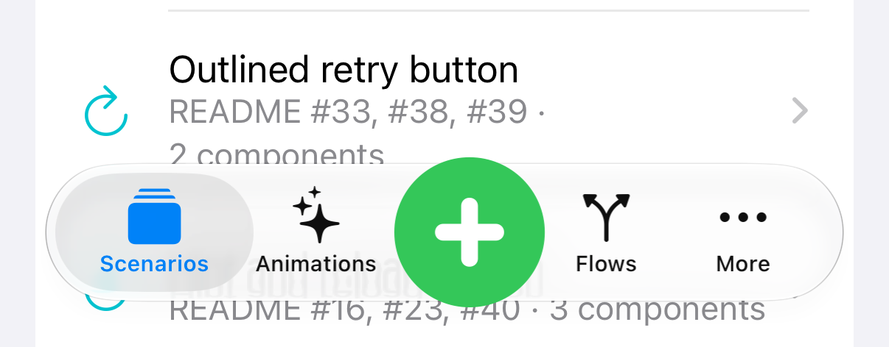

# 任务记录 / Task log

<!-- bound-classes: none -->

<!-- docs-navigation:start -->

| 中文 | English |
| --- | --- |
| [用途](#用途--purpose) | [Purpose](#用途--purpose) |
| [任务](#任务--tasks) | [Tasks](#任务--tasks) |

<!-- docs-navigation:end -->

<!-- docs-binding:start -->

| 类 / Class | 头文件 / Header |
| --- | --- |
| 无 / none | — |

<!-- docs-binding:end -->

## 用途 / Purpose

| 中文 | English |
| --- | --- |
| 开始任何任务前，先在 `docs/` 中找到最合适的文档，把任务记为 TODO，写下任务的详细上下文、用户的要求和用户的原始提示词，然后才开始工作；任务结束后把该 TODO 标为已完成。这样任务中断后，下一次会话能从文档中找回上下文。没有更合适的文档时（例如流程、说明文件类任务），记在本文件。规则见 `instructions.md` 的 “Record every task in docs before starting it”。 | Before any task, find the most fitting document in `docs/`, record the task there as a TODO with its detailed context, the user's requirements and the user's original prompt, and only then start; when the task ends, mark that TODO done. If a task is interrupted, the next session finds its context in the document. Tasks with no better document (process or instruction changes, for example) are recorded here. The rule is "Record every task in docs before starting it" in `instructions.md`. |

## 任务 / Tasks

### 进行中：移除第三方刷新项目名称的全部痕迹，改用 CYLRefresh 命名 / In progress: Remove every trace of the third-party refresh project names, use CYLRefresh names

- Date and branch: 2026-11-19, `feat/android-refresh-port-followup` (PR #31). Sessions, by the session-roles rule: winCYLTableViewPlaceHolder (Android, HarmonyOS, mini program, docs, scripts) and Mac-CYLTableViewPlaceHolder (iOS core, iOS examples, tests, podspec).
- User's original prompt (verbatim): "the scene generator: original vector art, no images, standard SVGA 2.x. generate yourself or download other resource which support this case 移除SmartRefresh 任何痕迹，改用CYLRefresh"
- Requirements: (1) no name of the original third-party refresh projects (the Android layout library and the iOS styles library the user named) is left in code, identifiers, file names, UI texts, string keys, tests, screenshots' file names or docs. CYLRefresh names are used instead: the styles demo is "CYLRefresh styles" (`CYLRefreshStylesDemoViewController`, methods `style…`, keys `CYLScenarioRefreshStyle…`, Android `RefreshStylesPage.kt`, HarmonyOS `RefreshStylesPage.ets`, mini program `refresh-demos/refresh-styles`). (2) The SVGA scenes stay this repository's own generated vector art (standard SVGA 2.x, no images).
- Exception, kept on purpose: the copyright and license notice that the derived code's licenses require (Apache-2.0 for the Android layout code, MIT for the iOS styles code), in one notice file per package (`LICENSE.refresh-third-party.txt`). The user's quoted prompts in the docs also stay verbatim.
- Acceptance: full marks (100) = a case-insensitive search for the old name finds only those notices and the quoted prompts; Android, HarmonyOS and the mini program build and pass their tests; the renamed styles page opens on a device; iOS is done by the Mac session; pushed. Pass (60) = Android, HarmonyOS and the mini program are clean and tested.
- Progress (2026-11-19, Windows session): Android `a94afd0` (build and unit tests pass); HarmonyOS and mini program `aa9c4b9` (x86 build, 91 / 91 unit tests, `npm test` 73 / 73; string keys renamed in CYLScenarioExample.bundle and regenerated); docs, instructions, the skill and the screenshot file names next. Old-name identifiers of the iOS styles library in the parity tables (`UISmart…`) become `UI…`; upstream issue links keep their numbers (`issue #N`). Pixels of older screenshots that show the old title are not changed.

### 已完成（95 / 100）：处理剩余 TODO：iOS 多行标题截图、小程序 npm 包、Android 刷新示例播放控件 / Done (95 / 100): Fix the open TODOs: iOS multi-line title screenshot, mini program npm package, Android refresh demo playback controls

- Date: 2026-11-19. Branch: `feat/android-refresh-port-followup` (PR #31).
- User's original prompt (verbatim): "fix TODO: −5: iOS simulator screenshot of a multi-line title. Waiting on the Mac session. −5: Publishing the mini program npm package. Waiting on CYLTabBarController upstream. −10: Playback controls on the Android refresh demo pages. Waiting on the iOS row \"Refresh demo pages with animated headers\"."
- Requirements: close the three TODOs instead of waiting.
- Acceptance: full marks (100) = (1) the iOS screenshot committed with measurements; (2) the mini program uses a published npm package; (3) the Android refresh demo pages with animated icons have Play all, speed and loop through the core, unit-tested, checked on emulator-5556 with a sheet; docs and pushed. Pass (60) = (3) done and verified, (1) and (2) settled or with exact blockers.
- Done: (1) already done by the Mac session in `98d7483` (iPhone 18 Pro simulator, iOS 27.2, `-AppleLanguages (ru)`, 3 lines within 1 pt; the centering entry is 100). (3) `ab7d05f`: `CYLRefreshIconView` gains `animationSpeed`, `loopsWhilePlaying` and `replayAnimation()` (as HarmonyOS `CYLRefreshIconViewModel`); image frames are rebuilt with `DURATION / speed`; example51–56 show the controls, shared with the Animations detail page (`PlaybackControls.kt`). Found and fixed in the core: `CYLPlaceholderView` restarted a looping GIF on a 1x timer, which cut passes played below 1x short; the engine's GIF view loops by itself since 4f73209c. Tests: merged 27 / 27 (new `CYLRefreshIconPlaybackTest`), placeholder 40 / 40. Emulator: Lottie spinner at 3x keeps coming back with loop on and plays once with loop off; at 0.25x one pass outlasts the refresh; frames 0.8 s → 3.2 s (0.25x) and 0.267 s (3x); NoFavorites.gif still loops at 1x and 0.25x ([screenshot](assets/android-17-api37-x86_64-emulator-refresh-playback-controls-ab7d05f-20261119-sheet.png)). (2) blocked: upstream `cyl-tabbar-miniprogram` 0.2.0 is ready but unpublished, and npm is not logged in here.
- Found: on the emulator an `AnimationDrawable` steps about every 100 ms (34 frames meant for 0.8 s take about 2.5 s); a device limit, not the core.
- Score: 95 / 100. TODO (-5): publish `cyl-tabbar-miniprogram` to npm (the owner runs `! npm login`; the CYLTabBarController mini program session owns the package), then switch the mini program to the package.

### TODO：表格占位图被键盘遮住（来自 CYLSearchViewController） / TODO: The table placeholder is covered by the keyboard (from CYLSearchViewController)

- Date and branch: 2026-11-19, `feat/android-refresh-port-followup`. Reported by the session Mac-CYLSearchViewController (a peer request, logged under the session-roles rule: iOS core, so this Mac session).
- Report (verbatim, English): "the table placeholder shown by `cyl_reloadData` is centred in the whole table, so with the keyboard up its subtitle is covered. Repro: CYLSearchViewController native example, Search tab (CYLSearchExampleViewController: plain UISearchController + tableView.cyl_reloadData, CYLPlaceholderView style .noResults), type "zzzz": "No results found" sits under the keyboard (iPhone 18 Pro, iOS 27.2)." Their own fix for CYLSearchView: CYLSearchViewController `f83ccd1` (framed above the keyboard's overlap).
- Requirements: fix in the core: center the automatic placeholder in the area above the keyboard / respect the table's adjusted bottom inset; unit test; screenshot.

### TODO：CYLPlaceholderStackView 改用 CYLAnimatedItemStackView；CYLPlaceholderView 迁移到 Swift / TODO: CYLPlaceholderStackView on CYLAnimatedItemStackView; CYLPlaceholderView in Swift

- Date and branch: 2026-11-19, `feat/android-refresh-port-followup`. Relayed by the session Mac-CYLTabBarController 小程序开发 from the owner: "封装…CYLPlaceholderStackView到CYLanimatedView里的一个视图，他的特点为每一个元素都为CYLanimatedView，并通知session名字为Mac-CYLTableViewPlaceHolder 让他使用我们的新视图控件来完成原本由CYLPlaceholderStackView完成的工作".
- Upstream: CYLTabBarController `f702df06` adds `CYLAnimatedItemStackView` (Swift, @objc, every element a CYLAnimatedItemView); `bf1717f8` / `4c7dc79d` port CYLAnimatedItemView to Swift (same Objective-C API). Objective-C cannot subclass a Swift class, and CYLPlaceholderView is an Objective-C subclass of CYLAnimatedItemView, so the pin stays at `28a9609d` (the last commit before the port) until CYLPlaceholderView is Swift.
- Requirements: (1) CYLPlaceholderView in Swift (keeping its Objective-C API); (2) pin the newest CYLTabBarController; (3) CYLPlaceholderStackView built on CYLAnimatedItemStackView, keeping its public API; (4) scenario tests; (5) report what the stack view is missing.
- Order settled (2026-11-19, relayed again by Mac-CYLTabBarController 小程序开发 from the owner, verbatim): "要转发任务给其他session要求适应swift新代码完成原有功能 fix The Swift port has a downstream dependency I missed: CYLPlaceholderView, an Objective-C subclass of CYLAnimatedItemView." CYLPlaceholderView first, then the stack view.
- Upstream hooks (Swift names in the parent): `layoutContent(in:)`, `contentSizeThatFits(_:)`, `itemStateDidChange()`, `itemAccessibilityLabel()`, `updateItemAccessibility()`, `applyIconTintColor(_:)`, `applyItemAppearance()`, `reloadAnimation()`, the `animationView` getter; properties `isDragEnabled` (`dragEnabled`), `isIconHidden` (`iconHidden`), `isAnimationReady` (`animationReady`); engine flag `CYL_ANIMATION_ENGINE_AVAILABLE` (Swift).
- Rubric: 100 = CYLPlaceholderView in Swift as a subclass of the Swift CYLAnimatedItemView with its Objective-C API unchanged (selectors, `CYLPlaceholderItem*` keys, enums), the pin at the newest CYLTabBarController, the core, the examples (CocoaPods) and the framework / Carthage build compile, all existing tests pass with the same counts or more (core 191, animation 13 at `28a9609d`), screenshots of scenarios that change visually, then CYLPlaceholderStackView on CYLAnimatedItemStackView with its public API kept; 60 = CYLPlaceholderView in Swift, the pin moved, core and animation tests pass.

### 已完成：按 session 名称分配平台任务（Mac → iOS，Win → 其他端） / Done: Assign platform work by session name (Mac → iOS, Win → the other platforms)

- Date and branch: 2026-11-19, `feat/android-refresh-port-followup`.
- User's original prompt (verbatim): "找到本项目instructions 相关文件以及skills相关文件，如果没有就新增文件保证写入成功，全英文写入：开始任务前检查session名称，名字中以Mac开头（忽略大小写）的session主要负责iOS端开发测试，名字以Win开头（忽略大小写）主要负责其他端开发，如果相应session均处于活跃状态，优选分配不同平台端任务到合适session，如果不存在以上规则的session则跳过该规则继续独立完成任务。"
- Requirements: (1) find the instruction files and the skill files; add a file when none fits; make sure the write succeeds; (2) English only; (3) the rule: before a task, check the session names; a session whose name starts with "Mac" (any case) mainly does iOS development and testing, one starting with "Win" (any case) mainly the other platforms; when both kinds are active, prefer handing each platform's part to the fitting session; when no such session exists, skip the rule and finish the task alone.
- Context: rule files: root `instructions.md`, `AGENTS.md`, skills under `.agents/skills/` (linked from `.claude/skills`); no skill covers session coordination yet, so a new skill `cyl-session-roles` is added. Append only (an earlier bulk edit wiped skills): check the diff numstat and the frontmatter after writing.
- Done (2026-11-19): `instructions.md` new section "Session roles: Mac sessions for iOS, Win sessions for the other platforms" (+19 lines, nothing removed); `AGENTS.md` new section "Session roles" and the skill list (+11, nothing removed); new skill `.agents/skills/cyl-session-roles/SKILL.md` (frontmatter checked, reachable through `.claude/skills`). Written in English.

### 已完成（四端）：内置动画组件的播放次数默认改为 1 / Done (all four platforms): Bundled animation components play once by default (repeat count 1)

- Date and branch: 2026-11-19, `feat/android-refresh-port-followup`.
- User's original prompt (verbatim): "RepeatCount = 1  改为默认为1"
- Requirements: the default `CYLPlaceholderItemAnimationRepeatCount` becomes 1 (play once) instead of 0 (loop).
- Context: `CYLPlaceholderView.animationRepeatCount` already defaults to 1 ("Absent means once"). The one default of 0 is in `+[CYLPlaceholderComponent componentWithBundledAnimation:fallbackStyle:title:size:action:]` (`CYLPlaceholderScenario.m`, "Scenario icons loop by default"), used by every catalog scenario and bundled-animation component; callers that want a loop set `animationRepeatCount = 0`. Refresh icons are not affected (`CYLRefreshIconView` drops this key and loops by `loopsWhilePlaying`). To check: unit tests that expect 0, docs that say scenario icons loop, the Android and HarmonyOS builders (same default for parity).
- Decision (the owner, 2026-11-19, asked once): spinners keep looping ("Spinners keep looping"), everything else plays once.
- Done (2026-11-19, iOS): `CYLScenarioAnimationLoopsByDefault` in `CYLPlaceholderScenario.m` (the examples' `loopsByDefault` list); `componentWithBundledAnimation:` sets 1, or 0 for a spinner file; the HUD sets its own count and is unchanged. Test `testScenarioIconsPlayOnceByDefaultAndSpinnersLoop`; 191 core tests pass. Docs: README, `Placeholder-Scenarios.md`, `iOS-Android-Parity.md`. Parity: done on 2026-11-19 by the Windows session (`0d2ec78`), see the next line.
- Done (2026-11-19, Android, HarmonyOS, WeChat Mini Program; Windows session, `0d2ec78`): the same rule and list. Android: `CYLPlaceholderScenarioCatalog.animationLoopsByDefault` / `scenarioAnimationRepeatCount`; the stack view applies it to the scenario animation unless the component's `animationRepeatCount` was set (test `scenarioAnimationsPlayOnceByDefaultAndSpinnersLoop`). HarmonyOS: `CYLPlaceholderAnimationLoopsByDefault` in `componentWithBundledAnimation` and `componentsForScenario` (both looped before); 91 / 91 unit tests. Mini program: `cyl-placeholder`'s `loop` property is unset by default and then follows `animationLoopsByDefault` per file (true / false still override); 72 / 72 tests. Score: 100 / 100.
- Impact check on tab bar animations (the owner, 2026-11-19: "评估RepeatCount = 1 改为默认为1后是否影响tabbar相关动画逻辑，tabbar逻辑为只有主动要求playout才播放，如果影响了还是改为默认为0"): no impact, the default stays 1. The change is only in this repository's `componentWithBundledAnimation:` (placeholder scenario components). CYLTabBarController, CollectionViewClassifyMenu and CYLSearchViewController have 0 references to it or to `CYLPlaceholderItemAnimationRepeatCount` (`git grep`). Tab bar items use `CYLAnimatedItemView` directly, play only on an explicit `playAnimation` (selection), and their `animationLoops` default is untouched. A repeat count never starts playback; it only says how often a started animation plays.

### 已完成（100 / 100）：Moonlight.pag 示例页深色背景 / Done (100 / 100): a dark backdrop for Moonlight.pag on the example detail pages

- Date and branch: 2026-11-19, `feat/android-refresh-port-followup`.
- User's original prompt (verbatim): "做" (answering the offer: "把 iOS 示例依赖的 CYLTabBarController 版本更新到 `396d3fca`" and "给 Moonlight.pag 的示例页加深色背景，让它在浅色模式下也能看见").
- Requirements: (1) the iOS examples depend on a CYLTabBarController commit that includes `396d3fca` (Rive tint fix); (2) CYLScenarioExampleMoonlight.pag is visible in light mode on every example's animation detail page.
- Context: (1) already satisfied: the Podfiles pin `4f73209c` (`e52f7b5`), and `git merge-base --is-ancestor 396d3fca 4f73209c` holds; nothing to change. (2) The file's artwork is white on a transparent layer, made for its black composition background, which PAGView does not draw on any platform (libpag has no background API; see the Q12 row of `docs/HarmonyOS.md`). Example-only change, approved by the owner ("做"), because the core cannot draw a background libpag does not expose: the detail page shows this file on a black backdrop with a white title. Platforms: iOS `CYLAnimationListViewController.swift`, HarmonyOS `AnimationDetailPage.ets`, mini program `pages/animations`; Android `AnimationsPage.kt` is being edited by the Windows session, asked to apply the same change there.
- Android done (2026-11-19, `4b20079`, Windows session): `AnimationsPage.detail()` gives the item a black background, 16 dp padding and a white title for `CYLScenarioExampleMoonlight.pag` only; checked on emulator-5556 ([screenshot](assets/android-17-api37-x86_64-emulator-moonlight-backdrop-4b20079-20261119-sheet.png)).
- iOS done (2026-11-19, `f38a260`): `CYLAnimationDetailViewController` (in `CYLAnimationListViewController.swift`) gives `CYLScenarioExampleMoonlight.pag` a black page and a white title (`CYLPlaceholderItemTitleColor`). Checked on the iPhone 18 Pro simulator (iOS 27.2, light mode): moon, stars and text drawn, white title ([screenshot](assets/ios-moonlight-pag-black-backdrop-sheet-ios27.2-iphone18pro-sim-f38a260-20261119.png)).
- HarmonyOS done (2026-11-19, `f38a260`): `AnimationDetailPage.ets` gives the item area a black background and the item a white title for that file. Checked on the Mac arm64 emulator (Mate 70 Pro, HarmonyOS 6.0.1 API 21, light mode) once the load dropped to 11: moon, stars and text drawn, white title ([screenshot](assets/harmonyos-moonlight-pag-black-backdrop-sheet-harmonyos6.0.1-api21-mate70pro-emulator-arm64-f38a260-20261119.png)). The Windows x86_64 emulator cannot check it: libpag ships arm64 only.
- Mini program: nothing to change; it has no PAG player, and its detail page shows only the "no PAG player" note for this file.
- Done (2026-11-19): (1) no change needed (pin `4f73209c` includes `396d3fca`); (2) iOS `f38a260`, Android `4b20079`, HarmonyOS `f38a260`, each checked with a screenshot; mini program has no PAG player. Score: 100 / 100.

### 已完成（90 / 100）：鸿蒙 Q7 Rive 倍速 → Moonlight.pag 画面空白 → iOS 多行标题截图 / Done (90 / 100): HarmonyOS Q7 Rive speed, then Moonlight.pag blank, then the iOS multi-line title screenshot

- Date: 2026-11-18. Branch: `feat/android-refresh-port-followup` (PR #31). Session: Mac CYLTableViewPlaceHolder.
- User's original prompt (verbatim): "鸿蒙 Q7 Rive 倍速 → Moonlight.pag 画面空白 → iOS 多行标题截图。"
- Requirements, in this order: (1) Q7 in `docs/HarmonyOS.md`: Rive plays at the chosen speed on the HarmonyOS example (the row says "N/A, no emulator", which no longer holds: the Mac emulator 127.0.0.1:5559 is arm64 and runs Rive); (2) `CYLScenarioExampleMoonlight.pag` draws nothing in its HarmonyOS detail page (no hilog error); find out why and fix (core first); (3) an iOS simulator screenshot of a placeholder with a multi-line title, to confirm iOS centers it (the Windows session's open point, -5, in "Placeholder titles centered by default").
- Context: Q7 code from 2026-11-16: `CYLRiveSpeedController` (a `RiveFileController` subclass whose `advance` multiplies the elapsed time by the speed) passed as RiveAnimationView's `controller`; never checked on a device. Screenshots follow `instructions.md` "Header and footer on stitched screenshots" (sheet tool, one column first) and pass `scripts/check_screenshots.py` locally.
- Acceptance: full marks (100) = Q7 measured on the emulator (the speed changes the animation's pace) and the row updated, the quality score rerun; Moonlight's cause found and fixed or documented with evidence; the iOS screenshot sheet committed; all pushed. Pass (60) = Q7 done.
- Progress (2026-11-18): Q7 tried and stopped. The 2026-11-16 "crash" that disabled the speed controller happened on the x86_64 Windows emulator, where Rive cannot run, so it was retried on arm64: `CYLRiveSpeedController` passed as RiveAnimationView's `controller`. First run on 127.0.0.1:5557: Truck.riv drew, no crash, but frames at 0.25x and 3x showed the same small change (mean pixel difference 0.5–1.0), so no proof the speed applied. After reinstalling a build that logs `advance`, 5557 went offline; the same build took 127.0.0.1:5559 offline a few minutes later. Both emulators belong to other sessions (told; they need a restart from DevEco Device Manager). The change is reverted (nothing committed); Q7 stays N/A with this evidence in `docs/HarmonyOS.md`. Blocked until an emulator is back: Moonlight.pag. Next: the iOS multi-line title screenshot (simulator, not affected).
- Progress (2026-11-18, `7be5926`): Moonlight.pag done, no rendering bug. My own emulator (CYL Placeholder Test, 127.0.0.1:5557) started; hilog shows the PAGView surface created and no error; the animation area has 0 non-white pixels on the white page; a debug build with a black page background (reverted) shows the white moon, stars and vertical text playing. The file's composition background is black (#000000, 25 fps, 150 frames) and PAGView does not draw it, so the white artwork is white on white. Not a decoder problem (the file is vector only, no video sequence). Evidence: `docs/assets/harmonyos-moonlight-pag-white-artwork-mate70pro-emulator-arm64-7be5926-20261118.png`, Q12 row in `docs/HarmonyOS.md` updated. Next: the iOS multi-line title screenshot.
- Progress (2026-11-18, `cca2ce9`): iOS multi-line title screenshot blocked again. ExampleScenarios clean build succeeded (Xcode 27.2, `/tmp/xpa/dd-scen`), but CoreSimulator hangs: my simulator CYLPlaceholder-HUD-test (iOS 27.2) stays "Booting" for over 5 minutes, and `simctl install` times out (200 s and 90 s) on the booted iPhone 18 Pro (iOS 27.2) and iPhone 17 Pro (iOS 27.0); another session's install hangs the same way; host load average 340–770. Score 85 / 100. TODO (-15): once `simctl install` works, launch with `-AppleLanguages (ru)` so a placeholder title wraps, screenshot, measure the icon and line centers, make the sheet, run `scripts/check_screenshots.py`.
- Done (2026-11-18): after other sessions shut down idle simulators, `simctl install` worked on the iPhone 18 Pro (iOS 27.2). Multi-line title centered (see the title-centering entry): `docs/assets/ios-multiline-title-centered-sheet-ios27.2-iphone18pro-sim-cca2ce9-20261118.png`, `scripts/check_screenshots.py` passes.
- Score: 90 / 100. TODO (-10): Q7, Rive playback speed on HarmonyOS, stays N/A: @ohos/rive 1.0.4 has no speed API and a custom controller took two emulators down (`docs/HarmonyOS.md`); reopen when @ohos/rive adds a speed or advance API.
- Progress (2026-11-18, later): both remaining items are blocked by the environment, not started on a device. Moonlight.pag: the file is libpag's own `assets/moonlight.pag` (Apache-2.0, sha256 747ac418…); hypothesis, not verified: its content is a video sequence that libpag on HarmonyOS decodes with the hardware video decoder, which the emulator may lack, hence a blank view with no error; to check on an emulator with libpag/decoder hilog when one is reachable. 5559 was restarted by its owner, then went unreachable again before anything was launched on it (`hdc tconn` fails); 5557 is still hung. iOS multi-line title: `pod install` done (Podfile pinned to CYLTabBarController ad3dca0e, Pods were at 6a9ede85), clean build of ExampleScenarios succeeded (fresh derived data, Xcode 27.2), but `simctl install` / `boot` hang on every simulator tried (CoreSimulator not responding; a HarmonyOS build also took 10 min instead of 1, so the Mac is heavily loaded). Next: retry both when the emulator and CoreSimulator respond.

### 已完成（100 / 100）：从 CI 移除截图 Label 检查 / Done (100 / 100): Remove the screenshot label check from CI

- Date: 2026-11-18. Branch: `feat/android-refresh-port-followup` (PR #31). Session: Mac CYLTableViewPlaceHolder.
- User's original prompt (verbatim): "Remove label CI screenshots from ci"
- Requirements: remove the screenshot label check (`python3 scripts/check_screenshots.py` and its Pillow install step, job `Docs navigation` in `.github/workflows/ios.yml`, added in 91e0002) from CI. The "Example screenshots" job (demo builds and their screenshots) has no label check and stays.
- Context: the checker and `scripts/screenshot_sheet.py` stay in the repository as local tools; the rule texts that say "CI runs it" (`instructions.md` enforcement, `AGENTS.md`, `docs/instructions.md`, skills `cyl-docs` and `cyl-verify`) are changed to a local check before committing an image.
- Acceptance: full marks (100) = both CI steps gone, every "CI runs it" for the checker updated, workflow YAML still valid, pushed. Pass (60) = the CI steps gone.
- Result (2026-11-18): the Pillow install step and `python3 scripts/check_screenshots.py` are gone from the `Docs navigation` job (`.github/workflows/ios.yml`; YAML parses); the "Example screenshots" job is unchanged. `instructions.md` (enforcement step 3), `AGENTS.md`, `docs/instructions.md` and skills `cyl-docs`, `cyl-verify` now call the checker a local check that CI does not run; the scripts' Pillow hint no longer says CI installs it. The checker still passes locally.

### 已完成（100 / 100）：截图 Label 规范为何没有生效，并强制执行 / Done (100 / 100): Why the screenshot label rule was not applied, and enforce it

- Date: 2026-11-18. Branch: `feat/android-refresh-port-followup`.
- User's original prompt (verbatim): "检查为什么没有应用新增的截图Label规范，并强化该策略保证以后截图必须遵循该规范，避免再出现该问题。"
- Requirements: (1) find why the new screenshot label rule (`instructions.md`, "Header and footer on stitched screenshots", 9cdf294) was not applied; (2) strengthen it so every future screenshot must follow it; (3) prevent a repeat.
- Findings: 9cdf294 landed at 11:04:14 from another session; this session's b8a4aaf (11:04:40) pulled it in the same command as its commit and never read it; every other screenshot this session added today predates it. Gaps behind that: no step re-reads rules that a pull changes; no tool makes the required sheet (screenshots were raw captures with ad-hoc names, side-by-side images were horizontal rows without header / footer, already against the older one-column-first order); no automated check.
- Plan: a sheet tool (`scripts/screenshot_sheet.py`: portrait, two columns first, English bold header / captions / footer bands outside the panels, metadata embedded), a checker (`scripts/check_screenshots.py`, in CI and before every commit that adds images), the rules (re-read rules after a pull; sheets only through the tool; the checker), and this session's non-conforming screenshots of today remade as conforming sheets with renamed originals.
- Acceptance: full marks (100) = the cause recorded; tool and checker committed and run in CI; rules in `instructions.md`, `AGENTS.md` and the skills `cyl-verify` / `cyl-docs`; this session's screenshots of today conform (checker green); pushed. Pass (60) = cause recorded, checker in CI, rules written.
- Done 2026-11-18: `scripts/screenshot_sheet.py` (sheet tool, layout updated to the owner's second change of the day, 63dac99: one column first, two columns only above 2.17 times the width; long names wrap inside the bands) and `scripts/check_screenshots.py` (every image in `docs/assets/` not in `screenshot-legacy.txt` is a sheet with a complete record, from PNG text or a `<sheet>.sheet.json` sidecar, or a conventionally named original one uses), run in CI (`Docs navigation` job). The checker flagged exactly the non-conforming image (b8a4aaf's `harmonyos-animation-detail-item-playback.jpeg`). Rules: `instructions.md` "Re-read the rules a pull changes" and "Enforcement: every screenshot passes the checker"; `AGENTS.md`, `docs/instructions.md`, skills `cyl-verify` and `cyl-docs`. This session's screenshots of today remade as six conforming sheets with renamed originals (playback controls on Android; mini program icon tint; mini program events and title in the item; HarmonyOS and Android center line; HarmonyOS item view, spacing, playback); the post-rule image removed; the docs point to the sheets; earlier files kept as legacy (CYLTabBarController's docs link two). The Mac session's two post-rule sheets (ffmpeg) got sidecars from their own header, captions and footer. Checker: 34 screenshots, 8 sheets, 137 legacy, no error.
- CI: run 44193548056 (91e0002), job `Docs navigation`: the Pillow step and `python3 scripts/check_screenshots.py` succeeded (the run was later cancelled by the next push, after that job had finished). The Mac session also ran the checker (34 screenshots, 8 sheets, 137 legacy, no failure); a7d91a1 added the Pillow hint it asked for.
- Update 2026-11-18: at the owner's request the checker no longer runs in CI (512d9a4, Mac session: Pillow and checker steps removed from `Docs navigation`); `scripts/check_screenshots.py` and `scripts/screenshot_sheet.py` stay as local tools, and the rules say to run the checker before every commit that adds or changes an image. Do not add it back to CI.
- Score: 100 / 100.

### 已完成（100 / 100）：截图规则：一列多行优先，超过一屏再两列 / Done (100 / 100): Screenshot rule: one column first, two columns when taller than a phone screen

- Date: 2026-11-18. Branch: `feat/android-refresh-port-followup` (PR #31). Session: Mac CYLTableViewPlaceHolder.
- User's original prompt (verbatim): "更新截图规则，优选一列多行 如果一列拼接后长度超过普通手机的一屏幕 则两列多行"
- Requirements (English): update the screenshot rule: one column with several rows first; when the one-column image would be taller than one screen of a common phone, two columns with several rows.
- Context: `9cdf294` put two columns first; this replaces that order. A common phone screen is 19.5:9, so "taller than one screen" at phone width means height > about 2.17 × width (the same threshold as CYLTabBarController's `scripts/stitch-screenshots.py`).
- Acceptance: full marks (100) = `instructions.md`, `AGENTS.md`, skills `cyl-verify` and `cyl-docs` updated, writes checked, pushed. Pass (60) = `instructions.md` and one skill.
- Result (2026-11-18): the order is now one column with several rows first, two columns with several rows only when one column would be taller than one phone screen (height above about 2.17 times the width, 19.5:9), one row last; in `instructions.md` ("Screenshots of local builds and CI/CD" and "Header and footer on stitched screenshots"), `AGENTS.md`, skills `cyl-docs` and `cyl-verify` (edited in place, frontmatter checked, no "two columns first" left). The two sheets of `e2ec88c` (Q17, Rive inputs) are far taller than a phone screen in one column, so their two columns already follow the rule.

### 已完成（100 / 100）：截图规范：竖版两列多行，拼接图加 header / footer / Done (100 / 100): Screenshot rules: portrait, two columns, header and footer on stitched images

- Date: 2026-11-18. Branch: `feat/android-refresh-port-followup` (PR #31). Session: Mac CYLTableViewPlaceHolder.
- User's original prompt (verbatim): "找到本项目instructions 相关文件以及skills相关文件，如果没有就新增文件保证写入成功，全英文写入：找到截图相关规范，如果没有就新建保证写入成功，截图除了 优先选用竖版排列风格。优先两列，多行。且给拼接好的图增加header，footer，header，footer不能与截图区域重叠 覆盖，标注关键信息：关键信息也是英文，测试模拟器平台，模拟器系统版本，操作系统版本，ide 版本，以及测试目的等等。以附带的截图为例。提取截图的附带信息以及风格 完善我的描述规则。"
- Requirements (English): in the instructions and skills files (create them if missing; check the writes), in English: stitched screenshots use a portrait layout, two columns over several rows first; every stitched image gets a header and a footer that never overlap or cover the screenshots; they carry the key information in English: the simulator platform, the simulator OS version, the host OS version, the IDE version, the test purpose and so on. Use the attached screenshot as the example: take its information and style to complete the rule.
- Context: the attached example (CYLTabBarController, iOS 27.2, iPhone 17 Pro simulator, Xcode 27.2, CYLTabBarController dcbfdec6 (ef1d0313), feat/harmony, 2026-11-18, "Rive tags at rest (no play)"): white background, a red bold header line with the environment and the purpose, a red bold caption band above each panel ("launch, no play", "11 s later, 0 changed pixels"), panels stacked top to bottom, nothing drawn on the screenshots, no footer. The current rule ("Screenshots of local builds and CI/CD") puts one column first and two columns second; the owner now puts two columns first.
- Acceptance: full marks (100) = the rule in `instructions.md`, `AGENTS.md`, skills `cyl-verify` and `cyl-docs`, the example image in `docs/assets`, writes checked by grep, pushed. Pass (60) = `instructions.md` and one skill.
- Result (2026-11-18): `instructions.md` "Screenshots of local builds and CI/CD": the stitch order is now a portrait sheet, two columns over several rows first, one column second, one row last; new subsection "Header and footer on stitched screenshots" (layout; header and footer bands that never overlap or cover a screenshot; English, bold, one high-contrast color; header fields in order: platform and device with simulator OS, IDE version, host OS, library commits, repository branch and commit, date, test purpose; a caption band above each panel; footer with the verdict, measured values, method, launch arguments and original file names; originals committed). Also in `AGENTS.md` and skills `cyl-verify`, `cyl-docs` (edited in place, frontmatter checked, numstat 5–36 lines added). Reference image: `docs/assets/screenshot-style-reference-ios27.2-iphone17pro-xcode27.2-cyltabbarcontroller-dcbfdec6-20261118.png`.

### 已完成（100 / 100）：鸿蒙 Rive input 示例页 / Done (100 / 100): HarmonyOS Rive input example page

- Date: 2026-11-18. Branch: `feat/android-refresh-port-followup` (PR #31). Session: Mac CYLTableViewPlaceHolder.
- User's original prompt (verbatim): "加鸿蒙 Rive input 示例页"
- Requirements: a HarmonyOS example page that shows Rive placeholders driven by state-machine inputs: `triggerInput`, a boolean `input`, and `numberInput` + `values` (each play sets the next value), like the iOS Rive Rooms page (`CYLRiveRoomsViewController.swift`: house.riv, number input `Rooms`, values 3,4,5,6, picker, slider, Loop switch with a label). Uses the example animator `entry/src/main/ets/engines/CYLRivePlaceholderItemAnimator.ets` aligned with CYLRiveIcon in `9378da4`.
- Context: the 2026-11-18 Rive alignment left these input paths unverified on HarmonyOS because the example had no such page. The Mac emulator 127.0.0.1:5559 is arm64, so Rive runs there.
- Acceptance: full marks (100) = page reachable from the example, each of the three input kinds plays and restarts on Play all, the number label / picker / slider follow the loop, strings in all languages, emulator screenshots in `docs/assets`, docs updated, pushed. Pass (60) = page with `numberInput` (house.riv Rooms) working on the emulator with a screenshot.
- Order: starts after the Q17 dark-mode fix in progress (tasks in instruction order).
- Result (2026-11-18, `4bcfdb0`): `entry/src/main/ets/pages/RiveInputsPage.ets`, opened by "Rive inputs" at the top left of the Animations tab: number (house.riv, Rooms 3–6, picker, slider, label, Loop every 1.5 s), boolean (Space Reload, Start), trigger (Skating Reload, pullRelease; Bow's advance needs its pull input first). Core bug found and fixed on the way: `CYLPlaceholderAnimationViewModel.initWithFileURLOptions` dropped the options in the URL fragment, so no input option reached the Rive animator (new test, 91 / 91). The file starts at a Rooms value outside 3–6, so the label shows "–" until the first play. Verified on the Mac arm64 emulator (hilog setNumberState / setBooleanState / fireState, frames): `docs/assets/harmonyos-rive-inputs-page-mate70pro-emulator-arm64-4bcfdb0-20261118.png` (header / captions / footer, two columns) and originals `harmonyos-rive-inputs-*.jpeg`; strings in seven languages; house.riv with its NOTICE entry; `docs/HarmonyOS.md` "Rive inputs page".
### 已完成（100 / 100）：规则：图标 + 标题只用 CYLAnimatedItemView，其余用 CYLPlaceholderStackView，各平台同一布局框架 / Done (100 / 100): Rule: an icon with a title uses CYLAnimatedItemView only, the rest CYLPlaceholderStackView, one layout framework on every platform

- Date: 2026-11-18. Branch: `feat/android-refresh-port-followup`.
- User's original prompt (verbatim): "找到本项目instructions 相关文件以及skills相关文件，如果没有就新增文件保证写入成功，全英文写入：use only CYLAnimatedItemView only on this icon and title case instead of CYLPlaceholderStackView. CYLPlaceholderStackView only used in case which CYLAnimatedItemView cannot cover.  apply same function layout framework as CYLPlaceholderStackView does on other platform"
- Requirements: (1) find the instructions and skills files (create when missing); (2) write in English: an icon with a title uses CYLAnimatedItemView only, not CYLPlaceholderStackView; CYLPlaceholderStackView only where CYLAnimatedItemView cannot cover the case; (3) every platform applies the same layout framework as CYLPlaceholderStackView does on the other platforms.
- Context: the rule follows 64ab041 (the HarmonyOS animation detail page on CYLAnimatedItemView, the core's CYLPlaceholderAnimatedItem) and the review there (scenarios and the support page stay stacks; Android's detail page is a CYLPlaceholderView, a CYLAnimatedItemView subclass; the mini program detail page waits for a title font weight).
- Acceptance: full marks (100) = the rule in `instructions.md`, `AGENTS.md`, `docs/instructions.md`, the platform folders' instructions (Android, HarmonyOS, mini program) and the skills `cyl-api-map` and `cyl-verify`, in English, pushed. Pass (60) = `instructions.md` and `AGENTS.md`, pushed.
- Done 2026-11-18: the full rule is the new `instructions.md` section "Icon and title: CYLAnimatedItemView; CYLPlaceholderStackView only for what it cannot cover" (six points: icon + title is the item; the stack only for what the item cannot cover, with examples; missing item features go upstream first; playback stays on the core model; one layout framework on every platform; verify the center line). Summaries in `AGENTS.md`, `docs/instructions.md`, `android/instructions.md`, the HarmonyOS and mini program folders' `instructions.md` (each with the platform's current state) and the skills `cyl-api-map` (parity tables) and `cyl-verify` (center-line check). No file was missing. `git diff --check` and the docs navigation check pass.
- Score: 100 / 100.

### 已完成（100 / 100）：图标 + 标题只用 CYLAnimatedItemView，CYLPlaceholderStackView 只用于它覆盖不了的情况 / Done (100 / 100): An icon with a title uses CYLAnimatedItemView only; CYLPlaceholderStackView only where the item cannot cover it

- Date: 2026-11-18. Branch: `feat/android-refresh-port-followup`.
- User's original prompt (verbatim): "kill OneDrive / use only CYLAnimatedItemView only on this icon and title case instead of CYLPlaceholderStackView. CYLPlaceholderStackView only used in case which CYLAnimatedItemView cannot cover"
- Requirements: (1) stop OneDrive; (2) the icon + title case (the Celebrate animation detail page of the last issue) draws with CYLAnimatedItemView, not CYLPlaceholderStackView; (3) CYLPlaceholderStackView stays only where the item view cannot do the job.
- Acceptance: full marks (100) = OneDrive stopped; every non-iOS page showing only an icon and a title on the item view, playback controls working, centered, other cases reviewed and listed; pushed. Pass (60) = OneDrive stopped and the HarmonyOS detail page on the item view, verified.
- Done: (1) OneDrive and OneDrive.Sync.Service stopped (no OneDrive process left). (2) HarmonyOS: new core API `CYLPlaceholderAnimatedItem` (attach / detach / animationURL) and the exported `CYLPlaceholderAnimatedItemBuilder`, so a page shows a placeholder model's animation in its own CYLAnimatedItemView while playback stays on the model; `CYLPlaceholderView` uses the same attach / detach. `AnimationDetailPage` now draws `CYLAnimatedItemView` (vertical, 180, title) instead of a one-component stack. Emulator (x86_64, local build without .so): icon and title centered (x 658 / 658.5), Play all restarts, the loop switch loops (frames drawn across 10 s), unit tests 89 / 89 ([screenshot](assets/harmonyos-6.0.1-api21-x86_64-emulator-animation-detail-item-view-b8a4aaf-20261118-sheet.png)). (3) Reviewed and kept: scenario pages (several components, actions) and SupportPage (icon, title and a hint) stay stacks; Android's detail page already uses `CYLPlaceholderView`, a CYLAnimatedItemView subclass (it adds the GIF loop the plain item lacks); the mini program detail page draws its own player and title (no stack) and stays, because `cyl-animated-item` has no font weight and one title color (its title is 17px semibold, white in dark mode).
- Found upstream (reported to the CYLTabBarController HarmonyOS session): `CYLAnimatedItemView.spacing` is never applied (title against the icon); no titleLines (one line only).
- Update 2026-11-18: CYLTabBarController 0ce518a8 (B21) applies `spacing` and adds `titleLines`; pinned; the detail page shows an 8 vp gap (title top 1656 px, icon bottom 1628 px, 3.5 px per vp), icon and title still centered (x 658 / 658.5), unit tests 89 / 89 ([screenshot](assets/harmonyos-6.0.1-api21-x86_64-emulator-animation-detail-item-view-b8a4aaf-20261118-sheet.png)).
- Update 2026-11-18 (CYLTabBarController ad3dca0e, B22: item playback): the core's builder follows the item's `speed` / `loops` / `restartToken` (`@Prop @Watch`, applied on change only, so CYLPlaceholderView is unchanged) and plays a URL with no placeholder model through a model of its own; `CYLAnimatedItemController` is re-exported. `AnimationDetailPage` drops the bridge: item props only (`animationSpeed`, `animationLoops`, `controller`). Emulator, CYLPlaceholderCelebrate.json, 12 captures per case: Play all restarts a finished one-shot; 3x ends it after 6 captures where 1x still draws at 12; loop on keeps cycling; centered, 8 vp gap; unit tests 89 / 89 ([screenshot](assets/harmonyos-6.0.1-api21-x86_64-emulator-animation-detail-item-view-b8a4aaf-20261118-sheet.png)).
- Update 2026-11-18 (CYLTabBarController 5582685f: `titleFontWeight`, `titleDarkColor`, `userInterfaceStyle`; asked for by this session): pinned (2bd8eda); the mini program animation detail page is one `cyl-animated-item` (b20a5f2): vertical, 180px, title 17px weight 600, #000000 / #ffffff in dark, Lottie through `generic:cyl-lottie-view`, GIF in the item, Replay and Play all through `restartAnimation()`, speed and loop as properties. Measured with automation_evaluate: titleStyle light `color: #000000;font-weight: 600`, dark (the item's theme listener) `color: #ffffff;font-weight: 600`; npm test 71 / 71 ([screenshot](assets/wechat-miniprogram-devtools2.02.2609250-baselib3.17.6-detail-item-b20a5f2-20261118-sheet.png)).
- Update 2026-11-18 (CYLTabBarController ad385a5a, B24: the GIF view obeys loops, speed and restart; pinned in c867ca9, HarmonyOS unit tests 91 / 91): the Android detail page moved to a plain `CYLAnimatedItemView` (90a25d4) and failed on emulator-5556 (Android 17, x86_64). `CYLPlaceholderUploading.gif` (20 frames, 600 ms) stays on its last frame (screen vs. frame 19: mean diff 0.03) with Loop on and through Play all, with 0.00 change in 25 captures 0.3 s apart. A Lottie on the same page loops, the animator scale is 1 and battery saver is off. Reported to the CYLTabBarController Windows session with the evidence. 90a25d4 was reverted (28e2207), so the page stays on `CYLPlaceholderView` until the GIF view animates.
- Update 2026-11-18 (CYLTabBarController 4f73209c, the B24 fix: its own GIF decoder instead of `Movie`, and the frame clock instead of a ValueAnimator, which the app saw at duration scale 0; reported by the user and relayed to the CYLTabBarController Windows sessions): pinned (e52f7b5). The page is back on a plain `CYLAnimatedItemView` (b2cbe6a). Measured on emulator-5556: Loop on, 19 of 20 captures change over 14 s; Loop off and Play all play one pass, then rest on the last frame; `NoFavorites.gif` passes end 1.9 / 1.8 s after Play all at 3x against 3.1 / 3.1 s at 1x. HarmonyOS unit tests 91 / 91, npm test 71 / 71 ([screenshot](assets/android-17-api37-x86_64-emulator-gif-item-b2cbe6a-20261118-sheet.png)).
- Score: 100 / 100. Every non-iOS detail page that shows an icon and a title (HarmonyOS, Android, WeChat Mini Program) is one CYLAnimatedItemView, centered, with the playback controls verified on a device. No missing points.

### 已完成（100 / 100）：占位图标题默认居中，图标与标题中心线对齐 / Done (100 / 100): Placeholder titles centered by default; the icon and the title share one center line

- Date: 2026-11-18. Branch: `feat/android-refresh-port-followup`.
- User's original prompt (verbatim): "新issue，placeholder的占位title，默认应该局中，包括单行以及多行。重点查看非iOS端效果，与iOS端局中逻辑保持一致。如果iOS也不局中同样更新iOS为局中。以上为异常截图 标记TODO icon与title总是中心线对齐" (with two screenshots: the mini program's left-aligned wrapped title, the HarmonyOS Celebrate page with the icon left of the title).
- Requirements: (1) titles centered by default, one line and several; (2) the icon and the title always on one center line; (3) the non-iOS platforms first, following iOS's centering; (4) fix iOS too if it is not centered; (5) record and screenshot first.
- Acceptance: full marks (100) = every platform measured centered (icon and title center lines equal, wrapped lines centered), fixes in the cores, screenshots before / after, docs, pushed. Pass (60) = the two reported platforms fixed and measured.
- Done: screenshots saved first (`docs/assets/issue-title-center-*.{png,jpg}`). HarmonyOS: the icon was 14 px left of the title (layout dump), fixed in the core with `isBare: true` on the `CYLAnimatedItemView` (`docs/HarmonyOS.md` E16); after the fix the icon, canvas and text centers are equal (x = 658). Mini program: the screenshot was the 59a1cb0f trial, never committed; 52569d68 centers each wrapped line and draws the title at the same pixels as before (`docs/WeChat-MiniProgram.md`). Android: already centered (x = 539.5 / 540, a two-line text centered). iOS: centered by code (no change needed).
- Update 2026-11-18 (e9d9fa9): automated HarmonyOS check. `CYLPlaceholderView` gives its icon and title inspector ids (`<accessibilityIdentifier>-icon` / `-title`, or `cyl-placeholder-*`), the animation detail page's item gets `itemId` `animation-detail-item`, and `python3 scripts/harmonyos-center-check.py` reads a uitest dumpLayout (hdc or `--layout`) and fails when a center differs by more than 1 px. Emulator: Network unavailable icon / title x 658.0 / 658.0, Celebrate detail 658.0 / 658.5, both PASS; `--tolerance 0` fails the 0.5 px case and a test dump with a 14 px offset fails; unit tests 91 / 91 ([screenshot](assets/harmonyos-6.0.1-api21-x86_64-emulator-center-check-e9d9fa9-20261118-sheet.png)).
- Update 2026-11-18 (cca2ce9, Mac session): iOS measured. iPhone 18 Pro simulator, iOS 27.2, Xcode 27.2, ExampleScenarios launched with `-AppleLanguages (ru)`: the first scenario's title wraps to 3 lines; ink centers icon 600.5 px, lines 603.5 / 604.0 / 602.0 px, screen center 603.0 (within 3.5 px = 1.2 pt; the slashed Wi-Fi glyph is not symmetric). Sheet: `docs/assets/ios-multiline-title-centered-sheet-ios27.2-iphone18pro-sim-cca2ce9-20261118.png`.
- Score: 100 / 100.

### 已完成（100 / 100）：重新固定 CYLTabBarController（59a1cb0f，再到 52569d68），小程序改用 cyl-animated-item 的事件与标题属性 / Done (100 / 100): Pin CYLTabBarController (59a1cb0f, then 52569d68); the mini program uses cyl-animated-item's events and title properties

- Date: 2026-11-18. Branch: `feat/android-refresh-port-followup`.
- Prompt (relayed from the owner by Mac-CYLTabBarController 小程序开发, verbatim): "both cyl-animated-item requests landed on feat/cross-platform-components in 59a1cb0f. (1) Events with the engine's detail: `animationready`, `animationcomplete`, `animationloopcomplete`, `animationerror` ... (2) Properties `titleColor`, `titleFontSize`, `titleLines` ... Please repin, drop your workaround, and tell me if anything renders wrong."
- Requirements: (1) repin to 59a1cb0f (Cartfile, Podfiles, the copied component); (2) count `repeatCount` passes from `bind:animationcomplete` and drop the `cyl_animation()` listener; (3) move `cyl-placeholder`'s icon title into the item through `title-color` / `title-font-size` / `title-lines` where it renders the same; (4) check in WeChat DevTools and report rendering problems upstream.
- Acceptance: full marks (100) = all four, `npm test` green, DevTools screenshots (playback policies once / three times / loop, a titled icon), the HarmonyOS and Android checks still pass at the new pin, docs updated, pushed. Pass (60) = (1) and (2) with tests and a DevTools check of the playback policies.
- Done: (1) Cartfile and the four Podfiles at 59a1cb0f; the mini program copy synced (6 + 4 files and the upstream test); HarmonyOS `cylanimateditem` synced (only `UPSTREAM_COMMIT` changed); Android's `cylanimateditem` has no change between the two pins. (2) `bind:animationcomplete` replaces the `cyl_animation()` hook, with a test; `npm test` 67 / 67; DevTools: three passes, once, loop, Play all, console clean. (3) At 59a1cb0f a wrapped title in the item was left-aligned with a 2px gap and no line height (screenshot); reported; fixed upstream in 52569d68 (centered wrap, `titleSpacing`, `titleLineHeight`), repinned, and the title moved into the item: DevTools shows the same pixels as the old `<text>`; `npm test` 69 / 69. (4) DevTools screenshots in `docs/WeChat-MiniProgram.md`; HarmonyOS 89 / 89 at the new pin (only `UPSTREAM_COMMIT` changed); Android's `cylanimateditem` unchanged between 6a9ede85 and 52569d68.
- Score: 100 / 100.

### 已完成（95 / 100）：继续最早的非 iOS TODO：小程序 cyl-animated-item 剩余项 / Done (95 / 100): Continue the oldest non-iOS TODO: the mini program cyl-animated-item leftovers

- Date: 2026-11-18. Branch: `feat/android-refresh-port-followup`.
- User's original prompt (verbatim, relayed by Mac-CollectionViewClassifyMenu): "通知所有需要我回复continue的活跃session，continue"
- Requirements: continue the open TODOs (this session: everything except iOS), oldest first.
- Context: the oldest open non-iOS entry is `docs/WeChat-MiniProgram.md` "the components build on CYLTabBarController's cyl-animated-item" (score 80). Its remaining items: (1) a WeChat DevTools rendering check, (2) upstream requests, (3) tinted icons dim the animation / the static fallback is untinted, (4) the published npm package.
- Acceptance: full marks (100) = all four items done. Pass (60) = items 1 and 3 (the ones this repository can do) done and verified.
- Done: (1) already covered by the 2026-11-17 DevTools runs (MP1 to MP5), now recorded in the entry; (2) upstream has `cyl_playFromStart()` and `accessibilityHidden`; the events and title properties are requested from the CYLTabBarController mini program session; (3) tinted template icons now use `cyl-animated-item`'s `icon-tint` instead of a 45 % opacity, with a test (`npm test` 65 / 65) and a DevTools check (screenshot `docs/assets/wechat-miniprogram-devtools2.02.2609250-baselib3.17.6-icon-tint-5919ab7-20261118-sheet.png`). Also: `scripts/cyltabbarcontroller-checkout.sh` turns on `core.longpaths` (Windows: the upstream-copy test failed with "Filename too long").
- Score (then): 90 / 100. TODO (-5): upstream event forwarding and title properties (CYLTabBarController). TODO (-5): the published npm package (CYLTabBarController).
- Update 2026-11-19: the event forwarding and title properties landed upstream (59a1cb0f `bind:animationcomplete`, 52569d68 and 5582685f title properties, pinned). Left: the npm package. Upstream `cyl-tabbar-miniprogram` 0.2.0 (CrossPlatform/wechat-miniprogram-cyltabbar, branch feat/cross-platform-components) is ready with `src/cyl-animated-item`, but is not on npm (`npm view` 404) and this machine is not logged in to npm (`npm whoami`: need auth). Score: 95 / 100. TODO (-5): publish `cyl-tabbar-miniprogram` (needs the owner's `npm login` and the upstream session), then depend on it instead of `npm run sync-animated-item`.

### TODO：在 Mac 的 arm64 鸿蒙模拟器上补完质量分 Q12、Q15、Q17、Q7 / TODO: Finish HarmonyOS quality rows Q12, Q15, Q17 and Q7 on the Mac's arm64 emulator

- Date: 2026-11-18. Branch: `feat/android-refresh-port-followup` (PR #31). Session: Mac CYLTableViewPlaceHolder.
- User's original prompt (verbatim): "通知所有的活跃session，continue fix TODO"
- Requirements: (1) relay "continue fix TODO" to every active session; (2) continue this session's open TODOs, oldest first, without overlapping other sessions (the Windows session owns the Android / RN / Flutter rows).
- Context: `docs/HarmonyOS.md` quality score is 93 / 100. Open rows: Q12 (Lottie, PAG, Rive, GIF each play in the Animations tab; Rive crashed on the x86_64 Windows emulator, GIF showed nothing before E12), Q15 (HUD and HUD life cycle pages; the crash was fixed in E5), and two rows marked N/A because no emulator existed: Q17 (dark mode readable) and Q7 (Rive speed). The Mac emulator 127.0.0.1:5559 is arm64-v8a, so Rive runs there.
- Acceptance: full marks (100) = Q12, Q15, Q17 checked on the emulator with labeled screenshots in `docs/assets`; Q7 implemented (or a documented reason it cannot be) and checked; `node scripts/harmony-quality-score.js` rerun; pushed. Pass (60) = Q12 and Q15 checked with screenshots and the score rerun.
- Progress (2026-11-18): Q12 done (Lottie, PAG, Rive, GIF draw; Rive does not crash on arm64), Q15 done (HUD page, HUD states, life cycle, status bar); quality score 93 → 96 (`node scripts/harmony-quality-score.js`). Q17 fails: the example keeps white backgrounds in dark mode while system text turns white (screenshot in `docs/HarmonyOS.md`); fixing with dark-aware color resources next. Found on the way, TODO: `CYLScenarioExampleMoonlight.pag` draws nothing. Q7 (Rive speed) after Q17.
- Progress (2026-11-18, `e80de84`): Q17 done: dark-aware color resources in the example, scenario line icons gray in the core (as iOS); quality score 100 / 100 (`docs/assets/harmonyos-q17-dark-mode-fixed-mate70pro-emulator-arm64-e80de84-20261118.png`). Left: Q7 (Rive speed), still marked "N/A" with an outdated reason (an emulator exists now), and `CYLScenarioExampleMoonlight.pag` drawing nothing.

### 已完成（100 / 100）：模拟器重启后继续中断的设备测试 / Done (100 / 100): Continue the on-device checks interrupted by the hung emulator

- Date: 2026-11-18. Branch: `feat/android-refresh-port-followup`.
- User's original prompt (verbatim): "通知所有活跃会话，模拟器已经重启可用，继续 之前因为模拟器无法启动而中断的任务"
- Requirements: (1) tell every active session the emulator is available again; (2) continue the tasks that stopped because the emulator would not start.
- Context: emulator-5556 was cold-booted today; B17 passed and the four RN / Flutter examples launch. Rows still `TODO` in `docs/Example-Animation-Playback.md` that need the Android emulator: "`android/merged` example, refresh styles and animations" and "React Native and Flutter examples".
- Acceptance: full marks (100) = sessions told; RN and Flutter playback (Play all, speed, loop) checked on the emulator with screenshots; the `android/merged` example's animations checked; both rows updated; pushed. Pass (60) = sessions told and the RN / Flutter row checked and updated.
- Done 2026-11-18: (1) told the eight sessions that can use the Windows emulators (three local, five Mac); cloud sessions cannot reach them. (2) React Native and Flutter tab bar examples: Play all, speed and loop checked with Rive tab icons (icons loop with loop on, stop after one play with loop off); B17 passed. (3) `android/merged` Animations detail page had only Replay: added Play all, a 0.25–3× speed slider and a loop switch through the core API (`AnimationsPage.kt`, strings in seven languages), built, installed and checked on emulator-5556. `docs/Example-Animation-Playback.md` rows updated with screenshots.
- Found: Flutter tab bar example: turning on "Rive tab icons" jumps back to the first tab (React Native does not); reported to the CYLTabBarController session (their repository).
- Score (then): 90 / 100. Missing: TODO (-10): playback controls on the Android refresh demo pages, which follow the iOS row "Refresh demo pages with animated headers" (still TODO on iOS, so the 1:1 copy waits for it).
- Update 2026-11-19 (`ab7d05f`): the refresh demo pages with animated icons (example51–56) have the playback controls, done without waiting for the iOS row (see the 2026-11-19 entry at the top). Score: 100 / 100.

### 已完成：任务开始、评分、其他会话与模拟器重启规则 / Done: Task start, scoring, other sessions and emulator restart rules

- Date: 2026-11-18. Branch: `feat/android-refresh-port-followup`.
- User's original prompt (verbatim): "找到本项目instructions 相关文件以及skills相关文件，如果没有就新增文件保证写入成功，全英文写入：找到开始任务先标注todo写入文档的相关描述没有就新建该规则，如果有就插入以下规则：开始任务前总是在任务顶部标注TODO 以及当前分支，并找到合适的文档将任务写进docs文档以及验收评分标准什么是满分，什么什么是及格，不达到及格不允许中断任务，一直打分到及格为止。并标注为什么打不到满分，并将缺失的分数以TODO的形式打印在会话结束末端。并更新任务开始时写入的文档。看看 check other sessions first read their task ，第一步看看有没有session在编辑相同分支，如果没有就继续，如果有继续坚持任务是否重复。usually marked as TODO at top of 会话， 遇到 emulator stays hung until it's restarted,  please tell the other sessions first, then restart it. 遇到模拟器打不开的情况优先使用重启策略。无须询问是否重启直接命令行执行重启。"
- Requirements:
  1. Find the instructions and skills files (create them when missing) and write the rules in English.
  2. Extend the existing "record the task as a TODO in docs first" rule (it exists: `instructions.md`, `AGENTS.md`, skills `cyl-docs`, `cyl-verify`):
     - at task start, put `TODO` and the current branch at the top of the session reply;
     - the task's doc entry gets acceptance criteria: what full marks are and what a pass is;
     - never stop before a pass; keep rescoring until it passes;
     - state why full marks were not reached; print the missing points as `TODO`s at the end of the session;
     - update the doc entry written at task start.
  3. First step: check the other sessions and read their tasks; if one edits the same branch, check whether the task duplicates theirs before continuing.
  4. A hung emulator: tell the other sessions first, then restart it from the command line without asking; when an emulator does not open, restart it first.
- Context: the same-branch check for this task was done (the Mac CYLTableViewPlaceHolder session is idle, no overlap). The Android emulator-5556 restart earlier today followed rule 4 by hand.
- Acceptance: full marks (100) = all four rules in `instructions.md`, `AGENTS.md`, `docs/instructions.md` and the skills `cyl-docs`, `cyl-verify`, `cyl-harmonyos-setup`, in English, pushed. Pass (60) = the rules in `instructions.md` and `AGENTS.md`, pushed.
- Done 2026-11-18: the four rules are in `instructions.md` ("Before the TODO: check the other sessions first", "TODO and the branch at the top of the session", "Acceptance criteria and scoring", and the new section "Shared emulators: restart a hung emulator"), `AGENTS.md`, `docs/instructions.md` and the skills `cyl-docs`, `cyl-verify` (summary) and `cyl-harmonyos-setup` (section 5, emulator restart). No file was missing, so none was created. Verification: `git diff --check` clean; text read back.
- Score: 100 / 100 (full marks: every rule in every listed file, in English, pushed). No missing points.

### 已完成：在 Mac 上验证 CYLRefresh 新 API 并为 iOS 示例截图 / Done: Check the new CYLRefresh APIs on a Mac and screenshot the iOS example

| 中文 | English |
| --- | --- |
| 状态：已完成（2026-11-17，分支 `feat/android-refresh-port-followup`，PR #31，macOS 27 + Xcode 27.2）。单元测试 190 个、0 失败；CI 运行 44054792446（`86184cc`）通过，确认 Phoenix 尾部的失败是 CI 机器慢导致的超时；Example-Scenarios 在 iPhone 17 Pro（iOS 26.4）上运行，截图 `docs/assets/ios-cylrefresh-styles-phoenix-footer-iphone17pro-ios26.4-1d070cb.png`，写入 `docs/Refresh-Library-Parity.md`。 | Status: done (2026-11-17, branch `feat/android-refresh-port-followup`, pull request #31, macOS 27 + Xcode 27.2). Unit tests 190, 0 failures; CI run 44054792446 (`86184cc`) passed, so the Phoenix footer failure was a slow-runner timeout; Example-Scenarios runs on an iPhone 17 Pro (iOS 26.4), screenshot `docs/assets/ios-cylrefresh-styles-phoenix-footer-iphone17pro-ios26.4-1d070cb.png`, added to `docs/Refresh-Library-Parity.md`. |
| 用户原始提示词：“测CYLTableViewPlaceHolder 继续执行simctl launch continue 运行模拟器 截图更新相关文档。阅读CYLAnimatedItem 相关的集成文档，continue fix todo iOS端代码与测试” | User prompt, verbatim on the left (English: test CYLTableViewPlaceHolder, keep running simctl launch, run the simulator, take screenshots and update the related documents; read the CYLAnimatedItem integration documents and continue fixing the iOS TODOs, code and tests). |
| 要求：①在本机运行单元测试；②在模拟器上运行 iOS 示例（Example-Scenarios 的 CYLRefresh 演示页）；③截图并更新相关文档（`docs/Refresh-Library-Parity.md` 中“未在本地编译运行”的说明）。 | Requirements: (1) run the unit tests on this Mac; (2) run the iOS example on a simulator (Example-Scenarios, the CYLRefresh demo page); (3) take screenshots and update the related documents (the "not built or run locally" note in `docs/Refresh-Library-Parity.md`). |
| 上下文：CYLRefresh 新 API（`a5cbbf9`、`61e2b0c`、`00087d4`）由 Windows 会话在没有 Xcode 的情况下编写。已知：本机单元测试全部通过（190 个，0 失败，Xcode 27.2，iPhone 17 Pro Max iOS 27，`ae93b83`）；CI 中 `testDrawnFootersLoadAndShowNoMoreData`（Phoenix 尾部）失败一次，本机不能复现；本机 iOS 26.5 模拟器上测试宿主卡在第一个测试（本机环境问题）。 | Context: the new CYLRefresh APIs (`a5cbbf9`, `61e2b0c`, `00087d4`) were written by the Windows session without Xcode. Known: all unit tests pass on this Mac (190, 0 failures, Xcode 27.2, iPhone 17 Pro Max iOS 27, `ae93b83`); `testDrawnFootersLoadAndShowNoMoreData` (the Phoenix footer) failed once on CI and does not reproduce here; on a local iOS 26.5 simulator the test host hangs at the first test (a local environment problem). |

### 已完成（core）：Android → iOS 对照表计入刷新内核并循环打分到满分 / Done (core): the Android → iOS table counts the refresh kernel, scored in a loop up to 100

| 中文 | English |
| --- | --- |
| 状态：进行中（2026-11-17，分支 `feat/android-refresh-port-followup`，PR #31）。`docs/iOS-API-Map.md` 现在计入从 CYLRefreshLayout 并入的刷新内核与样式（`com.cyl.refresh.layout` / `header` / `footer` / `classics` / `drawable`），评分由 100 变为 69 / 100（883 行中 274 行 TODO）。流程：① 搜索现有 iOS 代码并记录对应；② 打分；③ 逐个实现 iOS 缺少的 API 与功能（core 优先，iOS example 复刻 Android example）；④ 再打分，循环直到满分；之后对 iOS → Android 表（`docs/iOS-Android-Parity.md`，当前 100）做同样的循环。规则（全英文）写入 `instructions.md` “Cross-platform API parity tables and the scoring loop” 与 skill `cyl-api-map`。标签（tag）示例属于 CollectionViewClassifyMenu 与 CYLSearchViewController，由各自会话处理。 | Status: in progress (2026-11-17, branch `feat/android-refresh-port-followup`, pull request #31). `docs/iOS-API-Map.md` now counts the refresh kernel and styles folded in from CYLRefreshLayout (`com.cyl.refresh.layout` / `header` / `footer` / `classics` / `drawable`); the score went from 100 to 69 / 100 (274 TODO of 883 rows). Process: (1) search the existing iOS code and record each match; (2) score; (3) implement each missing iOS API and feature (core first, the iOS example reproduces the Android one); (4) score again, until 100; then the same loop for the iOS → Android table (`docs/iOS-Android-Parity.md`, now 100). The rule (in English) is in `instructions.md`, "Cross-platform API parity tables and the scoring loop", and the skill `cyl-api-map`. The tag example belongs to CollectionViewClassifyMenu and CYLSearchViewController, handled by their own sessions. |
| 进展（2026-11-17）：69 → 91（搜索现有 iOS 代码，`a5cbbf9` 之前的 `9732b8c`）→ 97（第一批：自动开始、延迟、观察者、触发判断、二楼、全局默认，`a5cbbf9`）→ 97（第二批：BallPulse 尾部、Material 颜色与尺寸、WaveSwipe 阴影，`61e2b0c`）→ 100（第三批：布局选项）。iOS → Android 表同步为 100。剩余：iOS example 复刻 Android example 的用法；CI 编译验证（本机没有 Xcode）。 | Progress (2026-11-17): 69 → 91 (matching existing iOS code, `9732b8c`) → 97 (batch 1: auto start, delays, observers, deciders, second floor, app-wide defaults, `a5cbbf9`) → 97 (batch 2: ball-pulse footer, Material colors and size, WaveSwipe shadow, `61e2b0c`) → 100 (batch 3: layout options). The iOS → Android table stays at 100. Left: the iOS example reproducing the Android example's use; the CI build (no Xcode on this machine). |
| 用户原始提示词（节选）：“将iOS端与Android的core核心代码，制作一个表格，第一列为Android 端core核心代码的API以及功能列表，第二列为功能描述，第三列为iOS端对应的api或者功能。第三列默认为TODO。制作评分系统……100分后，再制作一个表格格式类似，第一列为iOS端api与功能……” | The user's original prompt (excerpt, verbatim on the left): build a table of the Android core's APIs and features, their descriptions, and the iOS counterparts (TODO by default), with a score; find, score, implement, update the iOS example; at 100, build the reverse table the same way. |

### 已完成：在仓库中标注 CYLAnimatedItem 接入文档的改造进度与 TODO / Done: Track the CYLAnimatedItem guide migration's progress and TODOs in the repository

| 中文 | English |
| --- | --- |
| 状态：已完成（2026-11-17）。新文档 [Animated-Item-Migration.md](Animated-Item-Migration.md)：总评分 85 / 100（iOS 90、Android 95、小程序 80、鸿蒙 75），接入文档要求逐项对照四个平台，7 项 TODO，按 commit 引入的方式；README 的动效段落链接该文档。 | Status: done (2026-11-17). New document [Animated-Item-Migration.md](Animated-Item-Migration.md): overall score 85 / 100 (iOS 90, Android 95, mini program 80, HarmonyOS 75), the guide's requirements item by item for the four platforms, 7 TODOs, how each platform takes the component by commit; the README's animation paragraph links it. |
| 用户原始提示词：“告诉我 你遵循文档改造的进度，并在本仓库合适地方标注进度以及todo。这个文档是与动效组件相关的。告诉我 你遵循文档改造的进度https://github.com/ChenYilong/CYLTabBarController/blob/feat/cross-platform-components/docs/Animated-Item.md” | The user's original prompt (verbatim on the left), summarized: report the progress of the migration that follows the guide, and record the progress and the TODOs in a fitting place in this repository; the guide is about the animation component. |
| 要求：新建（或复用）与动效组件相关的文档，按接入文档逐项列出各平台（iOS、Android、鸿蒙、微信小程序）的完成情况、验证证据、评分与 TODO，并在 README 与相关文档中链接。 | Requirements: a document about the animation component (new, or an existing one) that lists, item by item against the guide, each platform\'s status (iOS, Android, HarmonyOS, WeChat Mini Program), the verification evidence, a score and the TODOs, linked from the README and the related documents. |

### 进行中（代码完成，待设备验证）：鸿蒙与微信小程序的 CYLPlaceholderView 改用上游 CYLAnimatedItem / In progress (code done, device checks pending): HarmonyOS and the WeChat Mini Program placeholder views on upstream CYLAnimatedItem

| 中文 | English |
| --- | --- |
| 状态：代码完成（2026-11-17，`bfeb678` 小程序，`0847ffe` + `d54eef1` 鸿蒙），待设备验证。小程序：`cyl-placeholder`、HUD、状态条、刷新图标都经 `cyl-animated-item` 绘制（`npm run sync-animated-item` 按 Cartfile 的 commit 复制，`UPSTREAM_COMMIT`），没有引擎时显示静态图标，`npm test` 53 通过；鸿蒙：`scripts/sync-harmonyos-cylanimateditem.sh` 复制 `cylanimateditem`（`--check` 一致），`cylplaceholder` 只依赖它（`file:`），不依赖动画库，`CYLPlaceholderView` 用 `CYLAnimatedItemView` 绘制图标（ArkTS 结构体不能继承），示例注册 Lottie / PAG / Rive；移出核心的类不再由 `cylplaceholder` 导出（公开 API 变化，见 docs/HarmonyOS.md）。TODO：鸿蒙未编译（无 DevEco Studio）、小程序未在开发者工具中渲染；上游需求：小程序组件转发 `ready` / `complete` / `error` 与无障碍角色、标题样式属性，鸿蒙 `CYLAnimatedItemEngines` 支持自定义类型与注销。详见 docs/WeChat-MiniProgram.md、docs/HarmonyOS.md。 | Status: code done (2026-11-17, `bfeb678` mini program, `0847ffe` + `d54eef1` HarmonyOS), device checks pending. Mini program: `cyl-placeholder`, the HUD, the status bar and the refresh icons draw through `cyl-animated-item` (copied at the Cartfile's commit by `npm run sync-animated-item`, `UPSTREAM_COMMIT`), the static icon shows without an engine, `npm test` 53 pass; HarmonyOS: `scripts/sync-harmonyos-cylanimateditem.sh` copies `cylanimateditem` (`--check` matches), `cylplaceholder` depends only on it (`file:`), on no animation library, `CYLPlaceholderView` draws its icon with `CYLAnimatedItemView` (ArkTS structs cannot be subclassed), the example registers Lottie / PAG / Rive; the classes moved out of the core are no longer exported by `cylplaceholder` (a public API change, see docs/HarmonyOS.md). TODO: HarmonyOS not compiled (no DevEco Studio), the mini program not rendered in the DevTools; upstream requests: the mini program component forwarding `ready` / `complete` / `error`, an accessibility role and title style properties, HarmonyOS `CYLAnimatedItemEngines` with custom types and unregistering. Details: docs/WeChat-MiniProgram.md, docs/HarmonyOS.md. |
| 用户原始提示词：“我已经更新了该文档地址 最新地址https://github.com/ChenYilong/CYLTabBarController/blob/feat/cross-platform-components/docs/Animated-Item.md 文档更新了一些描述 请重新阅读 调整” | The user's original prompt (verbatim on the left), summarized: the guide changed again; read it and adjust. |
| 上下文：上游 `842aef88` 新增鸿蒙模块 `CrossPlatform/harmonyos-cyltabbar/cylanimateditem`（ohpm 包 `cylanimateditem`，组件 `CYLAnimatedItemView`，应用通过 `CYLAnimatedItemEngines.register()` 注册类型并用 `animationBuilder` 提供动画视图，`onLoaded` / `onFailed`）与小程序组件 `src/cyl-animated-item`（抽象节点 `cyl-lottie-view` 等接入引擎，GIF 用 `<image>`，`ready` / `error` 事件；逻辑在 `cyl_animated_item_model.js`）。未发布前按 commit 引入：鸿蒙复制或以 `file:` 依赖固定 commit 的 `cylanimateditem` 文件夹；小程序用 npm git 依赖或复制 `src/cyl-animated-item`。另：iOS 远程 GIF / PAG 下载（`ab29a846`、`d875dd12`，基类处理，无需改动）。要求：①本仓库鸿蒙 `CYLPlaceholderViewModel` 与小程序 `cyl-placeholder` 的图标 + 标题 + 动效改为基于上游组件（与 iOS、Android 相同的显示优先级，核心不依赖动画库，示例层注册引擎）；②按固定 commit 引入（Cartfile 的 commit），记录同步脚本；③协议文件随包发布；④小程序 `npm test` 通过；鸿蒙与小程序设备验证在本容器无法进行，记录为 TODO。 | Context: upstream `842aef88` adds the HarmonyOS module `CrossPlatform/harmonyos-cyltabbar/cylanimateditem` (ohpm package `cylanimateditem`, component `CYLAnimatedItemView`; apps register types with `CYLAnimatedItemEngines.register()` and pass the animation view through `animationBuilder`, `onLoaded` / `onFailed`) and the mini program component `src/cyl-animated-item` (engines through abstract nodes such as `cyl-lottie-view`, GIF with `<image>`, `ready` / `error` events; logic in `cyl_animated_item_model.js`). Until they are published, take them by commit: HarmonyOS copies, or depends with `file:` on, the `cylanimateditem` folder at a pinned commit; the mini program uses an npm git dependency or copies `src/cyl-animated-item`. Also: iOS remote GIF / PAG downloads (`ab29a846`, `d875dd12`, handled by the base class, nothing to change). Requirements: (1) the icon + title + animation of this repository\'s HarmonyOS `CYLPlaceholderViewModel` and mini program `cyl-placeholder` build on the upstream component (the same display priority as iOS and Android, a core with no animation library, engines registered in the example); (2) taken at the pinned commit (the Cartfile\'s), with a sync script; (3) the license ships with the packages; (4) mini program `npm test` passes; device checks for HarmonyOS and the mini program cannot run in this container and stay TODO. |

### TODO：继续处理 CYLAnimatedItem 迁移的 TODO，未发布的组件按 commit 引入 / TODO: Continue the CYLAnimatedItem TODOs; take unpublished components by commit

| 中文 | English |
| --- | --- |
| 状态：TODO（2026-11-17，分支 `feat/android-refresh-port-followup`，PR #31）。 | Status: TODO (2026-11-17, branch `feat/android-refresh-port-followup`, pull request #31). |
| 用户原始提示词：“continue fix todo还没发布的组件尝试使用commit方式导入。不要阻碍进度” | The user's original prompt (verbatim on the left), summarized: continue fixing the TODOs; components that are not published yet are taken by commit; do not let them block progress. |
| 要求与上下文：①未发布到 CocoaPods trunk / Maven Central 的上游组件（CYLAnimatedItem pod、Android `cyltabbarcontroller-animateditem`）一律按 Cartfile 固定的 commit 引入，不等待发布；②Android 构建目前要求手动传入 `-PcylTabBarDir`，否则直接失败：改为在没有本地 checkout 时自动检出 Cartfile 固定的 commit（`scripts/cyltabbarcontroller-checkout.sh`），一个 commit 同时用于 iOS 与 Android；③继续处理“进度”行中的其余 TODO（CI、动画颜色 API 等），无法由本仓库完成的（trunk 发布、小程序与鸿蒙的上游组件）记录原因并继续其他工作。 | Requirements and context: (1) upstream components not yet on the CocoaPods trunk or Maven Central (the CYLAnimatedItem pod, Android `cyltabbarcontroller-animateditem`) are taken at the commit the Cartfile pins, without waiting for a release; (2) the Android build needs `-PcylTabBarDir` today and fails without it: check out the Cartfile's commit automatically when there is no local checkout (`scripts/cyltabbarcontroller-checkout.sh`), so one commit serves iOS and Android; (3) continue the other TODOs of the progress row (CI, the animation color API and others); for those this repository cannot finish (trunk release, the upstream component for the mini program and HarmonyOS), record why and carry on. |

### 已完成：所有发布到外部仓库的包都包含协议声明，写入 instructions 与技能 / Done: Every published package carries its license, as a rule in the instructions and skills

| 中文 | English |
| --- | --- |
| 状态：已完成（2026-11-17，分支 `feat/android-refresh-port-followup`，PR #31）。规则（全英文）写入根目录 `instructions.md` 的 "License in every published package"、`AGENTS.md`、新技能 `.agents/skills/cyl-package-licenses/SKILL.md`（`.claude/skills` 为其链接）、`cyl-verify` 技能，以及 `CYLTableViewPlaceHolder/CYLTableViewPlaceHolder/instructions.md`、`scripts/instructions.md`，并新建 `android/instructions.md`、`CrossPlatform/harmonyos-cylplaceholder/instructions.md`、`CrossPlatform/wechat-miniprogram-cylplaceholder/instructions.md`。协议文件：iOS `CYLTableViewPlaceHolder.bundle/LICENSE`；Android 三个库模块的 `src/main/resources/META-INF/<artifact>/LICENSE`（并附 `LICENSE.placeholder-third-party`、`LICENSE.material-design-icons`、`LICENSE.refresh-third-party.txt`，此前只在模块根目录、不进入 AAR）；HarmonyOS 包根目录与 `rawfile/cylplaceholder/LICENSE`；小程序 `src/LICENSE`。验证：新脚本 `scripts/check_package_licenses.py`（8 个副本、3 个第三方副本、3 个清单）通过并加入 CI（Localization files job）；小程序测试 39 通过；文档、协议、本地化与鸿蒙检查通过。TODO：Android 尚未配置 Maven 发布（没有 POM），配置时须加入 `licenses`；AAR 内容与小程序上传对无扩展名文件的处理未在本机验证。 | Status: done (2026-11-17, branch `feat/android-refresh-port-followup`, pull request #31). The rule (English) is in the root `instructions.md` ("License in every published package"), `AGENTS.md`, the new skill `.agents/skills/cyl-package-licenses/SKILL.md` (linked from `.claude/skills`), the `cyl-verify` skill, `CYLTableViewPlaceHolder/CYLTableViewPlaceHolder/instructions.md` and `scripts/instructions.md`, plus new `android/instructions.md`, `CrossPlatform/harmonyos-cylplaceholder/instructions.md` and `CrossPlatform/wechat-miniprogram-cylplaceholder/instructions.md`. License files: iOS `CYLTableViewPlaceHolder.bundle/LICENSE`; `src/main/resources/META-INF/<artifact>/LICENSE` in the three Android library modules (with `LICENSE.placeholder-third-party`, `LICENSE.material-design-icons` and `LICENSE.refresh-third-party.txt`, which so far sat only at the module roots and did not reach the AAR); the HarmonyOS package root and `rawfile/cylplaceholder/LICENSE`; the mini program's `src/LICENSE`. Verified: the new `scripts/check_package_licenses.py` (8 copies, 3 third-party copies, 3 manifests) passes and runs in CI (Localization files job); mini program tests 39 pass; docs, license, localization and HarmonyOS checks pass. TODO: no Maven publication (POM) is configured for Android yet; when it is, add `licenses`; the AAR contents and how a mini program upload treats files without an extension are not verified here. |
| 用户原始提示词：“找到本项目instructions 相关文件以及skills相关文件，如果没有就新增文件保证写入成功，全英文写入：所有需要发布到外部仓库的代码，包括但不限于 cocoapods graddle npm maven等等 必须包含协议声明，如果已经有内置包文件夹就放进去，如果没有就新建，确保写入成功。以iOS为例，内置包bundle文件应包含协议文件。此操作适用于所有平台。” | The user's original prompt (Chinese, verbatim on the left), summarized: find the project's instructions and skills files (create them if missing, make sure the write succeeds) and write, in English only, the rule that all code published to an external registry (CocoaPods, Gradle, npm, Maven and others) must include its license declaration, placed in the package's built-in resource folder (created if missing; on iOS the resource bundle contains the license file); the rule applies to every platform. |
| 要求：①规则以全英文写入 `instructions.md`、`AGENTS.md` 与相关技能（`.agents/skills/`，没有合适的就新建）；②每个发布的包都带上本项目的协议文件：iOS `CYLTableViewPlaceHolder.bundle`、Android 各库模块（AAR 的资源）、HarmonyOS ohpm 包（模块根目录与 `rawfile`）、微信小程序 npm 包（发布目录 `src/`）；③已有的第三方协议文件保持不变；④检查脚本与 CI 验证每个包都带有协议文件。 | Requirements: (1) the rule in English in `instructions.md`, `AGENTS.md` and the relevant skills (`.agents/skills/`, a new one when none fits); (2) every published package carries this project's license file: the iOS `CYLTableViewPlaceHolder.bundle`, each Android library module (inside the AAR), the HarmonyOS ohpm package (module root and `rawfile`), the WeChat Mini Program npm package (its published folder `src/`); (3) existing third-party license files stay as they are; (4) a check script and CI verify that every package has its license file. |

### TODO：core 依赖 CYLTabBarController 的 CYLAnimatedItem 组件，动效引擎只在 example 层引入 / TODO: Core depends on CYLTabBarController's CYLAnimatedItem; animation engines only in the examples

| 中文 | English |
| --- | --- |
| 状态：TODO（2026-11-17，分支 `feat/android-refresh-port-followup`，PR #31）。 | Status: TODO (2026-11-17, branch `feat/android-refresh-port-followup`, pull request #31). |
| 用户原始提示词：“https://github.com/ChenYilong/CYLTabBarController/blob/13e717c9/docs/Animated-Item.md 根据文档链接，根据该文档，修改cocoapods gradle maven npm等配置，要求更新core核心代码 ，依赖该新组件。改造core核心代码，要求实现同等动效效果。core核心代码不依赖于动效引擎，仅仅在example层引入动效引擎时才展示动效icon。涉及的组件为本仓库中已经封装好的动效icon加title的核心组件代码。” | The user's original prompt (Chinese, verbatim on the left), summarized: following CYLTabBarController's `docs/Animated-Item.md` (commit `13e717c9`), change the CocoaPods, Gradle, Maven, npm and other configuration so the core depends on the new component; rework the core for the same animation effects; the core does not depend on any animation engine, and animated icons show only when an example adds an engine. The component concerned is this repository's packaged animated icon + title view (`CYLPlaceholderView`). |
| 接入文档以最新版本为准（2026-11-17 用户原始提示词：“更新该文档地址 最新地址https://github.com/ChenYilong/CYLTabBarController/blob/feat/cross-platform-components/docs/Animated-Item.md”）：[Animated-Item.md（分支 `feat/cross-platform-components`）](https://github.com/ChenYilong/CYLTabBarController/blob/feat/cross-platform-components/docs/Animated-Item.md)。13e717c9 之后新增并须遵循：显示优先级（动画 → 传入的静态图片 → 组件占位图）、异常场景回退（文件不存在 / 为空 / 损坏、下载失败、解析错误）、URL 动效下载期间先显示静态图片；按 commit 源码构建 Android 库时须同时加入 `:cylanimateditem`。 | The integration guide is its latest version (2026-11-17; the user's original prompt, verbatim on the left, asks to update the guide link to the branch URL): [Animated-Item.md (branch `feat/cross-platform-components`)](https://github.com/ChenYilong/CYLTabBarController/blob/feat/cross-platform-components/docs/Animated-Item.md). New since 13e717c9 and followed here: the display priority (animation, then the static image passed in, then the component placeholder), fallback in failure cases (missing, empty or corrupted file, failed download, parse error), the static image while a URL file downloads; a source build of the Android library at a commit must also include `:cylanimateditem`. |
| 2026-11-17 用户原始提示词：“更新该文档地址 最新地址https://github.com/ChenYilong/CYLTabBarController/blob/feat/cross-platform-components/docs/Animated-Item.md 文档更新了一些描述 请重新阅读 调整”。按该文档 `ab40e2b5` 版本的“下游仓库的迁移进度 / 下游接入注意事项”调整：①**Carthage / XCFramework 总是带引擎**（单一 framework target，`CYL_ANIMATION_ENGINE_AVAILABLE` 恒为 1，含 `CYLAnimatedItem.bundle`），只有 CocoaPods 能做到 core 不引入动效引擎、只显示静态图片；README 的 Carthage 说明据此修改（TODO，随 iOS 源码迁移一起完成）。②**新子库尚未发布到 CocoaPods trunk**：`pod lib lint` 已用 `--include-podspecs`（Cartfile 固定的 commit），示例 Podfile 用 `:git` + `:commit`；**TODO**：CYLTabBarController 发布包含 `CYLAnimatedItem` 的版本之前，本仓库不能 `pod trunk push`，发布时把依赖改为该版本号。③每次构建前取 CYLTabBarController 最新 commit（已由 `scripts/resolve-cyltabbarcontroller-commit.sh --write` 覆盖 Cartfile 与 Podfile）。④角标可保留在子类中或改用 CYLTabBarController 的 `CYLBadgeView` 子库：保留现有实现，不增加依赖。⑤小程序与 HarmonyOS 等上游提供对应组件（上游 TODO 5）。 | 2026-11-17, the user's original prompt (verbatim on the left): update the guide link, the guide changed, read it again and adjust. Adjusted to its `ab40e2b5` version ("Downstream migration status" and "Notes for downstream repositories"): (1) **Carthage / the XCFramework always include the engine** (one framework target, `CYL_ANIMATION_ENGINE_AVAILABLE` is always 1, `CYLAnimatedItem.bundle` included); only CocoaPods leaves the engine out of Core and shows static images. The README's Carthage text changes accordingly (TODO, with the iOS source migration). (2) **The new subspecs are not on the CocoaPods trunk yet**: `pod lib lint` already uses `--include-podspecs` (the commit the Cartfile pins) and the example Podfiles `:git` + `:commit`. **TODO**: until CYLTabBarController releases a version with `CYLAnimatedItem`, this repository cannot `pod trunk push`; at release, depend on that version. (3) CYLTabBarController's newest commit before every build (`scripts/resolve-cyltabbarcontroller-commit.sh --write` updates the Cartfile and the Podfiles). (4) The badge may stay in the subclass or use CYLTabBarController's `CYLBadgeView` subspec: the existing badge stays, no new dependency. (5) The mini program and HarmonyOS wait for the upstream component (upstream TODO 5). |
| 2026-11-17 用户原始提示词：“更新了该文档地址 最新地址https://github.com/ChenYilong/CYLTabBarController/blob/feat/cross-platform-components/docs/Animated-Item.md 文档更新了一些描述 请重新阅读 调整”。重新阅读 `7511f7db` 版本：`ab40e2b5` 之后只更新了“下游仓库的迁移进度”中本仓库一行（记录 `2358f09`、`1445404`、`1505e0c`、`8c743a9`、`8791cfa`、`ad8d34a`）与提交记录，没有新的接入规则；剩余工作与本条一致（`CYLPlaceholderView` 在 iOS 与 Android 上继承 `CYLAnimatedItemView`、删除 iOS `CYLPlaceholderAnimation/`、Android CI 通过）。Cartfile 与示例 Podfile 固定到 `7511f7db`。 | 2026-11-17, the user's original prompt (verbatim on the left): the guide changed again, read it and adjust. Re-read at `7511f7db`: since `ab40e2b5` only this repository's row in "Downstream migration status" (recording `2358f09`, `1445404`, `1505e0c`, `8c743a9`, `8791cfa`, `ad8d34a`) and the commit list changed; no new integration rule. The remaining work matches this entry (`CYLPlaceholderView` subclassing `CYLAnimatedItemView` on iOS and Android, removing the iOS `CYLPlaceholderAnimation/`, a green Android CI). The Cartfile and the example Podfiles pin `7511f7db`. |
| 进度（2026-11-17 03:58 UTC，约 80%，等待 iOS CI）：**已完成**：依赖配置（podspec、Podfile、Cartfile、`scripts/cyltabbarcontroller-xcframework.sh`、测试与 CI 脚本）；Android `CYLPlaceholderView` 继承 `com.cyl.animateditem.CYLAnimatedItemView`，删除引擎副本与 `placeholder-lottie` / `-pag` / `-rive` 模块，Android CI 通过（run #49，`933ba13`）；iOS `CYLPlaceholderView` 继承 `CYLAnimatedItemView`，删除 `CYLPlaceholderAnimation/`、`LottieSwift/`、`RiveSwift/` 与 `CYLPlaceholderItemAnimationService.h`，测试改为使用上游引擎；README、`instructions.md`、`cyl-api-map` 技能、API 对照表更新。**TODO**：①iOS CI 全绿（单元测试、动画测试、framework、Carthage、iOS 12、五个 Demo 截图）——iOS 源码未在本机编译；②重复次数大于 1：Android 循环播放、iOS 的 GIF / Rive / SVGA 按文件本身播放（上游引擎没有循环或进度控制）；③动效颜色 API（Android `setAnimationColors` 等标为 planned，Android 表 95 分）；④Rive 数据绑定与旧版输入的测试已删除（依赖已删除的 Rive 视图）；⑤CocoaPods trunk 发布等待上游发布 `CYLAnimatedItem`；⑥小程序与 HarmonyOS 等待上游组件（上游 TODO 5）；⑦CYLSearchViewController 与 CollectionViewClassifyMenu 以源码构建本仓库 Android 模块时需加入 `:cylanimateditem`；⑧视觉效果（布局、角标、状态条、HUD）未验证；⑨`carthage bootstrap` 无法构建 CYLTabBarController（Carthage 列出其 checkout 中所有 Xcode 工程，`CrossPlatform/flutter_cyltabbar/example/ios/Runner.xcodeproj` 需要 Flutter 生成的 Swift 包，CI Carthage job 失败于 `8c1b248`）：本仓库改用 `scripts/cyltabbarcontroller-xcframework.sh`，需上游修复（例如把该工程移出 Carthage 扫描范围）后才能直接用 Carthage；⑩上游 `CYLTabBarController-Framework` target 把 `CYLAnimatedItemView.h` 与引擎头文件（`CYLTabBarItemAnimationFactory.h` 等）设为 Project 头文件，framework 不包含它们（iOS 12 deployment build 在 `4266af9` 报 `CYLAnimatedItemView.h file not found`）：`scripts/cyltabbarcontroller-xcframework.sh` 暂时把它们复制进 framework 的 Headers，需上游改为 Public（上游已在 `1f0fccec` 修复）；⑪Xcode 16（iOS 12 两个 job）无法导入 Xcode 26 构建的 CYLTabBarController framework（`CYLTabBarController-Swift.h` 需要 iOS 26 的 `UIUtilities` 模块，iOS 12 runtime 在 `6072b5a` 失败）：`Tests/run-tests.rb` 改为按 commit 引入 `pod 'CYLAnimatedItem/Engine'`，由 CocoaPods 用所选 Xcode 构建；`scripts/ios12-build.sh` 改为以 12.0 构建该工程，不再构建 framework target。⑫上游 Lottie animator 是所有其他 animator 不处理的文件的兜底，且对损坏的本地文件不报告解析失败，因此这类文件显示空的 Lottie 视图而不是静态图片（`2547dc7` 的动画测试）：测试已按上游行为调整；显示优先级规则需上游修复 Lottie（上游 PR #814 已修复并合并到 PR #788，`9a54e26a`：`CYLTabBarItemAnimationURLMayBeLottie()` 让 Lottie 兜底只接收 Lottie 文档；本仓库测试恢复为严格断言：文本文件、损坏的 JSON 文件与缺失的文件保留静态图片，`/a.txt` 没有 animator）。⑬Swift 6.2（Xcode 26.6）从 `.swiftinterface` 重新构建 CYLTabBarController 的 Swift 模块时崩溃（"Redundant conformance requirements in signature <Self where Self : CYLBadgeTextDisplaying>"，`d214229` 的 Demo .）：`scripts/cyltabbarcontroller-xcframework.sh` 改为不开启 `BUILD_LIBRARY_FOR_DISTRIBUTION`（不生成 interface，使用二进制模块，两端为同一 Xcode）；上游应简化 `CYLBadgeTextDisplaying` 协议的约束，使其 interface 能编译。 | Progress (2026-11-17 03:58 UTC, about 80%, waiting for iOS CI): **Done**: the dependency configuration (podspec, Podfiles, Cartfile, `scripts/cyltabbarcontroller-xcframework.sh`, test and CI scripts); Android `CYLPlaceholderView` subclasses `com.cyl.animateditem.CYLAnimatedItemView`, the engine copy and the `placeholder-lottie` / `-pag` / `-rive` modules are deleted, Android CI green (run #49, `933ba13`); iOS `CYLPlaceholderView` subclasses `CYLAnimatedItemView`, `CYLPlaceholderAnimation/`, `LottieSwift/`, `RiveSwift/` and `CYLPlaceholderItemAnimationService.h` deleted, tests use the upstream engine; README, `instructions.md`, the `cyl-api-map` skill and the API tables updated. **TODO**: (1) a green iOS CI (unit, animation, framework, Carthage, iOS 12, five demo screenshots); the iOS sources were not compiled here; (2) repeat counts above 1: Android loops, iOS GIF / Rive / SVGA play as the file defines (the upstream engine has no loop or progress control for them); (3) an animation color API (Android `setAnimationColors` and others marked planned, Android table 95); (4) the Rive data-binding and legacy-input tests were dropped (they relied on the deleted Rive views); (5) the CocoaPods trunk release waits for upstream to release `CYLAnimatedItem`; (6) the mini program and HarmonyOS wait for the upstream component (upstream TODO 5); (7) CYLSearchViewController and CollectionViewClassifyMenu need `:cylanimateditem` when they build this repository's Android module from source; (8) the visual result (layout, badge, status bar, HUD) is not verified; (9) `carthage bootstrap` cannot build CYLTabBarController (Carthage lists every Xcode project in its checkout, and `CrossPlatform/flutter_cyltabbar/example/ios/Runner.xcodeproj` needs Flutter-generated Swift packages; the CI Carthage job failed on `8c1b248`): this repository uses `scripts/cyltabbarcontroller-xcframework.sh` instead; plain Carthage needs an upstream fix (for example keeping that project out of Carthage's scan); (10) upstream's `CYLTabBarController-Framework` target marks `CYLAnimatedItemView.h` and the engine headers (`CYLTabBarItemAnimationFactory.h` and others) as project headers, so the framework does not ship them (the iOS 12 deployment build failed on `4266af9` with `CYLAnimatedItemView.h file not found`): `scripts/cyltabbarcontroller-xcframework.sh` copies them into the framework's Headers for now; upstream should make them public (done upstream in `1f0fccec`); (11) Xcode 16 (the iOS 12 jobs) cannot import a CYLTabBarController framework built by Xcode 26 (`CYLTabBarController-Swift.h` needs the iOS 26 `UIUtilities` module; iOS 12 runtime failed on `6072b5a`): `Tests/run-tests.rb` now takes `pod 'CYLAnimatedItem/Engine'` by commit, so CocoaPods builds it with the selected Xcode, and `scripts/ios12-build.sh` builds that project at 12.0 instead of the framework target. (12) upstream's Lottie animator is the fallback for every file no other animator takes and does not report a parse failure for a corrupt local file, so such a file shows an empty Lottie view instead of the static image (seen in the animation tests on `2547dc7`); the tests now follow upstream; the display-priority rule needs an upstream fix for Lottie (fixed upstream by PR #814, merged into PR #788 as `9a54e26a`: `CYLTabBarItemAnimationURLMayBeLottie()` makes the Lottie fallback take only Lottie documents; the tests here expect that again: a text file, a broken JSON file and missing files keep the static image, `/a.txt` has no animator). (13) Swift 6.2 (Xcode 26.6) crashes rebuilding CYLTabBarController's Swift module from its `.swiftinterface` ("Redundant conformance requirements in signature <Self where Self : CYLBadgeTextDisplaying>", Demo . on `d214229`): `scripts/cyltabbarcontroller-xcframework.sh` now builds without `BUILD_LIBRARY_FOR_DISTRIBUTION` (no interface, the binary module, the same Xcode for both); upstream should simplify the `CYLBadgeTextDisplaying` protocol requirements so its interface compiles. |
| 2026-11-17 04:30 UTC 跟进上游 `c53d2899`（CYLAnimatedItem 成为独立 pod 与模块）与 `1f0fccec`（framework target 公开引擎头文件），见[接入文档](https://github.com/ChenYilong/CYLTabBarController/blob/feat/cross-platform-components/docs/Animated-Item.md)：iOS podspec 的 Core 改为依赖 `CYLAnimatedItem/Core`，动画子规格依赖 `CYLAnimatedItem/<类型>`；示例 Podfile 与动画测试按 commit 引入 `pod 'CYLAnimatedItem'`（Example-Scenarios 另有同一 commit 的 `CYLTabBarController`），`resolve-cyltabbarcontroller-commit.sh --write` 同时更新两种 pod 行；`pod lib lint` 改用 `--include-podspecs=CYLAnimatedItem.podspec`；`CYLPlaceholderView.h` 先导入 `<CYLAnimatedItem/CYLAnimatedItemView.h>`，再回退到 Carthage framework 的 `<CYLTabBarController/…>`；Android 引擎类的包名从 `com.cyl.tabbar` 改为 `com.cyl.animateditem`（Android CI 在 `2b04cf2` 因此编译失败）。Cartfile 与 Podfile 固定到 `1f0fccec`。 | 2026-11-17 04:30 UTC, following upstream `c53d2899` (CYLAnimatedItem becomes its own pod and module) and `1f0fccec` (the framework target ships the engine headers as public), see the [guide](https://github.com/ChenYilong/CYLTabBarController/blob/feat/cross-platform-components/docs/Animated-Item.md): the iOS podspec's Core depends on `CYLAnimatedItem/Core` and the animation subspecs on `CYLAnimatedItem/<Type>`; the example Podfiles and the animation tests take `pod 'CYLAnimatedItem'` by commit (Example-Scenarios also `CYLTabBarController` at the same commit), and `resolve-cyltabbarcontroller-commit.sh --write` updates both pod lines; `pod lib lint` uses `--include-podspecs=CYLAnimatedItem.podspec`; `CYLPlaceholderView.h` imports `<CYLAnimatedItem/CYLAnimatedItemView.h>` first, then the Carthage framework's `<CYLTabBarController/…>`; the Android engine classes moved from `com.cyl.tabbar` to `com.cyl.animateditem` (Android CI failed to compile on `2b04cf2` because of it). The Cartfile and Podfiles pin `1f0fccec`. |
| 2026-11-17 用户原始提示词：“更新了该文档地址 最新地址https://github.com/ChenYilong/CYLTabBarController/blob/feat/cross-platform-components/docs/Animated-Item.md 文档更新了一些描述 请重新阅读 调整”。重新阅读 `b53011fa` 版本（仅文档）：CYLAnimatedItem 是独立组件，不依赖 CYLTabBarController；本仓库一行要求“依赖 `pod 'CYLAnimatedItem'` 与所需的 `CYLAnimatedItem/<类型>`（不依赖 CYLTabBarController），写 `import CYLAnimatedItem`”。核对结果：podspec、示例 Podfile、动画测试已按此修改（`6ca6d58`）；`CYLPlaceholderView.h` 先导入 `<CYLAnimatedItem/…>`；只有 Example-Scenarios 因使用 TabBar 而 `import CYLTabBarController`。例外：Carthage 没有单独的 CYLAnimatedItem framework（上游 framework target 把它编译进 `CYLTabBarController` 模块），因此 Carthage 与单元测试仍链接 CYLTabBarController.xcframework（TODO：上游提供独立 framework 后改用）。没有其他需要调整的代码。 | 2026-11-17, the user's original prompt (verbatim on the left): the guide changed again, read it and adjust. Re-read at `b53011fa` (docs only): CYLAnimatedItem is a component of its own that does not depend on CYLTabBarController; this repository's row asks to depend on `pod 'CYLAnimatedItem'` and the `CYLAnimatedItem/<Type>` subspecs it needs (no CYLTabBarController) and to write `import CYLAnimatedItem`. Checked: the podspec, the example Podfiles and the animation tests already do (`6ca6d58`); `CYLPlaceholderView.h` imports `<CYLAnimatedItem/…>` first; only Example-Scenarios imports CYLTabBarController, for its tab bar. Exception: Carthage has no separate CYLAnimatedItem framework (the upstream framework target compiles it into the `CYLTabBarController` module), so Carthage and the unit tests still link CYLTabBarController.xcframework (TODO: switch when upstream offers its own framework). No other code needs to change. |
| 2026-11-17 用户原始提示词：“我已经更新了该文档地址 最新地址https://github.com/ChenYilong/CYLTabBarController/blob/feat/cross-platform-components/docs/Animated-Item.md 文档更新了一些描述 请重新阅读 调整”。重新阅读 `ec12a9d8` 版本：新增①`CYLAnimatedItem/Core` 的各类型开关 `CYL_GIF_AVAILABLE`、`CYL_PAG_AVAILABLE`、`CYL_RIVE_AVAILABLE`、`CYL_SVGA_AVAILABLE`、`CYL_LOTTIE_AVAILABLE`；②没有对应引擎时类型 key 仍能编译，只产生编译警告（`CYL_*_REQUIRED`），条目显示静态图片，debug 构建输出需要加入的 pod（`CYLAnimationWarnMissingEngine()`）；③每个发布包带协议文件（与本仓库已完成的规则一致，Android 同样用 `META-INF/<artifact>/LICENSE`）。调整：`CYLPlaceholderView.h` 的类型 key（`CYLPlaceholderItemLottie…`、`…PAG…`、`…Rive…`、`…GIF…`，共 23 个）加上 `CYL_LOTTIE_REQUIRED` / `CYL_PAG_REQUIRED` / `CYL_RIVE_REQUIRED` / `CYL_GIF_REQUIRED`（旧版未定义时为空）；`CYLPlaceholderView.m` 内部读取这些 key 的位置用 `-Wdeprecated-declarations` 局部忽略；debug 提醒由基类 `CYLAnimatedItemView` 在 `animationURL` 无法播放时输出，子类无需改动；Android 同样由基类处理。Cartfile 与 Podfile 固定到 `ec12a9d8`。 | 2026-11-17, the user's original prompt (verbatim on the left): the guide changed again, read it and adjust. Re-read at `ec12a9d8`, new: (1) per-type guards in `CYLAnimatedItem/Core` (`CYL_GIF_AVAILABLE`, `CYL_PAG_AVAILABLE`, `CYL_RIVE_AVAILABLE`, `CYL_SVGA_AVAILABLE`, `CYL_LOTTIE_AVAILABLE`); (2) a type's keys compile without its engine and only warn (`CYL_*_REQUIRED`), the item shows its static image, and debug builds log the pod to add (`CYLAnimationWarnMissingEngine()`); (3) a license in every published package (the rule this repository already follows; Android uses `META-INF/<artifact>/LICENSE` as well). Adjusted: the 23 type keys in `CYLPlaceholderView.h` (`CYLPlaceholderItemLottie…`, `…PAG…`, `…Rive…`, `…GIF…`) carry `CYL_LOTTIE_REQUIRED` / `CYL_PAG_REQUIRED` / `CYL_RIVE_REQUIRED` / `CYL_GIF_REQUIRED` (empty when an older CYLAnimatedItem lacks them); `CYLPlaceholderView.m` ignores `-Wdeprecated-declarations` locally where it reads those keys; the debug reminder comes from the base `CYLAnimatedItemView` when `animationURL` cannot play, so the subclass needs no change (Android likewise). The Cartfile and Podfiles pin `ec12a9d8`. |
| 2026-11-17 用户原始提示词：“我已经更新了该文档地址 最新地址https://github.com/ChenYilong/CYLTabBarController/blob/feat/cross-platform-components/docs/Animated-Item.md 文档更新了一些描述 请重新阅读 调整”（此前：“merged pr 814 to 788， continue”）。重新阅读 `0a63bed5` 版本：①PR #814 合并：Lottie 兜底只接收 Lottie 文档，`CYLAnimatedItem.podspec` 设 `DEFINES_MODULE`；②多动效引擎管理：每个引擎子库在 `+load` 自行注册（与 PlusButton 相同的注册制），`CYLTabBarItemAnimatorRegistry` 新增 `+registeredIdentifiers`、`+isAnimatorRegisteredWithIdentifier:`、`+missingKnownIdentifiers`、`+conflictDescriptions`、`+registrationReport`、DEBUG 启动报告与 `CYLTabBarItemAnimatorRegistryDidChangeNotification`；③异常场景（4）写明 Lottie 只接收 Lottie 文档。调整：动画测试新增 `testTheRegistryReportsEachEngineOfThisBuild`（GIF、PAG、Rive、Lottie 已注册，SVGA 列为缺失，没有冲突，报告列出全部类型）；Example-Scenarios 的动画页每个引擎分组标题显示是否已注册（本地化“已注册 / 未包含在此构建中”，七种语言），新增“动效引擎”按钮显示注册报告；GIF 分组改为 `CYLTableViewPlaceHolder/GIF`（Core 不再自带 GIF 播放）。Cartfile 与 Podfile 固定到最新 commit。 | 2026-11-17, the user's original prompt (verbatim on the left; before it: "merged pr 814 to 788, continue"): the guide changed again, read it and adjust. Re-read at `0a63bed5`: (1) PR #814 merged: the Lottie fallback takes only Lottie documents, and `CYLAnimatedItem.podspec` sets `DEFINES_MODULE`; (2) multi-engine management: each engine subspec registers itself in `+load` (the plus button's registration model), and `CYLTabBarItemAnimatorRegistry` gains `+registeredIdentifiers`, `+isAnimatorRegisteredWithIdentifier:`, `+missingKnownIdentifiers`, `+conflictDescriptions`, `+registrationReport`, a DEBUG launch report and `CYLTabBarItemAnimatorRegistryDidChangeNotification`; (3) failure case (4) says Lottie only takes Lottie documents. Adjusted: the animation tests gain `testTheRegistryReportsEachEngineOfThisBuild` (GIF, PAG, Rive and Lottie registered, SVGA listed as missing, no conflict, the report names every type); Example-Scenarios' animation page shows in each engine section whether it registered (localized "Registered / Not in this build", seven languages) and an "Engines" button with the registry's report; the GIF section names `CYLTableViewPlaceHolder/GIF` (Core no longer plays GIF itself). The Cartfile and Podfiles pin the newest commit. |
| 2026-11-17 11:50 UTC：上游 `720dc360` 起 `CYLTabBarController-Framework` 不再编译 CYLAnimatedItemView，而是链接独立的 `CYLAnimatedItem.framework`（scheme `CYLAnimatedItem`，与 CocoaPods 相同的模块）；其公开头文件 `CYLUtils.h` 引用 `CYLAnimationKeys.h`，只有 `CYLAnimatedItem` target 提供，因此主示例构建失败（Demo . 于 `45290c4`，[run 44069883850](https://github.com/ChenYilong/CYLTableViewPlaceHolder/actions/runs/44069883850)：`'CYLAnimationKeys.h' file not found`）。修复：`scripts/cyltabbarcontroller-xcframework.sh` 在上游有该 scheme 时同时生成 `Carthage/Build/CYLAnimatedItem.xcframework`（旧布局仍复制头文件）；framework target 与主示例链接并嵌入两者；无障碍测试与 `pod-lint.sh xcframework` 同步；`Cartfile` 固定 `6bb42405`。验证：提交 `d517440` 的 iOS 工作流 [run 44077794356](https://github.com/ChenYilong/CYLTableViewPlaceHolder/actions/runs/44077794356) 全部通过（单元测试、Framework build and analyze、Carthage、pod lib lint、无障碍测试、三组动画测试、iOS 12 部署构建、5 个 Demo 及其截图）；iOS 12 runtime 因 runner 无法解析 github.com 失败（与本改动无关）。 | 2026-11-17 11:50 UTC: since upstream `720dc360`, `CYLTabBarController-Framework` no longer compiles CYLAnimatedItemView; it links a separate `CYLAnimatedItem.framework` (scheme `CYLAnimatedItem`, the same module as in CocoaPods). Its public `CYLUtils.h` imports `CYLAnimationKeys.h`, which only the `CYLAnimatedItem` target provides, so the main example failed to build (Demo . on `45290c4`, [run 44069883850](https://github.com/ChenYilong/CYLTableViewPlaceHolder/actions/runs/44069883850): `'CYLAnimationKeys.h' file not found`). Fix: `scripts/cyltabbarcontroller-xcframework.sh` also builds `Carthage/Build/CYLAnimatedItem.xcframework` when upstream has that scheme (the old layout still copies headers); the framework target and the main example link and embed both; the accessibility tests and `pod-lint.sh xcframework` follow; the `Cartfile` pins `6bb42405`. Verified: the iOS workflow [run 44077794356](https://github.com/ChenYilong/CYLTableViewPlaceHolder/actions/runs/44077794356) on `d517440` passed every job (unit tests, Framework build and analyze, Carthage, pod lib lint, accessibility tests, the three animation jobs, the iOS 12 deployment build, the 5 demos and their screenshots); iOS 12 runtime failed because the runner could not resolve github.com (unrelated to this change). |
| 2026-11-17 21:20 UTC：单元测试 `testDrawnFootersLoadAndShowNoMoreData` 在 `5a8a601` 上失败（[run 44176195229](https://github.com/ChenYilong/CYLTableViewPlaceHolder/actions/runs/44176195229)）：`CYLRefreshMaterialFooter` 在 `endRefreshing` 后 5 秒内仍为 refreshing，整个测试用时 25 秒（runner 负载高；`5a8a601` 未改动 CYLRefresh，`7927fb2` 上通过）。等待时间改为 15 秒，失败信息包含状态、样式状态与结束延时。 | 2026-11-17 21:20 UTC: the unit test `testDrawnFootersLoadAndShowNoMoreData` failed on `5a8a601` ([run 44176195229](https://github.com/ChenYilong/CYLTableViewPlaceHolder/actions/runs/44176195229)): `CYLRefreshMaterialFooter` was still refreshing 5 s after `endRefreshing`, and the whole test took 25 s (a busy runner; `5a8a601` does not touch CYLRefresh and the test passed on `7927fb2`). The wait is now 15 s, and the failure message gives the state, the style status and the finishing delay. |
| 2026-11-18 00:30 UTC：iOS 12 runtime 在 `203b0c1` 上失败（[run 44202863031](https://github.com/ChenYilong/CYLTableViewPlaceHolder/actions/runs/44202863031)）：`testStartHeaderInPushedTableViewController` 结束时起始刷新头已在窗口中但仍为 WillRefresh（日志 `start 1>4`）；限时 15 秒，测试用时 75 秒，同一运行中另一测试用时 100 秒，说明 run loop 卡顿，`-didMoveToWindow` 排队的切换尚未执行就超时。该测试此前三次在 iOS 12 上通过。等待改为 60 秒，超时后再处理 2 秒队列。 | 2026-11-18 00:30 UTC: iOS 12 runtime failed on `203b0c1` ([run 44202863031](https://github.com/ChenYilong/CYLTableViewPlaceHolder/actions/runs/44202863031)): `testStartHeaderInPushedTableViewController` ended with the start header in the window but still WillRefresh (log `start 1>4`). The limit was 15 s but the test took 75 s, and another test in the same run took 100 s: the run loop stalled and the wait ended before the promotion block queued by `-didMoveToWindow` ran. The test had passed on iOS 12 in the three runs before. The wait is now 60 s, with a 2 s drain after the deadline. |
| 2026-11-18 02:35 UTC：单元测试 `testSecondFloorOpensAndCloses` 在 `4eaed77` 上失败（[run 44221250060](https://github.com/ChenYilong/CYLTableViewPlaceHolder/actions/runs/44221250060)）：固定等待 0.7 秒后二楼仍为 SecondaryClosing（阶段 11），测试用时 35 秒（runner 负载高；`4eaed77` 及之前 4 个提交未改动 CYLRefresh，`7be5926` 上通过）。打开与关闭都改为轮询（最多 15 秒）。 | 2026-11-18 02:35 UTC: the unit test `testSecondFloorOpensAndCloses` failed on `4eaed77` ([run 44221250060](https://github.com/ChenYilong/CYLTableViewPlaceHolder/actions/runs/44221250060)): after the fixed 0.7 s wait the second floor was still SecondaryClosing (phase 11), and the test took 35 s (a busy runner; neither `4eaed77` nor the 4 commits before it touch CYLRefresh, and the test passed on `7be5926`). Opening and closing now poll, for up to 15 s. |
| 2026-11-18 02:50 UTC：单元测试 `testAHiddenPlaceholderStaysAwayFromAnEmptyList` 在 `a697ce6` 上失败（[run 44224287071](https://github.com/ChenYilong/CYLTableViewPlaceHolder/actions/runs/44224287071)）：固定等待 0.1 秒后占位视图尚未加入空列表，测试用时 10.8 秒（runner 负载高；占位与测试代码多次提交未改动）。三处等待改为轮询（最多 10 秒）。这是本 PR 中第四个从固定等待改为轮询的测试。 | 2026-11-18 02:50 UTC: the unit test `testAHiddenPlaceholderStaysAwayFromAnEmptyList` failed on `a697ce6` ([run 44224287071](https://github.com/ChenYilong/CYLTableViewPlaceHolder/actions/runs/44224287071)): after the fixed 0.1 s wait the placeholder was not in the empty table yet, and the test took 10.8 s (a busy runner; neither the placeholder code nor the test changed in many commits). The three waits now poll, for up to 10 s. This is the fourth test in this pull request moved from a fixed wait to polling. |
| 2026-11-18 03:15 UTC：单元测试 `testDrawnFootersLoadAndShowNoMoreData` 在 `98d7483` 上再次失败（[run 44226788525](https://github.com/ChenYilong/CYLTableViewPlaceHolder/actions/runs/44226788525)），这次是 `CYLRefreshDeliveryFooter` 在 `beginRefreshing` 后 5 秒内未调用刷新回调，测试用时 32 秒（runner 负载高）。所有测试中 3 到 5 秒的轮询 / expectation 超时改为 15 秒（条件成立即返回，通过时不变慢；8 处，6 个文件）。仍有约 20 处固定 `runUntilDate` 等待未改，需逐个写条件，待维护者决定是否一次性改完。 | 2026-11-18 03:15 UTC: the unit test `testDrawnFootersLoadAndShowNoMoreData` failed again on `98d7483` ([run 44226788525](https://github.com/ChenYilong/CYLTableViewPlaceHolder/actions/runs/44226788525)), this time because `CYLRefreshDeliveryFooter` had not called its refresh block within 5 s of `beginRefreshing`; the test took 32 s (a busy runner). Every 3 to 5 s poll or expectation timeout in the tests is now 15 s (they return as soon as the condition holds, so a passing run is no slower; 8 places in 6 files). About 20 fixed `runUntilDate` waits remain; each needs its own condition, pending the owner's decision on converting them all at once. |
| 要求：①core 依赖 `CYLTabBarController/CYLAnimatedItem`（iOS CocoaPods 子库，`:git` + 最新 `:commit`）与 Android `io.github.chenyilong:cyltabbarcontroller-animateditem`（按 commit 构建时用 `:cylanimateditem` 替换）；②删除本仓库的引擎副本 `CYLPlaceholderAnimation/` 及各动画库 animator，`CYLPlaceholderView` 继承 `CYLAnimatedItemView`，公开 API 保持；③core 不依赖任何动效引擎（只显示静态图片，`CYL_ANIMATION_ENGINE_AVAILABLE` 为 0）；example 加入组件动效引擎（`CYLTabBarController/CYLAnimatedItemLottieSwift`、`…PAG`、`…Rive`、`…GIF` 等）后才播放动效；④npm（小程序）与鸿蒙：上游组件尚未提供（其文档 TODO 3、4），先记录。 | Requirements: (1) the core depends on `CYLTabBarController/CYLAnimatedItem` (iOS CocoaPods subspec, `:git` + latest `:commit`) and Android `io.github.chenyilong:cyltabbarcontroller-animateditem` (substituted by `:cylanimateditem` when built by commit); (2) delete this repository's engine copy `CYLPlaceholderAnimation/` and its animators; `CYLPlaceholderView` subclasses `CYLAnimatedItemView` with its public API kept; (3) the core depends on no animation engine (static images, `CYL_ANIMATION_ENGINE_AVAILABLE` = 0); animations play only when an example adds a component engine (`CYLTabBarController/CYLAnimatedItemLottieSwift`, `…PAG`, `…Rive`, `…GIF`…); (4) npm (mini program) and HarmonyOS: the upstream component does not exist there yet (its TODO 3 and 4), recorded first. |

### 已完成：所有 icon + title / 动效展示都经过 CYLPlaceholderView / Done: Every icon + title and animation display goes through CYLPlaceholderView

| 中文 | English |
| --- | --- |
| 状态：已完成（2026-11-17，分支 `feat/android-refresh-port-followup`，PR #31）。 | Status: done (2026-11-17, branch `feat/android-refresh-port-followup`, pull request #31). |
| 验证（2026-11-17，提交 `e043e86`）：iOS 工作流 [run 44000091068](https://github.com/ChenYilong/CYLTableViewPlaceHolder/actions/runs/44000091068) 全部通过（单元测试、pod lib lint、框架、Carthage、iOS 12 部署构建、无障碍、五个示例 Demo 与截图，见 PR #31 的 “Example screenshots” 评论）；Android 工作流（单元测试与示例构建）通过；iOS 12 runtime 作业以 12.0 部署目标构建并运行 181 个单元测试全部通过。 鸿蒙的两处绕过仍是 `docs/HarmonyOS.md` 中的 TODO（需 DevEco 编译）。 | Verification (2026-11-17, commit `e043e86`): the iOS workflow [run 44000091068](https://github.com/ChenYilong/CYLTableViewPlaceHolder/actions/runs/44000091068) passed every job (unit tests, pod lib lint, framework, Carthage, iOS 12 deployment build, accessibility, the five example demos and their screenshots, in the "Example screenshots" comment on PR #31); the Android workflow (unit tests and the example build) passed; the iOS 12 runtime job built for the 12.0 deployment target and passed all 181 unit tests. The two HarmonyOS bypasses remain a TODO in `docs/HarmonyOS.md` (needs a DevEco build). |
| 用户原始提示词：“请确保本项目中所有具有如下特征的组件使用的是同一个组件，如果不是相关代码修改内部实现，以保证使用的是同一个组件，方便我重构该组件就可以把修改应用到所有组件上。我的需求是以后新增动效类型，仅需需要修改这个组件，所有需要使用动效展示的组件都可以支持新增动效，无须在第二个地方修改代码。这个组件是 `CYLPlaceholderView`（icon + title 的封装，同时负责播放 GIF / Lottie / PAG / Rive 动效）。当前分支 `feat/android-refresh-port-followup` 上的实现类地址：https://github.com/ChenYilong/CYLTableViewPlaceHolder/blob/feat/android-refresh-port-followup/CYLTableViewPlaceHolder/CYLTableViewPlaceHolder/CYLPlaceholderView.m 公开接口在同目录的头文件：https://github.com/ChenYilong/CYLTableViewPlaceHolder/blob/feat/android-refresh-port-followup/CYLTableViewPlaceHolder/CYLTableViewPlaceHolder/CYLPlaceholderView.h” | The user's original prompt (Chinese, verbatim on the left), summarized: make sure every component in the project that shows an icon with a title or plays an animation uses one component, `CYLPlaceholderView` (the icon + title view that also plays GIF / Lottie / PAG / Rive); where one does not, change its internals so it does, so that refactoring that component applies everywhere. A new animation type must then need a change in that component only, with no second place to edit. |
| 要求：①排查 iOS core（占位图、CYLRefresh、HUD、状态栏）与示例中所有显示 icon + title 或播放动效的地方；②不经过 `CYLPlaceholderView` 的改为内部使用它（公开 API 不变）；③新增动效类型时只需修改 `CYLPlaceholderView`（及其动画注册表）；④其他端同理（Android `CYLPlaceholderView`、鸿蒙 `CYLPlaceholderViewModel`）。 | Requirements: (1) audit every place in the iOS core (placeholder, CYLRefresh, HUD, status bar) and the examples that shows an icon + title or plays an animation; (2) those that bypass `CYLPlaceholderView` use it internally (public API unchanged); (3) a new animation type needs a change only in `CYLPlaceholderView` (and its animator registry); (4) likewise on the other platforms (Android `CYLPlaceholderView`, HarmonyOS `CYLPlaceholderViewModel`). |
| 进度（2026-11-17，`8a605ca`）：iOS 的占位图、堆叠视图、HUD、状态栏、刷新图标都已经过 `CYLPlaceholderView`；唯一重复的 `CYLRefreshComponent` 自建动图改为交给 `CYLPlaceholderView`（`CYLPlaceholderItemImages`）。Android：堆叠视图每个条目改为 `CYLPlaceholderView`、场景动画经 `setAnimationFile`；`CYLPlaceholderView` 新增 `setAnimationImages` 与 `autoPlaysAnimation`，`fromItemAttributes` 支持图片序列键；`CYLRefreshIconView` 不再自建 `AnimationDrawable` 并关闭自动播放（修复空闲刷新图标自动播放）。规则 “One animation component” 写入 `instructions.md` / `AGENTS.md`。例外：Rive 刷新头与系统菊花；示例中的自定义视图演示保留。鸿蒙两处绕过见 `docs/HarmonyOS.md` 的 TODO。待 CI 编译。 | Progress (2026-11-17, `8a605ca`): on iOS the placeholder, stack view, HUD, status bar and refresh icons already go through `CYLPlaceholderView`; the one duplicate, `CYLRefreshComponent` building animated images itself, now hands them to `CYLPlaceholderView` (`CYLPlaceholderItemImages`). Android: every stack view item is a `CYLPlaceholderView` and scenario animations go through `setAnimationFile`; `CYLPlaceholderView` gains `setAnimationImages` and `autoPlaysAnimation`, and `fromItemAttributes` takes the image-sequence keys; `CYLRefreshIconView` no longer builds its own `AnimationDrawable` and turns auto-play off (fixing an idle refresh icon that played by itself). The rule "One animation component" is in `instructions.md` / `AGENTS.md`. Exceptions: the Rive refresh header and the system spinners; the examples' custom-view demos stay. HarmonyOS's two bypasses: TODO in `docs/HarmonyOS.md`. CI build pending. |

### 已完成：文档以聚合后的 API 作为唯一版本介绍（首个发布版本） / Done: Docs introduce the consolidated API as the only version (the first release)

| 中文 | English |
| --- | --- |
| 状态：已完成（2026-11-17，分支 `feat/android-refresh-port-followup`，PR #31）。README 去掉版本、升级、迁移、改名、删除、“仍可用”、“新增”等说明，只描述当前 API（刷新组件、资源包、动画图片、Android 与小程序段落）；`docs/Placeholder-HUD.md`、`docs/Refresh-Library-Parity.md` 与 `docs/Android-Port.md` 的“现状”、`docs/WeChat-MiniProgram.md`、小程序 README、`docs/Swift-Guide.md`、`instructions.md` 与 `AGENTS.md` 的规则同样只写当前状态；删除小程序从未发布的兼容转发 `src/cyl-refresh-trailer/` 与 `src/cyl-placeholder/cyl_placeholder_hud.js`（`npm test` 39/39）。任务记录与 issue 进度表保留历史。 | Status: done (2026-11-17, branch `feat/android-refresh-port-followup`, pull request #31). The README drops the version, upgrade, migration, rename, removal, "still works" and "new" notes and describes only the current API (the refresh component, the resource bundle, animation images, the Android and mini program sections); the "Current state" of `docs/Placeholder-HUD.md`, `docs/Refresh-Library-Parity.md` and `docs/Android-Port.md`, `docs/WeChat-MiniProgram.md`, the mini program README, `docs/Swift-Guide.md` and the rules in `instructions.md` and `AGENTS.md` likewise state only the current state; the mini program's never-released forwarders `src/cyl-refresh-trailer/` and `src/cyl-placeholder/cyl_placeholder_hud.js` are removed (`npm test` 39/39). The task record and the issue progress table keep their history. |
| 用户原始提示词：“更新文档，以聚合后的api为准。这是一个没有发布的版本，我们将发布的事第一个版本。所有无需备注增删改接口，细节。以聚合后的api 为准。作为唯一版本介绍。” | The user's original prompt (Chinese, verbatim on the left): update the docs to the consolidated API. This version is unreleased; what we release is the first version. No notes on added, removed or changed APIs or their details are needed. The consolidated API is the reference, introduced as the only version. |
| 要求：README 与面向使用者的文档（`docs/` 中的介绍、各端 README、skill、文件夹 instructions）只描述当前 API，作为第一个版本：不写“原来叫…”、“已删除”、“改名”、“旧路径仍可用”、“自某日起”等变更说明；任务记录（`docs/Task-Log.md`）与问题进度表照常保留历史。因为没有发布过，旧路径的兼容转发（小程序 `cyl-refresh-trailer/`、`cyl-placeholder/cyl_placeholder_hud.js`）也不需要。 | Requirements: the README and the user-facing documents (introductions in `docs/`, each platform's README, the skills, folder instructions) describe only the current API, as the first version: no "formerly called…", "deleted", "renamed", "the old path still works" or "since <date>" notes; the task record (`docs/Task-Log.md`) and the issue progress table keep their history as usual. Since nothing was released, the old-path forwarders (mini program `cyl-refresh-trailer/`, `cyl-placeholder/cyl_placeholder_hud.js`) are not needed either. |

### 已完成：以聚合后的 API 为准更新文档 / Done: Update the documentation to the consolidated API

| 中文 | English |
| --- | --- |
| 状态：已完成（2026-11-17，分支 `feat/android-refresh-port-followup`，PR #31）。README 的 Android 段落改为 CYLRefresh 唯一内核（`CYLRefreshLayout`、`com.cyl.refresh.*`、删除的两个库、`:merged-rive`、“加载更多”/“StoreHouse” Tab）与 HUD 文件夹，小程序段落改为 `cyl-refresh/trailer`；`docs/Refresh-Library-Parity.md` 与 `docs/Android-Port.md` 开头新增“现状（聚合后的 API）”；`CYLRefresh/instructions.md` 写明共用逻辑的位置；`docs/Swift-Guide.md` 记录新增的 Swift 拼写（待 CI）。带日期的历史记录未改。验证：`update-docs-navigation.py --check`、`check_localizations.py`、三个 API 表 `--check` 通过。 | Status: done (2026-11-17, branch `feat/android-refresh-port-followup`, pull request #31). The README's Android paragraph now describes CYLRefresh as the only kernel (`CYLRefreshLayout`, `com.cyl.refresh.*`, the two deleted libraries, `:merged-rive`, the "Load more" / "StoreHouse" tabs) and the HUD folder, and the mini program paragraph `cyl-refresh/trailer`; `docs/Refresh-Library-Parity.md` and `docs/Android-Port.md` open with "Current state (the consolidated API)"; `CYLRefresh/instructions.md` says where shared logic lives; `docs/Swift-Guide.md` records the new Swift spellings (pending CI). Dated history entries are unchanged. Checks: `update-docs-navigation.py --check`, `check_localizations.py` and the three API tables' `--check` pass. |
| 用户原始提示词：“更新文档，以聚合后的api为准” | The user's original prompt (Chinese, verbatim on the left): update the documentation, taking the consolidated API as the reference. |
| 要求：README、`docs/`、skill 与各文件夹的 instructions 中描述当前用法的部分改为聚合后的 API：Android `CYLRefreshLayout`（原 `CYLRefreshLayout`）与 `com.cyl.refresh.*` 包名，删除的 SVPullToRefresh / android-Ultra-Pull-To-Refresh，示例不再依赖 MJRefresh，iOS `CYLRefresh/Custom/Rive/`、`CYLPlaceholderHUD/` 文件夹，Android `merged/library/rive`，小程序 `cyl-refresh/trailer`，新增的 `titleForState:`、`cyl_setStateTitle:forState:` 等；带日期的历史记录保持原样。 | Requirements: the parts of the README, `docs/`, the skills and the folder instructions that describe current usage follow the consolidated API: Android `CYLRefreshLayout` (formerly `CYLRefreshLayout`) and the `com.cyl.refresh.*` packages, the deleted SVPullToRefresh / android-Ultra-Pull-To-Refresh, examples no longer depending on MJRefresh, the iOS `CYLRefresh/Custom/Rive/` and `CYLPlaceholderHUD/` folders, Android `merged/library/rive`, the mini program `cyl-refresh/trailer`, and the new `titleForState:`, `cyl_setStateTitle:forState:` and friends; dated history entries stay as they were. |

### 已完成：HUD 代码聚合到一个文件夹，CYLHUD 是唯一的 HUD 内核（iOS、Android、其他端） / Done: Gather the HUD code in one folder, CYLHUD the only HUD kernel (iOS, Android, the other platforms)

| 中文 | English |
| --- | --- |
| 状态：已完成（2026-11-17，分支 `feat/android-refresh-port-followup`，PR #31）。 | Status: done (2026-11-17, branch `feat/android-refresh-port-followup`, pull request #31). |
| 验证（2026-11-17，提交 `e043e86`）：iOS 工作流 [run 44000091068](https://github.com/ChenYilong/CYLTableViewPlaceHolder/actions/runs/44000091068) 全部通过（单元测试、pod lib lint、框架、Carthage、iOS 12 部署构建、无障碍、五个示例 Demo 与截图，见 PR #31 的 “Example screenshots” 评论）；Android 工作流（单元测试与示例构建）通过；iOS 12 runtime 作业以 12.0 部署目标构建并运行 181 个单元测试全部通过。 | Verification (2026-11-17, commit `e043e86`): the iOS workflow [run 44000091068](https://github.com/ChenYilong/CYLTableViewPlaceHolder/actions/runs/44000091068) passed every job (unit tests, pod lib lint, framework, Carthage, iOS 12 deployment build, accessibility, the five example demos and their screenshots, in the "Example screenshots" comment on PR #31); the Android workflow (unit tests and the example build) passed; the iOS 12 runtime job built for the 12.0 deployment target and passed all 181 unit tests. |
| 用户原始提示词：“同样要求处理HUD，将所有HUD代码聚合在一个文件夹。保证CYLHUD是唯一kernel” | The user's original prompt (Chinese, verbatim on the left): handle the HUD with the same requirements (as the CYLRefresh consolidation): gather all HUD code in one folder, and make sure CYLHUD is the only kernel. |
| 要求：①与 CYLRefresh 相同：HUD 代码移入一个文件夹（`CYLHUD`），重复的 API 只保留一份，公开 API 兼容；②示例只用 CYLHUD，不依赖 SVProgressHUD、MBProgressHUD 等其他 HUD 库；③iOS 之后同样处理 Android、鸿蒙与微信小程序。 | Requirements: (1) as for CYLRefresh: the HUD code moves into one folder (`CYLHUD`), duplicate APIs are kept once, the public API stays compatible; (2) the examples use only CYLHUD and depend on no other HUD library (SVProgressHUD, MBProgressHUD...); (3) after iOS, the same for Android, HarmonyOS and the WeChat mini program. |
| 上下文：iOS 的 HUD 是 `CYLTableViewPlaceHolder/CYLTableViewPlaceHolder/CYLPlaceholderHUD.h/.m`（SVProgressHUD 风格 API，基于 CYLPlaceholderView），测试 `Tests/CYLPlaceholderHUDTests.m`，示例 `CYLHUDViewController.swift`；没有其他 HUD 库依赖。Android：`android/placeholder/.../CYLPlaceholderHUD.kt`；鸿蒙：`CYLPlaceholderHUD.ets` + `CYLPlaceholderHUDView.ets`；微信小程序：`src/cyl-placeholder-hud/` 组件 + `src/cyl-placeholder/cyl_placeholder_hud.js`。文档：`docs/Placeholder-HUD.md`。 | Context: the iOS HUD is `CYLTableViewPlaceHolder/CYLTableViewPlaceHolder/CYLPlaceholderHUD.h/.m` (SVProgressHUD-style API, built on CYLPlaceholderView), tests `Tests/CYLPlaceholderHUDTests.m`, example `CYLHUDViewController.swift`; no other HUD library is a dependency. Android: `android/placeholder/.../CYLPlaceholderHUD.kt`; HarmonyOS: `CYLPlaceholderHUD.ets` + `CYLPlaceholderHUDView.ets`; WeChat mini program: the `src/cyl-placeholder-hud/` component + `src/cyl-placeholder/cyl_placeholder_hud.js`. Document: `docs/Placeholder-HUD.md`. |
| 进度（2026-11-17）：排查：各端示例的 HUD 调用全部来自 `CYLPlaceholderHUD`，没有其他 HUD 库依赖，各端只有这一个 HUD 内核；各端 HUD 原本已只有一份实现（没有重复 API 可合并）。聚合：iOS `CYLTableViewPlaceHolder/CYLHUD/`（新增总头文件 `CYLHUD.h`，`CYLTableViewPlaceHolder.h` 改为导入它；Xcode 工程新增 CYLHUD 分组、podspec Core 与 `Tests/run-tests.rb` 同步）；Android `placeholder/.../hud/`（包名不变）；鸿蒙 `ets/hud/`（`Index.ets` 与测试的导入路径更新）；微信小程序 `src/cyl-placeholder-hud/cyl_placeholder_hud.js`（旧路径转发，`npm test` 39/39 通过）。规则 “One HUD: CYLHUD” 写入 `instructions.md` 与 `AGENTS.md`，`docs/Placeholder-HUD.md` 新增说明。剩余：CI 编译（iOS、Android、鸿蒙本机无法编译）。 | Progress (2026-11-17): audit: every platform's example HUD calls come from `CYLPlaceholderHUD`, no other HUD library is a dependency, so each platform has this one HUD kernel; each platform's HUD already had a single implementation (no duplicate API to merge). Gathered: iOS `CYLTableViewPlaceHolder/CYLHUD/` (new umbrella `CYLHUD.h`, which `CYLTableViewPlaceHolder.h` now imports; a CYLHUD group in the Xcode project, the podspec's Core and `Tests/run-tests.rb` follow); Android `placeholder/.../hud/` (same package); HarmonyOS `ets/hud/` (`Index.ets` and test imports updated); WeChat mini program `src/cyl-placeholder-hud/cyl_placeholder_hud.js` (the old path forwards; `npm test` 39/39). The rule "One HUD: CYLHUD" is in `instructions.md` and `AGENTS.md`; `docs/Placeholder-HUD.md` explains it. Remaining: the CI build (iOS, Android and HarmonyOS do not build in this container). |
| 追加（2026-11-17）：用户原话：“文件夹可以改为名字CYLPlaceholderHUD”。iOS 文件夹 `CYLHUD/` 改名为 `CYLTableViewPlaceHolder/CYLPlaceholderHUD/`（与 `CYLRefresh/` 一样以组件名命名）；上一步新增的总头文件 `CYLHUD.h` 删除（尚未发布，与类名同名的文件夹已足够），`CYLTableViewPlaceHolder.h` 恢复导入 `CYLPlaceholderHUD.h`；Xcode 分组、podspec、`Tests/run-tests.rb`、规则（改名为 “One HUD: CYLPlaceholderHUD”）与文档同步。Android（`hud/`）、鸿蒙（`ets/hud/`，与 `ets/refresh/` 一致）与微信小程序（`cyl-placeholder-hud/`）沿用各自平台的文件夹命名。 | Addition (2026-11-17): the user's words: "the folder can be renamed CYLPlaceholderHUD". The iOS folder `CYLHUD/` became `CYLTableViewPlaceHolder/CYLPlaceholderHUD/` (named after the component, as `CYLRefresh/`); the umbrella `CYLHUD.h` added in the previous step is removed (never released; the folder named after the class is enough) and `CYLTableViewPlaceHolder.h` imports `CYLPlaceholderHUD.h` again; the Xcode group, podspec, `Tests/run-tests.rb`, the rule (now "One HUD: CYLPlaceholderHUD") and the docs follow. Android (`hud/`), HarmonyOS (`ets/hud/`, like `ets/refresh/`) and the mini program (`cyl-placeholder-hud/`) keep their platform's folder naming. |

### 已完成：iOS 示例刷新 API 全部来自 CYLRefresh，合并 CYLRefresh 内的重复逻辑，移除非 CYLRefresh 依赖 / Done: Every iOS example refresh API from CYLRefresh, merge CYLRefresh's duplicate logic, remove non-CYLRefresh dependencies

| 中文 | English |
| --- | --- |
| 状态：已完成（2026-11-17，分支 `feat/android-refresh-port-followup`，PR #31）。 | Status: done (2026-11-17, branch `feat/android-refresh-port-followup`, pull request #31). |
| 验证（2026-11-17，提交 `e043e86`）：iOS 工作流 [run 44000091068](https://github.com/ChenYilong/CYLTableViewPlaceHolder/actions/runs/44000091068) 全部通过（单元测试、pod lib lint、框架、Carthage、iOS 12 部署构建、无障碍、五个示例 Demo 与截图，见 PR #31 的 “Example screenshots” 评论）；Android 工作流（单元测试与示例构建）通过；iOS 12 runtime 作业以 12.0 部署目标构建并运行 181 个单元测试全部通过。 | Verification (2026-11-17, commit `e043e86`): the iOS workflow [run 44000091068](https://github.com/ChenYilong/CYLTableViewPlaceHolder/actions/runs/44000091068) passed every job (unit tests, pod lib lint, framework, Carthage, iOS 12 deployment build, accessibility, the five example demos and their screenshots, in the "Example screenshots" comment on PR #31); the Android workflow (unit tests and the example build) passed; the iOS 12 runtime job built for the 12.0 deployment target and passed all 181 unit tests. |
| 用户原始提示词：“排查iOS example中的刷新相关api 是否全部来自CYLRefresh 如果不是 继续重构。合并CYLRefresh内的重复逻辑，重复API。使代码更加聚合。保持CYLRefresh原有API兼容性。移除任何非 CYLRefresh 的依赖，比如，SVPullToRefresh 全部提取api ，merge到CYLRefresh. For. Example move all refresh code into CYLRefresh, move and translate the kernel refresh code to CYLRefresh. Remove smartrefreshlayout. make sure CYRefresh is the only kernel.” | The user's original prompt (verbatim on the left), summarized: check that every refresh API the iOS examples use comes from CYLRefresh and keep refactoring where not; merge duplicate logic and duplicate APIs inside CYLRefresh so the code is more cohesive, keeping CYLRefresh's existing API compatible; remove every non-CYLRefresh dependency (for example, extract all of SVPullToRefresh's API and merge it into CYLRefresh); move all refresh code into CYLRefresh, move and translate the kernel refresh code into CYLRefresh, remove SmartRefreshLayout, and make sure CYLRefresh is the only kernel. |
| 上下文：iOS 示例的刷新调用已全部来自 CYLRefresh（`cyl_header` / `cyl_footer` / `cyl_trailer` 与 CYLRefresh 控件），但四个示例的 Podfile 仍有 `pod 'MJRefresh'`（`AGENTS.md` 的旧规则 “Depending on MJRefresh in the examples”，`scripts/resolve-mjrefresh-version.sh`，`scripts/ci-build-example.sh`），代码中没有 import；按本任务移除，并更新规则。iOS 只有一个刷新内核：所有控件（含从 CYLRefresh styles 移植的 Drawn 刷新头）都继承 `CYLRefreshComponent`；iOS 没有 SVPullToRefresh 或 CYLRefreshLayout 的代码（Android 端已在本分支删除 / 并入）。重复逻辑候选：Auto / Back 状态尾部与状态头部的标题表，动画头部与两种动画尾部的帧图片逻辑，Normal 头尾的转圈视图，几何辅助方法。 | Context: the iOS examples' refresh calls already all come from CYLRefresh (`cyl_header` / `cyl_footer` / `cyl_trailer` and the CYLRefresh controls), but four example Podfiles still list `pod 'MJRefresh'` (the old `AGENTS.md` rule "Depending on MJRefresh in the examples", `scripts/resolve-mjrefresh-version.sh`, `scripts/ci-build-example.sh`) with no import in the code; this task removes it and updates the rule. iOS has one refresh kernel: every control (the Drawn headers ported from CYLRefresh styles included) subclasses `CYLRefreshComponent`; iOS has no SVPullToRefresh or CYLRefreshLayout code (Android deleted / folded them on this branch). Duplicate-logic candidates: the title tables of the Auto / Back state footers and the state header, the frame-image logic of the animation header and both animation footers, the Normal header / footer spinners, and geometry helpers. |
| 进度（2026-11-17）：①排查：iOS 示例（Example、Example-Scenarios、Example-SwiftUI、Example-objc-01 / 02）的刷新调用全部来自 CYLRefresh，没有 import 其他刷新库。②移除非 CYLRefresh 依赖：四个示例 Podfile 删除 `pod 'MJRefresh'`，删除 `scripts/resolve-mjrefresh-version.sh` 与 CI 中的步骤，规则改为 `instructions.md` “One refresh library: CYLRefresh”（`AGENTS.md`、`Examples/instructions.md`、三个 skill、README、issue-progress 同步，`e2520a4`）。③合并 CYLRefresh 内的重复逻辑（公开 API 全部保留）：动画头部与两种动画尾部的图片序列、高度与图标文件逻辑移到 `CYLRefreshComponent`（`cyl_setAnimationImages:duration:forState:` 等）；状态头部、两种状态尾部与状态尾随控件的标题表移到 `CYLRefreshComponent (CYLRefreshStateTitles)`，状态头部、自动尾部与尾随控件补上与回弹尾部相同的 `titleForState:`（Android 同步补齐，`48f81ce`）；两种 Normal 尾部的无更多数据图片移到 `CYLRefreshFooter (CYLRefreshNoMoreDataImage)`（`3b8a476`）；`+[NSBundle cyl_refreshBundle]` 改为调用 `CYLPlaceholderResourceBundle()`（`31698b3`）。新增测试 `Tests/CYLRefreshConsolidationTests.m`。④iOS 只有一个刷新内核（`CYLRefreshComponent`）；iOS 没有 SVPullToRefresh / CYLRefreshLayout 代码；Android 的 CYLRefreshLayout 已并入、Ultra 与 SVPullToRefresh 已删除（见上一条任务）。剩余 TODO：CI 编译与测试（本机无法编译 iOS / Android）；Normal 头部与尾部的菊花视图（与各自公开属性绑定）与 `CYLRefreshConfig.languageCode` / `CYLPlaceholderLocalization.language` 两个语言设置尚未合并（合并会改变行为，需所有者决定）。 | Progress (2026-11-17): (1) Audit: the refresh calls of the iOS examples (Example, Example-Scenarios, Example-SwiftUI, Example-objc-01 / 02) all come from CYLRefresh; none imports another refresh library. (2) Non-CYLRefresh dependencies removed: the four example Podfiles drop `pod 'MJRefresh'`, `scripts/resolve-mjrefresh-version.sh` and its CI step are deleted, and the rule becomes "One refresh library: CYLRefresh" in `instructions.md` (`AGENTS.md`, `Examples/instructions.md`, three skills, the README and issue-progress follow; `e2520a4`). (3) CYLRefresh's duplicate logic merged (every public API kept): the image-sequence, height and icon-file logic of the animation header and both animation footers moved to `CYLRefreshComponent` (`cyl_setAnimationImages:duration:forState:` and friends); the title tables of the state header, both state footers and the state trailer moved to `CYLRefreshComponent (CYLRefreshStateTitles)`, and the state header, auto footer and trailer gained the back footer's `titleForState:` (Android too; `48f81ce`); the two normal footers' no-more-data image moved to `CYLRefreshFooter (CYLRefreshNoMoreDataImage)` (`3b8a476`); `+[NSBundle cyl_refreshBundle]` now returns `CYLPlaceholderResourceBundle()` (`31698b3`). New tests: `Tests/CYLRefreshConsolidationTests.m`. (4) iOS has one refresh kernel (`CYLRefreshComponent`) and no SVPullToRefresh / CYLRefreshLayout code; on Android CYLRefreshLayout is folded in and Ultra and SVPullToRefresh are deleted (see the previous task). Remaining TODO: CI build and tests (iOS and Android do not build in this container); the Normal header and footers' spinners (tied to each class's public property) and the two language settings `CYLRefreshConfig.languageCode` / `CYLPlaceholderLocalization.language` are not merged (merging changes behavior; the owner decides). |

### 已完成：刷新代码聚合进 CYLRefresh（iOS，然后 Android 与其他端） / Done: Consolidate the refresh code into CYLRefresh (iOS, then Android and the other platforms)

| 中文 | English |
| --- | --- |
| 状态：已完成（2026-11-17，分支 `feat/android-refresh-port-followup`，PR #31）。 | Status: done (2026-11-17, branch `feat/android-refresh-port-followup`, pull request #31). |
| 验证（2026-11-17，提交 `e043e86`）：iOS 工作流 [run 44000091068](https://github.com/ChenYilong/CYLTableViewPlaceHolder/actions/runs/44000091068) 全部通过（单元测试、pod lib lint、框架、Carthage、iOS 12 部署构建、无障碍、五个示例 Demo 与截图，见 PR #31 的 “Example screenshots” 评论）；Android 工作流（单元测试与示例构建）通过；iOS 12 runtime 作业以 12.0 部署目标构建并运行 181 个单元测试全部通过。 | Verification (2026-11-17, commit `e043e86`): the iOS workflow [run 44000091068](https://github.com/ChenYilong/CYLTableViewPlaceHolder/actions/runs/44000091068) passed every job (unit tests, pod lib lint, framework, Carthage, iOS 12 deployment build, accessibility, the five example demos and their screenshots, in the "Example screenshots" comment on PR #31); the Android workflow (unit tests and the example build) passed; the iOS 12 runtime job built for the 12.0 deployment target and passed all 181 unit tests. |
| 用户原始提示词：“在iOS端重构core 核心代码，merge所有与refresh相关的文件夹文件进入CYLRefresh文件夹，然后以已经存在的CYLRefresh文件夹里的文件为基准，merge类似功能类似API进入合适的文件，在保留CYLRefresh文件夹里的文件的兼容性，保持外部调用CYLRefresh文件夹里的文件api不受影响的前提下，merge其他core文件夹里的refresh相关api。以已经存在的CYLRefresh文件夹里的文件为基准的意思是，如果其他文件夹里的文件的API与它重复，那么仅仅保留CYLRefresh的api。如果不重复仅仅CYLRefresh的api新增参数就能实现，那么找到CYLRefresh文件夹里的合适文件，复制新增CYLRefresh的api并新增参数。并修改example的非CYLRefresh相关的刷新api。修改完成后同样的要求作用于android端与其他端。保证刷新接口聚合在CYLRefresh组件内。example代码可以随便改，无须考虑example用法。” | The user's original prompt (Chinese, verbatim on the left), summarized: refactor the iOS core: move every refresh-related file in the core into the `CYLRefresh` folder; taking the existing `CYLRefresh` files as the base, merge similar features and APIs into fitting files, keeping the `CYLRefresh` files compatible and their API unchanged for callers. "Base" means: an API elsewhere that duplicates a `CYLRefresh` API is dropped and only the `CYLRefresh` one stays; one that `CYLRefresh` can offer by adding a parameter gets a copy of the `CYLRefresh` API with the new parameter in a fitting `CYLRefresh` file. Change the examples' refresh calls that are not CYLRefresh. Then apply the same to Android and the other platforms. The refresh API ends up gathered in the CYLRefresh component. Example code may change freely; its usage is no constraint. |
| 要求：①iOS core 中与刷新相关的文件全部移入 `CYLTableViewPlaceHolder/CYLRefresh/`；②以 CYLRefresh 现有 API 为准：重复的 API 只保留 CYLRefresh 的；能靠给 CYLRefresh API 加参数实现的，在合适的 CYLRefresh 文件中复制一份带新参数的 API；③CYLRefresh 现有公开 API 不变（兼容）；④example 中不属于 CYLRefresh 的刷新调用改为 CYLRefresh；⑤之后对 Android 与其他端（HarmonyOS、微信小程序）做同样的事；⑥刷新接口聚合在 CYLRefresh 组件内。 | Requirements: (1) move every refresh-related file of the iOS core into `CYLTableViewPlaceHolder/CYLRefresh/`; (2) the CYLRefresh API is the base: for a duplicate keep only the CYLRefresh API; where a new parameter on a CYLRefresh API covers it, add a copy of that API with the parameter in a fitting CYLRefresh file; (3) the existing public CYLRefresh API stays as it is (compatible); (4) the examples' refresh calls that are not CYLRefresh move to CYLRefresh; (5) then the same for Android and the other platforms (HarmonyOS, WeChat mini program); (6) the refresh API is gathered in the CYLRefresh component. |
| 上下文：iOS core 中 `CYLRefresh/` 以外与刷新相关的代码：`RiveSwift/CYLRefreshRiveHeader.swift`（Rive 子 spec 的刷新头）。占位图里的 `CYLPlaceholderStyleRefresh`、`CYLPlaceholderScenarioRefreshIcon`、HUD 默认的 `CYLRefresh*` 动画名属于占位图（重试图标、加载动画），`UIScrollView+CYLPlaceholder.m` 只让刷新控件保持在占位图之上，不是刷新 API；刷新的字符串表 `CYLRefresh.strings` 与 `Animations/CYLRefresh*` 在核心 bundle 中，按规则核心 bundle 只能增量变化。Android：`android/merged/library`（`com.cyl.refresh`）是 CYLRefresh 的对应，`android/merged/rive` 有 `CYLRefreshRiveHeader.kt`；三个转写的上游库（CYLRefreshLayout、android-Ultra-Pull-To-Refresh、SVPullToRefresh）按之前任务各有自己的文件夹。 | Context: refresh code of the iOS core outside `CYLRefresh/`: `RiveSwift/CYLRefreshRiveHeader.swift` (the Rive subspec's refresh header). The placeholder's `CYLPlaceholderStyleRefresh`, `CYLPlaceholderScenarioRefreshIcon` and the HUD's default `CYLRefresh*` animation names belong to the placeholder (a retry icon, a loading animation); `UIScrollView+CYLPlaceholder.m` only keeps refresh controls above the placeholder and is no refresh API; the refresh strings table `CYLRefresh.strings` and `Animations/CYLRefresh*` live in the core bundle, which changes only additively. Android: `android/merged/library` (`com.cyl.refresh`) is CYLRefresh's counterpart, and `android/merged/rive` holds `CYLRefreshRiveHeader.kt`; the three transcribed upstream libraries (CYLRefreshLayout, android-Ultra-Pull-To-Refresh, SVPullToRefresh) each keep their own folder from the earlier task. |
| 进度（2026-11-17）：①iOS：唯一在 `CYLRefresh/` 以外的刷新文件 `CYLRefreshRiveHeader.swift` 移到 `CYLRefresh/Custom/Rive/`，仍由 Rive 子 spec 编译，API 不变（`7ea7d57`）；iOS 示例本来只用 CYLRefresh。②微信小程序：`src/cyl-refresh-trailer/` 移到 `src/cyl-refresh/trailer/`，旧路径保留为别名（`da8417d`，`npm test` 通过，DevTools 未验证）。③Android：`:merged-rive` 移到 `android/merged/library/rive`（Gradle 路径不变，`ad2beec`）；CYLRefresh 新增 `CYLRefreshHeader(context)`（不绘制的监听刷新头）并让 `cyl_header = null` / `cyl_footer = null` 关闭对应拉动；示例去掉自己的 CYLRefreshLayout 刷新头类与 `setEnableRefresh` / `setEnableLoadMore`（`aa4f9d1`，新增两个单元测试）。④鸿蒙：刷新代码已全部在 `ets/refresh/`，示例没有系统刷新控件。待用户决定：Android 的三个转写库（CYLRefreshLayout、android-Ultra-Pull-To-Refresh、SVPullToRefresh）及示例中各自的 Tab。核心 bundle 中的刷新资源（`CYLRefresh.strings`、`Animations/CYLRefresh*`）按规则保留在原处。 | Progress (2026-11-17): (1) iOS: the only refresh file outside `CYLRefresh/`, `CYLRefreshRiveHeader.swift`, moved to `CYLRefresh/Custom/Rive/`, still compiled by the Rive subspec, API unchanged (`7ea7d57`); the iOS examples already use only CYLRefresh. (2) WeChat mini program: `src/cyl-refresh-trailer/` moved to `src/cyl-refresh/trailer/`, the old path kept as an alias (`da8417d`; `npm test` passes; not checked in DevTools). (3) Android: `:merged-rive` moved to `android/merged/library/rive` (same Gradle path, `ad2beec`); CYLRefresh gained `CYLRefreshHeader(context)` (a listener header that draws nothing) and `cyl_header = null` / `cyl_footer = null` turn that pull off; the examples drop their own CYLRefreshLayout header class and `setEnableRefresh` / `setEnableLoadMore` (`aa4f9d1`, two new unit tests). (4) HarmonyOS: the refresh code is already all in `ets/refresh/`; the example uses no system refresh control. Waiting on the user: Android's three transcribed libraries (CYLRefreshLayout, android-Ultra-Pull-To-Refresh, SVPullToRefresh) and their example tabs. The core bundle's refresh resources (`CYLRefresh.strings`, `Animations/CYLRefresh*`) stay where they are, per the bundle rule. |
| 用户决定（2026-11-17，回答 Android 三个转写库如何处理）：“move all refresh code into CYLRefresh, move and translate the kernel refresh code to CYLRefresh.  Remove cylrefreshlayout . make sure CYLRefresh is the only kernel.” 计划：CYLRefreshLayout 的 Kotlin 内核与样式代码移入 `android/merged/library`（包名 `com.cyl.refresh.*` → `com.cyl.refresh.*`，`com.cyl.refresh.drawable` → `com.cyl.refresh.drawable`，`CYLRefreshLayout` → `CYLRefreshLayout`），资源并入 CYLRefresh 库，删除 `android/CYLRefreshLayout/`（含 Java 原版），保留许可证与出处；之后处理 Ultra-Pull-To-Refresh 与 SVPullToRefresh。 | Owner's decision (2026-11-17, answering what to do with Android's three transcribed libraries): "move all refresh code into CYLRefresh, move and translate the kernel refresh code to CYLRefresh.  Remove cylrefreshlayout . make sure CYLRefresh is the only kernel." Plan: CYLRefreshLayout's Kotlin kernel and style code moves into `android/merged/library` (packages `com.cyl.refresh.*` → `com.cyl.refresh.*`, `com.cyl.refresh.drawable` → `com.cyl.refresh.drawable`, `CYLRefreshLayout` → `CYLRefreshLayout`), its resources join the CYLRefresh library, and `android/CYLRefreshLayout/` (with the original Java copy) is deleted, keeping the license and attribution; Ultra-Pull-To-Refresh and SVPullToRefresh follow. |

### 已完成：Android → iOS 核心 API 对照表与评分，补齐 iOS，再做 iOS → Android 对照表 / Done: The Android → iOS core API table and score, fill the iOS gaps, then the iOS → Android table

| 中文 | English |
| --- | --- |
| 状态：已完成（2026-11-16，分支 `feat/android-refresh-port-followup`，PR #31）。 | Status: done (2026-11-16, branch `feat/android-refresh-port-followup`, pull request #31). |
| 验证（2026-11-17，提交 `e043e86`）：iOS 工作流 [run 44000091068](https://github.com/ChenYilong/CYLTableViewPlaceHolder/actions/runs/44000091068) 全部通过（单元测试、pod lib lint、框架、Carthage、iOS 12 部署构建、无障碍、五个示例 Demo 与截图，见 PR #31 的 “Example screenshots” 评论）；Android 工作流（单元测试与示例构建）通过；iOS 12 runtime 作业以 12.0 部署目标构建并运行 181 个单元测试全部通过。 | Verification (2026-11-17, commit `e043e86`): the iOS workflow [run 44000091068](https://github.com/ChenYilong/CYLTableViewPlaceHolder/actions/runs/44000091068) passed every job (unit tests, pod lib lint, framework, Carthage, iOS 12 deployment build, accessibility, the five example demos and their screenshots, in the "Example screenshots" comment on PR #31); the Android workflow (unit tests and the example build) passed; the iOS 12 runtime job built for the 12.0 deployment target and passed all 181 unit tests. |
| 用户原始提示词：“拉取最新代码找到切换最新commit所在分支。继续完成下面的任务：找到下面描述中相关的文档，如果没有就新建，如果有就插入：将iOS端与Android的core核心代码，制作一个表格，第一列为Android 端core核心代码的API以及功能列表，第二列为功能描述，第三列为iOS端对应的api或者功能。第三列默认为TODO。制作评分系统，第三列没有TODO 为满分，全部是TODO为0分。制作表格完成后，第一步 寻找iOS端对应的api和功能。第二：打分。第三步：开始实现iOS端没有的功能。和api。第三步：更新iOS端example 使用新增api 和功能，复刻Android的对应的example。我举其他项目的例子说明：。在collectionview的项目中，其他项目，android端有一个拖拽tag 的功能，以及诸多API。iOS端则完全没有。你需要标记todo，然后先实现core核心代码，然后复刻example。第二个例子，第一个的例子中其中的tag 结构比iOS端丰富。左侧为icon中间为title，右侧为总是固定保留的删除icon。iOS端缺少删除icon。你应该首选修改core核心代码，将iOS端的封装好的icon加title的组合再merge进android的逻辑，新增删除icon。并支持点击事件 允许拖拽事件。并保持iOS端与android的核心空间代码逻辑一致，API一致。并且taglist也应展示删除tag的演示。删除后更新list数据源后展示是否重新布局。100分后，再制作一个表格格式类似，第一列为iOS端api与功能，第二列描述，第三列为android端的对应，默认TODO，制作评分系统. 找到下面描述中相关的文档，如果没有就新建，如果有就插入：全英文写入：制作一个表格，第一列为，第二列为功能描述，第三列为 对应的api或者功能。第三列默认为TODO。制作评分系统，第三列没有TODO 为满分，全部是TODO为0分。制作表格以及评分系统完成后，第一步 尝试搜索现有代码，尝试匹配TODO项，寻找对应的api和功能。第二：打分。第三：。开始逐一处理TODO。并更新TODO为对应实现。第四步骤：打分。如此循环往复一直到满分为止。同样优先更新核心组件，使用example展示用法。” | The user's original prompt is quoted in the Chinese column. |
| 要求：①拉取最新代码，切换到最新提交所在的分支（`feat/android-refresh-port-followup`；`ci-screenshots` 只存 CI 截图，不是代码分支）；②找相关文档（没有就新建）：表格 A，第一列 Android core 的 API 与功能，第二列功能描述，第三列 iOS 对应（默认 TODO）；评分：第三列没有 TODO 为满分，全部 TODO 为 0 分；③先找 iOS 对应、打分，再实现 iOS 缺少的 core 功能与 API，再更新 iOS example 复刻 Android 的对应 example；core 优先，API 与逻辑与 Android 一致；④满分后做表格 B（全英文）：第一列 iOS 的 API 与功能，第二列描述，第三列 Android 对应（默认 TODO），评分；搜索现有代码匹配、打分、逐一处理 TODO、再打分，循环到满分；同样 core 优先，用 example 展示。 | Requirements: (1) pull the latest code and switch to the branch of the newest commit (`feat/android-refresh-port-followup`; `ci-screenshots` holds CI screenshots only, not code); (2) find the related document, or create it: table A with the Android core APIs and features, a description, and the iOS counterpart (TODO by default), scored from 0 (all TODO) to 100 (no TODO); (3) find the iOS counterparts, score, implement what iOS lacks in the core, then update the iOS examples to copy the Android examples; core first, the same API and logic as Android; (4) at 100, table B in English: the iOS APIs and features, a description, the Android counterpart (TODO by default), scored; search the code, score, work through the TODOs, score again, until 100; core first, shown in the examples. |
| 上下文：已有生成的 iOS → Android 表 `docs/Android-API-Map.md`（`scripts/android-api-map.py`，数据 `android/merged/api-map.json`，95 / 100）。Android core：`android/placeholder`（及 lottie / pag / rive 动画器）与 `android/merged/library`（CYLRefresh，基于 CYLRefreshLayout 内核）。表格 A 新建为 `docs/iOS-API-Map.md`，由新脚本根据 Kotlin 公开声明与 `api-map.json` 的反向映射生成。 | Context: a generated iOS → Android table already exists, `docs/Android-API-Map.md` (`scripts/android-api-map.py`, data `android/merged/api-map.json`, 95 / 100). The Android core is `android/placeholder` (with its Lottie / PAG / Rive animators) and `android/merged/library` (CYLRefresh on the CYLRefreshLayout kernel). Table A becomes a new `docs/iOS-API-Map.md`, generated by a new script from the public Kotlin declarations and the reverse of `api-map.json`. |
| 进度（2026-11-16）：表格 A 已建 `docs/iOS-API-Map.md`（脚本 `scripts/ios-api-map.py`，手动对照 `android/merged/ios-map.json`，CI 检查是否最新）。首次评分 78（122 TODO）；改进匹配（主构造器参数、KDoc 中引用并在 iOS 头文件中确认的名称）后 93；人工对照后 98，剩 7 处 iOS 缺口；已在 iOS core 实现：`UIScrollView.cyl_placeholderView`、`-[CYLPlaceholderView setAnimationFile:]`、`CYLPlaceholderStackView` 的 `imageView` / `titleLabel` / `hintLabel` / `button`、`+[CYLPlaceholderComponent textComponentWithText:fontSize:color:]`、`CYLPlaceholderConfigurationErrorDomain`（Swift `CYLPlaceholderConfigurationError`）、`CYLPlaceholderItemImages` / `CYLPlaceholderItemAnimationDuration`、`CYLRefreshFlyHeader` 的 `mountainView` / `flyView` / `floatView`；评分 100 / 100（待 CI 编译）。测试 `Tests/CYLAndroidParityTests.m` 对应 Android 单元测试；Android 示例未使用这些 API，iOS 示例在交互流程（`cyl_placeholderView` 通知 VoiceOver）与联系客服页（`hintLabel`）中使用。 | Progress (2026-11-16): table A is `docs/iOS-API-Map.md` (script `scripts/ios-api-map.py`, hand matches in `android/merged/ios-map.json`, checked in CI). First score 78 (122 TODO); 93 after better matching (primary-constructor properties, iOS names cited in the KDoc and found in the iOS headers); 98 after hand matching, leaving 7 iOS gaps, now implemented in the iOS core: `UIScrollView.cyl_placeholderView`, `-[CYLPlaceholderView setAnimationFile:]`, `CYLPlaceholderStackView` `imageView` / `titleLabel` / `hintLabel` / `button`, `+[CYLPlaceholderComponent textComponentWithText:fontSize:color:]`, `CYLPlaceholderConfigurationErrorDomain` (Swift `CYLPlaceholderConfigurationError`), `CYLPlaceholderItemImages` / `CYLPlaceholderItemAnimationDuration`, and `CYLRefreshFlyHeader` `mountainView` / `flyView` / `floatView`; score 100 / 100 (CI to compile). Tests: `Tests/CYLAndroidParityTests.m`, after the Android unit tests; the Android examples do not call these APIs, the iOS example uses `cyl_placeholderView` (VoiceOver focus in the flows) and `hintLabel` (the support page). |
| 进度（2026-11-17）：表格 B 为全英文的 `docs/iOS-Android-Parity.md`（脚本 `scripts/ios-android-parity.py`，CI 检查）。首次评分 97（716 行中 20 个 TODO）；其中 13 个已在 Android 实现、只是对照表过期（第二楼层、triggerMode、PAG / Rive 动画器、两个配置工厂、8 个绘制类的说明）；真正补齐的 Android core：`CYLRefreshTrailer` 的 `automaticallyRefresh` / `triggerAutomaticallyRefreshPercent` / `autoTriggerTimes`，`CYLPlaceholderComponent.attributes` 保留全部 iOS 键并通过 `CYLPlaceholderView` 显示，`CYLPlaceholderView.fromItemAttributes` 支持样式、文案、偏移、颜色、选中颜色、字号、动画文件、重复次数、交互、点按高亮与无障碍键。评分 100 / 100。Android 示例的 FlatDesign item 改为与 iOS 示例相同的键。新增 Android CI（`.github/workflows/android.yml`），本机无法编译 Android（SDK 许可证需由用户接受）。 | Progress (2026-11-17): table B is `docs/iOS-Android-Parity.md`, English only (script `scripts/ios-android-parity.py`, checked in CI). First score 97 (20 TODO of 716 rows); 13 were already on Android with a stale map (second floor, triggerMode, PAG / Rive animators, both configuration factories, the notes of 8 drawing classes); the Android core gained `CYLRefreshTrailer` `automaticallyRefresh` / `triggerAutomaticallyRefreshPercent` / `autoTriggerTimes`, `CYLPlaceholderComponent.attributes` keeping every iOS key and showing them through `CYLPlaceholderView`, and `CYLPlaceholderView.fromItemAttributes` with the style, message, offset, color, selected color, size, animation file, repeat count, interaction, tap highlight and accessibility keys. Score 100 / 100. The Android example's FlatDesign item now uses the iOS example's keys. New Android CI (`.github/workflows/android.yml`); Android does not build in this container (the SDK licenses are the user's to accept). Remaining partial rows (platform differences, not TODO): image URLs, dark variants and title decorations of item keys are kept but not applied on Android. |

### 已完成：bug 优先在 core 修复的规则 / Done: Rule: fix bugs in the core first

| 中文 | English |
| --- | --- |
| 状态：已完成（2026-11-17，分支 `feat/android-refresh-port-followup`，PR #31）。规则（全英文）写入 `instructions.md` 的 “Code conventions” 新小节 “Fix bugs in the core first”，并在 `AGENTS.md`、`Examples/instructions.md`、skills `cyl-verify` 与 `cyl-docs` 中引用。 | Status: done (2026-11-17, branch `feat/android-refresh-port-followup`, pull request #31). The rule (in English) is a new subsection "Fix bugs in the core first" under "Code conventions" in `instructions.md`, referenced from `AGENTS.md`, `Examples/instructions.md` and the skills `cyl-verify` and `cyl-docs`. |
| 用户原始提示词：“continue，并找到instructions相关文档，以及skills相关文档，追加编码规范：全英文写入：如果遇到issue bug，你应该主要优先修改 core 层面的代码以规避类似问题，而非example层。core的定义为发布到 相关库管理平台的代码比如 cocoapods maven gradle npm等平台的代码。最差的方式是在example层修复。如果无法从core 层面修复，你要询问我并告知我原因。并在相关文档中解释 ：为什么不能从core层面解决，而是在example层解决。” | The user's original prompt (verbatim on the left): find the instructions and skills documents and append, in English: fix issues and bugs in the core first, not in the example layer; the core is the code published to package registries (CocoaPods, Maven, Gradle, npm…); fixing in the example layer is the worst option; when the core cannot fix it, ask the owner and say why, and explain in the related document why the core cannot and the example does. |

### 已完成：鸿蒙 IDE 准备与模拟器必要条件写入说明文件与 skills / Done: Write the HarmonyOS IDE preparation and emulator prerequisites into the instructions and skills

| 中文 | English |
| --- | --- |
| 状态：已完成（2026-11-16，分支 `feat/android-refresh-port-followup`）。新建 skill `.agents/skills/cyl-harmonyos-setup/SKILL.md`（全英文）；`instructions.md` 的 “HarmonyOS” 追加 “IDE and emulator setup”；`AGENTS.md` 引用该 skill。本机 `%APPDATA%\Huawei\DevEcoStudio6.0\options\country.region.xml` 已核对为 `<countryregion name="CN"/>`（备份 `country.region.xml.bak-NZ` 为 NZ）。 | Status: done (2026-11-16, branch `feat/android-refresh-port-followup`). New skill `.agents/skills/cyl-harmonyos-setup/SKILL.md` (English only); `instructions.md` "HarmonyOS" gains "IDE and emulator setup"; `AGENTS.md` points to the skill. This machine's `%APPDATA%\Huawei\DevEcoStudio6.0\options\country.region.xml` checked: `<countryregion name="CN"/>` (the backup `country.region.xml.bak-NZ` holds NZ). |
| 用户原始提示词：“全英文写入instructions相关文件以及 skills相关文件： 鸿蒙系统 ide 准备工作，模拟器安装的必要条件， region should be set to china (NZ) in country.region.xml to china make sure The region file now says China: <countryregion name="CN"/>” | The user's original prompt (verbatim on the left): write in English into the instructions and skills: the HarmonyOS IDE preparation, the emulator's prerequisites, and the region in `country.region.xml` changed from NZ to China; make sure the region file says `<countryregion name="CN"/>`. |

### TODO：SVGA 动效（对齐 CYLTabBarController），example 一比一复刻 Rive 的演示 / TODO: SVGA animations (as CYLTabBarController has them), the examples copy every Rive demo 1:1

| 中文 | English |
| --- | --- |
| 状态：进行中（2026-11-19，Android、鸿蒙与微信小程序的全部 Rive 演示都有 SVGA 版；iOS 代码完成，模拟器截图与 SVGA 场景行待做，90 / 100）。 | Status: in progress (2026-11-19: on Android, HarmonyOS and the WeChat Mini Program every Rive demo has an SVGA twin; iOS code done, the simulator screenshots and the SVGA scene rows are left, 90 / 100). |
| 验收：满分（100）= iOS、Android、鸿蒙、微信小程序的占位图、刷新图标与 HUD 都能播放 `.svga`，每个 Rive 演示都有 SVGA 版，各端有截图；及格（60）= 四端都能播放 `.svga`，动效 Tab 列出 SVGA 文件，并有 SVGA 刷新图标示例。 | Acceptance: full marks (100) = on iOS, Android, HarmonyOS and the WeChat Mini Program, the placeholder, the refresh icon and the HUD play `.svga`, every Rive demo has an SVGA twin, with screenshots per platform; pass (60) = `.svga` plays on all four, the Animations tab lists SVGA files, and an SVGA refresh icon example exists. |
| 进展（2026-11-19，Windows 会话，`f3a9850`）：Android 完成。core 无需改动：上游 `CYLSVGATabBarItemAnimator`（Cartfile 固定的 `4f73209c` 已包含）通过反射找到 SVGAPlayer-Android。示例加入 SVGAPlayer-Android 2.6.1（JitPack，只用于 `com.github.yyued`）与上游 6 个 SVGA 文件（Apache-2.0，`NOTICE.svga-samples.md`）；动效 Tab 列出它们；新增 example57（example54 Rive 刷新图标的 SVGA 版，带播放控件）；example56 的尾部空闲时显示 SVGA。截图：`docs/assets/android-17-api37-x86_64-emulator-svga-f3a9850-20261119-sheet.png`。阻塞：CYLRefresh 的 7 个 Rive 样式（Bow、Bubbles、Halloween…）是随下拉进度驱动的整幅 Rive 场景，没有对应的 SVGA 素材，暂不复刻。评分 25 / 100。TODO（-75）：iOS core 与示例（Mac 会话）、鸿蒙、微信小程序，以及 CYLRefresh 样式的 SVGA 素材。 | Progress (2026-11-19, Windows session, `f3a9850`): Android done. The core needs no change: upstream `CYLSVGATabBarItemAnimator` (in `4f73209c`, the Cartfile pin) finds SVGAPlayer-Android by reflection. The example adds SVGAPlayer-Android 2.6.1 (JitPack, limited to `com.github.yyued`) and upstream's six SVGA files (Apache-2.0, `NOTICE.svga-samples.md`). The Animations tab lists them; example57 is the SVGA twin of the Rive refresh icon (example54), with the playback controls; example56's footer rests on SVGA. Sheet: `docs/assets/android-17-api37-x86_64-emulator-svga-f3a9850-20261119-sheet.png`. Blocked: the seven CYLRefresh Rive styles (Bow, Bubbles, Halloween…) are full Rive scenes driven by the pull progress, and no SVGA artwork exists for them, so they are not copied yet. Score: 25 / 100. TODO (-75): the iOS core and examples (Mac session), HarmonyOS, the WeChat Mini Program, and SVGA artwork for the CYLRefresh styles. |
| 进展（2026-11-19，Windows 会话，`438ae6e`）：鸿蒙完成。示例注册 SVGA 引擎 `CYLSVGAPlaceholderItemAnimator`：用 CYLTabBarController 的 SVGA 2.x 解码与渲染（`4f73209c`，原样复制到 `engines/svga`）在 Canvas 上逐帧绘制，支持从第 0 帧播放、最后一帧、停止、进度、倍速与循环次数；没有原生库，x86_64 模拟器也能播放。动效 Tab 列出 6 个 SVGA 文件（`NOTICE.animations`），新增 example57，example56 尾部空闲时显示 SVGA，与 Android 一致。core 未改动。截图：`docs/assets/harmonyos-601-api21-x86_64-emulator-svga-438ae6e-20261119-sheet.png`。评分 45 / 100。TODO（-55）：iOS core 与示例（Mac 会话）、微信小程序、CYLRefresh 样式的 SVGA 素材。 | Progress (2026-11-19, Windows session, `438ae6e`): HarmonyOS done. The example registers an SVGA engine, `CYLSVGAPlaceholderItemAnimator`: it draws frame by frame on a Canvas with CYLTabBarController's SVGA 2.x decoder and renderer (`4f73209c`, copied unchanged into `engines/svga`), with play from frame 0, last frame, stop, progress, speed and repeat counts. It has no native library, so it plays on the x86_64 emulator too. The Animations tab lists the six SVGA files (`NOTICE.animations`); example57 is added and example56's footer rests on SVGA, as on Android. The core is unchanged. Sheet: `docs/assets/harmonyos-601-api21-x86_64-emulator-svga-438ae6e-20261119-sheet.png`. Score: 45 / 100. TODO (-55): the iOS core and examples (Mac session), the WeChat Mini Program, and SVGA artwork for the CYLRefresh styles. |
| 进展（2026-11-19，Windows 会话，`132798d`）：微信小程序完成。`npm run sync-example` 同时复制 CYLTabBarController 的 `cyl-svga-miniprogram`（MIT，附 fflate 的 NOTICE），示例把它作为 `cyl-animated-item` 的 `cyl-svga-view` 传入（与 `cyl-lottie` 相同）；动画导入脚本把 6 个 SVGA 样例列为 `<name>.svga.bin`（代码包不能包含 `.svga`），新增 example57，example56 尾部空闲时显示 SVGA；`CYLScenarioMJSVGAIcon` 加入共用的示例字符串（7 种语言）。`npm test` 71/71。截图（微信开发者工具模拟器）：`docs/assets/wechat-miniprogram-devtools-simulator-svga-132798d-20261119-sheet.png`。评分规则：四端各 20 分（播放 `.svga`、动效列表、SVGA 刷新图标示例），另 20 分为 Rive 演示的完整 SVGA 版（CYLRefresh 样式、HUD、场景）。评分 60 / 100（及格要求四端，iOS 未完成，因此尚未及格）。TODO（-20）：iOS core 与示例（Mac 会话；示例字符串已加入 `CYLScenarioMJSVGAIcon`）。TODO（-20）：CYLRefresh 7 个 Rive 样式、HUD 与场景的 SVGA 版，需要新的 SVGA 素材。 | Progress (2026-11-19, Windows session, `132798d`): WeChat Mini Program done. `npm run sync-example` also copies CYLTabBarController's `cyl-svga-miniprogram` (MIT, with fflate's NOTICE). The example passes it as `cyl-animated-item`'s `cyl-svga-view`, as it passes `cyl-lottie`. The animation importer lists the six SVGA samples as `<name>.svga.bin`, because a package cannot hold `.svga`. example57 is added, and example56's footer rests on SVGA. `CYLScenarioMJSVGAIcon` is in the shared example strings (seven languages). `npm test`: 71 of 71. Sheet (WeChat DevTools simulator): `docs/assets/wechat-miniprogram-devtools-simulator-svga-132798d-20261119-sheet.png`. Scoring: 20 points per platform (`.svga` plays, the animation list, the SVGA refresh icon example), plus 20 points for full SVGA twins of the Rive demos (CYLRefresh styles, HUD, scenarios). Score: 60 / 100. Pass needs all four platforms, so this is not a pass yet without iOS. TODO (-20): the iOS core and examples (Mac session; the example string `CYLScenarioMJSVGAIcon` is already added). TODO (-20): SVGA twins of the seven CYLRefresh Rive styles, the HUD and the scenarios, which need new SVGA artwork. |
| 进展（2026-11-19，Mac 会话，`f67a4d8`）：iOS 代码完成：Podfile 加 `CYLTableViewPlaceHolder/SVGA`（core 已有该子库，依赖 `CYLAnimatedItem/SVGA` 与 SVGAPlayerLite 1.0.8，pod install 成功）；CYLTabBarController 的 6 个 `tab_*.svga`（与 Android 相同，sha256 与上游一致）与 `NOTICE.svga-samples.md` 放入示例 bundle，动效 Tab 把 SVGA 列为引擎；example57「SVGA 刷新图标」（静止 `tab_list.svga`、刷新中 `tab_activity.svga`，header 与 footer）；example56 的 footer 静止时用 `tab_list.svga`。干净构建通过。待办：在模拟器上运行与截图（load 136–606，共享模拟器被其他会话占用，新模拟器无法启动）；其余 Rive 演示的 SVGA 版等 Windows 会话的文件。 | Progress (2026-11-19, Mac session, `f67a4d8`): iOS code done: the Podfile adds `CYLTableViewPlaceHolder/SVGA` (the core already has it: `CYLAnimatedItem/SVGA` with SVGAPlayerLite 1.0.8; pod install succeeded); CYLTabBarController's six `tab_*.svga` (the Android files, sha256 equal to upstream) and `NOTICE.svga-samples.md` in the example bundle, the Animations tab lists SVGA as an engine; example57 "SVGA refresh icon" (`tab_list.svga` at rest, `tab_activity.svga` refreshing, header and footer); example56's footer rests on `tab_list.svga`. Clean build passes. TODO: run it on a simulator and take the screenshots (load 136 to 606; the shared simulator is used by other sessions and a new one did not boot); the SVGA twins of the other Rive demos wait for the Windows session's files. |
| 发现（2026-11-19，Mac 会话）：iOS 的 SVGA 播放器（CYLTabBarController `4f73209c` 的 `CYLSVGATabBarItemAnimationView`，SVGAPlayerLite）只能从第 0 帧播放一次、停在首帧或末帧：没有 `progress`（不能随下拉定位）、没有 `cyl_setAnimationViewLoops:`（`loops` 固定为 1，刷新中不能循环；基类的循环计时器也需要 `progress`）、没有播放速度。因此 Windows 会话 `fa92250` 的 7 行 CYLRefresh「SVGA · …」场景在 iOS 上只能每次刷新播放一遍，不能按下拉定位，倍速滑块与循环开关对 SVGA 无效。按规则（“Animation bugs: record, screenshot, fix in CYLTabBarController”）应在 CYLTabBarController 的 SVGA 视图中补上 `progress`（`stepToFrame:andPlay:NO`）、循环（`loops = 0`）与速度，再更新本仓库的固定版本。等待维护者决定。 | Found (2026-11-19, Mac session): the iOS SVGA player (CYLTabBarController `4f73209c` `CYLSVGATabBarItemAnimationView`, SVGAPlayerLite) can only play once from frame 0 or rest on the first or last frame. It has no `progress` (no scrubbing with the pull) and no `cyl_setAnimationViewLoops:` (`loops` is fixed at 1, so it cannot loop while refreshing; the base class's loop timer also needs `progress`). It has no playback speed either. So the seven CYLRefresh "SVGA · …" scene rows of `fa92250` would play once per refresh on iOS, not scrub with the pull, and the speed slider and loop switch do nothing for SVGA. By the rule "Animation bugs: record, screenshot, fix in CYLTabBarController", the fix belongs in CYLTabBarController's SVGA view: `progress` (`stepToFrame:andPlay:NO`), looping (`loops = 0`) and speed, then a new pin here. Waiting for the owner's decision. |
| 进展（2026-11-19，Windows 会话，用户要求“fix to 100”，iOS 部分请 Mac 会话做）：Rive 演示的 SVGA 版补齐到非 iOS 三端。① `scripts/make_svga_scenes.py` 生成本仓库自己的 SVGA 2.x 场景（MIT，只有矢量形状，任何 SVGA 播放器都能绘制）：`CYLScenarioExampleRefresh{Bow,Bubbles,Halloween,Skating,Space,Squats}.svga`，375 × 150，30 fps，60 帧，首尾相接，对应 flutter_easy_refresh 的 6 个 Rive 场景。② CYLRefresh 新增 7 行 “SVGA · …”（styleSvga*）：Android `SVGASceneHeader`（core 的 CYLPlaceholderView，像 Rive 头部一样拉伸，下拉定位、刷新中循环，`fa92250`）；鸿蒙用 core 的 `CYLRefreshRiveHeaderModel` 加 `.svga` 文件，示例的 `CYLRefreshSVGASceneView` 作为驱动（`803a96f`）；小程序 `refresh-styles` 用 cyl-svga（`f445493`）。③ 刷新图标页的 Rive 行有 SVGA 版（鸿蒙、小程序，`6c607aa`；Android 没有刷新图标页）。④ 途中修复 Android core：刷新控件从不把下拉进度传给图标，iOS `setPullingPercent:` 与鸿蒙都会，现在空闲时调用 `updateForPullingPercent`（`fa92250`）。⑤ 小程序：cyl-refresh 先挂载插槽后布局，cyl-svga 加载时量到 1 px 画布；页面在布局稳定后重新加载新挂载的场景。截图：`docs/assets/android-17-api37-x86_64-emulator-svga-styles-fa92250-20261119-sheet.png`、`docs/assets/harmonyos-601-api21-x86_64-emulator-svga-styles-803a96f-20261119-sheet.png`、`docs/assets/wechat-miniprogram-devtools-simulator-svga-styles-f445493-20261119-sheet.png`。不复刻：鸿蒙 `RiveInputsPage`（Rive 状态机的数字 / 布尔 / 触发输入；SVGA 没有状态机与输入）。评分 90 / 100。TODO（-5）：iOS 在模拟器上运行并截图（Mac 会话，模拟器被占用）。TODO（-5）：iOS 的 7 行 SVGA 场景（Mac 会话；上游 iOS SVGA 播放器没有进度与循环，已请所有者修改 CYLTabBarController）。 | Progress (2026-11-19, Windows session, the user's "fix to 100"; the iOS part went to the Mac session): the SVGA twins of the Rive demos are complete on the three non-iOS platforms. (1) `scripts/make_svga_scenes.py` writes this repository's own SVGA 2.x scenes (MIT, vector shapes only, so every SVGA player draws them): `CYLScenarioExampleRefresh{Bow,Bubbles,Halloween,Skating,Space,Squats}.svga`, 375 × 150, 30 fps, 60 frames, looping seamlessly; they match flutter_easy_refresh's six Rive scenes. (2) CYLRefresh gains seven "SVGA · …" rows (styleSvga*). Android: `SVGASceneHeader`, the core's CYLPlaceholderView in a header that stretches like the Rive one, scrubs with the pull and loops while refreshing (`fa92250`). HarmonyOS: the core's `CYLRefreshRiveHeaderModel` with an `.svga` file, driven by the example's `CYLRefreshSVGASceneView` (`803a96f`). Mini program: `refresh-styles` with cyl-svga (`f445493`). (3) The refresh icon pages' Rive row has an SVGA twin (HarmonyOS and the mini program, `6c607aa`; Android has no refresh icon page). (4) Fixed on the way, in the Android core: the refresh component never passed the pull to its icon, which iOS `setPullingPercent:` and HarmonyOS do; it now calls `updateForPullingPercent` at rest (`fa92250`). (5) Mini program: cyl-refresh mounts the slot before laying it out, so cyl-svga measured a 1 px canvas; the page now reloads a newly mounted scene once the layout settles. Sheets: `docs/assets/android-17-api37-x86_64-emulator-svga-styles-fa92250-20261119-sheet.png`, `docs/assets/harmonyos-601-api21-x86_64-emulator-svga-styles-803a96f-20261119-sheet.png`, `docs/assets/wechat-miniprogram-devtools-simulator-svga-styles-f445493-20261119-sheet.png`. Not copied: HarmonyOS `RiveInputsPage` (Rive state machine number, boolean and trigger inputs; SVGA has no state machine or inputs). Score: 90 / 100. TODO (-5): run iOS on a simulator and take its screenshots (Mac session; the simulator is in use by others). TODO (-5): the seven SVGA scene rows on iOS (Mac session; the upstream iOS SVGA player has no progress or looping, and the owner has been asked to change CYLTabBarController). |
| 用户原始提示词：“找到本项目相关文档，加入TODO：cyltabbar 现已增加svga动效，更新core代码以支持该动效，要求example层一比一复刻rive相关演示。只要rive有的演示场景 svga也要有。” | The user's original prompt (verbatim on the left): find this project's related documents and add a TODO: CYLTabBarController now has SVGA animations; update the core code to support them; the example layer copies the Rive demos 1:1: every demo scenario Rive has, SVGA has too. |
| 参照：CYLTabBarController 的 SVGA 接入（`docs/SVGA-Animation.md`，issue #415，提交 `0af437ea`、`c5c0d336`、`0342bb22`）：一个 CocoaPods 子库 `CYLTabBarController/SVGA`（`SVGAPlayer`），key 与播放流程同 Rive，作为「可播放视图」插件接入，Core 与引擎不为 SVGA 改动。 | Reference: CYLTabBarController's SVGA integration (`docs/SVGA-Animation.md`, issue #415, commits `0af437ea`, `c5c0d336`, `0342bb22`): a CocoaPods subspec `CYLTabBarController/SVGA` (`SVGAPlayer`), the same keys and playback pipeline as Rive, plugged in as a "playable view", with no SVGA-specific change to the core or the engine. |
| 要求：①core：在 `CYLTableViewPlaceHolder/CYLPlaceholderAnimation/` 增加 `SVGA/CYLSVGAPlaceholderItemAnimator`（与 `Rive/CYLRivePlaceholderItemAnimator` 同构：注册到 `CYLPlaceholderItemAnimatorRegistry`，按 `.svga` 扩展名匹配，静态图标兜底，播放 / 停止 / 最后一帧 / 进度 / 倍速 / 循环次数按 SVGA 能力实现），podspec 增加 `SVGA` 子库；刷新图标（`CYLRefreshIconView`）、占位视图、栈视图与 HUD 都能播放 `.svga`。②example 一比一复刻 Rive 的每个演示，每个 Rive 场景都有 SVGA 版：动效 Tab 的「Rive」引擎分组（文件列表与详情页）；刷新图标列表的 Rive 行与「按条目属性」行；刷新 Tab 的 example54（Rive 刷新图标）与「每个状态不同引擎」（example56）、集合视图 example32；CYLRefresh styles 的 7 个 Rive 样式（Bow、Bubbles、Halloween、Skating、Space、Squats、Space 尾部，对应 `CYLRefreshRiveHeader` / `CYLRefreshRiveStyle`，SVGA 版需要同等的头部 / 样式）；场景与 HUD 中使用 `.riv` 的变体。③内置 SVGA 文件附带来源与许可证（仓库规则）。④按规则同步到各端（Android、鸿蒙、小程序等）的 API 表与示例表，鸿蒙表（`docs/HarmonyOS.md`）重新生成时会出现新的行。 | Requirements: (1) core: add `SVGA/CYLSVGAPlaceholderItemAnimator` under `CYLTableViewPlaceHolder/CYLPlaceholderAnimation/` (built like `Rive/CYLRivePlaceholderItemAnimator`: registered in `CYLPlaceholderItemAnimatorRegistry`, matched by the `.svga` extension, the static icon as fallback, play / stop / last frame / progress / speed / repeat count as far as SVGA supports them), a `SVGA` subspec in the podspec; the refresh icon (`CYLRefreshIconView`), the placeholder view, the stack view and the HUD all play `.svga`. (2) The examples copy every Rive demo 1:1, with an SVGA version of each Rive scenario: the "Rive" engine section of the Animations tab (file list and detail); the Rive row and the "By item attributes" row of the refresh icon list; the Refresh tab's example54 (Rive refresh icon), "a different engine for each state" (example56) and collection example32; the 7 Rive CYLRefresh styles styles (Bow, Bubbles, Halloween, Skating, Space, Squats, Space footer, i.e. `CYLRefreshRiveHeader` / `CYLRefreshRiveStyle`; the SVGA version needs an equivalent header / style); the scenario and HUD variants that use `.riv`. (3) Bundled SVGA files come with their source and license (repository rule). (4) Following the rules, every platform's API and example tables (Android, HarmonyOS, mini program...) get the new rows; regenerating the HarmonyOS tables (`docs/HarmonyOS.md`) adds them. |

### TODO：继续未结束的任务，并完成文档中的所有 TODO / TODO: Continue the unfinished tasks and finish every TODO in the documents

| 中文 | English |
| --- | --- |
| 状态：TODO（2026-11-14，分支 `feat/android-refresh-port`，PR #28）。 | Status: TODO (2026-11-14, branch `feat/android-refresh-port`, pull request #28). |
| 用户原始提示词：“根据Memory 以及本地Memory文档，尝试继续完成对于 CYLTableViewPlaceHolder 文件夹 我们未结束的任务，然后遍历所有文档，找到关键词TODO 完成所有TODO工作。重点查看CYLTableViewPlaceHolder 文件夹相关文档的TODO continue” | The user's original prompt (verbatim on the left): from the memory and the local memory documents, continue the unfinished tasks of the CYLTableViewPlaceHolder folder, then go through every document, find the keyword TODO and finish all TODO work, with the focus on the TODOs of the documents of the CYLTableViewPlaceHolder folder; continue. |
| 要求：①先继续未结束的任务；②再遍历文档中的 TODO 并逐个完成；③重点是 CYLTableViewPlaceHolder 的文档；④按指令顺序执行（最早的指令先做）。 | Requirements: (1) continue the unfinished tasks first; (2) then go through the TODOs in the documents and finish them one by one; (3) the focus is CYLTableViewPlaceHolder's documents; (4) in instruction order (the oldest instruction first). |
| 上下文（2026-11-14 盘点的 TODO 标题）：`docs/Android-Port.md`：Android 移植总任务（第 5 步 API 对齐评分 36 / 100，进行中；第 6 步移植 iOS 示例；5 个需要真机的 CYLRefreshLayout issue，评分 98 / 100）、HarmonyOS NEXT；`docs/Task-Log.md`：动效示例的播放控制；`docs/Swift-Migration.md`：核心层转写为 Swift；`docs/Refresh-Library-Parity.md`：三个刷新库对照与 Swift 示例；`docs/issue-progress.md`、`docs/flatdesign-item-comparison.md`、`docs/commit-readiness-2026-11-09.md` 的 TODO 小节。先做进行中的 Android 第 5 步。 | Context (TODO headings found on 2026-11-14): `docs/Android-Port.md`: the Android port (step 5, the API alignment score, 36 / 100, in progress; step 6, porting the iOS examples; 5 CYLRefreshLayout issues that need a device, score 98 / 100) and HarmonyOS NEXT; `docs/Task-Log.md`: playback controls in animation examples; `docs/Swift-Migration.md`: the core in Swift; `docs/Refresh-Library-Parity.md`: the three refresh libraries compared, with Swift examples; the TODO sections of `docs/issue-progress.md`, `docs/flatdesign-item-comparison.md` and `docs/commit-readiness-2026-11-09.md`. The Android step 5 in progress comes first. |

### 已完成：修复 PR #29 的 CI 错误 / Done: Fix the CI failures of pull request #29

| 中文 | English |
| --- | --- |
| 状态：已完成（2026-11-14，分支 `fix/privacy-manifest-bundle`，PR #29）。①Unit tests：`f138707` 把固定等待改为等到加载（和回到空闲）发生，最多 5 秒；②Example-Scenarios：在 CYLTabBarController（分支 `feat/cross-platform-components`）修复 `CYLTabBarManifest.swift` 的可选类型混用，提交 `2ec9fa9`（本地 Xcode 27 构建通过；Xcode 27 的 Swift 6.4 本来就接受旧写法，Xcode 26 不接受）。验证：CI 运行 43524022935 全部通过。 | Status: done (2026-11-14, branch `fix/privacy-manifest-bundle`, pull request #29). (1) Unit tests: `f138707` replaces the fixed wait with a wait until the load (and the idle state) happens, up to 5 s. (2) Example-Scenarios: the mixed optional types in `CYLTabBarManifest.swift` are fixed in CYLTabBarController (branch `feat/cross-platform-components`), commit `2ec9fa9` (it builds locally with Xcode 27, whose Swift 6.4 accepted the old code anyway; Xcode 26 does not). Check: CI run 43524022935 passes every job. |
| 用户原始提示词：“修复CI错误后 continue https://github.com/ChenYilong/CYLTableViewPlaceHolder/actions/runs/43461720520/job/132010141898?pr=29” | The user's original prompt (verbatim on the left): fix the CI errors, then continue (link to run 43461720520, job 132010141898, pull request #29). |
| 要求：①修好 PR #29 的失败任务；②之后继续进行中的任务（Android 移植：`android/merged` 合并示例）。 | Requirements: (1) fix the failing jobs of pull request #29; (2) then continue the task in progress (the Android port: the merged example in `android/merged`). |
| 上下文：最新一次运行 43511586940 有两项失败。①Unit tests：`CYLRefreshDrawnHeaderTests testDrawnFootersLoadAndShowNoMoreData` 在 `beginRefreshing` 后固定等待 0.6 秒就断言已加载，每次失败的样式不同（Material / Phoenix / Taurus），是 CI 机器慢造成的时序不稳定；②Demo Examples/Example-Scenarios：CYLTabBarController 最新提交自身的 `CYLTabBarManifest.swift:812` 编译错误（`[String : Any]?` 不能转换为 `CYLTabBarManifest?`），在依赖库中。 | Context: the latest run, 43511586940, fails two jobs. (1) Unit tests: `CYLRefreshDrawnHeaderTests testDrawnFootersLoadAndShowNoMoreData` asserts the load 0.6 s after `beginRefreshing`, a fixed wait; a different style fails each run (Material / Phoenix / Taurus), timing flakiness on a slow CI machine. (2) Demo Examples/Example-Scenarios: a build error inside the dependency CYLTabBarController's latest commit, `CYLTabBarManifest.swift:812` (`[String : Any]?` cannot convert to `CYLTabBarManifest?`). |

### 已完成：开始任务前先在 docs 中记录任务 / Done: Record every task in docs before starting it

| 中文 | English |
| --- | --- |
| 状态：已完成（2026-11-12，分支 `claude/docs-todo-completion-xoef38`）。本条 TODO 先于规则提交（`10bfc35`）。 | Status: done (2026-11-12, branch `claude/docs-todo-completion-xoef38`). This TODO was committed before the rule (`10bfc35`). |
| 用户原始提示词：“写入instructions相关文件，skills相关文件，开始任何任务前总是找到docs里的合适文档，现将任务标记为TODO ，给出任务详细上下文以及我的要求，我的提示词，再开始任务，目的是防止任务中断后，丢失上下文，无法找到上下文。任务结束后再标记TODO为已完成。” | The user's original prompt (Chinese, verbatim on the left): write into the instruction files and the skills that before any task you always find the fitting document in docs, first mark the task as a TODO with its detailed context, the user's requirements and the user's prompt, and only then start; the purpose is that an interrupted task does not lose its context; when the task ends, mark the TODO done. |
| 要求：①写入 `instructions.md`、`AGENTS.md` 与 skills（全英文，与本仓库其他规则一致）；②内容：开始前找合适的 docs 文档、记为 TODO、写上下文 / 要求 / 原始提示词、再开始；结束后标为已完成；③本任务自己先按此规则记录。 | Requirements: (1) write it into `instructions.md`, `AGENTS.md` and the skills (in English, like the repository's other rules); (2) content: before starting, find the fitting docs document, record a TODO with the context, requirements and original prompt, then start; mark it done at the end; (3) record this task itself by the rule first. |
| 上下文：本分支同一会话中已写入的规则有 “Reuse CYLPlaceholderView in the core”（含图片设置排查）与 “A pull request for every new branch”；自动同步已用 `.git/NO_AUTO_SYNC` 暂停（`abe9917`）。`docs/` 中没有适合流程类任务的文档，因此新建本文件（双语格式，导航由 `scripts/update-docs-navigation.py` 生成）。 | Context: rules already written on this branch in the same session are "Reuse CYLPlaceholderView in the core" (with the image-setting audit) and "A pull request for every new branch"; the auto sync is paused with `.git/NO_AUTO_SYNC` (`abe9917`). No document in `docs/` fits process tasks, so this file is new (bilingual format, navigation generated by `scripts/update-docs-navigation.py`). |
| 结果：规则写入 `instructions.md` 新的一节 “Record every task in docs before starting it”（五步：找文档、记 TODO（日期、分支、原始提示词、要求、上下文）、先提交推送、做任务并记进度、结束后标为已完成并保留）、`AGENTS.md` 的 “Record every task in docs first”、skills `cyl-docs`（每个任务从 docs 开始）与 `cyl-verify`（验证前须有 TODO，验证后写入结果并标为完成）。验证：文档导航检查通过；本任务本身按规则执行（先记录、后修改、最后标为完成）。 | Result: the rule is in a new `instructions.md` section, "Record every task in docs before starting it" (five steps: find the document; record the TODO with the date, branch, original prompt, requirements and context; commit and push it first; do the task with progress notes; mark it done at the end and keep it), in `AGENTS.md` ("Record every task in docs first"), and in the skills `cyl-docs` (every task starts in docs) and `cyl-verify` (a TODO must exist before verifying; results go into it and it is marked done). Verification: the docs navigation check passes; this task itself followed the rule (recorded first, changed next, marked done last). |

### 已完成：截图规则写入说明文件与 skills / Done: Write the screenshot rules into the instructions and skills

| 中文 | English |
| --- | --- |
| 状态：已完成（2026-11-12，分支 `an earlier parity branch`；TODO 先提交于 `b3225d5`）。 | Status: done (2026-11-12, branch `an earlier parity branch`; TODO committed first in `b3225d5`). |
| 用户原始提示词：“追加截图细节，全英文：关键节点指的是比如可以删除todo关键词，或者Linux关键词，或者可以merge pr。或者你评估已经符合预期效果无bug 无issue。readme中展示的截取关键细节，如无必要不要全屏截取。最好是采用凭借格式展示多个关键细节。拼接截图，优先采用横向排布，方便手机端查看。其次是双列 多行拼接。最差是横向拼接。横向拼接一行最多三列。找到instructions相关文件，以及skills相关文件，找到构建build ci cd章节。如果没有就新建，确保写入成功，全英文写入如下内容：所有截图，包括CI CD截图以及本地构建截图，全部保存在docs文件夹相关文档中，如果无相关文档就新建文档，保存图片到git仓库。并在合适的时机，你认为效果符合预期就更新最新图片到readme，找到相关章节如果没有就新建，并标注运行平台iOS android flutter reactnative 鸿蒙 小程序。运行环境 操作系统版本，模拟器版本，对应平台版本sdk版本（iOS android flutter reactnative 鸿蒙 小程序）本仓库版本号或commit地址。当前时间。截图使用清晰原图。” | The user's original prompt (Chinese, verbatim on the left): more screenshot details, in English: key moments are when a TODO or "Linux" note can be removed, when a pull request can be merged, or when the result is judged to meet expectations with no bug or issue. README screenshots show cropped key details, not the full screen unless necessary, ideally several details stitched together. Stitching: the first preference is the layout easiest to read on a phone, then two columns over several rows, and a single horizontal row is the worst, at most three per row. In the build / CI/CD sections of the instructions and skills (create them if missing), write in English: every screenshot, CI/CD and local, is stored in the fitting docs document (new one if none) and committed; when the result meets expectations, update the README's matching section (new if none) with the latest images, labeled with the platform (iOS, Android, Flutter, React Native, HarmonyOS, mini program), the environment (OS version, simulator version, platform SDK version), this repository's version or commit link, and the time; use clear original images. |
| 要求：①英文写入 `instructions.md` 的 CI/CD 相关章节、`AGENTS.md` 与 skills（`cyl-verify`、`cyl-docs`）；②内容：截图时机、只截关键细节、拼接方式优先级、所有截图存 `docs/` 并提交、合适时更新 README 并标注平台 / 环境 / 版本 / 时间、清晰原图。拼接优先级按 memory “Screenshot layout: top to bottom” 理解为：从上到下纵向排列最优，其次双列多行，横向一行最差（每行最多三列）；提示词中“优先采用横向排布”与“最差是横向拼接”矛盾；用户已确认更正为优先竖向排布（2026-11-12：“更正为优先竖向排布”）。 | Requirements: (1) write in English into `instructions.md`'s CI/CD sections, `AGENTS.md` and the skills (`cyl-verify`, `cyl-docs`); (2) content: when to take screenshots, key details only, the stitching order, every screenshot stored in `docs/` and committed, the README updated when the result is right with the platform / environment / version / time, clear original images. The stitching order follows the memory "Screenshot layout: top to bottom": stacked top to bottom first, then two columns over several rows, a single horizontal row last (at most three per row); the prompt's "prefer horizontal" and "horizontal is the worst" conflicted; the user confirmed vertical first (2026-11-12: "更正为优先竖向排布", correct it to vertical first). |
| 上下文：`instructions.md` 已有 “CI/CD” 与 “CI example screenshots” 两章；`AGENTS.md` 已要求每次 CI 构建提供各示例截图；`cyl-docs` 已要求调试截图放 `docs/assets/`、最终截图放 README。截图工具：`scratchpad/strips.swift`（裁剪与拼接）。 | Context: `instructions.md` already has "CI/CD" and "CI example screenshots"; `AGENTS.md` already asks every CI build for a screenshot of each example; `cyl-docs` already puts debugging screenshots in `docs/assets/` and final ones in the README. Tool used: `scratchpad/strips.swift` (crop and stitch). |
| 结果：`instructions.md` 新增 “Screenshots of local builds and CI/CD” 一节（位于 “CI example screenshots” 之前，CI/CD 部分）：截图时机、只截关键细节、拼接优先级（从上到下 → 双列多行 → 单行最多三列）、全部存入 `docs/` 并提交、效果符合预期时更新 README 并标注平台 / 系统与模拟器 / SDK 版本 / commit 链接 / 时间、清晰原图；`AGENTS.md`、`cyl-verify`、`cyl-docs` 各加一条摘要。 | Result: `instructions.md` has a new section, "Screenshots of local builds and CI/CD" (before "CI example screenshots", in the CI/CD part): when to take screenshots, key details only, the stitching order (top to bottom → two columns → one row of at most three), everything stored in `docs/` and committed, the README updated when the result is right with the platform / OS and simulator / SDK versions / commit link / time, clear original images; `AGENTS.md`, `cyl-verify` and `cyl-docs` each got a summary. |

### 已完成：凸起的加号按钮规则、刷新头 / 刷新尾分开自动隐藏、外部项目的 PR 与 issue 规则 / Done: Bulged plus button rule, separate header / footer auto-hide, external projects' PRs and issues rule

| 中文 | English |
| --- | --- |
| 状态：进行中（2026-11-12，分支 `an earlier parity branch`）。 | Status: in progress (2026-11-12, branch `an earlier parity branch`). |
| 用户原始提示词（一）：“找到instructions相关文档以及skills相关文档。找到CYLTabBarController 相关example层集成章节，如果没有就新建，全英文追加一条规则集成PlusButton进行example演示时，总是优先使用plus button凸起效果。凸起的含义是plus button顶点超出tabbar范围。” | Original prompt 1 (Chinese, verbatim on the left): in the instructions and skills, in the section on integrating CYLTabBarController in the example layer (create it if missing), add an English rule: when an example shows a PlusButton, always prefer the bulged plus button, meaning its top goes above the tab bar. |
| 用户原始提示词（二）：“continue in order.把autoHideRefresh底层再加两个开关：autoHideRefreshHeader，autoHideRefreshHeader和因为footer也需要隐藏。分开设置或者同时设置。灵活。同时提供默认实现，全都自动隐藏” | Original prompt 2: continue in order. Under `autoHideRefresh`, add two switches, one for the header and one for the footer (the footer also needs hiding), settable separately or together; provide a default where everything hides automatically. |
| 用户原始提示词（三）：截图规则（与上一条已完成的 “截图规则写入说明文件与 skills” 相同，已在 `ac263d4` 写入 `instructions.md` 的 “Screenshots of local builds and CI/CD”、`AGENTS.md`、`cyl-verify`、`cyl-docs`，本次核对后不重复写入）。 | Original prompt 3: the screenshot rules, the same as the completed entry above; already written in `ac263d4` ("Screenshots of local builds and CI/CD" in `instructions.md`, `AGENTS.md`, `cyl-verify`, `cyl-docs`); checked, not written twice. |
| 用户原始提示词（四）：“写入一条规则到。instructions相关文件和skills文件中，全英文写入以下规则：如果本项目文档中出现了 非本项目的 GitHub 链接，切该链接是用来 做代码翻译等任务的，那么在翻译过程前，或者翻译过程后，需要 访问该GitHub 的 pr 链接，将处于open状态的pr合并进来。并且为该项目的issues页面，中处于open状态的issues在docs文件夹下相关文档，如果没有就新建文档中制作表格，第一列为issue地址 第二列为issue描述，第三列为修复状态，默认填TODO。你需要找到这些issue在我们项目代码中的对应项，尝试修复。issues修复完为满分，每修复一个issue打一次分，一直到满分为止。 举例说明：比如：本项目的android文件夹内，存在多个其他项目翻译为kotlin的任务，这些任务均默认翻译master分支代码，忽略了pr与issues内容，如果翻译任务还未开启那么就先 merge 该项目处于open状态的pr，再尝试解决open issues，只要issues处理状态达到60分，就可以开始翻译工作，翻译完成后，再开始尝试解决剩余的issues到满分。如果翻译工作已经完成，那么就单独对open pr内容进行翻译后，再merge到我们的项目中。基于翻译过的代码还是要处理issues。一直到满分。其他平台同样规则执行。” | Original prompt 4: an English rule for the instructions and skills: when the docs link to another project's GitHub repository for translation or a similar task, before or after translating, bring in that project's open pull requests, and list its open issues in a docs table (issue URL, description, status defaulting to TODO); find each issue's counterpart in our code and fix it; all fixed is full marks; score after every fix until full marks. Example: for the Kotlin translations in `android/`: if translation has not started, merge the open pull requests first, then work on open issues, and start translating once issues reach 60; after translating, fix the rest to full marks. If translation is already done, translate the open pull requests on their own, merge them in, and still handle the issues to full marks. Other platforms follow the same rule. |
| 要求：①英文规则写入 `instructions.md` 的 “Integrating CYLTabBarController in the examples”、`AGENTS.md`、`cyl-api-map` / `cyl-verify`：加号按钮优先凸起（顶点高于 tab bar）；②`autoHideRefresh` 分为刷新头、刷新尾两个开关，可分开或同时设置，默认全部自动隐藏（沿用此前规则：在导航栏 / tab bar 默认透明的 iOS 26 及以后默认开启）；③截图规则已存在，核对即可；④英文规则写入 `instructions.md`、`AGENTS.md` 与 skills：外部仓库的 open PR 合并、open issue 表格（地址 / 描述 / 状态）与评分、60 分开始翻译；并把这条规则应用到 `docs/Refresh-Library-Parity.md` 中的各个外部库（CYLRefresh styles、flutter_easy_refresh 等）与 `docs/Android-Port.md`。 | Requirements: (1) the English plus-button rule in `instructions.md` "Integrating CYLTabBarController in the examples", `AGENTS.md`, `cyl-api-map` / `cyl-verify`: prefer a bulged plus button (its top above the tab bar); (2) split `autoHideRefresh` into header and footer switches, settable separately or together, with everything hiding by default (keeping the earlier rule: on by default on iOS 26 and later, where the bars are transparent by default); (3) the screenshot rule exists, check only; (4) the English rule in `instructions.md`, `AGENTS.md` and the skills: merge external repositories' open PRs, an open-issue table (URL / description / status) with a score, translation from 60; then apply it to each external library in `docs/Refresh-Library-Parity.md` (CYLRefresh styles, flutter_easy_refresh and the rest) and to `docs/Android-Port.md`. |
| 进度（一）凸起的加号按钮 ✅：规则写入 `instructions.md` 的 “Integrating CYLTabBarController in the examples”、`AGENTS.md`、`cyl-api-map`、`cyl-verify`。Example-Scenarios 的加号按钮改为 84 点高（高于 tab bar），Liquid Glass 会把更高的加号按钮上移到底边与 tab bar 对齐，顶点因此超出 tab bar；经典 tab bar 上由 `constantOfPlusButtonCenterYOffset` -24 上移。原先 56 点、偏移 -6 时按钮完全在玻璃 tab bar 之内（只调大偏移在 Liquid Glass 上无效）。截图：iOS，macOS 27.3、Xcode 27.2、iPhone 17 Pro 模拟器 iOS 27.2，基于 `748ae57` 的工作区，2026-11-12 17:40（NZDT）。截图拼接顺序：用户确认为优先竖向排布，已在 `instructions.md`、`AGENTS.md`、`cyl-verify`、`cyl-docs` 中注明。 | Progress (1) bulged plus button ✅: the rule is in `instructions.md` "Integrating CYLTabBarController in the examples", `AGENTS.md`, `cyl-api-map` and `cyl-verify`. Example-Scenarios' plus button is now 84 points tall (taller than the tab bar); Liquid Glass raises a taller plus button until its bottom meets the bar's, so its top stands above the bar; on the classic tab bar `constantOfPlusButtonCenterYOffset` -24 raises it. Before, at 56 points with a -6 offset, the button sat inside the glass bar (a larger offset alone has no effect on Liquid Glass). Screenshot: iOS, macOS 27.3, Xcode 27.2, iPhone 17 Pro simulator iOS 27.2, working tree on `748ae57`, 2026-11-12 17:40 (NZDT). Stitching order: the user confirmed vertical first; noted in `instructions.md`, `AGENTS.md`, `cyl-verify` and `cyl-docs`. |

| 进度（四）外部项目规则 ✅：写入 `instructions.md` 新的一节 “Translating or porting another project: its open pull requests and issues”、`AGENTS.md`、`cyl-docs`、`cyl-verify`；已应用到 `docs/Refresh-Library-Parity.md`（CYLRefresh styles 100/100；flutter_easy_refresh 50/100，4 个 issue 的表格；其余 3 个库在各自任务开始时建表）。（三）截图规则：已存在，未重复写入。（二）刷新头 / 刷新尾分开自动隐藏：下一步。 | Progress (4) external-project rule ✅: in a new `instructions.md` section, "Translating or porting another project: its open pull requests and issues", `AGENTS.md`, `cyl-docs` and `cyl-verify`; applied in `docs/Refresh-Library-Parity.md` (CYLRefresh styles 100/100; flutter_easy_refresh 50/100 with a table of its 4 issues; the other 3 libraries get theirs when their tasks start). (3) screenshot rule: already there, not written twice. (2) separate header / footer auto-hide: next. |
| 进度（二）分开自动隐藏 ✅：`autoHideRefresh` 移到 `CYLRefreshComponent`，刷新头、刷新尾各有开关，默认在 iOS 26 及以后全部开启；刷新尾在空闲（或无更多数据）且完全位于底部栏下方时隐藏；新增 `isReadyToAutoHide` / `updateAutoHideVisibility` 子类钩子，滚动视图新增 `cyl_autoHideRefresh`、`cyl_autoHideRefreshHeader`、`cyl_autoHideRefreshFooter`（挂上前设置也生效）；README 已更新；新增测试 `testHeaderAndFooterAutoHideCanBeSetSeparatelyOrTogether`，157 个测试在 iOS 27.2 通过。本条全部完成（2026-11-12）。 | Progress (2) separate auto-hide ✅: `autoHideRefresh` moved to `CYLRefreshComponent`, so headers and footers each have a switch, all on by default on iOS 26 and later; a footer hides when idle (or showing no more data) and wholly below the bottom bars; new subclass hooks `isReadyToAutoHide` / `updateAutoHideVisibility`, and on the scroll view `cyl_autoHideRefresh`, `cyl_autoHideRefreshHeader`, `cyl_autoHideRefreshFooter` (also before attaching); README updated; new test `testHeaderAndFooterAutoHideCanBeSetSeparatelyOrTogether`; 157 tests pass on iOS 27.2. This entry is complete (2026-11-12). |

### 已完成：把所有 open PR 改为指向当前分支并合并 / Done: Retarget every open pull request to the current branch and merge it

| 中文 | English |
| --- | --- |
| 状态：进行中（2026-11-12，分支 `feat/smartrefresh-parity`）。用户原始提示词：“将所有处于open状态的pr的target branch改为当前分支，合并后，continue” | Status: in progress (2026-11-12, branch `feat/smartrefresh-parity`). The user's original prompt (verbatim on the left): retarget every open pull request to the current branch, merge it, then continue. |
| 上下文：open PR 只有 #26（`docs/auto-pr-for-new-branches` → `master`，另一个会话打开）与 #25（本分支自身 → `master`，不能指向自己）。合并后按任务顺序继续：修 WaveSwipe / Material / StoreHouse，再补 flutter_easy_refresh。 | Context: the open pull requests are #26 (`docs/auto-pr-for-new-branches` → `master`, opened by another session) and #25 (this branch → `master`, which cannot target itself). After merging, continue in order: fix WaveSwipe / Material / StoreHouse, then the flutter_easy_refresh gaps. |
| 结果：#26 改为指向本分支后合并（合并提交保留本分支已有的同样三条规则，`b9420c8` 删除 `cyl-verify` 中的重复内容），PR 显示为已合并；#25 是本分支自身，仍指向 `master`。之后按顺序修复了 StoreHouse、Material、WaveSwipe 三个样式（见 `docs/Refresh-Library-Parity.md`）。 | Result: #26 was retargeted to this branch and merged (the merge kept this branch's copies of the same three rules, and `b9420c8` removed the duplicates in `cyl-verify`); it shows as merged; #25 is this branch itself and still targets `master`. Then, in order, StoreHouse, Material and WaveSwipe were fixed (see `docs/Refresh-Library-Parity.md`). |

### TODO：动效示例的播放控制（从 0 重播、倍速滑块、循环开关） / TODO: Playback controls in animation examples (replay from 0, speed slider, loop switch)

| 中文 | English |
| --- | --- |
| 状态：TODO（2026-11-13，分支 `feat/android-refresh-port`）。规则先写入说明文件与 skills；各端示例的实现按任务顺序排在进行中的 Android 移植（`docs/Android-Port.md`）之后。 | Status: TODO (2026-11-13, branch `feat/android-refresh-port`). The rule is written into the instructions and skills first; the examples on every platform are implemented after the Android port in progress (`docs/Android-Port.md`), by task order. |
| 用户原始提示词：“在docs 中找到example演示规则，找到相关文档及相关章节，如果没有就新建，确保写入成功：全英文写入：instructions相关相关文档中中记录 相关skills中记录引用该文档去，在展示动效相关example展示中，除了一次性play all ，触发重新开始从0进度开始播放， 额外增加倍速滑块，以及循环播放switch。这几个组件可以组合控制动效播放策略。请在example相关页面实现，如有必要可以修改core核心代码，以支持该演示策略。通过调整这些组件可以实时控制动效的播放策略。标记为TODO事项：举例说明，截图中的页面就可以应用该策略。此要求适用于所有层面的example包括iOS端 android端，跨端 rn flutter 小程序 鸿蒙 continue continue” | The user's original prompt (verbatim on the left): find the example demo rules in docs (create the section if none), write in English into the instructions and the related skills (pointing to that document): every example that shows animations has, besides a one-shot "Play all" that restarts from progress 0, a speed slider and a loop switch; together they set the playback strategy, live; implement it in the example pages, changing the core if needed; mark as TODO, for example the page in the screenshot (an "Animated icons" page: "Animation engine: CYLTabBarItemAnimationFactory is linked", "1x", "Play all", Lottie chips) can use it; this applies to the examples of every layer: iOS, Android, React Native, Flutter, mini programs, HarmonyOS. |
| 进度（2026-11-13）：规则已写入 `docs/Example-Animation-Playback.md`（新建，按用户要求全英文）、`instructions.md` 的 “Animation playback controls in examples”、`AGENTS.md`、`Examples/instructions.md`、skills `cyl-verify` 与 `cyl-docs`（只追加，已核对写入）。各端示例实现仍为 TODO（见该文档的 Pages 表）。 | Progress (2026-11-13): the rule is in `docs/Example-Animation-Playback.md` (new, English only as asked), `instructions.md` "Animation playback controls in examples", `AGENTS.md`, `Examples/instructions.md` and the skills `cyl-verify` and `cyl-docs` (appended only, writes checked). The examples on every platform are still TODO (the Pages table in that document). |
| 要求：①“Play all” 每次都从进度 0 重新播放；②倍速滑块（实时生效）；③循环开关（实时生效）；④三者可组合；⑤需要时修改 core 以支持；⑥所有端的示例；⑦规则写入 `instructions.md`、`AGENTS.md` 与相关 skills，文档为 `docs/Example-Animation-Playback.md`。 | Requirements: (1) "Play all" always restarts from progress 0; (2) a speed slider, live; (3) a loop switch, live; (4) they combine; (5) the core changes where needed; (6) every platform's examples; (7) the rule goes into `instructions.md`, `AGENTS.md` and the related skills, documented in `docs/Example-Animation-Playback.md`. |
| 进度（2026-11-19，`378259d`、`17fa2f2`）：iOS Example-Scenarios 动画 Tab 详情页完成（全部播放、倍速、循环，经核心 API）；核心修复：单次动画播完后 `playPlaceholderAnimation` 从进度 0 重播（单元测试）。剩余：iOS「刷新图标」页与刷新演示页；CYLTabBarController 示例页由该仓库处理。 | Progress (2026-11-19, `378259d`, `17fa2f2`): the iOS Example-Scenarios Animations detail page is done (Play all, speed, loop through the core API); core fix: `playPlaceholderAnimation` replays a finished one-shot animation from progress 0 (unit test). Left: the iOS "Refresh icons" page and the refresh demo pages; CYLTabBarController's example pages belong to that repository. |
| 进度（2026-11-19，`e81e2fc`、`0af1a6d`）：iOS「刷新图标」演示页加上三个控件；核心 `CYLRefreshIconView` 新增 `animationSpeed`、`loopsWhilePlaying`、`replayAnimation`（单元测试，191 个通过）。待办：循环开关的模拟器验证与截图（共享模拟器被其他会话占用，新模拟器在 load 136 时无法启动）。剩余：刷新演示页（Lottie / Rive / PAG / GIF 样式）。 | Progress (2026-11-19, `e81e2fc`, `0af1a6d`): the iOS Refresh icons demo pages have the three controls; core `CYLRefreshIconView` gains `animationSpeed`, `loopsWhilePlaying`, `replayAnimation` (unit test, 191 pass). TODO: check the loop switch on a simulator and take the screenshot (the shared simulator was taken by other sessions, a new one did not boot at load 136). Left: the refresh demo pages (Lottie / Rive / PAG / GIF styles). |
| 进度（2026-11-19，`f67a4d8`）：刷新演示页 example51–57 也加上三个控件（与「刷新图标」页共用 `CYLPlaybackControlsView.installAsRefreshIconControls`），干净构建通过；模拟器验证与截图待办（同上）。 | Progress (2026-11-19, `f67a4d8`): the refresh demo pages example51–57 have the three controls too (shared `CYLPlaybackControlsView.installAsRefreshIconControls` with the Refresh icons pages); clean build passes; the simulator check and screenshot are TODO (as above). |

### 已完成：合并所有 open PR 到本分支并关闭，只保留一个 PR / Done: Merge every open pull request into this branch, close them, keep one pull request

| 中文 | English |
| --- | --- |
| 状态：已完成（2026-11-13，分支 `feat/android-refresh-port`）。合并提交 `3b6b2fd`（`origin/an earlier parity branch` 的 5 个提交，无冲突）；#25、#27 留言后关闭；#28 目标改为 `master`，标题与说明已更新；现在只有 #28 一个 open PR。`.github/NO_AUTO_SYNC` 未提交。旧分支未删除（删除远端分支需要用户确认）。 | Status: done (2026-11-13, branch `feat/android-refresh-port`). Merge commit `3b6b2fd` (the 5 commits of `origin/an earlier parity branch`, no conflicts); #25 and #27 got a comment and were closed; #28 now targets `master`, with an updated title and description; #28 is the only open pull request. `.github/NO_AUTO_SYNC` stays uncommitted. The old branches were not deleted (deleting remote branches needs the owner's confirmation). |
| 用户原始提示词：“合并所有处于open 状态的pr到本分支，或者本地所有未提交的代码到本分支 continue / 合并所有处于open 状态的pr到本分支，合并后close pr，或者本地所有未提交的代码到本分支 。仅保留一个pr，一个活跃分支为本分支 continue” | The user's original prompt (verbatim on the left): merge every open pull request (or all local uncommitted code) into this branch, close those pull requests after merging, and keep only one pull request and one active branch: this one. |
| 上下文：open PR 为 #25（`an earlier parity branch` → `master`）、#27（`feat/android-placeholder` → `an earlier parity branch`）、#28（本分支 → `feat/android-placeholder`）。`feat/android-placeholder` 已全部在本分支；`an earlier parity branch` 有 5 个提交不在本分支。本地未提交的只有 `.github/NO_AUTO_SYNC`（自动同步暂停标记，不提交）。计划：合并 `origin/an earlier parity branch`，关闭 #25、#27，把 #28 的目标改为 `master`。 | Context: the open pull requests are #25 (`an earlier parity branch` → `master`), #27 (`feat/android-placeholder` → `an earlier parity branch`) and #28 (this branch → `feat/android-placeholder`). `feat/android-placeholder` is all in this branch; `an earlier parity branch` has 5 commits that are not. The only uncommitted local file is `.github/NO_AUTO_SYNC` (the auto-sync pause marker, not committed). Plan: merge `origin/an earlier parity branch`, close #25 and #27, retarget #28 to `master`. |

### 已完成：Swift 迁移中 example 编译错误优先改 example / Done: During the Swift migration, fix example build errors in the examples

| 中文 | English |
| --- | --- |
| 状态：已完成（2026-11-13，分支 `feat/android-refresh-port`）。规则（全英文）追加到 `instructions.md` 新小节 “Examples have the lowest weight”、`docs/Swift-Migration.md`（“Rule: examples have the lowest weight”）、`docs/Swift-Guide.md`、`AGENTS.md`、`Examples/instructions.md`、skills `cyl-verify` 与 `cyl-api-map`；只追加（numstat 删除行为 0），skills 的 frontmatter 未变。 | Status: done (2026-11-13, branch `feat/android-refresh-port`). The rule (in English) is appended to `instructions.md` (new subsection "Examples have the lowest weight"), `docs/Swift-Migration.md` ("Rule: examples have the lowest weight"), `docs/Swift-Guide.md`, `AGENTS.md`, `Examples/instructions.md` and the skills `cyl-verify` and `cyl-api-map`; appended only (0 deleted lines by numstat), the skills' frontmatter unchanged. |
| 用户原始提示词：“在文档中找到objc迁移swift相关文档，包含docs instructions skils 相关文档。全英文更新，追加规则：更新example 编译错误，规则为优先改example层代码，所有example权重为最低，无须example修改的考虑兼容性。任意修改example代码，全力保障core核心层代码没有包袱，负担。不要因为example层的用法而降低core swif代码质量。以swift编码规范为准。continue  continue” | The user's original prompt (verbatim on the left): find the Objective-C → Swift migration documents (docs, instructions, skills) and append, in English: when example builds break, change the example code first; every example has the lowest weight and needs no compatibility; change example code freely so the core carries no baggage; never lower the core's Swift quality for an example's usage; the Swift coding standard decides. |
| 要求：①找到相关文档：`docs/Swift-Migration.md`、`docs/Swift-Guide.md`、`instructions.md`（“Swift examples and a Swift-friendly core”）、`AGENTS.md`、`Examples/instructions.md`、相关 skills；②全英文追加规则（只追加，不覆盖）；③规则内容见上。 | Requirements: (1) find the documents: `docs/Swift-Migration.md`, `docs/Swift-Guide.md`, `instructions.md` ("Swift examples and a Swift-friendly core"), `AGENTS.md`, `Examples/instructions.md` and the related skills; (2) append the rule in English (append only, never overwrite); (3) the rule as above. |
| 上下文：`docs/Swift-Migration.md` 的原需求写着 “Change the example layer only when necessary”，新规则补充：迁移造成 example 编译错误时，改 example，而不是让 core 迁就 example。按任务顺序，Android 移植仍在进行，本任务只是写规则，先完成。 | Context: the original requirement in `docs/Swift-Migration.md` says "Change the example layer only when necessary"; the new rule adds that when the migration breaks an example's build, the example changes, never the core for the example. By task order the Android port is still in progress; this task only writes rules, so it is done first. |

### 已完成：隐私清单放入独立 bundle / Done: the privacy manifest in a bundle of its own

| 中文 | English |
| --- | --- |
| 状态：已完成（2026-11-13，分支 `fix/privacy-manifest-bundle`，基于 `feat/android-refresh-port`）。`CYLTableViewPlaceHolder.podspec` 的 Core 子库把 `CYLRefresh/PrivacyInfo.xcprivacy` 从 `resources` 移到 `resource_bundles`（`CYLTableViewPlaceHolderPrivacy`）。验证：CYLSearchViewController 的 React Native 示例（自带 `PrivacyInfo.xcprivacy`）固定到本分支后 iOS 构建成功，见 CYLSearchViewController `docs/android-and-cross-platform.md`。 | Status: done (2026-11-13, branch `fix/privacy-manifest-bundle`, from `feat/android-refresh-port`). The Core subspec of `CYLTableViewPlaceHolder.podspec` moves `CYLRefresh/PrivacyInfo.xcprivacy` from `resources` to `resource_bundles` (`CYLTableViewPlaceHolderPrivacy`). Verified: CYLSearchViewController's React Native example (which has its own `PrivacyInfo.xcprivacy`) builds for iOS once pinned to this branch; see CYLSearchViewController `docs/android-and-cross-platform.md`. |
| 背景：作为普通资源复制时，隐私清单落在 App 根目录，与 App 自己的 `PrivacyInfo.xcprivacy` 冲突，Xcode 报 “Multiple commands produce …/PrivacyInfo.xcprivacy”（React Native 0.88 模板自带隐私清单）。CYLSearchViewController 的原生示例没有自己的清单，所以之前没有出现。 | Context: copied as a plain resource, the manifest landed at the app's root and clashed with the app's own `PrivacyInfo.xcprivacy`: Xcode fails with "Multiple commands produce …/PrivacyInfo.xcprivacy" (the React Native 0.88 template has a privacy manifest). CYLSearchViewController's native example has none of its own, so it never showed. |
| 用户原始提示词：无（在 CYLSearchViewController 的 React Native 任务中发现，按子仓库规则在本仓库修复）。 | The user's original prompt: none (found during CYLSearchViewController's React Native task; fixed here per the sub-repository rule). |

### TODO：新增 SVGA 动效支持，example 一比一复刻 Rive 演示 / TODO: SVGA animation support, examples mirror every Rive demo one to one

| 中文 | English |
| --- | --- |
| 状态：与上方“SVGA 动效（对齐 CYLTabBarController）”重复，进度与评分记在那里。原状态：TODO（2026-11-16，分支 `feat/android-refresh-port`）。只记录任务，尚未开始；按任务顺序排在进行中的 Android 移植之后。 | Status: a duplicate of "SVGA animations (as CYLTabBarController has them)" above, which holds the progress and score. Was: TODO (2026-11-16, branch `feat/android-refresh-port`). Recorded only, not started; by task order it comes after the Android port in progress. |
| 用户原始提示词：“找到本项目相关文档，加入TODO：cyltabbar 现已增加svga动效，更新core代码以支持该动效，要求example层一比一复刻rive相关演示。只要rive有的演示场景 svga也要有。” | The user's original prompt (verbatim on the left): find this project's related documents and add a TODO: CYLTabBarController now supports SVGA animations; update the core to support them, and have the examples mirror the Rive demos one to one: every demo scene Rive has, SVGA has too. |
| 要求：①core 支持 SVGA（`.svga`）动效，接入方式与 Rive 相同（独立子库 / 模块，按扩展名选择动画器）；②example 层一比一复刻 Rive 的所有演示场景；③Rive 有的场景 SVGA 都要有；④按项目规则覆盖各端（iOS、Android 等），带截图更新文档。 | Requirements: (1) the core plays SVGA (`.svga`) animations, integrated like Rive (its own subspec / module, the animator picked by file extension); (2) the examples mirror every Rive demo scene one to one; (3) every scene Rive has, SVGA has; (4) every platform by the project rules (iOS, Android and the others), docs updated with screenshots. |
| 上下文：参考实现在 CYLTabBarController `docs/SVGA-Animation.md`（提交 `0342bb2`）：子库 `CYLTabBarController/SVGA`，`SVGAPlayer` 2.5，`Protobuf` 固定 3.21（2.5.7 生成的文件在 3.22+ 编译失败），无 SVGAPlayer 时宏为 0，解析异步、解析前的播放 / 停止请求在解析后执行，core 与引擎未为 SVGA 改动。本项目 Rive 相关位置：iOS `CYLPlaceholderAnimation/Rive/CYLRivePlaceholderItemAnimator`、`RiveSwift/`（占位图动画视图、`CYLRefreshRiveHeader.swift`）；Android `android/placeholder-rive`、`android/merged/rive`（`CYLRefreshRiveHeader.kt`）；演示：iOS / Android 的动画列表页（Rive 分组）、刷新头 Rive 样式（`docs/Refresh-Icon-Animation.md`）、占位图加载 Rive（`docs/Placeholder-Scenarios.md`）。需要准备 `.svga` 素材及其许可证，写入 NOTICE。未验证：Android 的 SVGA 播放库选型（如 `SVGAPlayer-Android`）。 | Context: the reference is CYLTabBarController `docs/SVGA-Animation.md` (commit `0342bb2`): subspec `CYLTabBarController/SVGA`, `SVGAPlayer` 2.5, `Protobuf` pinned to 3.21 (2.5.7's generated files fail with 3.22+), the macro is 0 without SVGAPlayer, parsing is asynchronous and play / stop asked before it runs afterwards, core and engine unchanged for SVGA. Rive in this project: iOS `CYLPlaceholderAnimation/Rive/CYLRivePlaceholderItemAnimator`, `RiveSwift/` (placeholder animation views, `CYLRefreshRiveHeader.swift`); Android `android/placeholder-rive`, `android/merged/rive` (`CYLRefreshRiveHeader.kt`); demos: the animation list pages on iOS / Android (Rive section), the Rive refresh header styles (`docs/Refresh-Icon-Animation.md`), Rive placeholder loading (`docs/Placeholder-Scenarios.md`). `.svga` files and their licenses are needed, added to NOTICE. Not verified: the Android SVGA player library (for example `SVGAPlayer-Android`). |

### 已完成：鸿蒙 IDE 准备与模拟器必要条件 / Done: HarmonyOS IDE preparation and emulator prerequisites

| 中文 | English |
| --- | --- |
| 状态：已完成（2026-11-16，分支 `feat/android-refresh-port`）。规则（全英文）追加到 `instructions.md`、`AGENTS.md` 与 skill `cyl-verify` 末尾的 “HarmonyOS: IDE preparation and emulator prerequisites”；CYLTabBarController 同步追加。本机 DevEco 地区文件已改为 `CN`。 | Status: done (2026-11-16, branch `feat/android-refresh-port`). The rule (English) is appended as "HarmonyOS: IDE preparation and emulator prerequisites" to `instructions.md`, `AGENTS.md` and the `cyl-verify` skill; CYLTabBarController got the same. This Mac's DevEco region file now says `CN`. |
| 用户原话：「接入android ，并 全英文写入instructions相关文件以及 skills相关文件： 鸿蒙系统 ide 准备工作，模拟器安装的必要条件， region should be set to china (NZ) in country.region.xml to china make sure The region file now says China: <countryregion name="CN"/>」 | The user's prompt (verbatim on the left): integrate SVGA into Android, and write in English into the instructions and skills: HarmonyOS IDE preparation and emulator prerequisites; the region in country.region.xml must be China (it was NZ): `<countryregion name="CN"/>`. |

### 已完成：脚本优先用 bash 执行 / Done: Run scripts with bash first

| 中文 | English |
| --- | --- |
| 状态：已完成（2026-11-16）。没有脚本执行相关章节，新建 “Running scripts: bash first”，写入 `AGENTS.md`、`instructions.md` 与 skill `cyl-verify`（全英文）。用户原话：「写入instructions相关文件，skills相关指令，找到脚本执行的相关章节，没有的话就新建，保证写入成功：全英文写入：优先使用bash 执行脚本 避免以下错误zsh doesn't split $box into words either. Running the same measurement as a bash script.」 | Status: done (2026-11-16). No section on running scripts existed, so "Running scripts: bash first" is new in `AGENTS.md`, `instructions.md` and the `cyl-verify` skill (English). |

### 已完成：每个有提交的分支必须有 open 的 PR / Done: Every branch with commits has an open pull request

| 中文 | English |
| --- | --- |
| 状态：已完成（2026-11-16，分支 `feat/android-refresh-port-followup`，PR #31）。规则（全英文）写入 `AGENTS.md` “Git”、`instructions.md` “Committing on branches” 与 skill `cyl-verify`。用户原话：「写入instructions相关文件，skills相关指令，找到commit 的相关章节，没有的话就新建，保证写入成功：全英文写入：创建分支后有任何commit必须提交pr。不允许只新建分支，持续向该分支commit代码，但不创建pr。因为不创建pr会导致该分支上的所有commit代码全部被忽略。 commit前必须检查该分支pr是否处于open状态，如果不处于open状态必须新建pr。target 目标优先设置为 在创建pr前的活跃pr，如果没有才设置为master分支。如果open状态的pr已经超过两个，那么就要慎重，你需要询问我，是否新建分支创建pr还是保持在本分支继续提交。因为超过两个分支会导致代码合并困难，无法合理分配分支的目标分支。」 | Status: done (2026-11-16, branch `feat/android-refresh-port-followup`, PR #31). The rule (English) is in `AGENTS.md` "Git", `instructions.md` "Committing on branches" and the `cyl-verify` skill. |
| 追加（2026-11-16）：每次问答结束后，只要当前分支不是 master / main，必须直接 commit 并 push，无须询问；写入同一规则的 “Commit and push at the end of every turn” 小节。用户原话（第二次，追加）：「…一次问答结束后，只要当前分支不是master main，则必须commit 必须push ，无须询问，因为代码总是在分支上，并不会push 到master main分支。非常安全。无须担心push后的任何风险。」 | Added (2026-11-16): at the end of every turn, on any branch other than master / main, commit and push without asking; added as "Commit and push at the end of every turn" in the same rule. |
| 2026-11-18，分支 `feat/android-refresh-port-followup`（PR #31），由 CYLTabBarController 会话完成。用户原话：「在placeholder项目中为 这个rive home icon专门做一个页面展示作为占位图时的效果。做一个选项卡，或者滑块，手动滑动播放。并演示loop switch用 label展示数字或者实时控制刚刚提到的选项卡或者滑块，展示loop如何控制数字来实现loop。」 | Done (2026-11-18): a page for the Rive Home icon (house.riv, whose state machine moves only when its number input `Rooms` changes) as a placeholder. Requirements: (1) show it as a placeholder; (2) a picker or a slider plays it by hand; (3) a loop switch, with a label that shows the number, drives the picker and slider live, to show how looping steps the number. Context: CYLTabBarController a10cdffc adds the Rive options `numberInput` / `values` (each play sets the next value; docs/Animated-Item.md and docs/Rive-Animation.md there); CYLAnimatedItem/Rive plays them through `CYLRiveLegacyTabBarItemAnimationView`. Result: `Examples/Example-Scenarios/Sources/CYLRiveRoomsViewController.swift`, opened from the `CYLScenarioExampleHouse.riv` row of the Animations tab (file in `CYLScenarioExample.bundle/Animations`, recorded in its `NOTICE.animations`); a `CYLPlaceholderStackView` with `CYLPlaceholderItemAnimationOptions` `stateMachine=State Machine 1`, `numberInput=Rooms`, `values=3,4,5,6`; a 3/4/5/6 segmented control and a slider set Rooms by hand (one play per step); the Loop switch plays it every 1.5 s, and the label, picker and slider follow; launch arguments `-CYLRiveRoomsPage` (opens the page) and `-CYLRiveRoomsLoop` (loop on); 7 new strings in all 7 languages (`scripts/check_localizations.py` passes); Podfile at CYLTabBarController a10cdffc. Verified: clean build (derived data emptied), iPhone 17 Pro simulator, iOS 27.0, Xcode 27.2, macOS 27.3; a video with loop on, frames 1.5 s apart: Rooms 3, 4, 5, 6, with the house, label, picker and slider in step: `docs/assets/rive-rooms-loop-ios.png` (top to bottom). |

### 已完成（iOS）：按 CYLTabBarController 6a9ede85 复查本项目 Rive 代码 / Done (iOS): Re-check this project's Rive code against CYLTabBarController 6a9ede85

| 中文 | English |
| --- | --- |
| 状态：TODO（2026-11-18，分支 `feat/android-refresh-port-followup`，PR #31）。来源：CYLTabBarController 会话的 Rive 变更通知（非用户原话）：每次播放都会重新开始 Rive 图标、循环可用（iOS 经 `-cyl_setAnimationViewLoops:`）；新选项 `numberInput` + `values`；最新提交 6a9ede85。 | Status: TODO (2026-11-18, branch `feat/android-refresh-port-followup`, PR #31). Source: a Rive change notice from the CYLTabBarController session (not the user's words): every play restarts a Rive icon and looping works (iOS through `-cyl_setAnimationViewLoops:`); new options `numberInput` + `values`; latest commit 6a9ede85. |
| 要求：①复查 `CYLRefreshRiveHeader`、带 `legacy` 的 Rive 占位图、`CYLPlaceholderView` 重复次数（`animationRepeatCount` 0 现在真的会循环 Rive 状态机）；②有问题先修 core；③重跑 Rive 检查并截图。 | Requirements: (1) re-check `CYLRefreshRiveHeader`, the Rive placeholders with `legacy`, and `CYLPlaceholderView` repeat counts (`animationRepeatCount` 0 now really loops a Rive state machine); (2) fix the core first; (3) rerun the Rive checks with screenshots. |
| 已发现：`CYLPlaceholderView` 的 Rive 选项白名单（`-cyl_validateAnimationOptions:forExtension:`）没有 `numberInput` 与 `values`，用这两个选项时会误报 “not supported”（选项本身仍会传给 animator）；示例 objc-01、objc-02、SwiftUI 的 Podfile 仍固定在 e8b66957。 | Found: the Rive option allowlist of `CYLPlaceholderView` (`-cyl_validateAnimationOptions:forExtension:`) lacks `numberInput` and `values`, so using them logs a false "not supported" (the options still reach the animator); the objc-01, objc-02 and SwiftUI example Podfiles are still pinned to e8b66957. |
| 已完成（iOS，2026-11-18）：①`CYLPlaceholderView` 的 Rive 白名单加入 `numberInput`、`values`（注释同步列出 `color`），`docs/flatdesign-vs-placeholder-comparison.md` 同步；②`CYLRefreshRiveHeader` 自己驱动 `RiveViewModel`，不经 CYLAnimatedItem，不受影响；③`animationRepeatCount` 0 → `animationLoops`，Rive 播放器现在提供 `setLoops:`（经 `-cyl_setAnimationViewLoops:`），所以“不支持重复次数”的提示不再出现，N > 1 仍需 `progress`（Rive 没有，照旧提示并按文件播放）；④Podfile 升到 6a9ede85 由 Windows 会话完成（973dc0d）。验证：清空 derived data 后编译 Example-Scenarios，iPhone 17 Pro 模拟器 iOS 26.4、Xcode 27.2、macOS 27.3，`-CYLRiveRoomsPage -CYLRiveRoomsLoop` 启动，Rooms 循环步进，控制台 0 条 “not supported”：`docs/assets/ios-rive-rooms-numberinput-no-warning-iphone17pro-ios26.4-6a9ede85.png`。剩余：鸿蒙示例 `CYLRivePlaceholderItemAnimator.ets` 与 CYLRiveIcon 对齐（每次播放重启、布尔先 false 再 true、`numberInput`/`values`、播放中不重启循环），另起一条。 | Done (iOS, 2026-11-18): (1) the Rive allowlist of `CYLPlaceholderView` now has `numberInput` and `values` (the comment also lists `color`), and `docs/flatdesign-vs-placeholder-comparison.md` says so; (2) `CYLRefreshRiveHeader` drives its own `RiveViewModel`, not CYLAnimatedItem, so it is unaffected; (3) `animationRepeatCount` 0 sets `animationLoops`, and the Rive player now has `setLoops:` (through `-cyl_setAnimationViewLoops:`), so the "repeat count not supported" log no longer appears; N > 1 still needs `progress`, which Rive lacks, so it logs and plays as the file defines; (4) the Podfiles were moved to 6a9ede85 by the Windows session (973dc0d). Verified: clean build of Example-Scenarios (derived data emptied), iPhone 17 Pro simulator, iOS 26.4, Xcode 27.2, macOS 27.3, launched with `-CYLRiveRoomsPage -CYLRiveRoomsLoop`: Rooms steps in a loop and the console has 0 "not supported" lines: `docs/assets/ios-rive-rooms-numberinput-no-warning-iphone17pro-ios26.4-6a9ede85.png`. Left: align the HarmonyOS example's `CYLRivePlaceholderItemAnimator.ets` with CYLRiveIcon (restart on every play, boolean false then true, `numberInput` / `values`, no loop restart while playing), as its own entry. |

### 已完成：鸿蒙 Rive 占位图播放与 CYLRiveIcon 对齐 / Done: HarmonyOS Rive placeholders play like CYLRiveIcon

| 中文 | English |
| --- | --- |
| 状态：TODO（2026-11-18，分支 `feat/android-refresh-port-followup`，PR #31）。来源：CYLTabBarController 会话与 winCYLTableViewPlaceHolder 会话的通知（非用户原话）：CYLTabBarController 6a9ede85 的鸿蒙 `CYLRiveIcon`（`cyltabbar/src/main/ets/CYLRiveTabBarItemAnimator.ets`，7a7748a0 + 3f262501）每次播放都从头开始，本项目示例的 `entry/src/main/ets/engines/CYLRivePlaceholderItemAnimator.ets` 还是旧行为。 | Status: TODO (2026-11-18, branch `feat/android-refresh-port-followup`, PR #31). Source: notices from the CYLTabBarController and winCYLTableViewPlaceHolder sessions (not the user's words): in CYLTabBarController 6a9ede85 the HarmonyOS `CYLRiveIcon` (`cyltabbar/src/main/ets/CYLRiveTabBarItemAnimator.ets`, 7a7748a0 + 3f262501) plays from the start on every play; this project's example `entry/src/main/ets/engines/CYLRivePlaceholderItemAnimator.ets` still plays the old way. |
| 要求：①命名动画：重置后播放；②`triggerInput`：重置状态机，50 ms 后触发；③布尔输入 / view model `active`：先 false，50 ms 后 true，`duration` 后再 false；④新选项 `numberInput` + `values`（每次播放设为下一个值，加入 core 常量与 `CYLRiveUsesLegacyRuntime`）；⑤没有可用输入的状态机：重置后播放；⑥`animationRepeatCount` 0 循环状态机：每次结束后再播放（`duration` + 0.4 s，或 1.5 s），仍在自行播放的文件（`isPlaying()`）不被打断；⑦core 测试 + 模拟器截图。 | Requirements: (1) named animation: reset, then play; (2) `triggerInput`: reset the state machine, fire 50 ms later; (3) boolean input / view model `active`: false, true 50 ms later, false again after `duration`; (4) new options `numberInput` + `values` (each play sets the next value; core constants and `CYLRiveUsesLegacyRuntime`); (5) a state machine without a usable input: reset, then play; (6) `animationRepeatCount` 0 loops a state machine: play again after each pass (`duration` + 0.4 s, or 1.5 s), without cutting short a file still playing on its own (`isPlaying()`); (7) core tests + emulator screenshot. |
| 已完成（2026-11-18）：①core `cylplaceholder`：新增 `CYLPlaceholderAnimationOptionRiveNumberInput` / `...NumberValues` 与 `CYLRiveNextNumber`（与 CYLTabBarController `cylRiveNextNumber` 相同），`numberInput` 计入 `CYLRiveUsesLegacyRuntime`，`Index.ets` 导出；新测试 `stepsRiveNumberInputValues`；②示例 `CYLRivePlaceholderItemAnimator.ets` 按 `CYLRiveIcon.cylPlay` 改写：命名动画 reset 后播放，`triggerInput` reset 后 50 ms 触发，`numberInput` 设为下一个值，布尔（输入或 view model `active`）先 false、50 ms 后 true、`duration` 后 false，其余 reset 后播放；`animationRepeatCount` 0 现在也让状态机循环（每次 `duration` + 0.4 s 或 1.5 s 后再播放，自行播放中的文件不打断），以前返回不支持。验证：`hvigorw assembleHap` 成功；`cylplaceholder` 单元测试 89 / 89 通过；Mac 上的 Mate 70 Pro 模拟器（127.0.0.1:5559，`const.product.cpu.abilist` = arm64-v8a，所以 Rive 可运行）：动画页 LightSwitch.riv 打开循环后 hilog 每约 1.4 s 一次 `RiveAnimationView: reset` + `play`，画面每次都正常绘制：`docs/assets/harmonyos-rive-placeholder-loop-lightswitch-mate70pro-emulator-arm64.jpeg`；Success.riv 新旧版本画面相同（文件本身只画出很小的彩点，不是回归）。未验证：带 `triggerInput` / `input` / `numberInput` 的占位图（示例里还没有这样的页面）、真机。 | Done (2026-11-18): (1) core `cylplaceholder`: new `CYLPlaceholderAnimationOptionRiveNumberInput` / `...NumberValues` and `CYLRiveNextNumber` (the same as CYLTabBarController's `cylRiveNextNumber`); `numberInput` counts in `CYLRiveUsesLegacyRuntime`; exported from `Index.ets`; new test `stepsRiveNumberInputValues`; (2) the example's `CYLRivePlaceholderItemAnimator.ets` follows `CYLRiveIcon.cylPlay`: a named animation resets, then plays; `triggerInput` resets, then fires 50 ms later; `numberInput` is set to the next value; a boolean (input or view model `active`) goes false, true 50 ms later, false after `duration`; anything else resets, then plays; `animationRepeatCount` 0 now loops a state machine too (plays again after `duration` + 0.4 s or 1.5 s, without cutting short a file still playing), where it used to be unsupported. Verified: `hvigorw assembleHap` succeeds; `cylplaceholder` unit tests 89 / 89 pass; Mate 70 Pro emulator on the Mac (127.0.0.1:5559, `const.product.cpu.abilist` = arm64-v8a, so Rive runs): on the Animations tab, LightSwitch.riv with Loop on logs `RiveAnimationView: reset` + `play` about every 1.4 s and draws correctly each time: `docs/assets/harmonyos-rive-placeholder-loop-lightswitch-mate70pro-emulator-arm64.jpeg`; Success.riv looks the same before and after the change (the file itself draws only tiny confetti; not a regression). Not verified: placeholders with `triggerInput` / `input` / `numberInput` (the example has no such page yet), a real phone. |
