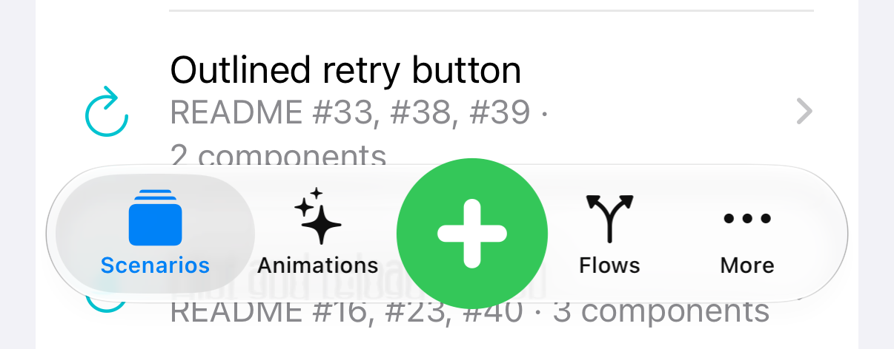

# 任务记录 / Task log

<!-- bound-classes: none -->

<!-- docs-navigation:start -->

| 中文 | English |
| --- | --- |
| [用途](#用途--purpose) | [Purpose](#用途--purpose) |
| [任务](#任务--tasks) | [Tasks](#任务--tasks) |

<!-- docs-navigation:end -->

<!-- docs-binding:start -->

| 类 / Class | 头文件 / Header |
| --- | --- |
| 无 / none | — |

<!-- docs-binding:end -->

## 用途 / Purpose

| 中文 | English |
| --- | --- |
| 开始任何任务前，先在 `docs/` 中找到最合适的文档，把任务记为 TODO，写下任务的详细上下文、用户的要求和用户的原始提示词，然后才开始工作；任务结束后把该 TODO 标为已完成。这样任务中断后，下一次会话能从文档中找回上下文。没有更合适的文档时（例如流程、说明文件类任务），记在本文件。规则见 `instructions.md` 的 “Record every task in docs before starting it”。 | Before any task, find the most fitting document in `docs/`, record the task there as a TODO with its detailed context, the user's requirements and the user's original prompt, and only then start; when the task ends, mark that TODO done. If a task is interrupted, the next session finds its context in the document. Tasks with no better document (process or instruction changes, for example) are recorded here. The rule is "Record every task in docs before starting it" in `instructions.md`. |

## 任务 / Tasks

### 已完成：修复 PR #29 的 CI 错误 / Done: Fix the CI failures of pull request #29

| 中文 | English |
| --- | --- |
| 状态：已完成（2026-11-14，分支 `fix/privacy-manifest-bundle`，PR #29）。①Unit tests：`f138707` 把固定等待改为等到加载（和回到空闲）发生，最多 5 秒；②Example-Scenarios：在 CYLTabBarController（分支 `feat/cross-platform-components`）修复 `CYLTabBarManifest.swift` 的可选类型混用，提交 `2ec9fa9`（本地 Xcode 27 构建通过；Xcode 27 的 Swift 6.4 本来就接受旧写法，Xcode 26 不接受）。验证：CI 运行 43524022935 全部通过。 | Status: done (2026-11-14, branch `fix/privacy-manifest-bundle`, pull request #29). (1) Unit tests: `f138707` replaces the fixed wait with a wait until the load (and the idle state) happens, up to 5 s. (2) Example-Scenarios: the mixed optional types in `CYLTabBarManifest.swift` are fixed in CYLTabBarController (branch `feat/cross-platform-components`), commit `2ec9fa9` (it builds locally with Xcode 27, whose Swift 6.4 accepted the old code anyway; Xcode 26 does not). Check: CI run 43524022935 passes every job. |
| 用户原始提示词：“修复CI错误后 continue https://github.com/ChenYilong/CYLTableViewPlaceHolder/actions/runs/43461720520/job/132010141898?pr=29” | The user's original prompt (verbatim on the left): fix the CI errors, then continue (link to run 43461720520, job 132010141898, pull request #29). |
| 要求：①修好 PR #29 的失败任务；②之后继续进行中的任务（Android 移植：`android/merged` 合并示例）。 | Requirements: (1) fix the failing jobs of pull request #29; (2) then continue the task in progress (the Android port: the merged example in `android/merged`). |
| 上下文：最新一次运行 43511586940 有两项失败。①Unit tests：`CYLRefreshDrawnHeaderTests testDrawnFootersLoadAndShowNoMoreData` 在 `beginRefreshing` 后固定等待 0.6 秒就断言已加载，每次失败的样式不同（Material / Phoenix / Taurus），是 CI 机器慢造成的时序不稳定；②Demo Examples/Example-Scenarios：CYLTabBarController 最新提交自身的 `CYLTabBarManifest.swift:812` 编译错误（`[String : Any]?` 不能转换为 `CYLTabBarManifest?`），在依赖库中。 | Context: the latest run, 43511586940, fails two jobs. (1) Unit tests: `CYLRefreshDrawnHeaderTests testDrawnFootersLoadAndShowNoMoreData` asserts the load 0.6 s after `beginRefreshing`, a fixed wait; a different style fails each run (Material / Phoenix / Taurus), timing flakiness on a slow CI machine. (2) Demo Examples/Example-Scenarios: a build error inside the dependency CYLTabBarController's latest commit, `CYLTabBarManifest.swift:812` (`[String : Any]?` cannot convert to `CYLTabBarManifest?`). |

### TODO：继续未结束的任务，并完成文档中的所有 TODO / TODO: Continue the unfinished tasks and finish every TODO in the documents

| 中文 | English |
| --- | --- |
| 状态：TODO（2026-11-14，分支 `feat/android-refresh-port`，PR #28）。 | Status: TODO (2026-11-14, branch `feat/android-refresh-port`, pull request #28). |
| 用户原始提示词：“根据Memory 以及本地Memory文档，尝试继续完成对于 CYLTableViewPlaceHolder 文件夹 我们未结束的任务，然后遍历所有文档，找到关键词TODO 完成所有TODO工作。重点查看CYLTableViewPlaceHolder 文件夹相关文档的TODO continue” | The user's original prompt (verbatim on the left): from the memory and the local memory documents, continue the unfinished tasks of the CYLTableViewPlaceHolder folder, then go through every document, find the keyword TODO and finish all TODO work, with the focus on the TODOs of the documents of the CYLTableViewPlaceHolder folder; continue. |
| 要求：①先继续未结束的任务；②再遍历文档中的 TODO 并逐个完成；③重点是 CYLTableViewPlaceHolder 的文档；④按指令顺序执行（最早的指令先做）。 | Requirements: (1) continue the unfinished tasks first; (2) then go through the TODOs in the documents and finish them one by one; (3) the focus is CYLTableViewPlaceHolder's documents; (4) in instruction order (the oldest instruction first). |
| 上下文（2026-11-14 盘点的 TODO 标题）：`docs/Android-Port.md`：Android 移植总任务（第 5 步 API 对齐评分 36 / 100，进行中；第 6 步移植 iOS 示例；5 个需要真机的 SmartRefreshLayout issue，评分 98 / 100）、HarmonyOS NEXT；`docs/Task-Log.md`：动效示例的播放控制；`docs/Swift-Migration.md`：核心层转写为 Swift；`docs/Refresh-Library-Parity.md`：三个刷新库对照与 Swift 示例；`docs/issue-progress.md`、`docs/flatdesign-item-comparison.md`、`docs/commit-readiness-2026-11-09.md` 的 TODO 小节。先做进行中的 Android 第 5 步。 | Context (TODO headings found on 2026-11-14): `docs/Android-Port.md`: the Android port (step 5, the API alignment score, 36 / 100, in progress; step 6, porting the iOS examples; 5 SmartRefreshLayout issues that need a device, score 98 / 100) and HarmonyOS NEXT; `docs/Task-Log.md`: playback controls in animation examples; `docs/Swift-Migration.md`: the core in Swift; `docs/Refresh-Library-Parity.md`: the three refresh libraries compared, with Swift examples; the TODO sections of `docs/issue-progress.md`, `docs/flatdesign-item-comparison.md` and `docs/commit-readiness-2026-11-09.md`. The Android step 5 in progress comes first. |

### 已完成：开始任务前先在 docs 中记录任务 / Done: Record every task in docs before starting it

| 中文 | English |
| --- | --- |
| 状态：已完成（2026-11-12，分支 `claude/docs-todo-completion-xoef38`）。本条 TODO 先于规则提交（`10bfc35`）。 | Status: done (2026-11-12, branch `claude/docs-todo-completion-xoef38`). This TODO was committed before the rule (`10bfc35`). |
| 用户原始提示词：“写入instructions相关文件，skills相关文件，开始任何任务前总是找到docs里的合适文档，现将任务标记为TODO ，给出任务详细上下文以及我的要求，我的提示词，再开始任务，目的是防止任务中断后，丢失上下文，无法找到上下文。任务结束后再标记TODO为已完成。” | The user's original prompt (Chinese, verbatim on the left): write into the instruction files and the skills that before any task you always find the fitting document in docs, first mark the task as a TODO with its detailed context, the user's requirements and the user's prompt, and only then start; the purpose is that an interrupted task does not lose its context; when the task ends, mark the TODO done. |
| 要求：①写入 `instructions.md`、`AGENTS.md` 与 skills（全英文，与本仓库其他规则一致）；②内容：开始前找合适的 docs 文档、记为 TODO、写上下文 / 要求 / 原始提示词、再开始；结束后标为已完成；③本任务自己先按此规则记录。 | Requirements: (1) write it into `instructions.md`, `AGENTS.md` and the skills (in English, like the repository's other rules); (2) content: before starting, find the fitting docs document, record a TODO with the context, requirements and original prompt, then start; mark it done at the end; (3) record this task itself by the rule first. |
| 上下文：本分支同一会话中已写入的规则有 “Reuse CYLPlaceholderView in the core”（含图片设置排查）与 “A pull request for every new branch”；自动同步已用 `.git/NO_AUTO_SYNC` 暂停（`abe9917`）。`docs/` 中没有适合流程类任务的文档，因此新建本文件（双语格式，导航由 `scripts/update-docs-navigation.py` 生成）。 | Context: rules already written on this branch in the same session are "Reuse CYLPlaceholderView in the core" (with the image-setting audit) and "A pull request for every new branch"; the auto sync is paused with `.git/NO_AUTO_SYNC` (`abe9917`). No document in `docs/` fits process tasks, so this file is new (bilingual format, navigation generated by `scripts/update-docs-navigation.py`). |
| 结果：规则写入 `instructions.md` 新的一节 “Record every task in docs before starting it”（五步：找文档、记 TODO（日期、分支、原始提示词、要求、上下文）、先提交推送、做任务并记进度、结束后标为已完成并保留）、`AGENTS.md` 的 “Record every task in docs first”、skills `cyl-docs`（每个任务从 docs 开始）与 `cyl-verify`（验证前须有 TODO，验证后写入结果并标为完成）。验证：文档导航检查通过；本任务本身按规则执行（先记录、后修改、最后标为完成）。 | Result: the rule is in a new `instructions.md` section, "Record every task in docs before starting it" (five steps: find the document; record the TODO with the date, branch, original prompt, requirements and context; commit and push it first; do the task with progress notes; mark it done at the end and keep it), in `AGENTS.md` ("Record every task in docs first"), and in the skills `cyl-docs` (every task starts in docs) and `cyl-verify` (a TODO must exist before verifying; results go into it and it is marked done). Verification: the docs navigation check passes; this task itself followed the rule (recorded first, changed next, marked done last). |

### 已完成：截图规则写入说明文件与 skills / Done: Write the screenshot rules into the instructions and skills

| 中文 | English |
| --- | --- |
| 状态：已完成（2026-11-12，分支 `feat/smartrefresh-parity`；TODO 先提交于 `b3225d5`）。 | Status: done (2026-11-12, branch `feat/smartrefresh-parity`; TODO committed first in `b3225d5`). |
| 用户原始提示词：“追加截图细节，全英文：关键节点指的是比如可以删除todo关键词，或者Linux关键词，或者可以merge pr。或者你评估已经符合预期效果无bug 无issue。readme中展示的截取关键细节，如无必要不要全屏截取。最好是采用凭借格式展示多个关键细节。拼接截图，优先采用横向排布，方便手机端查看。其次是双列 多行拼接。最差是横向拼接。横向拼接一行最多三列。找到instructions相关文件，以及skills相关文件，找到构建build ci cd章节。如果没有就新建，确保写入成功，全英文写入如下内容：所有截图，包括CI CD截图以及本地构建截图，全部保存在docs文件夹相关文档中，如果无相关文档就新建文档，保存图片到git仓库。并在合适的时机，你认为效果符合预期就更新最新图片到readme，找到相关章节如果没有就新建，并标注运行平台iOS android flutter reactnative 鸿蒙 小程序。运行环境 操作系统版本，模拟器版本，对应平台版本sdk版本（iOS android flutter reactnative 鸿蒙 小程序）本仓库版本号或commit地址。当前时间。截图使用清晰原图。” | The user's original prompt (Chinese, verbatim on the left): more screenshot details, in English: key moments are when a TODO or "Linux" note can be removed, when a pull request can be merged, or when the result is judged to meet expectations with no bug or issue. README screenshots show cropped key details, not the full screen unless necessary, ideally several details stitched together. Stitching: the first preference is the layout easiest to read on a phone, then two columns over several rows, and a single horizontal row is the worst, at most three per row. In the build / CI/CD sections of the instructions and skills (create them if missing), write in English: every screenshot, CI/CD and local, is stored in the fitting docs document (new one if none) and committed; when the result meets expectations, update the README's matching section (new if none) with the latest images, labeled with the platform (iOS, Android, Flutter, React Native, HarmonyOS, mini program), the environment (OS version, simulator version, platform SDK version), this repository's version or commit link, and the time; use clear original images. |
| 要求：①英文写入 `instructions.md` 的 CI/CD 相关章节、`AGENTS.md` 与 skills（`cyl-verify`、`cyl-docs`）；②内容：截图时机、只截关键细节、拼接方式优先级、所有截图存 `docs/` 并提交、合适时更新 README 并标注平台 / 环境 / 版本 / 时间、清晰原图。拼接优先级按 memory “Screenshot layout: top to bottom” 理解为：从上到下纵向排列最优，其次双列多行，横向一行最差（每行最多三列）；提示词中“优先采用横向排布”与“最差是横向拼接”矛盾；用户已确认更正为优先竖向排布（2026-11-12：“更正为优先竖向排布”）。 | Requirements: (1) write in English into `instructions.md`'s CI/CD sections, `AGENTS.md` and the skills (`cyl-verify`, `cyl-docs`); (2) content: when to take screenshots, key details only, the stitching order, every screenshot stored in `docs/` and committed, the README updated when the result is right with the platform / environment / version / time, clear original images. The stitching order follows the memory "Screenshot layout: top to bottom": stacked top to bottom first, then two columns over several rows, a single horizontal row last (at most three per row); the prompt's "prefer horizontal" and "horizontal is the worst" conflicted; the user confirmed vertical first (2026-11-12: "更正为优先竖向排布", correct it to vertical first). |
| 上下文：`instructions.md` 已有 “CI/CD” 与 “CI example screenshots” 两章；`AGENTS.md` 已要求每次 CI 构建提供各示例截图；`cyl-docs` 已要求调试截图放 `docs/assets/`、最终截图放 README。截图工具：`scratchpad/strips.swift`（裁剪与拼接）。 | Context: `instructions.md` already has "CI/CD" and "CI example screenshots"; `AGENTS.md` already asks every CI build for a screenshot of each example; `cyl-docs` already puts debugging screenshots in `docs/assets/` and final ones in the README. Tool used: `scratchpad/strips.swift` (crop and stitch). |
| 结果：`instructions.md` 新增 “Screenshots of local builds and CI/CD” 一节（位于 “CI example screenshots” 之前，CI/CD 部分）：截图时机、只截关键细节、拼接优先级（从上到下 → 双列多行 → 单行最多三列）、全部存入 `docs/` 并提交、效果符合预期时更新 README 并标注平台 / 系统与模拟器 / SDK 版本 / commit 链接 / 时间、清晰原图；`AGENTS.md`、`cyl-verify`、`cyl-docs` 各加一条摘要。 | Result: `instructions.md` has a new section, "Screenshots of local builds and CI/CD" (before "CI example screenshots", in the CI/CD part): when to take screenshots, key details only, the stitching order (top to bottom → two columns → one row of at most three), everything stored in `docs/` and committed, the README updated when the result is right with the platform / OS and simulator / SDK versions / commit link / time, clear original images; `AGENTS.md`, `cyl-verify` and `cyl-docs` each got a summary. |

### 已完成：凸起的加号按钮规则、刷新头 / 刷新尾分开自动隐藏、外部项目的 PR 与 issue 规则 / Done: Bulged plus button rule, separate header / footer auto-hide, external projects' PRs and issues rule

| 中文 | English |
| --- | --- |
| 状态：进行中（2026-11-12，分支 `feat/smartrefresh-parity`）。 | Status: in progress (2026-11-12, branch `feat/smartrefresh-parity`). |
| 用户原始提示词（一）：“找到instructions相关文档以及skills相关文档。找到CYLTabBarController 相关example层集成章节，如果没有就新建，全英文追加一条规则集成PlusButton进行example演示时，总是优先使用plus button凸起效果。凸起的含义是plus button顶点超出tabbar范围。” | Original prompt 1 (Chinese, verbatim on the left): in the instructions and skills, in the section on integrating CYLTabBarController in the example layer (create it if missing), add an English rule: when an example shows a PlusButton, always prefer the bulged plus button, meaning its top goes above the tab bar. |
| 用户原始提示词（二）：“continue in order.把autoHideRefresh底层再加两个开关：autoHideRefreshHeader，autoHideRefreshHeader和因为footer也需要隐藏。分开设置或者同时设置。灵活。同时提供默认实现，全都自动隐藏” | Original prompt 2: continue in order. Under `autoHideRefresh`, add two switches, one for the header and one for the footer (the footer also needs hiding), settable separately or together; provide a default where everything hides automatically. |
| 用户原始提示词（三）：截图规则（与上一条已完成的 “截图规则写入说明文件与 skills” 相同，已在 `ac263d4` 写入 `instructions.md` 的 “Screenshots of local builds and CI/CD”、`AGENTS.md`、`cyl-verify`、`cyl-docs`，本次核对后不重复写入）。 | Original prompt 3: the screenshot rules, the same as the completed entry above; already written in `ac263d4` ("Screenshots of local builds and CI/CD" in `instructions.md`, `AGENTS.md`, `cyl-verify`, `cyl-docs`); checked, not written twice. |
| 用户原始提示词（四）：“写入一条规则到。instructions相关文件和skills文件中，全英文写入以下规则：如果本项目文档中出现了 非本项目的 GitHub 链接，切该链接是用来 做代码翻译等任务的，那么在翻译过程前，或者翻译过程后，需要 访问该GitHub 的 pr 链接，将处于open状态的pr合并进来。并且为该项目的issues页面，中处于open状态的issues在docs文件夹下相关文档，如果没有就新建文档中制作表格，第一列为issue地址 第二列为issue描述，第三列为修复状态，默认填TODO。你需要找到这些issue在我们项目代码中的对应项，尝试修复。issues修复完为满分，每修复一个issue打一次分，一直到满分为止。 举例说明：比如：本项目的android文件夹内，存在多个其他项目翻译为kotlin的任务，这些任务均默认翻译master分支代码，忽略了pr与issues内容，如果翻译任务还未开启那么就先 merge 该项目处于open状态的pr，再尝试解决open issues，只要issues处理状态达到60分，就可以开始翻译工作，翻译完成后，再开始尝试解决剩余的issues到满分。如果翻译工作已经完成，那么就单独对open pr内容进行翻译后，再merge到我们的项目中。基于翻译过的代码还是要处理issues。一直到满分。其他平台同样规则执行。” | Original prompt 4: an English rule for the instructions and skills: when the docs link to another project's GitHub repository for translation or a similar task, before or after translating, bring in that project's open pull requests, and list its open issues in a docs table (issue URL, description, status defaulting to TODO); find each issue's counterpart in our code and fix it; all fixed is full marks; score after every fix until full marks. Example: for the Kotlin translations in `android/`: if translation has not started, merge the open pull requests first, then work on open issues, and start translating once issues reach 60; after translating, fix the rest to full marks. If translation is already done, translate the open pull requests on their own, merge them in, and still handle the issues to full marks. Other platforms follow the same rule. |
| 要求：①英文规则写入 `instructions.md` 的 “Integrating CYLTabBarController in the examples”、`AGENTS.md`、`cyl-api-map` / `cyl-verify`：加号按钮优先凸起（顶点高于 tab bar）；②`autoHideRefresh` 分为刷新头、刷新尾两个开关，可分开或同时设置，默认全部自动隐藏（沿用此前规则：在导航栏 / tab bar 默认透明的 iOS 26 及以后默认开启）；③截图规则已存在，核对即可；④英文规则写入 `instructions.md`、`AGENTS.md` 与 skills：外部仓库的 open PR 合并、open issue 表格（地址 / 描述 / 状态）与评分、60 分开始翻译；并把这条规则应用到 `docs/Refresh-Library-Parity.md` 中的各个外部库（SmartRefreshControl、flutter_easy_refresh 等）与 `docs/Android-Port.md`。 | Requirements: (1) the English plus-button rule in `instructions.md` "Integrating CYLTabBarController in the examples", `AGENTS.md`, `cyl-api-map` / `cyl-verify`: prefer a bulged plus button (its top above the tab bar); (2) split `autoHideRefresh` into header and footer switches, settable separately or together, with everything hiding by default (keeping the earlier rule: on by default on iOS 26 and later, where the bars are transparent by default); (3) the screenshot rule exists, check only; (4) the English rule in `instructions.md`, `AGENTS.md` and the skills: merge external repositories' open PRs, an open-issue table (URL / description / status) with a score, translation from 60; then apply it to each external library in `docs/Refresh-Library-Parity.md` (SmartRefreshControl, flutter_easy_refresh and the rest) and to `docs/Android-Port.md`. |
| 进度（一）凸起的加号按钮 ✅：规则写入 `instructions.md` 的 “Integrating CYLTabBarController in the examples”、`AGENTS.md`、`cyl-api-map`、`cyl-verify`。Example-Scenarios 的加号按钮改为 84 点高（高于 tab bar），Liquid Glass 会把更高的加号按钮上移到底边与 tab bar 对齐，顶点因此超出 tab bar；经典 tab bar 上由 `constantOfPlusButtonCenterYOffset` -24 上移。原先 56 点、偏移 -6 时按钮完全在玻璃 tab bar 之内（只调大偏移在 Liquid Glass 上无效）。截图：iOS，macOS 27.3、Xcode 27.2、iPhone 17 Pro 模拟器 iOS 27.2，基于 `748ae57` 的工作区，2026-11-12 17:40（NZDT）。截图拼接顺序：用户确认为优先竖向排布，已在 `instructions.md`、`AGENTS.md`、`cyl-verify`、`cyl-docs` 中注明。 | Progress (1) bulged plus button ✅: the rule is in `instructions.md` "Integrating CYLTabBarController in the examples", `AGENTS.md`, `cyl-api-map` and `cyl-verify`. Example-Scenarios' plus button is now 84 points tall (taller than the tab bar); Liquid Glass raises a taller plus button until its bottom meets the bar's, so its top stands above the bar; on the classic tab bar `constantOfPlusButtonCenterYOffset` -24 raises it. Before, at 56 points with a -6 offset, the button sat inside the glass bar (a larger offset alone has no effect on Liquid Glass). Screenshot: iOS, macOS 27.3, Xcode 27.2, iPhone 17 Pro simulator iOS 27.2, working tree on `748ae57`, 2026-11-12 17:40 (NZDT). Stitching order: the user confirmed vertical first; noted in `instructions.md`, `AGENTS.md`, `cyl-verify` and `cyl-docs`. |

| 进度（四）外部项目规则 ✅：写入 `instructions.md` 新的一节 “Translating or porting another project: its open pull requests and issues”、`AGENTS.md`、`cyl-docs`、`cyl-verify`；已应用到 `docs/Refresh-Library-Parity.md`（SmartRefreshControl 100/100；flutter_easy_refresh 50/100，4 个 issue 的表格；其余 3 个库在各自任务开始时建表）。（三）截图规则：已存在，未重复写入。（二）刷新头 / 刷新尾分开自动隐藏：下一步。 | Progress (4) external-project rule ✅: in a new `instructions.md` section, "Translating or porting another project: its open pull requests and issues", `AGENTS.md`, `cyl-docs` and `cyl-verify`; applied in `docs/Refresh-Library-Parity.md` (SmartRefreshControl 100/100; flutter_easy_refresh 50/100 with a table of its 4 issues; the other 3 libraries get theirs when their tasks start). (3) screenshot rule: already there, not written twice. (2) separate header / footer auto-hide: next. |
| 进度（二）分开自动隐藏 ✅：`autoHideRefresh` 移到 `CYLRefreshComponent`，刷新头、刷新尾各有开关，默认在 iOS 26 及以后全部开启；刷新尾在空闲（或无更多数据）且完全位于底部栏下方时隐藏；新增 `isReadyToAutoHide` / `updateAutoHideVisibility` 子类钩子，滚动视图新增 `cyl_autoHideRefresh`、`cyl_autoHideRefreshHeader`、`cyl_autoHideRefreshFooter`（挂上前设置也生效）；README 已更新；新增测试 `testHeaderAndFooterAutoHideCanBeSetSeparatelyOrTogether`，157 个测试在 iOS 27.2 通过。本条全部完成（2026-11-12）。 | Progress (2) separate auto-hide ✅: `autoHideRefresh` moved to `CYLRefreshComponent`, so headers and footers each have a switch, all on by default on iOS 26 and later; a footer hides when idle (or showing no more data) and wholly below the bottom bars; new subclass hooks `isReadyToAutoHide` / `updateAutoHideVisibility`, and on the scroll view `cyl_autoHideRefresh`, `cyl_autoHideRefreshHeader`, `cyl_autoHideRefreshFooter` (also before attaching); README updated; new test `testHeaderAndFooterAutoHideCanBeSetSeparatelyOrTogether`; 157 tests pass on iOS 27.2. This entry is complete (2026-11-12). |

### 已完成：把所有 open PR 改为指向当前分支并合并 / Done: Retarget every open pull request to the current branch and merge it

| 中文 | English |
| --- | --- |
| 状态：进行中（2026-11-12，分支 `feat/smartrefresh-parity`）。用户原始提示词：“将所有处于open状态的pr的target branch改为当前分支，合并后，continue” | Status: in progress (2026-11-12, branch `feat/smartrefresh-parity`). The user's original prompt (verbatim on the left): retarget every open pull request to the current branch, merge it, then continue. |
| 上下文：open PR 只有 #26（`docs/auto-pr-for-new-branches` → `master`，另一个会话打开）与 #25（本分支自身 → `master`，不能指向自己）。合并后按任务顺序继续：修 WaveSwipe / Material / StoreHouse，再补 flutter_easy_refresh。 | Context: the open pull requests are #26 (`docs/auto-pr-for-new-branches` → `master`, opened by another session) and #25 (this branch → `master`, which cannot target itself). After merging, continue in order: fix WaveSwipe / Material / StoreHouse, then the flutter_easy_refresh gaps. |
| 结果：#26 改为指向本分支后合并（合并提交保留本分支已有的同样三条规则，`b9420c8` 删除 `cyl-verify` 中的重复内容），PR 显示为已合并；#25 是本分支自身，仍指向 `master`。之后按顺序修复了 StoreHouse、Material、WaveSwipe 三个样式（见 `docs/Refresh-Library-Parity.md`）。 | Result: #26 was retargeted to this branch and merged (the merge kept this branch's copies of the same three rules, and `b9420c8` removed the duplicates in `cyl-verify`); it shows as merged; #25 is this branch itself and still targets `master`. Then, in order, StoreHouse, Material and WaveSwipe were fixed (see `docs/Refresh-Library-Parity.md`). |

### TODO：动效示例的播放控制（从 0 重播、倍速滑块、循环开关） / TODO: Playback controls in animation examples (replay from 0, speed slider, loop switch)

| 中文 | English |
| --- | --- |
| 状态：TODO（2026-11-13，分支 `feat/android-refresh-port`）。规则先写入说明文件与 skills；各端示例的实现按任务顺序排在进行中的 Android 移植（`docs/Android-Port.md`）之后。 | Status: TODO (2026-11-13, branch `feat/android-refresh-port`). The rule is written into the instructions and skills first; the examples on every platform are implemented after the Android port in progress (`docs/Android-Port.md`), by task order. |
| 用户原始提示词：“在docs 中找到example演示规则，找到相关文档及相关章节，如果没有就新建，确保写入成功：全英文写入：instructions相关相关文档中中记录 相关skills中记录引用该文档去，在展示动效相关example展示中，除了一次性play all ，触发重新开始从0进度开始播放， 额外增加倍速滑块，以及循环播放switch。这几个组件可以组合控制动效播放策略。请在example相关页面实现，如有必要可以修改core核心代码，以支持该演示策略。通过调整这些组件可以实时控制动效的播放策略。标记为TODO事项：举例说明，截图中的页面就可以应用该策略。此要求适用于所有层面的example包括iOS端 android端，跨端 rn flutter 小程序 鸿蒙 continue continue” | The user's original prompt (verbatim on the left): find the example demo rules in docs (create the section if none), write in English into the instructions and the related skills (pointing to that document): every example that shows animations has, besides a one-shot "Play all" that restarts from progress 0, a speed slider and a loop switch; together they set the playback strategy, live; implement it in the example pages, changing the core if needed; mark as TODO, for example the page in the screenshot (an "Animated icons" page: "Animation engine: CYLTabBarItemAnimationFactory is linked", "1x", "Play all", Lottie chips) can use it; this applies to the examples of every layer: iOS, Android, React Native, Flutter, mini programs, HarmonyOS. |
| 进度（2026-11-13）：规则已写入 `docs/Example-Animation-Playback.md`（新建，按用户要求全英文）、`instructions.md` 的 “Animation playback controls in examples”、`AGENTS.md`、`Examples/instructions.md`、skills `cyl-verify` 与 `cyl-docs`（只追加，已核对写入）。各端示例实现仍为 TODO（见该文档的 Pages 表）。 | Progress (2026-11-13): the rule is in `docs/Example-Animation-Playback.md` (new, English only as asked), `instructions.md` "Animation playback controls in examples", `AGENTS.md`, `Examples/instructions.md` and the skills `cyl-verify` and `cyl-docs` (appended only, writes checked). The examples on every platform are still TODO (the Pages table in that document). |
| 要求：①“Play all” 每次都从进度 0 重新播放；②倍速滑块（实时生效）；③循环开关（实时生效）；④三者可组合；⑤需要时修改 core 以支持；⑥所有端的示例；⑦规则写入 `instructions.md`、`AGENTS.md` 与相关 skills，文档为 `docs/Example-Animation-Playback.md`。 | Requirements: (1) "Play all" always restarts from progress 0; (2) a speed slider, live; (3) a loop switch, live; (4) they combine; (5) the core changes where needed; (6) every platform's examples; (7) the rule goes into `instructions.md`, `AGENTS.md` and the related skills, documented in `docs/Example-Animation-Playback.md`. |

### 已完成：合并所有 open PR 到本分支并关闭，只保留一个 PR / Done: Merge every open pull request into this branch, close them, keep one pull request

| 中文 | English |
| --- | --- |
| 状态：已完成（2026-11-13，分支 `feat/android-refresh-port`）。合并提交 `3b6b2fd`（`origin/feat/smartrefresh-parity` 的 5 个提交，无冲突）；#25、#27 留言后关闭；#28 目标改为 `master`，标题与说明已更新；现在只有 #28 一个 open PR。`.github/NO_AUTO_SYNC` 未提交。旧分支未删除（删除远端分支需要用户确认）。 | Status: done (2026-11-13, branch `feat/android-refresh-port`). Merge commit `3b6b2fd` (the 5 commits of `origin/feat/smartrefresh-parity`, no conflicts); #25 and #27 got a comment and were closed; #28 now targets `master`, with an updated title and description; #28 is the only open pull request. `.github/NO_AUTO_SYNC` stays uncommitted. The old branches were not deleted (deleting remote branches needs the owner's confirmation). |
| 用户原始提示词：“合并所有处于open 状态的pr到本分支，或者本地所有未提交的代码到本分支 continue / 合并所有处于open 状态的pr到本分支，合并后close pr，或者本地所有未提交的代码到本分支 。仅保留一个pr，一个活跃分支为本分支 continue” | The user's original prompt (verbatim on the left): merge every open pull request (or all local uncommitted code) into this branch, close those pull requests after merging, and keep only one pull request and one active branch: this one. |
| 上下文：open PR 为 #25（`feat/smartrefresh-parity` → `master`）、#27（`feat/android-placeholder` → `feat/smartrefresh-parity`）、#28（本分支 → `feat/android-placeholder`）。`feat/android-placeholder` 已全部在本分支；`feat/smartrefresh-parity` 有 5 个提交不在本分支。本地未提交的只有 `.github/NO_AUTO_SYNC`（自动同步暂停标记，不提交）。计划：合并 `origin/feat/smartrefresh-parity`，关闭 #25、#27，把 #28 的目标改为 `master`。 | Context: the open pull requests are #25 (`feat/smartrefresh-parity` → `master`), #27 (`feat/android-placeholder` → `feat/smartrefresh-parity`) and #28 (this branch → `feat/android-placeholder`). `feat/android-placeholder` is all in this branch; `feat/smartrefresh-parity` has 5 commits that are not. The only uncommitted local file is `.github/NO_AUTO_SYNC` (the auto-sync pause marker, not committed). Plan: merge `origin/feat/smartrefresh-parity`, close #25 and #27, retarget #28 to `master`. |

### 已完成：Swift 迁移中 example 编译错误优先改 example / Done: During the Swift migration, fix example build errors in the examples

| 中文 | English |
| --- | --- |
| 状态：已完成（2026-11-13，分支 `feat/android-refresh-port`）。规则（全英文）追加到 `instructions.md` 新小节 “Examples have the lowest weight”、`docs/Swift-Migration.md`（“Rule: examples have the lowest weight”）、`docs/Swift-Guide.md`、`AGENTS.md`、`Examples/instructions.md`、skills `cyl-verify` 与 `cyl-api-map`；只追加（numstat 删除行为 0），skills 的 frontmatter 未变。 | Status: done (2026-11-13, branch `feat/android-refresh-port`). The rule (in English) is appended to `instructions.md` (new subsection "Examples have the lowest weight"), `docs/Swift-Migration.md` ("Rule: examples have the lowest weight"), `docs/Swift-Guide.md`, `AGENTS.md`, `Examples/instructions.md` and the skills `cyl-verify` and `cyl-api-map`; appended only (0 deleted lines by numstat), the skills' frontmatter unchanged. |
| 用户原始提示词：“在文档中找到objc迁移swift相关文档，包含docs instructions skils 相关文档。全英文更新，追加规则：更新example 编译错误，规则为优先改example层代码，所有example权重为最低，无须example修改的考虑兼容性。任意修改example代码，全力保障core核心层代码没有包袱，负担。不要因为example层的用法而降低core swif代码质量。以swift编码规范为准。continue  continue” | The user's original prompt (verbatim on the left): find the Objective-C → Swift migration documents (docs, instructions, skills) and append, in English: when example builds break, change the example code first; every example has the lowest weight and needs no compatibility; change example code freely so the core carries no baggage; never lower the core's Swift quality for an example's usage; the Swift coding standard decides. |
| 要求：①找到相关文档：`docs/Swift-Migration.md`、`docs/Swift-Guide.md`、`instructions.md`（“Swift examples and a Swift-friendly core”）、`AGENTS.md`、`Examples/instructions.md`、相关 skills；②全英文追加规则（只追加，不覆盖）；③规则内容见上。 | Requirements: (1) find the documents: `docs/Swift-Migration.md`, `docs/Swift-Guide.md`, `instructions.md` ("Swift examples and a Swift-friendly core"), `AGENTS.md`, `Examples/instructions.md` and the related skills; (2) append the rule in English (append only, never overwrite); (3) the rule as above. |
| 上下文：`docs/Swift-Migration.md` 的原需求写着 “Change the example layer only when necessary”，新规则补充：迁移造成 example 编译错误时，改 example，而不是让 core 迁就 example。按任务顺序，Android 移植仍在进行，本任务只是写规则，先完成。 | Context: the original requirement in `docs/Swift-Migration.md` says "Change the example layer only when necessary"; the new rule adds that when the migration breaks an example's build, the example changes, never the core for the example. By task order the Android port is still in progress; this task only writes rules, so it is done first. |

### 已完成：隐私清单放入独立 bundle / Done: the privacy manifest in a bundle of its own

| 中文 | English |
| --- | --- |
| 状态：已完成（2026-11-13，分支 `fix/privacy-manifest-bundle`，基于 `feat/android-refresh-port`）。`CYLTableViewPlaceHolder.podspec` 的 Core 子库把 `CYLRefresh/PrivacyInfo.xcprivacy` 从 `resources` 移到 `resource_bundles`（`CYLTableViewPlaceHolderPrivacy`）。验证：CYLSearchViewController 的 React Native 示例（自带 `PrivacyInfo.xcprivacy`）固定到本分支后 iOS 构建成功，见 CYLSearchViewController `docs/android-and-cross-platform.md`。 | Status: done (2026-11-13, branch `fix/privacy-manifest-bundle`, from `feat/android-refresh-port`). The Core subspec of `CYLTableViewPlaceHolder.podspec` moves `CYLRefresh/PrivacyInfo.xcprivacy` from `resources` to `resource_bundles` (`CYLTableViewPlaceHolderPrivacy`). Verified: CYLSearchViewController's React Native example (which has its own `PrivacyInfo.xcprivacy`) builds for iOS once pinned to this branch; see CYLSearchViewController `docs/android-and-cross-platform.md`. |
| 背景：作为普通资源复制时，隐私清单落在 App 根目录，与 App 自己的 `PrivacyInfo.xcprivacy` 冲突，Xcode 报 “Multiple commands produce …/PrivacyInfo.xcprivacy”（React Native 0.88 模板自带隐私清单）。CYLSearchViewController 的原生示例没有自己的清单，所以之前没有出现。 | Context: copied as a plain resource, the manifest landed at the app's root and clashed with the app's own `PrivacyInfo.xcprivacy`: Xcode fails with "Multiple commands produce …/PrivacyInfo.xcprivacy" (the React Native 0.88 template has a privacy manifest). CYLSearchViewController's native example has none of its own, so it never showed. |
| 用户原始提示词：无（在 CYLSearchViewController 的 React Native 任务中发现，按子仓库规则在本仓库修复）。 | The user's original prompt: none (found during CYLSearchViewController's React Native task; fixed here per the sub-repository rule). |
