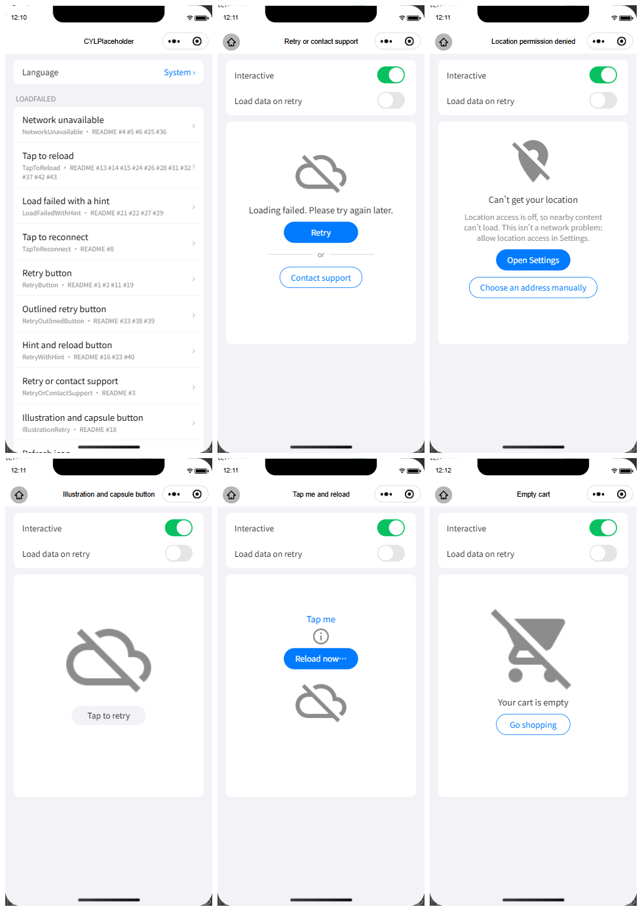
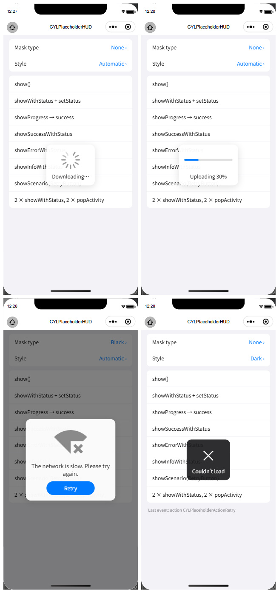
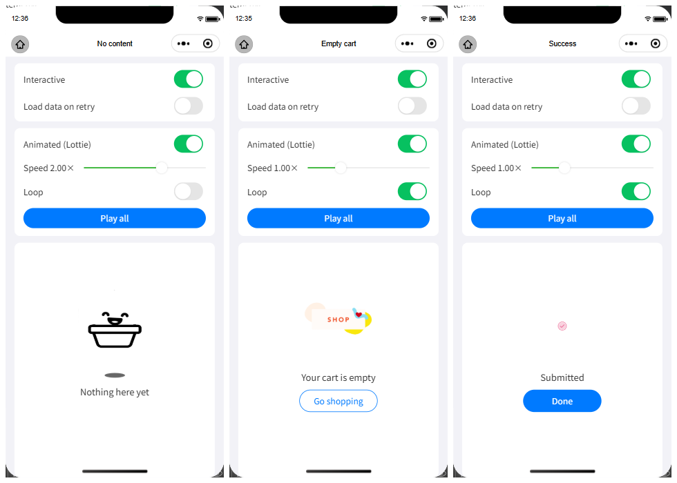
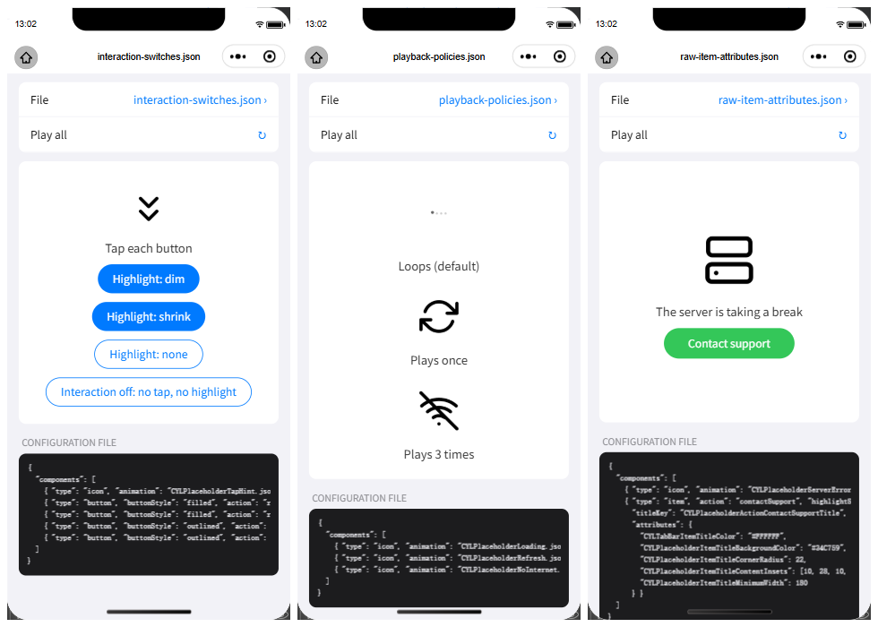
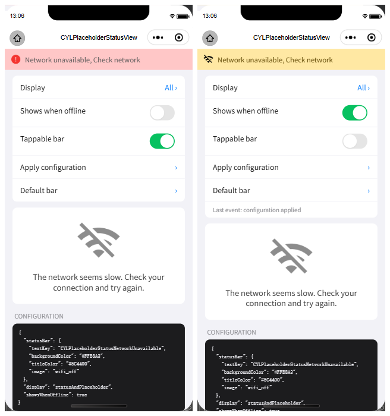
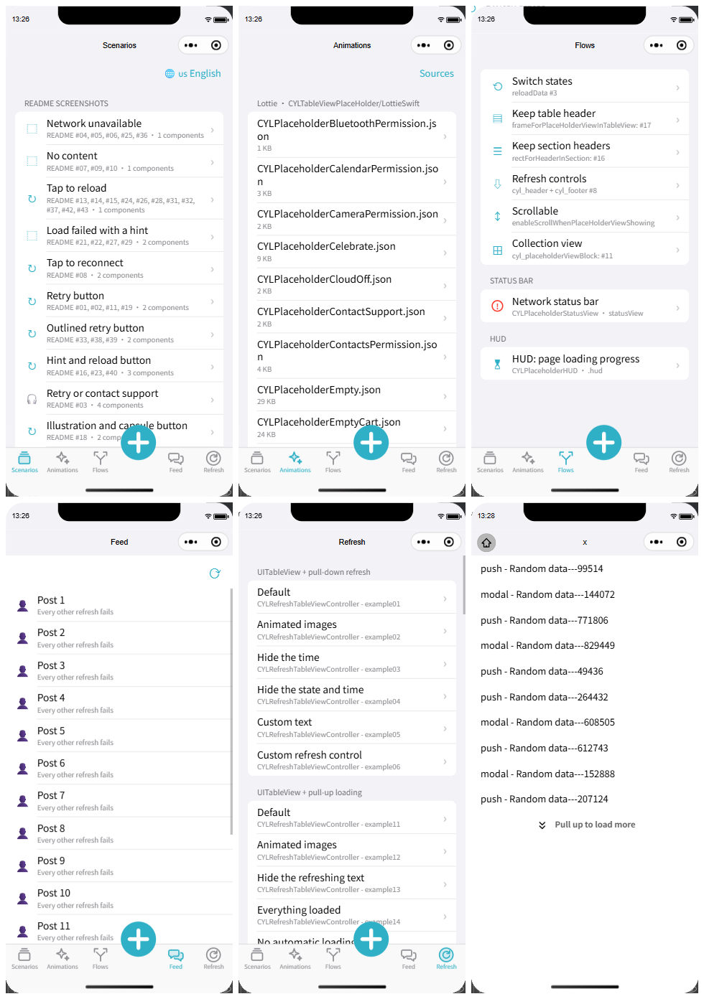
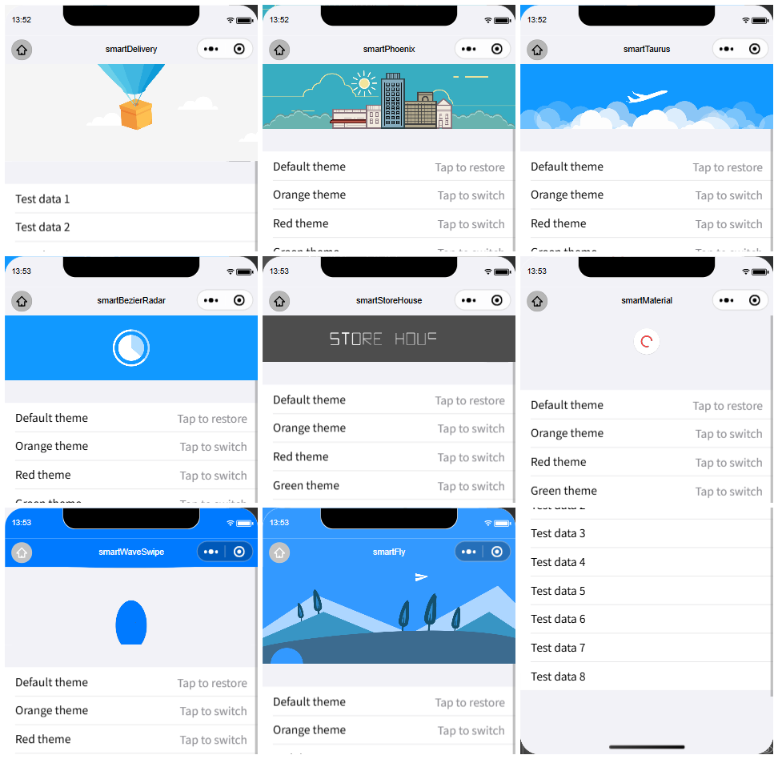
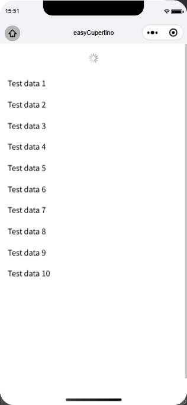
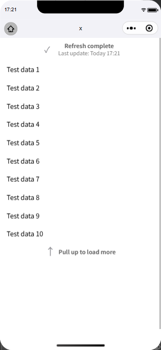

# 微信小程序版 / WeChat Mini Program port

<!-- bound-classes: none -->

<!-- docs-navigation:start -->

| 中文 | English |
| --- | --- |
| [任务](#任务--tasks) | [Tasks](#任务--tasks) |
| [结构](#结构--structure) | [Structure](#结构--structure) |
| [API 对照](#api-对照--api-alignment) | [API alignment](#api-对照--api-alignment) |
| [验证](#验证--verification) | [Verification](#验证--verification) |
| [CYLRefresh in one folder](#cylrefresh-in-one-folder) | [CYLRefresh in one folder](#cylrefresh-in-one-folder) |
| [README 中的微信小程序说明（2026-11-20 移入）](#readme-中的微信小程序说明2026-11-20-移入--wechat-mini-program-notes-from-the-readme-moved-2026-11-20) | [WeChat Mini Program notes from the README (moved 2026-11-20)](#readme-中的微信小程序说明2026-11-20-移入--wechat-mini-program-notes-from-the-readme-moved-2026-11-20) |

<!-- docs-navigation:end -->

<!-- docs-binding:start -->

| 类 / Class | 头文件 / Header |
| --- | --- |
| 无 / none | — |

<!-- docs-binding:end -->

## 任务 / Tasks

| 中文 | English |
| --- | --- |
| CYLAnimatedItem（动效组件）接入进度、评分与 TODO 见 [Animated-Item-Migration.md](Animated-Item-Migration.md)。 | CYLAnimatedItem (the animation component) migration status, score and TODOs: [Animated-Item-Migration.md](Animated-Item-Migration.md). |

### TODO: the components build on CYLTabBarController's cyl-animated-item (score 95)

- **Date / branch:** 2026-11-17, `feat/android-refresh-port-followup` (pull request #31).
- **The user's original prompt:** the same CYLAnimatedItem migration request as iOS and Android (CYLTabBarController
  `docs/Animated-Item.md`, "Downstream migration status"): this repository's icon + title + animation component and
  every other place that shows an icon or plays an animation build on the upstream component, keeping this repository's
  names, properties and events where possible; the core package depends on no animation library; the example installs
  the engines it uses through the abstract nodes.
- **Requirements:** upstream ships CYLAnimatedItem for the mini program as `src/cyl-animated-item` in
  `CrossPlatform/wechat-miniprogram-cyltabbar` (engines through the abstract nodes `cyl-lottie-view`, `cyl-pag-view`,
  `cyl-rive-view`, `cyl-svga-view`; GIF drawn with `<image>`; `ready` shows the animation, `error` goes back to the
  static image, else the placeholder, and logs once which package to install; display logic in
  `cyl_animated_item_model.js` with node tests). Display priority, as on iOS / Android: the animation if it plays, else
  the static image passed in, else the placeholder. Unpublished upstream, so it is taken by commit: copied (the guide
  allows an npm git dependency or a copy; `miniprogram_npm` copies only `src/`), at the commit the repository's
  `Cartfile` pins (`57a527ef`), without editing the copied files.
- **Done (2026-11-17):**
  1. `scripts/sync-cyl-animated-item.js` (`npm run sync-animated-item`) reads the `Cartfile` commit and copies, with
     `git show <commit>:<path>` from the CYLTabBarController checkout (`Carthage/Checkouts/CYLTabBarController`, or
     `CYL_TABBAR_DIR`): `src/cyl-animated-item/` (component, model, `cyl_animated_item_placeholder.png`),
     `src/cyl-animation-placeholder/` (the default of the abstract nodes, which `cyl-animated-item/index.json` names)
     and upstream's `test/cyl_animated_item.test.js`; it adds the upstream `src/LICENSE` as
     `LICENSE.CYLTabBarController` in both folders and `src/cyl-animated-item/UPSTREAM_COMMIT` (repository, commit,
     paths, license).
  2. `cyl-placeholder`: each icon is a `cyl-animated-item` (`image` = the static icon, `animation-url` = the animation
     when `animated`, `icon-size` = the side, `loop` / `speed` live). Static icons now stay while the engine loads and
     when it is missing or fails (before, `animated` without an engine drew an empty view). The title stays the
     component's own `<text>` (upstream's title is 14px, one line, with no color property), and the icon box keeps its
     `aria-role` (`button` / `img`) and `aria-label`; the item sits in an `aria-hidden` wrapper so it is not read
     twice. `playAll()` and `repeatCount` reach the engine inside the item (`selectComponent` →
     `.cyl-animated-item-animation`); because upstream does not forward `complete`, a repeat count above 1 listens on
     the engine's `cyl_animation()` object (`addEventListener('complete')`, lottie-web).
  3. `cyl-placeholder-hud`: the loading icon (`loadingAnimationFileName`, else the CYLRefreshActivity GIF as the static
     image) and the `showImage` icon (an animation file plays too) are `cyl-animated-item`; the inner
     `cyl-placeholder` now gets the HUD's engines. `cyl-placeholder-status`: the bar's icon is a `cyl-animated-item`.
     `cyl-refresh`: the header / footer state icons are `cyl-animated-item`; `CYLRefresh.iconForState` now accepts
     PAG, Rive and SVGA files (type `pag` / `rive` / `svga`, `animationUrl`) besides Lottie and images; other files
     still show the spinner.
  4. Engines: the abstract node `animation` stays the Lottie engine (no change for `generic:animation="cyl-lottie"`;
     it is forwarded as the item's `cyl-lottie-view`), and the components add `cyl-pag-view`, `cyl-rive-view`,
     `cyl-svga-view`. Every default is the copied `cyl-animation-placeholder`, which reports `error`; the package has no
     dependency. `src/cyl-placeholder/no-animation/` is removed. Paths for the item are made absolute against the
     calling component (`cylResolvePath` in `src/cyl-placeholder/cyl_animated_icon.js`), because the item draws files
     from its own folder; `imageBase` may stay relative.
  5. `scripts/sync-example.js` also copies `cyl-animated-item` and `cyl-animation-placeholder` into the example (git
     ignored) and falls back to the Cartfile checkout for the example's libraries. Tests: upstream's model tests
     (7) and `test/animated_icon.test.js` (the copy matches the Cartfile commit byte for byte when the checkout is
     present, the path / type helpers, the display priority, every component draws icons only through the item with
     its engines declared and the item hidden from screen readers, no animation library dependency).
- **Verification (2026-11-17, Linux container, Node):** `npm test` 53 / 53; `npm run sync-example` copies the six
  folders; `python3 scripts/check_package_licenses.py`, `python3 scripts/check_localizations.py` and
  `python3 scripts/update-docs-navigation.py --check` pass. Not verified: rendering. WeChat DevTools cannot run in
  this container, so nothing was drawn: the abstract node forwarding under a different name
  (`generic:cyl-lottie-view="animation"`), the layout (the item adds 4px padding and a 44px minimum height, offset by
  negative margins / fixed wrappers), the `aria-hidden` wrapper, `playAll()` / `repeatCount` through the nested
  engine, and the HUD / status / refresh icons are unchecked.
- **Remaining work (2026-11-18 update, score 80 -> 90):**
  1. Done: rendering in WeChat DevTools. The 2026-11-17 runs (see "Verification" below: CYLAnimatedItem TODO 3, MP1 to
     MP5) cover the scenarios, the configuration page's playback policies, "Play all", the HUD, the status bar and the
     refresh icon demos, with screenshots.
  2. Upstream requests. Done: `cyl_playFromStart()` and `accessibilityHidden` (6a9ede85); the events
     `animationready` / `animationcomplete` / `animationloopcomplete` / `animationerror` and the title properties
     `titleColor` / `titleFontSize` / `titleLines` (59a1cb0f), then centered wrapped titles, `titleSpacing` and
     `titleLineHeight` (52569d68, pinned 2026-11-18). `cyl-placeholder` now counts
     `repeatCount` from `bind:animationcomplete`; the `cyl_animation()` hook (40 tries, 250 ms apart, lottie-web's
     `complete`) is removed. WeChat DevTools, playback-policies.json: the "3 times" item plays three passes and stops,
     "once" stops, the looping item goes on, Play all restarts the count, console clean
     ([screenshot](assets/wechat-miniprogram-devtools2.02.2609250-baselib3.17.6-events-and-title-in-item-5a8a601-20261118-sheet.png)); test "repeat counts come from cyl-animated-item's
     animationcomplete event". The icon's title moved into the item (`title`, `axis` vertical, `title-color`
     #333333, `title-font-size` 16, `title-line-height` 22, `title-spacing` 12, `title-lines` 0); the separate
     `<text>` is gone. At 59a1cb0f a wrapped title was left-aligned with a 2px gap
     ([before the fix](assets/wechat-miniprogram-devtools2.02.2609250-baselib3.17.6-events-and-title-in-item-5a8a601-20261118-sheet.png)); reported, fixed upstream in 52569d68. WeChat
     DevTools at 52569d68: "Network unavailable" draws the wrapped title at the same pixels as the old `<text>` (dark
     rows 28 to 143, columns 49 to 274 in both), the playback-policies page looks the same, repeat counts still right,
     console clean ([left: old text, right: in the item](assets/wechat-miniprogram-devtools2.02.2609250-baselib3.17.6-events-and-title-in-item-5a8a601-20261118-sheet.png)); test "an
     icon's title is drawn by cyl-animated-item" (`npm test` 69 / 69). Requested from the owner of the mini program animation code (the "Mac-CYLTabBarController文件夹" session).
  3. Done (2026-11-18): tinted template icons use the item's `icon-tint` (#8c8c8c, the old 45 % black on white) instead
     of a 45 % opacity on the icon box: the static image and the static image of an animated icon are tinted, a playing
     animation keeps its colors. Test: "tinted template icons use the item tint" (`npm test` 65 / 65). WeChat DevTools:
     Network unavailable with the animation (black Lottie) and with the animation off (gray static icon), console clean
     ([screenshot](assets/wechat-miniprogram-devtools2.02.2609250-baselib3.17.6-icon-tint-5919ab7-20261118-sheet.png)).
  4. Open, upstream: move to the published npm package (or an npm git dependency) once CYLTabBarController publishes the
     component inside its package's `src/`; until then run `npm run sync-animated-item` whenever the `Cartfile` moves. Blocked (2026-11-19, the owner's decision relayed by the CYLTabBarController mini program session): `cyl-tabbar-miniprogram` is published later from master in a normal release, once its docs have an npm release section (CYLTabBarController `docs/WeChat-Mini-Program.md`, TODO); until then the commit-pinned copy (`npm run sync-animated-item`) stays.
- **Why not 100:** item 4 (upstream publishing, -5) waits for CYLTabBarController.

### DONE: the package entry works after DevTools' Build npm (score 100)

- **Date / branch:** 2026-11-15, `fix/miniprogram-package-entry` (from `feat/android-refresh-port-followup`; its pull
  request targets that branch).
- **The user's original prompt (verbatim):** "修复 cylplaceholder 的包名入口 continue"
- **Requirement:** `require('cyl-placeholder-miniprogram')` works in a mini program that installs the package from npm
  and runs DevTools' Build npm. Found while packaging CYLSearchViewController's mini program library, which follows
  this package (CYLSearchViewController `docs/miniprogram-api-alignment.md`).
- **Faults (reproduced in a new mini program: `npm pack`, `npm install` of the tarball, Build npm):**
  1. Build npm copies the `miniprogram` folder (`src/`) to `miniprogram_npm/cyl-placeholder-miniprogram/`, and
     `require('<package>')` loads that folder's `index.js`. `main` was `src/cyl-placeholder/cyl_placeholder.js`,
     so there was no `index.js`: "module 'pages/index/cyl-placeholder-miniprogram.js' is not defined".
  2. The entry spread its requires (`{ ...require('./cyl_scenario_catalog') }`). DevTools' "filter unused files" does
     not see a require inside an object spread and drops that file ("module … is not defined") once the entry loads.
- **Fix:** `src/index.js` (`main`) loads `src/cyl-placeholder/cyl_placeholder.js`, which now assigns its parts with
  plain `Object.assign(module.exports, require(…))` statements. The paths the README uses for a copy of `src/` keep
  working. `test/package.test.js`: the entry is the built folder's `index.js` and exports the API; every relative
  require names a file and none is spread; the components refer to each other by relative paths; the published files
  exist.
- **Verification:** `npm test` 37/37. In WeChat DevTools 2.02.2609250 (base library 3.6.6, Windows 11 Pro
  10.0.22631), the new mini program renders `cyl-placeholder` (RetryButton) from `miniprogram_npm`, and
  `require('cyl-placeholder-miniprogram')` gives 18 exports (`CYLPlaceholderAction.Retry` is
  `CYLPlaceholderActionRetry`); no console error. Before the fix the same page failed with fault 1.

### TODO: WeChat Mini Program placeholder package (score 95)

- **Date / branch:** 2026-11-15, `feat/android-refresh-port-followup` (based on `feat/android-refresh-port`; its pull
  request targets `feat/android-refresh-port`).
- **The user's original prompt (verbatim):** "基于新分支 开始下微信小程序开发。找到docs里面任何提及微信小程序的信息开始开发。找到crossplatorm 相关文件夹，没有就新建，新建或者更微信小程序开发。微信小程序开发者工具Skills ，根据文档"
- **Requirements:**
  1. Start WeChat Mini Program development on the new branch.
  2. Use every mention of mini programs in the docs as the spec.
  3. Find the cross-platform folder; there was none in this repository, so create `CrossPlatform/` (the same name
     and layout as CYLTabBarController's `CrossPlatform/wechat-miniprogram-cyltabbar`).
  4. Use the WeChat DevTools Skills (<https://developers.weixin.qq.com/miniprogram/dev/devtools/Skills.html>) to
     build, run and screenshot the example.
- **What the docs say about mini programs:**
  - `AGENTS.md` "SKILLS": install the WeChat DevTools Skills (done on this machine: `~/.claude/skills/wechatide-skill`,
    a junction to the DevTools' own `wechatide-skill` v0.3.11).
  - `instructions.md` rule 6: the porting rules apply to every platform, mini programs included.
  - `instructions.md` / `docs/Example-Animation-Playback.md`: every example page that shows animations gets "Play
    all" (restart from progress 0), a speed slider and a loop switch.
  - `instructions.md` screenshots: the README records the platform, the base library version, the commit and time.
  - `instructions.md` localization: one `locales/<locale>.json` per package (the Web / React Native rule; used here).
- **Plan:**
  1. `CrossPlatform/wechat-miniprogram-cylplaceholder/src/cyl-placeholder`: a custom component that renders one of
     the 35 scenarios of `CYLPlaceholderScenarioCatalog` (translated from `android/placeholder`'s
     `CYLPlaceholderScenario.kt`): icon / title / hint / button / separator components, background tap action,
     `action` event with the `CYLPlaceholderAction*` names, `interactive` switch.
  2. Localization from the Android strings (en, zh-Hans, zh-Hant, ja, ko, ru, uk) into `locales/*.json`.
  3. Example app (`example/miniprogram`): a scenario list page and a page showing each scenario on an empty list.
  4. `node --test` unit tests for the catalog and the localization.
  5. Open the example with the DevTools skill (`project_import`, `open_project_window`, `simulator_screenshot`),
     store the screenshot in `docs/`, update the README.
- **Score: 95 / 100.** Package, example and unit tests done; all 35 scenarios render and Retry works in the DevTools
  simulator; `cyl-placeholder-hud` (CYLPlaceholderHUD), Lottie animations for 31 scenarios with "Play all", speed
  and loop controls, `CYLPlaceholderConfiguration` (JSON configuration files) and `cyl-placeholder-status`
  (CYLPlaceholderStatusView) ported; all checked in the simulator; README section with screenshots added. Left:
  the real phone check (skipped), the differences listed in items 2–4.
- **Remaining work (TODO):**
  1. Check on a real phone (preview). Skipped for now at the owner's request (2026-11-15). The DevTools Skills client authorization (`wechatide auth -c Claude`) still
     times out with `connect_failed` even while logged in, so the simulator run used the classic CLI
     (`wechatidecli open` / `auto`) and miniprogram-automator instead of the skill tools. DevTools refuses
     `touristappid` ("There is no such AppID", code 10): set a real AppID in the git-ignored
     `project.private.config.json`.
  2. Animations (`f8089ef`): Lottie done for the 31 scenarios whose file list has a `CYLPlaceholder*.json`; the
     example has "Play all", a speed slider and a loop switch. Left: PAG / Rive / GIF variants (TitleAboveIllustration
     PAG, Uploading GIF, Success Rive; the mini program shows those scenarios' static icon or the first JSON variant),
     choosing a variant per scenario, Lottie on the HUD (`loadingAnimationFileName`), Dark Mode colors (`colors` of
     cyl-lottie). The example's player comes from a CYLTabBarController checkout (`CYL_TABBAR_DIR`, default: next to
     this repository); the package itself has no dependency (the `animation` generic defaults to the copied
     `cyl-animation-placeholder`, which reports `error`, so the static icon stays; see the cyl-animated-item task).
  3. Ported with known differences (no further work planned unless asked). `CYLPlaceholderStatusView` (`2368eb0`):
     `cyl-placeholder-status` is placed by the page (a mini program has no view controller or
     `additionalSafeAreaInsets`; put it above the list), no Dynamic Type height, no
     `CYLPlaceholderItemContentAxis` item keys, no right-to-left mirroring.
     `CYLPlaceholderConfiguration` is ported (`3e164da`) except: `.plist` (refused with the Android message), the
     `item` type draws only the title attributes (title color, background color, corner radius, content insets,
     minimum width; other raw item attributes are ignored), a numeric `style` indexes the sorted icon list instead of
     the `CYLPlaceholderStyle` enum order, non-Lottie `animation` names validate but keep the static icon.
     `CYLPlaceholderHUD` is ported (`dfc0495`) except: the appear / disappear / touch notifications (one `touch`
     event instead), haptics, `offsetFromCenter`, `minimumSize`, colors / font / corner radius properties,
     `loading/progress/successAnimationFileName` (the loading animation is the iOS `CYLRefreshActivity.gif`; success /
     error / info use text glyphs instead of the iOS images), the Custom style and Custom mask type.
  4. Icon tinting: Android tints template icons; the mini program uses 45 % opacity (no `tintColor` on `<image>`).
  5. Done: branch pushed; pull request https://github.com/ChenYilong/CYLTableViewPlaceHolder/pull/31 targets
     `feat/android-refresh-port`.
- **Doc discrepancy found, fixed 2026-11-20:** `docs/Placeholder-Scenarios.md` said "36 scenarios (including HUD)" in
  two places, but the iOS header (`CYLPlaceholderScenario.h`: `CYLPlaceholderScenarioNetworkUnavailable` through
  `CYLPlaceholderScenarioHUD`, then the `CYLPlaceholderScenarioCount` sentinel) and the Kotlin enum both have 35
  entries (HUD included); the same document's own text already said "35 of 35" two sentences later. Both header cells
  of `docs/Placeholder-Scenarios.md` now say 35. The unit test pins the mini program list to the Kotlin enum.

### TODO: The mini program example as a 1:1 copy of the iOS example (score 85)

- **Status (2026-11-15 13:54, commits `81ec65b`, `555758c`, `66f0dbc`):** every screen of the iOS example exists:
  the tab bar (cyl-tab-bar from CYLTabBarController: five tabs, the teal plus button at index 3, Publish), the 🌐
  language menu (7 languages + follow system, rebuilds the interface), Scenarios (4 sections, detail with "Tap:
  on | Clear", support, the 7 configuration files incl. the plist, raw file), Animations (74 files by engine,
  detail replaying every 4 s, NOTICE), Flows (5 flows, collection, status bar with its toolbar, HUD with 16 rows,
  HUD life cycle), Feed (alternating failures, refresh icons list and demo), Refresh (65 rows: table examples
  01–06 / 11–21 / 51–56, test page, collections, web view, languages, 27 CYLRefresh styles, 8 easy_refresh
  samples; in the `refresh-demos` subpackage). The example's own texts come from `CYLScenarioExample.bundle`
  (7 languages, `scripts/import-example-strings.js`).
- **Verified:** WeChat DevTools 2.02.2609250, base library 3.17.6: every tab and every page opens with no exception
  or console error (miniprogram-automator); headers drawn mid-refresh for 8 CYLRefresh styles; `npm test` 33 / 33.
  Screenshots: `docs/assets/wechat-miniprogram-example-tabs.png`, `docs/assets/wechat-miniprogram-refresh-styles.png`.
  Not verified: a real phone (skipped at the owner's request), touch-driven behaviors that the automator cannot
  drag (pull distances, the pull-left trailer, the second floor, trigger modes).
- **Not 1:1 (platform limits, documented in the pages):**
  - No SF Symbols: row icons are emoji / text glyphs; tab icons are original SVGs in the iOS gray and teal.
  - Navigation bar buttons sit in a row under the native bar; no large titles; modal pages are pushed pages.
  - PAG and Rive have no mini program player: such files are listed but show a note (Animations), a spinner
    (refresh icons) or a drawn equivalent (CYLRefresh Rive styles).
  - The web view page is a native page (a `<web-view>` cannot host the refresh header or overlays, and github.com
    is not a business domain of the AppID).
  - `cyl-refresh` cannot report the pull beyond the threshold or the footer's pull, and hides the header when a
    refresh ends, so some CYLRefresh finish animations and drawn footers are simplified; the games are not
    playable (the header ignores touches).
  - Unknown file types are not packaged: `.plist` and NOTICE / LICENSE texts ship as `<name>.json` holding the text
    as a JSON string (`CYLPlaceholderConfiguration.readConfigurationFile` reads `.plist.json`).
- **Remaining work:** check touch behaviors on a phone (the refresh features moved into `cyl-refresh`, see below).

#### Original task record

- **Date / branch:** 2026-11-15, `feat/android-refresh-port-followup` (pull request #31).
- **The user's original prompt (verbatim):** "跳过真机测试。继续小程序example层要一比一复刻"
- **Requirements:** skip the real phone test; rebuild the mini program example as a 1:1 copy of the iOS example
  `Examples/Example-Scenarios` (the Android `android/merged/example` is itself a port of it).
- **The iOS example:** a CYLTabBarController with five tabs, Scenarios, Animations, Flows, Feed and Refresh, and a
  teal plus button at index 3 that presents "Publish" (Uploading, then Success with Done); a 🌐 language switch that
  rebuilds the interface; the Scenarios tab lists the README cases, the business cases and the configuration files;
  HUD and status bar pages; the Refresh tab is a menu of CYLRefresh demos (table, collection, web view, CYLRefresh
  and EasyRefresh styles, refresh icons, DIY controls).
- **Plan:** the tab bar with the plus button from CYLTabBarController's mini program package
  (`wechat-miniprogram-cyltabbar`, its `cyl-tab-bar` custom tab bar), one page per iOS screen, the example's own
  texts from `CYLScenarioExample.bundle` (7 languages), the same rows, buttons and behaviors. The refresh demos need a
  pull-to-refresh for mini programs (CYLRefresh is not ported yet); the plan for them is recorded once the spec of
  the iOS pages is done.

### TODO: cyl-refresh takes over the page-level refresh features (score 85)

- **Date / branch:** 2026-11-15, `feat/android-refresh-port-followup` (pull request #31).
- **The user's original prompt (verbatim):** "continue" (after the offer to move the page-level refresh features
  into `cyl-refresh`).
- **Plan:** `cyl-refresh` gets the Cupertino header and footer, a listener header, trigger modes (anywhere / onEdge),
  the second floor (`secondaryOffset`, `secondary` event), the behind scroll mode, a `pull` event with the
  unclamped percent, a finish phase (`endRefreshing({ success })` shows "Refresh complete" / "Refresh failed" for
  `finishDuration` ms), the back footer's pull progress, custom string tables (`CYLRefresh.registerStrings`), live
  language changes (`CYLRefresh.setLanguageCode` re-renders mounted components), a trailer (pull-left "see details")
  mode, and the chat helpers (`measureContent`, `getScrollTop`, `setScrollTop`, `scrollToBottom`). The easy_refresh
  page then drops its own component.
- **Status (2026-11-15, commit `b6fbd4f` + the finish-phase fix):** done. A second `endRefreshing` during the finish phase is ignored. Screenshots: `docs/assets/wechat-miniprogram-refresh-cupertino.png`, `docs/assets/wechat-miniprogram-refresh-finish.png`. `cyl-refresh` has header "cupertino" / "listener", footer "cupertino", the back
  footer's pull ("Release to load more", `pull` event for the footer), `headerTrigger` / `footerTrigger`,
  `secondaryOffset` + `secondary`, `behind`, `finishDuration` with `endRefreshing({ success })` /
  `endFooterRefreshing({ success })`, the `pull` event (percent beyond 1), `scroll` event and the scroll helpers;
  `CYLRefresh.registerStrings`, `onLanguageChange`, `reloadLanguage`, `finishText`; the new
  `cyl-refresh-trailer` component (CYLRefreshNormalTrailer). The easy_refresh page uses `cyl-refresh` (its
  `easy-refresh` component is removed), the pull-left collection uses `cyl-refresh-trailer`, the i18n page uses
  `registerStrings` + live `setLanguageCode`.
- **Verified:** `npm test` 35 / 35; DevTools 2.02.2609250 / base library 3.17.6: the 8 easy_refresh pages, the finish
  phase ("Refresh failed"), live language and custom table texts, the trailer component; all 65 Refresh rows open
  with no exception or console error. Not verified: touch-driven behaviors (drag distances, trigger modes, the
  second floor, the trailer pull) on a phone, skipped at the owner's request. Simulated touches (miniprogram-automator
  touchstart / touchmove / touchend) verified the trailer (pull left past 60px, release opens the test page) and the
  back footer ("Release to load more", release loads), which also found and fixed a back footer that never armed
  when the rows are shorter than the view.

### TODO: The mini program as a cyl- npm library, verified with npm pack and "构建 npm" (score 90)

- **Date / branch:** 2026-11-15, `feat/android-refresh-port-followup` (pull request #31).
- **The user's original prompt (verbatim):** "在跨端相关文档中标记TODO：小程序封装成库 cyl- 开头的小程序库，用 npm 打包加「构建 npm」实际验证过。提醒我的话先运行 ! npm login。 然后继续你未完成的任务。"
- **Requirements:** ship the mini program code as a library whose name starts with `cyl-`
  (`cyl-placeholder-miniprogram`: cyl-placeholder, cyl-placeholder-hud, cyl-placeholder-status, cyl-refresh with
  its trailer in `cyl-refresh/trailer`); pack it with `npm pack`; install the tarball in a mini program and run WeChat DevTools'
  "构建 npm" (Build npm); use the components from `miniprogram_npm` and check they open with no error.
- **Publishing:** `npm publish` needs the owner's npm account: run `! npm login` first (the owner runs it; the
  agent does not log in or publish on its own).
- **Status (2026-11-15 22:50):** verified, not published. `cyl-placeholder-miniprogram@0.2.0` (`npm pack`: 148 files,
  ~137 kB) installed from the tarball into a fresh mini program, "构建 npm" via `cli build-npm` (WeChat DevTools
  2.02.2609250, base library 3.17.6): `miniprogram_npm/cyl-placeholder-miniprogram` holds the five components;
  the page uses all five and `require('cyl-placeholder-miniprogram')`, with no exception or console error, and a
  Cupertino refresh ends in "Refresh complete". This found a missing entry: Build npm makes `src` the package
  root, so `main` (`src/cyl-placeholder/...`) did not resolve; `src/index.js` now re-exports the placeholder and
  refresh APIs (`main` is `src/index.js`). Screenshot: `docs/assets/wechat-miniprogram-npm-build.png`.
  Notes: DevTools' CLI fails with "There is no such AppID" when given an 8.3 short path (`CHENYI~1`) or a
  project.config.json with a BOM. Left: `npm publish` after the owner runs `! npm login`.

## 结构 / Structure

| Path (under `CrossPlatform/wechat-miniprogram-cylplaceholder/`) | Role |
| --- | --- |
| `src/cyl-placeholder/index.{js,json,wxml,wxss}` | The `cyl-placeholder` component (CYLPlaceholderStackView): vertical, centered stack; background tap; `action` event; `interactive` |
| `src/cyl-placeholder/cyl_scenario_catalog.js` | `CYLPlaceholderScenarioCatalog`, scenarios, categories, permissions, actions, button styles |
| `src/cyl-placeholder/cyl_localization.js` | `CYLPlaceholderLocalization`: `setLanguage`, `resolveLanguage`, `localizedString` |
| `src/cyl-placeholder-hud/cyl_placeholder_hud.js` | `CYLPlaceholderHUD`: state and timing of the HUD, no rendering (unit-tested with fake timers) |
| `src/cyl-placeholder-hud/index.{js,json,wxml,wxss}` | The `cyl-placeholder-hud` component: renders a `CYLPlaceholderHUD` (`selectComponent('#hud').hud`); `action` and `touch` events |
| `src/cyl-placeholder/cyl_configuration.js` | `CYLPlaceholderConfiguration`: parses configuration objects / JSON files |
| `src/cyl-refresh/` | `cyl-refresh` (CYLRefresh: MJRefresh-compatible header / footers, icons per state, DIY slots, CYLRefresh texts in 7 languages from `scripts/import-refresh-strings.js`) |
| `example/miniprogram/custom-tab-bar/`, `utils/tabs.js`, `utils/l10n.js` | The example's tab bar (cyl-tab-bar, synced from CYLTabBarController), tab configuration, example texts and language switch |
| `example/miniprogram/pages/`, `example/miniprogram/refresh-demos/` | One page per iOS screen; the Refresh tab's leaf pages in a subpackage |
| `src/cyl-placeholder/cyl_status.js` | `CYLPlaceholderStatusDisplay`, `CYLPlaceholderStatus` (status bar and status configuration) |
| `src/cyl-placeholder-status/index.{js,json,wxml,wxss}` | The `cyl-placeholder-status` component (the red network bar; `LICENSE.CYLChatKit` at the package root) |
| `src/cyl-placeholder/cyl_images.js` | Generated icon list (validates a configuration's `style`) |
| `src/cyl-placeholder/animations/` | The 31 placeholder Lottie files of the iOS bundle, `NOTICE.animations`, licenses |
| `src/cyl-animated-item/` | CYLTabBarController's `cyl-animated-item` (CYLAnimatedItem), copied unchanged at the `Cartfile` commit (`UPSTREAM_COMMIT`, `LICENSE.CYLTabBarController`); draws every icon and animation of the components |
| `src/cyl-animation-placeholder/` | CYLTabBarController's default of the abstract nodes (`animation`, `cyl-pag-view`, `cyl-rive-view`, `cyl-svga-view`): no engine, reports `error` |
| `src/cyl-placeholder/cyl_animated_icon.js` | `cylResolvePath` (absolute paths for the item) and `cylIconSource` (engine file or image) |
| `scripts/sync-cyl-animated-item.js` | `npm run sync-animated-item`: copies the two folders and upstream's model test at the `Cartfile` commit |
| `test/cyl_animated_item.test.js`, `test/animated_icon.test.js` | Upstream's model tests (copied); the copy, the helpers and the components' use of the item |
| `src/index.js` | The npm entry (`main`): `require('cyl-placeholder-miniprogram')` after Build npm loads it |
| `src/cyl-placeholder/cyl_placeholder.js` | The JavaScript API: the catalog, the HUD, the configuration, the status and the localization (plain `Object.assign` requires) |
| `src/cyl-placeholder/locales/<locale>.json` (+ generated `.js` twin) | Strings of `android/placeholder` (7 languages, 108 keys) |
| `src/cyl-placeholder/images/*.png` | Icons of `android/placeholder` (52), licenses copied alongside |
| `scripts/import-android-resources.js` | Re-imports strings and icons from Android |
| `scripts/sync-example.js` | Copies the components and the `cyl-animated-item` copy into the example (DevTools `beforeCompile` hook) |
| `example/miniprogram` | Scenario list (grouped by category, language picker), a scenario page on an empty list (Retry reloads, interactive switch, "Load data on retry") and a HUD page (every HUD call, mask type and style pickers) |
| `example/miniprogram/configurations/` | The six example configuration files (copied from `android/merged/example`) |
| `test/catalog.test.js`, `test/hud.test.js`, `test/configuration.test.js` | `node --test` unit tests |
| `test/package.test.js` | The package as a library: entry, requires, component paths, published files |

## API 对照 / API alignment

| iOS / Android | Mini program | Notes |
| --- | --- | --- |
| `CYLPlaceholderScenario` (35) | `CYLPlaceholderScenario` (string values = Kotlin names) | Same order |
| `CYLPlaceholderScenarioCatalog.componentsForScenario` | same name, returns plain objects | `type`: icon / text / hint / button / separator |
| `scenarioNamed`, `actionNamed`, `backgroundActionForScenario`, `categoryForScenario`, `permissionForScenario`, `scenarioForPermission`, `readmeScreenshotNumbersForScenario`, `localizedNameForScenario`, `localizedTitleForAction` | same names | Same behavior; tested |
| `CYLPlaceholderAction*` | same string values | Apps may pass their own strings |
| `CYLPlaceholderStackView` + action handlers | `<cyl-placeholder>` + `bind:action` | Handlers become one event with `{ action, scenario, index }` |
| `CYLPlaceholderStackView.interactive` | `interactive` property | |
| `CYLPlaceholderLocalization.language` | `CYLPlaceholderLocalization.setLanguage` or the `language` property | Falls back to the WeChat client language |
| `CYLPlaceholderHUD` `show`, `showWithStatus`, `showProgress(:status:)`, `setStatus`, `showInfo/Success/ErrorWithStatus`, `showImage`, `showScenario`, `showComponents`, `popActivity`, `dismiss(WithDelay)(completion)`, `visible`, `displayDurationForString`, `state`, `status`, `progress`, `activityCount`, `style`, `maskType`, `graceTimeInterval`, `minimum/maximumDismissTimeInterval`, `fadeIn/OutAnimationDuration` | same names on `selectComponent('#hud').hud` | Actions of components in the box arrive as the `action` event instead of an `actions` map |
| `animationFileNamesForScenario` | same name, plus `lottieFileNameForScenario` | Same lists as Kotlin; tested |
| Animated placeholder icons (`CYLPlaceholderView` is a `CYLAnimatedItemView`) | `cyl-animated-item` inside `cyl-placeholder`; `animated`, `speed`, `loop` properties, `playAll()`, `generic:animation="cyl-lottie"` (Lottie), `generic:cyl-pag-view` / `cyl-rive-view` / `cyl-svga-view` | The scenarios ship Lottie files only; any engine the page passes plays its files; animation, else static icon, else placeholder |
| `CYLPlaceholderStackView initWithConfiguration:` / `initWithContentsOfURL:`, Kotlin `fromConfiguration` / `fromContentsOfURL` | `<cyl-placeholder configuration="{{object or JSON string}}">`, `CYLPlaceholderConfiguration.parse(configuration, language)`, `readConfigurationFile(path)` | Errors: `configerror` event / thrown `CYLPlaceholderConfigurationError` with the Android messages; tap handlers stay in the page (`action` event) |
| `CYLPlaceholderComponent componentWithDictionary` | `CYLPlaceholderConfiguration.componentWithDictionary` | |
| `CYLPlaceholderStatusView` (`delegate` / `tapHandler`, `text`, `CYLPlaceholderStatusViewHeight`) | `<cyl-placeholder-status>` (`tappable` + `statustap`, `text`, `image`, `titleColor`, `backgroundColor`), `CYLPlaceholderStatusViewHeight` | The page places the bar |
| `cyl_statusDisplay`, `CYLPlaceholderStatusDisplay` | `CYLPlaceholderStatusDisplay`, `CYLPlaceholderStatus.showsStatusBar` / `showsPlaceholder` | The page binds `visible` and `wx:if` |
| `cyl_showsStatusViewWhenOffline` | `shows-when-offline` property, `networkchange` event | `wx.onNetworkStatusChange` |
| `cyl_applyStatusConfiguration`, `CYLPlaceholderStatusView fromConfiguration` | `CYLPlaceholderStatus.parseStatusConfiguration`, `statusBarFromConfiguration`, the bar's `configuration` property | Same keys and messages |

## 验证 / Verification

- 2026-11-15, Windows 11, Node 22.23.5: `npm test` passes 8 / 8: the scenario list matches the Kotlin enum; every
  scenario has components in all 7 languages, with every icon file present and every text resolved; the locale `.js`
  twins equal the `.json` tables; names, actions, categories, permissions, language tags; the wxml binds only
  handlers defined in `index.js`.
- 2026-11-15 12:14 (+13:00), commit `83c8bd0`, WeChat DevTools 2.02.2609250 simulator, base library 3.17.6:
  miniprogram-automator opened all 35 scenario pages and found the expected number of components on each; tapping
  Retry on RetryButton sent `CYLPlaceholderActionRetry (component 1)`, showed the Loading placeholder and returned.
  The simulator showed a stray backslash before apostrophes in the English texts (the importer had lost its regex
  backslashes); fixed in `83c8bd0` with a unit test (9 / 9 passed then). Screenshot:
  `docs/assets/wechat-miniprogram-example.png` (README section "WeChat Mini Program").
- 2026-11-15 12:29 (+13:00), commit `dfc0495`, same simulator: `npm test` passes 16 / 16 (7 HUD tests on fake timers:
  timed dismiss durations, cancelled dismiss, progress clamping, popActivity, grace time, scenario / components,
  mask). Tapping the HUD page's rows: "Downloading…" then "Almost done…" then dismissed; progress "Uploading 20%"
  then "Uploaded" then dismissed; showScenario(RetryButton) with the black mask shows 2 components and its Retry
  button sends `CYLPlaceholderActionRetry` (the page dismisses the HUD); the dark error HUD shows "Couldn't load".
  The simulator showed the HUD scenario box empty at first (a mini program turns a `null` Array property into `[]`,
  which replaced the scenario's components); fixed in `dfc0495`. Screenshot: `docs/assets/wechat-miniprogram-hud.png`.
- 2026-11-15 12:37 (+13:00), commit `f8089ef`, same simulator: `npm test` passes 17 / 17 (new: the file lists match
  the Kotlin `iconFiles`, every main icon carries a shipped Lottie file, the default generic exists). All 31 animated
  scenario pages render a `cyl-lottie` player with no console errors; on NoContent, speed 2 and loop off reach the
  lottie instance (`playSpeed` 2, `loop` false) and "Play all" restarts it (frame 387 → 9). Screenshot:
  `docs/assets/wechat-miniprogram-animation.png`. `fs.cpSync` crashed Node 22 on Windows (0xC0000409) when copying
  from the CYLTabBarController checkout; the sync script now copies file by file.
- 2026-11-15 13:03 (+13:00), commit `3e164da`, same simulator: `npm test` passes 24 / 24 (7 configuration tests: the
  six Android example files, overrides, background actions, styles / sizes / animations / repeat counts /
  interaction, item attributes and `titleKey`, every error message, no regex lookbehind in the sources). The
  configuration page rendered all six files with the expected components and no console errors; the dim button
  sent `CYLPlaceholderActionRetry`, the "interaction off" button sent nothing; in playback-policies the looping
  animation kept playing, the "once" one stopped on its last frame and the "3 times" one stopped after its third
  play; the raw item (`#rawItem`) sent `CYLPlaceholderActionContactSupport`. Screenshot:
  `docs/assets/wechat-miniprogram-configuration.png`.
- 2026-11-15 13:07 (+13:00), commit `2368eb0`, same simulator: `npm test` passes 27 / 27 (3 status tests: display
  flags, the default bar's localized text, bar dictionaries, `cyl_applyStatusConfiguration` rules and messages). The
  status page: the bar shows for All and StatusBar, hides for Placeholder and None, and the placeholder follows; a
  tap sends `statustap` only while tappable; with "shows when offline" on and display None, a simulated offline
  network event shows the bar and an online one hides it; the configuration gives the yellow bar with the Wi-Fi icon.
  A unit test caught `textKey` "CYLPlaceholderStatusNetworkUnavailable" not resolving (a missing camel-case rule);
  fixed before the commit. Screenshot: `docs/assets/wechat-miniprogram-status.png`. Not checked: the real network
  switch (simulated through the component's listener) and Dark Mode colors.
- 2026-11-17 21:35 (+13:00), CYLAnimatedItem TODO 3, WeChat DevTools 2.02.2609250 simulator, base library 3.17.6,
  CYLTabBarController 56a89d56: `npm test` 55 / 55. The scenarios list, Animations list, a Lottie detail, the HUD,
  status bar and refresh icon pages render with no console errors ([tour](assets/wechat-miniprogram-animated-item-tour.png)).
  The playback-policies file plays its looping (the Loading dots), once and 3 times items as the file says, all through
  `cyl-animated-item` with the Lottie engine loaded ([screenshot](assets/wechat-miniprogram-animation-bugs.png)). Found:
  - MP1 (fixed, example): the scenario detail, animation detail and configuration pages had lost the playback controls
    when the example became a 1:1 copy of iOS (the old `pages/scenario` had them). A shared example widget
    `widgets/playback-controls` (Play all, loop switch, speed slider 0.25–3x, seven languages, accessible labels) now
    sits on all three; Play all calls `cyl-placeholder.playAll()` / `cyl-lottie.cyl_playFromStart()`, speed and loop
    bind to the core properties ([screenshot](assets/wechat-miniprogram-playback-controls.png)). These controls are the
    example's own UI, so the example is where they belong.
  - MP2 (fixed in CYLTabBarController, PR #818, commit `2b09d007`): the speed did not reach the playing Lottie. With speed 3x the `cyl-lottie` view's
    `speed` property is 3 but its animation plays at 1x; `cylAnimation` is still the stand-in a `path` load returns
    (the swap in its DOMLoaded handler never ran), and a direct `cyl_setSpeed(2)` reached the inner animation while the
    property observer did not ([screenshot](assets/wechat-miniprogram-speed-bug.jpg)). Recorded and screenshotted, then
    handed to CYLTabBarController (owner's rule: animation bugs are fixed in its animation component).
  - MP3 (fixed, example): the Animations list wrapped long file names mid-word ("…Permission.js" / "on"); like iOS and
    HarmonyOS it now keeps one line and ends with an ellipsis ([screenshot](assets/wechat-miniprogram-animations-list.jpg)).
  - MP4 (fixed in CYLTabBarController, [PR #818](https://github.com/ChenYilong/CYLTabBarController/pull/818), commits
    `2b09d007` and `4f764db5`, taken here by the Cartfile pin; owner's report 2026-11-17): on configuration → playback-policies.json (and the
    scenario pages) the Lottie icons do not play, and "Replay" does not play them either: two screenshots a minute apart
    are identical ([screenshot](assets/wechat-miniprogram-playback-not-playing.png)). Recorded first, screenshot second;
    the fix belongs in CYLTabBarController's animation component (`cyl-lottie` / `cyl-animated-item`). Cause: every
    `cyl-lottie` reloaded about 30 times a second (`cylLoadToken` 1237 -> 1269 in one second): since 56a89d56
    `cyl-animated-item` binds `colors` (an Object) on every render and the player's observer reloaded each time, destroying
    the animation before it played. Fixes: `cyl-lottie` reloads only when path / data / colors / fit change and applies
    the current speed / loop / autoplay when a load ends (`2b09d007`, which also fixes MP2); `cyl-animated-item` keeps its
    loaded state when the same file is set again, or the static image stayed over a playing animation after Replay
    (`4f764db5`). Verified at `4f764db5` in the simulator: each player loads once, the looping item plays, Replay restarts
    all three (frames 8 / 4 / 4 after 150 ms, 41 / 21 / 21 after 700 ms) and 2x reaches every animation
    ([screenshot](assets/wechat-miniprogram-playback-fixed.png)). The example now syncs its CYLTabBarController
    libraries from the pinned checkout first (`scripts/sync-example.js`).
    Review follow-up `a43c124d` (same PR): the same file after a failed load is a retry: `cyl-lottie` loads it again and
    `cyl-animated-item` clears the failure. Re-verified at `a43c124d`: the same results; `npm test` 59 / 59.
  - More pages (2026-11-17, CYLTabBarController a43c124d): Flows → state switching shows each state's own icon and text
    and the list for data ([screenshot](assets/wechat-miniprogram-state-switch.png); the HarmonyOS E13 bug does not occur
    here); the collection flow, page life cycle, Feed, Refresh list, refresh icon demo and support pages render
    ([screenshot](assets/wechat-miniprogram-more-pages.png)). MP5 (fixed, example): the refresh icon demo page started with
    an empty setup, so its first render passed null to `cyl-refresh`'s String `header` / `footer` (two console warnings);
    it starts with the default setup now and the console is clean.
  - The refresh icon demo has the playback controls too: the core `cyl-refresh` takes `icon-speed` / `icon-loop` and
    `playIconsFromStart()`, and the demo wires the shared widget to them (simulator: speed 2x and loop off reach the state
    icon; [screenshot](assets/wechat-miniprogram-refresh-icon-controls.jpg)).
  - Not done: screen-reader output (WeChat DevTools has no screen reader; it needs a real phone with VoiceOver / TalkBack).
- Not verified: a real phone.

## CYLRefresh in one folder

Every refresh component of the mini program lives in `src/cyl-refresh/`: `cyl_refresh.js`, the `cyl-refresh` component
and the trailer component (CYLRefreshNormalTrailer) in `src/cyl-refresh/trailer/`. The HUD lives in
`src/cyl-placeholder-hud/`. The example copies `cyl-refresh/` with `scripts/sync-example.js`. TODO (not verified):
open the trailer in WeChat DevTools (needs the owner's DevTools login).

## README 中的微信小程序说明（2026-11-20 移入） / WeChat Mini Program notes from the README (moved 2026-11-20)

| 中文 | English |
| --- | --- |
| `CrossPlatform/wechat-miniprogram-cylplaceholder` 是本库的微信小程序版：`cyl-placeholder` 组件，35 个场景、七种语言，从 Android 版 `android/placeholder` 翻译而来。用微信开发者工具打开该文件夹即可运行示例。用法、属性与事件见其 README，进度与 TODO 见 [WeChat-MiniProgram.md](WeChat-MiniProgram.md)。 | `CrossPlatform/wechat-miniprogram-cylplaceholder` is the WeChat Mini Program version: the `cyl-placeholder` component with 35 scenarios in seven languages, translated from `android/placeholder`. Open that folder in WeChat DevTools to run the example. Usage, properties and events: its README; progress and TODOs: [WeChat-MiniProgram.md](WeChat-MiniProgram.md). |
| 截图：微信开发者工具 2.02.2609250 模拟器，基础库 3.17.6，Windows 11，提交 `83c8bd0`，2026-11-15 12:14（+13:00）。场景列表与五个场景页。 | Screenshot: WeChat DevTools 2.02.2609250 simulator, base library 3.17.6, Windows 11, commit `83c8bd0`, 2026-11-15 12:14 (+13:00). The scenario list and five scenario pages. |

| 中文 | English |
| --- | --- |
| `cyl-placeholder-hud`（`CYLPlaceholderHUD`）：加载中、进度、遮罩下的场景、深色错误提示。同一模拟器与基础库，提交 `dfc0495`，2026-11-15 12:29（+13:00）。 | `cyl-placeholder-hud` (`CYLPlaceholderHUD`): loading, progress, a scenario under the black mask, a dark error. Same simulator and base library, commit `dfc0495`, 2026-11-15 12:29 (+13:00). |

| 中文 | English |
| --- | --- |
| Lottie 动效与播放控制（全部播放、倍速、循环）：无内容（2 倍速、不循环）、空购物车、提交成功。同一模拟器与基础库，提交 `f8089ef`，2026-11-15 12:37（+13:00）。 | Lottie animations with playback controls (Play all, speed, loop): no content (2×, no loop), empty cart, success. Same simulator and base library, commit `f8089ef`, 2026-11-15 12:37 (+13:00). |

| 中文 | English |
| --- | --- |
| 配置文件初始化（`CYLPlaceholderConfiguration`）：三种按下样式与关闭交互、三种播放策略、原始 item 属性，下方为文件内容。同一模拟器与基础库，提交 `3e164da`，2026-11-15 13:03（+13:00）。 | Configuration files (`CYLPlaceholderConfiguration`): three highlight styles and interaction off, three playback policies, raw item attributes, each with the file below. Same simulator and base library, commit `3e164da`, 2026-11-15 13:03 (+13:00). |

| 中文 | English |
| --- | --- |
| 红条（`cyl-placeholder-status`，`CYLPlaceholderStatusView`）与占位图：默认红条，以及应用状态配置后的黄色红条。同一模拟器与基础库，提交 `2368eb0`，2026-11-15 13:07（+13:00）。 | The status bar (`cyl-placeholder-status`, `CYLPlaceholderStatusView`) with the placeholder: the default bar, and the yellow bar of a status configuration. Same simulator and base library, commit `2368eb0`, 2026-11-15 13:07 (+13:00). |

| 中文 | English |
| --- | --- |
| 示例一比一复刻 iOS 的 `Example-Scenarios`：CYLTabBarController 的 TabBar（五个 Tab、第 4 位的凸起加号按钮）、场景、动效、流程、动态与刷新五个 Tab，刷新 Tab 的 65 个示例（MJRefresh 表格与集合视图、CYLRefresh styles 27 种样式、flutter_easy_refresh 8 种用法）。同一模拟器与基础库，提交 `66f0dbc`，2026-11-15 13:54（+13:00）。差异见 [WeChat-MiniProgram.md](WeChat-MiniProgram.md)。 | The example is a 1:1 copy of the iOS `Example-Scenarios`: CYLTabBarController's tab bar (five tabs, the raised plus button at index 3), the Scenarios, Animations, Flows, Feed and Refresh tabs, and the Refresh tab's 65 demos (MJRefresh tables and collections, 27 CYLRefresh styles, 8 flutter_easy_refresh samples). Same simulator and base library, commit `66f0dbc`, 2026-11-15 13:54 (+13:00). Differences: [WeChat-MiniProgram.md](WeChat-MiniProgram.md). |

| 中文 | English |
| --- | --- |
| `cyl-refresh` 提供：Cupertino 头部与尾部、监听头部、触发方式（anywhere / onEdge）、二楼、头部固定在内容下方、结束提示（`finishDuration`）、上拉尾部的拖动进度、自定义文字表（`CYLRefresh.registerStrings`）、即时切换语言，以及左拉「查看图文详情」的尾随组件 `cyl-refresh/trailer`。左图：Cupertino 头部刷新中；右图：结束提示「Refresh complete」。微信开发者工具 2.02.2609250，基础库 3.17.6，2026-11-15 17:21（+13:00）。 | `cyl-refresh` provides the Cupertino header and footer, a listener header, trigger modes (anywhere / onEdge), the second floor, the behind mode, the finish phase (`finishDuration`), the back footer's pull progress, custom string tables (`CYLRefresh.registerStrings`), live language changes, and the trailer component `cyl-refresh/trailer` (pull left to see details). Left: the Cupertino header refreshing; right: the finish phase, "Refresh complete". WeChat DevTools 2.02.2609250, base library 3.17.6, 2026-11-15 17:21 (+13:00). |

 
